# E46 M3 Touring Conversion

<!-- github-only -->
> **Read it as a website:** [pniessen.github.io/e46-m3-touring](https://pniessen.github.io/e46-m3-touring/), with a chapter sidebar, wiring diagrams, printable job cards, fillable worksheets and calculators.
<!-- /github-only -->

A build plan for turning a US-market BMW E46 325i Touring (rear-wheel drive, manual) into the E46 M3 Touring that BMW built once, in 2000, and never sold. It follows the recipe most serious conversions use: one whole M3 donor supplies the S54 engine, six-speed gearbox, axle parts, steering, brakes and front panels, and you weld M3 rear-arch steel into the wagon body.

It is written for a home garage with a welder, and it links its sources inline: build threads, finished cars, vendor instructions, BMW documents and videos. It grew in four rounds of research. The first draft came from search-engine extracts. In October 2026 a verification pass re-read the linked pages and checked part numbers against BMW's parts catalog (ETK). A third round then filled in the wiring, fuel-pump control, torque values, Touring subframe work, arch steel and coding, and two skeptic reviews checked that every fact fits these two cars and that each phase can be followed and checked. A fourth round, later in October 2026, covered coding, body and chassis: body-module and powertrain coding, the rear arches, the trunk floor and exhaust, suspension for the Touring's weight, the front axle and brakes, the fuel system, and cooling and A/C. Two more studies worked out what changes if your Touring turns out to be a 325xi, and a gap-filling pass went back to BMW's repair manual (TIS), BMW's coding data, the parts catalog, dealer listings and build threads for what that round had left open. A few sites blocked these checks; claims that rest only on them, or only on a search engine's summary, are marked "(unverified)". Confirm every part number, pinout and torque value for your VIN on [RealOEM](https://www.realoem.com/) and in BMW's repair and wiring documentation before you order, cut, re-pin or tighten anything.

Pin tables, continuity checks and button-by-button coding sessions are in the companion [Wiring and coding manual](WIRING-AND-CODING.md). The [Calculators](CALCULATORS.md) page works out gearing, tire-size changes, wheel fitment and tire loads.

| At a glance | |
|---|---|
| Your car | 2001–05 US 325iT, 5-speed manual, rear-wheel drive (this build's is a 2003) |
| Target | S54 engine, Getrag 420G six-speed, M3 axles, steering and brakes, M3 front end, welded M3 rear arches and trunk floor |
| Donor | One whole E46 M3 with a manual gearbox, same model year as your car or newer |
| Budget | About \$26k–\$73k on top of your car, doing the labor yourself, including tools and a 10–15% contingency. New BMW arch steel instead of the donor's adds about \$4,460 |
| Time | 18–30 months of evenings and weekends |
| Registered in | Massachusetts: safety inspection only for a 2001–05 car, but anti-tampering and title rules still apply ([Massachusetts](#massachusetts)) |
| Hardest jobs | Rear arches, immobilizer and coding, and welding the M3 trunk floor in where the spare-wheel well was |

<!-- toc -->
**Contents:** [Overview](#overview) · [Plan and budget](#plan-and-budget) · [Parts list](#parts-list) · [Step-by-step build](#step-by-step-build) · [Chassis and drivetrain](#deep-dive-chassis-and-drivetrain) · [Electronics and coding](#deep-dive-electronics-and-coding) · [Bodywork and fitment](#deep-dive-bodywork-and-fitment) · [Registration and legal](#registration-and-legal-us) · [Sources](#sources) · [Appendix](#appendix)
<!-- /toc -->

## Overview

### What you are building

BMW M built one working E46 M3 Touring in 2000 as an in-house feasibility study: S54 engine, six-speed manual, rear-wheel drive, Chrome Shadow metallic paint. It came down the normal Touring assembly line and then needed "only minimal manual follow-up work" to fit its M parts ([BimmerFile](https://www.bimmerfile.com/2016/09/28/m3-week-the-mythical-e46-m3-touring-is-real/)). BMW kept it secret until the M3's 30th-anniversary "M3 Week" in September 2016. BMW's own account gives no reason it wasn't built; it says only that, unlike the E36-based M3 Compact prototype shown to journalists, "the M3 Touring served entirely in-house purposes" ([BMWBlog](https://www.bmwblog.com/2016/09/28/one-off-bmw-e46-m3-touring/)). Later press accounts say M3 customers weren't keen ([evo](https://www.evo.co.uk/bmw/m3/208970/bmw-m3-touring-e46-review-driving-the-perfect-super-estate-that-never-was)).

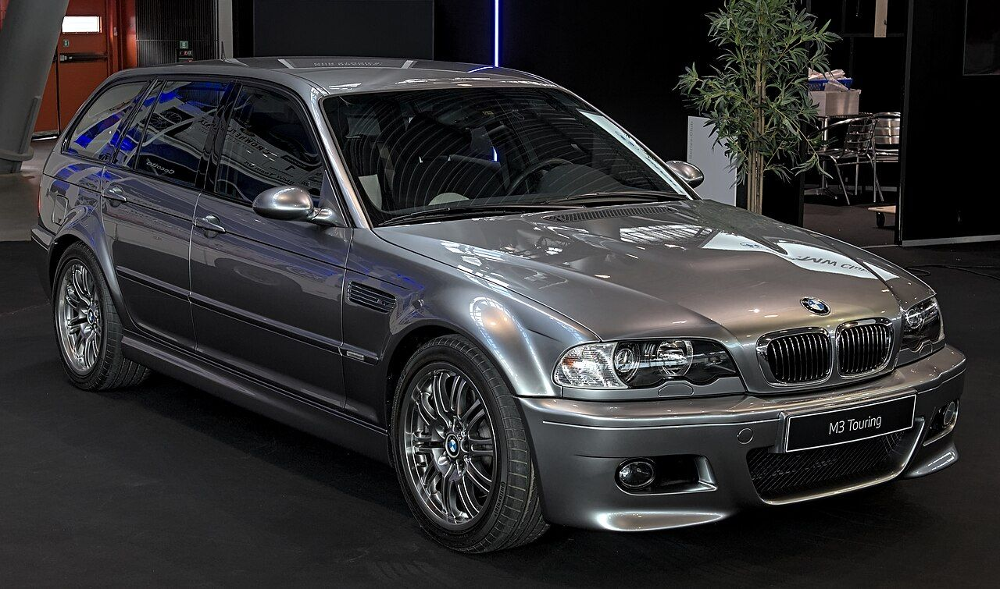

*Photo: The one BMW M built: the 2000 E46 M3 Touring at Retro Classics Stuttgart, February 2025. Alexander Migl, [CC BY-SA 4.0](https://creativecommons.org/licenses/by-sa/4.0/), via [Wikimedia Commons](https://commons.wikimedia.org/wiki/File:BMW_M3_%28E46%29_Touring_Retro_Classics_2025_DSC_7636.jpg).*

Jakob Polschak, then head of prototype building at BMW M, named the hard part: "One important thing we needed to demonstrate was that the rear doors of the standard production model could be reworked to adapt them to the rear wheel arches without the need for new and expensive tools" ([BimmerFile](https://www.bimmerfile.com/2016/09/28/m3-week-the-mythical-e46-m3-touring-is-real/)). BMW kept the flare off the door skins: it "decided against melding the rear wheel-arch sculpting into the door", and Petroyle's cars keep standard rear doors for that reason ([Autocar](https://www.autocar.co.uk/car-news/features/best-car-bmw-never-built-driving-sublime-e46-m3-touring)). Where the arch meets the rear door is still the trickiest junction on any conversion.

One finished conversion was bid to \$59,250 on Bring a Trailer without meeting its reserve ([Bring a Trailer, Aug 2024](https://bringatrailer.com/listing/2001-bmw-e46-m3-wagon/)); another sold for \$65,000 ([Built for Backroads, Sept 2025](https://www.builtforbackroads.com/listing/2004-bmw-325xit-touring-awd-s54-swap); an all-wheel-drive car with more than \$70,000 in it). A UK firm, Petroyle, plans 50 cars from £130,000 ([PistonHeads](https://www.pistonheads.com/news/ph-germancars/finally-an-e46-m3-touring-you-can-actually-buy/51036)).

### The recipe

Documented builds follow the same pattern.

1. **Buy one whole M3 donor.** Engine, gearbox, axle parts, brakes, modules and body panels arrive together and match, usually for less than buying them separately. A cheap convertible serves as well as a coupe; see [Choose the donor](#choose-the-donor).
2. **Move the running gear as assemblies:** the S54 with its 420G gearbox, the M3 front suspension and steering, and the rear axle with the M differential. The M3 rear axle bolts to the same four body points; one shop found "the bolts are the same" ([Tenza Motorsports – Supplying the S54 wagon with an M3 rear end (2021), 15:00](https://www.youtube.com/watch?v=GdCUQY-Xn-s&t=900s)). One UK builder dropped the donor's front subframe with the engine still on it ([PistonHeads](https://www.pistonheads.com/gassing/topic.asp?h=0&f=47&t=1655205)).
3. **Keep your Touring's body, interior, body wiring, EWS and keys.** An experienced builder told a first-timer: "You're better off keeping the Touring loom and modifying it… The difference in the two looms is just too big" ([PistonHeads](https://www.pistonheads.com/gassing/topic.asp?h=0&f=47&t=1623927)). The one build we found that fitted the M3's body loom had to move the Touring-only circuits (rear doors, opening rear glass, rear wiper and washer) into it ([PistonHeads](https://www.pistonheads.com/gassing/topic.asp?h=0&f=47&t=1655205)).
4. **Fit the M3 fuel system.** The S54 runs at 5 bar through the M3 filter-regulator, the M3 lines and the short M3 pipe set that joins them to the pump. Move the donor's whole in-tank set into your tank: pump, baffle, jet pump and left sender, BMW's own combination, which owners have fitted to non-M tanks, the same part as yours ([e46fanatics](https://www.e46fanatics.com/threads/will-an-m3-fuel-pump-fit-a-non-m-is-there-any-point-in-doing-this.903381/page-2)). Or fit the donor's whole tank, as several Touring builds did ([ThaChileanDude – Building an e46 m3 Wagon in 10 days (2024), 17:00](https://www.youtube.com/watch?v=iSgClonTiQg&t=1020s), [Calvin's Car Diary – What happened to my £200K E46 M3 Touring project (2025), 30:20](https://www.youtube.com/watch?v=WZaYROuG1jo&t=1820s), [PistonHeads](https://www.pistonheads.com/gassing/topic.asp?h=0&f=47&t=1655205)). Keeping your own pump is the fallback, and it needs an adapter nobody has documented. The pump's wiring stays as it is. See [Fuel system](#fuel-system) and [Fuel-pump control](#fuel-pump-control).
5. **Make the electronics agree.** The M3 engine harness and engine computer (DME) go in, with a few body-side wires moved. A vendor flashes the DME so it no longer needs the immobilizer handshake and writes your VIN into it. The M3 cluster gets a fresh memory chip carrying your VIN and then reads your true mileage from the light module. Keeping your Touring's own stability-control (DSC) unit is the documented route, and the steering-angle sensor is calibrated after the alignment. See [Electronics and coding](#deep-dive-electronics-and-coding).
6. **Do the metalwork.** Reinforce the rear subframe mounts and add the V-brace mounts a non-M body lacks, weld in an M3 trunk floor so the M3 muffler fits (new from BMW, or the donor's), weld M3 arch steel into the rear quarters (the donor's, or new BMW panels), and graft on the M3 front end. Reshaping the rear doors is optional.

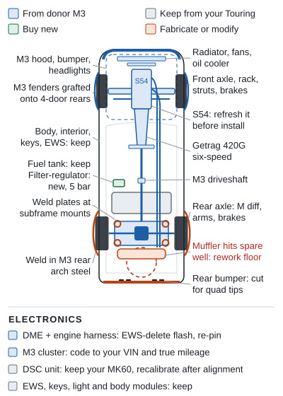 <!-- portrait -->

*Figure 1. Where every major part comes from. The rear arches grow because of the M3 rear wheels: the rear hub faces sit in the same place on both cars, but the M3's 9J ET26 wheel puts each rear tire 21 mm further out than a 325i wheel would sit, and the rim is an inch wider.*

### Why your car is a good start

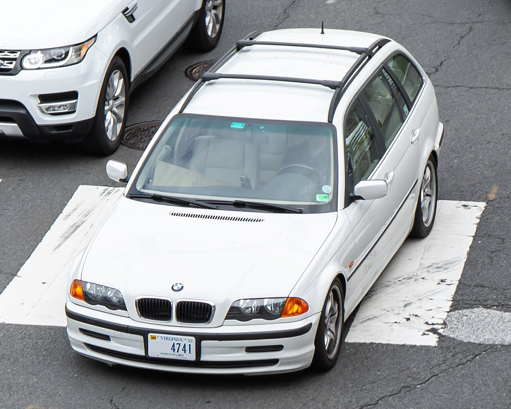

*Photo: The starting point: a pre-facelift E46 325i Touring. OWS Photography, [CC BY 4.0](https://creativecommons.org/licenses/by/4.0/), via [Wikimedia Commons](https://commons.wikimedia.org/wiki/File:BMW_325i_Touring_%28E46%29_Washington_DC_Metro_Area%2C_USA.jpg).*

- **Rear-wheel drive.** BMW's catalog lists one front subframe (front axle support 31111096902) for every rear-drive E46, M3 included; only the xi has its own ([ETK](https://bmwfans.info/parts-catalog/31111096902/)). Keeping all-wheel drive behind an S54 has needed the xi's own oil pan (the "330xi pan" is the same part, 11137519432) reworked around a single-stage M50-family pump, plus the 330xi six-speed and X3 differentials ([ETK](https://bmwfans.info/parts-catalog/11137519432/), [BimmerLife](https://bimmerlife.com/2022/07/04/a-perfect-one-car-solution-the-e46-m3-touring/)). On FCP Euro's S54 xi Touring the pump chain ground into that pan and wrecked the bottom end: "spun bearings, cracked rods, and a damaged crankshaft" ([FCP Euro, part 1](https://www.fcpeuro.com/blog/bmw-e46-m3xi-an-m3-powered-bmw-rally-wagon-ready-for-almost-anything)). Even converting an xi to rear drive adds the M3 front axle, an adapted gearbox crossmember and a complete MK60 ([325xi: rear drive or all-wheel drive](#325xi-rear-drive-or-all-wheel-drive)). You skip all of that.
- **Already a manual.** The pedal box, clutch master cylinder and clutch switch are in place, including the US (and Japan) wire that stops the car cranking unless the clutch is down ([clutch switch wiring](https://www.e46fanatics.com/threads/diy-manual-swap-clutch-pedal-sensor-wiring.1316805/)). BMW lists the same clutch master cylinder, slave cylinder and flex hose for your car and the M3. An automatic Touring would also need the manual pedals, a clutch line, the brake reservoir's sealed clutch outlet opened up and the gearbox section of the harness re-pinned; that last job caused one build's no-start ([Tracks and Trails – Attempting to drive my E46 M3 Touring for the first time (2026), 1:16:20](https://www.youtube.com/watch?v=pvR3ovRfQHg&t=4580s), [Tenza Motorsports – 5 things they don't tell you about S54 swaps (2021), 07:20](https://www.youtube.com/watch?v=-TXzg2Z8d7w&t=440s)).
- **Same platform.** The S54 swap into non-M E46s is well documented. After fitting a 2004 S54 to a 2000 323i, an MS42 car, one owner wrote: "I only had to re-pin the X60004 connector on few places, everything else is just plug and play" ([e46fanatics](https://www.e46fanatics.com/threads/s54-swap-wiring-information.1003871/)); an MS43 Touring also moves wires out of the E-box plug X6011, and an MS45.1 Touring adds wires to the cluster ([Harness and re-pinning](#harness-and-re-pinning)). Owners have bolted complete M3 rear subframes into non-M cars ([e46zone](https://www.e46zone.com/forum/topic/29209-e46-m3-lsd-into-330/)). Small differences still catch people out: sensors that move to the other side of the engine bay, wheel-speed sensor plugs, the Sport button. The [Parts list](#parts-list) flags each one.
- **Same floor and inner arches.** BMW lists the same rear axle carrier panel (41117000246) and trunk floor for the US 325i Touring and sedan, so sedan-pattern reinforcement plates should fit ([ETK: panel](https://bmwfans.info/parts-catalog/41117000246/), [ETK: Touring floor](https://bmwfans.info/parts-catalog/E46-Touring/USA/325i-M54/L-N/browse/bodywork/mounting_parts_for_trunk_floor_panel/), [ETK: sedan floor](https://bmwfans.info/parts-catalog/E46-Sedan/USA/325i-M54/L-N/browse/bodywork/mounting_parts_for_trunk_floor_panel/)). The inner half of the rear wheelhouse (41148231757/758) is the same part on your Touring and the M3 ([ETK](https://bmwfans.info/parts-catalog/41148231757/)).
- **A sound shell saves the most time.** On the UK builds, rust repair rather than the swap set the pace: Redish Motorsport called cutting out rust "the lengthiest process of this build" ([Autoalex Cars – How to build an E46 M3 Touring, part 3 (2023), 20:00](https://www.youtube.com/watch?v=cwbRDG7XHa8&t=1200s)).

### If your car is a 325xi

The owner once called this car a "325x", so decode the VIN before anything else ([how to tell an xi](#how-to-tell-an-xi)). A 325xi is all-wheel drive, and that changes the front half of the plan. BMW gave it its own front frame rails, strut towers and widened tunnel, its own front subframe and steering joint, a transfer case, an oil pan with a tube through it for the right front shaft, and a Bosch DSC 5.7 in place of the Teves MK60 this guide keeps ([BMW ST040](https://archive.org/download/BMWTechnicalTrainingDocuments/ST040%202001%20System%20Diagnosis/7%20E46%204wd%202010-24-00.pdf), [ETK](https://bmwfans.info/parts-catalog/41007037635/)). Behind the front seats it's a 325i Touring, so the floor, arches, rear-axle mounts and fuel system follow the guide.

You have two routes:

- **Convert it to rear drive: our recommendation.** Hard but feasible. Fit the donor's whole front axle, the M3 lower steering joint with its flexible coupling, the M3 gearbox crossmember on an adapter and the complete MK60 system, for about \$0–\$1,500 more in parts with a donor built from 09/2002 (\$1,000–\$3,000 with an earlier one) and 4–8 more weekends (our estimate).
- **Keep all-wheel drive only if all-wheel drive is the point.** Very hard: it needs an oil system BMW never made, the 330xi six-speed and a matched pair of differentials, and one of the two US cars that did it wrecked its S54's bottom end through the oil system.

Both routes, with parts, checks, coding and the documented xi builds, are in [325xi: rear drive or all-wheel drive](#325xi-rear-drive-or-all-wheel-drive).

### How hard each job is

| Job | Difficulty | Why |
|---|---|---|
| Engine and gearbox swap | Moderate | Same platform; heavy but bolt-in. One shop rated its S54 Touring swap about 7.5 out of 10, mostly for the labor ([Tenza Motorsports – Building an E46 M3 wagon is far more complicated (2021), 01:40](https://www.youtube.com/watch?v=O63Y52j-4PY&t=100s)) |
| Front and rear axle transplant | Moderate | Mostly bolt-on M3 parts |
| S54 refresh (rod bearings, VANOS, valves) | Moderate to hard | Precise work, special tools, a clean bench. Plan 3–7 days for a first rod-bearing job ([Paul Vo – Rod bearing installation and torque procedure (2017), description](https://www.youtube.com/watch?v=O345BKC8EkM)) |
| DSC and brakes | Moderate | Keeping your Touring's DSC unit is the documented route. One S54 Touring has run an M3 MK60 with M Track since 2022, but its owner hasn't published how it was coded ([NAM3](https://nam3forum.com/forums/forum/special-interests/coding-tuning/172815-flashing-the-mk60-with-zcp-software/page2), [NAM3 – Black & Tan 332iT #185](https://nam3forum.com/forums/forum/main-forum/member-build-journals/195928-black-tan-332it/page13)) |
| Fuel system | Moderate | Moving the donor's in-tank set into your tank and fitting the M3 pipe set, lines and filter-regulator, then pressure and delivery tests with the pump on a bypass ([Test the fuel system](#test-the-fuel-system)) |
| Cooling and A/C | Moderate; the A/C service is a shop job | The M3 radiator, fans and oil cooler bolt to your radiator supports, but the expansion tank needs the M3's brackets welded on or copied with rivnuts, the fan plug X82 has to reach the M3's pusher fan, and the bleed needs the ignition on. A certified shop recovers and recharges the A/C ([Cooling and oil cooler](#cooling-and-oil-cooler), [Air conditioning](#air-conditioning)) |
| Rear subframe mount reinforcement | Hard | Welding plate to a thin floor, much of it overhead. BimmerWorld recommends an experienced, professional shop ([BimmerWorld](https://www.bimmerworld.com/About-Us/E46-Rear-Subframe-Floor-Reinforcement-Install/)); one builder who did it himself concluded "take it to a shop" ([Tracks and Trails – Fixing the weakest part of my E46 Touring (2025), 13:20](https://www.youtube.com/watch?v=t4CtY_W3vpU&t=800s)) |
| Electronics and coding | Hard | Re-pinning connectors, the immobilizer (usually bought as a service), cluster EEPROM work, DSC coding |
| Floor and exhaust | Hard | Drilling out the spare-wheel well and plug-welding the M3 trunk floor in at every factory spot weld, plus the V-brace mounts and two M3 muffler brackets; the stock M3 exhaust then bolts up |
| Front fenders | Hard to graft; moderate with carbon Touring fenders | Carbon fenders took a few hours of fiddling per side on one build and two days of front-end alignment on another ([Tracks and Trails – What it really takes to build an E46 M3 Touring (2026), 04:00](https://www.youtube.com/watch?v=nADBRfX9DqY&t=240s), [M3projekts – Ep4, front-end alignment (2023), 01:00](https://www.youtube.com/watch?v=_sZHTK-Xae4&t=60s)) |
| Rear arches | Very hard | Panel grafting, inner arches, filler work; the inner wheelhouse joint and the door junction took the most time on camera ([M346 Projects – Pt 14, M3 body work (2024), 27:20](https://www.youtube.com/watch?v=4_LqrbAlNmw&t=1640s)) |
| Paint | Shop job for most | A full respray is normal after this much metalwork; one paint shop kept the car four months ([M346 Projects – Pt 25, paint reveal (2025), 00:00](https://www.youtube.com/watch?v=1AjKKQisrGE&t=0s)) |

### Decide these before you spend money

| Decision | Options | This guide's default | Details |
|---|---|---|---|
| **Donor** | Coupe or convertible; manual or SMG; build date; Competition package | A running manual car, same model year as your Touring or newer; built from 09/2002 if you want the option of using its DSC | [Choose the donor](#choose-the-donor) |
| **A 325xi's drive** | Convert it to rear drive with the donor's front axle, the M3 lower steering joint, the M3 gearbox crossmember on an adapter and a complete MK60 system; or keep all-wheel drive with the 330xi six-speed, a matched pair of diffs and your xi oil pan reworked around another pump | Convert to rear drive, with a donor built from 09/2002 of your xi's model year or newer | [325xi: rear drive or all-wheel drive](#325xi-rear-drive-or-all-wheel-drive) |
| **DSC and brakes** | Keep your Touring's MK60 DSC unit, booster and master cylinder; or fit the donor's MK60 with its master cylinder | Keep your Touring's. One S54 Touring cleared its DSC light only by refitting its own 325i unit, though its M3 unit got only a blank coding file and a PA-Soft reset ([e46fanatics](https://www.e46fanatics.com/threads/m3-cluster-swap-dsc-light.1260275/)); another has run an M3 MK60 since 2022, with its coding unpublished ([NAM3](https://nam3forum.com/forums/forum/special-interests/coding-tuning/172815-flashing-the-mk60-with-zcp-software)). An M3 MK60 codes only from a session vehicle order with an M3 type key and a date of 09/2002 or later, then needs INPA's initialisation ([manual](WIRING-AND-CODING.md#session-5-dsc-coding-and-vin)) | [DSC, brakes and steering angle](#dsc-brakes-and-steering-angle) |
| **Immobilizer** | EWS-delete flash of the donor DME with your VIN written in; a DME a vendor has virginized, synced to your EWS, since a used DME keeps its first car's code table for good ([BMW ST051](https://archive.org/download/BMWTechnicalTrainingDocuments/ST051%20Body%20Electronics%20I%20%28Archive%201%29/05%20EWS.pdf)); or the donor's EWS and keys | Delete plus VIN, bought as a service, unless your state checks DME software: California's Smog Check fails modified software ([BAR](https://www.bar.ca.gov/pdf/bag/202107/bar-ois-modified-software.pdf)) | [Immobilizer (EWS)](#immobilizer-ews), [Registration and legal](#registration-and-legal-us) |
| **Cluster** | M3 cluster on a new EEPROM chip carrying your VIN, done yourself or by a cluster service | Either; the cluster then reads your true mileage from the light module. It keeps the donor's vehicle order for good, because BMW's coding data accepts an M3 cluster only with an M3 order; your light module holds your car's ([BMW coding data](https://archive.org/details/sp-daten-v-32)) | [Instrument cluster and mileage](#instrument-cluster-and-mileage) |
| **Fuel** | The donor's in-tank set in your tank, the donor's whole tank, or your own pump if it passes the 5-bar delivery test with margin; pump wiring unchanged or the M3 pump module | The donor's in-tank set (pump, baffle, jet pump and left sender) in your tank, with the M3 pipe set, lines and filter-regulator; pump wiring unchanged | [Fuel system](#choose-the-pump-route), [Fuel-pump control](#fuel-pump-control) |
| **Front fenders** | Graft genuine M3 fenders onto the rear strips of your 4-door fenders, or buy carbon Touring fenders | Your choice | [Front end on a 4-door body](#front-end-on-a-4-door-body) |
| **Rear-arch steel** | The donor's quarters, coupe or convertible; or new BMW M3 convertible quarters (41357894541/542) with their inner lateral trim panels (41217894553/554), about \$2,230 per side at one US dealer (October 2026), so no donor steel goes into your body | Ask the RMV Title Division first. If grafting donor steel would bring a "reconstructed" title, or the donor's arches are rotten, buy new; otherwise use the donor's. Check one new inner panel against an M3 skin before you rely on its flange | [Rear arches and doors](#rear-arches-and-doors), [Massachusetts](#massachusetts) |
| **Rear doors** | Leave them standard and blend the flare in before the shut line, as BMW did; flare the door's trailing edge; or carry the flare across and re-cut the gap. At the shut line the M3 surface stands about 11–20 mm proud of the stock door (our estimate) | Standard doors: BMW's way, with no door metalwork and the factory gaps kept | [Rear doors](#rear-doors) |
| **Floor and exhaust** | Fit a new BMW M3 trunk floor; graft the donor's M3 floor; weld in a flat panel, or bond in a carbon M3-shape floor as one S54 Touring did ([NAM3 – Black & Tan 332iT #724 (2026)](https://nam3forum.com/forums/forum/main-forum/member-build-journals/195928-black-tan-332it/page49)); or keep the spare-wheel well and fit a muffler in the Touring's position, such as a US E36 M3 muffler, giving up the M3's rear-muffler layout ([e46fanatics](https://www.e46fanatics.com/threads/s54-conversion-muffler-shootout.1266239/), [NAM3 – Kaiv's first S54 Touring #14](https://nam3forum.com/forums/forum/main-forum/member-build-journals/4337-obioban-s-2004-jr-black-m3-wagon)) | A new BMW M3 floor (41127895619) with its front reinforcement (51717894229), \$763.61 and \$88.22 at BMWPartsDeal (October 2026): new steel that mates with the same rails, and no donor body steel for Massachusetts' "reconstructed" title question. The donor's floor is the fallback | [Exhaust and the spare-wheel well](#exhaust-and-the-spare-wheel-well) |
| **Springs, dampers and wheels** | M3 struts and dampers with a stiffer rear spring, or M3-fitment coilovers; 18-inch Style 67 or 19-inch wheels | M3 coupe struts and springs in front; at the rear, M3 dampers with springs about 7–9% stiffer than an M3 coupe's (our estimate), or M3 coilovers with a stiffer rear spring. Choose before the arch mock-up: moved-over M3 coupe springs sat one Touring low enough to rub ([Tenza Motorsports – ECS coilover install (2022), 00:40](https://www.youtube.com/watch?v=Sit-SmfU-9k&t=40s)) | [Suspension for Touring weight](#springs-dampers-and-anti-roll-bars), [Wheels, track and offsets](#wheels-track-and-offsets) |
| **Cooling and A/C** | Your plain heater valve with the CSL's hose, or the M3's pump valve wired and coded; the M3's viscous and pusher fans, or a single electric fan; your A/C lines with the donor's pressure hose | Your plain valve with hose 64212282548, no wiring. The M3 radiator, viscous fan and pusher fan, as BMW fitted them, with your fan plug X82 reaching the pusher; the pusher needs the M3 bumper's ducting. Keep your condenser and lines, fit the donor's pressure hose 64536902681, and keep the M54's old compressor until the A/C is charged: BMW sets the new oil by what it held | [Cooling and oil cooler](#cooling-and-oil-cooler), [Air conditioning](#air-conditioning) |
| **Shop or DIY** | Reinforcement welding, paint, A/C, alignment, DME flash, cluster, exhaust | Decide now: shop lead times set your calendar | [Shop briefs](#shop-briefs) |

### Documented builds compared

This table lists the E46 Tourings we found that were converted to M3 specification and documented well enough to compare, with BMW's own 2000 prototype first as the reference. Rows are grouped by how far each build went (full M3 body, body only, or an S54 swap that kept the Touring body) and run oldest first; problems are noted in the column where they happened, and "not stated" means the sources don't say. DME is the engine computer, EWS the immobilizer and DSC the stability control; the Exhaust column also covers the trunk floor and rear bumper.

| Build | Base car | Donor | DME, EWS and harness | DSC and brakes | Fuel | Rear arches and doors | Front end | Subframe reinforcement | Exhaust | Time and cost | Sources |
|---|---|---|---|---|---|---|---|---|---|---|---|
| **Reference** | | | | | | | | | | | |
| BMW M prototype, Germany, built 2000, shown 09/2016 | Touring off the normal assembly line | None: factory M parts; S54, six-speed manual | not stated | not stated | not stated | Wider rear wheel housings; flare ends at standard rear doors | M3 bonnet with power dome, bigger intakes, side gills, wider front arches | not stated | Four-pipe M3 exhaust | "Minimal manual follow-up work" after the line | [BMW M](https://www.bmw-m.com/en/topics/magazine-article-pool/bmw-m3-touring-concept-e46.html), [BimmerFile](https://www.bimmerfile.com/2016/09/28/m3-week-the-mythical-e46-m3-touring-is-real/), [Rush](https://www.rushmagazine.co.uk/post/e46-bmw-m3-touring-concept), [Autocar](https://www.autocar.co.uk/car-news/features/best-car-bmw-never-built-driving-sublime-e46-m3-touring) |
| **Full M3 body** | | | | | | | | | | | |
| Kitchski's shop (PistonHeads), a customer car, before 09/2016 | 320i Touring (MY2000), automatic, left-hand drive | 2005 M3 CS, SMG, right-hand drive, repaired Cat C, about 55k on the clock | Touring loom kept and modified | ABS-unit plug spliced (different connector) | not stated | not stated ("the bodykit doesn't fit. At all") | Front wings "the big headache" | not stated | M3 rear bumper widened about 35 mm in the center; tip cut-outs moved | He puts such a build at £30–35k | [PistonHeads p1](https://www.pistonheads.com/gassing/topic.asp?h=0&f=47&t=1623927), [p2](https://www.pistonheads.com/gassing/topic.asp?h=0&f=47&t=1623927&i=20), [p3](https://www.pistonheads.com/gassing/topic.asp?h=0&f=47&t=1623927&i=40) |
| E91M3 (PistonHeads), UK, 09/2016–01/2017 | 2005 320d Touring, bought with an engine fault | Rear half of a Cat C 2005 M3 convertible, for its panels | Not reached; advised to keep the Touring loom | not reached | not reached | New BMW quarters and boot floor were about £2k, so he planned to cut the convertible's | M3 bonnet, front bumper, mirrors and skirts bought | not reached | not reached | Abandoned after about three months; parts sold, car exported | [PistonHeads p1](https://www.pistonheads.com/gassing/topic.asp?h=0&f=47&t=1623927), [p3](https://www.pistonheads.com/gassing/topic.asp?h=0&f=47&t=1623927&i=40), [p4](https://www.pistonheads.com/gassing/topic.asp?h=0&f=47&t=1623927&i=60), [p5](https://www.pistonheads.com/gassing/topic.asp?h=0&f=47&t=1623927&i=80) |
| yavz (PistonHeads), UK, 02/2017–08/2022 | 318i Touring M Sport, 57k on the clock | His own M3 coupe, SMG; converted to manual in 2021 | Donor's engine and body looms with its DME; Touring-only circuits pinned in; started first time | Stock M3 brakes rebuilt; DSC not stated | M3 tank ("the pumps are different") | Donor's M3 quarters welded in; rear doors bent to match by a body shop | Wings made from M3 wings; OEM front bumper | Plates welded | M3 boot floor; donor's exhaust bracket welded on; Touring bumper's dip welded into the M3 bumper | Stalled for years (parts sold); painted 09/2021 | [PistonHeads p1](https://www.pistonheads.com/gassing/topic.asp?h=0&f=47&t=1655205), [p2](https://www.pistonheads.com/gassing/topic.asp?h=0&f=47&t=1655205&i=20), [p3](https://www.pistonheads.com/gassing/topic.asp?h=0&f=47&t=1655205&i=40), [p4](https://www.pistonheads.com/gassing/topic.asp?h=0&f=47&t=1655205&i=60), [p6](https://www.pistonheads.com/gassing/topic.asp?h=0&f=47&t=1655205&i=100) |
| JMCCRNA (e46fanatics), 2018; mechanical work by a performance shop, body by a separate shop | 2003 xi Touring with a blown engine; made rear-drive (the xi gearbox mount needed a custom bracket) | M3, body style not stated | not stated | M3 DSC module; the M3 wheel-speed sensors' plugs mated with the xi harness ("plugged right in"), whose Bosch sensors use the same blue housings; wiring not published | not stated | Quarters done; rear doors left flat "to follow the BMW prototype" | M3 panels and mirrors; Touring trim with M3 side markers | Reinforced (kit not stated) | Euro exhaust and the custom gearbox brace clashed | Started 10/2018; to paint 11/2018 | [e46fanatics](https://www.e46fanatics.com/threads/m3-touring-project.1240087/) |
| Kyle and Maggie Baca, Virginia (US), 12/2018–2022; body by Mid-Atlantic Customs | 2004 325xi Touring, 5-speed manual, 114,000 mi; kept AWD: a machined 330xi oil pan (the same part as the 325xi's own, 11137519432: [ETK](https://bmwfans.info/parts-catalog/11137519432/)) with an M50-family oil pump and an S52 windage tray, X3 3.91 diffs front and rear (the X3 2.5i's ratio), NV 124 transfer case, new GKN front shafts | Bought separately: 76,000-mi S54; 330xi six-speed (BimmerLife; the sale listing says "420G", but BMW made no all-wheel-drive 420G: [ETK](https://bmwfans.info/parts-catalog/23002229721/)) | Kassel tune; M3 cluster set to the car's mileage | M3 front calipers, 330i rear | M3 fuel system, S54 pump, tank baffles | M3 quarter panels welded in; doors not stated | OEM M3 aluminium hood, fenders, CSL bumper, mirrors | TMS plates; reinforced sway-bar mounts | Spare well deleted; custom 3-inch stainless exhaust | 280 h of mechanical work; over \$70k; listed at \$65k and sold 09/2025 | [BimmerLife](https://bimmerlife.com/2022/07/04/a-perfect-one-car-solution-the-e46-m3-touring/), [Built for Backroads](https://www.builtforbackroads.com/listing/2004-bmw-325xit-touring-awd-s54-swap) |
| Calvin's Car Diary with VRS Northampton, UK, 2019– | 2003 330d Touring that came with a botched M3 wing graft | 2003 M3 (a coupe in PT4, a convertible in the 2026 update) | ECU Master standalone for a forged turbo S54 | New BMW brake lines bent to shape; DSC not stated | Diesel tank out; M3 tank refurbished; rot behind it cut out | Donor quarters grafted; a section welded into the door so it flares out | M3 front with the rear of the Touring wing; gill moved forward | Some kit parts don't fit: the Touring has no rear-seat bulkhead | Donor boot floor; custom 3½-inch oval pipe | Not running 06/2026; "well in excess of £100,000" | [PT4 (2020), 02:00](https://www.youtube.com/watch?v=qKuvKS2fR2c&t=120s), [PT5 (2020), 07:20](https://www.youtube.com/watch?v=KzgXjYYyaL0&t=440s), [PT6 (2020), 10:00](https://www.youtube.com/watch?v=tJdxzzwIX1E&t=600s), [PT9 (2020), 02:20](https://www.youtube.com/watch?v=-BMrhOr8fdg&t=140s), [PT9, 07:00](https://www.youtube.com/watch?v=-BMrhOr8fdg&t=420s), [PT14 (2024), 16:40](https://www.youtube.com/watch?v=wfcw2mrhVlg&t=1000s), [PT15 (2025), 30:00](https://www.youtube.com/watch?v=WZaYROuG1jo&t=1800s), [PT15, 37:20](https://www.youtube.com/watch?v=WZaYROuG1jo&t=2240s), [2026 update, 18:40](https://www.youtube.com/watch?v=w_L72YANRdU&t=1120s), [2026 update, 36:00](https://www.youtube.com/watch?v=w_L72YANRdU&t=2160s) |
| A San Diego owner (US), filmed 2020–23 | not stated | not stated | not stated; passed California's BAR referee after about five visits | Porsche 996/Boxster S front calipers on CSL rotors | not stated | First quarters stopped short of the door; redone with new M3 quarters | 2M fenders; replica CSL bumper; M3 mirrors (bases and doors cut) | not stated | M3 rear bumper cut to clear the hatch | not stated | [Driving Cody (2020), 02:20](https://www.youtube.com/watch?v=7pAmQ4KDDYM&t=140s), [04:00](https://www.youtube.com/watch?v=7pAmQ4KDDYM&t=240s), [06:20](https://www.youtube.com/watch?v=7pAmQ4KDDYM&t=380s), [07:00](https://www.youtube.com/watch?v=7pAmQ4KDDYM&t=420s), [Bimmer INVASION (2023), 10:40](https://www.youtube.com/watch?v=GfxQDkaxeN8&t=640s), [11:20](https://www.youtube.com/watch?v=GfxQDkaxeN8&t=680s) |
| puma1824 (US owner), built by M3Projekts in Hungary, 12/2021–03/2023 | US 2003 325iT, about 145k mi; gearbox not stated | US 2003 M3 convertible, about 155k mi | not stated; tuned later (2024) | M3 MK60 and speed sensor; big brake kit added later | M3 fuel tank | Welded steel M3 arches carried onto the rear doors; steel source not stated | Front fenders made by M3Projekts from M3 and Touring parts (from photos); a second set became its mould | Rear subframe and floor reinforced | M3 floor pan and stock M3 muffler; rear bumper modified | 14 months to first drive (body shop 03–05/2022, paint 07–10/2022); shipping both cars about \$2k; costs not posted | [e46fanatics](https://www.e46fanatics.com/threads/project-e46-m3-touring-conversion-to-europe-and-back.1300891/); NAM3 [p2](https://nam3forum.com/forums/forum/main-forum/member-build-journals/155763-e46-m3-touring-conversion-to-europe-and-back/page2), [p4](https://nam3forum.com/forums/forum/main-forum/member-build-journals/155763-e46-m3-touring-conversion-to-europe-and-back/page4), [p5](https://nam3forum.com/forums/forum/main-forum/member-build-journals/155763-e46-m3-touring-conversion-to-europe-and-back/page5), [p6](https://nam3forum.com/forums/forum/main-forum/member-build-journals/155763-e46-m3-touring-conversion-to-europe-and-back/page6), [p8](https://nam3forum.com/forums/forum/main-forum/member-build-journals/155763-e46-m3-touring-conversion-to-europe-and-back/page8), [p10](https://nam3forum.com/forums/forum/main-forum/member-build-journals/155763-e46-m3-touring-conversion-to-europe-and-back/page10), [p14](https://nam3forum.com/forums/forum/main-forum/member-build-journals/155763-e46-m3-touring-conversion-to-europe-and-back/page14), [p16](https://nam3forum.com/forums/forum/main-forum/member-build-journals/155763-e46-m3-touring-conversion-to-europe-and-back/page16), [p17](https://nam3forum.com/forums/forum/main-forum/member-build-journals/155763-e46-m3-touring-conversion-to-europe-and-back/page17) |
| Autoalex Cars with Redish Motorsport, UK, 03/2023–05/2025 | 330i Touring Individual (UK), 204,000 mi, already with a Quaife LSD | Imola Red M3 coupe, manual, 190,000 mi, £9,250; its gearbox later balked on track | not stated | EBC big brake kit; DSC not stated | not stated | M3 panels welded on (the donor's inner arches had rotted out); door junction still "work in progress" in 03/2024 | Back to pre-facelift: M3 bumper, bonnet, lights; carbon wings from Hungary | Redish V3 plates tied to the chassis legs; new V-brace boxes made | New BMW M3 boot floor (about £430 + VAT in 2023) for the quad exhaust | About £70,000; a second engine was needed | [Donor (2023), 00:40](https://www.youtube.com/watch?v=elovkaAuNU0&t=40s), [Pt 1 (2023), 07:40](https://www.youtube.com/watch?v=RyoFFLppseE&t=460s), [Pt 3 (2023), 04:00](https://www.youtube.com/watch?v=cwbRDG7XHa8&t=240s), [Pt 3, 04:40](https://www.youtube.com/watch?v=cwbRDG7XHa8&t=280s), [Pt 3, 05:00](https://www.youtube.com/watch?v=cwbRDG7XHa8&t=300s), [Pt 3, 13:20](https://www.youtube.com/watch?v=cwbRDG7XHa8&t=800s), [Pt 3, 14:20](https://www.youtube.com/watch?v=cwbRDG7XHa8&t=860s), [Update (2024), 03:40](https://www.youtube.com/watch?v=vAHWkcGu8ek&t=220s), [Update, 09:00](https://www.youtube.com/watch?v=vAHWkcGu8ek&t=540s), [Finale (2025), 01:40](https://www.youtube.com/watch?v=N8pdzFoVu9k&t=100s), [Finale, 03:40](https://www.youtube.com/watch?v=N8pdzFoVu9k&t=220s), [Finale, 13:40](https://www.youtube.com/watch?v=N8pdzFoVu9k&t=820s), [Finale, 18:40](https://www.youtube.com/watch?v=N8pdzFoVu9k&t=1120s) |
| M346 Projects, Georgia (US), 07/2023–10/2025; metalwork by a visiting friend | 2004 base-model Touring, automatic, blown engine, about 160,000 mi, no rust | 2003 M3 convertible, SMG (kept) | Donor body-harness circuits re-pinned into the wagon; his "converted" DMEs never showed readiness monitors | not stated | Regulator leaked at first start (bad O-rings) | Convertible's quarters and inner tubs welded; accident-curled lips rolled; door edges flared with a 2x4, gap rebuilt with panel bond | M3Projekts carbon fenders; M3 mirrors on M3Projekts bases | Plates bonded with 3M panel bond, not welded | Donor trunk floor and extra hangers; used CSL silencer (\$400); catless headers (emissions caution) | 27 months, about four of them at the paint shop | [Pt 1 (2023), 02:00](https://www.youtube.com/watch?v=YqM2rQw1HQI&t=120s), [Pt 1, 06:40](https://www.youtube.com/watch?v=YqM2rQw1HQI&t=400s), [Pt 8 (2024), 15:00](https://www.youtube.com/watch?v=ua4AAA5sWOw&t=900s), [Pt 9 (2024), 02:40](https://www.youtube.com/watch?v=T-JM2xqxuv4&t=160s), [Pt 13 (2024), 05:40](https://www.youtube.com/watch?v=4Q3PxGuJyxI&t=340s), [Pt 14 (2024), 00:40](https://www.youtube.com/watch?v=4_LqrbAlNmw&t=40s), [Pt 14, 09:20](https://www.youtube.com/watch?v=4_LqrbAlNmw&t=560s), [Pt 14, 15:20](https://www.youtube.com/watch?v=4_LqrbAlNmw&t=920s), [Pt 14, 23:00](https://www.youtube.com/watch?v=4_LqrbAlNmw&t=1380s), [Pt 14, 30:20](https://www.youtube.com/watch?v=4_LqrbAlNmw&t=1820s), [Pt 14, 58:40](https://www.youtube.com/watch?v=4_LqrbAlNmw&t=3520s), [Pt 18 (2024), 02:20](https://www.youtube.com/watch?v=IBAqCYQuEzs&t=140s), [Pt 21 (2024), 26:20](https://www.youtube.com/watch?v=a7HeYZ8Ctow&t=1580s), [Pt 22 (2025), 02:00](https://www.youtube.com/watch?v=c6PDOLC94K0&t=120s), [Pt 22, 04:00](https://www.youtube.com/watch?v=c6PDOLC94K0&t=240s), [Headers (2024), 10:20](https://www.youtube.com/watch?v=pENUiROUII0&t=620s), [Pt 25 (2025)](https://www.youtube.com/watch?v=1AjKKQisrGE&t=0s), [Pt 26 (2025), 43:20](https://www.youtube.com/watch?v=m-WKkTAKpws&t=2600s) |
| M3projekts (Attila Csontos), Hungary, 08–12/2023 | €800 318d Touring (M47 diesel), manual | £7,000 Cat D UK M3 convertible, manual | Touring harness converted to six-cylinder by an auto-electrician; first start the same day; EWS route not stated | M3 MK60 and the M3 sensor under the driver's seat, on the car's own connector | not stated | Both M3 quarters planned; not shown by Ep 8 | Whole M3 front fits except the fenders (plus brackets); his carbon fenders took two days to align | Usual RACP cracks found at two mounts | M3 trunk floor welded in at a body shop | Cars cost €800 and £7,000 | [Ep1 (2023), 05:00](https://www.youtube.com/watch?v=hj3YoD1i6F4&t=300s), [Ep2 (2023), 16:20](https://www.youtube.com/watch?v=d5Sv9wz2X7A&t=980s), [Ep3 (2023), 05:00](https://www.youtube.com/watch?v=TT0sd2JB5dY&t=300s), [Ep3, 08:00](https://www.youtube.com/watch?v=TT0sd2JB5dY&t=480s), [Ep3, 09:30](https://www.youtube.com/watch?v=TT0sd2JB5dY&t=570s), [Ep4 (2023), 01:00](https://www.youtube.com/watch?v=_sZHTK-Xae4&t=60s), [Ep5 (2023), 20:00](https://www.youtube.com/watch?v=Ipbjt8S2c2g&t=1200s), [Ep6 (2023), 01:43](https://www.youtube.com/watch?v=YfJyE9DU5OE&t=103s), [Ep6, 02:00](https://www.youtube.com/watch?v=YfJyE9DU5OE&t=120s), [Ep6, 08:30](https://www.youtube.com/watch?v=YfJyE9DU5OE&t=510s), [Ep6, 17:02](https://www.youtube.com/watch?v=YfJyE9DU5OE&t=1022s), [Ep7 (2023), 01:00](https://www.youtube.com/watch?v=ihD3-3ZlBjI&t=60s), [Ep8 (2023), 14:00](https://www.youtube.com/watch?v=5xBcY33CPCM&t=840s) |
| SOS Customz (US body shop) for the solspeeds wagon, 2023 | not stated (an S54-swapped wagon) | not stated | Tried moving the M3's EWS, key and steering lock across to get it to start | not stated | not stated | M3 quarters joggled and plug-welded; inner structure lifted; door edges hammered out, no welding | Factory fenders kept at the mounts and door gap; M3 flare and gill spliced in | not stated | Trunk floor redone (method not stated); Touring center welded into the M3 bumper | About 30 days to paint, two people at 40–50 h a week | [SOS Customz (2023), 02:00](https://www.youtube.com/watch?v=L8m9gEOklVY&t=120s), [05:00](https://www.youtube.com/watch?v=L8m9gEOklVY&t=300s), [14:00](https://www.youtube.com/watch?v=L8m9gEOklVY&t=840s), [15:00](https://www.youtube.com/watch?v=L8m9gEOklVY&t=900s), [21:00](https://www.youtube.com/watch?v=L8m9gEOklVY&t=1260s), [26:00](https://www.youtube.com/watch?v=L8m9gEOklVY&t=1560s), [solspeeds Pt 4 (2023), 04:20](https://www.youtube.com/watch?v=xkRHbKlNzJU&t=260s) |
| Seller in Laguna Hills, California; auctioned on Bring a Trailer 08/2024 | 2001 325xi Touring, made rear-drive | 2001 M3: rebuilt S54 with CSL-style airbox, six-speed, DME, subframes, axles, diff | Donor DME; EWS route not stated. The donor cluster wasn't set to the car's mileage ("True mileage is unknown"), and the seller registered the car in Montana because "The CSL intake and tune won't pass CA SMOG" | Porsche 996 calipers; DSC route not stated (a 2001 donor has the MK20; our inference) | not stated | Fiberglass rear arches from 2M Autowerks, San Diego (seller) | Donor hood, front bumper and headlights; fiberglass front fenders from 2M Autowerks (seller) | Plate welded in; custom brace across the xi tunnel (seller) | Donor M3 spare-tire floor, for the muffler and charcoal canister | Bid to \$59,250, reserve not met (BaT, 20 Aug 2024) | [Bring a Trailer](https://bringatrailer.com/listing/2001-bmw-e46-m3-wagon/), [BMWBlog](https://www.bmwblog.com/2024/08/14/e46-bmw-m3-touring-on-bring-a-trailer/), [Motor1](https://www.motor1.com/news/730222/bmw-e46-m3-wagon-for-sale/) |
| Sloan Motor Cars, Connecticut (US), for sale 11/2024 | 2004 325i Touring, 65,000 mi | not stated (S54 and Getrag six-speed fitted) | Kassel tune; EWS route not stated | not stated | not stated | OEM metal flares grafted on front and rear | OEM front bumper and headlights | not stated | Catless headers (emissions caution), CSL mufflers, quad tips under a modified bumper; 3.73 diff | 3,000 mi since the conversion; price on request | [BMWBlog](https://www.bmwblog.com/2024/11/11/custom-e46-m3-touring-wagon-s54-build/) |
| Renner (US), filmed by Larry Chen, 03/2025 | 2002 Touring (per the VIN shown) | A running M3, cut up | not stated | not stated | not stated | M3 quarters contoured to the door; inner quarter and structure made in metal | Carbon front fenders | not stated | New M3 floor with the spare tub cut out and quad brackets; rear bumper made from two | not stated; claims a California-legal route, none shown | [Larry Chen (2025), 01:20](https://www.youtube.com/watch?v=YM2gyQOaJCk&t=80s), [03:00](https://www.youtube.com/watch?v=YM2gyQOaJCk&t=180s), [05:20](https://www.youtube.com/watch?v=YM2gyQOaJCk&t=320s), [07:20](https://www.youtube.com/watch?v=YM2gyQOaJCk&t=440s) |
| Tracks and Trails, Ontario (Canada), 06/2025–; DIY, his first welding project | 2004 325i Touring (ex-Las Vegas), automatic, M54 | 2002 M3, manual, 240,000 km (body style not stated); the rebuilt S54 showed metal at its first oil change | DME file sent away for an EWS delete; clutch switch wired to EWS and DME; automatic gearbox plugs caused a no-fuel no-start | not stated | One of the M3 tank's prongs broke, so the M3 pump went into the Touring tank; M3 regulator fitted after failed starts | Flares butt-welded; Touring inner arch extended; flare laid over the door, door gap re-cut | M3Projekts carbon fenders; M3 bumper, hood, mirrors, skirts | Redish V3 plates MIG-welded, tank out (CAD 2,300 DIY against a 2,500 shop quote); donor's V-brace boxes welded in | Partial M3 floor panel; catless headers (emissions caution) | First start 06/2026; panels on, paint still to do 09/2026 | [Intro (2025), 06:00](https://www.youtube.com/watch?v=KE7iY3yYBZI&t=360s), [Teardown (2025), 03:00](https://www.youtube.com/watch?v=G95Dwa667bQ&t=180s), [RACP (2025), 13:00](https://www.youtube.com/watch?v=t4CtY_W3vpU&t=780s), [Rear end (2025), 01:20](https://www.youtube.com/watch?v=eMJLXbvzckE&t=80s), [06:00](https://www.youtube.com/watch?v=eMJLXbvzckE&t=360s), [27:20](https://www.youtube.com/watch?v=eMJLXbvzckE&t=1640s), [First drive (2026), 08:40](https://www.youtube.com/watch?v=pvR3ovRfQHg&t=520s), [47:00](https://www.youtube.com/watch?v=pvR3ovRfQHg&t=2820s), [1:12:40](https://www.youtube.com/watch?v=pvR3ovRfQHg&t=4360s), [1:14:00](https://www.youtube.com/watch?v=pvR3ovRfQHg&t=4440s), [1:16:20](https://www.youtube.com/watch?v=pvR3ovRfQHg&t=4580s), [1:17:20](https://www.youtube.com/watch?v=pvR3ovRfQHg&t=4640s), [Bodywork (2026), 04:00](https://www.youtube.com/watch?v=nADBRfX9DqY&t=240s), [15:40](https://www.youtube.com/watch?v=nADBRfX9DqY&t=940s), [17:40](https://www.youtube.com/watch?v=nADBRfX9DqY&t=1060s), [34:40](https://www.youtube.com/watch?v=nADBRfX9DqY&t=2080s) |
| M Classics, Netherlands, car for sale 11/2025 | not stated | not stated; S54 with 250,000 km, manual | not stated | not stated | not stated | Wide body; M3 coupe arches and extra door metalwork per its site (unverified) | M3 bumpers and skirts | not stated | M3 trunk floor per its site (unverified) | €69,950 asking | [Autoblog.nl](https://www.autoblog.nl/nieuws/de-m3-touring-die-bmw-niet-durfde-te-bouwen-kan-van-jou-zijn-7175081), [M Classics](https://mclassics.nl/en/diensten/bmw-e46-m3-touring-conversion/) (site down when checked) |
| Petroyle Restorations, Oxfordshire (UK), 2026; 50 cars planned | Any E46 Touring shell | Mechanically sound M3 whose body doesn't matter; often one with a rotten boot floor; a new S54 from BMW is offered | not stated | not stated | not stated | Steel quarters shaped and welded to match the concept's arches, as part of a larger panel; standard doors (one 03/2026 video review's claim of carbon arches conflicts with BMWBlog and Perfects Auto) | Carbon front wings, sills and rear bumper | Rear axle carrier panel cracking addressed | Spare well cut out, carbon panel fitted | From £130,000 | [Autocar](https://www.autocar.co.uk/car-news/features/best-car-bmw-never-built-driving-sublime-e46-m3-touring), [PistonHeads](https://www.pistonheads.com/news/ph-germancars/finally-an-e46-m3-touring-you-can-actually-buy/51036), [Hagerty (2026), 06:40](https://www.youtube.com/watch?v=--YbwCS4F_g&t=400s), [09:00](https://www.youtube.com/watch?v=--YbwCS4F_g&t=540s), [10:00](https://www.youtube.com/watch?v=--YbwCS4F_g&t=600s), [candyshowroom (2026), 15:40](https://www.youtube.com/watch?v=uMAVcXRFZU4&t=940s), [BMWBlog (2026)](https://www.bmwblog.com/2026/04/09/e46-bmw-m3-touring-petroyle/), [Perfects Auto](https://perfectsauto.xyz/driving-e46-m3-touring.html) |
| **Body only** | | | | | | | | | | | |
| A Driftworks forum owner; date and place not stated | 330d Touring | None stated | not stated | not stated | not stated | Arch sections cut from E46 front fenders, welded to the quarters for M3 19-inch wheels (unverified) | not stated | not stated | not stated | not stated | [Driftworks](https://www.driftworks.com/forum/threads/bmw-e46-330d-touring-wide-rear-arches-m3-19-wheels.249761/) (blocked when checked) |
| **S54 swap, Touring body kept** | | | | | | | | | | | |
| A BMW master technician, Colorado (US), by 11/2018; sold through Glen Shelly (03/2019) to FCP Euro's Daniel Sloan, who ran it as the "M3xi" | 2001 325xi Touring, about 278,000 mi; kept AWD: "330Xi Oil Pan w/ Custom Baffles", "M50 Oil Pump w/ Welded Nut", X3 3.91 diffs front and rear. Under FCP the pump chain ground into the pan and wrecked the bottom end: spun bearings, cracked rods and a damaged crank. Rebuilt with a re-made pan, then 1,600 "trouble-free miles" (08/2021). Front CV boots wore when it was lowered | S54 from a 2004 M3 (VANOS failure; head rebuilt, rod bearings done); 330xi six-speed with an OEM 330 clutch kit | Custom tune; EWS route not stated; harness reworked later (FCP) | ECS Tuning CSL brake kit; DSC not stated | M3 fuel pump fitted later (FCP) | Riveted flares | not stated | not stated; strut towers reinforced later (FCP) | Custom high-flow exhaust with high-flow catalytic converters ("passes Colorado emissions", seller) | Asked \$26,500 (11/2018), then \$22,800 (03/2019); FCP's car went "over budget and over time" | [Jalopnik](https://jalopnik.com/does-this-custom-s54-rocking-2001-bmw-325ix-touring-hav-1830305864), [BMWBlog (2018)](https://www.bmwblog.com/2018/11/09/want-this-s54-swapped-e46-3-series-touring/), [German Cars For Sale](https://germancarsforsaleblog.com/superb-swap-2001-bmw-325xi-touring-s54-6-speed), [FCP Euro, part 1](https://www.fcpeuro.com/blog/bmw-e46-m3xi-an-m3-powered-bmw-rally-wagon-ready-for-almost-anything), [part 2](https://www.fcpeuro.com/blog/back-on-the-road-off-the-road-bmw-e46-m3xi-part-2) |
| Kaiv's first S54 Touring, later Obioban's (NAM3); posts imported in 03/2020 | E46 Touring (year not stated) | M3 engine, gearbox, diff, subframes, arms, brakes, cluster and DME | not stated | M3 MK60 fitted later | not stated | None (Touring body); Eibach M3 coilovers sat lower than the owner wanted even at full height, then TCK-valved Konis went in | Stock bumper at first; the M3 auxiliary fan and ducting went in only with an M-Tech II bumper | not stated | Stromung muffler on the E46 mounts, then a cut-down US E36 M3 muffler | not stated | [NAM3 #1–#14](https://nam3forum.com/forums/forum/main-forum/member-build-journals/4337-obioban-s-2004-jr-black-m3-wagon), [#20, #25](https://nam3forum.com/forums/forum/main-forum/member-build-journals/4337-obioban-s-2004-jr-black-m3-wagon/page2) |
| Tenza Motorsports, US, a customer car, 12/2020–06/2022 | 2004 325i Touring (US), M56 SULEV engine, automatic | Beaten 2002 M3 (\$6,500), six-speed; body style not stated | Kassel EWS-delete DME with the wagon's VIN and a tune; Kassel-coded M3 cluster with the wagon's mileage and rear-door lamps; about \$1,000 | M3 front brakes; M3 and non-M wheel-speed sensor plugs didn't mate (an MK20 donor), so non-M sensors went in the M3 hubs. An ABS light at the first start, before the brakes were bled; no problem reported three months later | Sealed SULEV tank replaced by the M3 tank (a legal question on a SULEV car); tank vent nipples snapped | None (Touring body); the M3 springs sat too low and the rear tyres rubbed until coilovers went in | ZHP bumper, lip cut away to feed the M3 oil cooler | not stated | Spare well kept; non-M and M3 exhausts merged | \$21,665 all in; driver's mirror and cruise control never worked | [Plan (2020), 00:40](https://www.youtube.com/watch?v=roTBxPmyhEY&t=40s), [Costs (2021), 01:00](https://www.youtube.com/watch?v=urkCbJGGPhs&t=60s), [Rear end (2021), 06:40](https://www.youtube.com/watch?v=GdCUQY-Xn-s&t=400s), [15:00](https://www.youtube.com/watch?v=GdCUQY-Xn-s&t=900s), [5 things (2021), 07:20](https://www.youtube.com/watch?v=-TXzg2Z8d7w&t=440s), [08:20](https://www.youtube.com/watch?v=-TXzg2Z8d7w&t=500s), [Front end (2021), 03:20](https://www.youtube.com/watch?v=k2YMcy9TdJk&t=200s), [Runs (2021), 02:00](https://www.youtube.com/watch?v=8uwpzS_-uDs&t=120s), [06:28](https://www.youtube.com/watch?v=8uwpzS_-uDs&t=388s), [07:20](https://www.youtube.com/watch?v=8uwpzS_-uDs&t=440s), [SULEV (2021), 01:20](https://www.youtube.com/watch?v=PgW1oWs7cfk&t=80s), [Exhaust (2021), 00:40](https://www.youtube.com/watch?v=aWiXbduR9fA&t=40s), [5 things pt 2 (2021), 03:20](https://www.youtube.com/watch?v=mDBiRn30fEs&t=200s), [04:00](https://www.youtube.com/watch?v=mDBiRn30fEs&t=240s), [06:07](https://www.youtube.com/watch?v=mDBiRn30fEs&t=367s), [Coilovers (2022), 00:40](https://www.youtube.com/watch?v=Sit-SmfU-9k&t=40s), [Total cost (2022), 01:20](https://www.youtube.com/watch?v=oSZrM5wW0sQ&t=80s), [04:20](https://www.youtube.com/watch?v=oSZrM5wW0sQ&t=260s), [07:20](https://www.youtube.com/watch?v=oSZrM5wW0sQ&t=440s) |
| Project BMW, San Francisco Bay Area (US), 10–12/2021; a driveway on jack stands | 325i Touring (M54); gearbox not stated | Curb-damaged M3 convertible, six-speed, clean title | Not shown on camera | M3 front brakes with the M3 front axle; DSC not stated | Pumps swapped in the Touring tank; M3 fuel lines (the 325's purge line didn't suit the S54) | None (Touring body) | Touring body; M3 rack, arms and struts on the Touring subframe | not stated; Powerflex inserts in the reused subframe bushes | ZHP muffler instead of the M3 quad | "At least a seven-day project", spread over two months | [Donor (2021), 02:00](https://www.youtube.com/watch?v=a1jWVo1Uarw&t=120s), [Front (2021), 02:20](https://www.youtube.com/watch?v=BXtfn8-WCdk&t=140s), [Day 4 (2021), 02:40](https://www.youtube.com/watch?v=iVGU_Yg0ZLw&t=160s), [Day 5 (2021), 00:20](https://www.youtube.com/watch?v=t9S0iXJj2GI&t=20s), [03:20](https://www.youtube.com/watch?v=t9S0iXJj2GI&t=200s), [04:00](https://www.youtube.com/watch?v=t9S0iXJj2GI&t=240s), [Finished (2021), 04:00](https://www.youtube.com/watch?v=8ItILfnYuuY&t=240s) |
| Bry5on ("Black & Tan 332iT", NAM3), California (US); built by Kaiv and passed by California's BAR referee; owned and reworked 05/2022–2026 | 2002 Touring (it came with the automatic's non-M auxiliary fan and shroud) | M3 driveline, subframes, MK60 and suspension (donor not stated) | Owner's own MSS54 tune; EWS route not stated | M3 MK60 with M Track, `$7MA` in the vehicle order; ZCP rotors with Porsche 996 calipers | not stated | None (Touring body; 245/40-17 under stock arches); Koni dampers on stock M3 springs, raised with 6 mm spacers, then late ZCP springs | ZHP bumpers; M3 auxiliary fan and ducting fitted 2023 | Turner RACP plates; bonded "stealth" Vincebar; V-brace mounts welded in | E36 M3 muffler on the stock floor, then (2026) a bonded carbon M3-shape floor with the M3 muffler | 3,606 lb, 48/52 on corner scales (2023) | [NAM3 #1](https://nam3forum.com/forums/forum/main-forum/member-build-journals/195928-black-tan-332it), [#25](https://nam3forum.com/forums/forum/main-forum/member-build-journals/195928-black-tan-332it/page2), [#150](https://nam3forum.com/forums/forum/main-forum/member-build-journals/195928-black-tan-332it/page10), [#158](https://nam3forum.com/forums/forum/main-forum/member-build-journals/195928-black-tan-332it/page11), [#185](https://nam3forum.com/forums/forum/main-forum/member-build-journals/195928-black-tan-332it/page13), [#598](https://nam3forum.com/forums/forum/main-forum/member-build-journals/195928-black-tan-332it/page40), [#724](https://nam3forum.com/forums/forum/main-forum/member-build-journals/195928-black-tan-332it/page49) |
| Seller in Buffalo, New York (US); listed 04/2023 | 2004 325xi Touring, about 200,000 mi on the chassis; made rear-drive with the M3 front and rear subframes and rack | S54 from a 2003 M3 (116,000 mi); 420G with a Sachs clutch and lightweight flywheel; M3 diff (3.64 per the listing) | MSS54HP DME; EWS route not stated | Kept the xi's Bosch DSC 5.7, which the seller lists as a known flaw; Porsche 996 Brembo calipers | not stated | None stated (Touring body) | not stated | not stated | CSL headers | Listed at \$24,000 (04/2023); sold for \$22,000 on Cars & Bids (06/2023, per Engine Swap Depot). The selector-shaft seal was leaking at sale | [Built for Backroads](https://www.builtforbackroads.com/listing/2004-bmw-325xi-touring-s54-swap), [Engine Swap Depot](https://engineswapdepot.com/?p=101132) |
| ThaChileanDude with Miracle Motorwerks (US), 2024 | E46 Touring, automatic, converted to manual with M3 pedals; engine not stated | not stated | Tuned M3 DME; clutch switch wired to the EWS and the brake-switch circuit | ABS light left on | M3 tank, pumps and lines | None (Touring body) | Touring body | not stated; poly subframe bushes clocked | not stated | About 10 days; ABS light, tamper dot and check-engine light left on | [10 days (2024), 00:55](https://www.youtube.com/watch?v=iSgClonTiQg&t=55s), [01:56](https://www.youtube.com/watch?v=iSgClonTiQg&t=116s), [17:00](https://www.youtube.com/watch?v=iSgClonTiQg&t=1020s), [19:56](https://www.youtube.com/watch?v=iSgClonTiQg&t=1196s), [29:34](https://www.youtube.com/watch?v=iSgClonTiQg&t=1774s), [34:48](https://www.youtube.com/watch?v=iSgClonTiQg&t=2088s), [35:19](https://www.youtube.com/watch?v=iSgClonTiQg&t=2119s) |

#### Other E46 S54 swaps worth learning from

These are sedans and coupes, not Tourings, but each one taught a wiring, coding, gearbox or fuel lesson that applies to your car.

| Build | Car | Lesson | Sources |
|---|---|---|---|
| ShopLifeTV, US, 2015–22 | 2001 330i sedan, automatic converted to six-speed, with a matched donor DME, EWS, key and cluster | The EWS's clutch/park-neutral input stopped the first start. He coded the input off instead of wiring the clutch switch to the EWS, which removes a start interlock. His advice to "realign the LCM" to a donor cluster would change the car's recorded mileage. Check-engine and traction lights came back years later. | [First start (2015), 01:08](https://www.youtube.com/watch?v=BV1yvGP7sCM&t=68s), [Parts (2016), 03:14](https://www.youtube.com/watch?v=hnaZqKbvwT4&t=194s), [The end (2022), 05:19](https://www.youtube.com/watch?v=WAiAHoTgfYw&t=319s) |
| Import Modify, US, 2018 | 328Ci race car (MS42) with an MSS54 bought with an EWS delete | Two small E-box plugs differed (3-pin against 4-pin), so compare every plug before first start. The EWS-delete DME still needed the car's own EWS to accept the key. The same vendor flash removed emissions functions: decline those options. | [Ep.36 (2018), 01:05](https://www.youtube.com/watch?v=9ErSBXkH7S0&t=65s), [Ep.41 (2018), 01:49](https://www.youtube.com/watch?v=gSeB5NYZ8qc&t=109s), [12:23](https://www.youtube.com/watch?v=gSeB5NYZ8qc&t=743s) |
| DBO, US, 2019–21 | 2001 330Ci, manual, fitted with a complete M3 body harness | The DM-TL plug had three wires on the 330Ci and four on the M3. The M3 brake booster's holes had to be slotted to fit the firewall. The crew guessed the fuel pressure at 4 bar; BMW sets the S54 at 5 bar ([BMW ST041](https://archive.org/download/BMWTechnicalTrainingDocuments/ST041%20M3%20Complete%20Vehicle/3%20EngineElectronics%20%28Part%202%29.pdf)). | [Part 1 (2019), 08:44](https://www.youtube.com/watch?v=td8MgQ_3KGs&t=524s), [16:40](https://www.youtube.com/watch?v=td8MgQ_3KGs&t=1000s), [Part 2 (2020), 03:41](https://www.youtube.com/watch?v=cEAIugEHkRQ&t=221s) |
| UNRIVALED, 2021 | E46 sedan with an S54 from an SMG car, converted to manual | A shop's coding left the SMG donor's DME in limp mode ("still thinks it's an SMG"): the DME software has to change, not just the coding. The M3 heater valve's auxiliary water pump needs its own wiring, or the cooling system is hard to bleed. | [UNRIVALED (2021), 02:02](https://www.youtube.com/watch?v=eddLff8yba0&t=122s), [02:32](https://www.youtube.com/watch?v=eddLff8yba0&t=152s) |
| e46fanatics "S54 swap wiring information", 2013– | A 2000 323i with a 2004 S54, and a 1998 323i with an MS43-type body harness | A few re-pins in the DME's body connector were enough on these cars, an MS42 car and one rewired for an M54's MS43; an MS43 Touring also moves wires out of the E-box plug X6011, and an MS45.1 Touring adds wires to the cluster. The four-wire map posted there from memory came from an M54 swap (MS42 to MS43); on an MS43 Touring the same wires move the other way. Use the [Wiring and coding manual](WIRING-AND-CODING.md). | [e46fanatics](https://www.e46fanatics.com/threads/s54-swap-wiring-information.1003871/) |
| Kalim (e46fanatics), 2011–18 | Two sedans (MS43 and MS45.1), one a 2003 325i | The M3 pump, baffle, left sender and lines went into the non-M tank, which BMW lists as the same part for the US 325i Touring. Swappers who left the pump on its stock relay found it ran, but a US DME stored a fuel-pump fault without lighting the check-engine lamp. | [p.1](https://www.e46fanatics.com/threads/kalims-s54-sedan-swap-warning-pic-heavy.889867/), [p.38](https://www.e46fanatics.com/threads/kalims-s54-sedan-swap-warning-pic-heavy.889867/page-38), [ETK](https://bmwfans.info/parts-catalog/16116766940/) |
| nextelbuddy (NAM3), 2020 | 2003 330i ZHP sedan (MS45.1 body harness) with an S54 | The oil-pressure lamp went out at ignition on, because the M3 routes the oil-pressure switch through the DME. One added wire from the DME connector to the cluster plus a cluster coding change fixed it; pins are in the [Wiring and coding manual](WIRING-AND-CODING.md). | [NAM3](https://nam3forum.com/forums/forum/main-forum/e46-2001-2006/61405-why-does-my-oil-light-turn-off-with-ignition-ii-engine-off) |

#### What the builds teach

1. **The arch-to-door junction is where builds differ most.** BMW's prototype and Petroyle's cars stop the flare at the shut line and keep standard rear doors ([Autocar](https://www.autocar.co.uk/car-news/features/best-car-bmw-never-built-driving-sublime-e46-m3-touring)), and JMCCRNA did the same "to follow the BMW prototype" ([e46fanatics](https://www.e46fanatics.com/threads/m3-touring-project.1240087/)). Most others carried the flare onto the door: yavz's body shop bent the doors to shape ([PistonHeads](https://www.pistonheads.com/gassing/topic.asp?h=0&f=47&t=1655205&i=40)), SOS Customz hammered the edges out ([SOS Customz – Building a BMW E46 M3 Touring Wagon (2023), 02:00](https://www.youtube.com/watch?v=L8m9gEOklVY&t=120s)), Calvin's body man welded a section in ([Calvin's Car Diary – PT9 (2020), 02:20](https://www.youtube.com/watch?v=-BMrhOr8fdg&t=140s)) and Tracks and Trails laid the flare over the door and re-cut the gap ([Tracks and Trails – What It REALLY Takes to Build an E46 M3 Touring (2026), 15:40](https://www.youtube.com/watch?v=nADBRfX9DqY&t=940s)). Flaring the door after the quarter is on opens the shut gap by 3–4 mm, which M346 rebuilt with panel bond ([M346 Projects – Pt 22 Rear door flare finishing (2025), 01:00](https://www.youtube.com/watch?v=c6PDOLC94K0&t=60s)), and the San Diego car's first quarters stopped short of the door and were redone ([Bimmer INVASION – E46 M3 Wagon in San Diego (2023), 11:20](https://www.youtube.com/watch?v=GfxQDkaxeN8&t=680s)). Either way, the front of the coupe flare sits wider than a four-door body and has to be dressed in ([M346 Projects – Pt 14 M3 Body Work (2024), 28:20](https://www.youtube.com/watch?v=4_LqrbAlNmw&t=1700s)). See [Rear arches and doors](#rear-arches-and-doors).
2. **No M3 front fender fits a four-door body.** Everything else in the M3 front end fits, give or take a few brackets ([M3projekts – Ep3 (2023), 08:00](https://www.youtube.com/watch?v=TT0sd2JB5dY&t=480s), [09:30](https://www.youtube.com/watch?v=TT0sd2JB5dY&t=570s)), but the fender is longer and sits further out ([Tracks and Trails – What It REALLY Takes to Build an E46 M3 Touring (2026), 02:20](https://www.youtube.com/watch?v=nADBRfX9DqY&t=140s)); one shop called the wings "the big headache" ([PistonHeads](https://www.pistonheads.com/gassing/topic.asp?h=0&f=47&t=1623927)). Builders grafted steel ([SOS Customz – Building a BMW E46 M3 Touring Wagon (2023), 05:00](https://www.youtube.com/watch?v=L8m9gEOklVY&t=300s), [Calvin's Car Diary – PT9 (2020), 07:00](https://www.youtube.com/watch?v=-BMrhOr8fdg&t=420s)) or bought M3Projekts' carbon Touring fenders, which still took two days to align on one car ([M3projekts – Ep4 Frontend alignment (2023), 01:00](https://www.youtube.com/watch?v=_sZHTK-Xae4&t=60s)) and hours of trim fitting on another ([M346 Projects – Pt 18 M3 front end installed (2024), 08:00](https://www.youtube.com/watch?v=IBAqCYQuEzs&t=480s)). A graft that stops the arch line short is shown on Calvin's second Touring ([Calvin's Car Diary – PT5 (2020), 07:20](https://www.youtube.com/watch?v=KzgXjYYyaL0&t=440s)). See [Front end on a 4-door body](#front-end-on-a-4-door-body).
3. **The rear underside gets rebuilt, not just cut.** The M3 silencer won't clear the spare-wheel well, so every full-body build that shows its floor replaced it: with a new BMW M3 floor ([Redish Motorsport – BMW M3 Touring build: Part 1 (2022), 04:40](https://www.youtube.com/watch?v=lf-52XqXSTk&t=280s)), the donor's floor ([M346 Projects – Pt 14 M3 Body Work (2024), 00:40](https://www.youtube.com/watch?v=4_LqrbAlNmw&t=40s)), part of an M3 panel ([Tracks and Trails – I spent \$10,000… rear end (2025), 01:20](https://www.youtube.com/watch?v=eMJLXbvzckE&t=80s)) or a carbon panel ([Autocar](https://www.autocar.co.uk/car-news/features/best-car-bmw-never-built-driving-sublime-e46-m3-touring)). The Touring floor also lacks the M3 silencer's extra hangers ([Redish Motorsport – BMW M3 Touring build: Part 1 (2022), 06:00](https://www.youtube.com/watch?v=lf-52XqXSTk&t=360s), [Tracks and Trails – rear end (2025), 03:20](https://www.youtube.com/watch?v=eMJLXbvzckE&t=200s)) and the V-brace mounting boxes ([Tracks and Trails – rear end (2025), 06:00](https://www.youtube.com/watch?v=eMJLXbvzckE&t=360s), [Autoalex v2 – Building an E46 M3 Touring: Massive update (2024), 04:00](https://www.youtube.com/watch?v=vAHWkcGu8ek&t=240s)). Three builds welded subframe plates, with the tank out ([Autoalex Cars – Part 3 (2023), 15:20](https://www.youtube.com/watch?v=cwbRDG7XHa8&t=920s), [Tracks and Trails – Fixing the weakest part… (2025), 09:00](https://www.youtube.com/watch?v=t4CtY_W3vpU&t=540s), [PistonHeads](https://www.pistonheads.com/gassing/topic.asp?h=0&f=47&t=1655205)); M346 bonded his, and nobody has compared the two ([M346 Projects – Pt 14 M3 Body Work (2024), 23:00](https://www.youtube.com/watch?v=4_LqrbAlNmw&t=1380s)). Parts of one kit wouldn't fit Calvin's Touring, which has no rear-seat bulkhead ([Calvin's Car Diary – PT15 (2025), 30:00](https://www.youtube.com/watch?v=WZaYROuG1jo&t=1800s)). The builds that kept the well ran a non-M, ZHP or US E36 M3 muffler instead ([Tenza Motorsports – Mixed exhaust (2021), 00:40](https://www.youtube.com/watch?v=aWiXbduR9fA&t=40s), [Project BMW – This S54 swap wagon pulls hard (2021), 04:00](https://www.youtube.com/watch?v=8ItILfnYuuY&t=240s), [NAM3 – Kaiv's first S54 Touring #14](https://nam3forum.com/forums/forum/main-forum/member-build-journals/4337-obioban-s-2004-jr-black-m3-wagon), [NAM3 – Black & Tan 332iT #25](https://nam3forum.com/forums/forum/main-forum/member-build-journals/195928-black-tan-332it/page2)), and one of them later bonded in a carbon M3-shape floor ([NAM3 – Black & Tan 332iT #724 (2026)](https://nam3forum.com/forums/forum/main-forum/member-build-journals/195928-black-tan-332it/page49)). See [Exhaust and the spare-wheel well](#exhaust-and-the-spare-wheel-well) and [Rear subframe mount reinforcement](#rear-subframe-mount-reinforcement).
4. **The builds that bought an EWS delete started; the ones that tried to sync struggled.** Tracks and Trails sent his DME file away for a delete ([Tracks and Trails – Attempting to Drive my BMW E46 M3 Touring for the First Time (2026), 1:12:40](https://www.youtube.com/watch?v=pvR3ovRfQHg&t=4360s)), and Tenza bought a Kassel DME with the delete, the wagon's VIN and a matching cluster for about \$1,000 ([Tenza Motorsports – M3 touring build finally runs! (2021), 02:00](https://www.youtube.com/watch?v=8uwpzS_-uDs&t=120s), [Tenza Motorsports – 5 things they don't tell you, part 2 (2021), 06:07](https://www.youtube.com/watch?v=mDBiRn30fEs&t=367s)). After a delete, the car's own EWS still checks the key and releases the starter ([BMW ST051](https://archive.org/download/BMWTechnicalTrainingDocuments/ST051%20Body%20Electronics%20I%20%28Archive%201%29/05%20EWS.pdf), [Import Modify – Ep.41 S54 Swap, First Start! (2018), 12:23](https://www.youtube.com/watch?v=gSeB5NYZ8qc&t=743s)). Two S54 Tourings that tried to sync a used or virginized DME to their own EWS couldn't: one moved to the donor's EWS and key and still didn't start ([e46fanatics](https://www.e46fanatics.com/threads/ews-synch-for-s54-swap-into-e46-touring.1318881/)); the other had been running on two keys, the M3's at the antenna and its own in the lock, and its thread ends unresolved ([e46fanatics](https://www.e46fanatics.com/threads/cant-sync-ews-dme-on-s54-swapped-e46-wagon.1300465/)). Keep the clutch switch wired to the EWS, as Tracks and Trails and ThaChileanDude did ([Tracks and Trails – Attempting to Drive… (2026), 08:40](https://www.youtube.com/watch?v=pvR3ovRfQHg&t=520s), [ThaChileanDude – Building an e46 m3 Wagon in 10 days (2024), 19:56](https://www.youtube.com/watch?v=iSgClonTiQg&t=1196s)). See [Immobilizer (EWS)](#immobilizer-ews).
5. **The M3 tank or pump went in without reported trouble; the regulator and lines are what caught builders out.** M3 tanks went into five of the Tourings above ([PistonHeads](https://www.pistonheads.com/gassing/topic.asp?h=0&f=47&t=1655205&i=20), [Tenza Motorsports – Total build cost (2022), 05:00](https://www.youtube.com/watch?v=oSZrM5wW0sQ&t=300s), [ThaChileanDude – Building an e46 m3 Wagon in 10 days (2024), 17:00](https://www.youtube.com/watch?v=iSgClonTiQg&t=1020s), [Calvin's Car Diary – PT15 (2025), 30:20](https://www.youtube.com/watch?v=WZaYROuG1jo&t=1820s), [NAM3](https://nam3forum.com/forums/forum/main-forum/member-build-journals/155763-e46-m3-touring-conversion-to-europe-and-back/page10)), and Tracks and Trails put the M3 pump into his Touring's tank ([Tracks and Trails – rear end (2025), 27:20](https://www.youtube.com/watch?v=eMJLXbvzckE&t=1640s)). His car then wouldn't start until he fitted the M3 filter-regulator ([Tracks and Trails – Attempting to Drive… (2026), 1:14:00](https://www.youtube.com/watch?v=pvR3ovRfQHg&t=4440s)); M346's regulator leaked at first start ([M346 Projects – Pt 13 Engine Start! (2024), 05:40](https://www.youtube.com/watch?v=4Q3PxGuJyxI&t=340s)); Project BMW found the 325's fuel and purge lines didn't suit the S54 ([Project BMW – S54 Engine Swap Wagon RUNS (2021), 00:20](https://www.youtube.com/watch?v=t9S0iXJj2GI&t=20s)). A US SULEV (M56) Touring has a sealed tank of its own, which Tenza replaced ([Tenza Motorsports – No more SULEV! (2021), 00:20](https://www.youtube.com/watch?v=PgW1oWs7cfk&t=20s)), so check your engine code before you plan, and check that changing a SULEV car's fuel system is legal where you live. See [Fuel system](#fuel-system).
6. **Wheel-speed sensors and the DSC unit can leave the ABS light on.** M3s built before 09/2002 have an MK20 DSC with inductive sensors and gray plugs; your Touring and later M3s have the MK60's active sensors with blue plugs ([BMW ST056](https://archive.org/download/BMWTechnicalTrainingDocuments/ST056%20Chassis%20Dynamics%20%28Archive%201%29/04%2520E46%2520DSC%25201-27-03.pdf)). That likely explains why Tenza found the M3 and non-M wheel-speed sensor plugs wouldn't mate on its 2004 Touring with a 2002 donor; it fitted non-M sensors in the M3 hubs and saw an ABS light at the first start, standing and before the brakes were bled ([Tenza Motorsports – 5 things they don't tell you, part 2 (2021), 03:20](https://www.youtube.com/watch?v=mDBiRn30fEs&t=200s), [Tenza Motorsports – M3 touring build finally runs! (2021), 07:20](https://www.youtube.com/watch?v=8uwpzS_-uDs&t=440s)). Three months later, after less than half a mile of driving, the builder reported no problems ([Tenza Motorsports – 5 things they don't tell you, part 2 (2021), 04:00](https://www.youtube.com/watch?v=mDBiRn30fEs&t=240s)). On a 2003 xi Touring the M3 sensors "plugged right in", but the xi's own Bosch sensors use the same blue housings, so that shows only that the plugs mate ([e46fanatics](https://www.e46fanatics.com/threads/m3-touring-project.1240087/), [BMW ST056](https://archive.org/download/BMWTechnicalTrainingDocuments/ST056%20Chassis%20Dynamics%20%28Archive%201%29/04%2520E46%2520DSC%25201-27-03.pdf)). Check your plugs before you order. One S54 wagon never cleared its DSC light with an M3 MK60 and went back to the 325i unit ([e46fanatics](https://www.e46fanatics.com/threads/m3-cluster-swap-dsc-light.1260275/)). Bry5on's ran on both and has used the M3 unit, with M Track, since 2022 ([NAM3](https://nam3forum.com/forums/forum/special-interests/coding-tuning/172815-flashing-the-mk60-with-zcp-software/page2), [NAM3 – Black & Tan 332iT #185](https://nam3forum.com/forums/forum/main-forum/member-build-journals/195928-black-tan-332it/page13)); three other builds above used the M3 unit ([M3projekts – Ep5 S54 install (2023), 20:00](https://www.youtube.com/watch?v=Ipbjt8S2c2g&t=1200s), [NAM3](https://nam3forum.com/forums/forum/main-forum/member-build-journals/155763-e46-m3-touring-conversion-to-europe-and-back/page4), [e46fanatics](https://www.e46fanatics.com/threads/m3-touring-project.1240087/)), and Kaiv's first S54 Touring got one later ([NAM3 #25](https://nam3forum.com/forums/forum/main-forum/member-build-journals/4337-obioban-s-2004-jr-black-m3-wagon/page2)). None of them has published its coding steps. ThaChileanDude's ABS light was still on after the swap ([ThaChileanDude – Building an e46 m3 Wagon in 10 days (2024), 34:48](https://www.youtube.com/watch?v=iSgClonTiQg&t=2088s)). See [DSC, brakes and steering angle](#dsc-brakes-and-steering-angle).
7. **Small wiring differences caused the no-starts and the lights left on.** Tracks and Trails' no-fuel no-start came from automatic-gearbox plugs that look the same but are wired differently ([Tracks and Trails – Attempting to Drive… (2026), 1:16:20](https://www.youtube.com/watch?v=pvR3ovRfQHg&t=4580s)). A 2001 325iT lost its oil and battery lamps because the M3 harness routes them through the DME ([e46fanatics](https://www.e46fanatics.com/threads/battery-and-oil-pressure-lights-inop.1207433/)); Tenza's driver's mirror and cruise control never worked ([Tenza Motorsports – Total build cost (2022), 07:20](https://www.youtube.com/watch?v=oSZrM5wW0sQ&t=440s)); ThaChileanDude's tamper dot and check-engine light stayed on ([ThaChileanDude – Building an e46 m3 Wagon in 10 days (2024), 35:19](https://www.youtube.com/watch?v=iSgClonTiQg&t=2119s)). The coolant-level and washer plugs move sides and had to be extended on several cars ([Tracks and Trails – Attempting to Drive… (2026), 22:40](https://www.youtube.com/watch?v=pvR3ovRfQHg&t=1360s), [M3projekts – Ep5 S54 install (2023), 04:00](https://www.youtube.com/watch?v=Ipbjt8S2c2g&t=240s), [Tenza Motorsports – 5 things they don't tell you (2021), 00:40](https://www.youtube.com/watch?v=-TXzg2Z8d7w&t=40s)). For a US inspection, M346's "converted" DMEs never set their readiness monitors ([M346 Projects – Pt 26 Final Wagon Reveal (2025), 43:20](https://www.youtube.com/watch?v=m-WKkTAKpws&t=2600s)), while a swap builder who keeps stock US software apart from the EWS delete reports every monitor ready ([e46fanatics](https://www.e46fanatics.com/threads/s54-swap-california-bar-certification.1307461/page-2)). Three builds above run catless headers, which a US road car may not do. See [Troubleshooting](#troubleshooting) and [Registration and legal (US)](#registration-and-legal-us).
8. **Rust and life, not the swap, set the schedule and the bill.** Autoalex's donor lost its inner arches as soon as it was stripped, cutting out rust was "the lengthiest process", and the car took about three years, two engines and £70,000 ([Autoalex Cars – Part 1 (2023), 07:40](https://www.youtube.com/watch?v=RyoFFLppseE&t=460s), [Autoalex Cars – Part 3 (2023), 20:00](https://www.youtube.com/watch?v=cwbRDG7XHa8&t=1200s), [Autoalex Cars – It Took 3 Years And £70,000… (2025), 18:40](https://www.youtube.com/watch?v=N8pdzFoVu9k&t=1120s)). Calvin's car is still not running after seven years and more than £100,000 ([Calvin's Car Diary – I have big news… (2026), 18:40](https://www.youtube.com/watch?v=w_L72YANRdU&t=1120s)), and Petroyle's donors often come with rotten boot floors ([Hagerty – "New" BMW E46 M3 Touring (2026), 06:40](https://www.youtube.com/watch?v=--YbwCS4F_g&t=400s)). yavz's build stalled for years and E91M3's was sold off after three months ([PistonHeads](https://www.pistonheads.com/gassing/topic.asp?h=0&f=47&t=1655205&i=40), [PistonHeads](https://www.pistonheads.com/gassing/topic.asp?h=0&f=47&t=1623927&i=80)). For scale, M346 started from a rust-free wagon and finished in 27 months of mostly DIY work ([M346 Projects – Pt 1 (2023), 02:00](https://www.youtube.com/watch?v=YqM2rQw1HQI&t=120s), [M346 Projects – Pt 26 Final Wagon Reveal (2025)](https://www.youtube.com/watch?v=m-WKkTAKpws&t=0s)), and SOS Customz did the metal and body in about 30 days with two full-time people ([SOS Customz – Building a BMW E46 M3 Touring Wagon (2023), 26:00](https://www.youtube.com/watch?v=L8m9gEOklVY&t=1560s)). See [Plan and budget](#plan-and-budget).

## Plan and budget

### Check your own Touring first

Before you buy a donor, make sure your Touring is the car this guide assumes. Most checks cost nothing; Phase 0 of the [build](#step-by-step-build) records the results.

| Check | How | What the answer means |
|---|---|---|
| Model and build date | Decode the VIN: 325i or 325xi, build date, option codes | An xi changes the plan ([If your car is a 325xi](#if-your-car-is-a-325xi)). The build date sets the facelift front (from 09/2001), how modules are coded (ZCS before 09/2001, the vehicle order after) and which DME you have |
| Engine and tank | Engine code on the block or in the VIN decode; look at the tank | You want an M54B25 with a plastic tank. An M56 SULEV car has a CAN-controlled pump module, a sealed metal tank and no return line ([ETK](https://bmwfans.info/parts-catalog/16146912019/)), so the fuel plan doesn't apply as written; one M56 Touring took the M3 tank, which changes a certified evaporative system, so ask your state first ([Tenza Motorsports – No more SULEV (2021), 00:20](https://www.youtube.com/watch?v=PgW1oWs7cfk&t=20s), [Registration and legal](#registration-and-legal-us)). BMW's 2002 bulletin introduced the M56 with automatics ([BMW B11 75 02](https://archive.org/download/BMWTechnicalTrainingDocuments/ST055%20Engine%20Electronics%20%28Archive%202%29/08_SULEV.pdf)). Read one way, BMW's catalog lists a five-speed for the US 325i M56 Touring ([ETK](https://bmwfans.info/parts-catalog/E46-Touring/USA/325i-M56/L-N/browse/manual_transmission/manual_transmission_s5d_g/)); read another, that gearbox sits in groups shared with other engines, and the only M56 gearbox-module harness it lists is for automatics ([ETK](https://bmwfans.info/parts-catalog/E46-Touring/USA/325i-M56/browse/engine_electrical_system/wiring_harness_engine_trans_module/)), so a manual M56 is probably a conversion. Either way a manual isn't proof of an M54: check the engine code and the tank |
| DME | Read the label in the E-box | MS43 on cars built to 02/2003, MS45.1 from 03/2003 ([ETK](https://bmwfans.info/parts-catalog/E46-Touring/USA/325i-M54/L-N/browse/engine_electrical_system/programmed_dme_control_unit_2/)); forums and Kassel's chart call the second "MS45". No label? The MS45.1 has the leak-test heater wire in X60004 pin 2 and wires in pins 5 and 15; the MS43 has the heater wire in the E-box plug X6011. On a car built in 02 or 03/2003, check rather than assume; a 325xi should have an MS43 in every year, but read its label too ([manual](WIRING-AND-CODING.md#which-dme-your-touring-has)). It sets your re-pin list |
| DSC, not ASC only | Label on the hydraulic unit, or the option list | BMW also lists ASC-only units for US Tourings, and an ASC-only car has no steering-angle sensor ([ETK](https://bmwfans.info/parts-catalog/E46-Touring/USA/325i-M54/L-N/browse/brakes/asc_hydro_unit_control_unit_support/)); BMW's 2003 US spec sheet for the 325i Sport Wagon lists DSC ([BMW USA](https://www.press.bmwgroup.com/usa/article/attachment/T0022146EN_US/41437)). Cars built before 09/2001 also have an early MK60 with analog yaw sensors ([e46fanatics](https://www.e46fanatics.com/threads/mk60-coding-index-the-following-control-unit-is-not-allowed-for-this-coding-job.1264623/)) |
| Rear axle carrier panel (RACP) | Clean and inspect all four subframe mounts top and bottom, the ends of the V-shaped beam and the rail-to-floor spot welds, using CMP's criteria ([CMP, part 1](https://cmpautoengineering.com/pages/part-1-will-my-e46-subframe-crack-how-will-i-know), [part 2](https://cmpautoengineering.com/pages/part-2-it-s-not-just-the-subframe-mounts)) | Cracks are repaired before plating. A torn panel is a body-shop job: BMW's 21 kg replacement (41117000246) is marked "This part is discontinued" at BMWPartsDeal (last price \$1,304.68, October 2026), so ask a dealer whether a successor exists ([BMWPartsDeal](https://www.bmwpartsdeal.com/parts/bmw-repair_part_insert_rear_axle_support-41117000246.html)) |
| Rust | Rear arch inner lips, sills and jacking points, around the tank and brake-pipe brackets, battery box, floor | On one Touring Redish found the jacking points delaminating, corrosion behind the tank brackets and holes in the battery box ([Autoalex Cars – Part 3 (2023), 03:00](https://www.youtube.com/watch?v=cwbRDG7XHa8&t=180s), [12:40](https://www.youtube.com/watch?v=cwbRDG7XHa8&t=760s)) |
| Options | Climate control (automatic IHKA or manual IHKR), DSC button or console switch center, xenon lights, front fogs and a rain/light sensor (together they set your light module's part number), steering-wheel buttons, mirror harness on facelift doors, cruise | A/C is confirmed working with IHKA; nobody has confirmed IHKR ([e46fanatics](https://www.e46fanatics.com/threads/kalims-s54-sedan-swap-warning-pic-heavy.889867/page-38)). Without front fogs, the M3 bumper's fog lights need a fog-variant light module, the fog button and relay K47; no coding turns them on ([manual](WIRING-AND-CODING.md#mirrors-and-headlights), [BMW coding data](https://archive.org/details/sp-daten-v-32)). Facelift Touring doors have ribbon-cable mirror harnesses that M3 mirrors don't plug into ([M346 Projects – Pt 21, M3 mirror retrofit (2024), 00:20](https://www.youtube.com/watch?v=a7HeYZ8Ctow&t=20s)) |
| Coding kit | Build it and prove it on the unmodified car: INPA reads the cluster, light module and DSC, and NCS Expert reads the vehicle order (FA) or key code (ZCS) | Fix the cable, port or software before taking any backup; Phase 0 then saves every module's coding and the cluster and light-module EEPROMs. See [Factory documentation and coding kit](#factory-documentation-and-coding-kit) |

### Choose the donor

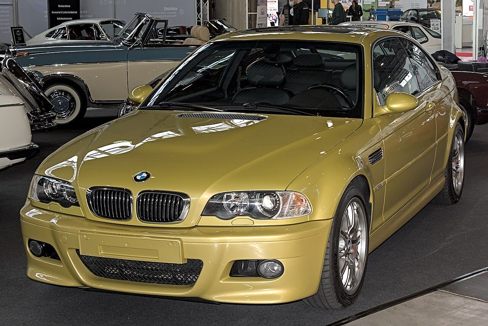

*Photo: A coupe donor: E46 M3 at Retro Classics 2025. Alexander Migl, [CC BY-SA 4.0](https://creativecommons.org/licenses/by-sa/4.0/), via [Wikimedia Commons](https://commons.wikimedia.org/wiki/File:BMW_M3_%28E46-2S%29_Retro_Classics_2025_DSC_7558.jpg).*

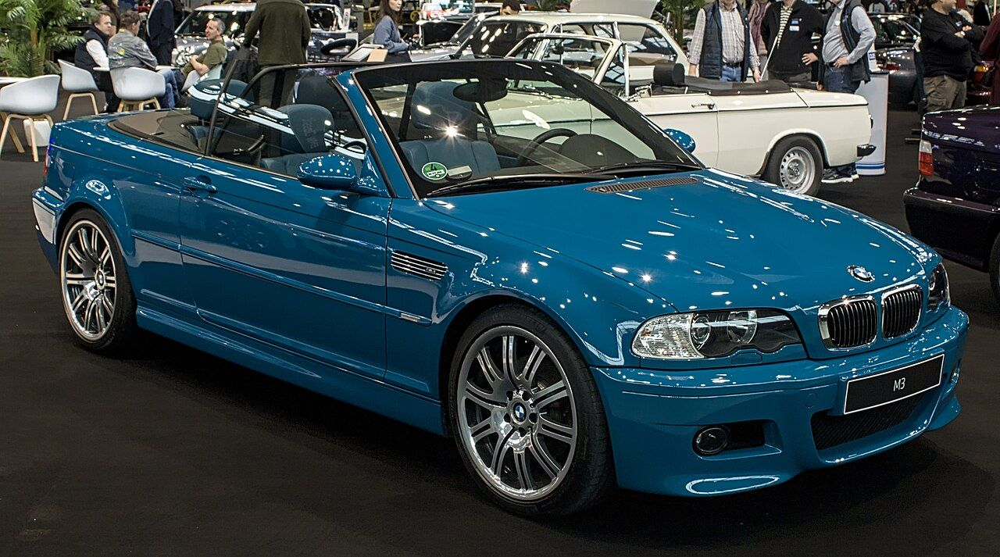

*Photo: Convertibles usually cost less, and their rear quarters almost certainly carry the same arch as the coupe's (see [Rear arches and doors](#rear-arches-and-doors)). E46 M3 convertible at Retro Classics 2026. Alexander Migl, [CC BY-SA 4.0](https://creativecommons.org/licenses/by-sa/4.0/), via [Wikimedia Commons](https://commons.wikimedia.org/wiki/File:BMW_M3_%28E46-2CS%29_Retro_Classics_2026_IMG_4807.jpg).*

Buy one complete, running E46 M3 with a manual gearbox. A running car lets you test the engine, gearbox and electronics before they come apart. The builder of two Hungarian conversions puts it simply: "Coupe or Cabrio/Vert doesn't really matter… better if she is mechanically fine" ([M3projekts – Cheapest UK M3 donor, Ep7 (2023), description](https://www.youtube.com/watch?v=ihD3-3ZlBjI)).

- **Model year: the same as your Touring or newer.** EPA policy and state engine-change rules generally want the engine to be the same model year as the chassis or newer (see [Registration and legal](#registration-and-legal-us)). A 2003 Touring can take an engine from a 2003–06 M3; a 2005 needs a 2005 or 2006. Choose a donor whose underhood emissions (VECI) label shows a US 50-state certification; in Massachusetts the emissions category matters too (see [Massachusetts](#massachusetts)).
- **If your Touring is a 325xi, choose its route first.** Converting it to rear drive takes the donor's whole MK60 system with its sensors, pipes and harness branch, so buy a donor built from 09/2002. Keeping all-wheel drive leaves the donor's 420G, front axle, MK60 and diff unused ([325xi: rear drive or all-wheel drive](#325xi-rear-drive-or-all-wheel-drive)).
- **Build date.** Several parts change with production date:

| Part | Earlier cars | Later cars | What it means for you |
|---|---|---|---|
| Engine computer | MSS54, to about 09/2003 | MSS54HP, from about 09/2003 ([NAM3](https://nam3forum.com/forums/forum/special-interests/coding-tuning/2052-comprehensive-mss54-mss54hp-dme-information/page2)) | Either works. Keep the DME with its own engine harness, which also changes at 09/2003 ([ETK](https://bmwfans.info/parts-catalog/E46-Coupe/USA/M3-S54/browse/engine_electrical_system/wiring_harness_engine_trans_module/)) |
| DSC unit | Teves MK20, to 09/2002: 43-pin plug and a separate pre-charge pump ([ETK](https://bmwfans.info/parts-catalog/E46-Coupe/USA/M3-S54/L-N/browse/brakes/hydro_unit_dsc_control_unit_fastening/)) | MK60, from 09/2002 (Competition unit from 12/2004): the same 47-pin plug as your Touring's ([ETK](https://bmwfans.info/parts-catalog/E46-Coupe/USA/M3-S54/L-N/browse/brakes/hydro_unit_dsc_fastening_sensors/)) | Matters only if you'd use the donor's DSC. An MK20 won't plug into your harness. An M3 MK60 codes only from a session vehicle order with an M3 type key and a date of 09/2002 or later, then needs INPA's initialisation ([manual, Session 5](WIRING-AND-CODING.md#session-5-dsc-coding-and-vin)) |
| Master cylinder and booster | 34312282343 and 34332282193, to 09/2002 | 34317838638 and 34332282622, from 09/2002 ([ETK](https://bmwfans.info/parts-catalog/34332282622/)) | Only for the donor-DSC route |
| Rod bolts | M11 twelve-point, reused, on engines built up to 12/12–13/2002 | M10 E-Torx, new every time, tightened in three cycles ([BMW SI B11 04 04](https://nam3forum.com/forums/filedata/fetch?id=5213)) | Vendors and ETK give 02/2003 for the change; go by the bolt heads, not the date. Late engines need 12 new bolts |
| Instrument cluster | Coding index 20–22 | Redesign clusters, coding index 23–24, roughly 2003 on ([e46fanatics](https://www.e46fanatics.com/threads/diy-m3-cluster-into-non-m-retrofit.1277945/)) | Prefer a redesign cluster: it properly supports the M Track light and brake-force display. For a Touring built from 09/2002, use a cluster from 09/2002 or later: ECUswap calls it compulsory ("zwangsweise") ([ECUswap](https://ecuswap.de/technikinfo-kombiinstrument-austausch-e46/)); a 2003–06 donor gives index 23 or 24. The cluster keeps the donor's vehicle order, since BMW's coding data accepts an index-23 or -24 cluster only with an M3 order ([BMW coding data](https://archive.org/details/sp-daten-v-32)). The backlight wire also changed at 09/2002, so an older cluster in a later Touring needs a wire added, and a newer cluster in an older Touring a light-module update ([e46fanatics](https://www.e46fanatics.com/threads/diy-m3-cluster-into-non-m-retrofit.1277945/)) |
| Rear wheel-speed sensors | Early type, to 09/2002 | Later type, from 09/2002; your Touring changed at 09/2001 ([ETK](https://bmwfans.info/parts-catalog/34526752683/)) | You keep your own sensors: they suit the M3 hubs, and from 09/2002 the M3 uses the same parts ([Brakes and DSC](#brakes-and-dsc)). A donor built before 09/2002 has the MK20's inductive sensors with gray plugs, which don't fit your harness; that likely explains why a 2004 Touring's plugs didn't mate with its 2002 donor's ([Tenza Motorsports – 5 things they don't tell you, part 2 (2021), 03:20](https://www.youtube.com/watch?v=mDBiRn30fEs&t=200s)), while on a 2003 xi Touring, whose Bosch sensors use the same blue housings, the M3 sensors' plugs mated ([e46fanatics](https://www.e46fanatics.com/threads/m3-touring-project.1240087/)) |
| Competition package (ZCP) | — | From 12/2004: a quicker rack (shared with the CSL), 345 × 28 mm front rotors and 19-inch Style 163 wheels ([ETK: rack](https://bmwfans.info/parts-catalog/32132282642/), [ETK: rotor](https://bmwfans.info/parts-catalog/34112282445/)) | Nice to have, not needed |

- **Manual, not SMG.** SMG cars cost less (one estimate says 20–30%, unverified), but you'd add the manual shift parts and clutch hydraulics an SMG car lacks, a manual gearbox-harness section ([Redline](https://www.redline-motorsport.com/product-category/e46-wiring/)) and manual DME software. The MSS54's hardware is the same for both gearboxes, but BMW released separate manual and SMG software, so an SMG donor's DME needs a reflash or a vendor's conversion, not just coding ([NAM3](https://nam3forum.com/forums/forum/special-interests/coding-tuning/2052-comprehensive-mss54-mss54hp-dme-information), [ECUWorx](https://www.ecuworx.co.uk/how-to/a-run-down-of-features-of-the-mss5x-binary-modification-tool-and-what-they-do/)). One SMG-donor DME that a local shop "coded" stayed in limp mode ([UNRIVALED – Watch this before you S54 swap your BMW (2021), 02:02](https://www.youtube.com/watch?v=eddLff8yba0&t=122s)). The PistonHeads Touring's builder converted an SMG donor.
- **Coupe or convertible.** Convertibles usually cost less (see the price table below), and for this conversion they give up almost nothing:
  - BMW lists separate M3 convertible quarter panels (41357894541/542), but the arch is almost certainly the same pressing as the coupe's. Both cars have the same rear track, wheels and body width, and the same filler flap, bumper brackets and side skirts meet the flare ([ETK: quarter](https://bmwfans.info/parts-catalog/41357894541/), [ETK: flap](https://bmwfans.info/parts-catalog/51172695524/), [BMW USA](https://www.press.bmwgroup.com/usa/article/attachment/T0022127EN_US/41385)). BMW's own dimension drawings of the two M3s show the same arch opening within 2–9 mm and the same flare within 3–7 mm (our measurement from the drawings, an estimate) ([M3 coupe drawing](https://getoutlines.com/blueprints/6769/2007-bmw-m3-e46-coupe-blueprints), [M3 convertible drawing](https://getoutlines.com/blueprints/453/2004-bmw-m3-e46-c-cabriolet-blueprints)). Confirm it with section templates at seven stations before you cut ([Datum, stations and templates](#datum-stations-and-templates)).
  - A convertible quarter covers the whole outer skin from the door shut line to the tail light, the part a Touring needs; it lacks only the coupe's C-pillar. Its arch flange sits on the convertible's heavy inner side frame, so expect more spot welds to drill ([ETK](https://bmwfans.info/parts-catalog/E46-Cabrio/USA/M3-S54/L-N/browse/bodywork/body_side_frame/)). It brings the same M3 trunk floor, front fenders, hood and bumper as a coupe.
  - One owner-built Touring used both quarter sections and the trunk floor from a 2003 M3 convertible ([M346 Projects – Pt 1, M3 part out (2023), 06:40](https://www.youtube.com/watch?v=YqM2rQw1HQI&t=400s)).
  - M3 convertible front seats don't fit a Touring ([e46fanatics](https://www.e46fanatics.com/threads/project-e46-m3-touring-conversion-to-europe-and-back.1300891/)), and the convertible's front struts (31312282265/266) and springs are sized for a heavier nose, a front axle load of about 856 kg against the coupe's 779 kg: plan on coupe front springs or coilovers with a convertible donor. Its rear dampers (33522282267) were built for a rear load close to your Touring's (our inference), though aftermarket makers sell one damper for both M3s ([ETK](https://bmwfans.info/parts-catalog/31312283103/), [Suspension for Touring weight](#springs-dampers-and-anti-roll-bars)).
- **Damage and rust you can accept.** A bent shell is fine if the parts you need are intact: drivetrain, axle parts, front panels (hood, fenders, headlights, bumper), both rear arch areas and the trunk floor around the muffler. Rust is the bigger risk. E46 rear-arch rust starts at the inner arch, hidden under seam sealer ([Redish](https://www.redish-motorsport.com/BMWE46M3RearWheelArchesRust.html)), and Redish says M3 inner arches "are always rotten out" ([Autoalex Cars – Part 3 (2023), 04:20](https://www.youtube.com/watch?v=cwbRDG7XHa8&t=260s)), and Autoalex's cheap coupe donor lost its inner arch as soon as it was stripped ([Autoalex Cars – Part 1 (2023), 07:40](https://www.youtube.com/watch?v=RyoFFLppseE&t=460s)). That car revved cleanly, but its frame and subframes turned out to be "in seriously bad condition" ([BMWBlog](https://www.bmwblog.com/2023/03/03/e46-m3-touring-build/)).
- **Paperwork.** Get the title or salvage paperwork and a bill of sale, and photograph the VIN plates and engine number; your state may ask for proof of the engine's year.

**Test it while it still runs.** Some tests need the seller's agreement; do the rest before teardown.

| Test | How | Record or look for |
|---|---|---|
| Drive it | Fully warm; every gear; listen at warm idle | A knock at idle; clean shifts into all six gears and reverse; diff clunk or whine. One 190,000-mile donor's gearbox later refused a gear on track ([Autoalex Cars – It took 3 years and £70,000 (2025), 13:40](https://www.youtube.com/watch?v=N8pdzFoVu9k&t=820s)) |
| Fault codes | Scan every module with INPA and save the lists | Stored faults in the DME, DSC, cluster, airbag and EWS |
| Module IDs | Record each module's part number and software; read the DME's ID and its stored VIN slots (AIF) with Tool32 ([ECUWorx](https://www.ecuworx.co.uk/2016/02/26/adding-updating-your-vin-uif-with-tool32/)); back up the cluster EEPROM with PA-Soft | Unit types (MK20 or MK60, MSS54 or HP) and the cluster's coding index. Send the DME data with the DME if a vendor flashes it |
| Compression and leak-down | Warm engine, all plugs out | Compression of about 11–12 bar (160–174 psi) minimum, about the same on every cylinder: a figure from a forum compilation, so confirm it in TIS ([Flow compilation, p.47](https://drive.google.com/file/d/1GS3Hirx6x0c0WG8hPeXiwfXfeUldkQnm/view?usp=sharing)). No leak-down figure turned up; judge how even the six cylinders are |
| VANOS | Tool32 or INPA VANOS tests; listen for rattle; if allowed, take the valve cover off and look at the exhaust-hub tabs and the oil-pump disc ([Beisan](https://beisansystems.com/s54-vanos-procedure-e46-m3/)) | VANOS faults, and the test readings to compare after the refresh (Phase 12); a cracked hub tab means a new hub |
| Fuel pressure | Gauge on the threaded test fitting at the regulator, beside the filter under the left front floor (filter cover off); pump run through a bypass at its module's socket, terminals 30 and 87b (pins 6 and 2 of plug X10157, through a switch with a 15 A inline fuse), BMW's method ([BMW ST041](https://archive.org/download/BMWTechnicalTrainingDocuments/ST041%20M3%20Complete%20Vehicle/3%20EngineElectronics%20%28Part%202%29.pdf)) | 5.0 ± 0.2 bar; 20 minutes later no more than 0.5 bar (7 psi) lost and still 4.5 bar or more ([Bentley, quoted on e46fanatics](https://www.e46fanatics.com/threads/fuel-pressure-info.1116777/)). It proves the pump, regulator and check valve you'll move |
| A/C | Run it on max | Cold air and a compressor that engages. Then have a shop recover the refrigerant before you open anything; venting it is prohibited ([EPA](https://www.epa.gov/mvac/regulatory-requirements-mvac-system-servicing)) |
| DSC and ABS | Warning lights at start; a careful hard stop on a quiet road | Lights out, ABS working |
| Options fitted | Look for headlight-washer nozzle covers in the bumper and a second pump on the washer bottle | Headlight washers were an option on US M3s (BMW code 502), not standard ([ETK](https://bmwfans.info/parts-catalog/E46-Coupe/USA/M3-S54/L-N/browse/vehicle_electrical_system/windshield_cleaning_container/)) |
| Measurements | On level ground, on BMW 18- or 19-inch wheels, in BMW's normal position: a full tank, two people of about 68 kg (150 lb) in the front seats and 14 kg (31 lb) in the middle of the trunk ([TIS 32 00](https://workshop-manuals.com/bmw/3_series_e46/m3_s54_coupe/3_technical_data/32__steering_and_wheel_alignment/0__electronic_chassis_alignment/1_td__chassis_wheel_alignment_normal_position_e46___m3_m3_csl/)). At each corner: BMW's ride height (rim flange at the bottom middle to the arch's lower edge), the heights of the hub center, the arch lip and a body point both cars share, and how far the lip sits outboard of the tire ([Measure and mock up before you cut](#measure-and-mock-up-before-you-cut)). Photograph the spring paint marks, the label on each front strut, the B-pillar tire placard and the underhood A/C and emissions labels | BMW's 605 mm front and 587 mm rear on 18-inch wheels (619 and 600 mm on 19s), ±10 mm with left and right within 10 mm, shows a stock stance ([TIS 31 00](https://workshop-manuals.com/bmw/3_series_e46/m3_s54_coupe/3_technical_data/31__front_axle/0__general/1_td__front_axle_ride_height_e46___m3/), [TIS 33 00](https://workshop-manuals.com/bmw/3_series_e46/m3_s54_coupe/3_technical_data/33__rear_axle/0__general/2_td__rear_axle_ride_height_e46___m3/)). Your hub-to-body and hub-to-lip targets for the Phase 6 mock-up, and the A/C charge |

| Donor option | Price seen | Source |
|---|---|---|
| Running E46 M3 | 2005 coupes \$37,275–\$45,150 and 2005 convertibles \$12,750–\$31,500, in sales from Dec 2024 to Jan 2026 (from search extracts) | [Hagerty](https://www.hagerty.com/valuation-tools/bmw/m3/2005/2005-bmw-m3) |
| Rough donors used for conversions | \$6,500 for a curbed 2002 M3 that needed a clutch (2021); £7,000 for an insurance-write-off convertible (UK, 2023); £9,250 for a rusty 190,000-mile coupe (UK, 2023). In Canada in 2025, manual M3s with over 400,000 km were asking more than CAD 20,000 | [Tenza Motorsports – S54 swap costs (2021), 01:00](https://www.youtube.com/watch?v=urkCbJGGPhs&t=60s), [M3projekts – Ep7 (2023), 01:00](https://www.youtube.com/watch?v=ihD3-3ZlBjI&t=60s), [Autoalex Cars – I bought a cheap E46 M3 (2023), 00:40](https://www.youtube.com/watch?v=elovkaAuNU0&t=40s), [Tracks and Trails – Can I do it? (2025), 07:40](https://www.youtube.com/watch?v=KE7iY3yYBZI&t=460s) |
| Salvage or wrecked M3 | A salvage-title convertible already missing its rear end, about \$4,500 (bought around 2018); a clean-title 2003 six-speed with salvage history, \$7,100 (April 2019) | [autoevolution](https://www.autoevolution.com/news/watch-this-4500-bmw-e46-m3-donor-car-get-a-new-lease-in-life-after-sitting-for-4-years-196000.html), [e46fanatics](https://www.e46fanatics.com/threads/salvage-m3-worth-a-gamble.1252507/) |
| Used S54 with DME and harness, about 200k miles | About \$3,500 asking locally, \$6,000 and up on eBay and Copart (June 2025). The same thread suggests a whole '03.5-on convertible donor for under \$9–10k | [NAM3](https://nam3forum.com/forums/forum/main-forum/e46-2001-2006/309472-s54-used-engine-prices) |
| Complete used M3 rear axle | €1,650 (Germany, 2023) | [M539 Restorations – Project Cologne PT13 (2023), 00:40](https://www.youtube.com/watch?v=6NbgUPsl8og&t=40s) |

> [!TIP]
> An engine on its own is cheaper, but you would still need the M3 axle parts, steering, brakes, cluster, harness, fuel parts and body panels. Bought piece by piece, those usually cost more than a rough whole car.

### Budget

These ranges assume you do the labor. Rows marked "estimate" are planning figures, not quotes. Vendor prices were checked in October 2026 unless a date is given; £ and € prices are as listed, before shipping and import costs.

| Item | Range (USD) | Basis |
|---|---|---|
| Donor M3 | \$8,000–\$20,000 | Estimate; recent prices under [Choose the donor](#choose-the-donor). Add travel or transport: one build spent about \$1,000 collecting its cars ([Tenza Motorsports – Total build cost (2022), 01:40](https://www.youtube.com/watch?v=oSZrM5wW0sQ&t=100s)) |
| Rod-bearing parts | \$750–\$1,100 | BimmerWorld's OEM kits are \$753.99 for engines built to 2/03 and \$844.99 from 4/03, with new M10 bolts ([BimmerWorld](https://www.bimmerworld.com/Engine/Engine-Maintenance/Rod-Bearing-Overhaul-Kit-Basic-OEM-E46-M3-2004.html)); upgraded bolts or coated bearings cost more (estimate). Shops charge \$1,625 ([EAS](https://europeanautosource.com/products/eas-s54-rod-bearing-service-bmw-e46-e85-e86-m3-z4m)); Mr Vanos in the UK charges £1,995, including a new oil pump, ARP bolts and two engine mounts ([Mr Vanos](https://mrvanos.com/products/rod-bearing-replacement-bmw-3-series-e46-m3)) |
| VANOS refresh | \$155–\$1,135 | Beisan's seal and rattle kit is \$155 ([Beisan](https://beisansystems.com/s54-vanos-procedure-e46-m3/)); BimmerWorld's kit with a new exhaust hub is \$979.99 without seals ([BimmerWorld](https://www.bimmerworld.com/Engine/Camshafts/S54-VANOS-Refresh-Kit-with-VAC-Exhaust-Hub-E46-Z3-Z4.html)) |
| Other engine seals, gaskets, chain guide, shims | \$500–\$1,500 | Estimate |
| Clutch, dual-mass flywheel, pilot bearing, bolts | \$600–\$1,800 | Estimate |
| 420G seals and gear-identification switch | \$100–\$300 | The switch is about \$78 ([NAM3](https://nam3forum.com/forums/forum/main-forum/e46-2001-2006/2844-smg-to-6mt-conversion)); seals estimate |
| Axle refresh: subframe and diff mounts, RTABs, arms, end links | \$800–\$2,000 | Estimate |
| Brakes: pads, rotors, pad-wear sensors, M3 front hoses, booster grommet, DOT 4 brake fluid; parking-brake shoes if worn | \$600–\$1,500 | Estimate |
| Rear springs about 7–9% stiffer than an M3 coupe's, or M3 coilovers | \$1,200–\$3,500 | Estimate. The donor brings its struts and dampers; budget for new rear springs about 7–9% stiffer than an M3 coupe's (our estimate). BMW's M3 rear springs are about \$75–\$101 each at FCP Euro (October 2026), and no maker sells a kit for an M3-axle Touring ([FCP Euro](https://www.fcpeuro.com/products/bmw-coil-spring-mubea-33532283137), [Suspension for Touring weight](#springs-dampers-and-anti-roll-bars)) |
| Rear subframe reinforcement and V-brace mounts | \$250–\$700 in parts | The MSW kit is about \$155–\$160 ([Morehead](https://www.moreheadspeedworks.com/product/msw-e46-rear-subframe-mounting-chassis-reinforcement-kit/)); Redish's plates were £180, plus £125 for six tank and brake-pipe brackets, in 2023 ([Autoalex Cars – Part 3 (2023), 16:00](https://www.youtube.com/watch?v=cwbRDG7XHa8&t=960s)); aftermarket V-brace boxes were "like a hundred bucks" in 2025 ([Tracks and Trails – I spent \$10,000 on my E46 Touring's rear end (2025), 07:40](https://www.youtube.com/watch?v=eMJLXbvzckE&t=460s)). Shop labor: \$800–\$1,200 quoted in 2019, about \$2,200–\$2,400 with bushings and an alignment ([e46fanatics](https://www.e46fanatics.com/threads/m3-subframe-reinforcement-labor-cost-what-is-reasonable.1253483/)); one 2025 Canadian quote was CAD 2,500, against CAD 2,300 to do it yourself including a new welder ([Tracks and Trails – Fixing the weakest part of my E46 Touring (2025), 13:20](https://www.youtube.com/watch?v=t4CtY_W3vpU&t=800s)) |
| Trunk floor, muffler brackets and heat shield | \$0–\$1,400 | Recommended new parts at BMWPartsDeal, October 2026: floor 41127895619 \$763.61, reinforcement 51717894229 \$88.22, brackets 41122494844 \$27.19 and 41112493931 \$71.40, rear heat shield 51482494848 \$259.12, together \$1,209.54 plus shipping ([floor](https://www.bmwpartsdeal.com/parts/bmw-trunk_floor-41127895619.html)); add \$92.19 for a new M3 canister holder 16132229735 if the canister has to move and you didn't keep the donor's. \$0 if you graft the donor's floor and brackets. The M3 exhaust comes with the donor; a new rear muffler 18107831783 is \$5,093.16 at BMWPartsDeal (October 2026). One builder found a used CSL muffler for \$400 in 2024 ([M346 Projects – Pt 9, CSL muffler (2024), 02:40](https://www.youtube.com/watch?v=T-JM2xqxuv4&t=160s)), but a CSL rear section was never US-certified |
| Fuel: a new M3 filter, seals and clamps; the donor's in-tank set, pipe set, lines, regulator housing and regulator (a new regulator only if the donor's fails its Phase 1 test) | \$250–\$900 | Estimate. If the donor's are missing or damaged, a new delivery unit is \$559.16 and a new pipe set \$159.88 at BMWPartsDeal, and a new baffle \$123.62 at BimmerWorld (October 2026) ([BMWPartsDeal](https://www.bmwpartsdeal.com/parts/bmw-delivery_unit_right-16142229684.html), [BimmerWorld](https://www.bimmerworld.com/Intake-Fuel/Fuel-Filters/Genuine-BMW-Fuel-Baffle-Fixture-16112229656-E46-E46-M3.html)) |
| Cooling: new expansion tank and holder, thermostat, vent screw, hoses and BMW antifreeze; the M3 radiator, oil cooler and both fans come with the donor | \$400–\$900 | Estimate ([Cooling and oil cooler](#cooling-and-oil-cooler)) |
| A/C: recovery on both cars, a new receiver-drier and O-rings, PAG oil, evacuation and charge; the donor's pressure hose | \$300–\$700 | Estimate ([Air conditioning](#air-conditioning)) |
| DME: EWS delete with your VIN written in (manual software if SMG) | \$100–\$349, plus shipping | Kassel charges \$109 for the delete plus \$20 for the VIN, or \$349 for its engine-swap coding with every swap option ([Kassel](https://www.kasselperformance.com/product/bmw-e46-m3-s54-mss54-hp-tuning/)). DUDMD charges \$215–\$225 ([DUDMD](https://www.dudmd.com/products/e46-m3-mss54-ews-delete-service)). RPM charges \$300 (October 2026) ([RPM](https://www.rpmmotorsport.net/collections/bmw-unlocked-ecu-service-ews-cas-delete/products/bmw-e46-m3-s54-m5-e39-s62-ews-delete-ready-to-start)). Severn charges \$100–\$200 depending on shipping, and its page says "off-road use only" ([Severn](https://www.severntuning.com/products/bmw-mss54-hp-ews-delete-2001-2006-e46-m3)). For the sync route, RPM's used-DME EWS programming is \$300 ([RPM](https://rpmmotorsport.net/products/bmw-e39-e46-m3-m5-s54-s62-used-ecu-dme-ews-programming)) |
| Coding kit: laptop, K+DCAN cable, PA-Soft interface, 10 A charger; Standard Tools 2.12 with NCS Expert 4.0.1 | \$300–\$800 | Estimate; less if you own a suitable laptop. BMW doesn't sell the software to owners ([Factory documentation and coding kit](#factory-documentation-and-coding-kit)) |
| Cluster: new EEPROM done yourself, or a service | \$50–\$400 | Estimate. Huggins Racing lists a used-cluster VIN and mileage correction, which sets a used cluster to your car's true mileage, at \$125 and its rear-door LED mod at \$100 (October 2026) ([Huggins](https://racehuggins.com/product/e46-cluster-mileage-vin-correction/), [Huggins](https://racehuggins.com/product/e46-m3-cluster-mod-for-non-m/)). One Touring build paid Kassel about \$1,000 including shipping for the DME tune, EWS delete and cluster mileage together (2021, [Tenza Motorsports – 5 things they don't tell you, part 2 (2021), 05:40](https://www.youtube.com/watch?v=mDBiRn30fEs&t=340s)) |
| Wiring: terminals, repair leads, depinning keys | \$100–\$300 | Estimate. Redline's plug-in E46 S54 swap harness is \$265 and needs an EWS-deleted DME ([Redline](https://www.redline-motorsport.com/product/e46-m52tu-m54-s54/)) |
| Body materials | \$500–\$2,000 | Estimate, using the donor's arch steel. New BMW arch steel adds about \$4,460 for both sides (tip below) |
| Front fenders | \$0–\$2,000 | Grafting the donor's costs only materials; carbon Touring fenders are €1,400 before VAT ([M3Projekts](https://m3projekts.com/product/e46-m3-touring-front-fenders/)) |
| Paint (full respray) | \$6,000–\$15,000 | Estimate; varies widely by region and shop |
| Tires, alignment, fluids, hardware | \$1,500–\$2,500 | Estimate |
| Tools you don't own yet | \$1,000–\$3,000 | Estimate: welder, respirator and extraction, spot-weld cutters, test gauges and the fuel test kit, torque wrenches, engine stand ([Tools and test equipment](#tools-and-test-equipment)). One builder's MIG welder was about CAD 1,200 ([Tracks and Trails – Fixing the weakest part of my E46 Touring (2025), 13:00](https://www.youtube.com/watch?v=t4CtY_W3vpU&t=780s)) |
| Contingency | 10–15% | Estimate; every documented build met work it hadn't planned |
| **Total** | **About \$26k–\$73k** | Including contingency; before selling leftovers. New BMW arch steel adds about \$4,460 |

> [!TIP]
> If the donor's arch steel is rotten, or you'd rather keep donor steel out of your body, here is what new BMW steel costs (October 2026). At one US dealer the M3 convertible's rear side panels 41357894541/542 were \$2,105.60 each (list \$2,561.00) and its inner lateral trim panels 41217894553/554, which include the outer half of the wheelhouse, \$127.54 and \$118.80; the M3 coupe's side panels 41217890689/690 were \$6,932.63 each and its interior side frames 41217890677/678 \$1,311.70 each ([BMWPartsDeal: 41357894541](https://www.bmwpartsdeal.com/parts/bmw-left_rear_side_panel-41357894541.html), [41217894553](https://www.bmwpartsdeal.com/parts/bmw-left_inner_lateral_trim_panel-41217894553.html), [41217890689](https://www.bmwpartsdeal.com/parts/bmw-left_rear_side_panel-41217890689.html), [41217890677](https://www.bmwpartsdeal.com/parts/bmw-left_interior_side_frame-41217890677.html)). That makes about \$2,230 a side for new convertible steel and \$8,240 a side for coupe steel, before freight and tax (our arithmetic). Each page said "Ships in 1-3 Business Days", but stock isn't confirmed until you order. That the convertible's inner panel carries the M3-width arch flange is our reading of BMW's diagram, so check one against an M3 skin first. New convertible steel for both arches plus the new trunk floor and its reinforcement comes to about \$5,310 (our arithmetic), with no donor steel in your body ([Massachusetts](#massachusetts)).
>
> In Europe, eStore-Central lists the convertible quarter at €1,979.88 each and the inner panels at €141.50 and €131.82, about €4,280 for both sides plus an M3 filler flap (51172695524, €45.06), and the coupe quarter at €6,518.67 each ([eStore-Central](https://www.estore-central.com/bmw-parts-catalog/E46-M3-S54/Cabrio/Bodywork/Body-Side-Frame/)). R44, a UK shop that prices in pounds, lists the coupe quarters at £4,420 each ([R44: left](https://r44performance.com/products/genuine-bmw-e46-m3-rear-quarter-panel-left-41217890689), [right](https://r44performance.com/products/genuine-bmw-e46-m3-rear-quarter-panel-right-41217890690)). BMW's inner arch panels have been £990 each since 2025 ([Redish](https://www.redish-motorsport.com/BMWE46M3RearWheelArchesRust.html)); we infer that is the M3 coupe's interior side frame 41217890677/678. LBL Panels' M3 arch sections are £225 standard or £375 for a full arch, in 1.2 mm steel (2026, unverified), but no current listing turned up in October 2026 ([m3cutters](https://forums.m3cutters.co.uk/threads/e46-m3-rear-arch-repair-panel.252420/)). Redish has also used a fabricator's repair panels at "like 10%" of the price of a BMW side panel, which it put at "2,300 and something pounds" ([Autoalex Cars – Part 3 (2023), 06:00](https://www.youtube.com/watch?v=cwbRDG7XHa8&t=360s)).

Selling what you don't use (the M54, the 5-speed, the MS43 or MS45.1 DME, replaced 325i axle parts, donor interior and panels) can recover \$2k–\$5k (estimate). Hold back the fallback parts listed under [Space, storage and logistics](#space-storage-and-logistics), and keep the M54's A/C compressor until the A/C is charged ([Air conditioning](#air-conditioning)).

**If your car is a 325xi,** converting it to rear drive adds about \$0–\$1,500 in parts with a donor built from 09/2002, or \$1,000–\$3,000 with an earlier one, net of selling the xi's drivetrain and DSC (our estimate). No source costs keeping all-wheel drive. Both routes are in [325xi: rear drive or all-wheel drive](#325xi-rear-drive-or-all-wheel-drive).

For comparison, Autoalex's UK build with specialist help cost about £70,000, including two engines ([Autoalex Cars – It took 3 years and £70,000 (2025), 18:40](https://www.youtube.com/watch?v=N8pdzFoVu9k&t=1120s)), and the all-wheel-drive Touring that sold for \$65,000 had more than \$70,000 in it ([Built for Backroads](https://www.builtforbackroads.com/listing/2004-bmw-325xit-touring-awd-s54-swap)). A US S54 swap that kept the non-M body and spare-wheel well came to \$21,665 all in, including both cars and a budget paint job ([Tenza Motorsports – Total build cost (2022), 01:20](https://www.youtube.com/watch?v=oSZrM5wW0sQ&t=80s)). With one finished car bid to \$59,250 without selling and another sold for \$65,000, build this because you want the car, not as an investment.

### Time

Rough durations for one person working evenings and weekends. These are planning estimates; the last column shows what builders reported.

| Phase | Weekends | Evidence |
|---|---|---|
| Buy, test and strip the donor | 4–8 | One builder stripped a convertible donor in about a week ([M346 Projects – Pt 1, M3 part out (2023), 02:00](https://www.youtube.com/watch?v=YqM2rQw1HQI&t=120s)) |
| Strip your Touring | 2–4 | |
| Subframe mounts and floor | 4–8 | Cutting one V-brace mounting box off a donor "took all day" ([Tracks and Trails – I spent \$10,000 on my E46 Touring's rear end (2025), 06:20](https://www.youtube.com/watch?v=eMJLXbvzckE&t=380s)) |
| Rear arches (and doors, if you reshape them) | 8–16 | A professional shop took about four weeks, two people at 40–50 hours a week, for the whole body from first cut to paint ([SOS Customz – Building a BMW E46 M3 Touring wagon (2023), 26:00](https://www.youtube.com/watch?v=L8m9gEOklVY&t=1560s)) |
| S54 and axle refresh (in parallel with the bodywork) | 6–10 | Plan 3–7 days for a first rod-bearing job ([Paul Vo – Rod bearing installation and torque procedure (2017), description](https://www.youtube.com/watch?v=O345BKC8EkM)); Beisan quotes 7 or more hours for a DIY VANOS job ([Beisan](https://beisansystems.com/s54-vanos-procedure-e46-m3/)) |
| Reassembly: axles, engine, fuel, cooling, exhaust | 8–12 | |
| Wiring, coding, first start, shakedown | 4–8 | Allow a week or two for the DME and cluster to visit a vendor; RPM quotes 1–2 business days after arrival, with overnight shipping both ways ([RPM](https://www.rpmmotorsport.net/collections/bmw-unlocked-ecu-service-ews-cas-delete/products/bmw-e46-m3-s54-m5-e39-s62-ews-delete-ready-to-start)) |
| Front end, paint and trim | 4–8, plus shop time | One paint shop kept the car four months ([M346 Projects – Pt 25, paint reveal (2025), 00:00](https://www.youtube.com/watch?v=1AjKKQisrGE&t=0s)) |

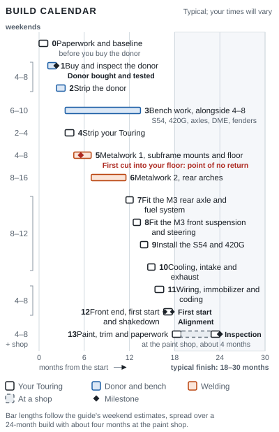 <!-- portrait -->

*Figure 2. The phases on a calendar for a typical build of about two years, with bar lengths in proportion to the weekend estimates above. Bench work runs alongside Phases 4 to 8, the paint shop can keep the car for about four months, and the first cut into your floor, in Phase 5, is the point of no return.*

**If your car is a 325xi,** converting it to rear drive adds 4–8 weekends (our estimate): the front-end trial fit and transplant, with any anti-roll-bar brackets, 1–2; a gearbox-crossmember adapter 1–2; the DSC hardware and pipes 1–2; the DSC loom and coding 1–2 ([325xi: rear drive or all-wheel drive](#325xi-rear-drive-or-all-wheel-drive)).

Real builds:

| Build | Who did the work | Timeline |
|---|---|---|
| Autoalex Cars: UK 330i Touring, coupe donor | Specialist (Redish Motorsport) | Started March 2023, handed over May 2025 ([Autoalex Cars – It took 3 years and £70,000 (2025), 03:20](https://www.youtube.com/watch?v=N8pdzFoVu9k&t=200s), [06:20](https://www.youtube.com/watch?v=N8pdzFoVu9k&t=380s)) |
| "To Europe and back": US 2003 325iT, convertible donor | A shop in Hungary | Picked up December 2021, bodywork March–May 2022, first test drive March 2023 ([e46fanatics](https://www.e46fanatics.com/threads/project-e46-m3-touring-conversion-to-europe-and-back.1300891/)) |
| M346 Projects: US 2004 Touring, convertible donor | Owner, with a visiting metalworker | July 2023 to October 2025, including four months at the paint shop ([M346 Projects – Pt 1 (2023), 00:00](https://www.youtube.com/watch?v=YqM2rQw1HQI&t=0s), [Pt 26, final reveal (2025), 00:00](https://www.youtube.com/watch?v=m-WKkTAKpws&t=0s)) |
| Tracks and Trails: 2004 325i Touring (automatic) | Owner, his first welding project | Cars bought by June 2025, first start June 2026, body panels on by September 2026 with paint still to do ([Tracks and Trails – Can I do it? (2025), description](https://www.youtube.com/watch?v=KE7iY3yYBZI), [Attempting to drive (2026), 1:17:20](https://www.youtube.com/watch?v=pvR3ovRfQHg&t=4640s), [What it really takes (2026), 34:40](https://www.youtube.com/watch?v=nADBRfX9DqY&t=2080s)) |

Keep the scope to the recipe: a turbocharged Touring on a standalone ECU, started in 2019, still wasn't running in June 2026 ([Calvin's Car Diary – I have big news about my £200,000 E46 M3 Touring (2026), 18:20](https://www.youtube.com/watch?v=w_L72YANRdU&t=1100s)).

### Factory documentation and coding kit

BMW's documentation is the reference for every standard procedure, torque and wiring diagram this guide doesn't print. Load the right VIN: one Touring swapper found the diagrams changed once he entered his wagon's VIN, and a Bentley page that didn't match his car misled him ([e46fanatics](https://www.e46fanatics.com/threads/battery-and-oil-pressure-lights-inop.1207433/)).

| Source | Use it for | Where |
|---|---|---|
| BMW TIS (newTIS) | Repair instructions, tightening torques, technical data and capacities, body dimensions (group 41 00), alignment values; wiring diagrams (WDS) by VIN | [newTIS](https://www.newtis.info/) (it runs a browser check, so open it in a normal browser). Read body-side diagrams with your Touring's VIN and engine-side ones with the donor's. One builder found it lacked the right MSS54 DME diagram ([e46fanatics](https://www.e46fanatics.com/threads/s54-swap-fuel-injectors-low-circuit.1277127/)). BMW's repair text (TIS issue 12/2007) is also free to read, page by page, on workshop-manuals.com for the [325i Touring](https://workshop-manuals.com/bmw/3_Series_E46/325i_M54_TOUR/) and the [M3 coupe](https://workshop-manuals.com/bmw/3_Series_E46/M3_S54_COUPE/); the M3 convertible has its own ([example page](https://workshop-manuals.com/bmw/3_series_e46/m3_s54_conver/3_technical_data/33__rear_axle/0__general/2_td__rear_axle_ride_height_e46___m3/)) |
| BMW WDS (Wiring Diagram System), public mirror | Wiring diagrams, DME pin tables, connector views and component locations; the manual's pin tables name the drawing behind every wire | [wds.psjr.org](https://wds.psjr.org/en/e46/). It has no VIN filter: pick each drawing by the models and build dates in its title. ISTA shows the diagrams for your exact VIN; BMW's official portal sold a one-day subscription for \$32 in October 2026 ([BMW AOS](https://bmwtechinfo.bmwgroup.com/)) |
| ETK parts catalog | Part numbers, which models use a part, changes by build date | [RealOEM](https://www.realoem.com/) or [bmwfans.info](https://bmwfans.info/parts-catalog/E46-Touring/USA/325i-M54/L-N/browse/); search by VIN |
| Bentley E46 service manual | A printed manual for the 325i; a seller listing says it also covers the 2000–05 M3 (unverified) | [Bentley Publishers](https://www.bentleypublishers.com/) |
| BMW service bulletins | SI B11 04 04: S54 rod bearings, bolts, torques, oil and break-in. SI B12 09 13: inspections fail when the DME holds the wrong VIN | [SI B11 04 04, via NAM3](https://nam3forum.com/forums/filedata/fetch?id=5213), [SI B12 09 13, via NHTSA](https://static.nhtsa.gov/odi/tsbs/2013/MC-10150160-9999.pdf) |
| BMW training manuals | How the systems work: E46 M3 (ST041), MS S54 engine management (ST055), EWS (ST051) | [ST041](https://archive.org/download/BMWTechnicalTrainingDocuments/ST041%20M3%20Complete%20Vehicle/1%20M3%20Complete%20Vehicle.pdf), [ST055](https://ia801005.us.archive.org/11/items/BMWTechnicalTrainingDocuments/ST055%20Engine%20Electronics%20%28Archive%201%29/8%20MS%20S54.pdf), [ST051](https://archive.org/download/BMWTechnicalTrainingDocuments/ST051%20Body%20Electronics%20I%20%28Archive%201%29/05%20EWS.pdf) |
| SGBD job documentation | The jobs, status bits and fault numbers Tool32 uses, for the S54's DME (`MSS54DS0.PRG`), the MK60 DSC (`DSC_MK60.PRG`) and the other modules | [SGBD documentation](https://github.com/emdzej/ediabasx-docs-sgbd/blob/main/docs/sgbd/MSS54DS0.md) and its [MK60 page](https://github.com/emdzej/ediabasx-docs-sgbd/blob/main/docs/sgbd/DSC_MK60.md), a community transcription of BMW's job files |
| "Flow" E46 M3 torque compilation | A forum PDF of the M3's fasteners built on RealOEM printouts, with a TIS alignment page. Cross-check only; confirm in TIS | [Google Drive](https://drive.google.com/file/d/1GS3Hirx6x0c0WG8hPeXiwfXfeUldkQnm/view?usp=sharing), via [NAM3](https://nam3forum.com/forums/forum/main-forum/e46-2001-2006/414-e46-m3-torque-spec-thread-every-bolt-on-the-car-on-diagrams) |

**Coding kit.** Buy it early and prove it on your unmodified Touring before you need it. Setup steps are in the [Wiring and coding manual](WIRING-AND-CODING.md).

- **Laptop:** a dedicated Windows 10 or 11 laptop, 32- or 64-bit, running Windows natively (not in a virtual machine or Boot Camp), with its charger plugged in. BMW Standard Tools 2.12 installs on Windows 7–11, so older advice that it needs Windows XP is out of date ([e46fanatics](https://www.e46fanatics.com/threads/installing-bmw-standard-tools.1322014/)).
- **Cable:** a K+DCAN USB cable with an FTDI chip and a switch that bridges OBD pins 7 and 8. On an E46 only the DME talks on pin 7; the cluster, light module and DSC are on pin 8, so an unbridged cable can't read them ([e46fanatics](https://www.e46fanatics.com/threads/installing-bmw-standard-tools.1322014/), [NAM3](https://nam3forum.com/forums/forum/main-forum/e46-2001-2006/293965-verify-ncsexpert-function-before-doing-manual-swap)). Set it to COM1 with a 1 ms latency timer ([NAM3](https://nam3forum.com/forums/forum/special-interests/coding-tuning/204464-help-with-coding-issues-re-ncs-and-pasoft)).
- **PA-Soft interface:** PA-Soft (BMW Scanner 1.4) needs its own interface for cluster and light-module EEPROM work. Its driver is the step most likely to fail on Windows 10 and 11, so install it first ([e46fanatics](https://www.e46fanatics.com/threads/installing-bmw-standard-tools.1322014/), [NAM3](https://nam3forum.com/forums/forum/special-interests/coding-tuning/204464-help-with-coding-issues-re-ncs-and-pasoft)).
- **Software:** BMW Standard Tools 2.12 (INPA, Tool32, NCS Expert, WinKFP) with E46 data files, plus NCS Dummy and an NCS profile that allows editing, such as Revtor's or FISTER ([ECUWorx](https://www.ecuworx.co.uk/uploads/M-Track.pdf)). Use the NCS Expert 4.0.1 that comes with Standard Tools 2.12, with a manipulation profile such as Revtor's `NCSDUMMY4.PFL` or terra's "Expert Mode w/ Manipulation": version 3.x doesn't run on 64-bit Windows ([NAM3](https://nam3forum.com/forums/forum/special-interests/coding-tuning/1281-getting-started-with-ncs-expert), [NAM3](https://nam3forum.com/forums/forum/special-interests/coding-tuning/1281-getting-started-with-ncs-expert/page3)). Two owners' INPA builds, labelled 5.00 and 5.0.2, had no MK60 steering-angle page, while builds 3.0.1 and 4.4.7 are reported to have it; Tool32 runs the job, `LENKWINKEL_DSC_ABGLEICHEN`, either way ([e46fanatics](https://www.e46fanatics.com/threads/dsc-mk60-replacement-coding-with-ncs-expert.1286178/), [e46fanatics](https://www.e46fanatics.com/threads/steering-angle-calibration-not-showing-up-in-inpa.1285802/), [SGBD documentation](https://github.com/emdzej/ediabasx-docs-sgbd/blob/main/docs/sgbd/DSC_MK60.md)). BMW's dealer software, ISTA, is optional.
- **Power:** a battery charger or power supply of at least 10 A on the car whenever you code or flash ([ECUWorx](https://www.ecuworx.co.uk/how-to/using-the-mss5x-binary-modification-tool/)).
- **For the cluster, if you do it yourself:** an EEPROM programmer (R270 type), a hot-air rework station and a blank M35080 chip ([e46fanatics](https://www.e46fanatics.com/threads/diy-m3-cluster-into-non-m-retrofit.1277945/)). A cluster service replaces all three.
- **Not enough on their own:** BimmerGeeks' ProTool reads E46 faults but can't code an E46 ([BimmerGeeks](https://www.bimmergeeks.net/protool)); Carly lists only comfort and lighting coding ([Carly](https://www.mycarly.com/blog/car-coding/bmw-e46-coding-list-what-you-can-code/)); the Foxwell NT530 does resets, not module coding ([BimmerWorld](https://www.bimmerworld.com/Tools/Foxwell-NT530-OBD-System-Scanner-for-BMWs.html)).

> [!NOTE]
> BMW doesn't sell Standard Tools, PA-Soft, NCS profiles or data files to owners; they circulate through forums and vendors ([e46fanatics](https://www.e46fanatics.com/threads/installing-bmw-standard-tools.1322014/)). Scan what you download, and keep the laptop for the car.

### Tools and test equipment

- **Lifting and moving:** a two-post lift makes this far easier. Without one you need tall jack stands, an engine hoist with a load leveler, a transmission jack, an engine support bar, an engine stand, a low table or dollies for dropping subframes, and wheel dollies to move the stripped shell. Read [Safety](#safety) before anything heavy comes out.
- **Measuring and testing:** two torque wrenches (one covering about 5–60 Nm, one reaching 300 Nm for the hub nuts), a torque-angle gauge, a compression tester and a leak-down tester, a fuel-pressure gauge with an adapter for BMW's threaded test fitting (BMW names adapter 13 5 220 for the S54 regulator's fitting and for later non-M rails; [BMW ST041 Part 2](https://archive.org/download/BMWTechnicalTrainingDocuments/ST041%20M3%20Complete%20Vehicle/3%20EngineElectronics%20%28Part%202%29.pdf), [BMW ST055](https://archive.org/download/BMWTechnicalTrainingDocuments/ST055%20Engine%20Electronics/04_Fuel%20Management.pdf)), a relay-bypass switch with a 15 A inline fuse, a graduated container of 2 L or more and a quick-connect cap rated for 5 bar for the fuel tests ([Test the fuel system](#test-the-fuel-system)), a mechanical oil-pressure gauge with an M12×1.5 adapter for the oil-pressure-switch port ([Flow](https://drive.google.com/file/d/1GS3Hirx6x0c0WG8hPeXiwfXfeUldkQnm/view?usp=sharing)), a cooling-system pressure tester, a multimeter, a vernier caliper for panel thickness, a profile gauge for arch shapes, and a tape measure and plumb bob for ride height and body diagonals. Toe plates and a camber gauge are optional.
- **Engine bench:** Plastigauge in the green PG-1 grade FCP Euro uses ([FCP Euro – S54 rod bearing replacement DIY (2022), 01:20](https://www.youtube.com/watch?v=Emjw22o_V8c&t=80s)), feeler gauges and valve shims, E-Torx sockets E10, E12 and E14, and a 12-point 12 mm socket for M11 rod bolts. From Beisan's VANOS procedure: BMW's crank-turning socket 83300491056 (or a 36 mm 12-point socket on early engines, which have four Torx bolts at the crank hub; later engines take a 27 mm hex adapter), and a 32 mm fan wrench with water-pump pulley holder 83300491046 for the left-hand-thread fan clutch ([Beisan](https://beisansystems.com/s54-vanos-procedure-e46-m3/)). If the VANOS unit comes off, add the S54 timing set (cam bridge, locking pins, crank pin) and a transfer-gear holder ([ECS Tuning – S54 valve adjustment and VANOS rebuild (2025), 01:30](https://www.youtube.com/watch?v=vhsxb5IRa8s&t=90s)).
- **Driveline and chassis:** a clutch alignment tool, a flywheel lock, an O2-sensor socket, a spring compressor for the front struts, bushing press kits (trailing-arm bushings, subframe and diff mounts), a ball-joint separator, an inner tie-rod tool, a pressure bleeder with an airtight cap (BMW's limit is 2 bar, 29 psi: [BMW TIS 34 00 050](https://workshop-manuals.com/bmw/3_series_e46/325i_m54_tour/2_repair_instructions/34__brakes/0__brake_testing_and_bleeding/10_ra__bleeding_brake_system_with_dsc3/)) or a slave-cylinder bleed tool, a brake-pedal depressor and caps for the brake pipes you open in Phase 4, and a brake-line bender: BMW supplies straight pre-flared lines ([Calvin's Car Diary – What happened to my £200K E46 M3 Touring project (2025), 37:20](https://www.youtube.com/watch?v=WZaYROuG1jo&t=2240s)).
- **Body:** a MIG welder set up for thin sheet (wire, gas and settings: [Welding settings and safety](#welding-settings-and-safety)), 8 mm (5/16 in) spot-weld cutters, with spares, and a spot-weld chisel, cut-off and flap discs, a hole punch for plug-weld holes (6 mm for the arch lips, 8 mm elsewhere), butt-weld clamps, clecos and panel clamps, a panel flanger if you joggle the arch seams, a cross-line laser, a tram gauge and 3 mm hardboard for the arch offsets and templates, a straightedge for door flush, copper or aluminum backing paddles, hammers and dollies, long sanding boards, and a plastic welder if you graft the rear bumpers.
- **Electrical:** depinning keys and a crimper for BMW's terminal families, a multimeter, labels and heat-shrink. Turner sells 12- and 23-piece depin sets ([Turner](https://www.turnermotorsport.com/c-1681-bmw-repair-kit), unverified). Coding hardware is under [Factory documentation and coding kit](#factory-documentation-and-coding-kit).
- **Safety equipment:** a respirator rated for metal fume plus local extraction, two fire extinguishers and a fire blanket, welding blankets, and eye, face and hand protection.

### Space, storage and logistics

For 18–30 months you'll store two cars' worth of parts: a stripped Touring shell, an engine on a stand, the donor's axle assemblies and your own, panels, glass and boxes of small parts. Plan the space before you buy the donor.

- **Room to work:** one bay for the Touring shell on wheel dollies, with room to open its doors and weld around it; a bench and the engine stand; shelving or wall racks for panels, axle assemblies and labelled bins; and dry storage for parts waiting to be sold. The donor needs a second bay or a driveway spot only until it's stripped.
- **Strip the donor fast.** Test it, take everything on the [Parts list](#parts-list), cut out the steel you need, then let the shell go. One builder stripped his donor in about a week ([M346 Projects – Pt 1, M3 part out (2023), 02:00](https://www.youtube.com/watch?v=YqM2rQw1HQI&t=120s)). Protect what you store: one builder's power-steering line kinked in storage and had to be replaced ([Tracks and Trails – Attempting to drive my E46 M3 Touring for the first time (2026), 1:05:20](https://www.youtube.com/watch?v=pvR3ovRfQHg&t=3920s)).
- **The donor shell and its title.** Sell or scrap the shell through a licensed dismantler or scrapyard; Autoalex's went to a new owner ([Autoalex Cars – Part 2 (2023), 13:40](https://www.youtube.com/watch?v=YSLP0kvBao4&t=820s)). Ask your DMV what happens to the donor's title when the car is dismantled, and keep copies of the title, bill of sale and the VIN-plate and engine-number photos for the engine-change paperwork ([Registration and legal](#registration-and-legal-us)).
- **Fluids and refrigerant.** Have a shop recover the A/C refrigerant from both cars before either system is opened; venting it is prohibited ([EPA](https://www.epa.gov/mvac/regulatory-requirements-mvac-system-servicing)). Drain oil, coolant, brake fluid and fuel into labelled containers and take them to a recycling center; your Touring keeps its brake fluid in ([Phase 4](#phase-4-strip-your-touring)).
- **Your Touring off the road.** Ask your insurer about a storage policy and your DMV whether to keep the car registered during the build.

**What to sell, and when.** The right-hand column is the guide's one list of fallback parts: your way back if the DSC, cluster, cruise or fuel route doesn't work out. The phases point here.

| Safe to sell early | Hold until the car has passed inspection |
|---|---|
| The M54, 5-speed gearbox and clutch, once the M54's A/C compressor is off: keep that until the A/C is charged ([Air conditioning](#air-conditioning)) | Your Touring's DSC unit, booster and master cylinder, and the donor's |
| The MS43 or MS45.1 DME and engine harness, once you've tagged its X60004 wires | Your Touring's original cluster, with its EEPROM backup |
| 325i axle parts you've replaced: rack, control arms, struts, rear subframe, trailing arms, brakes | The donor DME's original file, and the donor's EWS and keys |
| Touring front panels you've replaced: hood, fenders, bumper, headlights | The donor's clutch-switch module, if you fitted a new M3 one (your Touring's doesn't work with the MSS54) |
| Donor interior, glass, doors and trunk lid; a convertible's top | The donor's body harness and connector pigtails, a source of terminals and missing wires |
| | The fuel pump and tank you didn't fit, and the donor's fuel-pump module |
| | The donor's wheel-speed sensors, if it's an MK60 car (built from 09/2002); an MK20 donor's don't fit your harness |

### Shop briefs

Give any shop a written brief. These cover the jobs this guide suggests outsourcing.

| Job | Ask for | Tell them |
|---|---|---|
| **A/C, before teardown** | Recover the refrigerant from both cars, and write down how much refrigerant and how much oil came out of each | The donor's compressor and pressure hose are coming out; you'll cap every opening. BMW puts the recovered oil back in at the charge ([Air conditioning](#air-conditioning)) |
| **A/C, after first start** | Fit a new receiver-drier, 64538377330. Set the oil by BMW's rules: drain the donor's compressor and refill it with the amount drained from the Touring's old compressor plus 10 g, add back the oil recovered from the Touring, and add about 30 ml (1 oz) for the new drier: about 150 ml (5.1 US fl oz) of PAG in all, ND-8 grade for the Denso compressor ([spareto](https://spareto.com/products/denso-compressor-air-conditioning/dcp05039)). Evacuate for at least 30 minutes, with no more than 7 kPa (2 inHg) of change in a 5-minute hold. Charge R-134a by weight to the underhood label, then run the compressor in | The system has been open for months. Only the compressor-to-condenser hose (64536902681) is an M3 part; the condenser, the other lines and the drier's bracket are the same parts on both cars ([ETK: M3](https://bmwfans.info/parts-catalog/E46-Coupe/USA/M3-S54/L-N/browse/heater_and_air_conditioning/coolant_lines/), [ETK: Touring](https://bmwfans.info/parts-catalog/E46-Touring/USA/325i-M54/L-N/browse/heater_and_air_conditioning/coolant_lines/)). Bring your photo of the label, the Touring's old compressor and the recovery figures. BMW's targets: low side 1–2 bar, high side 10–15 bar, centre vent 4–20 °C (40–68 °F) ([Air conditioning](#air-conditioning)) |
| **Subframe reinforcement welding** | Underside plates at all four mounts plus the topside work: the rosette welds over the rear mounts, the floor tied to the rails, and V-brace mounting boxes | It's a Touring with no rear-seat bulkhead, so kit parts that brace against one won't fit ([Calvin's Car Diary – What happened to my £200K E46 M3 Touring project (2025), 30:00](https://www.youtube.com/watch?v=WZaYROuG1jo&t=1800s)). Keep the kit's spacer plates; no structural foam; the tank, fuel lines and EVAP parts are out. The brake pipes along the floor are still full of fluid: unclip and move them clear of each weld, or shield them ([Safety](#safety)). See [Rear subframe mount reinforcement](#rear-subframe-mount-reinforcement) |
| **Paint** | A full respray (or the panels you list), including door shuts, jambs, under the hood and the tailgate opening; the color code from the body tag | What you've prepped and what they must finish. The M3 panels were fitted in primer, so gaps are set. For a color change, ask whether the doors come off and the glass comes out, as on one build ([M346 Projects – Pt 23, paint shop prep (2025), 03:00](https://www.youtube.com/watch?v=oaycAZRakfc&t=180s)) |
| **Exhaust** | With the M3 floor, fitting only: the stock M3 front section 18107832909, intermediate pipe 18107832313 and muffler 18107831783 on the center support and BMW's three muffler brackets; flanges 22 ± 2 Nm (16 ± 1.5 ft-lb), muffler clamp 15 Nm (11 ft-lb), hanger nuts 22 Nm (16 ft-lb), hanger bolts 20 Nm (15 ft-lb). With the well kept: a rear section from the M3 mid-pipes to the muffler you choose, such as a US E36 M3 muffler | Keep the M3 catalysts, all four O2 sensors, the secondary-air parts and an unaltered muffler: Massachusetts bans by-passes and gutted or louder systems ([c. 90 §16](https://malegislature.gov/Laws/GeneralLaws/PartI/TitleXIV/Chapter90/Section16)). Bring the donor's gap figures. Check clearance to the floor, tank, bumper and tires at full bump; fit heat shields; set the tips to your bumper cut-outs. See [Exhaust and the spare-wheel well](#exhaust-and-the-spare-wheel-well) |
| **Wheel alignment** | BMW's E46 M3 values, set in BMW's design position after a ride-height check: the M3's normal-position load (a full tank, 68 kg (150 lb) on each front seat and 14 kg (31 lb) in the middle of the trunk), then weights near the struts until each corner is within 2 mm of the M3 ride height. Before and after printouts | Tell the shop: M3 axles on a body with major repairs, so BMW allows only the design-position method, not the rig's ride-height-input mode ([TIS 32 00 150](https://workshop-manuals.com/bmw/3_series_e46/m3_s54_coupe/2_repair_instructions/32__steering_and_wheel_alignment/0__electronic_chassis_alignment/18_ra__kds_chassis_wheel_alignment_check_with_load_up_to_design_position/), [32 00 155](https://workshop-manuals.com/bmw/3_series_e46/325i_m54_tour/2_repair_instructions/32__steering_and_wheel_alignment/0__electronic_chassis_alignment/20_ra__kds_chassis_wheel_alignment_check_with_ride-height_measurement_without_load/)). Every geometry part is M3, so the M3 values apply. Front camber moves only about ±0.5° in the strut-tower slots (tool 32 3 140) and caster not at all; rear camber is set at an eccentric bolt and rear toe with tool 32 3 030 ([Wheel alignment](#wheel-alignment)). If the car sits more than 10 mm below the M3 heights at that load, fix the springs first. You'll calibrate the steering-angle sensor afterwards |
| **DME flash** | An EWS delete with your Touring's full 17-character VIN written in; manual software if the donor was SMG; otherwise stock US software, since a Euro file can drop US emissions functions. Ask for BMW's latest US software for the donor's hardware: BMW's bulletin SI B12 22 08 (2009) says the original programming of 2001–05 US M3 DMEs could misjudge catalyst efficiency ([NHTSA bulletin index, record 10029304](https://static.nhtsa.gov/odi/ffdd/tsbs/TSBS_RECEIVED_2005-2009.zip)) | Decline secondary-air, rear O2, catalyst and EVAP deletes: they're illegal on a road car. Ask that every readiness monitor still runs; one builder's modified DMEs never set them ([M346 Projects – Pt 26, final reveal (2025), 43:20](https://www.youtube.com/watch?v=m-WKkTAKpws&t=2600s)). Send the fault list, hardware number and AIF you saved. If your state checks software, ask whether their file passes ([Registration and legal](#registration-and-legal-us)) |
| **Cluster service** | Your Touring's VIN in the M3 cluster, with the odometer set so it takes your true mileage from the light module; the M3 coding index and coding kept, not re-coded "from the factory vehicle order"; the donor's vehicle order left in the cluster, since NCS codes an index-23 or -24 cluster only with an M3 order ([BMW coding data](https://archive.org/details/sp-daten-v-32)); rear-door warning lights added if offered | Send a photo of your current odometer. Never let anyone change the light module's mileage to match a cluster. Owners name Kassel, Fixels and RPM Motorsport ([NAM3](https://nam3forum.com/forums/forum/main-forum/e46-2001-2006/228697-cluster-replacement)) and Huggins Racing ([e46fanatics](https://www.e46fanatics.com/threads/diy-m3-cluster-into-non-m-retrofit.1277945/)); Kassel added the rear-door warnings for one Touring ([Tenza Motorsports – 5 things they don't tell you, part 2 (2021), 05:40](https://www.youtube.com/watch?v=mDBiRn30fEs&t=340s)) |
| **Machine shop, if you fit ARP rod bolts** | Resize the rods after the new bolts go in, as ARP's sheet requires ([ARP](https://cdn.arp-bolts.com/instructions/201-6103.pdf)) | Mark every rod and cap |

### Safety

- **Lifts and stands.** The car's center of gravity moves when the engine or rear axle comes out. Strap it to a two-post lift or put stands under the end that's getting lighter, and reposition the lift arms; one builder supported the rear once the engine was out ([Tracks and Trails – Removing the M54 drivetrain (2025), 06:20](https://www.youtube.com/watch?v=3ud3sHHYU5g&t=380s)). Lower subframes level: studs pass through them ([Tenza Motorsports – Supplying the S54 wagon with an M3 rear end (2021), 04:40](https://www.youtube.com/watch?v=GdCUQY-Xn-s&t=280s)).
- **Fuel.** Drain and remove the tank, filler neck and EVAP parts, including the vapour separator in the right rear wheel well, before you weld or grind anywhere near the rear of the car, and cap every line. Store fuel in approved cans away from the work. When you run the pump for a test, work outdoors or with the doors open, away from flames, sparks, heaters and grinding, with an extinguisher at hand, eye protection and fuel-resistant gloves. Relieve the pressure before you open a joint: BMW warns that "residual fuel pressure may be present" ([BMW ST041 Part 2](https://archive.org/download/BMWTechnicalTrainingDocuments/ST041%20M3%20Complete%20Vehicle/3%20EngineElectronics%20%28Part%202%29.pdf)). Never run the pump dry or with the front feed line open, and collect test fuel only in an approved container ([Test the fuel system](#test-the-fuel-system)).
- **Refrigerant and coolant.** Never open an A/C line before a shop has recovered the refrigerant: nobody may vent it ([EPA](https://www.epa.gov/mvac/regulatory-requirements-mvac-system-servicing)). The cooling system runs at up to 2.0 bar (29 psi): open the expansion-tank cap only with the coolant cold. BMW checks the level only at 30 °C (86 °F) or below ([Cooling and oil cooler](#cooling-and-oil-cooler)).
- **Battery and electronics.** Disconnect the battery before welding, unplug the DME and alternator, and clamp the welder's ground close to the weld, never through suspension parts ([Garagistic K0536](https://www.garagistic.com/pages/instructions-e46-chassis-reinforcement-kit-k0536)).
- **Fire.** BimmerWorld warns that BMW's factory chassis coating "can be extremely flammable" ([BimmerWorld](https://www.bimmerworld.com/About-Us/E46-Rear-Subframe-Floor-Reinforcement-Install/)). Strip coatings and seam sealer back from the weld, keep two extinguishers and a fire blanket at hand, and stay with the car until everything has cooled.
- **Fumes.** Reinforcement plates are often zinc-coated, as CMP's 2.5 mm plates are ([CMP](https://cmpautoengineering.com/collections/bmw-e46/products/e46-subframe-racp-to-chassis-rail-plates)), and weld-through primer is zinc-rich. Zinc fume causes metal fume fever, so use local extraction or a respirator rated for metal fume ([OSHA](https://www.osha.gov/sites/default/files/publications/OSHA_FS-3647_WELDING.pdf)). Settings and test coupons: [Welding settings and safety](#welding-settings-and-safety).
- **Airbags.** Disconnect the battery and follow BMW's procedure before removing the steering wheel or anything else with an airbag.
- **Brakes.** The brake fluid stays in the system through the build (Phase 4), so keep weld heat and spatter off the brake pipes along the floor: unclip and move a pipe clear of a weld, or shield it, and keep every opened end capped (our recommendation). Don't drive until the pedal is firm, then prove the ABS with a careful hard stop on a quiet road ([DSC, brakes and steering angle](#dsc-brakes-and-steering-angle)).

## Parts list

"Source" says where each part comes from: **Donor M3**, **Keep** (from your Touring), **Buy new**, or **Fabricate**. Take every donor part before the shell goes; anything you miss turns up months later. In the web version you can filter by source and tick parts off as you get them. Part numbers come from BMW's parts catalog (ETK). To see which models use a part, add its number to `https://bmwfans.info/parts-catalog/`, for example [31111096902](https://bmwfans.info/parts-catalog/31111096902/). Check every number against your VIN on RealOEM before ordering. Single-use fasteners, seals and fluids are under [Consumables and single-use parts](#consumables-and-single-use-parts). If your car is a 325xi, its extra and different parts are in [325xi: rear drive or all-wheel drive](#325xi-rear-drive-or-all-wheel-drive).

### Engine and engine bay

| Part | Source | Notes |
|---|---|---|
| S54B32 engine, complete with ancillaries | Donor M3 | Keep the alternator, starter, A/C compressor, power-steering pump, intake, airbox, sensors, and the secondary-air pump and valve with it. The compressor is a Denso 7SBU16C filled with ND-8 PAG oil; Denso lists 5 pulley grooves for 64526910458 and 4 for the later 64526916232, so check the donor's pulley before you buy a belt ([spareto: 64526910458](https://spareto.com/products/denso-compressor-air-conditioning/dcp05014), [64526916232](https://spareto.com/products/denso-compressor-air-conditioning/dcp05039)) |
| M3 engine support arms; new engine mounts | Donor M3 | The arms set the engine's position; check oil-pan clearance to the rack before tightening. Fit new mounts |
| M3 engine harness with its E-box branch and gearbox-module harness | Donor M3 | Take the E-box fuse carrier and every E-box plug: X6011, X6021, X6053 and X6054, and the battery feed X64101/X64102 ([WDS](https://wds.psjr.org/en/e46/svg/SP0000014314.svg), [manual](WIRING-AND-CODING.md#e-box-plugs)). Keep the gearbox-module harness with it: its X6053 halves don't mate with a Touring's. The harness changes at 09/2003 ([ETK](https://bmwfans.info/parts-catalog/E46-Coupe/USA/M3-S54/browse/engine_electrical_system/wiring_harness_engine_trans_module/)) |
| M3 DME (MSS54 or MSS54HP) | Donor M3 | Keep it with its own harness; EWS delete with your VIN, see [Immobilizer (EWS)](#immobilizer-ews) |
| M3 accelerator pedal | Donor M3 | Your pedal's wires use the same X60004 pins on all three DMEs, and both cars list the same pedal module, 35426786282 ([WDS](https://wds.psjr.org/en/e46/svg/SP0000017646.svg), [ETK](https://bmwfans.info/parts-catalog/E46-Touring/USA/325i-M54/browse/pedals/acceleration_accelerator_pedal_module/)); take the M3's as a spare |
| Radiator 17102228941; fan shroud 17112228943 with air ducts 17112228945 and 17112228946 | Donor M3 | They bolt to your Touring's radiator supports, which take the same mounting parts on both cars. Leave off the Touring's adjusting screw, drain plug and lower seal; the M3 radiator has no drain plug ([ETK: M3](https://bmwfans.info/parts-catalog/E46-Coupe/USA/M3-S54/L-N/browse/radiator/radiator_frame/), [ETK: Touring](https://bmwfans.info/parts-catalog/E46-Touring/USA/325i-M54/L-N/browse/radiator/mounting_parts_f_radiator/), [Cooling and oil cooler](#cooling-and-oil-cooler)) |
| Viscous fan 11521712058 and coupling 11527831619 | Donor M3 | Your manual Touring has none: ETK lists the mechanical fan for automatic Tourings only ([ETK: M3](https://bmwfans.info/parts-catalog/E46-Coupe/USA/M3-S54/L-N/browse/engine/cooling_system_fan_fan_coupling/), [ETK: Touring](https://bmwfans.info/parts-catalog/E46-Touring/USA/325i-M54/L-N/browse/engine/cooling_system_fan_fan_coupling/)). The coupling has a left-hand thread |
| Electric pusher fan 64546988914 with compression shroud 64546905077 | Donor M3 | It sits in front of the condenser. Your manual Touring's electric fan sits in its radiator shroud (17117561757), with its plug X82 on the shroud. The DME wire stays on the same pin, but X82's lead may need extending or re-routing to reach the pusher ([ETK](https://bmwfans.info/parts-catalog/E46-Coupe/USA/M3-S54/L-N/browse/heater_and_air_conditioning/pusher_fan/), [ETK: Touring shroud](https://bmwfans.info/parts-catalog/E46-Touring/USA/325i-M54/L-N/browse/radiator/fan_shroud/), [WDS](https://wds.psjr.org/en/e46/zinfo/E46_EM9A.htm), [manual](WIRING-AND-CODING.md#fans-and-can)). A manual Touring almost certainly has no pusher of its own, and WDS names X82 the auxiliary-blower connector ([WDS](https://wds.psjr.org/en/e46/find/X82)): in one M3-Touring swap the M3 pusher "bolted right into the touring's rad support and plugged right in" ([NAM3](https://nam3forum.com/forums/forum/main-forum/e46-2001-2006/246516-non-m-electric-fan-fitment)). It needs the M3 bumper's ducting: one Touring couldn't use it behind its stock bumper and fitted it with an M-Tech II bumper ([NAM3 – Kaiv's first S54 Touring #20](https://nam3forum.com/forums/forum/main-forum/member-build-journals/4337-obioban-s-2004-jr-black-m3-wagon/page2)) |
| Coolant expansion tank 17112283344; thermostat 11531318274 (80 °C) and O-ring 11531318402; vent screw 17111712788; hoses | Buy new | The plastic tank gets brittle with age ([BimmerWorld](https://www.bimmerworld.com/Cooling/Expansion-Tanks/Coolant-Expansion-Tank-E46-M3-BMW-17112283344.html)). It sits on the donor's holder 17112229108, on the other side of the engine bay from the 325i's, so extend or re-route the level-sensor lead ([Tracks and Trails – Attempting to drive (2026), 22:40](https://www.youtube.com/watch?v=pvR3ovRfQHg&t=1360s)). The holder is M3-only and also carries the secondary-air pump; the 2.0 bar cap and the level switch are the same parts on both cars ([ETK](https://bmwfans.info/parts-catalog/E46-Coupe/USA/M3-S54/L-N/browse/radiator/expansion_tank_tubing/), [ETK: air pump](https://bmwfans.info/parts-catalog/E46-Coupe/USA/M3-S54/L-N/browse/engine/emission_control_air_pump/), [Cooling and oil cooler](#cooling-and-oil-cooler)) |
| Secondary-air pump brackets 41147894115 (front) and 41147894116 (rear), on the right strut tower | Donor M3, or buy new | A non-M body lacks them. They're the only M3-only body brackets where the M3 holder 17112229108 sits, which carries both the expansion tank and the secondary-air pump, so the holder most likely bolts to them (our inference) ([ETK](https://bmwfans.info/parts-catalog/E46-Coupe/USA/M3-S54/L-N/browse/bodywork/front_body_bracket_right/)). New, they're about \$15–\$17 each at BMWPartsDeal (October 2026) ([BMWPartsDeal](https://www.bmwpartsdeal.com/parts/bmw-secondary_air_pump_bracket_front-41147894115.html)). Measure their positions on the donor, then cut them off and weld them in ([Tracks and Trails – Attempting to drive (2026), 23:20](https://www.youtube.com/watch?v=pvR3ovRfQHg&t=1400s), [M3projekts – Ep8, trunk floor (2023), 10:00](https://www.youtube.com/watch?v=5xBcY33CPCM&t=600s)), weld in new ones, or fit copies with rivnuts ([M346 Projects – pt 13 (2024), 00:05](https://www.youtube.com/watch?v=4Q3PxGuJyxI&t=5s)) |
| Heater valve | Keep (recommended), or Donor M3 | Every E46 M3 except the CSL has a valve with an auxiliary water pump (64118369807) whose two wires aren't in your harness; your plain valve (64118369805, the CSL's too) fits the S54 with no wiring ([ETK](https://bmwfans.info/parts-catalog/64118369807/), [NAM3](https://nam3forum.com/forums/forum/main-forum/e46-2001-2006/14592-deleting-auxiliary-water-pump)). With the M3 valve, wire and code the pump: without it, one car was hard to bleed ([UNRIVALED – Watch this before you S54 swap your BMW (2021), 02:32](https://www.youtube.com/watch?v=eddLff8yba0&t=152s), [manual](WIRING-AND-CODING.md#heater-valve-and-auxiliary-water-pump)) |
| Heater hoses: engine to valve 64216902678, heater core to engine 64216902680; valve to heater core 64216902679 with the M3 valve | Donor M3 | Your Touring's are M54 parts ([ETK](https://bmwfans.info/parts-catalog/E46-Coupe/USA/M3-S54/L-N/browse/heater_and_air_conditioning/water_hoses_water_valve/)) |
| Valve-to-heater-core hose 64212282548, with your plain valve | Buy new | The CSL's hose, the one ETK pairs with the plain valve and the S54's hoses ([ETK](https://bmwfans.info/parts-catalog/E46-Coupe/Europe/M3_CSL-S54/L-N/browse/heater_and_air_conditioning/water_hoses_water_valve/)). Your Touring's 64218363198 may fit, but nobody has tried it |
| Washer reservoir, pump and level sensor | Donor M3 | The M3 reservoir sits low behind the bumper; extend the pump and sensor leads ([Tracks and Trails – Attempting to drive (2026), 23:00](https://www.youtube.com/watch?v=pvR3ovRfQHg&t=1380s), [M3projekts – Ep5, S54 install (2023), 04:00](https://www.youtube.com/watch?v=Ipbjt8S2c2g&t=240s)) |
| Engine oil cooler 17212228942, holder 17212229744, pipe 17222283209 and brackets | Donor M3 | All M3-only parts ([ETK](https://bmwfans.info/parts-catalog/E46-Coupe/USA/M3-S54/L-N/browse/radiator/engine_oil_cooler/)); fit new O-rings 17222245358 (4). It sits under the radiator and breathes through the M3 bumper's lower opening |
| Power-steering reservoir, lines and cooler | Donor M3 | Must match the M3 rack; both hoses differ from the 325i's ([e46fanatics](https://www.e46fanatics.com/threads/s54-swap-wiring-information.1003871/)) |
| A/C pressure hose 64536902681, compressor to condenser | Donor M3 | The only refrigerant line that differs: your Touring's is 64536984883. Have the refrigerant recovered first ([ETK: M3](https://bmwfans.info/parts-catalog/E46-Coupe/USA/M3-S54/L-N/browse/heater_and_air_conditioning/coolant_lines/), [ETK: Touring](https://bmwfans.info/parts-catalog/E46-Touring/USA/325i-M54/L-N/browse/heater_and_air_conditioning/coolant_lines/), [Air conditioning](#air-conditioning)) |
| A/C condenser 64538377614, every other refrigerant line, drier bracket and pressure sensor | Keep | The same parts on both cars ([ETK](https://bmwfans.info/parts-catalog/E46-Touring/USA/325i-M54/L-N/browse/heater_and_air_conditioning/condenser_air_conditioning/)). The drier itself is new: see [Consumables](#consumables-and-single-use-parts) |
| Exhaust manifolds, catalysts, O2 sensors | Donor M3 | Keep every emissions part for inspection |
| E-box housing, DME and injector relays, engine ground strap | Keep | The same parts on both cars ([ETK: E-box](https://bmwfans.info/parts-catalog/E46-Coupe/USA/M3-S54/browse/engine_electrical_system/control_unit_box/), [ETK: relay](https://bmwfans.info/parts-catalog/E46-Coupe/USA/M3-S54/browse/vehicle_electrical_system/relay_dme_mss54_k6300/), [ETK: ground](https://bmwfans.info/parts-catalog/E46-Coupe/USA/M3-S54/browse/vehicle_electrical_system/ground_cable/)) |

### Fuel

| Part | Source | Notes |
|---|---|---|
| M3 fuel filter 13327831089 | Buy new | With the donor's housing and regulator (next row) it replaces the 325i's one-piece filter-regulator 13327512019, on the same bracket (13321435583) and cover (13328230397); take the donor's cover sealing element 13327830949, which the M3 adds ([ETK](https://bmwfans.info/parts-catalog/E46-Coupe/USA/M3-S54/L-N/browse/fuel_preparation_system/fuel_filter_pressure_regulator/)). Fit it all before the first start ([Tracks and Trails – Attempting to drive (2026), 1:14:00](https://www.youtube.com/watch?v=pvR3ovRfQHg&t=4440s)) |
| M3 regulator housing 13537830368 and 5-bar regulator 13531404089 | Donor M3 | The donor's Phase 1 test proves them: 5.0 ± 0.2 bar, then 20 minutes later no more than 0.5 bar lost and still 4.5 bar or more ([Phase 1](#phase-1-buy-and-inspect-the-donor)). Refit them with a new copper ring 07119963129, O-rings 13531720251 and 13531720252 and lock ring 13531736234 ([Consumables](#consumables-and-single-use-parts)); one build's regulator leaked at the first start on bad O-rings ([M346 Projects – pt 13 (2024), 05:40](https://www.youtube.com/watch?v=4Q3PxGuJyxI&t=340s)). Buy a new regulator only if the donor couldn't be tested, or if test T2 traces a bleed-down to it ([Test the fuel system](#test-the-fuel-system)) |
| M3 regulator vacuum hoses: 11747797082 (blue), 64111368684 (white) and 11727837591, metal sleeve 12517508831, cable tie 61131367599, clamps 61131365412 ×4 | Donor M3 | The S54 regulator is referenced to vacuum at the idle-air distribution pipe; your 325i's line is only a vent ([BMW ST041 Part 2](https://archive.org/download/BMWTechnicalTrainingDocuments/ST041%20M3%20Complete%20Vehicle/3%20EngineElectronics%20%28Part%202%29.pdf), [BMW ST034](https://archive.org/download/BMWTechnicalTrainingDocuments/ST034%20E46%20Complete%20Vehicle/10%20p1%20Engine%20Management%20Sys%20Internet-1.pdf)). Keep the metal sleeve ([Fuel system](#filter-regulator-and-vacuum-reference)) |
| M3 in-tank set: delivery unit 16142229684 (pump and right sender), baffle 16112229656, jet pump 16142282208, left sender 16142229683 | Donor M3 | The recommended route: BMW's own pump, baffle, jet pump and sender combination, moved into your tank with new flange seals 16111184084 (×2) and O-ring 16141183543 ([ETK](https://bmwfans.info/parts-catalog/E46-Coupe/USA/M3-S54/L-N/browse/fuel_supply/fuel_pump_and_fuel_level_sensor/)). Owners have fitted it to non-M tanks, the same part as yours ([e46fanatics](https://www.e46fanatics.com/threads/kalims-s54-sedan-swap-warning-pic-heavy.889867/), [e46fanatics](https://www.e46fanatics.com/threads/will-an-m3-fuel-pump-fit-a-non-m-is-there-any-point-in-doing-this.903381/page-2)). New: delivery unit 16142229684 \$559.16, pipe set 16112283288 \$159.88, front purge line 16132229652 \$89.59 and rear purge line 16132229417 \$77.76 at BMWPartsDeal, and the baffle \$123.62 at BimmerWorld (October 2026) ([BMWPartsDeal](https://www.bmwpartsdeal.com/parts/bmw-delivery_unit_right-16142229684.html), [BimmerWorld](https://www.bimmerworld.com/Intake-Fuel/Fuel-Filters/Genuine-BMW-Fuel-Baffle-Fixture-16112229656-E46-E46-M3.html)). Both tanks take the same flange seal and screw cap, so the "sleeve" one owner says the M3 pump needs is most likely the M3 baffle (our inference): fit the two together ([e46fanatics](https://www.e46fanatics.com/threads/will-an-m3-fuel-pump-fit-a-non-m-is-there-any-point-in-doing-this.903381/)). Keeping your own pump is the fallback: it must deliver 1.3 L or more in 30 s at 5 bar (our margin) and needs an undocumented adapter ([Choose the pump route](#choose-the-pump-route)) |
| M3 fuel pipes set 16112283288 | Donor M3 | The short hose set between the pump and the floor lines, with a push-on end at the pump and a quick-connector for the M3 rear feed line. Your set (16117175998) is clamped at both ends and doesn't take the M3 line ([ETK](https://bmwfans.info/parts-catalog/E46-Coupe/USA/M3-S54/L-N/browse/fuel_supply/fuel_pipe_and_mounting_parts/)) |
| M3 fuel lines: front feed 16122229410, rear feed 16122229409, return 16122229411; tubing supports 16122282049 and 16131177494 | Donor M3 | M3-only parts. They clip to your Touring's own points, since ETK lists the same clips and brackets for both cars, plus the two supports; four Touring builds fitted them as they are ([ETK](https://bmwfans.info/parts-catalog/E46-Coupe/USA/M3-S54/L-N/browse/fuel_supply/fuel_pipe_and_mounting_parts/), [Project BMW – Day 5 (2021), 03:00](https://www.youtube.com/watch?v=t9S0iXJj2GI&t=180s)). Feed and return swapped caused one swap's no-start ([NAM3](https://nam3forum.com/forums/forum/main-forum/e46-2001-2006/82513-s54-swap-to-ms42-car-no-start)) |
| M3 front purge line 16132229652 | Donor M3 | It runs to the S54's own purge valve; the 325's line didn't suit the S54 in Project BMW's Touring ([ETK](https://bmwfans.info/parts-catalog/E46-Coupe/USA/M3-S54/L-N/browse/fuel_supply/fuel_pipe_and_mounting_parts/), [Project BMW – Day 5 (2021), 00:40](https://www.youtube.com/watch?v=t9S0iXJj2GI&t=40s)). Take the M3 rear purge line 16132229417 too: you need it with the M3 floor, or if the front line won't mate with yours |
| Fuel tank; filler pot 51718208646, filler pipe 16117177490, pipe seal 16116755071, cap pin 16111184156 | Keep | The M3 uses the same filler parts and tank mounts ([ETK](https://bmwfans.info/parts-catalog/51718208646/), [ETK](https://bmwfans.info/parts-catalog/E46-Coupe/USA/M3-S54/L-N/browse/fuel_supply/fuel_tank_attaching_parts/)). Or fit the donor's whole tank (16112229736) with its in-tank set, as several Touring builds did ([ThaChileanDude – Building an e46 m3 Wagon in 10 days (2024), 17:00](https://www.youtube.com/watch?v=iSgClonTiQg&t=1020s), [PistonHeads](https://www.pistonheads.com/gassing/topic.asp?h=0&f=47&t=1655205&i=20)). An M56 SULEV car's sealed tank is a different case: one was replaced with the M3 tank, but that changes a certified evaporative system, so ask your state first ([Tenza Motorsports – No more SULEV (2021), 00:20](https://www.youtube.com/watch?v=PgW1oWs7cfk&t=20s), [Registration and legal](#registration-and-legal-us)). Don't drop a tank with its vent hoses attached: the plastic nipples snap and aren't sold separately ([Tenza Motorsports – Supplying the S54 wagon with an M3 rear end (2021), 06:40](https://www.youtube.com/watch?v=GdCUQY-Xn-s&t=400s)) |
| EVAP: canister, leak-test pump 16137193479, liquid-vapour separator 16136752641 on bracket 41148196386 | Keep | The same parts on both cars ([ETK](https://bmwfans.info/parts-catalog/E46-Coupe/USA/M3-S54/L-N/browse/fuel_supply/exp_tank_activated_carbon_container/)). The separator sits in the right rear wheel well behind the trim, inside the arch graft: take it out before the arch work and refit it ([BMW ST041 Part 3](https://archive.org/download/BMWTechnicalTrainingDocuments/ST041%20M3%20Complete%20Vehicle/3%20EngineElectronics%20%28Part%203%29.pdf)). All of it has to keep working for the leak test ([Filler and EVAP](#filler-and-evap)) |
| M3 canister holder 16132229735 with nuts 07147153450 ×4, cover 51717893604, vent pipes 16132283286 and 16132229415, rear purge line 16132229417 | Donor M3 | Only with an M3 trunk floor (floor options 1 and 2), and expect to need it there: if the Phase 5 mock-up puts your canister within 25 mm (1 in) of the M3 muffler or its right hanger, fit the M3 arrangement, which mounts the canister crosswise; if it clears by more, either layout works ([ETK](https://bmwfans.info/parts-catalog/E46-Coupe/USA/M3-S54/L-N/browse/fuel_supply/exp_tank_activated_carbon_container/), [Exhaust and the spare-wheel well](#exhaust-and-the-spare-wheel-well)). A new holder is \$92.19 at BMWPartsDeal (October 2026) ([BMWPartsDeal](https://www.bmwpartsdeal.com/parts/bmw-holder_for_activated_charcoal_filter-16132229735.html)). If you keep the well, keep your canister mount and covers 51718233265 and 51718233266 |
| Fuel-pump relay K96 | Keep | BMW's drawings put its coil on X60004 pin 10 on both the MS43 and the MS45.1 ([WDS](https://wds.psjr.org/en/e46/svg/SP0000014336.svg)). In documented swaps the US MSS54 drives it from that pin with no wiring change, leaving a stored pump fault that doesn't light the check-engine lamp ([e46fanatics](https://www.e46fanatics.com/threads/s54-swap-california-bar-certification.1307461/page-2)); prove it on your car ([Fuel-pump control](#fuel-pump-control)) |
| M3 fuel-pump module (EKP) 61357892976 | Donor M3 | Hold it even if you don't fit it: it's the fix if your state objects to the stored fault. ETK lists this number for the US coupe ([ETK](https://bmwfans.info/parts-catalog/61357892976/)); a convertible's module sits behind the right rear side trim, so check its label. Don't clear the fault by flashing Euro software: the pin tables mark the EVAP leak-test circuits as US-only, so a Euro file may not run them ([pinout sheet](https://docs.google.com/spreadsheets/d/1I_2XAvziPCiRlZXnkfk4x1tUIKy4TKPbmdJcGCBdGIg/edit?usp=sharing)) |

### Gearbox and driveline

| Part | Source | Notes |
|---|---|---|
| Getrag 420G six-speed | Donor M3 | Fits the non-M tunnel. Reseal it and change its oil while it's out (seals under [Consumables](#consumables-and-single-use-parts)) |
| Gear-identification switch 23142229113 | Donor M3 | Sits on the 420G, wired in series with the clutch switch; the MSS54 needs the pair for cruise control and idle control ([ETK](https://bmwfans.info/parts-catalog/23142229113/), [BMW ST055](https://archive.org/download/BMWTechnicalTrainingDocuments/ST055%20Engine%20Electronics%20%28Archive%201%29/8%20MS%20S54.pdf)). About \$78 new ([NAM3](https://nam3forum.com/forums/forum/main-forum/e46-2001-2006/2844-smg-to-6mt-conversion)) |
| Gearbox support 22312229198 and mounts 22322282340 | Donor M3 | Your Touring's support (22316769911) is a different part; fit new mounts |
| Shift carrier, lever, selector rod, bushings | Donor M3 | Matched to the 420G; fit new bushings |
| Clutch master cylinder, slave cylinder, flex hose | Keep | Same part numbers on both cars (21526773670, 21526785966, 21526774267) |
| Clutch hard line 21522229675 and hose bracket 21522229699 | Donor M3 | M3-only parts. BMW lists a clutch delay valve for your 325i's line but not for the M3 ([ETK](https://bmwfans.info/parts-catalog/21526755892/)); a few early-M3 owners report a differently designed valve ([e30sport](https://e30sport.net/e46m3perf/installs/lock-valve/index.htm)) |
| Dual-mass flywheel 21212229900, clutch set 21212282667, release bearing | Buy new | A dual-mass flywheel with an OEM-type clutch is the quietest road setup ([NAM3](https://nam3forum.com/forums/forum/main-forum/e46-2001-2006/53735-dual-mass-or-single-mass-flywheel)); the M3 clutch is 240 mm ([ETK](https://bmwfans.info/parts-catalog/E46-Coupe/USA/M3-S54/L-N/browse/clutch/clutch/)). Bolts and pilot bearing are consumables |
| M3 driveshaft 26112229240 | Donor M3 | Use it complete (1,404 mm); don't build a shaft from two different ones |
| Flex disc (guibo) 26112226527 and center mount 26122282495 | Buy new | The M3 guibo uses longer M12 bolts with single-use nuts |

### Front axle and steering

The fasteners that hold the front axle to the body, the subframe bolts, control-arm bracket bolts and strut-top nuts, are the same parts in the same numbers on both cars ([ETK: M3](https://bmwfans.info/parts-catalog/E46-Coupe/USA/M3-S54/L-N/browse/front_axle/front_axle_support_wishbone/), [ETK: Touring](https://bmwfans.info/parts-catalog/E46-Touring/USA/325i-M54/L-N/browse/front_axle/front_axle_support_wishbone_2/), [ETK: top mounts](https://bmwfans.info/parts-catalog/E46-Coupe/USA/M3-S54/L-N/browse/front_axle/guide_support_spring_pad_attaching_parts/)). So we expect the M3 front axle to bolt to your body as it does to a coupe's; the one open item is where the reinforcement plate's extra screws thread in (below). One 2004 US Touring took the M3's whole front subframe: "it looks like everything should be a direct bolt-on" ([Tenza Motorsports – Front end with M3 parts (2021), 00:40](https://www.youtube.com/watch?v=k2YMcy9TdJk&t=40s)).

| Part | Source | Notes |
|---|---|---|
| Front subframe 31111096902 | Keep | Same part on every rear-drive E46, M3 included; use the donor's instead if you drop it with the engine. Its four M12 bolts 31116781023 are shared too, and TIS says to replace them ([Department 69](https://www.department69.com/articles/bmw-e46-torque-specs-complete-reference-all-engines)) |
| M3 steering rack 32132229397 (32132282642 on ZCP) and tie rods | Donor M3 | M3 tie rods are their own parts (inner 32112228785/786, outer 32212229367/368); the rack's bolts and nuts are shared ([ETK](https://bmwfans.info/parts-catalog/E46-Coupe/USA/M3-S54/L-N/browse/steering/power_steering/)). The M3 rack makes your steering about 12% slower: see [Front axle and steering](#front-axle-and-steering-1) |
| M3 power-steering pump, hoses, return pipe and cooler | Donor M3 | Pump 32412229679 comes with the S54. Suction hose 32412229369, pressure hose 32412283893, return pipe 32412282354, cooling coil 17102282339 and its return line 32412282353 are all M3 parts. Fit new sealing rings: four A16×22 (32411093597) and two A14×20 (32411093596) ([ETK](https://bmwfans.info/parts-catalog/E46-Coupe/USA/M3-S54/L-N/browse/steering/hydro_steering_oil_pipes/)) |
| Power-steering reservoir 32416851217, lid 32416851332 and bracket 32411092940 | Keep | The same parts on both cars, so the M3 suction hose should reach yours (our inference). Fill with ATF ([Brakes and bleeding](#brakes-and-bleeding)) ([ETK](https://bmwfans.info/parts-catalog/E46-Touring/USA/325i-M54/L-N/browse/steering/oil_carrier_single_parts/)) |
| M3 control arms 31122229453/454, and arm brackets 31122229623/624 with rubber mounts 31122229857 | Donor M3 | Replace worn ball joints and bushings. The bracket bolts (33306760652, two per side) are shared; fit new ones |
| M3 struts, knuckles, hubs and top mounts | Donor M3 | Struts 31312283103/104 (coupe; the convertible's 31312282265/266 are sized for a heavier nose, so prefer the coupe's), upper spring pockets 31331090612, upper pads 31331091233, bump stops 31332229778, knuckles 31212229855/856, hubs 31222229501 and top mounts 31332229165/166 are M3 parts. The top mounts are left- and right-handed, with an offset center that gives the M3 more caster. The M3 knuckle takes a bigger ball-joint taper ([ETK](https://bmwfans.info/parts-catalog/E46-Coupe/USA/M3-S54/L-N/browse/front_axle/front_spring_strut_shock_absorber/), [BMW ST041](https://archive.org/download/BMWTechnicalTrainingDocuments/ST041%20M3%20Complete%20Vehicle/4%20RunningGear_djvu.txt)). Springs come from BMW's spring table by VIN: coupe 31332283130, convertible 31332282332 ([FCP Euro: coupe](https://www.fcpeuro.com/products/bmw-coil-spring-lesjofors-4008488), [convertible](https://www.fcpeuro.com/products/bmw-coil-spring-lesjofors-4008516), [Suspension for Touring weight](#suspension-for-touring-weight)) |
| M3 front brakes: calipers, carriers, dust shields 34112282109/110, 325 × 28 mm rotors (345 × 28 mm on ZCP) | Donor M3 | Fit new pads and rotors. Hoses and pipes: [Brakes and DSC](#brakes-and-dsc) |
| M3 front anti-roll bar 31352229755 (26 mm) and its mounts 31352229756 | Donor M3 | Only the bar and its mounts are M3 parts. The M3 convertible's 27 mm bar (31352229485) also fits and adds understeer. The end links (31356780847) and bar supports (31351094552) are the same parts on both cars; BMW says the M3's links were "adopted from the E46/2". New links needn't come from an M3 ([ETK](https://bmwfans.info/parts-catalog/E46-Coupe/USA/M3-S54/L-N/browse/front_axle/stabilizer_front/), [BMW ST041](https://archive.org/download/BMWTechnicalTrainingDocuments/ST041%20M3%20Complete%20Vehicle/4%20RunningGear_djvu.txt)) |
| Front reinforcement plate 51717893609, aluminium, with jack pad 51717894027 | Donor M3 | It takes 12 M10×35 screws 31106772199, six across the front and six across the rear, plus six small edge screws; your Touring's plate (51717028433) takes 4 + 4 + 3 ([ETK](https://bmwfans.info/parts-catalog/E46-Coupe/USA/M3-S54/L-N/browse/front_axle/front_axle_support_wishbone/), [TIS 51 71 374: M3](https://workshop-manuals.com/bmw/3_series_e46/m3_s54_coupe/2_repair_instructions/51__body_equipment_%28coupe%29/71__gaskets-seals_loose_body_components/4_ra__removing_and_installing___replacing_reinforcement_plate_on_front_axle_support_%28m/), [Touring](https://workshop-manuals.com/bmw/3_series_e46/325i_m54_tour/2_repair_instructions/51__body_equipment_%28tour%29/71__gaskets-seals_loose_body_components/5_ra__removing_and_installing_replacing_reinforcement_plate_on_front_axle_support/page_2603/)). Before it comes off the donor, note which part each hole threads into. At mock-up, run every screw in by hand on your car; if a thread is missing, fit your own plate on its 8. New screws either way ([BMW SI B11 04 04](https://nam3forum.com/forums/filedata/fetch?id=5213)) |
| Steering column, lower joint, flexible coupling and steering-angle sensor 32306793632 | Keep | The same parts on both cars. The lower joint was 32301094700 until 11/2003, then 32306764006 on both; keep whichever yours has. Fit new Torx bolts 32306778609 ([ETK](https://bmwfans.info/parts-catalog/E46-Touring/USA/325i-M54/L-N/browse/steering/steer_col_lower_joint_assy/)) |
| M3 front underbody heat shields | Donor M3 | Marked M, and wider to clear the M3 control-arm brackets ([Project BMW – S54 swap in a driveway, day 4 (2021), 00:20](https://www.youtube.com/watch?v=iVGU_Yg0ZLw&t=20s)) |

### Rear axle

| Part | Source | Notes |
|---|---|---|
| M3 rear subframe 33312282490 | Donor M3 | Bolts to the same body points with the same bolts ([ETK](https://bmwfans.info/parts-catalog/E46-Coupe/USA/M3-S54/L-N/browse/rear_axle/rear_axle_carrier/)) |
| M3 push rod (front crossmember) 33312229295 | Donor M3 | Tubular steel where your Touring's is cast aluminum ([Morehead](https://www.moreheadspeedworks.com/product/msw-e46-rear-subframe-mounting-chassis-reinforcement-kit/)). Keep your reinforcement kit's spacer plates under it ([PS Designs](https://psdesignsglobal.com/wp-content/uploads/psdesigns-bmw-e46-rear-subframe-v2-plate-install-guide.pdf)) |
| M3 V-brace 33312229899 with three M10 bolts 33306760652 | Donor M3 | M3-only; ties the rear axle carrier to the body ([ETK](https://bmwfans.info/parts-catalog/33312229899/), [BMW ST041](https://archive.org/download/BMWTechnicalTrainingDocuments/ST041%20M3%20Complete%20Vehicle/1%20M3%20Complete%20Vehicle.pdf)) |
| V-brace mounting boxes | Donor M3 | A non-M body has grommets where the M3 has threaded M10 mounts ([Autoalex Cars – Part 3 (2023), 05:00](https://www.youtube.com/watch?v=cwbRDG7XHa8&t=300s)). Cut the boxes off the donor with their reinforcement panel and plug-weld them in, or buy aftermarket lower boxes ([Tracks and Trails – I spent \$10,000 on my E46 Touring's rear end (2025), 06:00](https://www.youtube.com/watch?v=eMJLXbvzckE&t=360s)) |
| M3 subframe mounts: front 33312283573/574, rear 33312283419 (two) | Buy new | M3-specific parts |
| M3 differential 33102282480 (large case, Redish: type 210/215; 3.62:1, M variable lock) | Donor M3 | One part for every E46 M3 ([ETK](https://bmwfans.info/parts-catalog/33102282480/)), at 3.62:1 per BMW USA's 2002–03 spec sheets; later BMW documents print 3.64:1 (see [Key numbers](#key-numbers)). Redish sells BMW Motorsport's 4.10 gear set (now 23008437087, £1,054 in October 2026) ([Redish](https://www.redish-motorsport.com/BMWE46M3LSD210LargeCase410CWPDiffGearSet33108321899.html)) |
| Differential front mount 33172282484 | Buy new | M3 part |
| Half-shafts | Donor M3 | Bolts are consumables |
| Trailing arms 33322229685/686 with hubs, brakes and parking-brake shoes | Donor M3 | The arms and the parking-brake shoe kit (34416761293) are M3 parts |
| ABS wheel-speed sensors | Keep | Your MK60's active sensors (blue plugs) suit the M3 hubs: BMW uses the same pulse wheels on the MK20 and MK60, and the current sensors are listed for both cars ([BMW ST056](https://archive.org/download/BMWTechnicalTrainingDocuments/ST056%20Chassis%20Dynamics%20%28Archive%201%29/04%2520E46%2520DSC%25201-27-03.pdf), [ETK](https://bmwfans.info/parts-catalog/34526752683/)). An M3 built before 09/2002 has the MK20's inductive sensors with gray plugs, which don't fit your harness. That likely explains why a 2004 Touring's plugs didn't mate with its 2002 donor's ([Tenza Motorsports – 5 things they don't tell you, part 2 (2021), 03:20](https://www.youtube.com/watch?v=mDBiRn30fEs&t=200s)), while on a 2003 xi Touring, whose Bosch sensors use the same blue housings, the M3 sensors' plugs mated ([e46fanatics](https://www.e46fanatics.com/threads/m3-touring-project.1240087/)). The M3 and Touring front hubs (31222229501, 31226757024) each carry their own ABS ring and nobody publishes the tooth count ([FCP Euro](https://www.fcpeuro.com/products/bmw-wheel-hub-assembly-z4-m3-oem-31222229501)), so read all four wheel speeds in INPA at a steady speed before you rely on them ([manual](WIRING-AND-CODING.md#wheel-speed-and-pad-wear-sensors)) |
| Upper and lower control arms | Keep | Same parts on both cars (lower 33326770813, upper 33326781625/626); replace worn ones |
| Rear sway bar 33552282181 (21.5 mm) and links 33552283743 | Donor M3 | The non-M bar (18 or 19 mm) hits the M3 diff ([ETK](https://bmwfans.info/parts-catalog/E46-Coupe/USA/M3-S54/L-N/browse/rear_axle/stabilizer_rear/)) |
| Parking-brake cables | Keep | Same part numbers on both cars (34411165020/021) |
| M3 rear dampers: coupe 33522283105, convertible 33522282267 | Donor M3, or buy new | Fit them on M3 top mounts with the M3 trailing arms. The convertible's damper was built for a rear axle load close to your car's (our inference). Your Touring's own dampers (33526750783 standard, 33526750784 sport or rough-road, 33522282099 M Sport II) were made for the non-M arm. One bolts on, but Bilstein's data show the non-M rear damper extending 21 mm further than the M3's, so use M3 dampers; aftermarket makers sell one damper for both M3 numbers ([ETK](https://bmwfans.info/parts-catalog/33522283105/), [ETK](https://bmwfans.info/parts-catalog/33522282267/), [ETK](https://bmwfans.info/parts-catalog/33526750783/), [ShockWarehouse](https://www.shockwarehouse.com/products/bilstein-19-199511-rear-b4-oe-replacement-bilstein-touring-class-shock-absorber-bmw-m3), [FCP Euro](https://www.fcpeuro.com/products/bmw-shock-absorber-rear-m3-e46-310-053)). Or fit M3 coilovers ([Suspension for Touring weight](#suspension-for-touring-weight)), after checking the kit's height range: one Touring on Eibach M3 coilovers sat lower than its owner wanted even at full height ([NAM3 – Kaiv's first S54 Touring #12](https://nam3forum.com/forums/forum/main-forum/member-build-journals/4337-obioban-s-2004-jr-black-m3-wagon)) |
| M3 rear top mounts 33526779670 (two), with new M8 collar nuts 07119905374 (four) and rod nuts 33526773882 (two) | Donor M3 mounts; new nuts | Your Touring has 33521092362. BMW gives the M3's rear shock mounts the standard hole pattern ([BMW ST041](https://archive.org/download/BMWTechnicalTrainingDocuments/ST041%20M3%20Complete%20Vehicle/1%20M3%20Complete%20Vehicle.pdf)), and every non-M E46 convertible uses the M3 mount ([ETK](https://bmwfans.info/parts-catalog/33526779670/)). Nuts 28 Nm, rod nut 14 Nm |
| M3 rear bump stops 33532229777 (two) | Donor M3, or buy new | The M3's is black, with an extra groove ([ETK](https://bmwfans.info/parts-catalog/33532229777/), [BMW ST041](https://archive.org/download/BMWTechnicalTrainingDocuments/ST041%20M3%20Complete%20Vehicle/4%20RunningGear.pdf)) |
| Rear springs with about 7–9% more rate than an M3 coupe's | Buy new | ETK gives no fixed number: BMW picks springs from a spring table by VIN ([FCP Euro](https://www.fcpeuro.com/blog/repair-resource-bmw-coil-spring-parts-lookup)). FCP Euro's fitment notes list three M3 rear springs, 33532283135, 136 and 137; the convertible takes 137, the heaviest, sized for about 859 kg ([FCP Euro](https://www.fcpeuro.com/products/bmw-coil-spring-mubea-33532283137)). Ask a dealer for that one, or fit M3 coilovers with a rear spring about 10% stiffer than the kit's (our estimates); Ground Control's M3 kit takes any Eibach rate ([Ground Control](https://groundcontrolstore.com/products/coilover-conversion-kit-bmw-e46-m3-01-up)). No maker sells springs for an M3-axle Touring: H&R 29419, Eibach 2067.140 and Vogtland 951069 are for the non-M Touring ([springrates](https://www.springrates.com/products/h-r-sport-springs-for-2000-2005-bmw-325i-sport-wagon-e46)). The pads (lower 33531094518, upper 5 mm 33531136385) and the lower control arm are common, so any E46 rear-drive barrel spring fits: choose by rate and height. Moved-over M3 coupe springs sat one Touring low enough to rub ([Tenza Motorsports – ECS coilover install (2022), 00:40](https://www.youtube.com/watch?v=Sit-SmfU-9k&t=40s)); late ZCP M3 springs (blue stripe front, green rear) sat another about 8 mm higher in front and 9 mm higher at the rear than early ones (yellow stripes), by its owner's measurement ([NAM3 – Black & Tan 332iT #598 (2026)](https://nam3forum.com/forums/forum/main-forum/member-build-journals/195928-black-tan-332it/page40)) |
| Rear subframe reinforcement kit listed for the Touring | Buy new | CMP's Stage 1 underside plates, Stage 1.5 chassis-rail plates and Stage 2 RACP beam cover the Touring: CMP lists them for "All E46 non-M, E46 M3 (Excluding Hatch)" ([CMP](https://cmpautoengineering.com/collections/bmw-e46/products/e46-subframe-racp-reinforcement-plate-kit)). Other kits are compared in [Rear subframe mount reinforcement](#rear-subframe-mount-reinforcement). Kit parts that brace against the sedan's rear-seat bulkhead won't fit a Touring ([Calvin's Car Diary – What happened to my £200K E46 M3 Touring project (2025), 30:00](https://www.youtube.com/watch?v=WZaYROuG1jo&t=1800s)) |

### Brakes and DSC

This list follows the default route: keep your Touring's DSC unit, booster and master cylinder, the combination that cleared the DSC light in a documented S54 Touring ([e46fanatics](https://www.e46fanatics.com/threads/m3-cluster-swap-dsc-light.1260275/)). On that route no brake pipe changes; only the front hoses do. Why, and the alternative: [DSC, brakes and steering angle](#dsc-brakes-and-steering-angle).

| Part | Source | Notes |
|---|---|---|
| DSC hydraulic unit and module (MK60, 34516765453 and 34526765455) | Keep | Calibrate the steering angle after the alignment. The alternative is the donor's MK60 (34512282558), from a car built 09/2002 or later; an MK20 won't plug in ([ETK: Touring](https://bmwfans.info/parts-catalog/E46-Touring/USA/325i-M54/L-N/browse/brakes/hydro_unit_dsc_fastening_sensors_2/), [ETK: M3](https://bmwfans.info/parts-catalog/E46-Coupe/USA/M3-S54/L-N/browse/brakes/hydro_unit_dsc_fastening_sensors/)) |
| Brake booster 34336779682 and master cylinder 34336785666 | Keep | Your master cylinder is the same part as a 330i's ([BimmerWorld](https://www.bimmerworld.com/Brakes/Master-Cylinders/OEM-Brake-Master-Cylinder-34-33-6-785-666.html)), so expect a slightly longer, lighter pedal than an M3's ([Brakes and bleeding](#brakes-and-bleeding)). For the donor-DSC route BMW lists the M3's master cylinder 34317838638 and booster 34332282622, both from 09/2002 ([ETK](https://bmwfans.info/parts-catalog/E46-Coupe/USA/M3-S54/L-N/browse/brakes/brake_master_cylinder_dsc/)); nobody has documented whether the M3 master cylinder suits your booster |
| Booster port grommet 34336765316 | Buy new | The same part on every US E46, M3 included ([ETK](https://bmwfans.info/parts-catalog/34336765316/)) |
| M3 booster check valve 34331161300, with the S54's booster hose | Donor M3 | Fit the M3's check valve in your booster: BMW fitted the same valve to your booster part on M52 cars, the 323i Touring included ([ETK](https://bmwfans.info/parts-catalog/34331161300/)). Then shorten or re-route the hose to suit ([Brakes and bleeding](#brakes-and-bleeding)). The jet pump and its air shut-off valve 11617833212 come with the S54 ([ETK](https://bmwfans.info/parts-catalog/E46-Coupe/USA/M3-S54/L-N/browse/engine/vacuum_control_engine/)) |
| Brake pipes, front and rear, and rear brake hoses 34301165174 | Keep | From 09/2002 the M3 uses the same four front pipes as your Touring, and the rear pipes and hoses are the same parts on both cars; only the front hoses differ ([ETK: Touring](https://bmwfans.info/parts-catalog/E46-Touring/USA/325i-M54/L-N/browse/brakes/front_brake_pipe_dsc/), [ETK: M3 from 09/2002](https://bmwfans.info/parts-catalog/E46-Coupe/USA/M3-S54/L-N/browse/brakes/front_brake_pipe_dsc_2/)). The M3 front pipes 34322282275/277 belong to M3s built before 09/2002, with the MK20, and aren't needed ([ETK](https://bmwfans.info/parts-catalog/E46-Coupe/USA/M3-S54/L-N/browse/brakes/front_brake_pipe_dsc/)) |
| M3 front brake hoses 34322229723 | Buy new | M3-only; yours are 34326766966 ([ETK](https://bmwfans.info/parts-catalog/34322229723/)). Old hoses split: Autoalex's donor had split flexi hoses ([Autoalex Cars – Part 1 (2023), 00:40](https://www.youtube.com/watch?v=RyoFFLppseE&t=40s)) |
| M3 calipers and carriers, front and rear | Donor M3 | They come with the corners and trailing arms. Front carriers use the M3's M12×1.5×41 bolts (34111156989 or 34116767217); rear carriers take new micro-encapsulated screws 34203414763. Rebuild kits: front 34111157037, rear 34211166238 ([ETK: front](https://bmwfans.info/parts-catalog/E46-Coupe/USA/M3-S54/L-N/browse/brakes/front_brake_pad_wear_sensor/), [ETK: rear](https://bmwfans.info/parts-catalog/E46-Coupe/USA/M3-S54/L-N/browse/brakes/rear_brake_brake_pad_wear_sensor/)) |
| M3 rotors, pads and pad-wear sensors | Buy new | Front rotors 34112229529/530 (325 × 28 mm), pads 34112282416, sensor 34356751311; rear rotors 34212229379 (328 × 20 mm), pads 34216761248, sensor 34352229780. ZCP parts differ. The front sensor is also fitted to the US 325xi Touring, so it should plug into your front connector; the rear one is M3-only, so check its plug and lead length against yours ([ETK](https://bmwfans.info/parts-catalog/34356751311/), [ETK](https://bmwfans.info/parts-catalog/34352229780/)) |
| M3 parking-brake shoes 34416761293, springs 34410034938 and adjusting screw 34416851437 | Donor M3 | They come with the trailing arms; new shoes if worn. The cables, lever and switch are the same parts on both cars ([ETK](https://bmwfans.info/parts-catalog/E46-Coupe/USA/M3-S54/L-N/browse/brakes/parking_brake_brake_shoes/)) |
| Wheel-speed sensors: front 34526792896 (right) and 34526792897 (left), rear 34526752683 | Keep | The same part numbers as an M3 built from 09/2002 ([ETK](https://bmwfans.info/parts-catalog/34526792896/), [manual](WIRING-AND-CODING.md#wheel-speed-and-pad-wear-sensors)) |
| DSC yaw and lateral sensor cluster 34526764018 | Keep | The same part on an M3 with the MK60. Tourings built from 09/2001 have this CAN-type sensor; earlier cars have analog sensors ([e46fanatics](https://www.e46fanatics.com/threads/mk60-coding-index-the-following-control-unit-is-not-allowed-for-this-coding-job.1264623/)) |
| Steering-angle sensor 32306793632 | Keep | The same part on both cars. Calibrate it after the alignment. ASC-only Tourings don't have one ([ETK](https://bmwfans.info/parts-catalog/E46-Touring/USA/325i-M54/L-N/browse/brakes/asc_hydro_unit_control_unit_support/)) |
| Donor's DSC unit, master cylinder and booster | Donor M3 | Hold them until the car passes inspection: they're the other route |

### Electronics

| Part | Source | Notes |
|---|---|---|
| M3 instrument cluster | Donor M3 | Needs a new M35080 EEPROM carrying your VIN and no mileage of its own, so that it takes your true mileage from the light module ([e46fanatics](https://www.e46fanatics.com/threads/diy-m3-cluster-into-non-m-retrofit.1277945/), [NAM3](https://nam3forum.com/forums/forum/special-interests/coding-tuning/154645-cluster-with-coding-index-0x24-virginization)). PA-Soft alone can't rewrite a used cluster's VIN or mileage ([e46fanatics](https://www.e46fanatics.com/threads/e46-m3-cluster-coding.1278842/)). On one Touring built before 09/2001 the light module didn't pass the mileage across ([e46fanatics](https://www.e46fanatics.com/threads/diy-m3-cluster-into-non-m-retrofit.1277945/)). M3 clusters have no rear-door warning lights and over-read about 8.9% by design ([e46fanatics](https://www.e46fanatics.com/threads/diy-e46-cluster-gauges-definitions.1324535/)). The new chip brings back the donor's vehicle order as well, and that's the order the cluster needs: BMW's coding data accepts an index-23 or -24 M3 cluster only with an M3 order, so leave the donor's there and keep your light module as the source of your car's order ([BMW coding data](https://archive.org/details/sp-daten-v-32), [manual](WIRING-AND-CODING.md#session-4-cluster-and-light-module)). Or use a cluster service ([Shop briefs](#shop-briefs)) |
| Your Touring's cluster | Keep | Hold it as the fallback, with its EEPROM backup |
| Light module (LCM), EWS, keys, lock cylinders, body module (GM5) | Keep | The light module holds your car's true mileage and VIN ([e46fanatics](https://www.e46fanatics.com/threads/diy-m3-cluster-into-non-m-retrofit.1277945/)); make the cluster match it, never the reverse |
| M3 clutch-switch module 61319122700 | Donor M3, or buy new | **Required.** The M3 module outputs +12 V with the pedal up, which the MSS54's clutch and gear-switch chain needs; your Touring's (61319231129) switches to ground and doesn't work with it ([NAM3](https://nam3forum.com/forums/forum/main-forum/e46-2001-2006/225235-clutch-switch-help-code-50)). Two S54 builds cured no cruise with it ([e46fanatics](https://www.e46fanatics.com/threads/m3-cluster-swap-dsc-light.1260275/), [NAM3](https://nam3forum.com/forums/forum/main-forum/member-build-journals/3768-what-s-going-on-in-my-shop-currently/page3)). Keep its wire to EWS pin 8, which stops the car cranking without the clutch |
| M3 console switch unit (61316925520 coupe, 61316925521 convertible) | Donor M3 | Optional, for the Sport button. A DSC-equipped US 325i Touring has only the DSC button (61316901592), so it has no Sport button; 61316925498 is the console unit for cars without DSC ([ETK: convertible](https://bmwfans.info/parts-catalog/61316925521/), [ETK: Touring switches](https://bmwfans.info/parts-catalog/E46-Touring/USA/325i-M54/2003/browse/vehicle_electrical_system/various_switches/), [ETK: Touring console unit](https://bmwfans.info/parts-catalog/E46-Touring/USA/325i-M54/2003/browse/vehicle_electrical_system/switch_unit_center_console/)). The M3 unit needs no coding: NCS Expert has no entry for it ([manual](WIRING-AND-CODING.md#sport-button-and-switch-center)). Two new wires run from X60004 pins 15/16 to the switch connector's pins 17/18, and a Touring with only a DSC button also needs terminal 30, terminal R and K-bus wires to that connector ([ETK](https://bmwfans.info/parts-catalog/61316925520/), [e46fanatics](https://www.e46fanatics.com/threads/e46-m3-sport-button-retrofit-on-non-m.1286041/), [NAM3](https://nam3forum.com/forums/forum/main-forum/e46-2001-2006/243243-depinning-center-control-switch), [manual](WIRING-AND-CODING.md#sport-button-and-switch-center)). M Track is a coding option of the donor's MY2003-on MK60 only; a cluster with the M Track symbol is optional ([ECUWorx](https://www.ecuworx.co.uk/uploads/M-Track.pdf)) |
| Donor EWS and keys | Donor M3 | Only for the donor-EWS route, which leaves you carrying two keys; see [Immobilizer (EWS)](#immobilizer-ews) |
| Coding kit | Buy new | See [Factory documentation and coding kit](#factory-documentation-and-coding-kit) |

### Body

| Part | Source | Notes |
|---|---|---|
| M3 hood 41617894223, headlights, kidney grilles, front bumper with carrier | Donor M3 | The M3 bumper mounts on fender supports 51118195295/96; Tourings built from 09/2001 don't have them, so buy a pair ([Garagistic](https://www.garagistic.com/products/e46-m3-style-front-bumper-aftermarket-replacement)). Halogen M3 headlights plug into a halogen Touring with no coding. Xenon ones also need BMW's xenon light module (61319133026, or 61319133027 with a rain/light sensor), new or virginized (RPM Motorsport programs used ones for \$300, October 2026; [RPM](https://www.rpmmotorsport.net/products/bmw-e46-e38-e39-z4-x5-x3-lcm-vin-number-mileage-programming)), and front and rear level sensors ([manual](WIRING-AND-CODING.md#session-9-light-module-and-headlights)). If your Touring has no front fogs, the bumper's fog lights need a fog-variant light module, the fog button and relay K47 ([manual](WIRING-AND-CODING.md#mirrors-and-headlights)) |
| Front panel (radiator support) | Keep | Same part (51717111691) on the Touring, coupe and M3 |
| M3 front fenders 41357894337/338 to graft, or carbon Touring fenders | Donor M3 | Carbon Touring fenders are €1,400 before VAT ([M3Projekts](https://m3projekts.com/product/e46-m3-touring-front-fenders/)); see [Front end on a 4-door body](#front-end-on-a-4-door-body) |
| Front and rear wheel-arch liners, splash shields | Donor M3 | Both front and rear liners are needed ([M3projekts – Ep3, M3 parts on the Touring (2023), 09:30](https://www.youtube.com/watch?v=TT0sd2JB5dY&t=570s)). The M3-only "coverings" 51712695667/51717895936 may be the rear liners (unconfirmed) ([ETK](https://bmwfans.info/parts-catalog/51712695667/)) |
| M3 rear arch steel: outer skin with the inner lip | Donor M3, or buy new | From a coupe or a convertible; see [Choose the donor](#choose-the-donor). Your inner wheelhouse half is already the M3's part (41148231757/758). New BMW steel, with no donor steel in your body: the M3 convertible quarter 41357894541/542 plus its inner lateral trim panel 41217894553/554 (our candidate for the inner arch flange; check one against an M3 skin first), about \$2,230 per side at BMWPartsDeal or €2,120 at eStore-Central in October 2026. The coupe quarter is 41217890689/690 and its interior side frame 41217890677/678. Prices are under [Budget](#budget); see [Rear arches and doors](#rear-arches-and-doors) |
| M3 fuel filler flap 51172695524 and surround | Donor M3 | Shaped to the M3 quarter; graft it with the right-side arch. Only the flap changes: the filler pot 51718208646, filler pipe 16117177490, pipe seal 16116755071 and cap pin 16111184156 are your Touring's own parts, so the pot stays where it is (our inference from the shared parts) ([ETK: Touring](https://bmwfans.info/parts-catalog/E46-Touring/USA/325i-M54/L-N/feb2003/browse/bodywork/side_panel_tail_trim/), [ETK: M3](https://bmwfans.info/parts-catalog/E46-Coupe/USA/M3-S54/L-N/browse/bodywork/side_panel_tail_trim/)). Take a coupe donor's hinge (51172695527) with its surround; a convertible donor's hinge (51178151955) is your Touring's part. The flap actuator (67116988090 to 03/2003, 67116987637 from 03/2003) stays with your car. After the graft, check that the pot seats in the M3 opening and the flap closes flush and locks ([Filler and EVAP](#filler-and-evap)) |
| M3 trunk floor 41127895619 with front reinforcement 51717894229 | Buy new | Recommended. \$763.61 and \$88.22 at BMWPartsDeal, October 2026, "Ships in 1-3 Business Days", but stock isn't confirmed until you order ([floor](https://www.bmwpartsdeal.com/parts/bmw-trunk_floor-41127895619.html), [reinforcement](https://www.bmwpartsdeal.com/parts/bmw-reinforcement_trunk_floor_front-51717894229.html)). BMW lists the reinforcement as "additionally required" with the floor, on the M3 coupe and convertible alike; it mates with the same rails and axle carrier panel ([ETK: coupe](https://bmwfans.info/parts-catalog/E46-Coupe/USA/M3-S54/L-N/browse/bodywork/mounting_parts_for_trunk_floor_panel/), [convertible](https://bmwfans.info/parts-catalog/E46-Cabrio/USA/M3-S54/L-N/browse/bodywork/mounting_parts_for_trunk_floor_panel/)). New steel keeps donor body steel out of the Massachusetts title question. The fallback is the donor's floor, which carries the same reinforcement (a convertible's also has supports 41217021949 and 41217020784); see [Exhaust and the spare-wheel well](#exhaust-and-the-spare-wheel-well) |
| M3 muffler brackets: rear-left 41122494844, right 41112493931 | Buy new | \$27.19 and \$71.40 at BMWPartsDeal, October 2026; one listing flags 41122494844, so confirm stock ([41122494844](https://www.bmwpartsdeal.com/parts/bmw-rear_silencer_bracket_rear-41122494844.html), [41112493931](https://www.bmwpartsdeal.com/parts/bmw-bracket_rear_muffler_right-41112493931.html)). The M3 muffler hangs on two mounts on the left and one on the right ([Redish Motorsport – M3 Touring build part 1 (2022), 06:00](https://www.youtube.com/watch?v=lf-52XqXSTk&t=360s)). Your front-left bracket, 41112497585, is already the M3's part; the rear-left replaces your short-stud 41118204223, and the right one sits on the right rear side member ([ETK](https://bmwfans.info/parts-catalog/E46-Coupe/USA/M3-S54/L-N/browse/bodywork/mounting_parts_for_trunk_floor_panel/)). Or cut them off the donor |
| M3 heat shields: rear silencer 51482494848, tunnel 51487893366 | Donor M3 | New, the rear one is \$259.12 at BMWPartsDeal, October 2026 ([BMWPartsDeal](https://www.bmwpartsdeal.com/parts/bmw-heat_insulator_rear_silencer-51482494848.html)). Your Touring's rear shield 51487037885 is sized for the small non-M muffler; one builder found its tunnel shield 51488193807 interchangeable with the M3's ([ETK: M3](https://bmwfans.info/parts-catalog/E46-Coupe/USA/M3-S54/L-N/browse/vehicle_trim/insulation/), [Touring](https://bmwfans.info/parts-catalog/E46-Touring/USA/325i-M54/L-N/browse/vehicle_trim/insulation_2/)) |
| M3 exhaust: front section 18107832909 (US), intermediate pipe 18107832313, rear muffler 18107831783 | Donor M3 | They bolt up on the M3 floor. The muffler is 26.7 kg (58.9 lb) and the same part on every 2001–06 M3; new, it's \$5,093.16 at BMWPartsDeal, October 2026 ([ETK](https://bmwfans.info/parts-catalog/E46-Coupe/USA/M3-S54/L-N/browse/exhaust_system/intermediate_pipe_rear_muffler/), [BMWPartsDeal](https://www.bmwpartsdeal.com/parts/bmw-rear_muffler-18107831783.html)). If you keep the well instead, three S54 swaps ran a US E36 M3 muffler ([NAM3 – Kaiv's first S54 Touring #14](https://nam3forum.com/forums/forum/main-forum/member-build-journals/4337-obioban-s-2004-jr-black-m3-wagon), [NAM3 – Trent's swap #57](https://nam3forum.com/forums/forum/main-forum/member-build-journals/173296-trent-s-s54-rebuild-and-sedan-swap/page4), [NAM3 – Black & Tan 332iT #25](https://nam3forum.com/forums/forum/main-forum/member-build-journals/195928-black-tan-332it/page2)) |
| Muffler hangers (3 sets): brackets 18207839657, rubber mounts 18201401797, M8 flanged nuts 18307620549 (6), M8×45 bolts 07119902955 and collar nuts 07119927022; center-support rubbers 18207832991 (2) | Donor M3 | Your center support 18211436309 is the same part; renew any perished rubber ([ETK](https://bmwfans.info/parts-catalog/E46-Coupe/USA/M3-S54/L-N/browse/exhaust_system/intermediate_pipe_rear_muffler/)) |
| Fuel-tank and brake-pipe brackets | Buy new | Corroded on most of these builds; Redish's set of six was £125 in 2023 ([Autoalex Cars – Part 3 (2023), 16:00](https://www.youtube.com/watch?v=cwbRDG7XHa8&t=960s)) |
| Rear bumper | Keep and modify | Cut for the quad tips, or graft its tailgate section into the M3 bumper; see [Rear bumper, skirts and trim](#rear-bumper-skirts-and-trim) |
| M3 rear bumper cover and side brackets | Donor M3 | Only for the bumper graft; the same parts on the M3 coupe and convertible ([ETK](https://bmwfans.info/parts-catalog/E46-Coupe/USA/M3-S54/L-N/browse/vehicle_trim/m_trim_rear/)) |
| Inner-arch fill strips, backing strips for the skin seams, gusset plates at the sill and door junction, door-edge extensions if you reshape the doors | Fabricate | Measure your panels at a cut edge and match the thickness: expect about 0.7–0.8 mm for the arch skin ([Welding settings and safety](#welding-settings-and-safety)). LBL's M3 arch sections are 1.2 mm, thicker than the skin they'd join ([m3cutters](https://forums.m3cutters.co.uk/threads/e46-m3-rear-arch-repair-panel.252420/), unverified). One build needed a plate for a moon-shaped gap where the new quarter met the sill ([M346 Projects – Pt 14, M3 body work (2024), 46:00](https://www.youtube.com/watch?v=4_LqrbAlNmw&t=2760s)) |
| Paint | Buy new | Shop or DIY |

### Wheels and interior

| Part | Source | Notes |
|---|---|---|
| Wheels: Style 67 18-inch (8J ET47 front, 9J ET26 rear) or ZCP 19-inch | Donor M3 | See [Wheels, track and offsets](#wheels-track-and-offsets) |
| Tires: 225/45R18 front, 255/40R18 rear (or 19-inch equivalents) | Buy new | Check the load index against your Touring's door-label axle ratings ([tire load check](CALCULATORS.md#tire-load-check)). BMW's pressures, cold: 230/240 kPa (33/35 psi) front/rear with up to four people, 280/330 kPa (41/48 psi) with luggage too ([Tires for Touring weight](#wheels-track-and-offsets)) |
| M3 steering wheel 32342282020 | Donor M3 | BimmerWorld lists it as fitting any E46 with the round sport airbag ([BimmerWorld](https://www.bimmerworld.com/BMW-Parts/E46-M3-Steering-Wheel-Fits-All-E46-w-Round-Sport-Airbag-BMW-32342282020.html)) |
| M3 mirrors and their mirror modules | Donor M3 | They don't bolt to 4-door doors; M3Projekts sells adapter bases for €239–459 before VAT ([M3Projekts](https://m3projekts.com/product/e46-m3-touring-sedan-mirror-base/)). Facelift Touring doors have ribbon-cable mirror harnesses, so one builder fitted older-type door harnesses from a sedan ([M346 Projects – Pt 21, M3 mirror retrofit (2024), 00:20](https://www.youtube.com/watch?v=a7HeYZ8Ctow&t=20s)) |
| M3 side skirts | Donor M3 | Fit them with OEM M3 rocker clips, which are taller than non-M clips ([e46fanatics](https://www.e46fanatics.com/threads/m3-touring-project.1240087/)); coupe skirts are a few millimeters shorter than the Touring's own ([M3projekts – Ep3, M3 parts on the Touring (2023), 05:30](https://www.youtube.com/watch?v=TT0sd2JB5dY&t=330s)) |
| M3 front seats, shift knob and boot, badges | Donor M3 | Optional; M3 convertible front seats don't fit ([e46fanatics](https://www.e46fanatics.com/threads/project-e46-m3-touring-conversion-to-europe-and-back.1300891/)) |

### Consumables and single-use parts

Buy these new. Part numbers come from ETK, BMW's SI B11 04 04 and the "Flow" compilation of ETK pages ([Flow](https://drive.google.com/file/d/1GS3Hirx6x0c0WG8hPeXiwfXfeUldkQnm/view?usp=sharing)); confirm each by VIN. Torques for these fasteners are under [Torque values](#torque-values) in the Appendix.

| Part | Source | Notes |
|---|---|---|
| Rod bearings: blue 11247835440 (rod side), red 11247835439 (cap side) | Buy new | Standard size ([ETK](https://bmwfans.info/parts-catalog/E46-Coupe/USA/M3-S54/L-N/browse/engine/crankshaft_connecting_rod/)) |
| Rod bolts 11247834310 (12) | Buy new | Only for engines with E-Torx (M10) rod bolts; M11 twelve-point bolts are reused in their own holes ([BMW SI B11 04 04](https://nam3forum.com/forums/filedata/fetch?id=5213)) |
| VANOS seals and oil-pump disc; exhaust-hub sprocket bolts; upper chain guide and tensioner | Buy new | Beisan's kit and disc ([Beisan](https://beisansystems.com/s54-vanos-procedure-e46-m3/)); BMW's updated Torx sprocket bolts replace hex bolts that shear ([ECS Tuning – S54 valve adjustment and VANOS rebuild (2025), 48:51](https://www.youtube.com/watch?v=vhsxb5IRa8s&t=2931s)); the upper guide is often worn thin by about 85,000 miles ([BimmerWorld](https://www.bimmerworld.com/Engine/Camshafts/S54-VANOS-Refresh-Kit-with-VAC-Exhaust-Hub-E46-Z3-Z4.html)) |
| Engine gaskets and seals: CPV O-ring, valve-cover gasket and spark-plug-tube seals, oil-pan gaskets, pickup-tube O-ring, rear main seal, water-pump gasket 11517831099 and thermostat O-ring 11531318402 | Buy new | One builder lists oil-pan cover gasket 11137832023 (engines to 04/2003) or 11137834886 (after) ([Paul Vo – Rod bearing installation and torque procedure (2017), description](https://www.youtube.com/watch?v=O345BKC8EkM)); BMW's SI seals the pan joints with Hylomar ([SI](https://nam3forum.com/forums/filedata/fetch?id=5213)) |
| Oil filter set 11427833769 and drain-plug sealing ring 07119963151 | Buy new | |
| Exhaust gaskets and nuts: manifold gaskets and nuts, flange gaskets 18307830674 (2), muffler gasket rings 18111723379 and 18101405737; anti-seize for the O2 sensors | Buy new | ([ETK](https://bmwfans.info/parts-catalog/E46-Coupe/USA/M3-S54/L-N/browse/exhaust_system/intermediate_pipe_rear_muffler/)) |
| Flywheel bolts 11222243051 (8) | Buy new | ETK marks them "required for repair" ([ETK](https://bmwfans.info/parts-catalog/E46-Coupe/USA/M3-S54/L-N/browse/engine/flywheel_twin_mass_flywheel/)) |
| Pressure-plate screws 21207548052 (6) | Buy new | M8 10.9, micro-encapsulated ([ETK](https://bmwfans.info/parts-catalog/E46-Coupe/USA/M3-S54/L-N/browse/clutch/clutch/)) |
| Pilot bearing 11211720310 | Buy new | ([ETK](https://bmwfans.info/parts-catalog/E46-Coupe/USA/M3-S54/L-N/browse/engine/flywheel_twin_mass_flywheel/)) |
| 420G seals: input 23121228493, selector shaft 23127501582, output 23121222769 | Buy new | |
| Guibo bolts 26117635643 and self-locking nuts 26127536563 | Buy new | ([ETK](https://bmwfans.info/parts-catalog/E46-Coupe/USA/M3-S54/L-N/browse/drive_shaft/drive_shaft_cen_bearing_const_vel_joint/)) |
| Half-shaft bolts 33211227664 (12) | Buy new | The Flow compilation says always replace |
| Diff front bolt 33177840535; rear drive-flange collar nuts 33411133785 | Buy new | Only if you disturb them |
| Front axle fasteners: subframe bolts 31116781023 (4), control-arm bracket bolts 33306760652 (4), M14 self-locking nuts 31106774714 (control arms and strut tops), ball-joint nuts 31106777806, tie-rod-end nuts 32216769539, strut clamp bolts 31306779487, top-mount nuts 31316769731 (6), reinforcement-plate bolts 31106772199 (12), anti-roll-bar link nuts 33306760587 (4) and clamp nuts 07119905374 (4), steering-joint bolts 32306778609; front hub collar nuts 31211128336 only if a hub comes off | Buy new | Self-locking or stretch fasteners; TIS says to replace the subframe bolts ([Department 69](https://www.department69.com/articles/bmw-e46-torque-specs-complete-reference-all-engines)) |
| Rear axle fasteners and bushings: subframe collar nuts 33326760374, damper top-mount nuts 07119905374 (four) and rod nuts 33526773882 (two), nuts for the four control-arm bolts at the trailing arms, the three V-brace screws if you fit it, the anti-roll-bar link nuts, RTABs | Buy new | BMW says to replace each of these ([TIS 33 32](https://workshop-manuals.com/bmw/3_series_e46/m3_s54_coupe/4_tightening_torques/33__rear_axle/32__control_arms_and_struts/1_azd__control_arms_and_struts/page_3587/), [TIS 33 55](https://workshop-manuals.com/bmw/3_series_e46/m3_s54_coupe/4_tightening_torques/33__rear_axle/55__stabiliser_bar/1_azd__stabilizer_bar/)) |
| Brake pads and rotors, front and rear | Buy new | |
| Rear caliper carrier screws 34203414763 (4) | Buy new | Micro-encapsulated M10×26.5 |
| Power-steering sealing rings: A16×22 32411093597 (4), A14×20 32411093596 (2) | Buy new | For the hollow bolts and the rack banjo |
| Brake-booster port grommet 34336765316 | Buy new | Takes the M3's check valve in your booster ([Brakes and bleeding](#brakes-and-bleeding)) |
| Master-cylinder nuts 07129906196 | Buy new | Only if the master cylinder comes off |
| Fuel: regulator O-rings 13531720251 and 13531720252, regulator lock ring 13531736234 and housing copper ring 07119963129; pump-flange seals 16111184084 (×2) and O-ring 16141183543; the S54 feed pipe's O-ring 13641730767 at the rail; hose clamps, including L12-15 07129952104 for the pipe set's return hose and L42-48 07129952119 (×2) for the filler hose | Buy new | Regulator parts per the M3's filter-regulator diagram ([ETK](https://bmwfans.info/parts-catalog/E46-Coupe/USA/M3-S54/L-N/browse/fuel_preparation_system/fuel_filter_pressure_regulator/)); BMW replaces fuel-system sealing rings "with new COPPER rings only" ([BMW ST055](https://archive.org/download/BMWTechnicalTrainingDocuments/ST055%20Engine%20Electronics/04_Fuel%20Management.pdf)). Pump seals per the M3's pump diagram ([ETK](https://bmwfans.info/parts-catalog/E46-Coupe/USA/M3-S54/L-N/browse/fuel_supply/fuel_pump_and_fuel_level_sensor/)). One builder's regulator leaked at first start on old O-rings ([M346 Projects – Pt 13, engine start (2024), 05:40](https://www.youtube.com/watch?v=4Q3PxGuJyxI&t=340s)); replace the one-time clamps on the tank ([M346 Projects – Pt 14, M3 body work (2024), 21:40](https://www.youtube.com/watch?v=4_LqrbAlNmw&t=1300s)) |
| A/C receiver-drier 64538377330, and O-rings for every joint you open (64508374959, 64508375741, 64508363041, 64538375742) | Buy new | The same parts on both cars. 64536917658 is the drier's bracket, which you keep ([ETK: drier](https://bmwfans.info/parts-catalog/E46-Coupe/USA/M3-S54/L-N/browse/heater_and_air_conditioning/drying_container/), [ETK: lines](https://bmwfans.info/parts-catalog/E46-Coupe/USA/M3-S54/L-N/browse/heater_and_air_conditioning/coolant_lines/)). The shop supplies the PAG oil: both OE compressors are Denso 7SBU16C units that take ND-8, 160 ml in a new compressor ([spareto: 64526910458](https://spareto.com/products/denso-compressor-air-conditioning/dcp05014), [64526916232](https://spareto.com/products/denso-compressor-air-conditioning/dcp05039), [Air conditioning](#air-conditioning)) |
| Fluids: BMW 10W-60 engine oil, MTF-LT-2 gearbox oil, SAF-XJ+FM diff oil with friction modifier, ATF (Dexron III type) for the power steering, BMW antifreeze 82141467704 (two 1 US gal jugs) and distilled water, DOT 4 brake fluid such as BMW's low-viscosity 81220142156 | Buy new | Specifications and quantities: [Fluids and capacities](#fluids-and-capacities) |
| Body consumables: weld-through primer, epoxy primer, seam sealer (a brushable one for the arch-lip channels), panel-bond adhesive, cavity wax, underbody coating, body filler, scrap steel for test coupons, body hole plugs | Buy new | Leave out structural foam until all welding is done ([BimmerWorld](https://www.bimmerworld.com/About-Us/E46-Rear-Subframe-Floor-Reinforcement-Install/)) |
| Floor: weld-through primer, 2K epoxy primer, seam sealer, cavity wax, and BMW body plugs for every hole in the new floor | Buy new | Massachusetts fails floor holes that would let exhaust into the cargo area (540 CMR 4.04(12)(d)); see [Exhaust and the spare-wheel well](#exhaust-and-the-spare-wheel-well) |
| Blank M35080 EEPROM | Buy new | For the cluster; one builder used an "080D0WQ" chip ([e46fanatics](https://www.e46fanatics.com/threads/diy-m3-cluster-into-non-m-retrofit.1277945/)) |
| BMW pre-crimped repair leads and terminals; 0.35 mm² wire for the new X60004 pin-5 ground and the cluster lamp wires; heat-shrink and harness tape | Buy new | Match each terminal to the one already in the cavity, by its ETK family and wire size; ETK doesn't say which family goes where ([ETK](https://bmwfans.info/parts-catalog/E46-Touring/USA/325i-M54/L-N/browse/engine_electrical_system/contact_system_mlk/), [manual](WIRING-AND-CODING.md#terminals-tools-and-repair-leads)) |

## Step-by-step build

The build runs in three stages, with bench work in parallel (Figure 3). Phases 0 to 2 come first: prove your tools on the unmodified Touring, record its baseline, and test the donor while it still runs.

- **Stage 1, strip and metalwork (Phases 4–6).** All welding happens while the car is stripped and the fuel tank is out: subframe mounts, floor and rear arches (and the doors, if you reshape them). You fit-check the M3 rear axle and muffler before you close the floor, and mock up the axle with your final springs, dampers, wheels and tires before you cut the arches.
- **Stage 2, mechanical (Phases 7–12).** Axles, fuel, engine, cooling, exhaust, wiring and coding, then the first start and shakedown with the M3 front end fitted in primer.
- **Stage 3, finish (Phase 13).** Final bodywork, paint, trim and inspection.

If you would rather paint once with the car empty, you can move paint to the end of Stage 1. You give up the chance to fix gaps and clearances found during the shakedown without touching fresh paint.

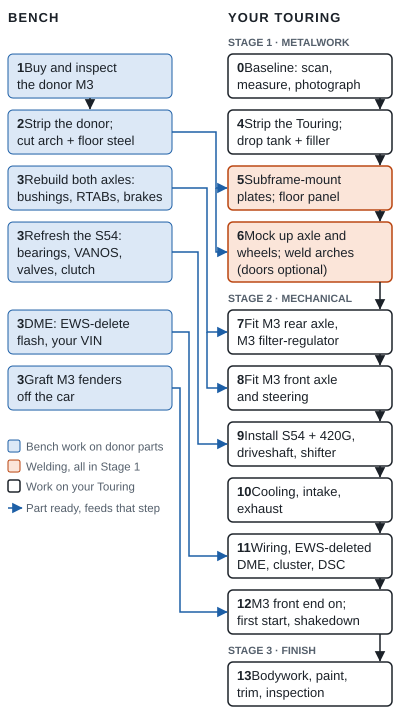 <!-- portrait -->

*Figure 3. Build order. The bench track feeds the car at four points: arch and floor steel, rebuilt axles, the refreshed engine, and the flashed DME. Grafted front fenders join before the first drive because the oil cooler needs the M3 bumper's airflow.*

[Time](#time) puts the phases on a calendar, with the bench work running alongside.

**How to use the phases.** Each phase says what to do and in what order, and links to the deep dives and the [Wiring and coding manual](WIRING-AND-CODING.md) for how. Torques are in [Torque values](#torque-values) and fluids in [Fluids and capacities](#fluids-and-capacities). Each phase ends with a **Done when** table: the checks, what a pass looks like, and what to do if one fails. Don't cover a phase's work with the next one until every check passes.

**Keep the fallbacks.** Hold on to the parts on the hold list in [Space, storage and logistics](#space-storage-and-logistics), among them your Touring's DSC unit, brake booster, master cylinder and cluster, until the car has passed inspection. In one S54 Touring the M3's DSC unit never cleared its fault, and refitting the Touring's own unit cured it ([e46fanatics](https://www.e46fanatics.com/threads/m3-cluster-swap-dsc-light.1260275/)). Plan where two cars' worth of parts will live first: [Space, storage and logistics](#space-storage-and-logistics).

**Watch the whole order:** two DIY series film a complete conversion: [Tracks and Trails – building an E46 M3 Touring (2025), 06:00](https://www.youtube.com/watch?v=KE7iY3yYBZI&t=360s), on a North American 325i Touring, and [M346 Projects – SMG Touring build Pt 1 (2023), 06:40](https://www.youtube.com/watch?v=YqM2rQw1HQI&t=400s), on a US Touring with a convertible donor. Treat their exhaust as a warning, not a model: both cars ended up with catless headers ([Tracks and Trails – first drive (2026), 47:00](https://www.youtube.com/watch?v=pvR3ovRfQHg&t=2820s), [M346 Projects – Euro header install (2024), 10:20](https://www.youtube.com/watch?v=pENUiROUII0&t=620s)). Keep the M3's catalysts and every other emissions part ([Registration and legal](#registration-and-legal-us)).

### Phase 0: Paperwork and baseline

1. **Decode your VIN** and note the build date and option codes. Then confirm what you have ([Check your own Touring first](#check-your-own-touring-first) explains each check):
   - **A rear-drive 325i**, not an xi. At [bmwfans](https://bmwfans.info/vin/) an xi's VIN decodes as "325xi" (NHTSA's decoder calls it a "325i"), and its vehicle order carries option `$203`, all-wheel drive. If it's an xi, choose a route in [325xi: rear drive or all-wheel drive](#325xi-rear-drive-or-all-wheel-drive) before you buy a donor: it changes which donor you want.
   - **An M54B25 engine with a plastic tank**, not the M56 SULEV. BMW's bulletin introduced the M56 for 2003 with automatics, for California, New York and Massachusetts (Vermont from 2004). BMW's catalog can be read as listing a five-speed for the US 325i M56 Touring, but only in groups shared with other engines, and its M56 gearbox-module harness is for automatics only, so a manual M56 is probably a conversion. Either way a manual doesn't prove an M54: check the engine code and the tank. An M56 car has a pump controller, a metal tank and no return line, and the fuel plan doesn't apply ([BMW B11 75 02](https://archive.org/download/BMWTechnicalTrainingDocuments/ST055%20Engine%20Electronics%20%28Archive%202%29/08_SULEV.pdf), [ETK: gearbox](https://bmwfans.info/parts-catalog/E46-Touring/USA/325i-M56/L-N/browse/manual_transmission/manual_transmission_s5d_g/), [ETK: pump controller](https://bmwfans.info/parts-catalog/16146912019/)).
   - **The DME:** an MS43 if built to 02/2003, an MS45.1 from 03/2003; confirm it on the label ([ETK](https://bmwfans.info/parts-catalog/E46-Touring/USA/325i-M54/L-N/browse/engine_electrical_system/programmed_dme_control_unit_2/), [manual](WIRING-AND-CODING.md#which-dme-your-touring-has)). The re-pin list depends on it.
   - **DSC, not ASC only.** BMW lists ASC-only units for US Tourings, mostly up to 09/2001, and those cars have no steering-angle sensor ([ETK](https://bmwfans.info/parts-catalog/E46-Touring/USA/325i-M54/L-N/browse/brakes/asc_hydro_unit_control_unit_support/)).
   - **Facelift or not.** Tourings built from 09/2001 have the facelift front, which matters for fenders and bumper supports, and store their options as a vehicle order (FA) instead of the older key code (ZCS) ([BMW ST406](https://archive.org/download/BMWTechnicalTrainingDocuments/ST406%20Coding%20%26%20Programming/06%20Vehicle%20Coding%20Information.pdf)). That matters when an M3 module has to accept your car.
   - **Climate control:** automatic (IHKA) or manual (IHKR). A/C has only been confirmed working with the S54 on IHKA cars, so test it early on an IHKR car ([e46fanatics](https://www.e46fanatics.com/threads/kalims-s54-sedan-swap-warning-pic-heavy.889867/page-38)).
   - **The console switch panel.** Some Tourings have only a DSC button; the M3 Sport button then needs the M3 switch unit and its power feeds as well as two DME wires ([Tenza Motorsports – 5 things part 2 (2021), 08:45](https://www.youtube.com/watch?v=mDBiRn30fEs&t=525s)).
2. **Get the factory documentation** ([Factory documentation and coding kit](#factory-documentation-and-coding-kit)). Pull wiring diagrams (WDS) with your Touring's VIN loaded for the body side and the donor's for the engine side. One Touring swapper found the diagrams changed once his car's VIN was loaded ([e46fanatics](https://www.e46fanatics.com/threads/battery-and-oil-pressure-lights-inop.1207433/)).
3. **Ask your state** what an engine change needs, and get the answer in writing: put the [questions for your state program](#questions-for-your-state-program) to it ([Registration and legal](#registration-and-legal-us)). In Massachusetts, write to MassDEP and the RMV Title Division as set out in [Massachusetts](#massachusetts), and photograph your Touring's underhood emissions (VECI) label: its LEV, ULEV or SULEV category matters there. In California every engine change goes to a BAR Referee, and Smog Check fails modified DME software that doesn't match an OEM or CARB-approved configuration ([BAR](https://www.bar.ca.gov/engine-changes), [BAR, 2021](https://www.bar.ca.gov/pdf/bag/202107/bar-ois-modified-software.pdf)). Wherever software is checked, ask whether a VIN-matched EWS-delete flash passes before you choose your immobilizer route.
4. **Build and prove the coding kit on the unmodified Touring**, before you change anything ([Wiring and coding manual: before you start](WIRING-AND-CODING.md#before-you-start)). The usual failures are a cable without pins 7 and 8 bridged (an E46's body modules talk on pin 8) and a COM port that doesn't match `obd.ini` ([e46fanatics](https://www.e46fanatics.com/threads/installing-bmw-standard-tools.1322014/), [NAM3](https://nam3forum.com/forums/forum/main-forum/e46-2001-2006/293965-verify-ncsexpert-function-before-doing-manual-swap)). PA-Soft needs its own interface, and its driver is the step most likely to fail on Windows 10 and 11 ([e46fanatics](https://www.e46fanatics.com/threads/installing-bmw-standard-tools.1322014/)). The software circulates through forums and vendors, not BMW.
5. **Back up everything** with the Touring's original modules fitted, as the manual's [Session 1](WIRING-AND-CODING.md#session-1-vehicle-order-and-codings) and [backup list](WIRING-AND-CODING.md#back-up-everything-first) describe: the FA or ZCS, read from both the light module (ALSZ) and the cluster (AKMB), with screenshots of the option list, production date and type code ([e46fanatics](https://www.e46fanatics.com/threads/diy-how-to-code-fa-for-at-mt-swap.1290835/)); each module's coding files (`FSW_PSW.TRC` and `NETTODAT.TRC`) for the cluster, light module (LCM), GM5, DSC, EWS, climate control, and the airbag, steering-angle and park-distance modules if fitted ([ECUWorx](https://www.ecuworx.co.uk/uploads/M-Track.pdf)); the cluster and LCM EEPROMs, read with PA-Soft ([e46fanatics](https://www.e46fanatics.com/threads/e46-m3-cluster-coding.1278842/)); and every module's part number and fault list. Photograph the odometer, and note the mileage the cluster and the LCM each hold. With the DME still in, run its leak-test jobs and tag each X60004 wire with what it does: on an MS45.1 that settles which pin carries the leak-test pump ([manual](WIRING-AND-CODING.md#dm-tl-leak-test-pump-test-before-you-swap)).
6. **Inspect your own shell.** Check the rear axle carrier panel (RACP) at all four subframe mounts, top and bottom, against CMP's list of failure points ([CMP, part 1](https://cmpautoengineering.com/pages/part-1-will-my-e46-subframe-crack-how-will-i-know), [part 2](https://cmpautoengineering.com/pages/part-2-it-s-not-just-the-subframe-mounts)). Check the rear arches (rust starts at the inner lip, [Redish](https://www.redish-motorsport.com/BMWE46M3RearWheelArchesRust.html)), sills, jacking points, battery box and the floor round the tank brackets. A badly cracked RACP changes the plan: BMW's 21 kg replacement panel (41117000246, [ETK](https://bmwfans.info/parts-catalog/41117000246/)) is discontinued: BMWPartsDeal marks it "This part is discontinued" (last price \$1,304.68, October 2026), so ask a dealer whether a successor exists ([BMWPartsDeal](https://www.bmwpartsdeal.com/parts/bmw-repair_part_insert_rear_axle_support-41117000246.html), [Turner](https://www.turnermotorsport.com/p-69405-41117000246-genuine-bmw-part/)).
7. **Record the baseline** before anything changes:
   - **Ride height** ([how](#massachusetts-ride-height-baseline)): on level ground, loaded to BMW's normal position for your Touring: a full tank (or 3.2 kg (7 lb) in the cargo area for each US gallon short), 68 kg (150 lb) on each front seat, 68 kg in the middle of the rear seat and 21 kg (46 lb) in the middle of the cargo area. Set the tires to placard pressure, bounce each corner and roll the car a few feet. At each corner measure BMW's ride height (rim flange to arch edge), the heights of the hub center and the arch lip, and the jacking-point height; then the roof height at marked points front and rear. Compare the ride heights with BMW's figure for the label on each front strut: "6Z Serie" on 16-inch wheels, 589 mm front and 555 mm rear; "6Z Sport" on 17-inch wheels, 589 and 554 mm; ±10 mm ([BMW's figures](#ride-height-bmws-method-and-figures)). The roof and jacking points are your reference for Massachusetts' ride-height rule, because the arch lips get replaced ([Massachusetts](#massachusetts)); the corner heights are your reference for the arches.
   - **Label and options:** read the door-pillar label's GVWR and axle ratings (expect 2,045, 900 and 1,210 kg on a manual), and note S226A sport suspension or S338A M Sport II in the option codes.
   - **Alignment and photos:** an alignment printout, asking the shop to include BMW's ride-height figure for your car if its database has one; photos of the engine bay, the DME box (E-box), the harness routing and the underside.
   - **A/C and fans:** run BMW's A/C quick check: windows and doors shut, engine at 1,500–2,000 rpm, blower on medium, maximum cold, A/C on for more than 3 minutes. The centre vent should blow at least 11 °C (20 °F) below the outside air ([BMW ST054, A/C service](https://archive.org/download/BMWTechnicalTrainingDocuments/ST054%20Climate%20Control/07_AC%20Service%20and%20Diagnosis.pdf)). Photograph the underhood A/C label, which gives the refrigerant charge and oil. Note the fan layout: a manual Touring should have an electric fan in its radiator shroud, with plug X82 on the shroud; look in front of the condenser for a second fan ([Cooling and oil cooler](#cooling-and-oil-cooler)). Book a shop to recover the refrigerant before teardown (Phase 4).
   - **Rear doors:** mark three points along each rear door's trailing edge and record the shut gap with feeler gauges and the flush with a straightedge across the gap: the arch work has to put them back ([worksheet](WORKSHEETS.md#arches-and-doors)).

**Watch:** [50sKid – coding the vehicle order (2017), 08:52](https://www.youtube.com/watch?v=FiBr1h9j0bU&t=532s) reads the FA from an E46's cluster.

**Done when**

| Check | Pass | If it fails |
|---|---|---|
| Coding kit | INPA shows two solid black dots and reads the DME, cluster, LCM, EWS and DSC; NCS Expert reads the FA or ZCS | Bridge pins 7 and 8, match the COM port, try another INPA build. Don't back up or code anything until this works |
| Backups | FA or ZCS screenshots, a coding file per module, cluster and LCM EEPROM files and fault lists, stored in two places | Repeat. Never change a module you haven't backed up |
| Your car | Engine code, tank, DME, DSC, climate control and switch panel recorded | M56, xi or ASC only: re-plan the fuel, axle or DSC parts before you buy a donor |
| Shell | RACP, arches, sills and jacking points inspected and photographed | Cracks: plan their repair for Phase 5. Torn or rotten floor: get a body-shop quote before you buy the donor |
| Baseline | Corner, jacking-point and roof heights recorded at BMW's normal-position load; BMW's ride height within 10 mm of its figure for your strut label, left and right within 10 mm at each axle | Outside that, or a bigger split: a sagging spring or a damaged part. Note it, so it isn't copied into your targets |
| Door gaps | Rear door gaps and flush recorded at three marked points per door | Record them before any welding; the arches have to put them back |
| Your state | Written answer on what the engine change needs | No answer yet: don't buy the donor |

### Phase 1: Buy and inspect the donor

1. Shortlist manual M3s that meet the model-year rule ([Choose the donor](#choose-the-donor)). Ask for the VIN, build date and a photo of the engine number. If you might use its DSC unit, prefer one built 09/2002 or later. From then the US M3 has an MK60 with the same 47-pin plug as a Touring built from 09/2001; earlier M3s have an MK20 with a 43-pin plug and a separate pre-charge pump ([ETK, from 09/2002](https://bmwfans.info/parts-catalog/E46-Coupe/USA/M3-S54/L-N/browse/brakes/hydro_unit_dsc_fastening_sensors/), [ETK, to 09/2002](https://bmwfans.info/parts-catalog/E46-Coupe/USA/M3-S54/L-N/browse/brakes/hydro_unit_dsc_control_unit_fastening/)).
2. Inspect with the checklist in [Choose the donor](#choose-the-donor). Do a compression test and a leak-down and compare the cylinders. One compilation gives about 11–12 bar minimum for the S54, about the same on every cylinder ([Flow torque compilation, p.47](https://drive.google.com/file/d/1GS3Hirx6x0c0WG8hPeXiwfXfeUldkQnm/view?usp=sharing); confirm in TIS).
3. Confirm the panels you need are straight and sound: hood, fenders, headlights, bumper, both rear arch areas including the inner lips, and the trunk floor. M3 inner arches rust from the inside ([Redish](https://www.redish-motorsport.com/BMWE46M3RearWheelArchesRust.html)); one builder's donor lost its inner arch as soon as it was stripped ([Autoalex Cars – Part 1 (2023), 07:40](https://www.youtube.com/watch?v=RyoFFLppseE&t=460s)).
4. Collect the title or salvage paperwork and a bill of sale. Photograph the engine number and VIN plates; inspectors and insurers may ask for them.
5. **Before teardown, while it runs,** record what you can't test later. How to run each test, and what to look for, is in the [Test it while it still runs](#choose-the-donor) table:
   - **Modules:** every module's part number, software version and fault list, read with INPA. Note whether the DSC is an MK60 or an MK20.
   - **DME:** its identity, fault memory and AIF data (the record that holds the VIN), read with Tool32 and saved before it goes to a vendor ([ECUWorx](https://www.ecuworx.co.uk/2016/02/26/adding-updating-your-vin-uif-with-tool32/)).
   - **Cluster:** its EEPROM, read with PA-Soft and kept untouched ([e46fanatics](https://www.e46fanatics.com/threads/diy-m3-cluster-into-non-m-retrofit.1277945/)).
   - **VANOS:** Tool32's timing and leak tests on a warm engine, coolant at 85 °C (185 °F) or more, to compare with after the refresh ([MSS54 job reference](https://github.com/emdzej/ediabasx-docs-sgbd/blob/main/docs/sgbd/MSS54DS0.md)). Owners and ISTA, not BMW, put a healthy adjustment time at about 180–300 ms (ISTA's limit 500 ms) and the leak test within about ±5 °KW; a status reading "weggedriftet" means the VANOS leaks ([manual, Session 6](WIRING-AND-CODING.md#session-6-first-start-adaptations-and-throttle-check)).
   - **Fuel pressure,** at the threaded test fitting on the regulator beside the filter, with the pump on a bypass (pins 6 and 2 of the module's plug X10157): 5.0 ± 0.2 bar (72.5 ± 2.9 psi); 20 minutes later no more than 0.5 bar (7 psi) lost and still 4.5 bar (65 psi) or more. It decides whether the donor's regulator goes back in ([Filter-regulator and vacuum reference](#filter-regulator-and-vacuum-reference)) ([BMW ST041, part 2](https://archive.org/download/BMWTechnicalTrainingDocuments/ST041%20M3%20Complete%20Vehicle/3%20EngineElectronics%20%28Part%202%29.pdf), [Bentley, quoted on e46fanatics](https://www.e46fanatics.com/threads/fuel-pressure-info.1116777/)). If you want the untested pump-control lead, also note Tool32's `STAT_EKP_CFG_VERBAUT_WERT` ([manual](WIRING-AND-CODING.md#faults-that-look-like-pump-faults)).
   - **Road test:** every gear without a grind, no diff clunk, clutch, steering, brakes, ABS and DSC, and A/C that blows cold.
   - **Labels:** photos of the B-pillar tire placard and the underhood A/C and emissions labels.
   - **Arch targets:** on a level floor, on the donor's BMW 18- or 19-inch wheels, loaded to BMW's normal position for an M3 (a full tank, 68 kg (150 lb) on each front seat and 14 kg (31 lb) in the middle of the trunk), at all four corners: BMW's ride height, rim flange to arch edge (605 mm front and 587 mm rear on 18-inch wheels, 619 and 600 mm on 19-inch, each ±10 mm, left and right within 10 mm; outside that, use BMW's figure as your target, not the donor's stance; [BMW's figures](#ride-height-bmws-method-and-figures)); then the heights of the hub center, the arch lip and a body point both cars share, such as the floor beside each rear subframe mount, and how far the lip sits outboard of the tire's sidewall. Subtract to get each corner's hub-to-body and hub-to-lip figures: they give you the M3's stance and where your new arches go in Phase 6 ([Measure and mock up before you cut](#measure-and-mock-up-before-you-cut)).
   - **Exhaust at ride height:** on the same level floor, the muffler's lowest point above the ground, each tip's center height and offset from the centerline, and the smallest gap from a tip to its bumper cut-out. No source publishes them, and they become your targets ([Floor and exhaust positions](WORKSHEETS.md#floor-and-exhaust-positions)).
   - **Springs and struts:** photograph the paint marks on each spring and the symbol on each front strut, and note the strut and damper part numbers. They identify the donor's spring-table parts ([Suspension for Touring weight](#suspension-for-touring-weight)).
6. Book refrigerant recovery for the donor while it can still be driven or towed to a shop.

**Watch:** [Autoalex Cars – Part 1 (2023), 00:40](https://www.youtube.com/watch?v=RyoFFLppseE&t=40s) inspects a donor M3 on a ramp: split brake hoses, a bulging tire, and a trunk floor cracked by an old impact on the rear brace.

**Done when**

| Check | Pass | If it fails |
|---|---|---|
| Engine | Compression and leak-down even across cylinders; VANOS adjustment about 180–300 ms (ISTA's limit 500 ms), leak within about ±5 °KW, no "weggedriftet" (owner and ISTA figures, not BMW's); fuel pressure 5.0 ± 0.2 bar (72.5 ± 2.9 psi), and 4.5 bar or more after 20 minutes | Low or uneven: budget a head or engine job, or walk away |
| Electronics record | Module IDs and faults, DME identity and AIF, and cluster EEPROM saved | Repeat before anything is unplugged |
| DSC | Unit type noted: MK60 or MK20 | MK20: plan to keep your Touring's DSC (option A) |
| Measurements | Hub, lip and body-point heights and lip offsets at four corners, with hub-to-body and hub-to-lip worked out; BMW's ride height at the M3 load, rim flange to arch edge, 605 mm front and 587 mm rear ±10 mm on 18-inch wheels (619 and 600 mm on 19-inch), left and right within 10 mm; muffler and tip positions recorded; spring marks, placard and labels photographed | Measure before the car is lifted or stripped. Outside BMW's ride-height range, use BMW's figure as your Phase 6 target |
| Paperwork | Title or salvage paperwork and bill of sale in hand; engine number and VIN plates photographed | Don't buy without them |

### Phase 2: Strip the donor

1. Have a shop recover the A/C refrigerant before you open any line, and write down how much refrigerant and oil came out; venting it is prohibited ([EPA](https://www.epa.gov/mvac/regulatory-requirements-mvac-system-servicing)). Drain the engine oil, coolant, gearbox, diff, power-steering and brake fluid, and the fuel tank, into approved containers, and dispose of them properly ([Safety](#safety)). The M3 radiator has no drain plug: drain the coolant at the lower radiator hose and at the block's drain plug (13 mm) ([Blankowski](https://blankowski.com/Cars/m3_coolant_change/)).
2. Label both halves of every connector with matching tags and photograph everything before it comes apart. Bag and tag fasteners by assembly. Support or strap the car before the engine or an axle comes out: its balance shifts on stands or a lift ([Safety](#safety)). Before the exhaust comes off, with the car on a lift, record the hanger stud positions, the exhaust's gaps and the M3 well's depth from the rear-mount datum, and mark and count the floor's perimeter spot welds ([Floor and exhaust positions](WORKSHEETS.md#floor-and-exhaust-positions); [method](#exhaust-and-the-spare-wheel-well)).
3. Work down the [Parts list](#parts-list) and tag every **Donor M3** line as it comes off. Easy to miss:
   - **Cabin:** cluster; the console switch unit with the Sport button (61316925520 on a coupe, 61316925521 on a convertible; [ETK](https://bmwfans.info/parts-catalog/61316925520/), [ETK](https://bmwfans.info/parts-catalog/61316925521/)); the M3 clutch-switch module (61319122700, [ETK](https://bmwfans.info/parts-catalog/E46-Coupe/USA/M3-S54/L-N/browse/pedals/pedals_stop_light_switch/)); accelerator pedal; shift lever and carrier; mirrors; and the steering wheel if you want it (disarm the airbag per BMW's procedure first).
   - **Engine bay:** the complete engine harness with the DME, its gearbox-module harness and the whole E-box branch: the fuse carrier, the E-box plugs X6011, X6021, X6053 and X6054, and the battery feed X64101/X64102 ([manual](WIRING-AND-CODING.md#e-box-plugs)). Also the brackets for the expansion tank and secondary-air pump (41147894115 and 41147894116, on the front of the right strut tower), which a non-M body doesn't have: measure and photograph their positions before you cut them off ([Tracks and Trails – first drive (2026), 23:20](https://www.youtube.com/watch?v=pvR3ovRfQHg&t=1400s)); radiator, shroud, both fans, oil cooler and lines; the heater hoses, and the heater valve if you'll use the M3's; power-steering reservoir, lines and cooler; the A/C pressure hose 64536902681, compressor to condenser (the other A/C lines match your Touring's); and the DSC unit with its lines and the master cylinder, plus the brake booster if you plan DSC option B. Keep the booster's check valve (34331161300) with the S54's booster hose: it goes into your booster ([Brakes and bleeding](#brakes-and-bleeding)).
   - **Underside:** label every fuel-line end (feed, return, purge) and photograph the clip positions first. Take the fuel filter-regulator with its vacuum-hose set and metal sleeve and the filter cover's sealing element (13327830949); the M3 fuel lines (16122229409, 16122229410, 16122229411) with their tubing supports (16122282049, 16131177494); the fuel pipes set (16112283288); and the front purge line (16132229652) ([ETK](https://bmwfans.info/parts-catalog/E46-Coupe/USA/M3-S54/L-N/browse/fuel_supply/fuel_pipe_and_mounting_parts/)). From the tank, take the in-tank set (delivery unit 16142229684, left sender 16142229683, jet pump 16142282208 and baffle 16112229656), or the whole tank with every hose off before you lower it ([Fuel system](#choose-the-pump-route)). For an M3 trunk floor, also take the canister holder (16132229735) with its nuts, its cover (51717893604), the vent pipes (16132283286, 16132229415) and the rear purge line (16132229417); the complete exhaust with hangers and heat shields; the front heat shields, which differ on the M3 ([Project BMW – S54 into a Touring (2021), 00:20](https://www.youtube.com/watch?v=iVGU_Yg0ZLw&t=20s)); the driveshaft; the clutch hard line; and the M3 front brake hoses (34322229723), which are M3-only ([ETK](https://bmwfans.info/parts-catalog/34322229723/)), though new ones are better ([Brakes and DSC](#brakes-and-dsc)). The brake pipes can stay with the shell: an M3 built from 09/2002 uses the same pipes as your Touring ([Brakes and bleeding](#brakes-and-bleeding)).
   - **Engine and gearbox:** with a lift you can drop the front subframe with the engine still on it, as one UK builder did ([PistonHeads](https://www.pistonheads.com/gassing/topic.asp?h=0&f=47&t=1655205)); otherwise remove the gearbox and lift the engine out the top. Keep the gear-identification switch (23142229113) on the 420G; cruise control needs it ([NAM3](https://nam3forum.com/forums/forum/main-forum/e46-2001-2006/2844-smg-to-6mt-conversion)).
   - **Front axle and steering:** the rack with its tie rods and lines, control arms and brackets, struts, knuckles, hubs, brakes, sway bar and links, and the front reinforcement plate.
   - **Rear axle as one unit** ([FCP Euro, part 1](https://www.fcpeuro.com/blog/how-to-overhaul-the-bmw-e46-m3-rear-subframe-part-1)): subframe, diff, trailing arms with brakes and parking-brake shoes, half-shafts, sway bar, the tubular push rod (33312229295) and the V-brace (33312229899) ([ETK](https://bmwfans.info/parts-catalog/E46-Coupe/USA/M3-S54/L-N/browse/rear_axle/rear_axle_carrier/)). If you'll fit the V-brace, also cut out its body mounting boxes with their reinforcement panels (Phase 5). Take the rear dampers with their M3 top mounts (33526779670) and bump stops, and photograph each spring's paint marks before it comes out.
   - **Wheel-speed sensors, from an MK60 donor** (built from 09/2002): the same active type as your Touring's, so keep them as spares. An MK20 donor's are inductive sensors that don't fit your harness or suit your MK60 ([manual](WIRING-AND-CODING.md#wheel-speed-and-pad-wear-sensors)). That's why a 2004 Touring with a 2002 donor found the plugs didn't mate ([Tenza Motorsports – 5 things part 2 (2021), 03:15](https://www.youtube.com/watch?v=mDBiRn30fEs&t=195s)), while on a 2003 xi Touring, whose Bosch sensors use the same blue housings, the M3 sensors' plugs mated ([e46fanatics](https://www.e46fanatics.com/threads/m3-touring-project.1240087/), [Driveline and rear axle](#driveline-and-rear-axle)).
4. Remove the front panels: hood, fenders, headlights, bumper with its carrier and supports, kidney grilles and liners.
5. Cut out the metal you'll graft ([Rear arches and doors](#rear-arches-and-doors)), drilling out spot welds where you can instead of cutting:
   - both rear arch areas with generous margins: the outer skin plus as much of the inner wheel tub as you can get, or "you're going to have a gap" ([M346 Projects – Touring build Pt 14, body work (2024), 33:00](https://www.youtube.com/watch?v=4_LqrbAlNmw&t=1980s));
   - the fuel filler flap with its surround;
   - if you'll graft the donor's floor rather than fit a new one (the guide recommends new: [Exhaust and the spare-wheel well](#exhaust-and-the-spare-wheel-well)), the trunk floor around the muffler, cut with generous margins, with its front reinforcement (51717894229), which coupe and convertible floors both carry ([ETK](https://bmwfans.info/parts-catalog/E46-Coupe/USA/M3-S54/L-N/browse/bodywork/mounting_parts_for_trunk_floor_panel/));
   - the M3 muffler brackets, unless you'll buy them new (\$27.19 and \$71.40 at BMWPartsDeal, October 2026): the rear-left (41122494844) and the right (41112493931). The right one sits on the right rear side member, not the floor, so cut it off the rail with 20–30 mm (about 1 in) of metal round it (our estimate).

   Before you cut the arches, take the rear bumper off and record each quarter: laser-to-skin offsets every 100 mm from 400 mm ahead of the rear axle to 500 mm behind it, at the lip and 30 mm under the shoulder crease, and section templates in 3 mm hardboard or stiff card at seven stations (400, 300 and 150 mm ahead of the axle, at the axle, and 150, 300 and 450 mm behind it) ([Datum, stations and templates](#datum-stations-and-templates), [worksheet](WORKSHEETS.md#arch-targets)). They show up accident damage now and give you the Phase 6 targets. Cut 40–50 mm outside the seam lines you plan for the Touring ([Flare profile](#flare-profile)), and count the spot welds you drill along each lip.
6. Sell what you won't use, such as SMG parts, the donor interior and glass, and a convertible's top. Keep the donor's DSC unit until your DSC plan has worked.
7. Dispose of the shell and its title the way your state requires ([Space, storage and logistics](#space-storage-and-logistics)).

**Watch:** [DBO – pulling an E46 M3 engine (2019), 27:01](https://www.youtube.com/watch?v=SH-J8ngKerk&t=1621s); [M346 Projects – SMG Touring build Pt 1 (2023), 06:40](https://www.youtube.com/watch?v=YqM2rQw1HQI&t=400s) cuts the quarters and trunk floor from a convertible donor.

**Done when**

| Check | Pass | If it fails |
|---|---|---|
| Parts | Every Donor M3 line on the parts list removed, tagged, photographed and stored dry | Missing or damaged: order it now, while you can still compare it with the donor |
| Fluids | Refrigerant recovered (receipt kept); all fluids drained and disposed of | Recover before any A/C line is opened |
| Floor and exhaust record | Hanger studs, exhaust gaps and well depth recorded from the rear-mount datum before the exhaust came off; floor spot welds counted | Record what you still can before the floor is cut ([Floor and exhaust positions](WORKSHEETS.md#floor-and-exhaust-positions)) |
| Body steel | Arches with inner tubs, filler surround and, if you'll graft it, the floor section cut with margins; offsets recorded and templates made at seven stations per side, bumper off, left and right within 3 mm (our suggestion) | Rotten or damaged donor steel: plan new BMW or aftermarket panels now ([Rear arches and doors](#rear-arches-and-doors)) |
| Shell | Shell and title disposed of as your state requires | Keep the donor's paperwork and engine-number photos either way |

### Phase 3: Bench work

This runs alongside Phases 4 to 8. The axles must be ready for Phases 7 and 8, the engine for Phase 9, the DME for Phase 11 and the fenders for Phase 12.

1. **Refresh the S54 on a stand** ([S54 refresh on the stand](#s54-refresh-on-the-stand)): rod bearings, VANOS, valve clearances, seals, rear main seal, water pump, thermostat and engine mounts.
   - **Identify the rod bolts by their heads, not the build date.** E-Torx (E12) heads are M10 bolts: always new, and tightened in three full cycles. Twelve-point (12 mm) heads are M11 bolts: reused, each in its own hole, and tightened once. BMW warns that not following the M10 procedure "will result in serious engine damage" ([BMW SI B11 04 04](https://nam3forum.com/forums/filedata/fetch?id=5213)).
   - **Check the clearances with Plastigauge using the old bolts,** and fit new M10 bolts only for final assembly: each check would use up one of a new bolt's tightening cycles. BMW's figure is 0.040–0.070 mm ([BMW TIS 11 24 571](https://adkusters.dsmynas.com/Website%20mynas/TIS%20documents%20PDF%20aanvulling/11_24_571.pdf)). Some videos quote 0.03–0.07 mm; use BMW's.
2. **Clutch and flywheel:** new flywheel bolts and pressure-plate screws (both single-use) and a new pilot bearing ([Torque values](#torque-values), [Consumables and single-use parts](#consumables-and-single-use-parts)).
3. **Service the 420G while it's out:** new input, selector-shaft and output seals ([ETK printout in the Flow compilation, p.74](https://drive.google.com/file/d/1GS3Hirx6x0c0WG8hPeXiwfXfeUldkQnm/view?usp=sharing)), the gear-identification switch if it's worn, and new shifter bushings. Fill it in Phase 9, once it's in the car and level.
4. **Rebuild the axles:** M3 subframe and diff mounts, rear trailing-arm bushings, worn arms, ball joints and end links, and the brakes. Fit the rear control arms to the subframe before the diff: one arm bolt can't go in with the diff in place ([Tracks and Trails – perfecting the Touring's rear end (2025), 33:20](https://www.youtube.com/watch?v=eMJLXbvzckE&t=2000s)). Keep powder coat out of the bushing bores. If a diff output flange comes out, mark its bolt first and refit it to the mark, which keeps the bearing preload ([Flow compilation, pp.80–81](https://drive.google.com/file/d/1GS3Hirx6x0c0WG8hPeXiwfXfeUldkQnm/view?usp=sharing)). Fit the diff to the subframe here and torque its mounts on the bench, where you can reach them: front M14 bolt 200 Nm (148 ft-lb), rear M12 Torx bolts 20 Nm + 90° ([Driveline and rear axle](#driveline-and-rear-axle)). Leave the rubber-bushed joints snug; you torque them at ride height in Phase 7.
5. **Send the DME away** if you chose the delete route ([Immobilizer (EWS)](#immobilizer-ews), [Shop briefs](#shop-briefs)). Order the EWS delete and your Touring's full VIN. If the donor was an SMG car, add the manual (HS) software or a transmission-swap change: coding alone left one swapped car's SMG DME in limp mode ([UNRIVALED – watch this before you S54 swap (2021), 02:02](https://www.youtube.com/watch?v=eddLff8yba0&t=122s), [NAM3](https://nam3forum.com/forums/forum/special-interests/coding-tuning/2052-comprehensive-mss54-mss54hp-dme-information)). Decline every secondary-air, O2-sensor, catalyst and EVAP delete. Don't accept a Euro software flash either: it may drop US-only emissions functions such as the fuel-tank leak test, whose pins the DME tables mark "USA" ([pinout sheet](https://docs.google.com/spreadsheets/d/1I_2XAvziPCiRlZXnkfk4x1tUIKy4TKPbmdJcGCBdGIg/edit?usp=sharing)). The alternative, syncing the DME to your EWS, works only with a virgin DME: a used one has its rolling-code table burned in for good ([BMW ST051](https://archive.org/download/BMWTechnicalTrainingDocuments/ST051%20Body%20Electronics%20I%20%28Archive%201%29/05%20EWS.pdf)).
6. **Prepare the M3 cluster** now if you use a cluster service: your VIN, set to take your car's true mileage, and the rear-door warning LEDs that M3 clusters lack ([e46fanatics](https://www.e46fanatics.com/threads/diy-m3-cluster-into-non-m-retrofit.1277945/), [Instrument cluster and mileage](#instrument-cluster-and-mileage)). Otherwise do it in Phase 11.
7. **Graft the M3 front fenders** off the car, if you're using genuine fenders ([Front end on a 4-door body](#front-end-on-a-4-door-body)).
8. **Driveshaft:** bolt a new flex disc to the shaft's front flange, with the M3's bolts and new self-locking nuts, at 115 Nm, turning the bolt and not the nut; its gearbox side waits for Phase 9. Fit a new center mount ([Driveline and rear axle](#driveline-and-rear-axle)).
9. **Choose and buy** the springs, dampers, wheels and tires you'll run ([Suspension for Touring weight](#suspension-for-touring-weight), [Wheels, track and offsets](#wheels-track-and-offsets)); Phase 6 builds the arches around them. One S54 Touring on moved-over M3 coupe suspension sat so low that its rear tires rubbed ([Tenza Motorsports – coilovers (2022), 00:40](https://www.youtube.com/watch?v=Sit-SmfU-9k&t=40s)). Before you order springs, ask a dealer for an M3 coupe's and an M3 convertible's spring numbers by VIN: BMW picks springs from a spring table, and your rear wants about 7–9% more rate than a coupe's (our estimate).

**Watch:** [FCP Euro – S54 rod bearings (2022), 20:51](https://www.youtube.com/watch?v=Emjw22o_V8c&t=1251s) shows the three M10 cycles; [Paul Vo – rod bearing torque procedure (2017), 08:00](https://www.youtube.com/watch?v=O345BKC8EkM&t=480s); [ECS Tuning – S54 VANOS rebuild (2025), 17:30](https://www.youtube.com/watch?v=vhsxb5IRa8s&t=1050s), which fits E39 M5 (S62) diaphragm springs and plates; [FCP Euro – S54 valve adjustment (2022), 17:19](https://www.youtube.com/watch?v=6xtAIiKbKmM&t=1039s); [FCP Euro – E46 M3 clutch (2022), 17:19](https://www.youtube.com/watch?v=NmEOFBqreX8&t=1039s); [FCP Euro – E46 M3 control arms and bushings (2020), 12:23](https://www.youtube.com/watch?v=usfbSLE_1aI&t=743s).

**Done when**

| Check | Pass | If it fails |
|---|---|---|
| Rod bearings | Plastigauge reads 0.040–0.070 mm on every rod (old bolts); final bolts fitted and tightened to the procedure for their type | Out of range: measure the crank journals. BMW lists 0.25 mm undersize shells ([ETK](https://bmwfans.info/parts-catalog/E46-Coupe/USA/M3-S54/L-N/browse/engine/crankshaft_connecting_rod/)), which means a machine shop |
| VANOS | New seals and oil-pump disc; exhaust-hub tabs intact or the hub replaced ([Beisan](https://beisansystems.com/s54-vanos-procedure-e46-m3/)); the cam bridge sits flat and the crank pin slides in after reassembly ([ECS Tuning – S54 VANOS rebuild (2025), 55:11](https://www.youtube.com/watch?v=vhsxb5IRa8s&t=3311s)) | Re-time before the covers go on |
| Valves | Intake 0.18–0.23 mm, exhaust 0.28–0.33 mm, measured below 35 °C ([BMW S54 module](https://www.billswebspace.com/MS54B32TrainingModule.pdf)) | Re-shim |
| Clutch and 420G | Flywheel and pressure plate on new bolts, torqued and marked; three new gearbox seals; gear switch fitted | Fix it now; later it's a gearbox-out job |
| Axles | Bushings, mounts and arms renewed; the diff on the subframe with its mount bolts torqued; bolts torqued and marked, rubber-bushed joints left snug | Re-press any bushing that went in crooked |
| DME | Back from the vendor with a written list of changes: EWS delete, your VIN, manual software if needed, and nothing else | Any emissions function removed: send it back |
| Running gear | Springs, dampers, wheels and tires in hand for the Phase 6 mock-up | Don't start Phase 6 without them |

### Phase 4: Strip your Touring

1. Have a shop recover the Touring's A/C refrigerant before you open any line ([EPA](https://www.epa.gov/mvac/regulatory-requirements-mvac-system-servicing)), and cap every opening. Ask the shop to write down how much refrigerant and how much oil came out: BMW puts the recovered oil back in at the charge ([Air conditioning](#air-conditioning)).
2. Disconnect the battery. Drain the oil, coolant and power-steering fluid. **Leave the brake fluid in:** your brake pipes stay, so cap each pipe end as you open it (the front hoses at the strut brackets, the rear hoses at their brackets, the clutch line), keep the reservoir full, and leave a pedal depressor holding the pedal slightly down, BMW's way to stop the reservoir draining ([TIS 34 32 971](https://workshop-manuals.com/bmw/3_series_e46/325i_m54_tour/2_repair_instructions/34__brakes/32__brake_lines/3_ra__replacing_both_rear_brake_hoses/)). Kept full, the DSC unit needs only BMW's bleed for caliper and hose work later, with the tester's routine on the rear circuit; if it runs dry, it needs the routine at every wheel ([Brakes and bleeding](#brakes-and-bleeding)).
3. **Drain the fuel.** Run the tank as low as you can beforehand, then pump the rest into approved containers, outdoors or with good ventilation and an extinguisher at hand ([Safety](#safety)). The E46 tank is a saddle tank whose left half empties through a siphon jet driven by the return flow ([BMW ST055](https://ia801005.us.archive.org/11/items/BMWTechnicalTrainingDocuments/ST055%20Engine%20Electronics%20%28Archive%201%29/8%20MS%20S54.pdf)), so check that half separately.
4. Remove the exhaust, driveshaft, M54 engine and gearbox, front suspension and steering, and rear axle. Two Touring builders took the front end off and pulled the engine out of the front ([Tracks and Trails – M54 removal (2025), 01:00](https://www.youtube.com/watch?v=3ud3sHHYU5g&t=60s), [Project BMW – S54 swap in a driveway (2021), 00:20](https://www.youtube.com/watch?v=BXtfn8-WCdk&t=20s)). Support or strap the car before each heavy part comes out, and again after: the balance shifts ([Safety](#safety)).
5. Drop the fuel tank and remove the filler neck, which runs right past the right-rear arch you'll be welding, and cap every line. BimmerWorld calls tank removal "recommended, but not required" for the subframe welding alone ([BimmerWorld](https://www.bimmerworld.com/About-Us/E46-Rear-Subframe-Floor-Reinforcement-Install/)); with the arches to weld as well, take it out. Then remove the EVAP parts near that arch and under the floor:
   - **Vapour separator.** A fuel expansion-tank bracket (41148196386) sits among the rear wheelhouse parts ([ETK](https://bmwfans.info/parts-catalog/E46-Touring/USA/325i-M54/L-N/browse/bodywork/rear_wheelhouse_floor_parts/)). It carries the liquid-vapour separator (16136752641), which sits in the right rear wheel well behind the trim, inside the arch graft ([BMW ST041 Part 3](https://archive.org/download/BMWTechnicalTrainingDocuments/ST041%20M3%20Complete%20Vehicle/3%20EngineElectronics%20%28Part%203%29.pdf)). Take it out with its vent hoses, keep the bracket (or transfer it if you graft the donor's inner tub), and refit both before the tank goes back in.
   - **Canister and leak-test pump.** Under the right rear of the floor, between the battery box and the spare-wheel well, sit the charcoal canister and the DM-TL leak-test pump ([Tenza Motorsports – No more SULEV (2021), 01:30](https://www.youtube.com/watch?v=PgW1oWs7cfk&t=90s)). Photograph them and record their position from the rear-mount datum ([Floor and exhaust positions](WORKSHEETS.md#floor-and-exhaust-positions)), then remove them with their hoses and covers (51718233265, 51718233266), cap the hoses and label the pump's plug. The Phase 5 mock-up decides where they go back ([Exhaust and the spare-wheel well](#exhaust-and-the-spare-wheel-well)).
6. Remove the rear seats, cargo-floor trim and carpet, rear trim, rear door cards, wheel-arch liners and battery. Empty the spare-wheel well (spare, jack, tool kit, anti-drone liner and deadener), and take out the control modules under the load floor, labelled, plus the rear washer reservoir and the sound-system parts in the side areas ([what's in the well](#exhaust-and-the-spare-wheel-well)). Strip sound-deadening back from every weld line, then record the well, the hanger plates and the battery vent and ground positions ([Floor and exhaust positions](WORKSHEETS.md#floor-and-exhaust-positions)).
7. Remove the M54 harness and DME for resale. The body harness stays.
8. Sell the M54, 5-speed, MS43 or MS45.1 DME and engine harness, the 325i axle parts and the Touring's front panels. Before the M54 goes, unbolt its A/C compressor, cap its ports and keep it until the A/C is charged: BMW sets the oil in a replacement compressor by what the old one held ([Air conditioning](#air-conditioning)). Keep the fallback parts in the hold list under [Space, storage and logistics](#space-storage-and-logistics).
9. Pressure-wash the underside and let it dry, then look again with everything off: the RACP from above and below, the rails, the inner arches, and the floor behind the tank and brake-pipe brackets, where builders have found trapped rust ([Autoalex Cars – Part 3 (2023), 12:40](https://www.youtube.com/watch?v=cwbRDG7XHa8&t=760s)).

**Watch:** [Tracks and Trails – M54 removal (2025), 06:20](https://www.youtube.com/watch?v=3ud3sHHYU5g&t=380s) supports the rear once the engine is out.

**Done when**

| Check | Pass | If it fails |
|---|---|---|
| A/C | Refrigerant recovered (receipt kept, with the refrigerant and oil amounts); every opening capped; the M54's compressor kept, ports capped | Already empty: note it. The drier is replaced at the charge in Phase 12 anyway |
| Brakes | Brake fluid left in: reservoir full, every opened pipe end capped, pedal depressor in place | Reservoir ran dry or a pipe stood open: plan the DSC routine at every wheel in Phase 11 ([Brakes and bleeding](#brakes-and-bleeding)) |
| Fuel | Both halves of the tank drained; tank, filler neck and EVAP parts, including the canister and leak-test pump, out and stored away from the work area | Fuel left in the left half: drain it through its sender opening |
| Support | Shell stable on stands or the lift with the engine and axles out | Re-position the supports before anyone works under it |
| Fallback parts | Every part on the hold list in [Space, storage and logistics](#space-storage-and-logistics) labelled and stored | Don't sell them yet |
| Inspection | Underside clean and dry; new findings photographed and added to Phase 5 | Plan the extra repairs before you buy plates |

### Phase 5: Metalwork 1, subframe mounts and floor

This is the point of no return: once you cut into your Touring's floor, it can't easily go back to stock, so finish Phases 0–4 and be sure of the plan first. The reinforcement and the floor are one job. The tops of the rear mounts sit at the front corners of the spare-wheel well, so opening the well gives you access to them ([CMP, part 2](https://cmpautoengineering.com/pages/part-2-it-s-not-just-the-subframe-mounts)). [Rear subframe mount reinforcement](#rear-subframe-mount-reinforcement) has the procedure, and [Exhaust and the spare-wheel well](#exhaust-and-the-spare-wheel-well) has the floor options, the method and the pass values. This guide recommends a new BMW M3 trunk floor (41127895619) with its front reinforcement (51717894229): BMWPartsDeal lists them at \$763.61 and \$88.22 (October 2026), and new steel keeps donor body steel out of your car. Below is the order. The floor closes only after the axle and muffler have been tried in place.

If you're keeping the well and fitting a muffler in the Touring's own position, as some S54 Touring builders do ([e46fanatics](https://www.e46fanatics.com/threads/s54-conversion-muffler-shootout.1266239/)), reach the mount tops through trunk-floor windows in step 5 and close them with the kit's patch plates in step 9 ([BimmerWorld](https://www.bimmerworld.com/About-Us/E46-Rear-Subframe-Floor-Reinforcement-Install/)). Skip step 8.

1. **Get the welding right first** ([Welding settings and safety](#welding-settings-and-safety)). Measure your panel thicknesses, then weld test coupons in them with BMW's 8 mm (5/16 in) plug-weld holes, break them, and compare them with I-CAR's pass values. Set up fume extraction and a fire watch, and take every fuel and EVAP part away from the work, including the charcoal canister and leak-test pump under the right rear of the floor.
2. **Measure the body diagonals** across the rear and the front subframe mounting points, and write them down ([Welding settings and safety](#welding-settings-and-safety) shows how). BMW's E46 body control dimensions cover the sedan, coupe, Touring and convertible on one set of sheets (TIS 41 00): ±1 mm up to 1 m, ±2 mm above. At the rear the damper mounts are 1,060 mm apart, the spring seats 1,013 mm, the trailing-arm mounts 1,296 and 1,536 mm and the rear axle carrier mounts 440 and 660 mm, and the front strut tower is 3,086 mm from the rear damper mount. BMW calls them a rough check; correct repairs need a straightening bench ([TIS top view](https://workshop-manuals.com/bmw/3_series_e46/325i_m54_tour/2_repair_instructions/41__body_%28tour%29/0__body/10_ra__frame_alignment_control_dimensions_body_top_view_bmw_e_46_4-door___2-door___t/), [rear](https://workshop-manuals.com/bmw/3_series_e46/325i_m54_tour/2_repair_instructions/41__body_%28tour%29/0__body/12_ra__frame_alignment_control_dimensions_body_top_view_rear_end_bmw_e_46_4-door___/)). Before anything is cut, make sure the Touring's well, hanger plates and battery-box fittings are recorded from the same datum as the donor's, with the canister position you took before it came out in Phase 4 ([worksheet](WORKSHEETS.md#floor-and-exhaust-positions)).
3. **Clean to bare metal and repair** what Phases 0 and 4 found: stop-drill and weld cracks, and re-weld failed spot welds.
4. **Weld the underside plates,** with the kit's spacers as its instructions say.
5. **Open the spare-wheel well** by the cut rules: drill its spot welds from the cargo side with an 8 mm spot-weld cutter, through the flanges only, and split it away from below, keeping the RACP, rail and rear-panel flanges whole. The drilled holes become your plug-weld holes. For a donor-floor graft, drill out the same welds on both floors ([M346 Projects – Touring build Pt 14, body work (2024), 00:40](https://www.youtube.com/watch?v=4_LqrbAlNmw&t=40s)). Then check every spot weld the well was hiding ([method](#exhaust-and-the-spare-wheel-well)).
6. **Weld from above through the opening:** the three rosette welds on top of each rear mount ([BimmerWorld](https://www.bimmerworld.com/About-Us/E46-Rear-Subframe-Floor-Reinforcement-Install/)), any failed rail-to-floor spot welds, and topside rail plates if you fit them; CMP's list the Touring ([CMP](https://cmpautoengineering.com/collections/bmw-e46/products/e46-subframe-racp-to-chassis-rail-plates)). Some kits' cabin-side pieces won't fit, because a Touring has no partition wall behind the rear seat ([Calvin's Car Diary – PT15 (2025), 30:00](https://www.youtube.com/watch?v=WZaYROuG1jo&t=1800s)). Then the front mounts: their top welds sit under the rear seat, and reaching them "requires cutting into the floor of the cabin" ([CMP, part 2](https://cmpautoengineering.com/pages/part-2-it-s-not-just-the-subframe-mounts)). Weld a patch over the opening afterwards.
7. **V-brace, if you'll fit it.** A Touring has grommets where the M3 has threaded mounts for its V-brace, so builders weld in mounting boxes cut from the donor or bought ([Autoalex Cars – Part 3 (2023), 05:00](https://www.youtube.com/watch?v=cwbRDG7XHa8&t=300s), [Tracks and Trails – perfecting the Touring's rear end (2025), 06:00](https://www.youtube.com/watch?v=eMJLXbvzckE&t=360s)). Weld them in now, with the rest of the underside work. While the welder is out and the engine bay is empty, also weld the donor's secondary-air-pump brackets 41147894115 (front) and 41147894116 (rear), or new ones, to the front of the right strut tower at the positions you measured on the donor; the M3 expansion-tank holder most likely bolts to them in Phase 10 (our inference from BMW's catalog). Copies on rivnuts work too ([Cooling and oil cooler](#cooling-and-oil-cooler)).
8. **Fit-check before you close the floor.** The M3 muffler hangs from two mounts on the left and one on the right ([Redish Motorsport – Touring build Part 1 (2022), 06:00](https://www.youtube.com/watch?v=lf-52XqXSTk&t=360s)). Your front-left bracket (H1, 41112497585) is already the M3's part; replace the rear-left plate (H2; 41118204223 on your car) with the M3's 41122494844, and tack the right bracket (H3, 41112493931) to the right rear side member, all at the donor's recorded positions ([hangers](#exhaust-and-the-spare-wheel-well)). Clamp or cleco the new floor in, bolt up the M3 rear subframe with its diff, and hang the M3 muffler on all three hangers. Check its gaps against the donor's figures and whether your canister clears the muffler's right end by 25 mm (1 in); if it doesn't, plan the M3 canister holder ([canister](#exhaust-and-the-spare-wheel-well)). Weld the right bracket fully, then take the axle and muffler out again.
9. **Close the floor** with a new BMW M3 floor (recommended), the donor's M3 floor, or a ribbed flat panel no thinner than the original ([Exhaust and the spare-wheel well](#exhaust-and-the-spare-wheel-well)). Plug-weld it down through the drilled 8 mm holes into the floor beneath, at every factory spot-weld position and at least 25 mm (1 in) apart. Check that the battery tray and cargo-floor supports still fit.
10. **Measure the diagonals again** and compare.
11. **Protect everything:** weld-through or epoxy primer, seam sealer on both faces of every seam, a body plug in every hole, underbody coating outside and cavity wax in the box sections. Light-test the floor before the carpet goes back: Massachusetts fails any hole or crack that would let exhaust gas into the cargo area (540 CMR 4.04(12)(d)). No structural foam while there's welding still to come; it makes welding "more difficult and dangerous" ([BimmerWorld](https://www.bimmerworld.com/About-Us/E46-Rear-Subframe-Floor-Reinforcement-Install/)).

**Watch:** [Tracks and Trails – RACP plates on a Touring (2025), 07:20](https://www.youtube.com/watch?v=t4CtY_W3vpU&t=440s); [M346 Projects – Touring build Pt 14, body work (2024), 00:40](https://www.youtube.com/watch?v=4_LqrbAlNmw&t=40s) swaps in the M3 floor; [Tracks and Trails – perfecting the Touring's rear end (2025), 03:20](https://www.youtube.com/watch?v=eMJLXbvzckE&t=200s) shows the muffler hangers.

**Done when**

| Check | Pass | If it fails |
|---|---|---|
| Test coupons | 8 mm plug welds 10–13 mm across and no more than 3 mm high; broken apart, each leaves a 5–10 mm hole in the bottom coupon; lap stitches tear the top coupon out along their length | Change the settings and repeat before you weld the car |
| Repairs | Every crack stop-drilled and welded; failed spot welds re-welded, including those the well was hiding | Grind out and re-weld |
| Reinforcement | Underside plates, rear-mount rosette welds, front-mount top welds and any rail plates and V-brace boxes done, with penetration visible from inside where you can see | Grind out and re-weld before any sealer goes on |
| Fit check | Hanger studs within ±3 mm and gaps within ±5 mm of the donor's; at least 25 mm (1 in) from any fuel, brake or EVAP part; no contact at full bump or rebound; canister clear or moved to the M3 holder | Move the bracket, reshape the floor or move the canister before closing |
| Plug welds | One at every factory spot-weld position, at least 25 mm apart; no porosity or cracks | Grind out and re-weld |
| Diagonals | Within about 2 mm of your before-welding figures | Stop. Compare with BMW's control dimensions (TIS 41 00) and get a body shop with a straightening bench to check |
| Protection | All seams sealed both sides; a plug in every hole; no light through the floor with a lamp underneath; primed, coated and cavity-waxed | Finish it now; it won't be reachable later |

### Phase 6: Metalwork 2, rear arches

1. **Mock up the rear axle** as [Measure and mock up before you cut](#measure-and-mock-up-before-you-cut) describes, with your final dampers, wheels and tires ([Suspension for Touring weight](#suspension-for-touring-weight)) and the springs out. Jack each hub to its target height, within 2 mm:
   - the donor's hub-to-body height from Phase 1, if the donor passed BMW's ride-height check;
   - otherwise BMW's own M3 figure, measured on your Touring from the bottom middle of the rim flange to the lower edge of the arch: rear 587 mm (23.1 in) on 18-inch wheels or 600 mm (23.6 in) on 19-inch ([TIS 33 00, M3](https://workshop-manuals.com/bmw/3_series_e46/m3_s54_coupe/3_technical_data/33__rear_axle/0__general/2_td__rear_axle_ride_height_e46___m3/));
   - or your own target, if your springs will set the car higher or lower.
2. **Find full bump:** with the spring still out, jack each hub until the bump stop is fully compressed, turn the wheel, and check the tire's position there. The new arch has to clear it by at least 10 mm (our suggestion).
3. **Mark the targets:** where each new lip must sit around its tire, at the donor's hub-to-lip height and its move-out at each station ([Flare profile](#flare-profile)), checked from the car's center line so both sides match.
4. **Check the donor steel** against your templates. BMW's drawings show the same arch on the M3 coupe and convertible, within 2–9 mm by our measurement, but compare before you cut. One builder's donor arches had accident damage and curled in at the bottom ([M346 Projects – Touring build Pt 14, body work (2024), 58:40](https://www.youtube.com/watch?v=4_LqrbAlNmw&t=3520s)). If yours fail, or you want no donor steel in your body, new BMW M3 convertible steel was about \$2,230 a side at BMWPartsDeal in October 2026 ([A new-steel route](#rear-arches-and-doors)).
5. **Choose the door treatment** with the doors shut and aligned. We recommend standard doors with the flare blended in before the shut line, as BMW did; the alternative is to reshape the doors' trailing edges ([Rear doors](#rear-doors)).
6. **Mark the seams and cut** ([Arch graft step by step](#arch-graft-step-by-step), steps 4–6). Put each seam where the donor and Touring templates agree within 1 mm. These starting positions are our inference from scaled drawings ([Flare profile](#flare-profile)):
   - the top seam about 500–515 mm above the hub;
   - the rear seam about 550–600 mm behind the axle;
   - the front seam 25–40 mm behind the shut line.
7. **Weld in the arches** (steps 7–13):
   - the inner arch first, extended or grafted, and checked against the templates;
   - then the outer skin: tacked, its lip plug-welded, then stitched;
   - the gaps at the rocker and door filled;
   - the front of the flare dressed in to meet a standard door, because the coupe's flare sits wider than a four-door body there ([M346 Projects – Touring build Pt 14, body work (2024), 28:20](https://www.youtube.com/watch?v=4_LqrbAlNmw&t=1700s)), or the door's edge reshaped, as you chose in step 5.

   Graft the M3 filler surround with the right-side arch.
8. **Before you seal the right quarter,** check the filler. Your filler pot (51718208646) is the same part on the Touring and both M3s ([ETK](https://bmwfans.info/parts-catalog/E46-Touring/USA/325i-M54/L-N/browse/bodywork/side_panel_tail_trim/)), so it stays where it is (our inference). Check that it seats in the M3 skin's opening, that the M3 flap closes flush and latches, and that the filler pipe sits unstrained ([Filler and EVAP](#filler-and-evap)). A filler that doesn't seal will fail the EVAP leak test ([Inspection readiness](#inspection-readiness)).
9. Seam-seal the lip channel and every joint, epoxy-prime and cavity-wax (step 14). Leave filler work for Stage 3.
10. Remove the mock-up axle.

**Watch:** [M346 Projects – Touring build Pt 14, body work (2024), 27:20](https://www.youtube.com/watch?v=4_LqrbAlNmw&t=1640s) grafts the inner tub; [Tracks and Trails – bodywork (2026), 12:40](https://www.youtube.com/watch?v=nADBRfX9DqY&t=760s); [M346 Projects – Pt 22 door flare (2025), 00:20](https://www.youtube.com/watch?v=c6PDOLC94K0&t=20s).

**Done when**

| Check | Pass | If it fails |
|---|---|---|
| Templates | Every station's template fits within 1 mm | Planish or rework before primer |
| Symmetry | Station offsets and lip heights above the hub centers match within 3 mm side to side | Re-check the mock-up corner heights before you rework metal |
| Bump clearance | At least 10 mm from the tire to the lip and inner arch with the bump stop fully compressed (our suggestion) | Rework the inner arch or lip now |
| Doors | Doors open and close freely; gaps and flush within 0.5 mm of your readings from before welding (our suggestion), and inside BMW's E46 gaps: rear door to side wall 4 ± 0.75 mm, front door to rear door 4.5 ± 0.75 mm, doors to sill 5 ± 1 mm, each parallel within 1 mm ([TIS 41 00](https://workshop-manuals.com/bmw/3_series_e46/325i_m54_tour/2_repair_instructions/41__body_%28tour%29/0__body/13_ra__gap_dimensions_on_doors___engine_hood_and_trunk_lid/page_1919/)) | Rework the door edge or the flare's leading edge |
| Diagonals | Within ±2 mm of your figures from before welding (our suggestion) | Stop and have a body shop check the shell on a jig |
| Filler | Your pot seats in the M3 opening; the flap closes flush and latches; the filler pipe sits unstrained | Rework before the quarter is sealed |
| Inner lip | A sealed, double-skin edge all round | Weld and seal the gaps before primer |

### Phase 7: Fit the M3 rear axle and fuel system

Do the fuel system first, while the tank is out and easy to reach. Start with the tank empty and log every litre you put in: the log calibrates the fuel gauge later. Work outdoors or with the doors open, away from sparks and flame, with an extinguisher at hand ([Test the fuel system](#test-the-fuel-system)).

1. **In-tank set and tank.** Move the donor's in-tank set into your tank on the bench (route A, recommended); the donor's whole tank and your own pump are the other routes ([Choose the pump route](#choose-the-pump-route)).
   - Remove your delivery unit and left sender. Fit the M3 baffle (16112229656) in the right half and push the M3 jet pump's transfer pipe (16142282208) into it, as Kalim did. Then fit the M3 delivery unit (16142229684) and left sender (16142229683) with new seals (16111184084) and O-ring (16141183543) under the lock rings ([e46fanatics](https://www.e46fanatics.com/threads/kalims-s54-sedan-swap-warning-pic-heavy.889867/), [ETK](https://bmwfans.info/parts-catalog/E46-Coupe/USA/M3-S54/L-N/browse/fuel_supply/fuel_pump_and_fuel_level_sensor/)). Check that both plugs latch and both floats move freely.
   - Push the feed end of the M3 pipe set (16112283288) onto the pump and pull on it to check that it holds. Clamp its return hose to the tank's return nipple with a new L12-15 clamp (07129952104).
   - Refit the vapour separator (16136752641) and its hoses on its bracket in the right rear wheel well. Lift the tank on its straps without carrying it by its vent hoses, connect the vent pipe to the separator and the filler pipe's hose (16117176011) to the tank's filler stub with two new L42-48 clamps (07129952119), and keep every hose clear of the straps. Put in at least 10 L (2.6 US gal), our figure: BMW says never to run the pump unless it's "submersed in the fuel" ([BMW ST041, part 2](https://archive.org/download/BMWTechnicalTrainingDocuments/ST041%20M3%20Complete%20Vehicle/3%20EngineElectronics%20%28Part%202%29.pdf)).
2. **Filter-regulator and lines.**
   - On your bracket (13321435583): a new M3 filter (13327831089) with its arrow toward the engine, the donor's regulator housing (13537830368) with a new copper ring (07119963129), and the donor's 5-bar regulator (13531404089) with new O-rings and lock ring; a new regulator only if the donor's failed its Phase 1 test or couldn't be tested ([Filter-regulator and vacuum reference](#filter-regulator-and-vacuum-reference)).
   - The M3 rear feed (16122229409) from the pipe set's quick-connector to the filter inlet; the return (16122229411) from the housing to the pipe set's return hose; the front feed (16122229410) forward from the housing; and the M3 front purge line (16132229652). Clip them to your existing points and add the two M3 tubing supports (16122282049, 16131177494) ([Lines and the pipe set](#lines-and-the-pipe-set)).
   - Check that every quick-connector clicks and holds when you pull it, that feed and return are labelled (swapped, they gave one swap a no-start: [NAM3](https://nam3forum.com/forums/forum/main-forum/e46-2001-2006/82513-s54-swap-to-ms42-car-no-start)), and that no line touches the exhaust path, the driveshaft or the brake lines. Cap the front feed's engine end with a quick-connect plug rated for at least 5 bar.
   - Route the regulator's vacuum hose forward in its metal sleeve along the feed line, away from the exhaust, and cap its engine end until the engine is in.
3. **Test the pump at 5 bar** before anything covers it ([Test the fuel system](#test-the-fuel-system)).
   - Put the gauge on the regulator's threaded test fitting under the left front floor, with the filter cover off; the rail has no port ([BMW ST041, part 2](https://archive.org/download/BMWTechnicalTrainingDocuments/ST041%20M3%20Complete%20Vehicle/3%20EngineElectronics%20%28Part%202%29.pdf)).
   - Pull K96 behind the glovebox and fit a switch with a 15 A inline fuse across its socket's pins 6 (the F54 supply) and 2 (out to the pump), the way BMW's test bridges the relay socket. Check the pins on WDS for your VIN ([WDS](https://wds.psjr.org/en/e46/svg/SP0000014336.svg)). Run on the battery alone, without the charger.
   - Run tests T1 to T5: static pressure, the 20-minute hold, delivery into a container from the return line at the regulator, the voltage at the pump connector, and leaks. Log them on the [worksheet](WORKSHEETS.md#fuel-system-tests). Then reconnect the return with a new clamp, and refit K96 and the filter cover with the M3 sealing element (13327830949).
4. **Raise the rear axle** on a table or jack, keeping the subframe level as it goes up over the studs ([Tenza Motorsports – M3 rear end (2021), 04:40](https://www.youtube.com/watch?v=GdCUQY-Xn-s&t=280s)). The subframe hangs on four mounts: at each front mount an M12×1.5 stud screwed into the body (90 Nm) with a self-locking collar nut (77 Nm), and at each rear mount one M12×1.5×116 bolt (77 Nm). Torque the studs before the axle goes up, line up the front studs before the rear bolt holes, set the push rod with the kit's spacer plates over the front studs under their collar nuts, then torque the nuts and rear bolts and the push rod's bolts ([Driveline and rear axle](#driveline-and-rear-axle)). Fit the V-brace if you fitted its mounts.
5. Fit the M3 rear dampers on M3 top mounts (new M8 nuts at 28 Nm, new rod nuts at 14 Nm) with the M3 bump stops, and rear springs about 7–9% stiffer than an M3 coupe's, or M3 coilovers ([Suspension for Touring weight](#springs-dampers-and-anti-roll-bars)); then the M3 sway bar and links, the half-shafts with new bolts, brake lines, your own wheel-speed sensors (or an MK60 donor's) ([Driveline and rear axle](#driveline-and-rear-axle)), and your parking-brake cables. Torque the joints that don't need ride height as they go in: the trailing-arm brackets to the body and the two ball-joint bolts at each trailing arm, with new nuts.
6. **Adjust the parking-brake shoes** ([Brakes and bleeding](#brakes-and-bleeding)). You bed them in during the shakedown.
7. **Fill the diff** with BMW's limited-slip oil ([Fluids and capacities](#fluids-and-capacities)).
8. **Torque the rubber-bushed joints at ride height**, so the bushings aren't pre-twisted: the trailing-arm through-bolts, the control-arm bolts at the subframe and the damper lower bolts, which BMW's diagrams mark ([Flow compilation, pp.16–17](https://drive.google.com/file/d/1GS3Hirx6x0c0WG8hPeXiwfXfeUldkQnm/view?usp=sharing)), and the anti-roll bar's brackets and links, which are rubber-mounted too ([Driveline and rear axle](#driveline-and-rear-axle)). With the body on stands, jack each rear hub until hub-to-lip (hub center to the arch's lower edge) matches its target from the mock-up, within 5 mm, and torque there; or torque them once the car is complete on its wheels and loaded to BMW's normal position for an M3: a full tank, 68 kg (150 lb) on each front seat and 14 kg (31 lb) in the middle of the cargo floor ([Targets for the mock-up and the bushed joints](#targets-for-the-mock-up-and-the-bushed-joints)). Don't jack until the car lifts off its stands, as one builder did ([Tracks and Trails – perfecting the Touring's rear end (2025), 40:20](https://www.youtube.com/watch?v=eMJLXbvzckE&t=2420s)): without the engine and gearbox the car is lighter than when finished, so that leaves the suspension a little extended. Paint-mark every fastener.
9. **Refit the canister and leak-test pump** now the axle is up, in the layout you chose at the Phase 5 mock-up: your Touring's mounting and covers (51718233265, 51718233266), or the M3 holder (16132229735, four nuts 07147153450) and cover (51717893604) ([Filler and EVAP](#filler-and-evap)). Connect the vent pipes from the separator and the rear purge line to the front purge line, without kinks past the subframe, and plug in the leak-test pump. Every part has to keep working for the leak test.

**Watch:** [Tracks and Trails – perfecting the Touring's rear end (2025), 35:00](https://www.youtube.com/watch?v=eMJLXbvzckE&t=2100s) raises the M3 axle into a Touring and torques the bushed joints at ride height.

**Done when**

| Check | Pass | If it fails |
|---|---|---|
| Fuel pressure (T1, T2) | 5.0 ± 0.2 bar (72.5 ± 2.9 psi) static at the regulator's test fitting; 20 minutes after switch-off, no more than 0.5 bar (7 psi) lost and still 4.5 bar (65 psi) or more ([BMW ST041, part 2](https://archive.org/download/BMWTechnicalTrainingDocuments/ST041%20M3%20Complete%20Vehicle/3%20EngineElectronics%20%28Part%202%29.pdf), [Bentley, quoted on e46fanatics](https://www.e46fanatics.com/threads/fuel-pressure-info.1116777/)) | Bleeds down: pinch the pipe set's feed hose, then its return hose, to find whether the pump's check valve or the regulator leaks, as BMW's test does. Low: regulator O-rings, filter, pump voltage, then the pump. High: a kinked return |
| Fuel delivery (T3) | At least 1.12 L (1.2 US qt) in 30 s, the floor for every E46 engine ([Bentley, quoted on e46fanatics](https://www.e46fanatics.com/threads/fuel-pressure-info.1116777/)), collected from the return line at the regulator so the pump works against 5 bar (our method). A kept non-M pump: 1.3 L (1.4 US qt) or more (our margin) | Fit the M3 delivery unit and baffle. With the M3 unit in: the filter, a kinked hose, then the pump voltage |
| Pump voltage (T4) | At the pump connector, within 0.5 V of the battery; 0.5 V or less on the ground side | Clean and tighten the pump plug and its ground; check F54 and the K96 socket |
| Fuel leaks (T5) | None at any joint with the system pressurised; feed and return confirmed | Fix before the axle goes in |
| EVAP | Separator, canister and leak-test pump in; filler hose on both clamps; every vent and purge hose connected without kinks; the pump plugged in | Fix before the exhaust goes in: Phase 10 checks its clearance to them |
| Rear axle | Studs, collar nuts and rear bolts torqued; every fastener paint-marked; the rubber-bushed joints done with hub-to-lip within 5 mm of target; push rod on its spacers | Re-torque at the right height |
| Diff | Filled to the fill plug | Top up, check the plugs' seals |
| Parking brake | Released: both rear wheels turn freely. 1st tooth: no braking. 2nd tooth: braking just begins. Lever fully up: the wheels lock ([BMW TIS 34 10 014](https://workshop-manuals.com/bmw/3_series_e46/325i_m54_tour/2_repair_instructions/34__brakes/41__parking_brake/2_ra__adjusting_handbrake/page_1795/)) | Re-adjust the shoes, then the cables ([Brakes and bleeding](#brakes-and-bleeding)) |

### Phase 8: Fit the M3 front suspension and steering

1. **Keep air out of the DSC unit.** Your brake pipes stay, so your MK60 can keep its fluid through the whole build. Keep every pipe end you opened capped and the reservoir full, and leave a pedal depressor (or a wedged length of wood) holding the pedal slightly down so the reservoir can't drain, as BMW does ([TIS 34 32 971](https://workshop-manuals.com/bmw/3_series_e46/325i_m54_tour/2_repair_instructions/34__brakes/32__brake_lines/3_ra__replacing_both_rear_brake_hoses/)). Then BMW's bleed after caliper and hose work is all it needs, with its tester's routine on the rear circuit only ([TIS 34 00 048](https://workshop-manuals.com/bmw/3_series_e46/325i_m54_tour/2_repair_instructions/34__brakes/0__brake_testing_and_bleeding/9_ra__bleeding_brake_system_with_abs_asc-t/page_1741/)). The routine at every wheel is needed only after work on the master cylinder, the DSC unit or the pipes between them, or if the unit ran dry ([TIS 34 00 050](https://workshop-manuals.com/bmw/3_series_e46/325i_m54_tour/2_repair_instructions/34__brakes/0__brake_testing_and_bleeding/10_ra__bleeding_brake_system_with_dsc3/)).
2. **Front axle.** Fit the M3 control arms and brackets, struts, knuckles, hubs and top mounts (left and right differ) to your front subframe, or the donor's: it's the same part. If you're installing the donor's subframe with the engine on it, combine this with Phase 9. Torque everything now, on stands, in the order in [Front axle and steering](#front-axle-and-steering-1), with new fasteners wherever [Torque values](#torque-values) says "new": subframe bolts 110 Nm (81 ft-lb), rear bolts first; control-arm bracket bolts 59 Nm (44 ft-lb); strut-top nuts 34 Nm (25 ft-lb), BMW's E46 figure, M3 included. Only the anti-roll-bar clamp nuts wait, snug, for the car on its wheels in normal position, at the M3 load, in Phase 12. They're the only front joints the M3 torque compilation marks "tighten in normal position" ([Flow p.6](https://drive.google.com/file/d/1GS3Hirx6x0c0WG8hPeXiwfXfeUldkQnm/view?usp=sharing)). If you replace the front hubs (31222229501), each takes a new collar nut at 290 Nm (214 ft-lb) ([Torque values](#torque-values)).
3. **Reinforcement plate.** Offer up the M3 plate and run all 12 main screws in by hand before you order new ones: TIS doesn't say which of its threads are in the body. New screws, rear row first, 59 Nm (44 ft-lb) + 90°, then the six small edge screws ([Front axle and steering](#front-axle-and-steering-1)). If a thread is missing, fit your own plate (51717028433) on its 8 screws, and note it. Never drive without a plate.
4. **Wheel-speed sensors:** your own, seated flush in the M3 knuckles, screw at 8 Nm (71 in-lb), leads clipped clear of the strut at full droop ([manual](WIRING-AND-CODING.md#wheel-speed-and-pad-wear-sensors)).
5. **Center the steering:** wheel straight ahead, and the notch in the steering shaft lined up with the coupler's bolt hole ([FCP Euro – S54 rod bearings (2022), 39:54](https://www.youtube.com/watch?v=Emjw22o_V8c&t=2394s)). Fit a new pinch bolt ([BMW SI B11 04 04](https://nam3forum.com/forums/filedata/fetch?id=5213)). The inner tie rods take 110 Nm (81 ft-lb), which meets the "100 + 10 Nm" TIS prints for every E46, the M3 included ([TIS 32 21 2AZ](https://workshop-manuals.com/bmw/3_series_e46/m3_s54_coupe/4_tightening_torques/32__steering_and_wheel_alignment/21__steering_arms_tie_rods_steer._damper/1_azd__steering_arms/)). Before you fit a replacement rack, check that its hard lines clear the subframe; one aftermarket rack's didn't ([50sKid – rack replacement (2018), 23:35](https://www.youtube.com/watch?v=iwCoomDpICI&t=1415s)).
6. **Power steering:** connect the M3 lines at the rack with new sealing rings: the pressure hose's M16 hollow bolt at 40 Nm (30 ft-lb), the return banjo with its check valve at 35 Nm (26 ft-lb). The pump end and the cooler go on with the engine (Phase 10). You fill the system with ATF before the first start (Phase 12).
7. **Brakes:** fit the parts for the DSC option you chose in [DSC, brakes and steering angle](#dsc-brakes-and-steering-angle). Option A, the default, puts the M3 front hoses (34322229723) between your own pipes and the M3 calipers; no pipe changes ([ETK](https://bmwfans.info/parts-catalog/34322229723/)). Option B fits the M3 DSC unit with its master cylinder. With an MK20 donor, use option A. Either way, fit a new grommet (34336765316) and the M3's check valve (34331161300) in your booster now; the hose from the S54 goes on in Phase 10 ([Brakes and bleeding](#brakes-and-bleeding)).
8. **Fill, flush and prove the brakes** ([Brakes and bleeding](#brakes-and-bleeding)): DOT 4 low-viscosity fluid at no more than 2 bar (29 psi). Flush each wheel, right rear, left rear, right front, left front, then bleed the front by pumping the pedal fully at least 12 times per side and closing the bleed screw with the pedal held down ([TIS 34 00 048](https://workshop-manuals.com/bmw/3_series_e46/325i_m54_tour/2_repair_instructions/34__brakes/0__brake_testing_and_bleeding/9_ra__bleeding_brake_system_with_abs_asc-t/page_1741/)); then the static pedal test. The rear circuit's tester routine waits until INPA can talk to the DSC (Phase 11), and so does the routine at every wheel if the DSC unit ran dry or you opened the master cylinder or the pipes between it and the DSC unit. Don't blow air through the filled system to test it.

**Watch:** [FCP Euro – E46 M3 control arms and bushings (2020), 15:58](https://www.youtube.com/watch?v=usfbSLE_1aI&t=958s); [50sKid – rack replacement (2018), 12:35](https://www.youtube.com/watch?v=iwCoomDpICI&t=755s), on a non-M car with the same rack mounting.

**Done when**

| Check | Pass | If it fails |
|---|---|---|
| Fasteners | Torqued on stands and paint-marked, except the front anti-roll-bar clamp nuts, left snug for Phase 12 | Re-torque |
| Reinforcement plate | The M3 plate on all 12 new screws, or your own plate on its 8 | Fit your own plate |
| Steering | Wheel straight with the rack centered; full lock both ways without binding, or tire or line contact | Re-index the coupler; re-route lines |
| Brake lines | About 560 N (125 lb) on the pedal for 10 s: the pedal holds, with at least 20% of its travel left. Pedal wedged down overnight: no weeps at any union | Re-make the union; replace crushed flares |
| Pedal | High and firm after the flush and front bleed | Bleed again before you go on. The rear-circuit routine follows in Phase 11, at every wheel if the DSC unit took air |
| Booster check valve | Air passes only from the booster toward the engine | Turn it round, or replace it |

### Phase 9: Install the S54 and 420G

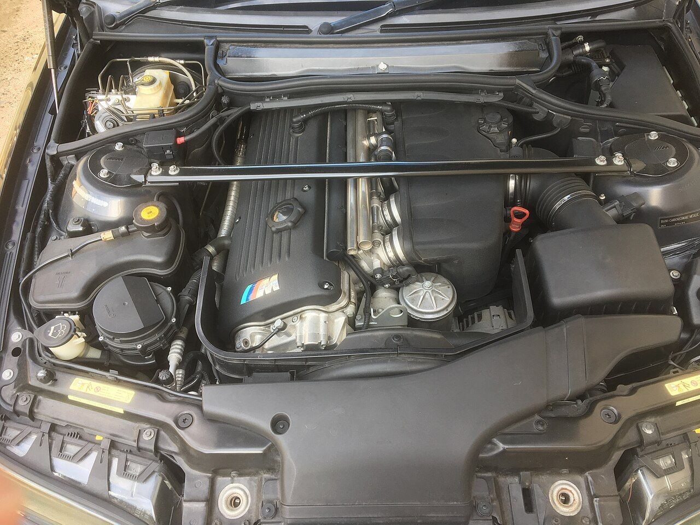

*Photo: Where Phases 9 and 10 end up: an S54B32 in an E46 M3 engine bay. melvil, [CC BY-SA 4.0](https://creativecommons.org/licenses/by-sa/4.0/), via [Wikimedia Commons](https://commons.wikimedia.org/wiki/File:S54B32-BMW-E46-M3.jpg).*

1. Bolt the engine and gearbox together with the clutch and flywheel you fitted in Phase 3. Fit the M3 engine arms, new mounts and the 420G's gearbox support. Fit the secondary-air valve before the engine goes in ([M3projekts – Ep5 (2023), 14:00](https://www.youtube.com/watch?v=Ipbjt8S2c2g&t=840s)).
2. Lower the engine in from above, or raise it in on the subframe. Unbolt the oil-cooler lines so the cooler clears the crossmember ([Project BMW – S54 on jack stands (2021), 01:20](https://www.youtube.com/watch?v=i0OUChEy3Io&t=80s)). One Touring builder had to drop the front subframe to get the S54 in ([Tracks and Trails – first drive (2026), 55:40](https://www.youtube.com/watch?v=pvR3ovRfQHg&t=3340s)).
3. **Before you tighten the engine mounts,** check the gap between the oil pan and the steering rack and subframe. Route the power-steering lines clear of the pan and sway bar: one M3 owner's lines wore a mark into his pan ([Paul Vo – rod bearing torque procedure (2017), video description](https://www.youtube.com/watch?v=O345BKC8EkM)).
4. Fit the shift carrier and lever with new bushings, then the complete M3 driveshaft: bolt its flex disc to the gearbox's output flange at 115 Nm (the shaft side was done in Phase 3), and fit the center mount ([Driveline and rear axle](#driveline-and-rear-axle)).
5. Fit the M3 clutch hard line and bleed the clutch ([Brakes and bleeding](#brakes-and-bleeding)). Clamping the flexible hose while you change lines keeps most of the air out ([Throttle House – E46 clutch delay valve removal (2016), 00:26](https://www.youtube.com/watch?v=LDEty2tnZLQ&t=26s)).
6. Fill the 420G to its fill plug with the car level ([Fluids and capacities](#fluids-and-capacities)).

**Watch:** [Project BMW – S54 into a Touring (2021), 05:20](https://www.youtube.com/watch?v=iVGU_Yg0ZLw&t=320s) installs the engine and gearbox together; [FCP Euro – E46 M3 clutch (2022), 26:34](https://www.youtube.com/watch?v=NmEOFBqreX8&t=1594s) fits the 420G.

**Done when**

| Check | Pass | If it fails |
|---|---|---|
| Oil pan | Clear of the rack and subframe; power-steering lines clear of the pan and sway bar | Check the engine sits on the M3 arms correctly; re-route the lines |
| Mounts | Engine and gearbox mounts torqued and marked | Re-torque |
| Clutch | Pedal firm and returns; the slave's pushrod moves its full stroke (check from below with a helper) | Bleed again; bench-bleed the slave ([Brakes and bleeding](#brakes-and-bleeding)) |
| Driveshaft | Flex disc and center mount torqued; center bearing preloaded forward (the Flow compilation gives 4–6 mm, [p.79](https://drive.google.com/file/d/1GS3Hirx6x0c0WG8hPeXiwfXfeUldkQnm/view?usp=sharing)) | Loosen, preload and re-torque |
| Gearbox | Filled to the fill plug, no leaks at the seals | Fix a leaking seal now |

### Phase 10: Cooling, intake and exhaust

1. **Fit the cooling parts** ([Cooling and oil cooler](#cooling-and-oil-cooler)):
   - the M3 radiator on your Touring's radiator supports, which take the same mounting parts; leave off the Touring's adjusting screw, drain plug and lower seal;
   - the oil cooler under it, with new O-rings: pipe unions 25 Nm (18 ft-lb), M8 flange screws 20 Nm (15 ft-lb), M6 bracket bolt 6 Nm (53 in-lb);
   - the shroud and its air ducts, then the viscous fan: fan to coupling 10 Nm (89 in-lb), coupling to water pump 40 Nm (30 ft-lb), with a **left-hand thread**;
   - the pusher fan and its compression shroud in front of the condenser, with plug X82 routed to it ([manual](WIRING-AND-CODING.md#fans-and-can));
   - a new M3 expansion tank on the donor's holder 17112229108, which also carries the air pump, bolted to the brackets 41147894115/116 you welded or riveted to the front of the right strut tower at the donor's positions, on the other side of the engine bay from the Touring's, with its level switch plugged in;
   - the S54's heater hoses and the heater valve you chose: your plain valve with the CSL's hose 64212282548 (recommended), or the M3 valve with its pump wired;
   - a new vent screw 17111712788 in hose 11537830716, left open for the fill in step 8.
2. Fit the intake and airbox, and the power-steering reservoir, lines and cooler. Connect the S54's brake-booster hose to the M3 check valve you fitted in your booster in Phase 8. On the M3 the hose meets the booster from the other side, so shorten or re-route it to reach and clamp it with 11151726340, as Tenza and two other builds did ([Tenza Motorsports – 5 things (2021), 07:40](https://www.youtube.com/watch?v=-TXzg2Z8d7w&t=460s), [Brakes and bleeding](#brakes-and-bleeding)).
3. **Route every sensor lead now.** The coolant-level sensor moves sides with the tank, the M3 washer tank sits low behind the bumper, and the radiator-outlet sensor lead has to reach the M3 radiator's sensor. Your 325i already reads that sensor; the one build that had to extend the lead was a Euro 318d diesel Touring ([Tenza Motorsports – 5 things (2021), 00:40](https://www.youtube.com/watch?v=-TXzg2Z8d7w&t=40s), [M3projekts – Ep6 (2023), 07:31](https://www.youtube.com/watch?v=YfJyE9DU5OE&t=451s)). The electric fan's plug X82 sits on a manual Touring's radiator shroud and has to reach the pusher fan in front of the condenser: compare the plugs, then extend it if it's short ([manual](WIRING-AND-CODING.md#fans-and-can)). Extend leads with proper terminals or soldered, heat-shrunk joints, and list each one for the Phase 11 checks.
4. **A/C:** fit the donor's pressure hose 64536902681 between the compressor and the condenser. Keep your Touring's other lines, condenser and drier bracket, which are the same parts on both cars ([ETK, M3](https://bmwfans.info/parts-catalog/E46-Coupe/USA/M3-S54/L-N/browse/heater_and_air_conditioning/coolant_lines/), [ETK, Touring](https://bmwfans.info/parts-catalog/E46-Touring/USA/325i-M54/L-N/browse/heater_and_air_conditioning/coolant_lines/)). Fit new O-rings at every joint you open, flange screws 20 Nm (15 ft-lb). Leave the old drier in place and keep the system capped for the shop: the new drier (64538377330) goes in on the day of the charge ([Air conditioning](#air-conditioning)).
5. **Exhaust:** fit the M3 manifolds, catalysts and O2 sensors (label the sensor plugs so they can't be swapped) and the secondary-air parts. Then fit the front section 18107832909 and intermediate pipe 18107832313 on the center support 18211436309 with the M3 rubbers 18207832991, flanges at 22 ± 2 Nm (16 ± 1.5 ft-lb), and hang the muffler 18107831783 on the three Phase 5 brackets: hanger nuts 22 Nm (16 ft-lb), hanger bolts 20 Nm (15 ft-lb), and the clamp flange at 15 Nm (11 ft-lb) with new gasket rings ([Exhaust and the spare-wheel well](#exhaust-and-the-spare-wheel-well), [Flow p.87](https://drive.google.com/file/d/1GS3Hirx6x0c0WG8hPeXiwfXfeUldkQnm/view?usp=sharing)). Fit every nut and bolt. If you kept the well, build or buy the rear section instead ([Shop briefs](#shop-briefs)). Keep every emissions part.
6. **Heat shields:** the M3 rear-silencer shield 51482494848 over the muffler and the tunnel shield 51487893366 (one builder found your Touring's 51488193807 interchangeable), plus a shield wherever the pipes come close to the tank, the cargo floor or the battery.
7. **Clearance:** with the suspension compressed and at full rebound, check the exhaust against the gaps you recorded on the donor (within ±5 mm) and keep it at least 25 mm (1 in) from any fuel, brake or EVAP part unless it's shielded ([pass values](#exhaust-and-the-spare-wheel-well)). One Touring's aftermarket Remus system (engine not stated) touched the inside of its 255/35-18 rear tires until the owner switched to 245/40-18 ([e46fanatics](https://www.e46fanatics.com/threads/s54-conversion-muffler-shootout.1266239/)).
8. **Fill and pressure-test the cooling system,** engine cold and ignition off: steps 1–8 of [Fill and bleed the cooling system](#fill-and-bleed-the-cooling-system). It takes about 9.3 L (9.8 US qt) of BMW antifreeze 82141467704 and distilled water, 50/50 ([Fluids and capacities](#fluids-and-capacities)). Fill slowly with the vent screw open, then pressure-test at 2.0 bar (29 psi), the cap's rating and never above it, for 15 minutes, and test the cap ([Flow compilation, p.60](https://drive.google.com/file/d/1GS3Hirx6x0c0WG8hPeXiwfXfeUldkQnm/view?usp=sharing), [BMW SI B17 03 16](https://static.nhtsa.gov/odi/tsbs/2016/MC-10146885-9999.pdf)). The rest of the bleed comes at the first start, in Phase 12.

**Done when**

| Check | Pass | If it fails |
|---|---|---|
| Cooling | Holds 2.0 bar (29 psi) on the tester for 15 minutes with no drop and no seepage; the cap holds and relieves at 2.0 bar; level at the cold mark | Find and fix the leak before the first start |
| Exhaust | Donor gaps within ±5 mm; 25 mm (1 in) from fuel, brake and EVAP parts; clear at full bump and rebound; heat shields fitted; new gaskets; every hanger nut and bolt fitted | Re-hang it or move what it touches; don't modify the M3 muffler |
| Exhaust leaks | Checked at the first start, in Phase 12, while the joints are cold: none at any joint; listen at each, or spray soapy water on them | Re-seat the joint with a new gasket |
| A/C | M3 pressure hose fitted; new O-rings at every opened joint; flange screws at 20 Nm; system closed and capped for the shop | Replace any O-ring you reused |
| Sensor leads | Every plug reaches its sensor without strain, and X82 reaches the pusher fan | Extend or re-route it now |

### Phase 11: Wiring, immobilizer and coding

Work in this order. Pin lists, terminals and each coding session are in the [Wiring and coding manual](WIRING-AND-CODING.md); the reasoning is in [Electronics and coding](#deep-dive-electronics-and-coding). Steps 9 to 12 follow the manual's coding sessions 2 to 5, in order, and Phase 12 continues with sessions 6 to 9.

1. **Diagrams:** BMW's WDS drawings for your build dates, on the public mirror the manual links, or ISTA by your VIN; the manual's tables name the drawing behind every wire ([manual: engine harness and DME](WIRING-AND-CODING.md#engine-harness-and-dme)). Switch the ignition off whenever you plug or unplug a DME connector ([BMW ST055](https://ia801005.us.archive.org/11/items/BMWTechnicalTrainingDocuments/ST055%20Engine%20Electronics%20%28Archive%201%29/8%20MS%20S54.pdf)).
2. **Engine harness and E-box:** route the M3 engine harness, and fit its whole E-box branch with the fuse carrier, its gearbox-module harness and the DME. Compare each E-box plug (X6011, X6021, X6053 or X60531, X6054 or X60541, and X64101/X64102) with its mate, cavity by cavity, before you join them ([E-box plugs](WIRING-AND-CODING.md#e-box-plugs)): a mismatch at X6053 gave circuit-low codes on all six injectors in one swap ([e46fanatics](https://www.e46fanatics.com/threads/s54-swap-fuel-injectors-low-circuit.1277127/)).
3. **Re-pin the body side** from the move table for your DME: [MS43](WIRING-AND-CODING.md#ms43-touring-what-to-move) (to 02/2003) or [MS45.1](WIRING-AND-CODING.md#ms451-touring-what-to-move) (from 03/2003) ([Harness and re-pinning](#harness-and-re-pinning)). The moves cover the leak-test heater, the clutch signal, the cluster's three lamps and its start feedback, the brake-light switch's test contact and a recommended ground at X60004 pin 5, and on an MS45.1 the leftover wires in pins 5 and 15 (and 19, if fitted) come out. On an MS43, move the heater out of X6011 pin 7 before the clutch wire goes in. Re-pin; don't cut and splice. The four-wire move in older forum posts came from a different swap; on an MS43 Touring those wires move the other way ([e46fanatics](https://www.e46fanatics.com/threads/s54-swap-wiring-information.1003871/)).
4. **Fuel-pump trigger:** leave your Touring's pump wiring as it is. BMW's drawings put the K96 relay on X60004 pin 10 on both the MS43 and the MS45.1, and builders report the US MSS54 drives it from that pin; the M3's pump-module wire on X6021 pin 1 finds no mate in a 325i ([Fuel-pump control](#fuel-pump-control), [manual](WIRING-AND-CODING.md#fuel-pump-control)). Never connect the US DME's pulsed pump output to the relay. Expect a stored fault, location 1 (0x01), that shows in INPA but doesn't light the check-engine lamp ([e46fanatics](https://www.e46fanatics.com/threads/s54-swap-california-bar-certification.1307461/page-2)).
5. **Clutch, cruise and Sport button:** fit the M3 clutch-switch module, 61319122700. The 325i's doesn't work with the MSS54's clutch chain, and two S54 builds cured no cruise with the M3 part ([e46fanatics](https://www.e46fanatics.com/threads/m3-cluster-swap-dsc-light.1260275/), [NAM3](https://nam3forum.com/forums/forum/main-forum/member-build-journals/3768-what-s-going-on-in-my-shop-currently/page3)). Its signal now crosses into the M3 harness at X6011 pin 7 and runs through the 420G's gear switch to X60002 pin 20; its wire to EWS pin 8, the start interlock fitted to US and Japanese cars, stays. The Sport button is optional ([manual](WIRING-AND-CODING.md#body-side-wiring)).
6. **Other body-side items:** the rear-door LEDs in the M3 cluster; the heater valve, either your plain valve or the M3's with its auxiliary pump wired and coded, since an unwired pump made one builder's cooling hard to bleed ([UNRIVALED – watch this before you S54 swap (2021), 02:32](https://www.youtube.com/watch?v=eddLff8yba0&t=152s), [manual](WIRING-AND-CODING.md#heater-valve-and-auxiliary-water-pump)); and the sensor leads from Phase 10.
7. **Check before first power-up:** steps 1–19 of the manual's [checks](WIRING-AND-CODING.md#checks-before-first-power-up). With the battery off and the DME unplugged, prove every moved wire end to end and open to ground, and measure the coils, injectors, sensors and leak-test module. With the battery on, check the DME's feeds and grounds. Then, battery off again, the DME and every other module plugged in, measure the CAN bus: about 60 Ω between X60004 pins 36 and 37, back-probed at the DME, from BMW's two 120 Ω resistors ([BMW ST040](https://archive.org/download/BMWTechnicalTrainingDocuments/ST040%202001%20System%20Diagnosis/9%20Bus%20System%20Troubleshooting.pdf)). Don't measure at the diagnosis socket: an E46's has no CAN pins, only the K-lines on pins 7 and 8 ([WDS](https://wds.psjr.org/en/e46/svg/SP0000014297.svg)).
8. **First power-up:** battery on a charger, ignition on, no cranking: steps 20–29. INPA should reach every module, the pump should prime once (`STEUERN_EKP` clicks K96), and the DME's status bits should follow the brake, the Sport button and, with a gear engaged, the clutch. The clutch module, brake switch and oil-level sensor are electronic, so these bits, not a meter, prove them.
9. **DME VIN** ([manual, Session 2](WIRING-AND-CODING.md#session-2-dme-vin-ews-delete-and-gearbox-software)): read the DME's VIN slots with Tool32 and check that the vendor wrote your Touring's full 17-character VIN. If not, write it into the next free AIF slot ([ECUWorx](https://www.ecuworx.co.uk/2016/02/26/adding-updating-your-vin-uif-with-tool32/)). Inspection testers read the VIN from the DME ([BMW SI B12 09 13](https://static.nhtsa.gov/odi/tsbs/2013/MC-10150160-9999.pdf)).
10. **Immobilizer** ([Session 3](WIRING-AND-CODING.md#session-3-ews)): with an EWS-deleted DME, or one a vendor has matched to your EWS, there's nothing to sync; check that your EWS still reads the key and the clutch interlock ([NAM3](https://nam3forum.com/forums/forum/main-forum/e46-2001-2006/38046-mss54-ews-delete-anyone-successful)). A sync you do yourself works only with a virgin DME ([Immobilizer (EWS)](#immobilizer-ews)).
11. **Cluster** ([Session 4](WIRING-AND-CODING.md#session-4-cluster-and-light-module)): fit the M3 cluster prepared to take your car's true mileage from the LCM ([Instrument cluster and mileage](#instrument-cluster-and-mileage)). Never write a mileage into the LCM: it holds your car's record, and the replacement cluster must show the true mileage ([49 U.S.C. §32704](https://www.law.cornell.edu/uscode/text/49/32704)). On a pre-09/2001 (ZCS) car the LCM may not pass the mileage across, so check ([e46fanatics](https://www.e46fanatics.com/threads/diy-m3-cluster-into-non-m-retrofit.1277945/)). Then leave the donor M3's vehicle order in the cluster. BMW's coding data accepts an M3 cluster only with an M3 order (type key with `S54B32`, dated 09/2001 or later), so NCS refuses it with your Touring's order: don't write your order into it, and code it only from its own read-out. If a cluster service already wrote your order in, change the type key to `BL93` for that coding session only, with no `FA_WRITE`. Your car's order stays in the light module (ALSZ): read it there for every other module, and never run Code Car ([Session 4](WIRING-AND-CODING.md#session-4-cluster-and-light-module)).
12. **DSC** ([Session 5](WIRING-AND-CODING.md#session-5-dsc-coding-and-vin)): with your own MK60, initialise its VIN and steering angle in INPA, then run its other two compensation routines, pressure sensors and lateral acceleration ([DSC, brakes and steering angle](#dsc-brakes-and-steering-angle)). An M3 unit first needs your VIN written in, and coding from a session vehicle order read from the light module (ALSZ), with the donor's M3 type key and a date of #0902 or later for that session only. This calibration is provisional; the final one comes after the alignment in Phase 12. If an M3 unit still won't clear "VIN not initialized", refit your Touring's unit (option A), as one S54 Touring owner had to; he had written a blank coding file to his and reset it in PA-Soft, not INPA ([e46fanatics](https://www.e46fanatics.com/threads/m3-cluster-swap-dsc-light.1260275/)).
13. **Bleed with INPA's routine,** now that INPA can talk to the DSC, BMW's way for the work you did ([Brakes and bleeding](#brakes-and-bleeding), step 4). After caliper and hose work, BMW bleeds the rear circuit with its tester's routine and the front by pedal ([TIS 34 00 048](https://workshop-manuals.com/bmw/3_series_e46/325i_m54_tour/2_repair_instructions/34__brakes/0__brake_testing_and_bleeding/9_ra__bleeding_brake_system_with_abs_asc-t/page_1741/)). If the DSC unit ran dry or was replaced, or you opened the master cylinder or the pipes between it and the DSC unit, run the routine at every wheel instead: right rear, left rear, right front, left front, restarting it for each wheel and pressing the pedal to the floor five times after each run ([TIS 34 00 050](https://workshop-manuals.com/bmw/3_series_e46/325i_m54_tour/2_repair_instructions/34__brakes/0__brake_testing_and_bleeding/10_ra__bleeding_brake_system_with_dsc3/page_1743/)). Pass: a firm pedal and the checks in [Brakes and bleeding](#brakes-and-bleeding), step 6.
14. Clear the faults in every module, cycle the ignition and read them again. Vehicle-order changes, body modules and headlight coding (Sessions 8 and 9) wait until the car runs, in Phase 12.

**Watch:** [50sKid – coding an E46 DSC unit (2016), 31:14](https://www.youtube.com/watch?v=CvyVCwCAx1Q&t=1874s), then the INPA VIN and steering-angle initialisation at 33:47; [Tenza Motorsports – 5 things part 2 (2021), 08:45](https://www.youtube.com/watch?v=mDBiRn30fEs&t=525s) wires the Sport button into a Touring.

**Done when**

| Check | Pass | If it fails |
|---|---|---|
| Moved circuits | Each reads continuity end to end, with no short to ground | Re-seat the terminal; re-check the drawing for your car |
| CAN bus | About 60 Ω between X60004 pins 36 and 37, with every module plugged in | About 120 Ω: a terminating module unplugged or cut off ([manual, step 19](WIRING-AND-CODING.md#can-bus-resistance)) |
| Modules | INPA reaches the DME, cluster, LCM, EWS, DSC and the rest | One module missing: its power, ground and bus wires. Several: the cable's pins 7 and 8 |
| Warning lamps | With the engine off, the red oil-pressure lamp and the charge lamp are lit | Oil lamp out: the X60004 pin 11 wire to cluster pin 13, and the cluster's `CAN_OELDRUCKSCHALTER` coding ([NAM3](https://nam3forum.com/forums/forum/main-forum/e46-2001-2006/61405-why-does-my-oil-light-turn-off-with-ignition-ii-engine-off), [manual](WIRING-AND-CODING.md#cluster-wiring)) |
| Cluster | Shows your car's true mileage (compare with your Phase 0 photo), with no tamper dot; NCS reads your Touring's order from ALSZ and the donor's from AKMB, as your coding sheet notes | VIN mismatch between cluster and LCM ([Troubleshooting](#troubleshooting)) |
| DME VIN | Tool32's `AIF_LESEN` and INPA show your Touring's full 17-character VIN; so does a generic OBD-II scanner, if the DME reports it (mode 09), which no rule required before the 2005 model year | Write the AIF again |
| DSC | DSC and brake lamps out; no 5EF1 or 5E1F; INPA reads about 0° with the wheel straight (provisional until the alignment) | [Session 5](WIRING-AND-CODING.md#session-5-dsc-coding-and-vin). An M3 unit: code it from a late session order read from ALSZ, then initialise it in INPA; still failing, refit your own |
| Clutch chain | In Tool32, with a gear engaged, `STAT_KRAFTSCHLUSS_EIN` reads 1 with the pedal up and `STAT_KUP_EIN` 1 with it down; in neutral both stay fixed ([MSS54 job reference](https://github.com/emdzej/ediabasx-docs-sgbd/blob/main/docs/sgbd/MSS54DS0.md)) | The M3 clutch module, the gear switch, the X6011 pin 7 crossing |
| Fuel pump | One prime at key-on; `STEUERN_EKP` clicks K96 | X60004 pin 10 to K96's coil wire ([Fuel-pump control](#fuel-pump-control)) |
| Fault memory | Only location 1 (0x01), the pump fault, and, after a delete, possibly 130 (0x82) | Fix every other fault before the first start ([Troubleshooting](#troubleshooting)) |

### Phase 12: Front end, first start and shakedown

**Fit the front end in primer.**

1. Fit the grafted fenders, hood, headlights, kidney grilles and bumper with its carrier and supports; Tourings built from 09/2001 need the M3 bumper's fender supports added ([Front end on a 4-door body](#front-end-on-a-4-door-body)). Keep the bumper's lower opening and ducting: the oil cooler breathes through it ([MotoIQ](https://motoiq.com/putting-csfs-e46-m3-oil-cooler-kit-to-the-test-with-data/)).
2. If the M3 headlights differ from your Touring's (xenon against halogen), check their wiring now: xenon lamps need BMW's xenon light module and two level sensors. The light module is the last coding session, at the end of this phase, and you aim the lamps then, at ride height; don't drive after dark before that.

**Before the first start.**

1. Fill the engine with 6.5 L (6.9 US qt) of 10W-60, BMW's figure after a rod-bearing job ([BMW SI B11 04 04](https://nam3forum.com/forums/filedata/fetch?id=5213)), and the power-steering reservoir with ATF, to about 25 mm below its edge with the engine off; then bleed it after the start as [Brakes and bleeding](#brakes-and-bleeding) describes. One build's pump rattled dry at its first start until the ATF went in ([M346 Projects – Pt 13 first start (2024), 08:00](https://www.youtube.com/watch?v=4Q3PxGuJyxI&t=480s)). Look under the car for drips.
2. Charge the battery and keep it on a charger of at least 10 A for the whole session. One swap's first start failed on a flat battery ([Tenza Motorsports – first start (2021), 03:55](https://www.youtube.com/watch?v=8uwpzS_-uDs&t=235s)).
3. Fit a mechanical oil-pressure gauge at the oil-pressure switch's port, which is threaded M12 × 1.5 ([Flow compilation, p.58](https://drive.google.com/file/d/1GS3Hirx6x0c0WG8hPeXiwfXfeUldkQnm/view?usp=sharing)). On a tee, the switch stays connected and the red cluster lamp gives you a second reading.
4. Fit the fuel-pressure gauge at the S54's test point, the threaded fitting on the regulator housing under the left front floor (filter cover off; BMW adapter 13 5 220), and tie it where you can read it. The rail has no port: BMW puts "the fuel pressure gage at the pressure test point at the fuel filter" ([BMW ST055, MS S54, p.41](https://archive.org/download/BMWTechnicalTrainingDocuments/ST055%20Engine%20Electronics%20%28Archive%201%29/8%20MS%20S54.pdf), [BMW ST041, part 2](https://archive.org/download/BMWTechnicalTrainingDocuments/ST041%20M3%20Complete%20Vehicle/3%20EngineElectronics%20%28Part%202%29.pdf), [Test the fuel system](#test-the-fuel-system)).
5. Ignition on, engine off: in Tool32 load `MSS54DS0.PRG`, run `IDENT` and `FS_LESEN`, and save both results. This is step 1 of the manual's [Session 6](WIRING-AND-CODING.md#session-6-first-start-adaptations-and-throttle-check), which the rest of this phase follows ([MSS54 job reference](https://github.com/emdzej/ediabasx-docs-sgbd/blob/main/docs/sgbd/MSS54DS0.md)).
6. **Coolant, with the ignition on** (steps 9 and 10 of [Fill and bleed the cooling system](#fill-and-bleed-the-cooling-system)). Engine off. With IHKA: heat at maximum, blower low, A/C off. With IHKR: blower at 1 and the temperature dial fully right, since at 0 the valve is energized shut. That holds the heater valve open and runs the M3 valve's pump, if you fitted it. After a few minutes, top up to the cold mark and crack the vent screw until coolant runs without bubbles; refit it at 2.5 Nm (22 in-lb) ([BMW ST054, engine cooling](https://archive.org/download/BMWTechnicalTrainingDocuments/ST054%20Climate%20Control/03_Engine%20Cooling-Heating%20System.pdf), [BMW ST054, IHKR](https://archive.org/download/BMWTechnicalTrainingDocuments/ST054%20Climate%20Control%20%28Archive%201%29/13%20IHKR%20E46.pdf)).

**Prime the oil.**

1. Stop fuel and sparks: pull the fuel-pump relay (K96) and the injector relay (K6327, [ETK](https://bmwfans.info/parts-catalog/E46-Coupe/USA/M3-S54/browse/vehicle_electrical_system/relay_for_injectors_k6327/)), and unplug the six ignition coils. On the S54 the injector relay is what powers the injectors ([BMW ST055](https://ia801005.us.archive.org/11/items/BMWTechnicalTrainingDocuments/ST055%20Engine%20Electronics%20%28Archive%201%29/8%20MS%20S54.pdf)).
2. Test the start interlock: with the clutch up, the starter must not turn; with it down, it cranks. That's the clutch switch's wire to EWS pin 8, fitted to US and Japanese cars ([BMW ST051](https://archive.org/download/BMWTechnicalTrainingDocuments/ST051%20Body%20Electronics%20I%20%28Archive%201%29/05%20EWS.pdf)).
3. Crank in short bursts, with pauses to let the starter cool, until the gauge shows oil pressure and holds it while cranking and the red oil lamp goes out. The tachometer should move while you crank: the DME sees engine speed (the manual's steps 30–32).
4. Refit the relays and the coil plugs.

**Reset the adaptations and let the throttles learn.** Do steps 2 to 5 of [Session 6](WIRING-AND-CODING.md#session-6-first-start-adaptations-and-throttle-check): clear the adaptations and the faults from cranking with the relays out, let the throttles run their key-on self-test, and check that `STAT_WDK_ADAPT_WERT` reads 0 and the clutch, brake and Sport inputs respond ([BMW ST041, part 1](https://archive.org/download/BMWTechnicalTrainingDocuments/ST041%20M3%20Complete%20Vehicle/3%20EngineElectronics%20%28Part%201%29.pdf)). Then, with the key on, the pump primes: check 5.0 ± 0.2 bar (72.5 ± 2.9 psi), and look along the lines, the filter-regulator and the rail for leaks.

**Start it.**

1. Start without touching the accelerator. Watch the oil gauge first: pressure must show at once. If it doesn't, switch off.
2. Let it idle. Top up the power steering and bleed it: full lock each way twice, never held there ([Brakes and bleeding](#brakes-and-bleeding)). Look for fuel, oil, coolant and power-steering leaks, and for exhaust leaks at each joint while they're still cold (listen, or spray soapy water on them), and listen for knocking or VANOS rattle.
3. **Bleed the cooling system as it warms** ([Fill and bleed the cooling system](#fill-and-bleed-the-cooling-system), steps 11–14; steps 9 and 10 came before the start). Idle about one minute with the cap off, top up and fit the cap. Then watch the coolant in Tool32, not the gauge, which shows oil temperature: `STATUS_MOTORTEMPERATUR` for the engine and `STATUS_KUEHLW_AUSL_TEMPERATUR` for the radiator outlet. The outlet should climb steadily once the engine passes about 80 °C (176 °F). Run `STEUERN_E_LUEFTER` to check that the electric fan runs.
4. At hot idle, check:
   - oil pressure at least 0.7 bar (10 psi), a figure from the [Flow compilation, p.49](https://drive.google.com/file/d/1GS3Hirx6x0c0WG8hPeXiwfXfeUldkQnm/view?usp=sharing) to confirm in TIS;
   - fuel pressure below 5 bar with the vacuum hose connected; BMW's diagram shows 3.8 bar with part-throttle vacuum ([BMW ST041, part 2](https://archive.org/download/BMWTechnicalTrainingDocuments/ST041%20M3%20Complete%20Vehicle/3%20EngineElectronics%20%28Part%202%29.pdf)). Pull the hose: the pressure returns to 5.0 ± 0.2 bar, and the hose is dry inside; fuel in it means a leaking regulator diaphragm (our check);
   - a steady idle, and fuel trims (`STATUS_LAMBDA_ADD_1` and `_2`) near zero. A positive value means the DME is adding fuel to make up for a lean mixture ([BMW ST041, part 3](https://archive.org/download/BMWTechnicalTrainingDocuments/ST041%20M3%20Complete%20Vehicle/3%20EngineElectronics%20%28Part%203%29.pdf)).
5. Still warm, with the coolant at 85 °C (185 °F) or more, run the VANOS timing and leak jobs (Session 6, step 7) and compare them with the donor's readings from Phase 1. BMW publishes no limits; owners and ISTA give about 180–300 ms adjustment time (ISTA's limit 500 ms) and a leak test within about ±5 °KW, with no "weggedriftet" status ([manual](WIRING-AND-CODING.md#session-6-first-start-adaptations-and-throttle-check)).
6. Read the faults in every module. Expect only location 1 (0x01), the pump fault, and, after a delete, possibly the immobilizer's 130 (0x82), which doesn't stop the engine starting ([NAM3](https://nam3forum.com/forums/forum/main-forum/e46-2001-2006/38046-mss54-ews-delete-anyone-successful)). Fix anything else before you drive. If it runs for a few seconds and then dies, that isn't the immobilizer: see the manual's [Won't start](WIRING-AND-CODING.md#wont-start). A brief fire while cranking that never catches is: see [Immobilizer (EWS)](#immobilizer-ews).
7. Switch off and let the coolant cool to 30 °C (86 °F) or below. Crack the vent screw: a hiss of air means another heat cycle, and two are usual (step 13 of [Fill and bleed the cooling system](#fill-and-bleed-the-cooling-system)). Top up to the cold mark and check the oil.
8. **Refit the oil-pressure switch.** Take off the mechanical gauge and its tee and screw the switch back into its port at 27 Nm (20 ft-lb) ([Torque values](#torque-values)). At the next key-on the red lamp lights, and it goes out once the engine runs, with no oil at the switch.

**Shake it down, align it, then finish the coding.**

1. **Brakes:** with a firm pedal, make progressive stops on a quiet road, then a careful hard stop from moderate speed. ABS should pulse and the car stop straight. Bleed again after the first few drives ([NAM3](https://nam3forum.com/forums/forum/main-forum/e46-2001-2006/189096-mk20-mk60-swap)). Bed in the parking-brake shoes on an empty road ([Brakes and bleeding](#brakes-and-bleeding)).
2. **Wheel speeds:** in INPA's DSC status, all four should agree while rolling. An M3 built before 09/2002 has sensors that don't suit your harness. If a speed is missing or the ABS lamp stays on, read the DSC fault memory before you go further: 5D90–5DC5 are the wheel-speed faults, and the last digit points to wiring, seating, the pulse wheel or tire size ([manual](WIRING-AND-CODING.md#wheel-speed-and-pad-wear-sensors)).
3. **Short drives near home,** then check the paint marks, wheel-bolt torque, fluid levels and fault memory.
4. **Fuel gauge:** starting near empty, add a measured amount and check that the gauge, the range and Tool32's `KOMBI46R.PRG` → `STATUS_AIF_TANKDATEN_LESEN` follow it (`STATUS_TANKINHALT_LESEN` belongs to the older cluster's `KOMBI46.PRG`). With the M3 delivery unit and left sender in your tank, the cluster reads BMW's own M3 sender pair in a tank of the same 63 L (16.6 US gal); with your Touring's senders, nobody has reported the reading. The reserve lamp should come on with about 8 L (2.1 US gal) left, and the leak test relies on the reading ([manual](WIRING-AND-CODING.md#fuel-gauge-and-tank-senders)).
5. **Speedometer:** compare with GPS. The M3 cluster over-reads by about 8.9% by design ([e46fanatics](https://www.e46fanatics.com/threads/diy-e46-cluster-gauges-definitions.1324535/)).
6. **Ride height and alignment:** after 5–10 miles, load the car to BMW's normal position for an M3: a full tank, 68 kg (150 lb) on each front seat and 14 kg (31 lb) in the middle of the cargo floor. Check the ride height, rim flange to arch edge: BMW's 605 mm front and 587 mm rear on 18-inch wheels (619 and 600 mm on 19s), ±10 mm, left and right within 10 mm ([After the build](#after-the-build-settle-check-and-align)). Then load it as in Phase 0 and check the roof and jacking points against your Phase 0 readings for Massachusetts. Torque the front anti-roll-bar clamp nuts, 21 Nm (15 ft-lb), with the car on its wheels at the M3 load; everything else at the front was torqued on stands in Phase 8. Then have the car aligned to BMW's E46 M3 figures in BMW's design position: the M3 load, plus weights near the struts until each corner is within 2 mm of BMW's ride height. Tell the shop not to use the rig's ride-height-input mode, which BMW bars for M cars ([Wheel alignment](#wheel-alignment), [Shop briefs](#shop-briefs)).
7. **Then calibrate the steering-angle sensor** ([Session 7](WIRING-AND-CODING.md#session-7-steering-angle-after-the-alignment)) and run the other two DSC compensation routines, pressure sensors and lateral acceleration, with the wheel straight, no pressure on the brake and the car level ([DSC, brakes and steering angle](#dsc-brakes-and-steering-angle)). It comes after the alignment, not before, because the calibration takes the wheel's position at that moment as straight ahead ([Evan Goyuk – E46 steering-angle calibration in INPA (2020), 02:48](https://www.youtube.com/watch?v=lseY6SRXWks&t=168s)).
8. **Vehicle-order changes and body modules** ([Session 8](WIRING-AND-CODING.md#session-8-vehicle-order-changes-and-body-modules)): none need swap coding if you kept your Touring's vehicle order. M Track doesn't need a stored change either: keep `$7MA` out of the stored order. If you do change the order, change it in the light module (ALSZ) only, since the cluster keeps the donor's; code only the modules it touches, one at a time and never with Code Car, and reset the DME adaptations again only after an engine-side change.
9. **Headlights** ([Session 9](WIRING-AND-CODING.md#session-9-light-module-and-headlights)): halogen M3 lamps in a halogen Touring need no coding; check the bulbs and that the light module stores no lamp faults. Xenon lamps need BMW's xenon light module, fitted new or virginized, and two level sensors. Then aim them, at ride height.
10. **A/C:** have a shop fit the new drier, set the oil, evacuate the system for at least 30 minutes, with no more than 7 kPa (2 inHg) of change in a 5-minute hold, and charge it by weight to the underhood label; then run the compressor in ([Shop briefs](#shop-briefs)). Then run BMW's checks: the compressor engages (`STAT_AC_EIN` and `STAT_KO_EIN` read 1); in BMW's efficiency test the evaporator reaches 15 °C (59 °F) or less within 3–4 minutes; the low side reads 1–2 bar (15–30 psi) and the high side 10–15 bar (150–225 psi); the centre vent blows 4–20 °C (40–68 °F), at least 11 °C (20 °F) below the outside air ([A/C checks and pass values](#ac-checks-and-pass-values), [worksheet](WORKSHEETS.md#ac-after-the-charge)). If the compressor never engages, start with the climate control's coded compressor lock ([manual](WIRING-AND-CODING.md#ac-with-manual-or-automatic-climate-control)).

**Break in the engine and set the readiness monitors.**

1. Drive 1,200 miles (1,930 km) below 5,500 rpm and 105 mph (169 km/h), BMW's figures after new rod bearings ([BMW SI B11 04 04](https://nam3forum.com/forums/filedata/fetch?id=5213)). Include closed-throttle coast-downs in gear, so the fuel cuts off: that's when the DME learns the crankshaft wheel, and its misfire detection is less sensitive until it has ([BMW ST041, part 3](https://archive.org/download/BMWTechnicalTrainingDocuments/ST041%20M3%20Complete%20Vehicle/3%20EngineElectronics%20%28Part%203%29.pdf)).
2. **Checks during the break-in.** BMW's bulletin gives none, and it says no oil service is needed at the end of the break-in (same SI). Our suggestion, logged on the [break-in worksheet](WORKSHEETS.md#break-in-log): at every fuel stop, the oil level and a look for leaks; after the first few drives, the paint marks, wheel-bolt torque, fluid levels and fault memory, and a second brake bleed; after the first few heat cycles, the coolant level; at about the halfway mark, every module's faults again; at 1,200 miles, the oil and filter.
3. Change the oil and filter at the end of the break-in (our recommendation, not BMW's), and look for metal in the drained oil and the filter.
4. Don't clear codes or disconnect the battery in the weeks before an inspection: both reset the readiness monitors ([NYVIP3](https://www.nyvip3.com/OBDII/ReadyVSNotReady)). Drive the MSS54 readiness plan in [Inspection readiness](#inspection-readiness) and the [manual](WIRING-AND-CODING.md#readiness-and-inspection). The fuel-tank leak test is the slow one: it runs with the engine off after at least 20 minutes of driving that followed at least 5 hours parked, with the tank 15–85% full, and only every second time those conditions are met ([BMW ST041, part 3](https://archive.org/download/BMWTechnicalTrainingDocuments/ST041%20M3%20Complete%20Vehicle/3%20EngineElectronics%20%28Part%203%29.pdf)). The DME reads the fuel level from the cluster, so check the gauge first.

**Watch:** [M346 Projects – Pt 13 first start (2024), 03:27](https://www.youtube.com/watch?v=4Q3PxGuJyxI&t=207s) primes the oil before refitting the pump fuse; [Tenza Motorsports – first start (2021), 05:38](https://www.youtube.com/watch?v=8uwpzS_-uDs&t=338s); [Evan Goyuk – E46 steering-angle calibration in INPA (2020), 02:48](https://www.youtube.com/watch?v=lseY6SRXWks&t=168s).

**Done when**

| Check | Pass | If it fails |
|---|---|---|
| Oil before firing | The gauge shows pressure while cranking with fuel and sparks disabled | Stop. Check the oil level, the pickup tube's O-ring and the pump before cranking again |
| Start interlock | The starter turns only with the clutch down | The clutch-switch wire to EWS pin 8 |
| Throttles | `STAT_WDK_ADAPT_WERT` = 0 after the reset; steady idle | Repeat the reset with the battery on charge; check the throttle wiring |
| Shifts | Revs drop cleanly between gears | Rev hang: check the clutch-switch chain first, then that the DME runs manual software. In one non-M automatic-to-manual swap the cause was a tune written for an automatic ([e46fanatics](https://www.e46fanatics.com/threads/manual-swap-rev-hang.1315205/)) |
| Hot oil pressure | At least 0.7 bar at hot idle (compilation figure; confirm in TIS) | Switch off and find the cause before you drive |
| Oil-pressure switch | Refitted at 27 Nm with the gauge off; no oil at the port; the red lamp lights at key-on and goes out running | Re-tighten; check the switch and its port for damage |
| Fuel | 5.0 ± 0.2 bar at key-on; lower at idle with vacuum, and back to 5.0 ± 0.2 bar with the hose pulled; no leaks | Vacuum hose, regulator, then the Phase 7 checks |
| Cooling | In Tool32 (the M3 gauge shows oil), the radiator-outlet temperature rises once the engine passes about 80 °C; no fault 96 (0x60); no hiss at the vent screw when cold, usually after two heat cycles; the electric fan runs on `STEUERN_E_LUEFTER` and with the A/C on at idle | Bleed again; with the M3 heater valve, check its pump's wiring and coding. Fault 96 (0x60): the radiator-outlet sensor's plug and hose, then the thermostat ([Cooling checks and pass values](#cooling-checks-and-pass-values)) |
| Brakes and ABS | Firm pedal; ABS pulses in a hard stop; the car stops straight | Bleed again with INPA's routine. ABS lamp or a missing wheel speed: read the DSC fault memory ([manual](WIRING-AND-CODING.md#wheel-speed-and-pad-wear-sensors)) |
| Ride height and alignment | At the M3 load: BMW's ride height ±10 mm, left and right within 10 mm. At your Phase 0 load: roof and jacking points within 50.8 mm (2 in) of Phase 0. Printouts before and after, with every value inside BMW's E46 M3 tolerances, set in BMW's design position ([Wheel alignment](#wheel-alignment)) | Ride height off: springs wrong for the axle load ([After the build](#after-the-build-settle-check-and-align)). A value the shop can't reach: a bent part, a top mount on the wrong side, the wrong ride height, or a bushed joint torqued at the wrong height |
| Steering angle | Calibrated after the alignment; INPA reads 0° with the wheel straight ([Evan Goyuk – E46 steering-angle calibration in INPA (2020), 03:19](https://www.youtube.com/watch?v=lseY6SRXWks&t=199s)); DSC lamp out | Recalibrate; a sensor that won't hold 0° may be faulty ([DSC, brakes and steering angle](#dsc-brakes-and-steering-angle)) |
| A/C | The compressor engages; the evaporator reaches 15 °C (59 °F) or less within 3–4 minutes in BMW's test; low side 1–2 bar, high side 10–15 bar; centre vent 4–20 °C (40–68 °F), at least 11 °C (20 °F) below the outside air | Never engages: the coded compressor lock, then the cluster's gateway and relay K19 ([manual](WIRING-AND-CODING.md#ac-with-manual-or-automatic-climate-control)). Cools poorly: have the shop recover and weigh the charge |
| Break-in | 1,200 miles below 5,500 rpm and 105 mph done; the checks along the way logged; oil changed; no metal in the oil or filter | Metal: stop driving and find its source |
| Readiness | A generic scanner shows every monitor ready. New York, for example, fails a 2001-or-later car with more than one not ready ([NYVIP3](https://www.nyvip3.com/OBDII/ReadyVSNotReady)) | Fuel-tank leak test stuck: check its conditions, the leak-test wiring and the filler-neck seal ([Inspection readiness](#inspection-readiness)) |
| Fault memory | Only location 1 (0x01), the pump fault, and possibly 130 (0x82) after an EWS delete | [Troubleshooting](#troubleshooting) |

### Phase 13: Paint, trim and paperwork

1. Final bodywork: filler, guide coat, block sanding and panel gaps. Over the arch seams use only a skim of filler, so the arch keeps its crisp edge ([Arch graft step by step](#arch-graft-step-by-step), step 16).
2. Paint. Most builders paint the whole car so the new arches and front panels match. Brief the paint shop on what you've prepared, the colour, and whether the jambs and engine bay are included ([Shop briefs](#shop-briefs)).
3. Fit trim and badges, the side skirts (with M3 rocker clips), the mirrors (on adapter bases if they're M3 mirrors) and the rear bumper with its quad-tip cut-outs ([Rear bumper, skirts and trim](#rear-bumper-skirts-and-trim)).
   - The Touring's tailgate opening drops lower than the M3 bumper allows, so builders graft the Touring bumper's center section into the M3 bumper ([Tracks and Trails – bodywork (2026), 28:00](https://www.youtube.com/watch?v=nADBRfX9DqY&t=1680s)).
   - Facelift Touring doors use ribbon-cable mirror wiring; M3 mirrors need the older door harness ([M346 Projects – Pt 21 (2024), 00:20](https://www.youtube.com/watch?v=a7HeYZ8Ctow&t=20s)).
   - If you flared the doors, their rubbing strips need reshaping to follow the flare ([Calvin's Car Diary – PT9 (2020), 04:20](https://www.youtube.com/watch?v=-BMrhOr8fdg&t=260s)).
4. **Pre-inspection check:**
   - all lights, side markers and rear reflectors (keep the reflectors on the modified bumper), and headlight aim;
   - horn, wipers and washers;
   - brakes, parking brake and tires;
   - ABS, DSC, airbag and check-engine lamps light at key-on and then go out;
   - no exhaust leaks;
   - readiness monitors set, and your Touring's VIN in the DME: Tool32 shows it, and a generic scanner does if the DME reports it (no rule required that before the 2005 model year; [Inspection readiness](#inspection-readiness)).
5. Inspection, registration and insurance ([Registration and legal](#registration-and-legal-us)). In California the car goes to a BAR Referee first ([BAR](https://www.bar.ca.gov/engine-changes)).
6. Once it has passed, sell the fallback parts.

**Watch:** [M346 Projects – making an E46 M3 Touring rear bumper (2024), 00:20](https://www.youtube.com/watch?v=R2a68pcDo38&t=20s).

**Done when**

| Check | Pass | If it fails |
|---|---|---|
| Pre-inspection check | Every item above passes | Fix it before the appointment |
| Inspection | Passed; in California, the Referee label fitted | Fix what the inspector lists; for an emissions fail, see [Inspection readiness](#inspection-readiness) |
| Paperwork | Registration and title updated as your state requires; agreed-value insurance in place | Keep receipts, photos and the donor's paperwork together for the insurer |

## Deep dive: chassis and drivetrain

This chapter explains how and why for each mechanical job. Torques appear at the step that needs them; the full table is in [Torque values](#torque-values), oils and capacities are in [Fluids and capacities](#fluids-and-capacities), and single-use fasteners are in [Consumables and single-use parts](#consumables-and-single-use-parts). Values marked "Flow" come from a forum compilation of RealOEM and BMW TIS printouts, not from BMW itself ([Flow PDF](https://drive.google.com/file/d/1GS3Hirx6x0c0WG8hPeXiwfXfeUldkQnm/view?usp=sharing), via [NAM3](https://nam3forum.com/forums/forum/main-forum/e46-2001-2006/414-e46-m3-torque-spec-thread-every-bolt-on-the-car-on-diagrams)). Where TIS gives a figure, use TIS. Group numbers such as "TIS 11 24" point you to BMW's own procedure.

### Rear subframe mount reinforcement

**What cracks.** The floor panel the rear subframe bolts to (the rear axle carrier panel, RACP), not the subframe itself. Torque reversals from the diff flex the mounts; the spot welds fail first, then cracks spread through the floor ([CMP, part 1](https://cmpautoengineering.com/pages/part-1-will-my-e46-subframe-crack-how-will-i-know)). BimmerWorld describes the floor as two sheets with a gap between them, with the mount gussets tack-welded to the bottom sheet only, and says most cracks begin at three rosette welds on top of the rear-most mounts ([BimmerWorld](https://www.bimmerworld.com/About-Us/E46-Rear-Subframe-Floor-Reinforcement-Install/)). Worn subframe bushings add movement and fatigue.

**Why do it on a Touring.** CMP says every E46 built after about February 2000 shares the same RACP, with cracks common on coupes, sedans, Tourings and convertibles ([CMP, part 1](https://cmpautoengineering.com/pages/part-1-will-my-e46-subframe-crack-how-will-i-know), [part 2](https://cmpautoengineering.com/pages/part-2-it-s-not-just-the-subframe-mounts)). BMW's catalog agrees: the US 325i Touring, the sedan and the M3 coupe list the same RACP repair panel (41117000246), and the Touring and sedan share the trunk floor (41127062570), rails and battery tray. Only the rear-seat backrest differs, where a Touring cross member (41148253150) takes the place of the sedan's partition ([ETK: floor](https://bmwfans.info/parts-catalog/E46-Touring/USA/325i-M54/L-N/browse/bodywork/rear_wheelhouse_floor_parts/), [trunk floor](https://bmwfans.info/parts-catalog/E46-Touring/USA/325i-M54/L-N/browse/bodywork/mounting_parts_for_trunk_floor_panel/), [partition](https://bmwfans.info/parts-catalog/E46-Touring/USA/325i-M54/L-N/browse/bodywork/partition_trunk/)). So a 2007 forum claim that the wagon floor is "slightly different… for more cargo space" doesn't hold at the mounts, and its "the subframe mounting points are not reinforced" only means no stronger than the sedan's. Tourings do crack, among them an Alpina B3 3.3 Touring "with extensive subframe cracks" ([e46fanatics](https://www.e46fanatics.com/threads/touring-subframe-failure.529699/)). Your conversion feeds M3 torque into a body without the M3's extra gussets, weld points and C-pillar reinforcement ([BMW ST041](https://archive.org/download/BMWTechnicalTrainingDocuments/ST041%20M3%20Complete%20Vehicle/1%20M3%20Complete%20Vehicle.pdf)), and CMP says failures are worst on M3s. No source calls reinforcement mandatory, but by Phase 5 the exhaust, driveshaft, subframe and tank are already out, which is most of the labor.

**Check your own floor.** Look for cracks close to each mount, at the ends of the panel's V-shaped beam, along the spot welds joining the chassis rails to the boot floor, and along the RACP's front edge ([CMP, part 2](https://cmpautoengineering.com/pages/part-2-it-s-not-just-the-subframe-mounts)). A 2001–05 Touring has the later mount insert, which CMP identifies by two rectangular indents on the vertical face in front of the rear mounts; on these cars cracks spread through the RACP rather than tearing the insert out ([CMP, part 1](https://cmpautoengineering.com/pages/part-1-will-my-e46-subframe-crack-how-will-i-know)). If the floor is badly torn, BMW's repair is the whole 21.3 kg RACP (41117000246), a body-shop job, and it's discontinued: BMWPartsDeal marks it "This part is discontinued" (last price \$1,304.68, October 2026), so ask a dealer whether a successor exists ([ETK](https://bmwfans.info/parts-catalog/41117000246/), [BMWPartsDeal](https://www.bmwpartsdeal.com/parts/bmw-repair_part_insert_rear_axle_support-41117000246.html), [Turner](https://www.turnermotorsport.com/p-69405-41117000246-genuine-bmw-part/)).

**Kits and the Touring.** No kit maker publishes Touring-specific cargo-side plates or instructions. The steel is the sedan's, so sedan-pattern plates should land in the same places, but dry-fit and trace before you cut. On one Touring, parts of a kit wouldn't fit because the Touring has no partition wall behind the rear seat ([Calvin's Car Diary – PT15 (2025), 30:00](https://www.youtube.com/watch?v=WZaYROuG1jo&t=1800s)).

| Kit | Touring fitment | Cargo-side (topside) parts |
|---|---|---|
| CMP Stage 1 underside plates | "All E46 non-M, E46 M3 (Excluding Hatch)" ([CMP](https://cmpautoengineering.com/collections/bmw-e46/products/e46-subframe-racp-reinforcement-plate-kit)) | None |
| CMP Stage 1.5 Chassis Rail Plates | Same wording ([CMP](https://cmpautoengineering.com/collections/bmw-e46/products/e46-subframe-racp-to-chassis-rail-plates)) | Tie the RACP to the rails under the boot trim; 2.5 mm zinc-coated steel |
| CMP Stage 2 rear weld-in RACP beam | Same wording; fit Stage 1.5 first ([CMP](https://cmpautoengineering.com/collections/bmw-e46/products/stage-2-e46-rear-weld-in-racp-beam)) | A beam welded in from above |
| CMP front weld-in beam | No: coupes and sedans with split folding seats only ([CMP](https://cmpautoengineering.com/collections/bmw-e46/products/pre-order-e46-front-weld-in-beam)) | — |
| Redish/PS Designs V3 | Not named; used on two Touring conversions ([Autoalex – build part 3 (2023), 14:20](https://www.youtube.com/watch?v=cwbRDG7XHa8&t=860s), [Tracks and Trails – Touring RACP (2025), 01:20](https://www.youtube.com/watch?v=t4CtY_W3vpU&t=80s)) | Four pieces fitted from above ([Hack Engineering](https://www.hackengineering.co.uk/?p=38587)) and plates tying the RACP to the chassis legs; £180 for the plates plus £125 for six replica tank and brake-pipe brackets, July 2023 ([Autoalex, 16:20](https://www.youtube.com/watch?v=cwbRDG7XHa8&t=980s)) |
| Turner TDR4675412 | Rogue lists the wagon ([Rogue](https://www.rogueengineering.com/Turner-Motorsport-E46-Subframe-Reinforcement_p_183.html)) | New sheet metal for the mount tops ([Turner](https://www.turnermotorsport.com/p-91-e46-rear-chassissubframe-reinforcement-kit/), unverified) |
| Properparts 99–06 | "Convertible, Coupe, Sedan and Wagon"; 16-gauge (1.5 mm) ([Properparts](https://properparts.co/products/99-06-bmw-e46-rear-subframe-reinforcement-plates-kit)) | Not stated |
| DriftShop Competition | Every E46 except the Compact; a buyer says there are no instructions ([DriftShop](https://www.driftshop.com/bmw-e46-rear-chassis-subframe-reinforcement-competition.html)) | Not stated |
| BimmerWorld, Garagistic, Revshift | All E46; Touring not named ([BimmerWorld](https://www.bimmerworld.com/Suspension-Steering/Reinforcements/BimmerWorld-E46-Rear-Subframe-Chassis-Reinforcement-Kit_2.html), [Garagistic](https://www.garagistic.com/products/e46-complete-chassis-reinforcement-kit-323-325-328-330-and-m3), [Revshift](https://revshift.com/products/subframe-chassis-reinforcement-kit-bmw-e46)) | Plates to close trunk-floor windows |
| Condor plate kit | "E46 coupe & sedan"; Touring not listed ([Condor – plate install, coupe (2019), description](https://www.youtube.com/watch?v=TVBHLFNL6k4)) | Two square trunk block-off plates; 14-gauge plates |
| Morehead MSW | Touring not named ([Morehead](https://www.moreheadspeedworks.com/product/msw-e46-rear-subframe-mounting-chassis-reinforcement-kit/)) | None; four mount plates and two crossmember spacers |
| Vorshlag trunk frame-to-floor kit | Non-M and M3; Touring not named ([Vorshlag](https://vorshlag-store.com/products/bmw-e46-rear-trunk-frame-to-subframe-reinforcement)) | Fitted after the mounts are reinforced, through a section cut from the upper trunk floor |
| Rogue RACP brace, Turner top-side brace | Coupe and sedan only ([Rogue via BimmerWorld](https://www.bimmerworld.com/Suspension-Steering/Reinforcements/Rogue-Engineering-RACP-Chassis-Brace-E46-3-Series.html); [Turner](https://www.turnermotorsport.com/p-36710086-top-side-reinforcement-kit-sedan/), unverified) | Bolt-in trunk braces |

Sources disagree on whether the cargo-side work is needed on cars built after early 2000. PS Designs makes its trunk-floor plates optional on them ([PS Designs/Redish](https://psdesignsglobal.com/wp-content/uploads/psdesigns-bmw-e46-rear-subframe-v2-plate-install-guide.pdf)); BimmerWorld says "Partial reinforcement (skipping the trunk portion) is not advised" ([BimmerWorld](https://www.bimmerworld.com/About-Us/E46-Rear-Subframe-Floor-Reinforcement-Install/)). With M3 torque going in and the floor already open, do it.

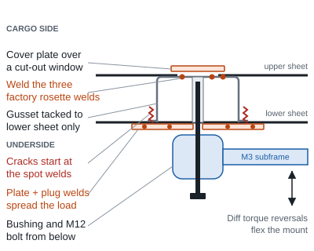 <!-- portrait -->

*Figure 4. Cross-section through one rear subframe mount. The mount's gusset is tacked only to the lower sheet, so load goes through a few spot welds. The kit's plate spreads it into the floor through plug welds, and welding the three factory rosette welds on top of the rear-most mounts ties the two sheets together.*

**Where the mounts sit.** On the Touring, as on the sedan, the rear mounts sit under the front edge of the steel spare-wheel well, beside each chassis rail, and the front mounts sit under the rear-seat base. CMP reaches the tops of the rear mounts by cutting away the front of the well within 120 mm (5 in) of each rail. In front of the well the RACP is spot-welded to the rails along a flange, and behind the mounts it joins the crumple structure on each side of the well ([CMP, part 2](https://cmpautoengineering.com/pages/part-2-it-s-not-just-the-subframe-mounts)). In the cargo area only trim covers this: Touring base panels, cover lids, a right-hand tray and side trims ([ETK: cargo trim](https://bmwfans.info/parts-catalog/E46-Touring/USA/325i-M54/L-N/browse/vehicle_trim/trim_panel_trunk_floor/)). If you take the well out (options 1–3 in [Exhaust and the spare-wheel well](#exhaust-and-the-spare-wheel-well)), you reach the tops of the rear mounts through that opening instead of cutting separate windows.

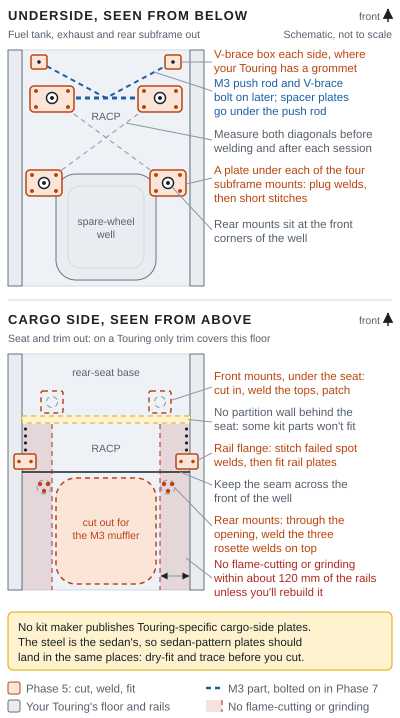 <!-- portrait -->

*Figure 5. The rear floor seen from below and from the cargo side, front at the top. Underneath, a plate goes under each of the four subframe mounts and a V-brace box goes in on each side. From above, you drill the floor and its well out along their spot welds, keeping the RACP, rail and rear-panel flanges whole, then weld the tops of the rear mounts through the opening. CMP's 120 mm is the strip CMP cuts away to reach those mount tops, not a zone to avoid.*

**Procedure** (assembled from the Garagistic, Morehead, BimmerWorld and CMP instructions and two Touring builds). It is one sequence with the floor work in [Exhaust and the spare-wheel well](#exhaust-and-the-spare-wheel-well): the floor closes only after the axle and muffler have been tried in place.

1. **Prepare** as in [Welding settings and safety](#welding-settings-and-safety): fuel system and battery out, fire watch, fume extraction, test coupons. Strip the cargo trim, carpet, sound deadening and rear seat to bare steel.
2. **Measure the body diagonals** before the first weld (same section).
3. **Strip the underside:** exhaust, driveshaft, rear subframe and suspension, fuel tank, underbody panels and liners near the welds ([Morehead](https://www.moreheadspeedworks.com/product/msw-e46-rear-subframe-mounting-chassis-reinforcement-kit/)). The plates can't be worked past the tank ([Tracks and Trails – Touring RACP (2025), 02:00](https://www.youtube.com/watch?v=t4CtY_W3vpU&t=120s)).
4. **Inspect** all four mounts from below, as above.
5. **Clean to bare metal** around each mount: paint, seam sealer and factory coating all come off. Clean mill scale off the plates and grind zinc coating off where you'll weld.
6. **Repair before reinforcing.** Drill a small hole at the tip of any crack to stop it, weld the crack, and repair failed spot welds ([Morehead](https://www.moreheadspeedworks.com/product/msw-e46-rear-subframe-mounting-chassis-reinforcement-kit/)).
7. **Underside plates.** Each large plate fits one mount; test-fit and mark them. Tack the kit's spacers first, then the plates, with weld-through primer on their backs ([Tracks and Trails – Touring RACP (2025), 07:20](https://www.youtube.com/watch?v=t4CtY_W3vpU&t=440s)). Plug-weld through the plate's holes; over a double-skinned area, "drill through the first layer of sheet metal only" so the plate fuses to the structure behind ([Garagistic K0536](https://www.garagistic.com/pages/instructions-e46-chassis-reinforcement-kit-k0536)). Weld the perimeter in short stitches, moving between mounts to spread the heat.
8. **Open the floor** by the cut rules in [Exhaust and the spare-wheel well](#exhaust-and-the-spare-wheel-well): drill the well's spot welds from the cargo side and lift it out downward, keeping the rail, RACP and rear-panel flanges whole. CMP's 120 mm (5 in) is the strip of the well it cuts away beside each rail to reach the mount tops, not a zone to avoid; what you must never cut or grind through is a flange. If you keep the well, cut BimmerWorld's windows instead: butt the trunk plate against the seam across the floor, trace it, and cut about ¼ in (6 mm) inside the line ([BimmerWorld](https://www.bimmerworld.com/About-Us/E46-Rear-Subframe-Floor-Reinforcement-Install/)).
9. **Topside welds.** First check every spot weld the well was hiding: those nearest the rails and the front "commonly let go first and are not visibly failed from beneath the car" ([CMP, part 2](https://cmpautoengineering.com/pages/part-2-it-s-not-just-the-subframe-mounts)). On each rear mount, weld the three rosette welds on top, then weld the upper and lower layers together at each existing spot weld ([BimmerWorld](https://www.bimmerworld.com/About-Us/E46-Rear-Subframe-Floor-Reinforcement-Install/)). Stitch failed spot welds along the rail-to-RACP flange ([CMP, part 2](https://cmpautoengineering.com/pages/part-2-it-s-not-just-the-subframe-mounts)), then fit the rail plates: CMP's, or Redish's, which Tracks and Trails welded from inside the trunk ([Tracks and Trails – Touring RACP (2025), 11:20](https://www.youtube.com/watch?v=t4CtY_W3vpU&t=680s)). CMP's Stage 2 beam follows the rail plates.
10. **Front mounts.** Their top welds sit under the rear-seat cushion, and CMP calls them "often neglected" ([CMP, part 2](https://cmpautoengineering.com/pages/part-2-it-s-not-just-the-subframe-mounts)). Tracks and Trails drilled out the rear-seat tabs to reach them and welded over the factory welds ([Tracks and Trails – Touring RACP (2025), 05:40](https://www.youtube.com/watch?v=t4CtY_W3vpU&t=340s)), and Redish reinforces "underneath the rear seat panel" on Tourings ([Autoalex – build part 3 (2023), 04:00](https://www.youtube.com/watch?v=cwbRDG7XHa8&t=240s)). Patch any opening you cut.
11. **V-brace mounting boxes,** if you'll fit the M3 V-brace (below).
12. **Mock up before you close the floor.** Hang the M3 rear axle and muffler in place, or leave the floor open until the Phase 6 mock-up, so the floor height and hangers suit the exhaust. Check them, and your canister, against the figures you took off the donor ([pass values](#exhaust-and-the-spare-wheel-well)).
13. **Close the floor:** plug-weld it down through the drilled 8 mm (5/16 in) holes at the factory spot-weld positions (see [Exhaust and the spare-wheel well](#exhaust-and-the-spare-wheel-well)).
14. **Measure the diagonals again** and compare them with your first readings.
15. **Protect it:** epoxy primer, seam sealer on every joint (both sides), a body plug in every hole, underbody coating outside and cavity wax inside ([Tracks and Trails – Touring rear end (2025), 09:40](https://www.youtube.com/watch?v=eMJLXbvzckE&t=580s)). If you want BMW's structural foam in the mount cavities, inject it last: foam makes later welding "more difficult and dangerous" ([BimmerWorld](https://www.bimmerworld.com/About-Us/E46-Rear-Subframe-Floor-Reinforcement-Install/)). Trim the cargo carpet if it no longer lies flat.

**Weld, don't glue.** Morehead: "Do not attempt to epoxy reinforcements… It does not work." BimmerWorld calls glue pointless because the mount tops must be welded anyway. One Touring builder bonded his plates with panel adhesive ([M346 Projects – pt 14 (2024), 23:00](https://www.youtube.com/watch?v=4_LqrbAlNmw&t=1380s)); nobody has compared the two, and the kit instructions say weld.

**Push rod, V-brace and spacers.** The M3 subframe comes with a tubular steel push rod (front crossmember, 33312229295) in place of the non-M cast-aluminium part, bolted to the body with four M8 bolts ([ETK: M3 carrier](https://bmwfans.info/parts-catalog/E46-Coupe/USA/M3-S54/L-N/browse/rear_axle/rear_axle_carrier/), [Morehead](https://www.moreheadspeedworks.com/product/msw-e46-rear-subframe-mounting-chassis-reinforcement-kit/)). Fit it with your kit's spacer plates, which make up for the plate thickness; PS Designs calls them "ESSENTIAL" and gives 25 Nm for the four bolts; BMW's figure for its M8 8.8 screws is 21 Nm (TIS 33 32 17AZ), which we use ([PS Designs/Redish](https://psdesignsglobal.com/wp-content/uploads/psdesigns-bmw-e46-rear-subframe-v2-plate-install-guide.pdf)). The M3 also has a V-shaped brace (33312229899) that "connects the rear axle carrier to the body" ([BMW ST041](https://archive.org/download/BMWTechnicalTrainingDocuments/ST041%20M3%20Complete%20Vehicle/1%20M3%20Complete%20Vehicle.pdf)), held by three M10×35 10.9 bolts at 59 Nm + 90° ([ETK](https://bmwfans.info/parts-catalog/33312229899/), [PS Designs/Redish](https://psdesignsglobal.com/wp-content/uploads/psdesigns-bmw-e46-rear-subframe-v2-plate-install-guide.pdf)). Your body has nowhere to bolt it: "on the non-M models, there's nothing there" ([Tracks and Trails – Touring rear end (2025), 06:00](https://www.youtube.com/watch?v=eMJLXbvzckE&t=360s)), and Redish says the Touring has grommets where the M3 has M10 threaded receivers ([Autoalex – build part 3 (2023), 05:20](https://www.youtube.com/watch?v=cwbRDG7XHa8&t=320s)). Builders added the mounting boxes in four ways: cut the donor's boxes off and plug-weld them at the factory weld points, a full day's work ([Tracks and Trails, 06:20](https://www.youtube.com/watch?v=eMJLXbvzckE&t=380s)); bought an aftermarket lower box, "like a hundred bucks" ([07:40](https://www.youtube.com/watch?v=eMJLXbvzckE&t=460s)); had new boxes fabricated ([Autoalex v2 – update (2024), 04:20](https://www.youtube.com/watch?v=vAHWkcGu8ek&t=260s)); or used the brackets in M3Projekts' kit ([M3projekts – trunk floor (2023), 10:00](https://www.youtube.com/watch?v=5xBcY33CPCM&t=600s)). The boxes carry axle loads, so weld them as carefully as the plates, with the floor still open.

**Stiffer subframe mounts.** BimmerWorld recommends urethane or solid subframe mounts "even on street cars", noting that BMW's bracing of the front mounts only moved the stress elsewhere ([BimmerWorld](https://www.bimmerworld.com/About-Us/E46-Rear-Subframe-Floor-Reinforcement-Install/)). Stiffer mounts pass the subframe's load into the floor more directly, so fit them only with the full underside and topside reinforcement.

> [!WARNING]
> Garagistic and Morehead recommend professional installation, and BimmerWorld recommends an experienced, professional shop. You will be welding thick plate to thin sheet, partly overhead. Practise on coupons first (see [Welding settings and safety](#welding-settings-and-safety)). Tracks and Trails spent about CAD 2,300 doing it himself, including a new welder, against a CAD 2,500 shop quote (November 2025), and concluded "for this, take it to a shop" ([Tracks and Trails – Touring RACP (2025), 13:00](https://www.youtube.com/watch?v=t4CtY_W3vpU&t=780s)). If you use a shop, give it the brief in [Shop briefs](#shop-briefs).

Watch: [Tracks and Trails – Touring RACP (2025), 07:20](https://www.youtube.com/watch?v=t4CtY_W3vpU&t=440s), [Tedward – subframe cracks (2020), 10:57](https://www.youtube.com/watch?v=Ww5WNopJshk&t=657s) (E46 M3 trunk-floor step; chapters only checked), [O'Leary's – reinforcement done right (2024), 08:07](https://www.youtube.com/watch?v=leftkCgDfK0&t=487s), [Condor – plate install, coupe (2019), description](https://www.youtube.com/watch?v=TVBHLFNL6k4) (Condor's kit lists the coupe and sedan only, not the Touring). Read: [StanceWorks DIY](https://stanceworks.com/forums/forum/the-garage/general-tech-and-maintenance/1022-official-diy-tms-sub-frame-reinforcement) and the photo instructions from [Garagistic](https://www.garagistic.com/pages/instructions-e46-chassis-reinforcement-kit-k0536) and [BimmerWorld](https://www.bimmerworld.com/About-Us/E46-Rear-Subframe-Floor-Reinforcement-Install/).

### Exhaust and the spare-wheel well

On a non-M E46 the M3's transverse rear muffler sits where the spare-wheel well is. BMW had to make room on the M3 too: the coupe's boot floor was modified for the larger silencer, whose mounts sit "on the outer ends of the under body" ([BMW ST041](https://archive.org/download/BMWTechnicalTrainingDocuments/ST041%20M3%20Complete%20Vehicle/1%20M3%20Complete%20Vehicle.pdf)), and an M Mobility tire kit replaced the spare wheel to free space for a "40 liter half-shell muffler with four outlets" ([BMW S54 module](https://www.billswebspace.com/MS54B32TrainingModule.pdf)). Petroyle cuts the Touring's well out and inserts a carbon-fiber panel ([Autocar](https://www.autocar.co.uk/car-news/features/best-car-bmw-never-built-driving-sublime-e46-m3-touring)).

**The two floors.** Your Touring's trunk floor (41127062570) is the deep-well floor BMW fits to every non-M E46, sedan and coupe included ([ETK](https://bmwfans.info/parts-catalog/41127062570/)). The M3's floor (41127895619) keeps a shallow well at the front, where a foam moulding holds the M Mobility kit ([BMW ST041](https://archive.org/download/BMWTechnicalTrainingDocuments/ST041%20M3%20Complete%20Vehicle/1%20M3%20Complete%20Vehicle.pdf)): "a little bit of a hump" that then "tails off" ([Redish – Touring build part 1 (2022), 05:49](https://www.youtube.com/watch?v=lf-52XqXSTk&t=349s)). Its rear part is flat, "so there is enough space for the large exhaust under it" ([M3projekts – trunk floor (2023), 17:14](https://www.youtube.com/watch?v=5xBcY33CPCM&t=1034s)). Everything around the floor is shared: the rails, side floors, battery tray, wheelhouse extension, canister brackets, jack bracket and ground pin carry the same part numbers on both cars. What differs is the floor pressing, the M3's front reinforcement (51717894229), two of the three muffler brackets, and the Touring's spare-wheel bracket ([ETK: Touring](https://bmwfans.info/parts-catalog/E46-Touring/USA/325i-M54/L-N/browse/bodywork/mounting_parts_for_trunk_floor_panel/), [M3](https://bmwfans.info/parts-catalog/E46-Coupe/USA/M3-S54/L-N/browse/bodywork/mounting_parts_for_trunk_floor_panel/)). So the M3 floor replaces yours part for part, on the same flanges. We infer that from the catalog; M346 found that "they all match up" ([M346 Projects – pt 14 (2024), 00:40](https://www.youtube.com/watch?v=4_LqrbAlNmw&t=40s)).

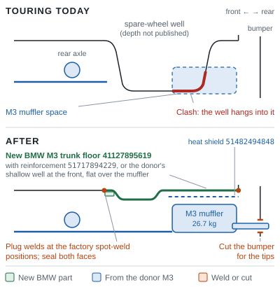 <!-- portrait -->

*Figure 6. Side section through the rear floor, front to the left. Your Touring's spare-wheel well hangs down into the space the M3 muffler needs, so the well comes out and a new BMW M3 trunk floor goes in, shallow at the front and flat over the muffler, plug-welded at the factory spot-weld positions.*

**What's in the well now, and where it goes.** BMW USA lists a space-saver spare as standard on the 2003 Sport Wagon, with about 57 L (2 cu ft) of extra room under the cargo floor ([BMW USA](https://www.press.bmwgroup.com/usa/article/attachment/T0022146EN_US/41437)). The load floor lifts out to reach the spare and the "control module mounting area located beneath" it ([BMW ST034](https://archive.org/download/BMWTechnicalTrainingDocuments/ST034%20E46%20Complete%20Vehicle/1%20models.pdf)). Photograph it all before anything comes out.

| Item, US 325i Touring | BMW number | When the M3 floor goes in |
|---|---|---|
| Compact spare, steel, 3.0B×16 ET32, 6.6 kg (14.6 lb) ([ETK](https://bmwfans.info/parts-catalog/E46-Touring/USA/325i-M54/L-N/browse/wheels/steel_rim_styl_12/)) | 36116750006 | Gone. Carry a tire sealant kit and compressor, as BMW does on the M3; the M3's trunk tray 51717906447 fits the new floor's shallow well ([ETK](https://bmwfans.info/parts-catalog/E46-Coupe/USA/M3-S54/L-N/browse/vehicle_trim/trunk_tray_breakdown_kit/)) |
| Spare-wheel bracket, threaded rod and M8 wing nut | 51718108473, 41118209460, 71106781144 | Gone with the well |
| Jack in the spare-wheel oddments box ([ETK](https://bmwfans.info/parts-catalog/E46-Touring/USA/325i-M54/L-N/browse/equipment_parts/car_tool_lifting_jack/)) | 71126767944, 71111092276 | Find the jack a home in a side storage area, or carry one elsewhere (your choice) |
| Tool kit with the towing eye, at the front of the well ([ETK](https://bmwfans.info/parts-catalog/E46-Touring/USA/325i-M54/L-N/browse/equipment_parts/car_tool_tool_box/)) | Towing eye 72157203519 | Keep both: in a side storage area or the M3 tray |
| Anti-drone liner and the 1,160 × 700 mm (46 × 28 in) sound deadener ([ETK](https://bmwfans.info/parts-catalog/E46-Touring/USA/325i-M54/L-N/browse/vehicle_trim/insulation/)) | 51488160470, 51488165271 | Out before welding; deaden the new floor once it's sealed |
| 80 Ah battery in its box on the right of the well, with a vent elbow and hose and a ground stud ([ETK](https://bmwfans.info/parts-catalog/E46-Touring/USA/325i-M54/L-N/browse/vehicle_electrical_system/battery_holder_and_mounting_parts/)) | Tray 51718237364, the same part on the M3; elbow 61211377835, hose 61211377745 | Out before welding. Refit the vent hose through its grommet and the ground on clean metal |
| Control modules under the load floor | — | Label each module, bracket and plug as it comes out; refit each where it stays dry and clear of the muffler's heat |
| Charcoal canister and leak-test pump, under the floor between the battery box and the well | Covers 51718233265, 51718233266 | Out before welding; keep or move them as *Canister and leak-test pump* below decides |
| Rear washer reservoir (right side area) and sound-system parts (left side area) ([BMW ST034](https://archive.org/download/BMWTechnicalTrainingDocuments/ST034%20E46%20Complete%20Vehicle/1%20models.pdf)) | — | Out before welding |
| Rear-silencer heat shield, sized for the small non-M muffler | 51487037885 | Replaced by the M3's 51482494848 |

**Choose the floor:**

| Option | What it takes | Notes |
|---|---|---|
| 1. A new BMW M3 trunk floor (41127895619) with its front reinforcement (51717894229). **Recommended** | Drill the Touring's well out along its factory spot welds and plug-weld the new floor in at the same points | New, rust-free steel, and no donor body steel welded into your car, which keeps the floor out of Massachusetts' "reconstructed" title question. BMWPartsDeal lists the floor at \$763.61 and the reinforcement at \$88.22 (October 2026), both "Ships in 1-3 Business Days", but stock isn't confirmed until you order ([floor](https://www.bmwpartsdeal.com/parts/bmw-trunk_floor-41127895619.html), [reinforcement](https://www.bmwpartsdeal.com/parts/bmw-reinforcement_trunk_floor_front-51717894229.html)); eStore-Central, an EU retailer, lists them at €717.97 and €81.79 ([eStore-Central](https://www.estore-central.com/bmw-parts-catalog/E46-M3-S54/Coupe/Bodywork/Mounting-Parts-For-Trunk-Floor-Panel/)). BMW lists the reinforcement as "additionally required" with the floor ([ETK](https://bmwfans.info/parts-catalog/E46-Coupe/USA/M3-S54/L-N/browse/bodywork/mounting_parts_for_trunk_floor_panel/)). In the UK the floor was about £430 plus VAT in July 2023, one large panel including the battery box; Redish used it on two Tourings ([Autoalex – build part 3 (2023), 13:20](https://www.youtube.com/watch?v=cwbRDG7XHa8&t=800s), [Redish – Touring build part 1 (2022), 04:40](https://www.youtube.com/watch?v=lf-52XqXSTk&t=280s)) |
| 2. The donor's M3 trunk floor | As option 1, with the donor's floor cut out with generous margins | The same part, used. Coupe and convertible floors both carry the front reinforcement 51717894229, and a convertible's also has two floor supports, 41217021949 and 41217020784 ([ETK: coupe](https://bmwfans.info/parts-catalog/E46-Coupe/USA/M3-S54/L-N/browse/bodywork/mounting_parts_for_trunk_floor_panel/), [convertible](https://bmwfans.info/parts-catalog/E46-Cabrio/USA/M3-S54/L-N/browse/bodywork/mounting_parts_for_trunk_floor_panel/)). The right muffler bracket sits on the rail, not the floor, so cut it off the donor separately (see *Hangers*). M346's Touring took its floor from a 2003 M3 convertible ([M346 Projects – Pt 1, M3 part out (2023), 06:40](https://www.youtube.com/watch?v=YqM2rQw1HQI&t=400s)). In Massachusetts, ask the RMV before you weld a donor floor in |
| 3. A flat panel | Cut the well out and weld in your own panel | Documented once: Calvin's Touring got "a sheet steel one that's been swaged for strength" in 2021 ([Calvin's Car Diary – PT10 (2021), 05:00](https://www.youtube.com/watch?v=jhG8TMQfSvA&t=300s)). His mechanic found "nothing wrong with it", but in 2025 it was swapped for a BMW M3 floor section for looks, before the car's exhaust was built ([Calvin's Car Diary – PT15 (2025), 22:05](https://www.youtube.com/watch?v=WZaYROuG1jo&t=1325s)). So no flat panel has been published with dimensions or tested under an exhaust; follow the rules below |
| 3b. A bonded composite M3-shape floor | Cut the well out inside its flanges and bond and rivet in a carbon panel moulded from an M3 floor | One S54 Touring (2026): 16 lb of steel out, 3.5 lb in, 2K non-conductive urethane with sealed stainless rivets over painted steel, M8 bond-in studs for the M3 hangers (the non-M studs are too short) and for the EVAP canister, and a rivet-in hanger bracket placed with jigs taken from an M3. Don't use windshield urethane: its carbon black conducts and invites galvanic corrosion ([NAM3 – Black & Tan 332iT #722–#748](https://nam3forum.com/forums/forum/main-forum/member-build-journals/195928-black-tan-332it/page49), [#739–#748](https://nam3forum.com/forums/forum/main-forum/member-build-journals/195928-black-tan-332it/page50)). No long-term or crash data |
| 4. Keep the well | The M3's front exhaust section, with a muffler in the Touring's position: Stromung's bolt-on, which "bolts to factory M3 midpipes and uses stock E46 hangers" ([LC's Garage – Stromung (2019), description](https://www.youtube.com/watch?v=eJqgR-EIun8)), Supersprint's rear sections or a welded-on non-M muffler. A US builder of several S54 Tourings says most are done this way ([e46fanatics](https://www.e46fanatics.com/threads/s54-conversion-muffler-shootout.1266239/)) | No floor surgery, but no quad-outlet M3 muffler. Tenza kept its non-M muffler with M3 flanges welded on, since the M3 pipe is 2³⁄₁₆ in against 2 in ([Tenza – wagon exhaust (2021), 00:40](https://www.youtube.com/watch?v=aWiXbduR9fA&t=40s)); Project BMW fitted a ZHP muffler ([Project BMW – wagon pulls hard (2021), 04:00](https://www.youtube.com/watch?v=8ItILfnYuuY&t=240s)). Three S54 swaps on the non-M floor ran a US E36 M3 muffler, one with its necked-down inlet cut off ([NAM3 – Kaiv's first S54 Touring #14](https://nam3forum.com/forums/forum/main-forum/member-build-journals/4337-obioban-s-2004-jr-black-m3-wagon), [NAM3 – Black & Tan 332iT #25](https://nam3forum.com/forums/forum/main-forum/member-build-journals/195928-black-tan-332it/page2)); one owner, who had fitted it in place of a loud Stromung, called it "blissfully quiet" ([NAM3 – Trent's swap #57](https://nam3forum.com/forums/forum/main-forum/member-build-journals/173296-trent-s-s54-rebuild-and-sedan-swap/page4)). In Massachusetts any of these must be no louder than the car's original equipment, with no gutted or by-passed muffler (*Massachusetts checks* below). One US S54 wagon whose non-M muffler steps down from 2½ to 2 in "has trouble picking up more speed" near 7,000 rpm ([ThaChileanDude – Building an e46 m3 Wagon in 10 days (2024), 33:56](https://www.youtube.com/watch?v=iSgClonTiQg&t=2036s)) |

> [!NOTE]
> Massachusetts gives a "reconstructed" title to a car reassembled by "welding together ... the frames or unit bodies of two or more motor vehicles" ([c. 90D §20F](https://malegislature.gov/Laws/GeneralLaws/PartI/TitleXIV/Chapter90D/Section20F)). We found no ruling on whether a donor's trunk floor counts, so ask the RMV Title Division before you cut the donor's ([Massachusetts](#massachusetts)). A new BMW floor avoids the question.

**Record the donor before you cut.** No source publishes the muffler's position, the hanger positions, the depth of either well or the factory gaps, so measure them on the donor while its exhaust still hangs, and use them as your pass values on the Touring. Write them on the [Floor and exhaust positions](WORKSHEETS.md#floor-and-exhaust-positions) worksheet, and photograph each with a tape in frame:

1. **The datum** is the midpoint between the bolt centers of the rear subframe's two rear mounts. Measure X rearward from the line through those bolts, and Y left (+) or right (−) of the midpoint. Use the same datum on your Touring, and check that the bolt spacing agrees within 2 mm (our estimate) before you trust the donor's figures. BMW's figure for that spacing is 660 mm (26.0 in) ± 1 mm: dimension F–F, which BMW's top view draws at the front corners of the spare-wheel well, behind the axle (our reading of the drawing) ([TIS 41 00](https://workshop-manuals.com/bmw/3_series_e46/325i_m54_tour/2_repair_instructions/41__body_%28tour%29/0__body/12_ra__frame_alignment_control_dimensions_body_top_view_rear_end_bmw_e_46_4-door___/)).
2. **On level ground at ride height,** loaded to BMW's normal position for an M3 (a full tank, 68 kg on each front seat and 14 kg in the trunk; [TIS 32 00](https://workshop-manuals.com/bmw/3_series_e46/m3_s54_coupe/3_technical_data/32__steering_and_wheel_alignment/0__electronic_chassis_alignment/1_td__chassis_wheel_alignment_normal_position_e46___m3_m3_csl/)), at placard tire pressures: the muffler's lowest point above the ground, each tip's center height and its offset from the car's centerline, and the gap from each tip to its bumper cut-out on all four sides (photograph them; the worksheet takes the smallest).
3. **On a lift, exhaust fitted:** the muffler to its heat shield at six points (left, center and right, at the front and rear edges); the shield to the floor; the muffler's front face to the diff cover and to the subframe; the closest pipe to the fuel tank, its straps and the V-brace; and the canister cover to the pipes.
4. **The three hangers:** X, Y and the length of each body stud, and which bracket it's on: H1 front-left, H2 rear-left or H3 on the right rail, as in *Hangers* below.
5. **The floor:** the depth of the M3's shallow well below its rim, measured from the cargo side; and the canister holder's four studs, photographed, noting whether they're on the floor or the RACP.
6. **The spot welds:** mark the donor floor's perimeter spot welds with a paint pen, then count them on each edge and measure their pitch.

On your Touring, in Phase 4, record the same datum, the existing hanger stud plates, the canister and leak-test pump (before they come out), the battery vent-hose exit and ground stud, and the well. One owner measured an E46 well at 62 cm (24.4 in) across ([BMW-Syndikat](https://www.bmw-syndikat.de/bmwsyndikatforum/topic_p134432_Fragen_zum_HiFi-Ausbau_Reserveradmulde_Car_Hifi___Multimedia___Navigation.html)); nobody has published its depth.

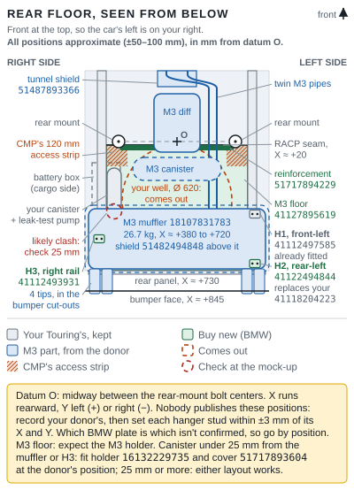 <!-- portrait -->

*Figure 7. The rear floor from underneath, front at the top, so the car's left is on the right. The new M3 floor fills the same outline as the panel you drill out, on the same flanges, and the muffler hangs from three stud plates at the outer ends of the underbody. Every position is approximate: record the donor's from datum O before you cut, and check your canister against the muffler's right end at the mock-up.*

**Cut rules.** The rear subframe mounts sit at the front corners of the well. CMP's access cut removes "the forward most portion of the spare wheel well within 5"/120mm of the chassis rails" to reach their tops ([CMP, part 2](https://cmpautoengineering.com/pages/part-2-it-s-not-just-the-subframe-mounts)). That 120 mm (5 in) is the strip CMP cuts away, not a zone to avoid, and every route that takes the well out works inside it. What must survive are the flanges, with their rows of spot welds: along both rails, across the front of the well where the RACP joins it, and at the rear panel. So:

- Separate the well along those flanges by drilling out its spot welds from the cargo side, through the flange only, with an 8 mm (5/16 in) spot-weld cutter. The holes become your plug-weld holes.
- If you trim instead, for a partial graft, cut at least 5 mm inboard of the flange, as M346 did ([M346 Projects – pt 14 (2024), 02:40](https://www.youtube.com/watch?v=4_LqrbAlNmw&t=160s)).
- Never torch-cut, and never cut or grind through a rail, RACP or rear-panel flange.
- Do the topside reinforcement through the opening before you close it (steps 8–13 of the [reinforcement procedure](#rear-subframe-mount-reinforcement)).

**Fitting the M3 floor** (options 1 and 2). This method follows BMW's welding rules ([Welding settings and safety](#welding-settings-and-safety)) and M346's Touring. [Phase 5](#phase-5-metalwork-1-subframe-mounts-and-floor) has the order of the whole job.

1. **Drill from the cargo side.** The well is spot-welded under the rail, RACP and rear-panel flanges. Drill each spot weld from above with the 8 mm cutter, through the flange only, and split the layers from below with a spot-weld chisel. The well drops out downward once it's free ([M346 Projects – pt 14 (2024), 02:40](https://www.youtube.com/watch?v=4_LqrbAlNmw&t=160s)). For a donor floor, drill the same welds on the donor; "they all match up" ([00:40](https://www.youtube.com/watch?v=4_LqrbAlNmw&t=40s)).
2. **Check what the well was hiding.** CMP: "Be sure to check all the spot welds previously hidden beneath this panel for failure. The ones closest to the chassis rails & front of the car commonly let go first and are not visibly failed from beneath the car." Use die penetrant to show hidden cracks. To close a gap at a failed spot weld, drill it out, bolt the layers tight, stitch-weld the flange edge, then fill the holes ([CMP, part 2](https://cmpautoengineering.com/pages/part-2-it-s-not-just-the-subframe-mounts)). Then do the topside reinforcement.
3. **Straighten the flanges** with a hammer and dolly. Check: a straight-edge shows less than 1 mm (0.04 in) of gap (our target), and no cracks show under die penetrant.
4. **Fit the brackets now,** while you can reach both faces (see *Hangers* below).
5. **Prepare the faces.** Take the paint off about 30 mm (1.2 in) around every weld, on both faces, and grind the zinc off in each weld zone ([11:00](https://www.youtube.com/watch?v=4_LqrbAlNmw&t=660s)). Coat every mating face with weld-through primer, kept out of the weld spots ([I-CAR CRN 503](https://rts.i-car.com/crn-503.html)). Strip seam sealer and underbody coating back there too: they burn.
6. **Offer the floor up from below,** propped and strapped, and cleco or clamp it at every flange hole ([08:20](https://www.youtube.com/watch?v=4_LqrbAlNmw&t=500s)). Check: the layers touch at each hole, with a gap of 1 mm or less (our target; BMW asks only for the smallest gap possible). Expect hand-fitting at the seam to the rear panel; the side and front flanges match up (our reading of two builds).
7. **Mock it up** with the M3 axle, or at least the diff, in place and the muffler on all three hangers. Check it against the donor's figures (*Clearances at the mock-up* below), and decide the canister.
8. **Plug-weld down-hand** from the cargo side, through the 8 mm flange holes into the new floor underneath: the same number and positions as the factory spot welds, and at least 25 mm (1 in) apart ([I-CAR CRN 1484](https://rts.i-car.com/crn-1484.html), [M346, 24:40](https://www.youtube.com/watch?v=4_LqrbAlNmw&t=1480s)). Skip around the four edges so no area gets hot, log the count on each edge ([worksheet](WORKSHEETS.md#plug-welds-and-sealing)), and measure the body diagonals after every session.
9. **Dress and check.** Grind each weld to no more than 3 mm (1/8 in) proud, without cutting into the panel. Check: every factory spot-weld position re-welded, no porosity or cracks, and melt-through visible underneath wherever you can see it.
10. **Seal and protect.** 2K epoxy primer on bare metal; seam sealer on both faces of every lap and plug-weld row; then top coat ([51:00](https://www.youtube.com/watch?v=4_LqrbAlNmw&t=3060s)). Fit a BMW body plug in every hole in the new floor, and light-test it (*Massachusetts checks* below). Underbody coating goes on outside, kept off the hanger rubbers and the shield standoffs, and cavity wax into the rails and box sections with a 360° wand ([Tracks and Trails – Touring rear end (2025), 09:40](https://www.youtube.com/watch?v=eMJLXbvzckE&t=580s)). No structural foam while welding remains. Then refit the battery box parts.

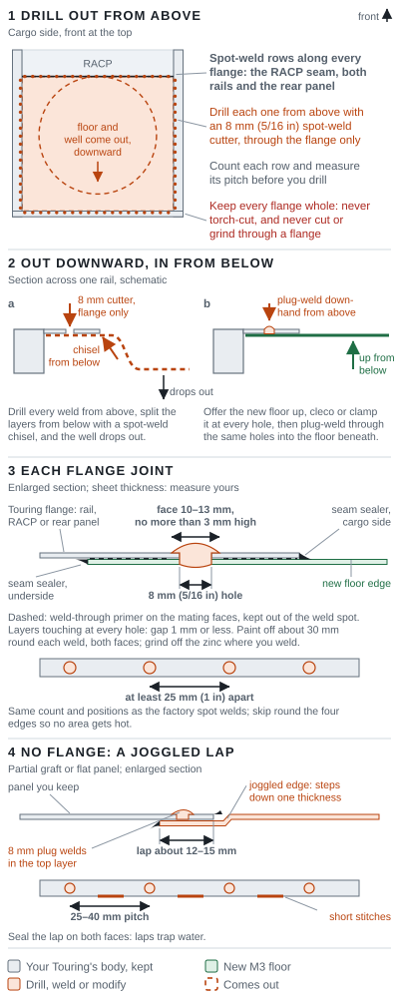 <!-- portrait -->

*Figure 8. The floor comes out and goes in through the same holes. Drill every factory spot weld from the cargo side, through the flange only, so the RACP, rail and rear-panel flanges stay whole; then offer the new floor up from below and plug-weld it down-hand through those holes, sealing both faces. Where a joint has no flange, joggle one edge and lap it.*

**Partial graft.** Tracks and Trails kept more of the Touring floor and cut out only what the M3 panel replaces ([Tracks and Trails – Touring rear end (2025), 01:20](https://www.youtube.com/watch?v=eMJLXbvzckE&t=80s)): trace the trimmed M3 panel on the Touring floor and cut about 5 mm inside the seams. Where a joint has no flange, lap it as for a flat panel. Calvin's team called the floor graft one of the hardest jobs on their car ([Calvin's Car Diary – PT6 (2020), 10:40](https://www.youtube.com/watch?v=tJdxzzwIX1E&t=640s)).

**BMW's own floor change** is heavier work than this guide's ([TIS 41 12 535](https://workshop-manuals.com/bmw/3_series_e46/325i_m54_tour/2_repair_instructions/41__body_%28tour%29/12__luggage_compartment_floor/1_ra__replacing_complete_rear_luggage_compartment_floor_%28tail_panel_removed%29_%28e46%29/)):

- the car on a straightening bench, with the tail panel, tank and rear axle carrier out;
- the spot welds drilled out along the side walls, the spare-wheel well and the floor assembly, and the rear side members cut at their 16 mm hole;
- the new floor clamped with the bench's attachments, then plug-welded through drilled holes, with zinc-rich primer on every mating face;
- the cavity foam parts bonded back in with window adhesive.

Keeping the rails whole, as this guide does, avoids BMW's rail cut.

**Flat panel** (option 3). No source gives the floor's gauge, so measure it at a cut edge and use steel no thinner. Stiffen the panel with transverse swaged or bead-rolled ribs, and with a hat-section across its front edge in place of BMW's reinforcement 51717894229 (our suggestion). Set it no lower than the rim of the old well, since the M3's own rear floor is flat, and hang the muffler under it in the mock-up before you close it. Plug-weld it to every original flange at the factory spot-weld positions, especially along both rails and the front seam, and leave no free edge near the mounts. Where a joint has no flange, joggle one edge and lap the panels by about 12–15 mm (0.5–0.6 in; our estimate); plug-weld through 8 mm holes in the top layer at 25–40 mm (1–1.6 in) pitch, add short stitches, and seal the lap on both faces, since laps trap water. In our view a lap is far more forgiving than a butt weld on thin steel; use an open butt joint over a copper backer only if your butt-weld coupons pass I-CAR's fold test. Hang the muffler from the outer underbody or the rails, as BMW does, never from the middle of the panel ([BMW ST041](https://archive.org/download/BMWTechnicalTrainingDocuments/ST041%20M3%20Complete%20Vehicle/1%20M3%20Complete%20Vehicle.pdf)). If the panel can hold water, give it one drain at its low point with a removable plug (our suggestion), never an open hole.

**Hangers.** BMW's catalog gives the M3 rear muffler, 18107831783, as 26.7 kg (58.9 lb); it's the same part on every 2001–06 M3 coupe and convertible ([ETK](https://bmwfans.info/parts-catalog/18107831783/)). It hangs on three brackets at the outer ends of the underbody, two on the left and one on the right ([Redish – Touring build part 1 (2022), 06:00](https://www.youtube.com/watch?v=lf-52XqXSTk&t=360s)), so, we infer, the new floor carries none of its weight. Your Touring's floor has two brackets, both on the left ([ETK](https://bmwfans.info/parts-catalog/E46-Touring/USA/325i-M54/L-N/browse/bodywork/mounting_parts_for_trunk_floor_panel/)), for a 12.9 kg (28 lb) muffler ([ETK](https://bmwfans.info/parts-catalog/E46-Touring/USA/325i-M54/L-N/browse/exhaust_system/center_and_rear_muffler/)); builders describe a single left-side hanger ([Tracks and Trails – Touring rear end (2025), 03:20](https://www.youtube.com/watch?v=eMJLXbvzckE&t=200s)). Prices are BMWPartsDeal's, October 2026.

| Bracket | BMW number | On your Touring | What to do |
|---|---|---|---|
| H1: rear silencer bracket, front (left front) | 41112497585 ([ETK](https://bmwfans.info/parts-catalog/41112497585/)) | Already fitted: the same part on every E46 | Keep it if it's sound and sits at the donor's position; replace it if it's rusted (\$27.20, [BMWPartsDeal](https://www.bmwpartsdeal.com/parts/bmw-rear_silencer_bracket_front-41112497585.html)) |
| H2: rear silencer bracket, rear (left rear) | 41122494844, M3 only ([ETK](https://bmwfans.info/parts-catalog/41122494844/)) | 41118204223, with short studs ([ETK](https://bmwfans.info/parts-catalog/41118204223/)) | Drill out the Touring's plate and plug-weld the M3 one at the donor's position (\$27.19, [BMWPartsDeal](https://www.bmwpartsdeal.com/parts/bmw-rear_silencer_bracket_rear-41122494844.html); one listing flags it, so confirm stock) |
| H3: bracket, rear muffler right (on the right rear side member) | 41112493931, M3 only ([ETK](https://bmwfans.info/parts-catalog/41112493931/)) | None | Buy it (\$71.40, [BMWPartsDeal](https://www.bmwpartsdeal.com/parts/bmw-bracket_rear_muffler_right-41112493931.html)), or cut the donor's off its rail with 20–30 mm (about 1 in) of metal round it (our estimate). Tack it at the donor's position, hang the muffler once, then weld it fully |

Which catalog number is which physical plate hasn't been confirmed against the builds, so place each by the donor's measured positions. **Check:** every stud within ±3 mm of the donor's X and Y (our estimate, inside the rubber mounts' give), the studs square to the body, and no plate movement when you torque its M8 nuts to 22 Nm (16 ft-lb). Builders:

- moved the existing hanger and cut the passenger-side hanger off the donor ([Tracks and Trails, 03:40](https://www.youtube.com/watch?v=eMJLXbvzckE&t=220s));
- swapped the non-M stud plate, whose studs are too short, for BMW's plate with the longer M3 studs, welded the extra M3 bracket behind it after hanging the exhaust to find the holes, and welded a third bracket to the passenger-side rail ([M346 Projects – pt 14 (2024), 09:20](https://www.youtube.com/watch?v=4_LqrbAlNmw&t=560s));
- cut the M3's extra bracket off the donor and welded it on. The poster calls it the "drivers side", but on a UK right-hand-drive car that's the right-hand (US passenger-side) bracket, 41112493931 (our reading) ([PistonHeads](https://www.pistonheads.com/gassing/topic.asp?h=0&f=47&t=1655205)).

Each of the three hanger stacks, from the body down: the stud plate's two M8 studs; bracket 18207839657 on two M8 flanged nuts 18307620549 at 22 Nm (16 ft-lb); rubber mount 18201401797; then an M8×45 bolt 07119902955 with collar nut 07119927022 at 20 Nm (15 ft-lb) into the muffler's tab ([ETK](https://bmwfans.info/parts-catalog/E46-Coupe/USA/M3-S54/L-N/browse/exhaust_system/intermediate_pipe_rear_muffler/); torques from [Flow p.87](https://drive.google.com/file/d/1GS3Hirx6x0c0WG8hPeXiwfXfeUldkQnm/view?usp=sharing)). Fit every nut and bolt.

**The rest of the exhaust.** The US M3's front section 18107832909, intermediate pipe 18107832313 and muffler bolt together ([ETK](https://bmwfans.info/parts-catalog/E46-Coupe/USA/M3-S54/L-N/browse/exhaust_system/intermediate_pipe_rear_muffler/)). The front and middle pipes went into Touring tunnels with no tunnel work reported on at least five builds ([Tracks and Trails – first drive (2026), 58:20](https://www.youtube.com/watch?v=pvR3ovRfQHg&t=3500s), [M346 Projects – pt 14 (2024), 48:49](https://www.youtube.com/watch?v=4_LqrbAlNmw&t=2929s), [LC's Garage – Stromung (2019), description](https://www.youtube.com/watch?v=eJqgR-EIun8), [The BMW Wagon Guy – S54 slicktop Touring, 03:34](https://www.youtube.com/watch?v=3oZcNAW4vb0&t=214s), [Project BMW – wagon pulls hard (2021), 04:00](https://www.youtube.com/watch?v=8ItILfnYuuY&t=240s)), and none reported trouble at the RACP plates, the V-brace or the center bearing. They hang from the center support 18211436309, the same part your Touring already has; fit the M3's rubber mounts 18207832991 (two) in place of the Touring's 18211745426. The center-bearing bracket and the RACP are shared too, so only parts that differ can get in the way: the Touring's fuel tank, kit welds left proud (grind them, as the kits say), V-brace boxes welded away from the M3 positions, and the Touring's canister (we infer). Joints:

- Front section to intermediate pipe: gaskets 18307830674 with M8×30 bolts and nuts, at 22 ± 2 Nm (16 ± 1.5 ft-lb).
- Intermediate pipe to muffler: new gasket rings 18111723379 and 18101405737, flange 18111719417, and four M8×50 bolts 07119904533 with square nuts 11621741172, at 15 Nm (11 ft-lb) ([Flow p.87](https://drive.google.com/file/d/1GS3Hirx6x0c0WG8hPeXiwfXfeUldkQnm/view?usp=sharing)).

The M3's three sections (front section, intermediate pipe and muffler) weigh about 42.6 kg (94 lb) against about 26.9 kg (59 lb) for the Touring's three, and most of the extra 15.7 kg (35 lb) is the muffler, behind the rear axle (our sum of BMW's catalog weights). Allow for it in your springs and in Massachusetts' ±2 in ride-height rule ([Suspension for Touring weight](#suspension-for-touring-weight)).

**Heat shields.** Fit the M3's: the rear-silencer shield 51482494848 (1.3 kg, M3 and CSL only; \$259.12 at [BMWPartsDeal](https://www.bmwpartsdeal.com/parts/bmw-heat_insulator_rear_silencer-51482494848.html), October 2026) and the tunnel shield 51487893366 ([ETK](https://bmwfans.info/parts-catalog/E46-Coupe/USA/M3-S54/L-N/browse/vehicle_trim/insulation/)). Your Touring's rear shield, 51487037885 (370 g), is sized for the small non-M muffler and won't cover the M3 box ([ETK](https://bmwfans.info/parts-catalog/E46-Touring/USA/325i-M54/L-N/browse/vehicle_trim/insulation_2/)). One builder found the M3 and Touring tunnel shields (51488193807 on your car) interchangeable, "Same same, but you know, different", and fitted the cleaner one ([Tracks and Trails – first drive (2026), 58:20](https://www.youtube.com/watch?v=pvR3ovRfQHg&t=3500s)); the M3's is the one shaped for the M3 pipes. The M3's rear shield hangs on body studs with 18 mm-flange nuts 07146949379 ([ETK](https://bmwfans.info/parts-catalog/E46-Coupe/USA/M3-S54/L-N/browse/vehicle_trim/insulation/), [drawing](https://ills.bmwfans.info/3liq.png)). Count and photograph its studs on the donor floor before you cut, because a new floor may not have them. With the exhaust in its final position, check its clearance to the floor, fuel tank, battery tray and tires at full bump, and add a shield wherever the pipes come close to the tank, the cargo floor or the battery. After 20 minutes' driving, the cargo floor over the muffler should feel warm but not hot to the hand (our check; there's no published limit). The M3's front shields are wider, to clear its larger control-arm brackets ([Project BMW – engine installed (2021), 00:20](https://www.youtube.com/watch?v=iVGU_Yg0ZLw&t=20s)).

**Canister and leak-test pump.** On your Touring the charcoal canister and the DM-TL leak-test pump sit under the right rear of the floor, fore and aft, "in between the battery tray and the spare tire well" ([Tenza Motorsports – No more SULEV (2021), 01:30](https://www.youtube.com/watch?v=PgW1oWs7cfk&t=90s)); BMW's wiring system puts the MS45.1 car's pump in the "RH rear wheelhouse" ([WDS](https://wds.psjr.org/en/e46/zinfo/E46_EI01065B.htm)). BMW moved them on the M3: the canister lies across the car just behind the differential, in an M3-only holder 16132229735 under an M3-only cover 51717893604, with M3 vent and purge hoses ([WDS](https://wds.psjr.org/en/e46/zinfo/E46_EI01065A.htm), [ETK](https://bmwfans.info/parts-catalog/E46-Coupe/USA/M3-S54/L-N/browse/fuel_supply/exp_tank_activated_carbon_container/)). The canister, the pump and the canister brackets on the floor (41128204385, 41128227776) are the same parts on both cars. On the M3 the holder sits on four M6 studs with self-locking nuts 07147153450. The studs may sit on the M3 floor or on the rear axle carrier panel, perhaps on the shared floor brackets, so find them on the donor before the floor is welded in ([ETK](https://bmwfans.info/parts-catalog/E46-Coupe/USA/M3-S54/L-N/browse/fuel_supply/exp_tank_activated_carbon_container/)). BMW's move suggests the Touring position clashes with the M3 muffler's right end, though nobody has proved it (our inference). With the well kept (option 4), leave the canister where it is. Move it only with an M3 floor, and expect to; check the Touring canister's clearance to the muffler at the Phase 5 mock-up, at full bump and full rebound:

- **Within 25 mm (1 in) of the muffler or its right hanger, or touching** (the likely result): fit the M3 arrangement at the donor's position: holder 16132229735 (\$92.19 at [BMWPartsDeal](https://www.bmwpartsdeal.com/parts/bmw-holder_for_activated_charcoal_filter-16132229735.html), October 2026) with its four M6 nuts, cover 51717893604 ([ETK](https://bmwfans.info/parts-catalog/E46-Coupe/USA/M3-S54/L-N/browse/vehicle_trim/underfloor_coating/)), the M3 vent pipes 16132283286 and 16132229415, and the M3 rear purge line 16132229417.
- **Clear by 25 mm or more:** either arrangement works. Keep the Touring's mounting and its covers 51718233265 and 51718233266, or fit BMW's M3 layout anyway: on Renner's Touring, which has a new M3 floor, "The EVAP system is from the M3" ([Larry Chen (2025), 22:39](https://www.youtube.com/watch?v=YM2gyQOaJCk&t=1359s)).

Keep the donor's holder, cover and hoses when you strip it, so you have them either way. With a flat panel, give the canister a fixed mount and cover equal to one of these; no tested design exists. The parts for each floor are listed in [Filler and EVAP](#filler-and-evap).

This moves an emissions part into BMW's own M3 arrangement and removes nothing: the canister and the leak-test pump must stay connected, sealed and working. Route the hoses without kinks (Tenza had to re-make one so it wouldn't kink in the tight space by the subframe, [04:35](https://www.youtube.com/watch?v=PgW1oWs7cfk&t=275s)), use new clamps, and make sure the pump's plug reaches without strain; if it doesn't, extend the lead with proper terminals ([repair leads](WIRING-AND-CODING.md#terminals-tools-and-repair-leads)). Prove it with the [DM-TL leak test](WIRING-AND-CODING.md#the-dm-tl-leak-test) and a completed EVAP readiness monitor.

**Clearances at the mock-up.** Pass values for the muffler hung on all three hangers, against the figures you took off the donor:

| Check | Pass |
|---|---|
| Hanger studs | Within ±3 mm of the donor's X and Y (our estimate) |
| The donor's gaps: muffler to shield, shield to floor, muffler to diff and subframe, pipes to tank, straps and V-brace | Within ±5 mm of the donor's (our estimate) |
| Tips | Centered in the bumper cut-outs, or at the donor's offsets within ±5 mm (our estimate) |
| Exhaust to any fuel, brake or EVAP line, or anything that burns | At least 25 mm (1 in), or shielded |
| Any fuel part to the exhaust | At least 38 mm (1.5 in), or shielded |
| Full bump (bump stop compressed) and full rebound | No contact anywhere |
| Rubber hangers | Hanging straight, with no side load (our estimate) |

Massachusetts publishes no clearance figures. The 25 and 38 mm rules are British Columbia's inspection limits, which we use as targets ([BC Vehicle Inspection Manual (2016, amended 2018), pp. 101–102](https://free.bcpublications.ca/civix/document/id/public/vsis/vim2lvims1pt)).

**Massachusetts checks.** The floor and the exhaust are both inspection items ([Massachusetts](#massachusetts)):

- **Seal every seam and hole.** 540 CMR 4.04(12)(d) rejects "holes or cracks, due to rust or otherwise, in the floor pans or other body panels which would permit the passage of exhaust gases into the passenger or trunk compartments" ([540 CMR 4.04](https://www.law.cornell.edu/regulations/massachusetts/540-CMR-4-04)). Plug every hole in the new floor, seal every lap and plug-weld row on both faces, and light-test it before the carpet goes back: a lamp under the car, the cargo area dark, no light at any seam. Then water-test the cargo area.
- **Fit every hanger fastener.** 540 CMR 4.04(5) wants exhaust components "securely fastened with fasteners in place and undamaged", and the exhaust to discharge "beyond operator, passenger, and/or trunk compartment". The M3 tips at the rear bumper do; an exit under the cargo floor wouldn't.
- **Keep the muffler stock.** M.G.L. c. 90 §16 bans a muffler "cut-out or by-pass", a muffler "from which the baffle plates, screens or other original internal parts have been removed and not replaced", and an exhaust "modified in a manner which will amplify or increase the noise" ([c. 90 §16](https://malegislature.gov/Laws/GeneralLaws/PartI/TitleXIV/Chapter90/Section16)). Fit the M3 muffler intact, with no valved, gutted or "delete" rear section. A CSL rear section was never US-certified, so treat one like an aftermarket part (our reading). The inspector revs the engine to check for noise, so keep the receipts and part numbers that show an unaltered BMW M3 system, and ask your station how it judges an M3 system on a 325i.

**Manifolds, catalysts and torques.** Keep the M3 manifolds, catalysts and all four O2 sensors; the Sloan Motors Touring's catless headers wouldn't pass a US emissions inspection ([BMWBlog](https://www.bmwblog.com/2024/11/11/custom-e46-m3-touring-wagon-s54-build/)). Manifold to front pipe: new nuts and gaskets, 24 Nm (18 ft-lb). O2 sensors: 50 Nm (37 ft-lb), with anti-seize on the threads only. M8 flanges: 22 ± 2 Nm (16 ± 1.5 ft-lb) ([Flow p.86](https://drive.google.com/file/d/1GS3Hirx6x0c0WG8hPeXiwfXfeUldkQnm/view?usp=sharing)). Muffler clamp 15 Nm (11 ft-lb), hanger body nuts 22 Nm (16 ft-lb) and hanger bolts 20 Nm (15 ft-lb), as above ([Flow p.87](https://drive.google.com/file/d/1GS3Hirx6x0c0WG8hPeXiwfXfeUldkQnm/view?usp=sharing)).

**Rear bumper and towing.** Mark the tip cut-outs with the exhaust in its final position; the bumper itself is covered in [Rear bumper, skirts and trim](#rear-bumper-skirts-and-trim). The M3's diffuser and muffler sit where a tow hitch would go, and its bumper carrier can't take a tow bar ([Autoalex v2 – update (2024), 11:20](https://www.youtube.com/watch?v=vAHWkcGu8ek&t=680s)).

### Welding settings and safety

Most of this build's welding is 1.5–2.5 mm plate onto thinner floor skins, much of it overhead, plus the floor and arch seams, on a car that has held fuel. Set up and practise before you touch the car.

**What you'll join:**

| Part | Thickness | Source |
|---|---|---|
| Properparts plates | 1.5 mm (16 gauge) | [Properparts](https://properparts.co/products/99-06-bmw-e46-rear-subframe-reinforcement-plates-kit) |
| Condor plates | 14 gauge (about 1.9 mm) | [Condor – plate install, coupe (2019), description](https://www.youtube.com/watch?v=TVBHLFNL6k4) |
| CMP chassis rail plates | 2.5 mm, zinc-coated | [CMP](https://cmpautoengineering.com/collections/bmw-e46/products/e46-subframe-racp-to-chassis-rail-plates) |
| LBL M3 rear arch repair sections | 1.2 mm | [m3cutters](https://forums.m3cutters.co.uk/threads/e46-m3-rear-arch-repair-panel.252420/), unverified |
| Your trunk floor | Not published. BMW's catalog weights (13.3 kg Touring floor, 12 kg M3 floor) suggest about 1.0–1.4 mm (our estimate) | [ETK](https://bmwfans.info/parts-catalog/E46-Touring/USA/325i-M54/L-N/browse/bodywork/mounting_parts_for_trunk_floor_panel/); measure with a vernier caliper at a cut edge or the first drilled spot weld, paint removed |
| Your RACP, rail and rear-panel flanges | Not published | Measure as above |
| Your arch skins | Not published. I-CAR puts typical outer panels "in the range of 0.70 mm", so expect about 0.7–0.8 mm (estimate) | [I-CAR](https://rts.i-car.com/oem-restraints-system-part-replacement-search/51df0590-ca17-4e8f-a0c4-939263a9c236.html); measure as above |

Buy steel for a flat panel or fill strips no thinner than the panel you measured.

**Wire, gas and settings.** Miller recommends 0.023–0.024 in (0.6 mm) wire for body panels up to 1/16 in (1.6 mm), and 0.030 in (0.8 mm) wire for 20 gauge to 1/8 in (about 0.9–3.2 mm), which likely suits the plate-to-floor welds better. Use argon/CO2: BMW's E46 rule is 82/18 with G3Si1 or G4Si1 wire (sold in the US as ER70S-6), and 75/25 is Miller's usual mix for body work ([TIS 41 00](https://workshop-manuals.com/bmw/3_series_e46/325i_m54_tour/2_repair_instructions/41__body_%28tour%29/0__body/48_ra__welding_and_soldering_steel_parts/)). Voltage and wire speed depend on the machine, so start from the chart inside your welder's door, and spot and stitch on panels rather than running long beads ([Miller](https://www.millerwelds.com/en-US/resources/knowledge-hub/mig-welding/how-to/mig-basics-for-automotive-welding-repair)). Never use pure argon: one Touring builder who ran 100% argon by mistake "could not get a good solid bead" and re-welded the floor with the right gas ([M346 Projects – pt 14 (2024)](https://www.youtube.com/watch?v=4_LqrbAlNmw)).

**BMW's rules for replacing spot welds.** BMW's E46 body-repair rules in TIS 41 00 say the same as its current rules, which I-CAR quotes ([TIS 41 00](https://workshop-manuals.com/bmw/3_series_e46/325i_m54_tour/2_repair_instructions/41__body_%28tour%29/0__body/48_ra__welding_and_soldering_steel_parts/), [I-CAR CRN 1484](https://rts.i-car.com/crn-1484.html), [I-CAR CRN 503](https://rts.i-car.com/crn-503.html)):

- "Take the number and position of welding spots and MAG weld seams from the separated part. Replace areas inaccessible to spot-welding tongs with MAG plug welds at the same distance." MAG is MIG welding with an active gas such as BMW's 82/18 or 75/25.
- Plug-weld holes are 8 mm (5/16 in) across, with at least 25 mm (1 in) between welds.
- Keep the gap between the layers "as small as possible": "The larger the weld gap, the lower will be the strength of the joint." BMW gives no figure; aim for 1 mm (0.04 in) or less (our target).
- Clamp the welder's ground "directly to the component to be welded".
- Remove the paint about 30 mm (1.2 in) around each weld and on its back, remove the zinc layer too where you MIG-weld, and coat every overlap with weld-through primer.
- Reseal every seam that was sealed, and don't MIG-braze in a repair.

I-CAR adds that a plug weld should stand no more than 3 mm (1/8 in) high ([I-CAR (2022)](https://rts.i-car.com/collision-repair-news/spot-and-plug-weld-nugget-size.html)). The home-welder way to meet all of this on the floor is to drill the spot welds from the cargo side and plug-weld down through the same holes into the new floor ([Exhaust and the spare-wheel well](#exhaust-and-the-spare-wheel-well)). That gives you BMW's hole size, count and spacing, with no overhead plug welds. The factory spot welds should already be at least 25 mm apart, but count and measure them to check (our inference).

**Test coupons.** Before each new combination of thicknesses, weld coupons of the same materials: a kit offcut, or plate of the same gauge, over sheet of your floor's measured gauge, cleaned the same way. Weld them in the position you'll use on the car, overhead included, with plug welds through holes of the size you'll use: BMW's 8 mm on the floor, the kit's on the plates. Break each apart in a vise. The weld should have fused into both pieces, not sat on top of the thin sheet or blown through it. Compare each coupon with I-CAR's pass values ([I-CAR practice welding guide (2023)](https://info.i-car.com/getmedia/5bf41ea3-7245-46a2-9d3f-9e6723bcb69f/i-car_practice-welding-guide.pdf)), adjust and repeat until it passes, and record it on the [worksheet](WORKSHEETS.md#test-coupons).

| Coupon | Pass on the face | Pass when broken apart |
|---|---|---|
| Plug weld, 8 mm hole (BMW's size; I-CAR's thick-thick coupon) | 10–13 mm (0.4–0.5 in) across, no more than 3 mm high | A 5–10 mm hole torn out of the bottom coupon |
| Plug weld, 6 mm hole (I-CAR's thin-thin coupon, for skins) | 8–10 mm across, no more than 3 mm high; melt-through on the back 3–6 mm across and up to 1.5 mm high | A 3–8 mm hole torn out of the bottom coupon |
| Lap (fillet) stitch, thin-thin | 25–38 mm (1–1.5 in) long, 3–8 mm wide, no more than 3 mm high | The top coupon tears out along the whole weld |
| Open butt, thin-thin | 25–38 mm long, 3–8 mm wide | Folded face to face, no cracks in the back of the weld |

**Distortion.**

- Use plug welds and short stitches, never long beads. Move between mounts, or around a panel, so no area gets hot, and let each area cool between passes. The [rear arches](#rear-arches-and-doors) use the same method.
- Close the gap before every weld: dolly the flange flat, put a cleco or clamp at each hole, and weld only where the layers touch.
- Measure the body diagonals before the first weld. Mark the four rear subframe mounting points and the front subframe points, measure both diagonals across each set with a tape or tram gauge (a plumb bob down to the floor helps), and write them down. Measure again after each session; a change of more than about 2 mm (our estimate of what a tram gauge repeats to) means the floor is pulling. BMW's body control dimensions are in TIS 41 00 ([Phase 5](#phase-5-metalwork-1-subframe-mounts-and-floor)).

**Fuel, brakes, battery and electrics.**

- The fuel tank, filler neck and lines come out before any welding, with the lines capped ([Garagistic K0536](https://www.garagistic.com/pages/instructions-e46-chassis-reinforcement-kit-k0536)). Drain and store the fuel safely (see [Safety](#safety)).
- Remove every fuel and EVAP part near a weld. The charcoal canister and the DM-TL leak-test pump sit under the right rear of the floor, between the battery box and the spare-wheel well ([Tenza Motorsports – No more SULEV (2021), 01:30](https://www.youtube.com/watch?v=PgW1oWs7cfk&t=90s)), on canister brackets on the trunk floor ([ETK: trunk floor](https://bmwfans.info/parts-catalog/E46-Touring/USA/325i-M54/L-N/browse/bodywork/mounting_parts_for_trunk_floor_panel/)). The liquid-vapour separator, which the catalog calls an expansion tank (16136752641), sits in the right rear wheel well behind the trim, on bracket 41148196386, inside the arch you'll graft ([BMW ST041 Part 3](https://archive.org/download/BMWTechnicalTrainingDocuments/ST041%20M3%20Complete%20Vehicle/3%20EngineElectronics%20%28Part%203%29.pdf), [ETK: floor](https://bmwfans.info/parts-catalog/E46-Touring/USA/325i-M54/L-N/browse/bodywork/rear_wheelhouse_floor_parts/)). Cap every hose.
- The brake pipes along the floor stay full of fluid through the build: unclip and move each one clear of a weld, or shield it, and keep every opened end capped ([Safety](#safety)).
- Disconnect the battery ([Garagistic K0536](https://www.garagistic.com/pages/instructions-e46-chassis-reinforcement-kit-k0536)) and take it out: its tray is on the trunk floor you'll be welding ([ETK: trunk floor](https://bmwfans.info/parts-catalog/E46-Touring/USA/325i-M54/L-N/browse/bodywork/mounting_parts_for_trunk_floor_panel/)).
- Clamp the welder's ground directly to the part you're welding, on clean metal close to the weld, as BMW asks; never through bushings or suspension parts.

**Fire.** BimmerWorld warns that BMW's chassis coating "can be extremely flammable" ([BimmerWorld](https://www.bimmerworld.com/About-Us/E46-Rear-Subframe-Floor-Reinforcement-Install/)), and undercoating, seam sealer and sound deadening smoulder. Strip them back from the weld, protect glass and anything you're keeping from spatter, and keep two extinguishers and a fire blanket within reach. BMW also warns of "combustible foam in welding area" when it replaces an E46 side panel ([TIS 41 35 101, coupe, p.12](https://workshop-manuals.com/bmw/3_series_e46/m3_s54_coupe/2_repair_instructions/41__body_%28coupe%29/35__side_panels/6_ra__replacing_rear_left_side_panel_%28partial_replacement_c-pillar%29_%28e46_coup%29/page_1892/)), so look into the cavity behind every arch seam and cut any foam back before you weld. Keep watching after you stop: OSHA's workplace rule asks for a fire watch of at least 30 minutes after hot work ([29 CFR 1910.252](https://www.osha.gov/laws-regs/regulations/standardnumber/1910/1910.252), unverified).

**Fumes.** CMP's rail plates are zinc-coated, and weld-through primer is zinc-rich. OSHA's welding-fume fact sheet names zinc fume as a cause of metal fume fever and calls for local exhaust ventilation at the arc, with a respirator where that isn't enough ([OSHA FS-3647](https://www.osha.gov/sites/default/files/publications/OSHA_FS-3647_WELDING.pdf)). Grind zinc coating off where you'll weld ([M346 Projects – pt 14 (2024), 11:00](https://www.youtube.com/watch?v=4_LqrbAlNmw&t=660s)), pull the fume away from you with an extractor, and wear a respirator rated for metal fume.

### S54 refresh on the stand

The engine will never be easier to work on than now. Do these before it goes in.

**Rod bearings.** They're the S54's best-known weak point; BMW's service action replaced them on E46 M3s built from 02/2001 to 05/2003 ([BMW SI B11 04 04](https://nam3forum.com/forums/filedata/fetch?id=5213)). On the stand you can take the oil pump off for room; FCP Euro calls rod 1 the hardest part with the pump in place ([FCP Euro – S54 rod bearings (2022), 51:17](https://www.youtube.com/watch?v=Emjw22o_V8c&t=3077s)).

1. **Identify the bolts by their heads,** not the build date. A 12-point head (12 mm 12-point socket) is the M11×1.25 bolt; an E-Torx head (E12) is the M10×1.25 bolt ([SI B11 04 04](https://nam3forum.com/forums/filedata/fetch?id=5213)). BMW changed over at 12/12–13/2002 production; the parts catalog and vendors say 02/2003, and a replacement rod can bring M10 bolts to an earlier engine ([ETK](https://bmwfans.info/parts-catalog/E46-Coupe/USA/M3-S54/L-N/browse/engine/crankshaft_connecting_rod/)).
2. **Buy the parts.** BMW's current shells are blue on the rod side (11247835440) and red on the cap side (11247835439), with 0.25 mm undersizes for a reground crank ([ETK](https://bmwfans.info/parts-catalog/E46-Coupe/USA/M3-S54/L-N/browse/engine/crankshaft_connecting_rod/), [SI](https://nam3forum.com/forums/filedata/fetch?id=5213)). BMW's 2001 TIS sheet, linked in step 4, mentions yellow-coded shells; the 2004 SI and today's catalog give blue and red. Late engines need 12 new M10 bolts (11247834310). BMW doesn't sell the M11 bolt, which is reused ([BimmerWorld](https://www.bimmerworld.com/Engine/Engine-Maintenance/Rod-Bearing-Overhaul-Kit-Basic-OEM-E46-M3-2003.html)).
3. **Mark everything.** Each cap goes back on its own rod, and each M11 bolt in its own hole: the "bolt from the exhaust side must be reinstalled again on the exhaust side" ([SI](https://nam3forum.com/forums/filedata/fetch?id=5213)). The rods are fracture-split, so a cap fits one way only ([FCP Euro, 17:28](https://www.youtube.com/watch?v=Emjw22o_V8c&t=1048s)).
4. **Measure the clearance** with Plastigauge (BMW specifies Plastigage PG-1). Put the piston at bottom dead center and lay the strip on the clean, oil-free crank pin. Fit the cap with matching pair numbers, tighten the bolts as in step 5, then remove the cap and read the strip's width against the scale. BMW's range is 0.040–0.070 mm. Below 0.040 mm, fit new shells; if new shells still read below 0.040 mm, replace the rod ([BMW TIS 11 24 571](https://adkusters.dsmynas.com/Website%20mynas/TIS%20documents%20PDF%20aanvulling/11_24_571.pdf)). FCP Euro and The Bimmer Barn quote 0.03–0.07 mm on camera ([FCP Euro, 21:43](https://www.youtube.com/watch?v=Emjw22o_V8c&t=1303s), [The Bimmer Barn – rod bearings (2022), 10:50](https://www.youtube.com/watch?v=kb7PO3CtERE&t=650s)); use BMW's figure. On M10 engines, measure with the old bolts and keep the new ones for final assembly, because BMW's procedure uses all three of their tightenings.
5. **Assemble.** Remove the plastic, oil the crank pins and shells, fit the caps by their pair numbers and tighten with an angle gauge:
   - **M11 (12-point):** 5 Nm, then 30 Nm (22 ft-lb), then 70° in one continuous pull ([TIS 11 24 571](https://adkusters.dsmynas.com/Website%20mynas/TIS%20documents%20PDF%20aanvulling/11_24_571.pdf), [SI](https://nam3forum.com/forums/filedata/fetch?id=5213)).
   - **M10 (E-Torx):** new bolts, tightened three times. Each cycle is 5 Nm, 30 Nm, then 105° in one pull; back each bolt off about one turn between cycles, and leave the third cycle as final. BMW warns that not following it "will result in serious engine damage" ([SI](https://nam3forum.com/forums/filedata/fetch?id=5213)). FCP Euro cleans the new bolts with alcohol and then oils them; the SI doesn't say ([FCP Euro, 20:27](https://www.youtube.com/watch?v=Emjw22o_V8c&t=1227s)).
6. **Oil pump and pan.** Oil-pump sprocket nut: 25 Nm, left-hand thread ([SI](https://nam3forum.com/forums/filedata/fetch?id=5213)). Check the pump housing for chain rub ([FCP Euro](https://www.fcpeuro.com/products/bmw-s54-connecting-rod-bearing-kit-11410395192kt1)). Oil-pan M6 screws: 10 Nm, with Hylomar at the timing-cover, block and bell-housing joints ([SI](https://nam3forum.com/forums/filedata/fetch?id=5213)); FCP Euro used RTV there, and Flow names Drei Bond 1209 ([FCP Euro, 33:19](https://www.youtube.com/watch?v=Emjw22o_V8c&t=1999s), [Flow p.53](https://drive.google.com/file/d/1GS3Hirx6x0c0WG8hPeXiwfXfeUldkQnm/view?usp=sharing)). Drain plug: 25 Nm with a new sealing ring ([Flow p.53](https://drive.google.com/file/d/1GS3Hirx6x0c0WG8hPeXiwfXfeUldkQnm/view?usp=sharing)).
7. **Oil and break-in.** After this job BMW's fill is 6.5 L of 10W-60, against 5.5 L for an ordinary oil change; check the dipstick. Break the bearings in for 1,200 miles below 5,500 rpm ([SI](https://nam3forum.com/forums/filedata/fetch?id=5213)). FCP Euro's video fills 6 L and suggests about 1,000 miles ([FCP Euro, 47:21](https://www.youtube.com/watch?v=Emjw22o_V8c&t=2841s), [49:07](https://www.youtube.com/watch?v=Emjw22o_V8c&t=2947s)); follow BMW. An oil change at the end of break-in is cheap insurance.

> [!WARNING]
> The Bimmer Barn's video says "5, 30 and 105 newton meters" for late engines and never mentions the three cycles ([The Bimmer Barn – rod bearings (2022), 03:36](https://www.youtube.com/watch?v=kb7PO3CtERE&t=216s)). The 105 is degrees, and the M10 bolts need all three cycles.

**ARP bolts.** ARP's sheets give a stretch value first, and a torque only as a fallback with ARP's lube: for 201-6103 (M11), 0.0075–0.0080 in (0.19–0.20 mm) or 70 ft-lb (95 Nm); for 201-6102, sold for M10 engines, 0.0065–0.0070 in (0.165–0.178 mm) or 50 ft-lb (68 Nm) ([ARP 201-6103](https://cdn.arp-bolts.com/instructions/201-6103.pdf), [ARP 201-6102](https://cdn.arp-bolts.com/instructions/201-6102.pdf), [BimmerWorld](https://www.bimmerworld.com/Engine/Gaskets/ARP-Rod-Bolt-Kit-S54-02-03-M10.html)). The 201-6102 sheet names the BMW S50 Euro engine, so check thread and length against your rods. Both sheets say the rods "should always be re-sized after new rod bolts are installed", a machine-shop job that's practical with the engine on a stand. Never use BMW's angle procedure on ARP bolts. Log each bolt's free length; ARP says to replace any that grows more than 0.001 in.

**Crankshaft end play.** While the crank is exposed, check it with a dial gauge: 0.141–0.253 mm ([Flow p.43](https://drive.google.com/file/d/1GS3Hirx6x0c0WG8hPeXiwfXfeUldkQnm/view?usp=sharing)).

Watch: [FCP Euro – S54 rod bearings (2022), 20:51](https://www.youtube.com/watch?v=Emjw22o_V8c&t=1251s), [Paul Vo – rod bearing torque (2017), 11:35](https://www.youtube.com/watch?v=O345BKC8EkM&t=695s), [The Bimmer Barn – rod bearings (2022), 10:50](https://www.youtube.com/watch?v=kb7PO3CtERE&t=650s) (Plastigauge; mind the warning above).

**VANOS.** Beisan Systems' procedure is the reference ([Beisan](https://beisansystems.com/s54-vanos-procedure-e46-m3/)); it quotes about 5 hours for a mechanic and 7 or more for a DIYer.

- **Tools.** BMW crank-turning socket 83300491056, or a 36 mm 12-point socket on early engines, which have four Torx bolts at the crank hub (later engines have an adapter with a 27 mm hex); a 32 mm fan wrench; and water-pump pulley holder 83300491046 ([Beisan](https://beisansystems.com/s54-vanos-procedure-e46-m3/)). Add the S54 timing set, a cam bridge and crank locking pin ([ECS Tuning – S54 valves and VANOS (2025), 01:30](https://www.youtube.com/watch?v=vhsxb5IRa8s&t=90s)). Turn the engine on the four balancer bolts, never on the stamped cover's 32 mm hex ([FCP Euro – S54 rod bearings (2022), 09:39](https://www.youtube.com/watch?v=Emjw22o_V8c&t=579s)), and inspect the balancer while it's exposed ([FCP Euro – S54 valves (2022), 09:42](https://www.youtube.com/watch?v=6xtAIiKbKmM&t=582s)).
- **Oil-pump disc and exhaust hub.** Replace the oil-pump drive disc (Beisan BS025) and the seals, and inspect the exhaust hub. Its driver tabs can crack and drop fragments into the pump or pan. If the hub only has play, the new disc's tighter holes take it out; if a tab is cracked, replace the hub ([Beisan](https://beisansystems.com/s54-vanos-procedure-e46-m3/)).
- **Upper chain guide.** BimmerWorld says that by about 85,000 miles it "is likely to be worn thin and may even be a bit broken at the tail end", causing rattle or VANOS faults; its kit replaces it with the exhaust hub ([BimmerWorld](https://www.bimmerworld.com/Engine/Camshafts/S54-VANOS-Refresh-Kit-with-VAC-Exhaust-Hub-E46-Z3-Z4.html)). ECS found it broken on its car ([ECS Tuning, 50:31](https://www.youtube.com/watch?v=vhsxb5IRa8s&t=3031s)).
- **Other updates** in ECS's rebuild: S62 diaphragm springs and pressure plates, BMW's later Torx exhaust-sprocket bolts in place of hex bolts that can shear, and transfer-gear bearing parts lapped to a slight preload to stop "VANOS knock" ([ECS Tuning, 42:13](https://www.youtube.com/watch?v=vhsxb5IRa8s&t=2533s), [47:02](https://www.youtube.com/watch?v=vhsxb5IRa8s&t=2822s), [48:51](https://www.youtube.com/watch?v=vhsxb5IRa8s&t=2931s)). ECS's on-camera torques aren't BMW-sourced; check TIS group 11 36.

Watch: [ECS Tuning – S54 valves and VANOS (2025), 17:30](https://www.youtube.com/watch?v=vhsxb5IRa8s&t=1050s), done in the car, with E39 M5 (S62) diaphragm springs and plates fitted in place of the S54's; its "magic tooth" and quarter-turn preload steps start at [56:13](https://www.youtube.com/watch?v=vhsxb5IRa8s&t=3373s). Engine-out sequences, chapters only checked: [OnlyyDans – S54 build pt 4 (2024), 29:19](https://www.youtube.com/watch?v=iDQEaRzFoTg&t=1759s), [CRANK – S54 timing (2023), 26:59](https://www.youtube.com/watch?v=FTgMMSVow84&t=1619s).

**Valve clearances.** BMW's S54 training module gives intake 0.18–0.23 mm and exhaust 0.28–0.33 mm, measured with the coolant below 35 °C ([BMW S54 module](https://www.billswebspace.com/MS54B32TrainingModule.pdf), [ECS guide](https://assets.ecstuning.com/edoc/PDF_23713_BMW_S54_ECS_Valve_Adjustment_Guide.pdf)). Each valve has a 9 mm shim sitting loose in a pocket on its spring retainer, under a finger follower; a spring clip holds each finger on its shaft. To change a shim, release the clip, slide the finger aside and lift the shim out with a magnet ([BMW S54 module](https://www.billswebspace.com/MS54B32TrainingModule.pdf), [FCP Euro – S54 valves (2022), 20:22](https://www.youtube.com/watch?v=6xtAIiKbKmM&t=1222s)).

1. Take the plugs out and turn the engine clockwise. Measure each valve with its cam lobe pointing straight up ([FCP Euro, 17:49](https://www.youtube.com/watch?v=6xtAIiKbKmM&t=1069s)).
2. Aim for the middle of the range: 0.20 mm intake, 0.30 mm exhaust ([18:06](https://www.youtube.com/watch?v=6xtAIiKbKmM&t=1086s), [25:31](https://www.youtube.com/watch?v=6xtAIiKbKmM&t=1531s)).
3. Measure the old shim with a micrometer and choose the new one as old shim + (measured clearance − target). FCP Euro and ECS each moved one size, 0.04 mm, to correct a valve.
4. Early heads have no screen in the oil-drain gallery to catch a dropped shim ([16:34](https://www.youtube.com/watch?v=6xtAIiKbKmM&t=994s)), so pack the valley with rags before you lift any shim.
5. The videos disagree on reassembly torques: spark plugs 23 Nm against 25 Nm, valve-cover nuts 10 Nm against 8 Nm ([FCP Euro, 31:23](https://www.youtube.com/watch?v=6xtAIiKbKmM&t=1883s), [34:58](https://www.youtube.com/watch?v=6xtAIiKbKmM&t=2098s); [ECS Tuning, 1:11:04](https://www.youtube.com/watch?v=vhsxb5IRa8s&t=4264s), [1:13:45](https://www.youtube.com/watch?v=vhsxb5IRa8s&t=4425s)). Use the TIS values.

Watch: [FCP Euro – S54 valves (2022), 18:06](https://www.youtube.com/watch?v=6xtAIiKbKmM&t=1086s), filmed on an S54-swapped E46 sedan; [ECS Tuning – S54 valves and VANOS (2025), 12:50](https://www.youtube.com/watch?v=vhsxb5IRa8s&t=770s).

**Throttle actuator and idle valve.** One actuator drives all six throttles through plastic gears that wear; sudden limp mode with EML and DSC lights is the classic symptom ([Pelican, Z4 M article on the same S54 actuator](https://www.pelicanparts.com/techarticles/BMW_Z4M/28-FUEL-S54_6_Cylinder_Engine_Throttle_Body_Actuator_Replacement/28-FUEL-S54_6_Cylinder_Engine_Throttle_Body_Actuator_Replacement.htm), unverified). Owners describe rebuild services for the E46 M3 and Z4 M actuators, and new units being no longer available ([z4-forum](https://z4-forum.com/threads/s54-throttle-actuator.155798/)). Test it, budget for a rebuilt unit, and clean the idle control valve.

**Oil-pump nut.** The nut that E36 (M52/S52) and M54 owners safety-wire is mostly a non-issue on the S54, though one forum member knows of an S54 that lost it at a track event. Owners use red Loctite, and some safety-wire it ([NAM3](https://nam3forum.com/forums/forum/main-forum/e46-2001-2006/70380-e46-m3-s54-pump-nut)).

**Also while it's out:** rear main seal, oil-pan gasket, valve-cover gasket, the CPV O-ring (the seal on the crankcase-vent constant-pressure valve, a known oil leak; [BimmerWorld](https://www.bimmerworld.com/Engine/Gaskets/Viton-O-Ring-Seal-for-S54-Constant-Pressure-Valve.html)), water pump and thermostat, engine mounts and oil-cooler lines. Autoalex's donor had a "completely shot" water pump ([Autoalex – build part 2 (2023), 08:40](https://www.youtube.com/watch?v=YSLP0kvBao4&t=520s)). Fit the secondary-air valve before the engine goes in ([M3projekts – S54 install (2023), 14:00](https://www.youtube.com/watch?v=Ipbjt8S2c2g&t=840s)). Forum advice for a donor engine is to do the rod bearings, CPV O-ring, gaskets and VANOS before it goes in ([e46fanatics](https://www.e46fanatics.com/threads/s54-m3-donor-car.1271469/)).

### Front axle and steering

Your front subframe can stay: BMW's catalog lists the same front axle support (31111096902) for every rear-drive E46, M3 included; only the xi differs ([ETK](https://bmwfans.info/parts-catalog/31111096902/), [e46fanatics](https://www.e46fanatics.com/threads/width-of-m3-vs-330i.1123651/)). The fasteners that meet the body or the subframe are shared too: the four subframe bolts, the control-arm bracket bolts, the strut-top nuts and the anti-roll-bar supports have the same part numbers, in the same quantities, on both cars ([ETK: M3](https://bmwfans.info/parts-catalog/E46-Coupe/USA/M3-S54/L-N/browse/front_axle/front_axle_support_wishbone/), [ETK: Touring](https://bmwfans.info/parts-catalog/E46-Touring/USA/325i-M54/L-N/browse/front_axle/front_axle_support_wishbone_2/), [ETK: top mounts](https://bmwfans.info/parts-catalog/E46-Coupe/USA/M3-S54/L-N/browse/front_axle/guide_support_spring_pad_attaching_parts/)). BMW slots every E46's strut towers for camber ([BMW ST056](https://archive.org/download/BMWTechnicalTrainingDocuments/ST056%20Chassis%20Dynamics%20%28Archive%201%29/01%20Suspension%20Systems%20and%20Alignment%20Procedures%201-20-03_djvu.txt)), and the M3's top mount gets its extra caster from an offset center ([BMW ST041](https://archive.org/download/BMWTechnicalTrainingDocuments/ST041%20M3%20Complete%20Vehicle/4%20RunningGear_djvu.txt)), so the towers need no change (our inference). Tenza's 2004 Touring took "an entire M3 front and rear subframe" and the M3's aluminium plate, and found that "everything should be a direct bolt-on" ([Tenza Motorsports – 5 things they don't tell you, part 2 (2021), 03:20](https://www.youtube.com/watch?v=mDBiRn30fEs&t=200s), [Tenza Motorsports – Front end with M3 parts (2021), 00:40](https://www.youtube.com/watch?v=k2YMcy9TdJk&t=40s), [06:00](https://www.youtube.com/watch?v=k2YMcy9TdJk&t=360s)).

Almost everything bolted to the subframe changes. The M3 has its own control arms and brackets, struts, knuckles, hubs, top mounts, tie rods, rack, anti-roll bar, reinforcement plate and brakes. Its control arms also move the wheel slightly forward, so single parts don't simply swap across ([e46fanatics](https://www.e46fanatics.com/threads/width-of-m3-vs-330i.1123651/)), and the M3 knuckle takes a bigger lower ball-joint taper ([e46fanatics](https://www.e46fanatics.com/threads/e46-m3-rear-end-swap-in-to-s54-325ci-driveshaft.1299993/)). A UK 330i Touring that took M3 hubs for a big-brake kit also got new M3 lower arms, "slightly longer, which gives you a slightly different caster and potentially camber angle" ([Autoalex v2 – We fitted expensive mods to our fast Tourings (2026), 15:40](https://www.youtube.com/watch?v=c_2bnLbABCc&t=940s), [21:40](https://www.youtube.com/watch?v=c_2bnLbABCc&t=1300s)). Move whole M3 corners rather than mixing parts.

**The one thing to prove at mock-up: the reinforcement plate.** BMW fixes the M3's aluminium plate with 12 M10×35 10.9 screws, six across the front and six across the rear, plus six small edge screws; your Touring's steel plate uses four across the front, four across the rear, whose threads are in the body, and three small screws ([TIS 51 71 374, M3](https://workshop-manuals.com/bmw/3_series_e46/m3_s54_coupe/2_repair_instructions/51__body_equipment_%28coupe%29/71__gaskets-seals_loose_body_components/4_ra__removing_and_installing___replacing_reinforcement_plate_on_front_axle_support_%28m/), [Touring](https://workshop-manuals.com/bmw/3_series_e46/325i_m54_tour/2_repair_instructions/51__body_equipment_%28tour%29/71__gaskets-seals_loose_body_components/5_ra__removing_and_installing_replacing_reinforcement_plate_on_front_axle_support/page_2603/), [ETK: M3](https://bmwfans.info/parts-catalog/E46-Coupe/USA/M3-S54/L-N/browse/front_axle/front_axle_support_wishbone/), [ETK: Touring](https://bmwfans.info/parts-catalog/E46-Touring/USA/325i-M54/L-N/browse/front_axle/front_axle_support_wishbone_2/)). BMW says the M3 plate bolts to "the control arm joints, front axle carrier and the rear control arm mounts" ([BMW ST041](https://archive.org/download/BMWTechnicalTrainingDocuments/ST041%20M3%20Complete%20Vehicle/4%20RunningGear_djvu.txt)), and Tenza fitted one. But the M3 plate has one extra screw on each side of each row, and TIS doesn't say whether those threads are in the shared front axle support or in the body; the rear row's are the doubtful ones (our inference). Before you take the plate off the donor, note which part each hole threads into. At the mock-up, offer the plate up and run every screw in by hand before you order new ones; if a thread is missing, fit your own plate on its 8 screws.

**Steering ratio.** The M3's steering is slower than your Touring's. BMW USA's 2003 figures:

| | 2003 US 325i Touring | US M3 |
|---|---|---|
| Overall steering ratio | 13.7:1 | 15.4:1 |
| Turns lock to lock | 3.0 | 3.0 |
| Turning circle | 10.5 m (34.4 ft) | 11.0 m (36.1 ft) |

Sources: BMW USA spec sheets for the [325i Sport Wagon](https://www.press.bmwgroup.com/usa/article/attachment/T0022146EN_US/41437) and the [M3](https://www.press.bmwgroup.com/usa/article/attachment/T0022150EN_US/41463); [BMW ST041](https://archive.org/download/BMWTechnicalTrainingDocuments/ST041%20M3%20Complete%20Vehicle/4%20RunningGear_djvu.txt) also gives 15.4:1 and 11.0 m. So with the M3 rack and knuckles you turn the wheel about 12% further for the same corner, through the same 3.0 turns, and the car needs about 0.5 m (1.7 ft) more to turn round (our arithmetic). Your DSC unit is coded for your own rack; what that means is in [DSC, brakes and steering angle](#dsc-brakes-and-steering-angle).

The ratio depends on the rack and on the knuckle's steering arm. The NAM3 steering thread measures rack travel per turn of the wheel ([NAM3 steering thread](https://nam3forum.com/forums/forum/main-forum/e46-2001-2006/189-comprehensive-steering-information-thread)):

| Rack | Travel per turn | Ratio with M3 knuckles | ETK number |
|---|---|---|---|
| Standard M3 | 47 mm | 15.4:1 | 32132229397 |
| M3 Competition (from 12/2004) and CSL | 50 mm | About 14.5:1 | 32132282642 |
| 330i and 330Ci M Sport II, 11/2000–04/2001 (for reference) | 50 mm | About 14.5:1 (13.7:1 in a 330i) | 32132282296 |

The 14.5:1 figures are worked out from the travel numbers. The 32132282296 rack, often sold as the "ZHP rack", is listed in ETK only for those early M Sport II cars. If you buy a replacement rack, check that its hard lines clear the subframe; an aftermarket rack's lines hit it on 50sKid's car ([50sKid – steering rack, non-M (2018), 23:35](https://www.youtube.com/watch?v=iwCoomDpICI&t=1415s)).

**Power steering.** The pump, pressure hose, suction hose, return pipe, cooling coil and the coil's return line are all M3 parts. The reservoir, its lid and bracket, the lower steering joint, the flexible coupling, the column and the steering-angle sensor are the same parts on both cars ([ETK: M3 lines](https://bmwfans.info/parts-catalog/E46-Coupe/USA/M3-S54/L-N/browse/steering/hydro_steering_oil_pipes/), [ETK: Touring lines](https://bmwfans.info/parts-catalog/E46-Touring/USA/325i-M54/L-N/browse/steering/hydro_steering_oil_pipes/), [ETK: column](https://bmwfans.info/parts-catalog/E46-Touring/USA/325i-M54/L-N/browse/steering/steer_col_lower_joint_assy/)). The lower joint changed from 32301094700 to 32306764006 on both cars at 11/2003; keep whichever yours has. The M3's ZF pump makes up to 120 bar and delivers 11 L/min, and the M3 rack has no hydraulic end stops ([BMW ST041](https://archive.org/download/BMWTechnicalTrainingDocuments/ST041%20M3%20Complete%20Vehicle/4%20RunningGear_djvu.txt)), so at full lock the pump runs at its limit: don't hold the wheel there (our inference). The circuit runs reservoir → suction hose → pump → pressure hose → rack → return pipe → cooling coil in front of the radiator → return line → reservoir. Fit new sealing rings at every hollow bolt and banjo ([50sKid, 10:58](https://www.youtube.com/watch?v=iwCoomDpICI&t=658s)): Autoalex's 330i Touring had a weeping rack banjo ([Autoalex v2 (2026), 20:40](https://www.youtube.com/watch?v=c_2bnLbABCc&t=1240s)). Keep the lines clear of the anti-roll bar and oil pan; one owner's lines wore a mark in his pan ([Paul Vo – rod bearing torque (2017), description](https://www.youtube.com/watch?v=O345BKC8EkM)). The fluid is ATF; filling and bleeding are in [Brakes and bleeding](#brakes-and-bleeding).

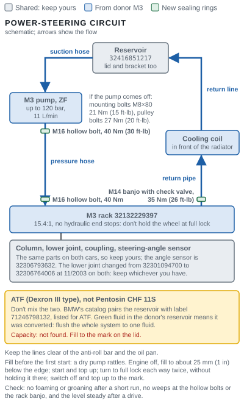 <!-- portrait -->

*Figure 9. The power-steering circuit runs on the M3's pump, hoses, rack, return pipe and cooling coil; the reservoir and the steering column's parts are the same on both cars, so yours stay. Fit new sealing rings at every hollow bolt and banjo, fill with ATF, not CHF 11S, and don't hold the wheel at full lock: the M3 rack has no hydraulic end stops.*

**When to torque what.** Torque the whole front axle on stands except the anti-roll-bar clamp nuts. The compilation's cover note asks for the "loaded" position for suspension bushings ([Flow p.1](https://drive.google.com/file/d/1GS3Hirx6x0c0WG8hPeXiwfXfeUldkQnm/view?usp=sharing)), but at the front its BMW annotations put that condition only on the anti-roll-bar clamps, "tighten in normal position to avoid preload" ([Flow p.6](https://drive.google.com/file/d/1GS3Hirx6x0c0WG8hPeXiwfXfeUldkQnm/view?usp=sharing)). The control-arm bracket bolts carry "always replace" and no position, both there and in Department 69's TIS list ([Flow p.2](https://drive.google.com/file/d/1GS3Hirx6x0c0WG8hPeXiwfXfeUldkQnm/view?usp=sharing), [Department 69](https://www.department69.com/articles/bmw-e46-torque-specs-complete-reference-all-engines)). The arm's rear bushing is pressed into its bracket, not clamped by those bolts, so tightening them on stands doesn't twist it (our inference).

**Fitting order and torques** (Phase 8). Values are from [Flow pp.2–14 and 28](https://drive.google.com/file/d/1GS3Hirx6x0c0WG8hPeXiwfXfeUldkQnm/view?usp=sharing) and [Department 69](https://www.department69.com/articles/bmw-e46-torque-specs-complete-reference-all-engines), which cites TIS, unless another source is named.

1. **Brake pipes first.** When the old front axle comes out (Phase 4), cap every brake pipe end you open and keep the reservoir full, so no air reaches the DSC unit ([Brakes and bleeding](#brakes-and-bleeding)).
2. **Subframe.** If it has to come down for the engine, unplug the headlight-level sensor lead first; the sensor drops with the subframe but its lead doesn't ([FCP Euro – S54 rod bearings (2022), 11:19](https://www.youtube.com/watch?v=Emjw22o_V8c&t=679s)). Subframe to body, M12 10.9: new bolts (31116781023; TIS says replace), 110 Nm (81 ft-lb). Tighten the rear bolts first; their dowels center the subframe ([40:37](https://www.youtube.com/watch?v=Emjw22o_V8c&t=2437s)).
3. **Bench-build each corner:** knuckle, hub, strut and top mount. Strut to knuckle: new M12 clamp bolt, 81 Nm (60 ft-lb). Damper rod nut: new, 64 Nm (47 ft-lb). The top mounts are handed, left and right. Only if you replace a hub (31222229501): a new collar nut (31211128336) at 290 Nm (214 ft-lb) ([Flow p.14](https://drive.google.com/file/d/1GS3Hirx6x0c0WG8hPeXiwfXfeUldkQnm/view?usp=sharing)).
4. **Control arms.** Arm to subframe: new M14 self-locking nut, 90 Nm (66 ft-lb). Arm bracket to body: new M10 bolts (33306760652), 59 Nm (44 ft-lb), on stands. Ball joint to knuckle: new self-locking nut, 65 Nm (48 ft-lb), no impact wrench.
5. **Strut tops.** Three new nuts per side (31316769731) at 34 Nm (25 ft-lb). The M3's own TIS page gives 34 Nm for the E46's 21 mm-flange nuts; the 24 Nm (18 ft-lb) in the M3 compilation is TIS's figure for older models' 18 mm-flange nuts ([TIS 31 31 1AZ](https://workshop-manuals.com/bmw/3_series_e46/m3_s54_coupe/4_tightening_torques/31__front_axle/31__spring_strut/1_azd__spring_struts/), [Flow p.3](https://drive.google.com/file/d/1GS3Hirx6x0c0WG8hPeXiwfXfeUldkQnm/view?usp=sharing)). Leave the camber pin in for a standard alignment: driving it out lets the mount move for up to about 0.5° of camber ([BMW ST056](https://archive.org/download/BMWTechnicalTrainingDocuments/ST056%20Chassis%20Dynamics%20%28Archive%201%29/01%20Suspension%20Systems%20and%20Alignment%20Procedures%201-20-03_djvu.txt)).
6. **Reinforcement plate** (51717893609): every screw run in by hand first (above). Then new M10×35 10.9 screws, rear row first, at 59 Nm (44 ft-lb) + 90° (BMW allows +30° on the angle), then the six small edge screws ([TIS 31 10 8AZ](https://workshop-manuals.com/bmw/3_series_e46/m3_s54_coupe/4_tightening_torques/31__front_axle/10__front_axle_suspension/1_azd__front_axle_suspension/page_3534/), [TIS 51 71 3AZ](https://workshop-manuals.com/bmw/3_series_e46/m3_s54_coupe/4_tightening_torques/51__body_equipment_%28coupe%29/71__gaskets-seals_loose_body_components/1_azd__seals_and_loose_body_parts/), [SI B11 04 04](https://nam3forum.com/forums/filedata/fetch?id=5213)). BMW: "Vehicles must not be driven without reinforcement plates."
7. **Anti-roll bar.** End-link nuts: new, 65 Nm (48 ft-lb). Clamp nuts: snug now, then 21 Nm (15 ft-lb) with the car on its wheels in normal position, at the M3 load (Phase 12).
8. **Rack and tie rods.** Rack to subframe: 42 Nm (31 ft-lb). Inner tie rod to rack: 110 Nm (81 ft-lb). TIS prints "100 + 10 Nm" for every E46, the M3 included, as the M3 compilation does, and 110 Nm meets it whether the "+ 10" is a tolerance or a final step (our reading). TIS's separate 110 Nm row is for the Z4 M (E85/E86 with the S54); that's the figure Department 69 gives for the M3 ([TIS 32 21 2AZ](https://workshop-manuals.com/bmw/3_series_e46/m3_s54_coupe/4_tightening_torques/32__steering_and_wheel_alignment/21__steering_arms_tie_rods_steer._damper/1_azd__steering_arms/), [Flow p.9](https://drive.google.com/file/d/1GS3Hirx6x0c0WG8hPeXiwfXfeUldkQnm/view?usp=sharing), [Department 69](https://www.department69.com/articles/bmw-e46-torque-specs-complete-reference-all-engines)). Outer tie-rod lock nut: 45 Nm (33 ft-lb). Tie-rod end to knuckle: new nut, 65 Nm (48 ft-lb), no impact wrench. Count the turns as you unscrew a tie-rod end, so the toe starts close ([50sKid – steering rack, non-M (2018), 06:22](https://www.youtube.com/watch?v=iwCoomDpICI&t=382s)).
9. **Center the rack before you join the steering shaft.** Lock the column, set the wheel straight ahead, and line up the notch in the shaft with the coupler's pinch-bolt hole ([FCP Euro, 39:54](https://www.youtube.com/watch?v=Emjw22o_V8c&t=2394s), [50sKid, 21:43](https://www.youtube.com/watch?v=iwCoomDpICI&t=1303s)). Fit new M8×33 Torx bolts at 22 Nm (16 ft-lb) ([SI B11 04 04](https://nam3forum.com/forums/filedata/fetch?id=5213)).
10. **Power-steering lines at the rack:** M16 hollow bolt 40 Nm (30 ft-lb) and M14 banjo with its check valve 35 Nm (26 ft-lb), each with new rings ([Flow p.8](https://drive.google.com/file/d/1GS3Hirx6x0c0WG8hPeXiwfXfeUldkQnm/view?usp=sharing)). At the pump, with the engine: the other M16 hollow bolt, 40 Nm. If the pump comes off: mounting bolts M8×80 21 Nm (15 ft-lb), pulley bolts 27 Nm (20 ft-lb) ([Flow p.11](https://drive.google.com/file/d/1GS3Hirx6x0c0WG8hPeXiwfXfeUldkQnm/view?usp=sharing)).
11. **Wheel-speed sensors:** your own, seated flush in the M3 knuckles, screw at 8 Nm (71 in-lb) ([Flow p.4](https://drive.google.com/file/d/1GS3Hirx6x0c0WG8hPeXiwfXfeUldkQnm/view?usp=sharing)). The strut's sensor and hose bracket (34526780591/592) is the same part on both cars.
12. **Wheels:** 120 ± 10 Nm (89 ± 7 ft-lb). Brakes, and filling and bleeding the power steering, are in [Brakes and bleeding](#brakes-and-bleeding).
13. **Check before the wheels go on:** every fastener torqued and paint-marked except the clamp nuts; each wheel spins freely; no sensor lead or brake hose under tension at full droop.
14. **Align, then calibrate.** Have the car aligned in BMW's design position, at the M3 load with the ride height checked ([Wheel alignment](#wheel-alignment), [After the build](#after-the-build-settle-check-and-align)), before you calibrate the steering-angle sensor ([DSC, brakes and steering angle](#dsc-brakes-and-steering-angle)). After rack or tie-rod work, "you absolutely need to get an alignment" ([50sKid, 06:39](https://www.youtube.com/watch?v=iwCoomDpICI&t=399s)). Caster can't be adjusted on an E46 ([BMW ST056](https://archive.org/download/BMWTechnicalTrainingDocuments/ST056%20Chassis%20Dynamics%20%28Archive%201%29/01%20Suspension%20Systems%20and%20Alignment%20Procedures%201-20-03_djvu.txt)), so a caster reading inside the M3's window (7°25' ± 30' at ±10° lock) tells you the M3 top mounts and arms are in and the body is straight (our inference).

Watch: [FCP Euro – E46 M3 control arms (2020), 15:58](https://www.youtube.com/watch?v=usfbSLE_1aI&t=958s) (M3-specific; no captions, chapters only checked), [50sKid – steering rack, non-M (2018), 12:35](https://www.youtube.com/watch?v=iwCoomDpICI&t=755s) (same rack mounting; no torques).

### Driveline and rear axle

**Gearbox (420G) on the bench.**

- **Seals:** input shaft 35×52×7 (23121228493), selector shaft 15×21×6.5 (23127501582) and output 52×68×8 (23121222769) ([Flow p.74](https://drive.google.com/file/d/1GS3Hirx6x0c0WG8hPeXiwfXfeUldkQnm/view?usp=sharing)).
- **Oil:** BMW MTF-LT-2 (75W-80 GL-4) ([BimmerWorld](https://www.bimmerworld.com/Genuine-BMW-MTF-LT-2-GL-4-Transmission-Fluid-1-liter.html)). BMW's US M3 owner's manuals give about 1.8 L (1.9 US qt), and ST041's "1.9 L" matches the quart figure (our inference), so buy 2 L and fill to the fill plug with the car level ([2003 M3 coupe manual, p.147](https://manualsnet.com/bmw/m3-coupe-3-series-2003), [BMW ST041](https://archive.org/download/BMWTechnicalTrainingDocuments/ST041%20M3%20Complete%20Vehicle/1%20M3%20Complete%20Vehicle.pdf)); check the label on the gearbox. Drain and fill plugs (M24×1.5): 52 Nm; reverse-light switch: 20 Nm ([Flow p.74](https://drive.google.com/file/d/1GS3Hirx6x0c0WG8hPeXiwfXfeUldkQnm/view?usp=sharing)). Undo the fill plug before the drain plug, so you know you can refill it.
- **Gear-identification switch** (23142229113), an M3, M5 and Z8 part ([ETK](https://bmwfans.info/parts-catalog/23142229113/)). The MSS54 reads the clutch through it for cruise control; the car starts and runs without it ([NAM3](https://nam3forum.com/forums/forum/main-forum/e46-2001-2006/2844-smg-to-6mt-conversion)). Check or replace it now; its wiring is in [Harness and re-pinning](#harness-and-re-pinning).
- **Shifter and mounts:** take the donor's complete shift carrier, lever and selector rod with new bushings, and its gearbox support (22312229198) and mounts (22322282340); your Touring's support (22316769911) is a different part ([ETK](https://bmwfans.info/parts-catalog/22312229198/)). Gearbox mounts and crossmember (M8): 21 Nm ([Flow p.78](https://drive.google.com/file/d/1GS3Hirx6x0c0WG8hPeXiwfXfeUldkQnm/view?usp=sharing)).

**Clutch and flywheel.**

- **Flywheel:** BMW's TIS gives 105 Nm (77 ft-lb) for the S54, the same as the M54, with the threads oiled and no thread locker. Fit eight new M12×1.5×50 bolts (11222243051), which the parts catalog marks "required for repair" ([TIS screenshot on NAM3](https://nam3forum.com/forums/forum/main-forum/e46-2001-2006/122587-loctite-on-flywheel-bolts), [ETK](https://bmwfans.info/parts-catalog/E46-Coupe/USA/M3-S54/L-N/browse/engine/flywheel_twin_mass_flywheel/)), and tighten them in a cross pattern ([Flow p.68](https://drive.google.com/file/d/1GS3Hirx6x0c0WG8hPeXiwfXfeUldkQnm/view?usp=sharing)). Ignore the 100 Nm in FCP Euro's non-M DIY ([FCP Euro](https://www.fcpeuro.com/blog/how-to-replace-the-clutch-flywheel-rear-main-seal-on-a-bmw-e46)). An aftermarket single-mass flywheel follows its maker's sheet.
- **Pilot bearing** (11211720310) and **rear main seal:** replace both ([ETK](https://bmwfans.info/parts-catalog/E46-Coupe/USA/M3-S54/L-N/browse/engine/flywheel_twin_mass_flywheel/), [FCP Euro – E46 M3 clutch (2022), 11:54](https://www.youtube.com/watch?v=NmEOFBqreX8&t=714s)).
- **Pressure plate:** the M3 uses six M8 10.9 micro-encapsulated screws (21207548052) at 34 Nm (25 ft-lb); fit new ones ([ETK](https://bmwfans.info/parts-catalog/E46-Coupe/USA/M3-S54/L-N/browse/clutch/clutch/), [Flow p.69](https://drive.google.com/file/d/1GS3Hirx6x0c0WG8hPeXiwfXfeUldkQnm/view?usp=sharing)). The 25 Nm in non-M guides is for 8.8 screws ([Department 69](https://www.department69.com/articles/bmw-e46-torque-specs-complete-reference-all-engines)). Center the disc with a clutch alignment tool.
- **Release parts:** FCP Euro's M3 clutch job also renews the steel fork pivot pin (21511223281), the fork (21511223302) and the release-bearing guide tube (23117512866) ([FCP Euro – E46 M3 clutch (2022), description](https://www.youtube.com/watch?v=NmEOFBqreX8)).
- **Which flywheel:** for a road wagon, a dual-mass flywheel with an OEM-type clutch is the quietest choice; single-mass flywheels bring chatter and gear rattle ([NAM3](https://nam3forum.com/forums/forum/main-forum/e46-2001-2006/53735-dual-mass-or-single-mass-flywheel)).

Watch: [FCP Euro – E46 M3 clutch (2022), 17:19](https://www.youtube.com/watch?v=NmEOFBqreX8&t=1039s) (no captions; chapters only checked).

**Fitting the engine and gearbox** (Phase 9).

- Use the M3's engine arms and mounts, and check the gap between the oil pan and the steering rack and subframe brace before you tighten the mounts. Engine mount nuts (M10): 45 Nm; engine support arm to block (M8): 21 Nm ([Flow p.54](https://drive.google.com/file/d/1GS3Hirx6x0c0WG8hPeXiwfXfeUldkQnm/view?usp=sharing), [FCP Euro – S54 rod bearings (2022), 41:26](https://www.youtube.com/watch?v=Emjw22o_V8c&t=2486s)).
- Two Touring builders had to make room. Project BMW lowered the engine and gearbox in together with the rack out ([Project BMW – engine installed (2021), 05:20](https://www.youtube.com/watch?v=iVGU_Yg0ZLw&t=320s)); Tracks and Trails dropped the front subframe: "I don't know how you guys get it in without dropping this subframe" ([Tracks and Trails – first drive (2026), 55:40](https://www.youtube.com/watch?v=pvR3ovRfQHg&t=3340s)). Disconnect the oil-cooler lines so the cooler clears the crossmember ([Project BMW – swap on jack stands (2021), 01:20](https://www.youtube.com/watch?v=i0OUChEy3Io&t=80s)).
- Bell-housing Torx bolts: M8 28 Nm, M10 52 Nm, M12 98 Nm; confirm the M12 value in TIS, because Flow's own general table gives 82 Nm. Starter (M10): 45 Nm. Clutch slave cylinder nuts: 22 Nm ([Flow pp.70–77](https://drive.google.com/file/d/1GS3Hirx6x0c0WG8hPeXiwfXfeUldkQnm/view?usp=sharing)).

**Driveshaft.** Use the complete M3 driveshaft (26112229240, 1,404 mm) with a new flex disc (26112226527), its bolts (26117635643) and self-locking nuts (26127536563), and a new center mount (26122282495) ([ETK](https://bmwfans.info/parts-catalog/E46-Coupe/USA/M3-S54/L-N/browse/drive_shaft/drive_shaft_cen_bearing_const_vel_joint/)). Your 325i's 5-speed shaft (26111229557, 1,585 mm) is the same part in the sedan, coupe and Touring, so the M3 coupe's shaft should fit your car as it does an M3; measure before final assembly anyway ([ETK](https://bmwfans.info/parts-catalog/26112229240/)). Don't try to combine halves. A shop told one swapper it's "NOT possible to make a driveshaft out of 2 different ones" ([e46fanatics](https://www.e46fanatics.com/threads/m3-rear-swap-completed.800207/)), and a 325Ci owner who kept his 5-speed with an M3 rear axle needed a custom hybrid shaft ([e46fanatics](https://www.e46fanatics.com/threads/e46-m3-rear-end-swap-in-to-s54-325ci-driveshaft.1299993/)).

- Flex disc, M3 M12 10.9 bolts: 115 Nm, bolted to the shaft on the bench in Phase 3 and to the gearbox's output flange in the car in Phase 9. The value is the "M3 / M5, M12 10.9" row of BMW's all-model TIS table ([BMW TIS 26 11](https://www.princeton.edu/~sdepasqu/bmw/Gas.Tank/AZD.Propeller.Shaft,complete.pdf)); Department 69 and Flow give 115 Nm for the E46 M3. Turn the bolt, not the nut ([Flow p.79](https://drive.google.com/file/d/1GS3Hirx6x0c0WG8hPeXiwfXfeUldkQnm/view?usp=sharing)).
- Center mount: 21 Nm, preloaded 4–6 mm forward ([Flow p.79](https://drive.google.com/file/d/1GS3Hirx6x0c0WG8hPeXiwfXfeUldkQnm/view?usp=sharing)).
- Driveshaft to diff (M10 Torx): 70 Nm. The shaft is balanced, so mark its position before you take it off ([Flow p.79](https://drive.google.com/file/d/1GS3Hirx6x0c0WG8hPeXiwfXfeUldkQnm/view?usp=sharing); [FCP Euro, part 3](https://www.fcpeuro.com/blog/how-to-overhaul-the-bmw-e46-m3-rear-subframe-part-3)).

**Clutch hydraulics.** Your pedal, master cylinder and flex hose, and the slave on the donor's gearbox, carry the same part numbers on both cars ([ETK](https://bmwfans.info/parts-catalog/21526773670/)). Only the hard line and its hose bracket differ, so fit the M3's (21522229675, 21522229699); the M3 line is insulated ([Project BMW – engine installed (2021), 01:40](https://www.youtube.com/watch?v=iVGU_Yg0ZLw&t=100s)). BMW's catalog lists the clutch delay valve (21526755892) for your 325i but not for the M3 ([ETK](https://bmwfans.info/parts-catalog/21526755892/)), so the M3 line leaves it out; a few early-M3 owners report finding a differently designed valve ([e30sport](https://e30sport.net/e46m3perf/installs/lock-valve/index.htm)). Bleeding is in [Brakes and bleeding](#brakes-and-bleeding).

**Rear axle.** The M3 rear subframe (33312282490) is a different part from yours (33316770865) but bolts to the same body points. Owners have fitted complete M3 rear subframes to non-M E46s ([e46zone](https://www.e46zone.com/forum/topic/29209-e46-m3-lsd-into-330/)), and a Touring builder found "the bolts are the same" ([Tenza – M3 rear end (2021), 15:00](https://www.youtube.com/watch?v=GdCUQY-Xn-s&t=900s)). What differs is everything bolted to the subframe: BMW lists M3-only trailing arms (33322229685/686), diff (33102282480) and parking-brake shoes (34416761293) ([ETK](https://bmwfans.info/parts-catalog/33322229685/)), and swappers move the M3 half-shafts and sway bar with them ([e46fanatics](https://www.e46fanatics.com/threads/m3-rear-swap-completed.800207/)). Move these over together:

- **Trailing arms** with hubs, brakes and parking-brake shoes. Your parking-brake cables fit them ([ETK](https://bmwfans.info/parts-catalog/34411165020/)).
- **Half-shafts.** They're a tight fit but go in ([e46fanatics](https://www.e46fanatics.com/threads/m3-rear-swap-completed.800207/)).
- **Wheel-speed sensors.** Use your own, or those of a donor built from 09/2002. An M3 built before 09/2002 has inductive sensors for its MK20, with plugs that don't fit your harness and a signal your MK60 isn't made to read ([manual](WIRING-AND-CODING.md#wheel-speed-and-pad-wear-sensors)). BMW lists the same current rear sensor for both cars ([ETK](https://bmwfans.info/parts-catalog/34526752683/)), and on a 2003 xi Touring the M3 sensors "plugged right in", though only into the xi's Bosch harness, whose sensors use the same blue housings ([e46fanatics](https://www.e46fanatics.com/threads/m3-touring-project.1240087/)). One S54 Touring, a 2004 car with a 2002 donor, showed an ABS light at its first start with its own sensors in the M3 hubs, but the car was standing and its brakes not yet bled, and three months later the builder reported no problems; it isn't evidence that the sensors don't suit ([DSC, brakes and steering angle](#dsc-brakes-and-steering-angle)). His fallback of splicing in the donor's sensor leads would have put MK20 sensors on an MK60, so don't ([Tenza – 5 things, part 2 (2021), 03:15](https://www.youtube.com/watch?v=mDBiRn30fEs&t=195s), [04:00](https://www.youtube.com/watch?v=mDBiRn30fEs&t=240s)). Read the wheel speeds in INPA before you drive ([DSC, brakes and steering angle](#dsc-brakes-and-steering-angle)).
- **Sway bar.** The non-M bar hits the M3 diff ([e46fanatics](https://www.e46fanatics.com/threads/m3-rear-swap-completed.800207/)); use the M3's 21.5 mm bar (33552282181) and links (33552283743) ([ETK](https://bmwfans.info/parts-catalog/33552282181/)).
- **Diff.** Every E46 M3 has the same large-case diff (Redish: "Type 210/215") with the M variable lock ([ETK](https://bmwfans.info/parts-catalog/33102282480/), [Redish](https://www.redish-motorsport.com/BMWE46M3LSD210LargeCase410CWPDiffGearSet33108321899.html)). BMW USA's 2002 and 2003 spec sheets give its ratio as 3.62:1; BMW's 2006 sheet and ST041 print 3.64:1 ([BMW USA, 2002](https://www.press.bmwgroup.com/usa/article/attachment/T0022127EN_US/41385), [BMW USA, 2006](https://www.press.bmwgroup.com/usa/article/attachment/T0019121EN_US/37451), [BMW ST041](https://archive.org/download/BMWTechnicalTrainingDocuments/ST041%20M3%20Complete%20Vehicle/1%20M3%20Complete%20Vehicle.pdf)). Redish sells BMW Motorsport's 4.10 gear set (now 23008437087, £1,054 in October 2026) and recommends a Quaife unit to cure the "M clunk" ([Redish](https://www.redish-motorsport.com/BMWE46M3DiffRebuildUpgrade.html)). Fill it with BMW's friction-modified SAF-XJ+FM, not ordinary gear oil ([Fluids and capacities](#fluids-and-capacities)). Drain and fill plugs: 60 Nm with an O-ring, 65 Nm with a sealing washer. If the output flanges come out, mark each flange bolt first and reassemble to the mark ([Flow pp.80–81](https://drive.google.com/file/d/1GS3Hirx6x0c0WG8hPeXiwfXfeUldkQnm/view?usp=sharing)).
- **Subframe and diff mounts:** new M3 parts (front 33312283573/574, rear 33312283419, diff front 33172282484) ([ETK: M3 carrier](https://bmwfans.info/parts-catalog/E46-Coupe/USA/M3-S54/L-N/browse/rear_axle/rear_axle_carrier/)). The push rod and V-brace are in [Rear subframe mount reinforcement](#rear-subframe-mount-reinforcement).

**Assembly and torques** (Phases 3 and 7). Values are from [Flow pp.15–19 and 81–83](https://drive.google.com/file/d/1GS3Hirx6x0c0WG8hPeXiwfXfeUldkQnm/view?usp=sharing) unless another source is named.

1. **Build the axle on the bench (Phase 3).** Fit the rear control arms to the subframe before the diff: with the diff in place, one arm bolt can't go in ([Tracks and Trails – Touring rear end (2025), 33:20](https://www.youtube.com/watch?v=eMJLXbvzckE&t=2000s)). Then fit the diff and torque its mounts while you can reach them: front M14 bolt 200 Nm; rear M12 Torx bolts 20 Nm + 90° ([Department 69](https://www.department69.com/articles/bmw-e46-torque-specs-complete-reference-all-engines), [NAM3](https://nam3forum.com/forums/forum/main-forum/e46-2001-2006/19815-diff-bolt-question)). Condor's diff-bushing video gives 128 ft-lb and 70 ft-lb, which look like Department 69's non-M figures swapped between the mounts (our inference); don't use them on the M3 diff ([Condor – M3 diff bushings (2019), 01:32](https://www.youtube.com/watch?v=fcOohpFKZZE&t=92s)). Leave the rubber-bushed joints snug.
2. **Studs first (Phase 7).** The subframe hangs on four mounts. At each front mount an M12×1.5 stud screws into the body: torque both to 90 Nm before the axle goes up ([Department 69](https://www.department69.com/articles/bmw-e46-torque-specs-complete-reference-all-engines), [FCP Euro, part 3](https://www.fcpeuro.com/blog/how-to-overhaul-the-bmw-e46-m3-rear-subframe-part-3)).
3. **Raise it level** on a table or transmission jack, because the subframe goes up over the studs ([Tenza – M3 rear end (2021), 04:40](https://www.youtube.com/watch?v=GdCUQY-Xn-s&t=280s)). Line up the front studs first, then the rear bolt holes.
4. **Subframe to body:** set the push rod with your kit's spacer plates over the front studs, then fit the self-locking collar nuts on the studs and one M12×1.5×116 bolt at each rear mount. Torque the collar nuts and rear bolts to 77 Nm, then the push rod's bolts to 21 Nm, BMW's figure ([Rear subframe mount reinforcement](#rear-subframe-mount-reinforcement)).
5. **Joints that don't need ride height,** as they go in: trailing-arm bracket to body 77 Nm, and the two M12 10.9 ball-joint bolts at each trailing arm (one of them the eccentric bolt) 110 Nm, with new nuts ([Flow p.16](https://drive.google.com/file/d/1GS3Hirx6x0c0WG8hPeXiwfXfeUldkQnm/view?usp=sharing), [TIS 33 32 11AZ](https://workshop-manuals.com/bmw/3_series_e46/m3_s54_coupe/4_tightening_torques/33__rear_axle/32__control_arms_and_struts/1_azd__control_arms_and_struts/page_3587/)).
6. **Half-shafts to diff:** the M3's black ribbed M10 Torx bolts (33211227664, 12 of them, new) at 100 Nm. The 80 Nm the compilation also prints is for silver bolts, not the M3's ([FCP Euro, part 3](https://www.fcpeuro.com/blog/how-to-overhaul-the-bmw-e46-m3-rear-subframe-part-3), [Flow p.83](https://drive.google.com/file/d/1GS3Hirx6x0c0WG8hPeXiwfXfeUldkQnm/view?usp=sharing)). Rear drive-flange collar nut: new, 300 Nm.
7. **At ride height** (see [Targets for the mock-up and the bushed joints](#targets-for-the-mock-up-and-the-bushed-joints)): trailing arm to bracket (the through-bolt) 110 Nm ([FCP Euro, part 2](https://www.fcpeuro.com/blog/how-to-overhaul-the-bmw-e46-m3-rear-subframe-part-2)); control arms at the subframe 77 Nm; damper lower bolt 100 Nm. BMW's diagrams mark these three "loaded" ([Flow pp.16–17](https://drive.google.com/file/d/1GS3Hirx6x0c0WG8hPeXiwfXfeUldkQnm/view?usp=sharing)). Do the anti-roll bar's brackets and links (22 Nm) at the same time: their mounts are rubber too, though the diagram doesn't say (our recommendation). Tracks and Trails approximated ride height by jacking under the axle until the car began to lift off its rear jack point ([Tracks and Trails – Touring rear end (2025), 35:00](https://www.youtube.com/watch?v=eMJLXbvzckE&t=2100s)). Without the engine and gearbox that leaves the suspension a little extended, so set each hub to its target hub-to-lip instead, or torque these joints once the car is complete on its wheels and loaded to BMW's normal position for an M3 (a full tank, 68 kg on each front seat, 14 kg in the cargo area).

Read: FCP Euro's written M3 rear subframe overhaul, [part 1](https://www.fcpeuro.com/blog/how-to-overhaul-the-bmw-e46-m3-rear-subframe-part-1), [part 2](https://www.fcpeuro.com/blog/how-to-overhaul-the-bmw-e46-m3-rear-subframe-part-2) and [part 3](https://www.fcpeuro.com/blog/how-to-overhaul-the-bmw-e46-m3-rear-subframe-part-3).

### 325xi: rear drive or all-wheel drive

Read this if your Touring turns out to be a 325xi, the all-wheel-drive version BMW sold in the US for 2001–05. The rest of the guide assumes a rear-drive 325i. Behind the front seats an xi is the same car, so the floor, arches, rear-axle mounts and fuel system follow the guide. In front almost everything differs: the body, front axle, gearbox mounting, oil pan and DSC are all xi parts ([BMW ST040](https://archive.org/download/BMWTechnicalTrainingDocuments/ST040%202001%20System%20Diagnosis/7%20E46%204wd%202010-24-00.pdf)). You can convert the car to rear drive, which is hard but feasible and what we recommend, or keep all-wheel drive, which is harder still and has already wrecked one S54's bottom end.

#### How to tell an xi

1. **Decode the VIN** at [bmwfans](https://bmwfans.info/vin/): it names an xi "325xi". Don't rely on NHTSA's decoder for this. It reads a 2001 325xi Touring's VIN as a "325i" wagon and gives no drive type ([NHTSA vPIC](https://vpic.nhtsa.dot.gov/api/vehicles/DecodeVinValues/WBAAW33421EN80596?format=json)).
2. **Read the vehicle order** from the light module (ALSZ), as Phase 0 and the manual's [Session 1](WIRING-AND-CODING.md#session-1-vehicle-order-and-codings) do. All-wheel drive is option `$203` ([BMW ST040](https://archive.org/download/BMWTechnicalTrainingDocuments/ST040%202001%20System%20Diagnosis/7%20E46%204wd%202010-24-00.pdf)). Note the type key in the order's `*` field as well, because Route 1 replaces it for one coding session. On cars built from 09/2001 it's also the VIN's characters 4–7: EN33 on a US 325i Touring ([BMW SP-Daten V32](https://archive.org/details/sp-daten-v-32)), EP33 on the 2004 325xi Touring in [Documented xi builds](#documented-xi-builds), whose VIN bmwfans decodes as a 325xi built in 11/2003. On an earlier car the type key doesn't settle it: BMW's coding data lists AW33 for the US 325i Touring of 09/2000–08/2001 ([BMW SP-Daten V32](https://archive.org/details/sp-daten-v-32)), yet bmwfans decodes a May 2001 AW33 VIN as a 325xi, so go by the decode and `$203` (our reading).
3. **Look underneath.** An xi has a transfer case on the back of the gearbox, a prop shaft running forward along the left of the engine, a front differential bolted to the oil pan and two front drive shafts. Its DSC unit sits on the right of the engine bay with a blue 42-pin plug; a 325i's MK60 sits on the left, under the master cylinder ([BMW ST056](https://archive.org/download/BMWTechnicalTrainingDocuments/ST056%20Chassis%20Dynamics%20%28Archive%201%29/04%2520E46%2520DSC%25201-27-03.pdf), [WDS: xi](https://wds.psjr.org/en/e46/zinfo/E46_EA65B.htm), [WDS: MK60](https://wds.psjr.org/en/e46/zinfo/E46_EA65D.htm)).
4. **Note the build month.** An xi built before 09/2001 stores a key code (ZCS) instead of a vehicle order, and BMW wants a changed ZCS to come from its technical hotline ([BMW ST406](https://archive.org/download/BMWTechnicalTrainingDocuments/ST406%20Coding%20%26%20Programming/06%20Vehicle%20Coding%20Information.pdf)). That makes the MK60 swap harder. A 2003 car has an order.

#### Rear drive or all-wheel drive: the verdict

**Convert to rear drive: our recommendation.** You fit the donor's complete M3 front axle, the M3 lower steering joint with its flexible coupling, the M3 gearbox crossmember on a fabricated adapter and the whole MK60 DSC system, then sell the xi's drivetrain. Three xi Tourings have been made rear-drive on M3 running gear, though none has documented its DSC swap. Our estimate is \$0–\$1,500 more in parts than the guide's plan with a donor built from 09/2002, or \$1,000–\$3,000 with an earlier one, plus 4–8 weekends.

**Keep all-wheel drive only if all-wheel drive is the point.** It keeps the xi's front axle and DSC, but it needs an oil system BMW never made, the 330xi six-speed and a matched pair of differentials. Two US cars have done it, and one wrecked its S54's bottom end through the oil system.

| | Route 1: convert to rear drive (recommended) | Route 2: keep all-wheel drive |
|---|---|---|
| Extra cost | About \$0–\$1,500 in parts with a donor built from 09/2002, \$1,000–\$3,000 with an earlier one, after selling the xi's drivetrain (our estimate; breakdown in [Route 1](#route-1-convert-to-rear-drive)) | Not costed: no source splits it out. You buy a 330xi six-speed set, a matched pair of diffs, a second oil pan to rework, oil-pump parts, a Z4 M clutch, new front shafts and a custom steering line, and the donor's 420G, front axle, MK60 and diff go unused |
| Extra time | 4–8 weekends (our estimate) | More, and open-ended. The documented AWD car took 280 hours of mechanical work in all, and FCP Euro's went "over budget and over time" ([BimmerLife](https://bimmerlife.com/2022/07/04/a-perfect-one-car-solution-the-e46-m3-touring/), [FCP Euro, part 2](https://www.fcpeuro.com/blog/back-on-the-road-off-the-road-bmw-e46-m3xi-part-2)) |
| Difficulty | Hard. In [How hard each job is](#how-hard-each-job-is), "DSC and brakes" rises from Moderate to Hard, and "Front and rear axle transplant" from Moderate to "Moderate to hard" (our rating) | Very hard: fabrication plus one-off integration |
| Risk | Two undocumented jobs, the DSC loom with its coding and the gearbox-crossmember adapter, plus the front-subframe trial fit. Each one shows up on the bench or at mock-up | An oil system BMW never made, which wrecked the bottom end of one of the two documented engines. Drivetrain torque above BMW's figures for the transfer case and diffs (our arithmetic). The MSS54-to-DSC 5.7 link is untested |
| What you keep | Everything behind the front seats, the steering column and its angle sensor, the brake booster | The xi's front axle, rack, DSC 5.7, rear axle, gearbox crossmember and rear prop shaft; on a car built from 03/2003, its transfer case and front prop shaft too |
| What you add | The donor's front axle and MK60 system; the M3 lower steering joint with its flexible coupling; the M3 gearbox crossmember on an adapter; a DSC adapter loom | The parts listed under Extra cost |
| What you get | M3 handling and parts, and about 100 kg (220 lb) less weight, BMW's figure for the xi system ([BMW ST040](https://archive.org/download/BMWTechnicalTrainingDocuments/ST040%202001%20System%20Diagnosis/7%20E46%204wd%202010-24-00.pdf)) | Traction on snow and gravel, 17 mm (0.7 in) more ground clearance, and the xi's four-wheel brake traction control |
| Legal standing | LEV in every model year, the S54's category ([Emissions and Massachusetts for an xi](#emissions-and-massachusetts-for-an-xi)). Once it can't drive all four wheels, Massachusetts' four-wheel-drive rules (540 CMR 6.00) stop applying (our reading) | LEV in every model year too. Still a four-wheel-drive vehicle under 540 CMR 6.00: no wheel spacers, a track widened by at most 4 in (102 mm) through tires and rims, and the body level to within 2 in (51 mm) front to rear |
| Documented | The Bring a Trailer car, JMCCRNA's and a 2004 car from Buffalo | Baca's, and the Colorado car that became FCP Euro's "M3xi" |

#### What differs on an xi body

BMW built the xi on "a specially designed body pan with a widened transmission tunnel and modifications on the driver's side to accept the transfer case", with "a completely new front engine carrier", reinforced front strut mounts and a new gearbox crossmember ([BMW ST040](https://archive.org/download/BMWTechnicalTrainingDocuments/ST040%202001%20System%20Diagnosis/7%20E46%204wd%202010-24-00.pdf)). The parts catalog shows where ([ETK: xi](https://bmwfans.info/parts-catalog/E46-Touring/USA/325xi-M54/L-N/browse/bodywork/front_body_parts/), [ETK: 325i](https://bmwfans.info/parts-catalog/E46-Touring/USA/325i-M54/L-N/browse/bodywork/front_body_parts/)):

| Area | 325xi Touring | 325i Touring and M3 | What it means for you |
|---|---|---|---|
| Front frame rails, inner | 41007037635/636: 325xi, 330xi and 330xd only ([ETK](https://bmwfans.info/parts-catalog/41007037635/)) | 41118234033/034, on every rear-drive E46 ([ETK](https://bmwfans.info/parts-catalog/41118234033/)) | The rear-drive front subframe probably bolts up, but prove it with the [trial fit](#route-1-convert-to-rear-drive) |
| Front frame rails, outer | 41117029237/238 | 41117029239/240 | As above |
| Strut towers | 41007037637/638 | 41148234035/036 | The top mounts, collar nuts and reinforcement plate (51717036781) are common. Check ride height at mock-up |
| Front anti-roll-bar body brackets | 41117161089/032 | 41118239195/196 | Check that the M3 bar's brackets seat; weld on the rear-drive pair if they don't |
| Transmission tunnel | Widened, with a cast crossmember (22316750856) | M3 crossmember 22312229198 on four M8 bolts | Expect the M3 crossmember to need an adapter |
| Front subframe fixings | Two M12×1.5×140 collar screws at the front; at the rear, adaptors on four M10×50 bolts and two M12×1.5×50 bolts | Four M12×1.5×100 collar screws (31116781023) | The same M12×1.5 thread at the front, used differently at the rear |
| Left front seat console | 41117037741 | 41118239493 | BMW puts the xi's yaw sensor and the MK60's sensor cluster both under the driver's seat ([BMW ST056](https://archive.org/download/BMWTechnicalTrainingDocuments/ST056%20Chassis%20Dynamics%20%28Archive%201%29/04%2520E46%2520DSC%25201-27-03.pdf)); check the bracket holes |
| DSC unit mounting | Right side, bracket 34516750966 | Left side, bracket 34516752664 on body bracket 41148201492 | The xi body has the left body bracket too ([ETK](https://bmwfans.info/parts-catalog/41148201492/)) |
| Behind the front seats: rear-axle body insert (41117000246), rear wheelhouses, trunk floor and partition, tank, pump, senders, fuel and vent lines, parking-brake cables, exhaust hangers | Same parts as the 325i Touring | As in the guide | The guide's plan applies. The xi adds a tank protective plate (16111183924): keep it. One gearbox-mounted exhaust bracket differs (18207502523 against 18311728547) ([ETK](https://bmwfans.info/parts-catalog/41117000246/), [ETK: fuel](https://bmwfans.info/parts-catalog/E46-Touring/USA/325xi-M54/L-N/browse/fuel_supply/), [ETK: exhaust](https://bmwfans.info/parts-catalog/E46-Touring/USA/325xi-M54/L-N/browse/exhaust_system/)) |

#### Route 1: convert to rear drive

You fit the donor's complete front axle with the M3 lower steering joint and its flexible coupling, mount the M3 gearbox crossmember on an adapter, and replace the Bosch DSC with the whole MK60 system ([next section](#route-1-swap-the-bosch-dsc-57-for-an-mk60)). The xi's transfer case, front differential and shafts, front subframe and rack come out. The M3 rear axle, floor, arches and fuel system go in as the guide describes.

| Item | 325xi Touring (yours) | 325i Touring | US M3 (donor) | For an xi |
|---|---|---|---|---|
| Front axle support (subframe) | 31101096954, with collar screws 31101095617, adaptors 31106768293/294 and bolts 07119902899 and 07149112451 | 31111096902, four collar screws 31116781023 | Same as the 325i's, plus reinforcement plate 51717893609 | The donor's, after the trial fit |
| Lower arms and their rear mounts | 31126758533/534; ball joints 31126756695/696; brackets 31121139791/792 on the subframe | 31122282121/122; brackets 31126783376 on the body | 31122229453/454; brackets 31122229623/624 on the body | The donor's |
| Struts and knuckles | 31316751131/132 or 31316759647/648; 31216756541/542 or 31216759311/312 | Rear-drive parts | M3 parts | The donor's |
| Front anti-roll bar; bushing brackets; links | 31351097261 (23.5 mm); 31356754336; 31356751079/080 | 31351097178 (23 mm); 31351094552; 31356780847 | 31352229755 (26 mm); 31351094552; 31356780847 | The donor's |
| Anti-roll-bar body brackets | 41117161089/032 | 41118239195/196 | 41118239195/196 | Check; weld on the rear-drive pair if needed |
| Rack | 32136759815 | 32136755065 (from 09/2001) | 32132229397 (Competition 32132282642) | The donor's |
| Lower steering joint | 32306750815 (to 11/2003) or 32306764009, with double joint 32306754165 | 32301094700 (to 11/2003) or 32306764006, with coupling 32301094703 | Same as the 325i's | The donor's |
| Steering column; steering-angle sensor | 32303450159; 32306793632 | Common | Common | Keep; recalibrate |
| Gearbox crossmember | 22316750856, bearing 22316773125, buffer 22316788586 | 22316769911 | 22312229198, mounts 22322282340, four M8×22 bolts 22326760945 | The donor's, on a fabricated adapter |
| Transfer case; front prop shaft; front diff; front shafts | 27107509763 or 27107530812; 26207525969 or 26207525970; 31507500797 or 31507526216; 31607505199/200 | — | — | Remove; sell once the trial fit passes |
| Rear prop shaft; center mount | 26117502959 (1,244 mm); 26121229317 | 26111229557 (1,585 mm); 26127501257 | 26112229240 (1,404 mm); 26122282495 | The donor's |
| Rear axle carrier (body insert 41117000246 on all three) | 33316770787 | 33316770865 | 33312282490 | The donor's, on the same body points |
| DSC system | Bosch DSC 5.7 on the right, with a pre-charge pump, an analogue yaw sensor, Bosch wheel-speed sensors and its own brake pipes | MK60 (from 09/2001) on the left, with a CAN sensor cluster, two pressure sensors on the master cylinder and its own pipes | Same as the 325i's, from 09/2002 | The whole MK60 system, with an adapter loom: part numbers in [the DSC section](#route-1-swap-the-bosch-dsc-57-for-an-mk60) |
| Fuel-filter cover | 13327500083 | 13328230397 | 13328230397 | The donor's, if yours doesn't clear |
| Tunnel heat insulator | 51488253953 | 51488193807 | 51487893366 | Fit and trim |
| Clutch hard line | 21526753015, support 21526774229 | 21526774230, support 21526774227 | 21522229675, bracket 21522229699 | The donor's (guide); check its route |

Part numbers are from ETK ([xi front axle](https://bmwfans.info/parts-catalog/E46-Touring/USA/325xi-M54/L-N/browse/front_axle/front_axle_support_4_wheel/), [M3 front axle](https://bmwfans.info/parts-catalog/E46-Coupe/USA/M3-S54/L-N/browse/front_axle/front_axle_support_wishbone/), [xi gearbox mount](https://bmwfans.info/parts-catalog/E46-Touring/USA/325xi-M54/L-N/browse/engine_and_gearbox_suspension/gearbox_suspension_4_wheel_drive/), [M3 gearbox mount](https://bmwfans.info/parts-catalog/E46-Coupe/USA/M3-S54/L-N/browse/engine_and_gearbox_suspension/gearbox_mounting/), [xi DSC sensors](https://bmwfans.info/parts-catalog/E46-Touring/USA/325xi-M54/L-N/browse/brakes/dsc_compressor_senors_mounting_parts/), [M3 DSC](https://bmwfans.info/parts-catalog/E46-Coupe/USA/M3-S54/L-N/browse/brakes/hydro_unit_dsc_fastening_sensors/), [xi rear brake pipes](https://bmwfans.info/parts-catalog/E46-Touring/USA/325xi-M54/L-N/browse/brakes/brake_pipe_rear_4_wheel/), [M3 rear brake pipes from 09/2002](https://bmwfans.info/parts-catalog/E46-Coupe/USA/M3-S54/L-N/browse/brakes/rear_brake_pipe_dsc_2/), [fuel filter](https://bmwfans.info/parts-catalog/E46-Touring/USA/325xi-M54/L-N/browse/fuel_preparation_system/fuel_filter_pressure_regulator/)). Check every number against your VIN.

**The gate: trial-fit the front subframe before you commit.** The xi's front frame rails are their own parts and its subframe fastens differently, so nobody can promise that the rear-drive subframe bolts up. Three xi Tourings run M3 or rear-drive front subframes, and none of their builders reported making mounts ([Built for Backroads](https://www.builtforbackroads.com/listing/2004-bmw-325xi-touring-s54-swap), [vmax.si](https://en.vmax.si/2024/12/21/this-is-a-near-perfect-m3-and-it-was-for-sale/), [e46fanatics](https://www.e46fanatics.com/threads/m3-touring-project.1240087/)). BMW bolts the xi subframe to "the vehicle frame at both the front and rear attachment points", and its front screws use the rear-drive thread, only longer, so we expect it to fit (our inference). Prove it at the start of Phase 5, before any cutting, with the xi's front axle out:

1. Offer up the donor's subframe, arm brackets and reinforcement plate on loose screws. All four M12×1.5 collar screws (31116781023) must start by hand and run to full depth, the rear dowels must engage, and no mount face may show a gap before torque.
2. Every M10 screw must start by hand at each arm-bracket and reinforcement-plate hole.
3. Fit the anti-roll bar on its brackets. Both bushing brackets must seat on their studs, and the bar must clear the oil pan, rack and lines at full lock and full bump.
4. With the subframe off again, measure the diagonals across its four body mounting points and write them down, as the guide does at the rear ([Phase 5](#phase-5-metalwork-1-subframe-mounts-and-floor)): they're your reference for the welding that follows.

If a screw won't start, stop. Measure against BMW's body dimensions and get a body shop's view. Fit thread inserts only where those dimensions confirm the position.

> [!NOTE]
> Keep the xi's front axle, transfer case, gearbox and DSC until the trial fit passes. They're your way back to Route 2 or to a stock car.

**Gearbox crossmember.** The xi's cast crossmember (22316750856) bolts to the xi tunnel with two M8×22 and two M8×60 bolts. The M3's (22312229198) needs four M8 threads at the rear-drive positions, which the xi tunnel may not have ([ETK: xi](https://bmwfans.info/parts-catalog/E46-Touring/USA/325xi-M54/L-N/browse/engine_and_gearbox_suspension/gearbox_suspension_4_wheel_drive/), [ETK: M3](https://bmwfans.info/parts-catalog/E46-Coupe/USA/M3-S54/L-N/browse/engine_and_gearbox_suspension/gearbox_mounting/)). JMCCRNA's converted xi needed a custom bracket, which then clashed with its Euro exhaust ([e46fanatics](https://www.e46fanatics.com/threads/m3-touring-project.1240087/)), and the Bring a Trailer car's seller lists a custom brace across the xi tunnel ([Bring a Trailer](https://bringatrailer.com/listing/2001-bmw-e46-m3-wagon/)).

1. **Phase 1:** on the donor, measure where its crossmember bolts sit against its driveshaft center-mount studs and its front subframe's rear screws. That's your template.
2. **Phase 5:** make an adapter, or weld in nuts at the rear-drive positions ([Welding settings and safety](#welding-settings-and-safety)).
3. **Phase 9:** fit the M3 crossmember as the guide does, M8 bolts at 21 Nm (15 ft-lb) ([Driveline and rear axle](#driveline-and-rear-axle)). Pass: the 420G's mounts sit square without force, and the exhaust clears the adapter.

**Steering.** The xi's lower steering joint is a double-cardan part made for the xi rack (32306750815 to 11/2003 or 32306764009, with double joint 32306754165). Fit the M3's (32301094700 to 11/2003 or 32306764006) with its flexible coupling (32301094703) ([ETK](https://bmwfans.info/parts-catalog/E46-Coupe/USA/M3-S54/L-N/browse/steering/steer_col_lower_joint_assy/)). The column (32303450159) and steering-angle sensor (32306793632) are common to all three cars, so they stay ([ETK](https://bmwfans.info/parts-catalog/32306793632/)).

**Anti-roll bar.** The M3 bar's bushing brackets (31351094552) clamp onto studs on the body brackets, and the xi's body brackets are made for a bar that runs round the front diff and shafts. If the M3 brackets don't seat, weld on the rear-drive body brackets (41118239195/196, €7.85 and €7.81 list at bmwfans, October 2026) at the positions you measured on the donor ([ETK](https://bmwfans.info/parts-catalog/E46-Touring/USA/325i-M54/L-N/browse/bodywork/front_body_bracket_left/)). In Phase 2, cut the donor's brackets out with margin to use as templates.

**Driveshaft, fuel, heat shields and clutch line.**

- **Driveshaft:** the M3's (26112229240, 1,404 mm (55.3 in)) with its center mount (26122282495). The xi's shaft is only 1,244 mm (49.0 in) because its gearbox and transfer case are longer. The M3 shaft should fit if the center-mount studs sit where rear-drive cars have them (our inference). Pass, as in [Driveline and rear axle](#driveline-and-rear-axle): the center-mount bolts start by hand with the shaft fully home, and take 21 Nm (15 ft-lb) with 4–6 mm (0.16–0.24 in) forward preload.
- **Fuel:** the guide's plan applies. Use the donor's filter cover if the xi's (13327500083) doesn't clear the M3 filter-regulator ([ETK](https://bmwfans.info/parts-catalog/E46-Touring/USA/325xi-M54/L-N/browse/fuel_preparation_system/fuel_filter_pressure_regulator/)).
- **Heat shields:** fit the donor's tunnel shields, or trim the xi's, in Phase 10.
- **Clutch line:** fit the M3 hard line as the guide does, and check its route along the xi tunnel.

**Extra cost** (our estimates; the euro figures are BMW list prices at bmwfans, October 2026):

| Item | Donor built from 09/2002 | Earlier donor |
|---|---|---|
| Front subframe; lower steering joint and coupling | The donor's (new: €356.70; €125.95 and €35.41) | Same |
| Anti-roll-bar body brackets, if needed | €7.85 and €7.81, plus welding | Same |
| Gearbox crossmember adapter | \$50–\$300 in steel and hardware, or \$300–\$800 at a fabricator | Same |
| MK60, sensor cluster, four sensors, master cylinder with pressure sensors, reservoir, pipes | The donor's | \$800–\$2,500, used or new (new: sensor cluster €360.48, master cylinder €328.81, pressure sensors €93.64 each) |
| DSC adapter loom | \$50–\$150 (47-pin housing €5.29) | Same |
| Tunnel heat shields | \$0–\$150 | Same |
| Selling the xi's drivetrain and DSC | Recovers perhaps \$300–\$1,500 | Same |
| **Net extra parts** | **About \$0–\$1,500** | **About \$1,000–\$3,000** |

**Extra time:** 4–8 weekends: the front-end trial fit and transplant, with any anti-roll-bar brackets, 1–2; the crossmember adapter 1–2; DSC hardware and pipes 1–2; the loom and coding 1–2 (our estimate).

#### Route 1: swap the Bosch DSC 5.7 for an MK60

The xi's DSC can't stay. BMW: "The front sensors of the 2wd and 4wd versions of E46 are physically different and will not fit in the wheel hub", and the MK60's rear sensors "will fit in the rear axle of the 4wd car however they are not compatible with the Bosch system" ([BMW ST056](https://archive.org/download/BMWTechnicalTrainingDocuments/ST056%20Chassis%20Dynamics%20%28Archive%201%29/04%2520E46%2520DSC%25201-27-03.pdf), pp.17–18). M3 hubs need MK60 sensors, so you need the MK60 and everything around it. On a converted xi the guide's Option A, keeping your own unit, doesn't exist, and its Option B ([DSC, brakes and steering angle](#dsc-brakes-and-steering-angle)) needs more than the unit. The 2004 Buffalo xi kept its Bosch unit, and its seller listed that as a known flaw ([Built for Backroads](https://www.builtforbackroads.com/listing/2004-bmw-325xi-touring-s54-swap)).

| Part | Bosch DSC 5.7 (xi) | Teves MK60 (325i from 09/2001, M3 from 09/2002) |
|---|---|---|
| Hydraulic and control unit | Right of the engine bay (34516762114, bracket 34516750966) | Left, under the master cylinder (325i 34516765453, M3 34512282558; bracket 34516752664) |
| Plug X18303 | 42-pin, blue | 47-pin, black (housing 61136954574) |
| Pre-charge pump | Below the master cylinder (34511166087, bracket 34516751719) | None |
| Master cylinder and pressure sensors | 34316751442; one sensor, on the unit | 325i 34336785666 or M3 34317838638; two sensors (34521164458) on the master cylinder |
| Fluid reservoir | 34326751589, level switch in the tank | 34326750798, switch in the cap (34326752698) |
| Yaw and lateral sensor | Analogue sensor under the driver's seat (34526753694) | CAN sensor cluster (34526764018, bracket 34526750817), also under the driver's seat |
| Wheel-speed sensors | Hall-effect, 8 V supply; front 34526756382, rear 34526756383 (xi only) | Magnetoresistive, 12 V; front 34526792896/897, rear 34526752683 |
| Brake pipes | The xi's own runs, to the right-hand unit | Front 34326759218, 34326755801, 34326752405, 34326752407; rear 34326752409, 34326755704, 34326766825 (325i, and M3 from 09/2002) |
| PT-CAN pins | 24 and 40 | 11 and 15 |

Sources: [BMW ST056](https://archive.org/download/BMWTechnicalTrainingDocuments/ST056%20Chassis%20Dynamics%20%28Archive%201%29/04%2520E46%2520DSC%25201-27-03.pdf), [ETK: xi](https://bmwfans.info/parts-catalog/E46-Touring/USA/325xi-M54/L-N/browse/brakes/dsc_compressor_senors_mounting_parts/), [ETK: M3](https://bmwfans.info/parts-catalog/E46-Coupe/USA/M3-S54/L-N/browse/brakes/hydro_unit_dsc_fastening_sensors/), [WDS: CAN](https://wds.psjr.org/en/e46/svg/SP0000017172.svg).

**Use a donor built from 09/2002.** It brings every left-side part: the MK60 with its bracket and mounts, the sensor cluster with its bracket, all four sensors, the master cylinder with both pressure sensors, the reservoir and cap, every brake pipe and clip, and above all its DSC harness branch. A 325i built from 09/2001 is the second source; with its unit, use the 325i master cylinder and the M3 front hoses. An earlier M3's MK20 sits on the right like the xi's unit, but it has other sensors, another plug and its own charge pump, and nobody has documented it in an xi: don't use it (our inference).

**Build the adapter loom by signal, never by pin number.** The two plugs number their pins differently. On the MK60, pin 24 is the sensor cluster's ground and pin 6 its supply, so moving the xi's wires across pin for pin would put PT-CAN high on a ground and a battery feed on the sensor supply (our inference from the WDS drawings). Cut the donor's DSC branch out long before you strip the donor: the 47-pin plug with every lead back to its next joint, labelled at both ends. Then join it to the xi harness signal by signal. "Move" means re-terminate the xi's own lead at the MK60 pin:

| MK60 pin | Signal | MK60 wire (WDS) | Where it comes from on the xi | Action |
|---|---|---|---|---|
| 1 | Battery (terminal 30), fuse F61, 30 A | 2.5 RT/GE | xi pin 2 (F35, 50 A, 4.0 RT) or pin 6 (F53, 30 A) | A feed fused at 30 A (our inference) |
| 32 | Battery (terminal 30), fuse F56, 30 A | 2.5 RT/BL | The other xi battery feed | As above |
| 4 | Ignition (terminal 15), fuse F33, 5 A | 0.5 GN/BL/GE | xi pin 23 is a different feed (terminal 87, F3, 20 A) | A new terminal-15 feed from F33, or this one re-fused at 5 A (our inference) |
| 16, 47 | Ground, to X170 | 2.5 BR | xi pins 1 and 5 | Move |
| 11, 15 | PT-CAN high, low | Twisted pair | xi pins 24 and 40 | **Move to 11 and 15. Never leave them on 24 and 40** |
| 6, 24, 29, 25 | Sensor cluster supply, ground, CAN2 high, CAN2 low | SW/RT/WS, BL/WS/GE, GE, BL/GE (cluster plug X61035 pins 3, 5, 2, 1) | The xi yaw sensor's six leads, in the same 6-pin housing | The donor's leads, or rewire by signal |
| 22, 23, 21 | Pressure sensor 1 supply, signal, ground | BL/SW/GE, SW/VI/GE, WS/BL/GE (X1747) | The xi sensor on the unit (three leads) | The donor's leads, to the master cylinder |
| 18, 20, 19 | Pressure sensor 2 supply, signal, ground | BL/SW, SW/VI, WS/BL (X1748) | None | The donor's leads |
| 46, 45 | Front-left wheel speed `DFVL`, `DFVL+` | BR, BR/RT | The xi's front-left lead (blue plug) | Move |
| 33, 34 | Front-right wheel speed `DFVR`, `DFVR+` | BR, GE | The xi's front-right lead | Move |
| 37, 36 | Rear-left wheel speed `DFHL`, `DFHL+` | BR, BL | The xi's rear-left lead | Move |
| 42, 43 | Rear-right wheel speed `DFHR`, `DFHR+` | GE/BR, GE/SW | The xi's rear-right lead | Move |
| 9 | Brake-fluid level `BRFN` (also cluster X11175 pin 20) | 0.35 BR/GN/GE | The xi's tank-switch lead | The donor's cap-switch lead |
| 27 | Parking brake `FSB` (also cluster X11175 pin 23) | 0.5 BL/BR/GE | The xi's lead | Move |
| 39 | DSC button `S_ASCPAS` | 0.5 BL/VI | The xi's lead | Move |
| Not on the drawings read | Brake-light switch, ABS lamp, diagnosis line, wheel-speed outputs | — | The xi's leads (diagnosis on xi pin 11) | Read these pins off the donor's plug |
| — | Pre-charge pump, hill-descent control, `LCM` line | — | xi only | Insulate and tie back |

Sources: WDS [MK60 supply](https://wds.psjr.org/en/e46/svg/SP0000015072.svg), [front sensors](https://wds.psjr.org/en/e46/svg/SP0000015073.svg), [rear sensors](https://wds.psjr.org/en/e46/svg/SP0000015074.svg), [sensor cluster](https://wds.psjr.org/en/e46/svg/SP0000017311.svg), [pressure sensor 1](https://wds.psjr.org/en/e46/svg/SP0000015080.svg), [pressure sensor 2](https://wds.psjr.org/en/e46/svg/SP0000015081.svg), [parking brake](https://wds.psjr.org/en/e46/svg/SP0000015085.svg), [DSC button](https://wds.psjr.org/en/e46/svg/SP0000015075.svg), [fluid level](https://wds.psjr.org/en/e46/svg/SP0000015086.svg), [CAN](https://wds.psjr.org/en/e46/svg/SP0000017172.svg); the DSC 5.7's [supply](https://wds.psjr.org/en/e46/svg/SP0000016593.svg) and [overview](https://wds.psjr.org/en/e46/svg/SP0000017263.svg). One WDS steering-angle page also draws the MK60's CAN on pins 24 and 40 (SP0000017308); the CAN-bus page contradicts it, so trace the twisted pair on the donor's plug before you cut.

> [!CAUTION]
> Disconnect the battery before you work on the loom. Fuse each MK60 battery feed at 30 A, as on the 325i (F56 and F61): the xi's 50 A feed (F35) was sized for the Bosch unit (our inference). DSC is a safety system, so if a check below fails, find the cause before you drive.

**Make the dead circuits safe.** The xi's pre-charge pump, hill-descent and analogue-sensor circuits go dead. So does a separate flat-tire warning unit (36236753289), if your car has one, because the MK60 from 2002 does that job itself ([BMW ST056](https://archive.org/download/BMWTechnicalTrainingDocuments/ST056%20Chassis%20Dynamics%20%28Archive%201%29/04%2520E46%2520DSC%25201-27-03.pdf)). Insulate each lead end and tie it back. The steering-angle sensor stays: it's the same part, on the same pins, on both systems.

**Checks before the first key-on** (Phase 11):

| Check | Pass | If it fails |
|---|---|---|
| Battery disconnected, MK60 plugged in: resistance across the CAN at the DME or cluster ([CAN bus resistance](WIRING-AND-CODING.md#can-bus-resistance)) | About 60 Ω | About 120 Ω: the MK60 isn't on the bus, so recheck pins 11 and 15 |
| MK60 unplugged, battery connected: voltage at the harness plug | Battery voltage at pins 1 and 32 only; pin 4 live only with the ignition on; pins 16 and 47 grounded; nothing at pin 6 (our check) | A feed on the wrong pin: stop and re-pin |

**Checks after coding** (Phases 11 and 12, after [Session 5](WIRING-AND-CODING.md#session-5-dsc-coding-and-vin)'s compensation routines):

| Check | Pass | If it fails |
|---|---|---|
| Identification and fault memory | INPA identifies the MK60; the fault memory is clear after the routines | Recheck CAN pins 11 and 15 and the ignition feed |
| Pressure sensors | About 0 bar with the pedal released; the brake-light switch changes state before either sensor reads 5 bar (73 psi) ([BMW ST056](https://archive.org/download/BMWTechnicalTrainingDocuments/ST056%20Chassis%20Dynamics%20%28Archive%201%29/04%2520E46%2520DSC%25201-27-03.pdf)) | Swap the two sensors' leads; check their supply |
| Steering angle | About 0° with the wheel straight, after the post-alignment calibration | Recalibrate ([Session 7](WIRING-AND-CODING.md#session-7-steering-angle-after-the-alignment)) |
| Wheel speeds | All four within about 1 km/h (0.6 mph) rolling straight at a steady 20 km/h (12 mph) (our check) | Swapped sensor leads, or an xi sensor left in |
| Lamps | ABS, DSC and yellow BRAKE lamps out after the self-test; red BRAKE lamp out with the parking brake off and the reservoir full | Read the faults; check the `BRFN` and `FSB` leads |

#### Route 1: code the MK60 from an xi order

**The rule BMW applies.** Your xi's order carries `$203` and the xi's type key. BMW's coding data allows every non-M MK60 coding index only when the order doesn't say `ALLRAD` (all-wheel drive), and the M3's index only when it says `S54B32`, as an M3 type key does ([BMW SP-Daten V32, E46SGVT.000](https://archive.org/details/sp-daten-v-32)). So NCS should refuse to code an MK60 from your stored order (our reading of the rule).

1. **Write your VIN into the MK60**, as [Session 5](WIRING-AND-CODING.md#session-5-dsc-coding-and-vin), Option B, describes.
2. **Set up the session order** as Option B does, read from ALSZ, with one more change: **delete `$203`**. For the M3's MK60, Option B already gives the session order the donor's type key, which says `S54B32` and also removes the xi's. For a 325i's MK60 coded with 325i values, put in the US 325i Touring's type key, EN33, instead ([BMW SP-Daten V32](https://archive.org/details/sp-daten-v-32)). Don't run `FA_WRITE`: the change lasts for this session only.
3. **Code, check and keep the coding** as Option B does, then run all three compensation routines, because the unit is new to the car.

**Expect:** "coding ended", with no "Codierindex … nicht zulässig". If NCS refuses, check that the session order has no `$203`, an allowed type key and a late enough date.

**Leave the stored order alone.** The light module keeps your xi's order, `$203` and type key included, and the M3 cluster keeps the donor's, exactly as on a 325i ([Session 4](WIRING-AND-CODING.md#session-4-cluster-and-light-module)). The MSS54 isn't coded from the order, so `$203` doesn't reach it, and your xi VIN goes into the MSS54, the cluster and the MK60 as a 325i's would (our inference). One light-module difference: BMW codes the xenon headlight-levelling sensor curves differently for `ALLRAD` cars, so with xenons, check those values in [Session 9](WIRING-AND-CODING.md#session-9-light-module-and-headlights) ([BMW SP-Daten V32, E46CVT.000](https://archive.org/details/sp-daten-v-32)).

**Steering angle.** Calibrate with the MK60's job, `lenkwinkel_dsc_abgleichen` in `DSC_MK60.PRG`, not the xi's `test_lenkwinkel` ([Session 7](WIRING-AND-CODING.md#session-7-steering-angle-after-the-alignment)).

#### Route 1: phase by phase

| Phase | What changes for an xi | Check | Pass |
|---|---|---|---|
| [Phase 0](#phase-0-paperwork-and-baseline) | Decode the VIN. Save the order from ALSZ with its type key, `$203` and build month. Photograph the VECI label, the right-hand DSC unit with its plug, and from underneath the xi crossmember with its four bolts, the tunnel and the anti-roll-bar brackets. Choose your route | VIN, order and label | The decode reads "325xi"; the order shows `$203`; the label names an LER test group (LEV). For Route 1, buy a donor built from 09/2002, of your xi's model year or newer |
| [Phase 1](#phase-1-buy-and-inspect-the-donor) | Save the donor's MK60 coding file and order. Measure where its gearbox crossmember bolts sit against the driveshaft center-mount studs and the front subframe's rear screws, and where its anti-roll-bar body brackets sit against the front subframe screws | Measurements | Each point dimensioned from two fixed body points and photographed with a rule in shot (our check) |
| [Phase 2](#phase-2-strip-the-donor) | Also take the front subframe with every fixing and the arm-bracket screws; the lower steering joint and coupling; the front anti-roll bar and its brackets, with the body brackets cut out with margin; the whole MK60 system with every pipe, clip and sensor; the DSC harness branch, cut long and labelled at both ends; the tunnel heat shields; the fuel-filter cover | Parts against the [Route 1 parts table](#route-1-convert-to-rear-drive) | Every item bagged and labelled |
| [Phase 3](#phase-3-bench-work) | Build the DSC adapter loom | Every lead, end to end | Continuity on every lead, and no lead shorted to another or to ground |
| [Phase 4](#phase-4-strip-your-touring) | Also remove the front axle complete (subframe, front diff, shafts, rack), the transfer case, both prop shafts, the gearbox with its cast crossmember, the Bosch unit and pre-charge pump, the yaw sensor, master cylinder, reservoir and every brake pipe. Keep the booster, column and steering-angle sensor, and keep the xi parts until Phase 5's gate passes | Subframe and arm-bracket threads | A thread gauge or new bolt runs in by hand. Chase threads; don't recut them |
| [Phase 5](#phase-5-metalwork-1-subframe-mounts-and-floor) | First the gate: trial-fit the front end. Then any anti-roll-bar brackets, the crossmember adapter, then the guide's rear work | The [trial fit](#route-1-convert-to-rear-drive) | Every screw starts by hand and runs home; the dowels engage; no mount face shows a gap; the bar's brackets seat and the bar clears at full lock and bump |
| [Phase 6](#phase-6-metalwork-2-rear-arches) | Unchanged: the rear quarters are the 325i Touring's | — | — |
| [Phase 7](#phase-7-fit-the-m3-rear-axle-and-fuel-system) | Unchanged: the same body points, tank, lines and parking-brake cables. Keep the tank protective plate; fit the donor's filter cover if yours doesn't clear the M3 filter-regulator | Filter cover | Seats on its bracket without force |
| [Phase 8](#phase-8-fit-the-m3-front-suspension-and-steering) | Fit the donor's front axle as the guide describes, with the M3 lower steering joint and coupling. Brakes: the MK60 hardware on the left, the donor's pipes, new M3 front hoses; bleed with INPA's routine ([Brakes and bleeding](#brakes-and-bleeding)) | Pipes and steering | No weeps after bleeding; the wheel straight with the rack centered |
| [Phase 9](#phase-9-install-the-s54-and-420g) | The M3 crossmember on its adapter; the M3 driveshaft; the clutch line's route along the xi tunnel | Crossmember and driveshaft | The 420G's mounts sit square; M8 bolts at 21 Nm (15 ft-lb); the center-mount bolts start by hand with the shaft fully home, then 21 Nm with 4–6 mm forward preload |
| [Phase 10](#phase-10-cooling-intake-and-exhaust) | Hang the M3 exhaust on the common hangers; fit and trim the tunnel shields | Exhaust clearance | No contact with the adapter or tunnel with the engine rocked by hand (our check) |
| [Phase 11](#phase-11-wiring-immobilizer-and-coding) | Fit the loom and make the dead circuits safe; write your VIN into the MK60, code it from a session order without `$203`, then run the three compensation routines | The checks before the first key-on | About 60 Ω across the CAN; feeds on the right pins; INPA identifies the MK60 |
| [Phase 12](#phase-12-front-end-first-start-and-shakedown) | Run the DSC checks after coding | Those checks | All pass |
| [Phase 13](#phase-13-paint-trim-and-paperwork) | Paperwork: LEV in every year; 540 CMR 6.00 no longer applies (our reading); tell your insurer | Letters | Written answers on file |

#### Route 2: keep all-wheel drive

Keep all-wheel drive only if it's the reason you want the car. You keep the xi's front axle, rack, DSC and rear axle, and put the S54 into the xi's driveline. That needs three things BMW never built: an S54 oil system that clears the xi's front axle, an S54-rated gearbox with a transfer case, and a matched pair of differentials with the gearing you want. Two US cars have done it; one wrecked its S54's bottom end through the oil system ([BimmerLife](https://bimmerlife.com/2022/07/04/a-perfect-one-car-solution-the-e46-m3-touring/), [FCP Euro, part 1](https://www.fcpeuro.com/blog/bmw-e46-m3xi-an-m3-powered-bmw-rally-wagon-ready-for-almost-anything)).

**How the driveline is laid out.** The gearbox drives the NV 124 transfer case on its tail. The NV 124 sends 62% of the torque back down the tunnel to the rear diff on a 1,244 mm (49.0 in) prop shaft, and 38% forward on a 723 mm (28.5 in) shaft that runs along the left of the gearbox and engine to the front diff. The front diff is bolted to the left side of the oil pan. The left front shaft runs straight from it; the right one runs through a tube welded across the front of the pan to a support bracket with a bearing on the pan's right side, then out to the hub. Both prop shafts turn at the same speed ([BMW ST040](https://archive.org/download/BMWTechnicalTrainingDocuments/ST040%202001%20System%20Diagnosis/7%20E46%204wd%202010-24-00.pdf), [ETK](https://bmwfans.info/parts-catalog/E46-Sedan/USA/330xi-M54/L-N/browse/drive_shaft/drive_shaft_4_wheel/)). The S54's headers sit on the right, next to that shaft.

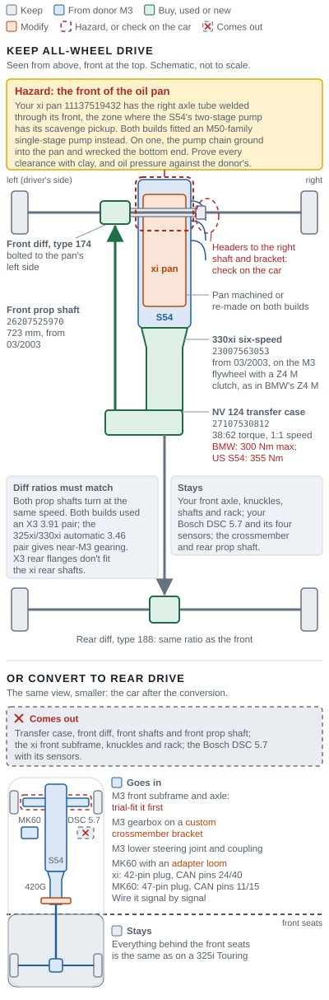 <!-- portrait -->

*Figure 10. The two routes for a 325xi, seen from above. Keeping all-wheel drive, the risk is the front of your own oil pan: its welded axle tube runs where the S54's two-stage pump has its scavenge pickup, and one of the two documented cars wrecked its bottom end there. Prove every clearance with clay and the oil pressure against the donor's before you drive, and fit the diffs as a matched pair. Converting to rear drive swaps the front axle, gearbox and DSC for M3 parts and an MK60 wired signal by signal; behind the front seats the car is the same as a 325i Touring.*

**What changes against the guide's plan:**

- **Oil pan and pump:** your xi pan, reworked around a single-stage pump ([below](#route-2-the-oil-pan-and-why-a-shared-gasket-proves-nothing)).
- **Gearbox, transfer case and diffs:** the 330xi six-speed and a matched pair of diffs ([below](#route-2-gearbox-transfer-case-and-differentials)).
- **Front axle, steering and DSC:** keep the xi's ([below](#route-2-front-axle-dsc-57-and-what-is-still-open)).
- **Rear axle:** keep the xi's, with the rear half of your matched diff pair. The guide's M3 rear axle doesn't apply: its 3.62 limited-slip diff has no front partner.
- **Body, floor, arches, fuel, cooling, wiring and coding:** as the guide describes. Keep the xi's tunnel insulator, center underbody screen, right engine-mount heat shield and gearbox exhaust bracket, which are shaped for the xi ([ETK](https://bmwfans.info/parts-catalog/E46-Touring/USA/325xi-M54/L-N/browse/vehicle_trim/insulation_2/)).
- **Left over:** the donor's 420G, front axle, MK60 and diff.

#### Route 2: the oil pan, and why a shared gasket proves nothing

**Same gasket, same pan? No.** BMW uses one oil-pan gasket, 11131437237, on essentially every M50, M52, M54, S50, S52 and S54 six since 1997: the rear-drive 325i, the 325xi and 330xi, the M3, the Z4 M and the E36 M3 ([ETK](https://bmwfans.info/parts-catalog/11131437237/)). It fixes the flange where the pan meets the block, and nothing more: the rear-drive 325i's pan (11131432703) takes the same gasket and is a third, different pan ([ETK](https://bmwfans.info/parts-catalog/E46-Touring/USA/325i-M54/L-N/browse/engine/oil_pan_oil_level_indicator/)). What matters sits inside the pan, and there the xi and the S54 clash:

- **The xi pan carries the front axle.** BMW: "The differential for the front axle is bolted to left side of the engine oil pan. … A connecting tube is welded into the oil pan. A shaft runs inside of the connecting tube between the front differential and the axle shaft on the right side" ([BMW ST040](https://archive.org/download/BMWTechnicalTrainingDocuments/ST040%202001%20System%20Diagnosis/7%20E46%204wd%202010-24-00.pdf)). The tube crosses the front of the pan, on the front axle line.
- **The S54's pump draws from the front of the pan.** "The S54 oil pump is two stage, supply and scavenge … the scavenge chamber (1) draws oil from the pickup at the front of the oil pan" ([BMW ST041](https://archive.org/download/BMWTechnicalTrainingDocuments/ST041%20M3%20Complete%20Vehicle/2%20M3%20DriveLine_djvu.txt)). Its pump (11417838123) and pickup (11417834887) are shared only with the Z3 M and Z4 M, and the pickup and its return pipe (11417834889) are made for the M3's pan ([ETK](https://bmwfans.info/parts-catalog/11417838123/), [ETK](https://bmwfans.info/parts-catalog/11417834887/)).
- **The "330xi pan" is your own pan.** Both documented builds bought a "330xi oil pan". ETK lists one pan, 11137519432, for the 325xi, the 330xi and the M54 X3 ([ETK](https://bmwfans.info/parts-catalog/11137519432/)). Even the M54's pickup differs between the xi and the rear-drive pan (11417502667 against 11417503258), so the sumps differ too ([ETK](https://bmwfans.info/parts-catalog/11417502667/)). Buy a second xi pan to rework and keep yours as a spare.
- **Both builds changed the pump.** Each fitted a single-stage M50-family pump, which has no front scavenge pickup, and machined or re-made the pan. Baca's car also has an S52 windage tray ([BimmerLife](https://bimmerlife.com/2022/07/04/a-perfect-one-car-solution-the-e46-m3-touring/), [German Cars For Sale](https://germancarsforsaleblog.com/superb-swap-2001-bmw-325xi-touring-s54-6-speed)). The US M50, M52 and S52 pump is 11411740154 and the tray (oil deflector) 11131433060 ([ETK](https://bmwfans.info/parts-catalog/11411740154/), [ETK](https://bmwfans.info/parts-catalog/11131433060/)). The pump's sprocket nut is a left-hand thread: the Colorado car's builder welded it, and a vendor sells a shaft kit for this conversion ([Turner](https://www.turnermotorsport.com/p-1150774-achilles-motorsports-upgraded-oil-pump-shaft-kit-bmw-s54s50b30b32euro-engine-swap-using-m50-pump-conversion/), unverified). Neither build says which pickup it ran.

**What went wrong on the Colorado car.** After FCP Euro bought it, "the oil pump chain was digging into the pan, and the pickup tube didn't have enough clearance to supply oil properly". The result was "spun bearings, cracked rods, and a damaged crankshaft" ([FCP Euro, part 1](https://www.fcpeuro.com/blog/bmw-e46-m3xi-an-m3-powered-bmw-rally-wagon-ready-for-almost-anything)). The mechanic found the engine full of "really fine aluminum dust", yet the oil filter "looked clean". The fix was a rebuilt bottom end and a new pan cut from the old one "with correct clearances", with baffles. The car then covered 1,600 "trouble-free miles" ([FCP Euro, part 2](https://www.fcpeuro.com/blog/back-on-the-road-off-the-road-bmw-e46-m3xi-part-2)).

> [!CAUTION]
> No BMW part fits this combination, and nobody has published the xi pan's inside dimensions. Treat the pan, pump and pickup as a fabrication job that you prove by measurement, not a parts swap. Prove it before the engine goes into the car.

**The checks that would have caught it.** BMW publishes no values for this combination, so the pass values come from your own two engines. That approach, and every pass value below except the guide's 0.7 bar, is our inference.

| When | Check | Pass |
|---|---|---|
| Phase 1, donor running | A mechanical gauge at the oil-pressure switch's port, as in [Phase 12](#phase-12-front-end-first-start-and-shakedown). Record the pressure and oil temperature at hot idle, 3,000 rpm and 5,000 rpm | Readings recorded: they're your pass values. 5,000 rpm keeps the later test inside the S54's break-in limit |
| Phase 4, the M54 out of the car but still in its xi pan | Modelling clay on the pan's front wall facing the pump sprocket and chain, and under the pickup mouth; pan on with its gasket, crank turned two full turns, pan off; measure the clay | Both gaps recorded: they're your minimums |
| After that, the S54 on the stand (bench work) | The M50-family pump, pickup and deflector fitted; the reworked pan trial-fitted on clay with its gasket; the crank turned two full turns by hand | No contact anywhere, and no clay thinner than the M54's gaps. If it fails, rework the pan and repeat |
| Same, after the baffles | The clay check again; the xi dipstick tube against the S54's intake side | The same pass; the tube fits without force |
| First fill | A measured fill against the dipstick | You know the volume that reaches each mark. The level sensor is common to both pans, but its warning point follows the xi pan's shape |
| First start | The gauge at hot idle, 3,000 and 5,000 rpm | At least 0.7 bar (10 psi) at hot idle (the guide's figure) and at least the donor's reading at each speed and oil temperature. Any shortfall: stop |
| About 800 km (500 miles), then 1,600–2,400 km (1,000–1,500 miles) | Oil analysis for aluminium | Aluminium not rising between samples. Don't rely on the filter: the FCP car's looked clean |

#### Route 2: gearbox, transfer case and differentials

**Not your five-speed.** The 325xi's five-speed is "S5D 320Z" in ETK and "S5D-280Z" in BMW's training text ([ETK](https://bmwfans.info/parts-catalog/E46-Touring/USA/325xi-M54/L-N/browse/manual_transmission/manual_transmission_s5d_z_4_wheel/), [BMW ST034](https://archive.org/download/BMWTechnicalTrainingDocuments/ST034%20E46%20Complete%20Vehicle/1%20models_djvu.txt)). In BMW's naming that number is the torque rating in Nm ([BMW ST045](https://archive.org/download/BMWTechnicalTrainingDocuments/ST045%20Z4%20Complete%20Vehicle/05%20E85%20Driveline.pdf)), so either way it's below the US S54's 355 Nm (262 ft-lb) ([BMW ST041](https://archive.org/download/BMWTechnicalTrainingDocuments/ST041%20M3%20Complete%20Vehicle/2%20M3%20DriveLine_djvu.txt)) (our reading). No build used it.

**Fit the 330xi six-speed, as both builds did.** It's the ZF GS6X37BZ (23007563053), built from 03/2003 ([ETK](https://bmwfans.info/parts-catalog/E46-Sedan/USA/330xi-M54/L-N/browse/manual_transmission/manual_transmission_gs6x37bz_dz_4_wheel/)). BMW ran the S54 through the same gearbox family in the Z4 M (GS6-37BZ, 23007837983), where it makes "262 lb-ft at 4900 rpm" ([ETK](https://bmwfans.info/parts-catalog/E85/USA/Z4_M3.2-S54/L-N/browse/manual_transmission/manual_transmission_gs6_37bz_dz/), [BMW ST601](https://archive.org/download/BMWTechnicalTrainingDocuments/ST601%20E85%20LCI%20and%20M%20Roadster/E85%20M%20Roadster_djvu.txt)). The 330xi box's input guide tube and seal are the Z4 M's parts, and the Z4 M pairs the M3's dual-mass flywheel (21212229900) with its own clutch set (21217837984, disc 21217837095) and the M3's release bearing (21511223582) ([ETK: clutch](https://bmwfans.info/parts-catalog/E85/USA/Z4_M3.2-S54/L-N/browse/clutch/clutch/), [ETK: seals](https://bmwfans.info/parts-catalog/E85/USA/Z4_M3.2-S54/L-N/browse/manual_transmission/gs6_37bz_dz_sealing_and_mount_parts/)). So the M3 flywheel with the Z4 M clutch is BMW's own way of joining an S54 to this gearbox (our inference). Fit the flywheel as the guide does ([Driveline and rear axle](#driveline-and-rear-axle)). The Colorado car ran a 330 clutch kit, which fits the spline but is built for M54 torque.

**Buy it as a set.** Take the box with its NV 124 transfer case (27107530812), both adapter shafts, the 723 mm (28.5 in) front prop shaft (26207525970) and the six-speed shift parts ([ETK: prop shafts](https://bmwfans.info/parts-catalog/E46-Sedan/USA/330xi-M54/L-N/browse/drive_shaft/drive_shaft_4_wheel/), [ETK: shift parts](https://bmwfans.info/parts-catalog/E46-Sedan/USA/330xi-M54/L-N/browse/gearshift/gear_shift_parts_manual_transm_4_wheel/)). A 325xi built from 03/2003 already has that transfer case and front shaft. An earlier one has the older pair (27107509763, and a 718 mm shaft), so use the 330xi's ([ETK](https://bmwfans.info/parts-catalog/E46-Touring/USA/325xi-M54/L-N/browse/transfer_box_electric_gearbox/transfer_case_nv_124/)). The crossmember (22316750856) and the 1,244 mm rear prop shaft are the same on both cars: keep yours.

**There is no all-wheel-drive 420G.** ETK lists the M3's gearbox (23002229721) for the E46 M3 only, with no transfer-case version ([ETK](https://bmwfans.info/parts-catalog/23002229721/)). The Baca car's sale listing says "420G", but BimmerLife's "330xi six-speed" is the account that fits.

**No gear switch.** The 330xi box carries only a reversing-light switch (23147524811). The 420G's gear-recognition switch, which the MSS54's clutch chain expects, isn't there ([ETK](https://bmwfans.info/parts-catalog/E46-Sedan/USA/330xi-M54/L-N/browse/manual_transmission/gs6x37bz_grbx_housing_and_mount_parts/), [Clutch switch, gear switch and cruise](WIRING-AND-CODING.md#clutch-switch-gear-switch-and-cruise)). Without it the car starts and runs, but cruise doesn't work ([Driveline and rear axle](#driveline-and-rear-axle)). Bridging the switch's plug would make the DME read "in gear" whenever the pedal is up, even in neutral; nobody has tested that (our inference).

**Transfer case.** The NV 124 is a single-speed gear unit with an open planetary center: "Torque Distribution: 38%: 62%. Maximum Torque: 300Nm", with both outputs at the same speed ([BMW ST040](https://archive.org/download/BMWTechnicalTrainingDocuments/ST040%202001%20System%20Diagnosis/7%20E46%204wd%202010-24-00.pdf)). That 300 Nm (221 ft-lb) is below the US S54's 355 Nm (262 ft-lb) and equal to the US 330xi's own engine torque. Yet BMW fitted the same NV 124 part numbers to the European 330xd ([ETK](https://bmwfans.info/parts-catalog/27107530812/)), a diesel of 390–410 Nm (288–302 ft-lb) ([BMW Group Classic](https://www.bmwgroup-classic.com/en/models/bmw-classics/product-description-page.ad-998-1.bmw-330xd-e46.html), unverified). So 300 Nm isn't the case's hard limit, but BMW never rated it behind an S54 (our inference). It takes 0.24 L (0.25 US qt) of MTF-LT-1 (83229408942), with drain and fill plugs at 33 Nm (24 ft-lb); BMW lists only its three oil seals and its mount as repairable ([BMW ST040](https://archive.org/download/BMWTechnicalTrainingDocuments/ST040%202001%20System%20Diagnosis/7%20E46%204wd%202010-24-00.pdf)).

**Matched differentials.** The NV 124 turns both prop shafts at the same speed, so the front and rear diffs must have the same ratio. BMW never sold a mismatched pair and publishes no tolerance, and both builds changed both diffs together. With an open planetary center a small mismatch wouldn't bind the driveline, but it would keep the planetary turning all the time; nobody has tested that, so don't (our inference). Both builds fitted X3 3.91 pairs (the X3 2.5i's ratio), which shorten the gearing about 11% against an M3's. The xi automatic's 3.46 pair comes within 2% of the M3 and is E46 xi hardware at both ends ([ETK: xi front](https://bmwfans.info/parts-catalog/E46-Touring/USA/325xi-M54/L-N/browse/front_axle/front_diff_components_all_wheel/), [ETK: xi rear](https://bmwfans.info/parts-catalog/E46-Touring/USA/325xi-M54/L-N/browse/rear_axle/final_drive_input_output_4_wheel/), [ETK: X3 front](https://bmwfans.info/parts-catalog/E83/USA/X3_2.5i-M54/L-N/browse/front_axle/front_diff_components_all_wheel/), [ETK: X3 rear](https://bmwfans.info/parts-catalog/E83/USA/X3_2.5i-M54/L-N/browse/rear_axle/differential_drive_output/)):

| Pair, front and rear | Part numbers | First gear, overall | Against the M3's 15.30 | Notes |
|---|---|---|---|---|
| 3.23, 325xi manual (yours) | 31507526216 (31507500797 before 03/2003); 33107500783 | 14.05 | 8% taller | Stock |
| 3.46, 325xi and 330xi automatic | 31507500799; 33107531623 (or 33107531622) | 15.05 | 2% taller | Our pick: the xi's mountings, 94 mm rear flanges and support bracket |
| 3.64, X3 3.0i (M54) | 31507523653; 33107523667 | 15.83 | 3.5% shorter | X3 diffs need the changes below |
| 3.91, X3 2.5i (the builds' ratio) | 31507523651; 33107537722 | 17.01 | 11% shorter | As above |

The overall ratios are our arithmetic: first gear 4.350 times the diff, assuming the 330xi box has the GS6-37BZ's petrol ratios, which ETK doesn't print, against the M3's 4.227 × 3.62 ([BMW ST045](https://archive.org/download/BMWTechnicalTrainingDocuments/ST045%20Z4%20Complete%20Vehicle/05%20E85%20Driveline.pdf), [BMW ST041](https://archive.org/download/BMWTechnicalTrainingDocuments/ST041%20M3%20Complete%20Vehicle/1%20M3%20Complete%20Vehicle_djvu.txt)). Bench-check each diff before it goes in: hold both output flanges so they turn together and count the input turns for one output turn. Pass: the stated ratio within a tenth of a turn (our check).

- **X3 diffs need adapting.** The X3's rear output flanges have an 86 mm bolt circle against the xi's 94 mm. Moving your E46 flanges into it should work, since the seal (33107505604) and lock ring (33131214961) are common, but neither build says so (our inference). The X3 front diff shares the xi's seals, gaskets and bolt size, but its support bracket differs (31507516064): keep the xi's (31537500850, \$166.73 at [BimmerWorld](https://www.bimmerworld.com/Driveline-Shifter/Differentials-Accessories/Genuine-BMW-Supporting-Bracket-31537500850-E46.html), October 2026) and its right-hand shaft.
- **Not the M3's limited-slip diff.** Its 3.62 has no front partner, and it's a larger unit with other mountings. FCP Euro fitted a Wavetrac limited-slip unit in a matched-ratio diff instead ([FCP Euro, part 1](https://www.fcpeuro.com/blog/bmw-e46-m3xi-an-m3-powered-bmw-rally-wagon-ready-for-almost-anything)).
- **Tires.** BMW asks for tires "of the same manufacture and tread configuration" on an xi ([2004 Sports Wagon owner's manual, p.127](https://manualsnet.com/pdf-content/0945ee845d7bf99b78315dcf/html/127.page.html)). The M3's 225/45R18 front and 255/40R18 rear tires are within 0.2% of each other in diameter (our arithmetic).

**Torque margins (our arithmetic).** In first gear a US S54 puts about 1,544 Nm (1,139 ft-lb) into the NV 124: 587 Nm forward and 957 Nm back. With 3.91 diffs that's about 2,294 Nm (1,692 ft-lb) at the front axle and 3,744 Nm (2,761 ft-lb) at the rear, 15% and 25% above BMW's figures of 2,000 Nm (1,475 ft-lb) and 3,000 Nm (2,213 ft-lb) for the two diffs; with 3.46 diffs it's 2% and 10% above ([BMW ST040](https://archive.org/download/BMWTechnicalTrainingDocuments/ST040%202001%20System%20Diagnosis/7%20E46%204wd%202010-24-00.pdf)). BMW doesn't say where its figures apply. Neither documented car has reported a diff, transfer-case or shaft failure, over roughly 16,000 km (10,000 miles) and 8,000 km (5,000 miles) (our estimate).

#### Route 2: front axle, DSC 5.7 and what is still open

**Keep the xi's front axle and rack.** The M3's front axle can't carry drive shafts. Keep the xi's subframe (31101096954), steel arms, struts, knuckles, hubs and front shafts (605 mm and 926 mm, 31607505199/200), and its rack (32136759815) with its lower joint ([BMW ST040](https://archive.org/download/BMWTechnicalTrainingDocuments/ST040%202001%20System%20Diagnosis/7%20E46%204wd%202010-24-00.pdf), [ETK](https://bmwfans.info/parts-catalog/E46-Touring/USA/325xi-M54/L-N/browse/front_axle/final_drive_frnt_axle_output_shaft_4whl/)). Fit new front shafts and keep a spare, as both builds did; Baca's are new GKN units ([BimmerLife](https://bimmerlife.com/2022/07/04/a-perfect-one-car-solution-the-e46-m3-touring/), [German Cars For Sale](https://germancarsforsaleblog.com/superb-swap-2001-bmw-325xi-touring-s54-6-speed)). FCP's driver found the xi rack less quick and communicative than an M3's ([FCP Euro, part 2](https://www.fcpeuro.com/blog/back-on-the-road-off-the-road-bmw-e46-m3xi-part-2)).

- **Brakes.** The 330xi's 325 × 25 mm front brake (discs 34116864047, calipers 34116765881/882, carriers 34106765880) bolts to the xi knuckle used from 03/2002 (31216759311/312) and its dust shields ([ETK](https://bmwfans.info/parts-catalog/E46-Sedan/USA/330xi-M54/L-N/browse/brakes/front_brake_pad_wear_sensor/)). The M3's 325 × 28 mm brake needs longer carrier bolts (M12×1.5×41, 34116767217), M3 dust shields and possibly machining.
- **Engine brackets.** Use the xi's brackets (left 22116750853, right 22116750852) and mounts; its left mount is already the M3's part (11812283798). The right bracket should bolt to the S54, because the 325i and M3 share theirs. The left differs between the 325i and M3, so offer the xi's up and check. Use bolt lengths that suit the S54's iron block: the M3 uses M8×26 and M8×35 where the M54 uses M8×34 ([ETK: xi](https://bmwfans.info/parts-catalog/E46-Touring/USA/325xi-M54/L-N/browse/engine_and_gearbox_suspension/engine_suspension/), [ETK: M3](https://bmwfans.info/parts-catalog/E46-Coupe/USA/M3-S54/L-N/browse/engine_and_gearbox_suspension/engine_suspension/)) (our inference).
- **Power steering.** The S54's pump and the xi rack share no hose, so plan a custom pressure line; both builds appear to have made one (our inference).
- **Ride height and wheels.** Keep the car at the xi's stock height or higher. BMW cut its front spring travel by about 20 mm (0.8 in) for the shaft angles, and the Colorado car wore out its front CV boots when lowered ([BMW ST040](https://archive.org/download/BMWTechnicalTrainingDocuments/ST040%202001%20System%20Diagnosis/7%20E46%204wd%202010-24-00.pdf), [German Cars For Sale](https://germancarsforsaleblog.com/superb-swap-2001-bmw-325xi-touring-s54-6-speed)). BMW also gave the xi 17 × 7.0 wheels "to ensure there is enough room for the front axles and brakes", so check M3 wheels and brakes at full lock and full bump.

**Keep the DSC 5.7.** It's the only unit that reads the xi's Bosch sensors and runs four-wheel ADB-X, its brake-based traction control, and an MK60's front sensors won't fit the xi's hubs ([BMW ST040: DSC 5.7](https://archive.org/download/BMWTechnicalTrainingDocuments/ST040%202001%20System%20Diagnosis/8%20dsc%20205_djvu.txt)). Keep its sensors, yaw sensor and steering-angle sensor too. Its coding comes from your car's order, so the engine change gives no reason to recode it (our inference). Whether it talks cleanly to the MSS54 is undocumented. The DSC 5.7 reads engine speed and fill from the DME and sends road speed back, and the MSS54 logs a fault if the DSC's or the steering-angle sensor's message goes missing ([SGBD: DSC57](https://github.com/emdzej/ediabasx-docs-sgbd/blob/main/docs/sgbd/DSC57.md), [SGBD: MSS54](https://github.com/emdzej/ediabasx-docs-sgbd/blob/main/docs/sgbd/MSS54DS0.md)). The M3 cluster takes the DSC and yellow brake lamps over CAN, while the DSC 5.7 drives the ABS lamp directly. Run these checks:

| Check | Pass | If it fails |
|---|---|---|
| Phase 0, before anything changes: Tool32 `DSC57.PRG` → `FS_LESEN`, then `STATUS_IO_LESEN_ANALOG` with the wheel straight | No stored faults; `STAT_LENKWINKEL_WERT` near 0°. This is your baseline | Fix the xi's DSC first |
| Key on, engine started, car rolled a few metres | The DSC, yellow BRAKE and ABS lamps light, then go out | Read both fault memories |
| MSS54 fault memory | None of 131 (0x83) DSC intervention implausible, 132 (0x84) DSC message timeout, 133 (0x85) steering-angle message timeout or 134 (0x86) cluster message timeout; no fault of type "DSC meldet V-Fehler" | 132: no road speed from the DSC, which also stops cruise. 133: the steering-angle sensor's message isn't what the MSS54 expects |
| `DSC57.PRG` → `STATUS_IO_LESEN_CAN` at idle and at 3,000 rpm | `STAT_MOTORDREHZAHL_WERT` matches the tachometer, and `STAT_NORM_FUELLUNG_FAHRER_WERT` rises with throttle | The DSC 5.7 isn't reading the MSS54: check the CAN at the DME |
| MSS54 `STATUS_V_CAN` on a drive | Matches the speedometer | As for fault 132 |
| After the alignment: `DSC57.PRG` → `TEST_LENKWINKEL` | Job OK and `ABGL_LWS_ID` returned; about 0° straight ahead; DSC lamp off | Repeat with the wheel dead straight |
| Low-speed traction test on a loose surface | The DSC lamp flashes and power drops during wheelspin; with DSC switched off, ADB still brakes a spinning wheel ([BMW ST040: DSC 5.7](https://archive.org/download/BMWTechnicalTrainingDocuments/ST040%202001%20System%20Diagnosis/8%20dsc%20205_djvu.txt)) | Read the faults |

**Mechanical checks** (our checks; BMW gives no figures):

| When | Check | Pass |
|---|---|---|
| Phase 9 | xi engine brackets on the S54 | Every hole lines up without force; full thread engagement in the iron block |
| Phase 9, at full droop and full bump with the steering at both locks | The headers against the right front shaft and its support bracket; the front prop shaft against the starter and oil-cooler lines; the exhaust against the NV 124 and tunnel insulator | No contact, with every heat shield refitted. A rub mark found later is a fail |
| Phase 8, at full droop | The front CV boots | Not stretched or kinked |
| About 800 km (500 miles) | The NV 124, diff and gearbox seals; the boots; any rub marks | Seals dry, boots intact, no marks |

**Still open.** Nobody has published:

- the clearance between the S54's headers and the right front shaft and its support bracket, or between the M3's front pipes and the NV 124;
- whether the xi's left engine bracket bolts to the S54 block;
- whether the MSS54 and the DSC 5.7 talk cleanly (the checks above settle it for your car);
- the xi pan's inside dimensions, how either builder reworked it, and which pickup each ran;
- an S54 oil-pressure figure on an M50-family pump, and torque ratings for the GS6X37BZ, NV 124 and diffs behind an S54;
- how the MSS54's clutch chain should be wired without the gear switch.

#### Emissions and Massachusetts for an xi

**An xi is the best case for the engine-switch rule.** EPA certified every 2001–05 325xi Sport Wagon in a LEV test group, the S54's category. For 2004–05 that meant California LEV and federal Bin 9, exactly as for the S54 ([EPA certification data](https://www.epa.gov/compliance-and-fuel-economy-data/annual-certification-data-vehicles-engines-and-equipment)):

| Model year | 325xi Sport Wagon test group | Level | The S54 (M3), same year |
|---|---|---|---|
| 2001 | 1BMXV02.5M54 or 1BMXV03.0LER | LEV | 1BMXV03.2S54, LEV |
| 2002 | 2BMXV03.0LER | LEV | 2BMXV03.2S54, LEV |
| 2003 | 3BMXV03.0LER | LEV | 3BMXV03.2S54, LEV |
| 2004 | 4BMXV03.0LER | LEV (California), Bin 9 (federal) | 4BMXV03.2S54, LEV and Bin 9 |
| 2005 | 5BMXV03.0LER | LEV (California), Bin 9 (federal) | 5BMXV03.2S54, LEV and Bin 9 |

So under the "same emissions certification category" test in [Massachusetts](#massachusetts), an xi matches in every year, where a 2003–05 325i Touring may be ULEV or SULEV (our reading). Your VECI label should name an LER group; if it names another, go by the label. EPA's policy also expects a donor of the same model year or newer.

**Ride height.** Your Massachusetts baseline is your xi's own height, which BMW lists 20 mm (0.8 in) above a 325i Touring's: 1,429 mm (56.3 in) against 1,409 mm (55.5 in) ([2004 Sports Wagon owner's manual](https://manualsnet.com/bmw/325i-sports-wagon-3-series-2004)). Record it in Phase 0 as the guide describes ([Massachusetts ride-height baseline](#massachusetts-ride-height-baseline)). A rear-drive conversion on M3 axles will probably sit lower than that, so check your spring choice against the 2-inch rule at mock-up (our inference).

**The four-wheel-drive rule.** 540 CMR 6.00 covers "Any vehicle that is capable of providing torque to all four wheels". In place of the general 2-inch rule it sets such a vehicle's own limits for raising or lowering it more than two inches from the maker's height; it also keeps the body level to within two inches front to rear, bans wheel spacers and limits a track increase through tires and rims to four inches ([540 CMR 4.04(13)](https://www.law.cornell.edu/regulations/massachusetts/540-CMR-4-04), [6.01](https://www.law.cornell.edu/regulations/massachusetts/540-CMR-6-01), [6.03](https://www.law.cornell.edu/regulations/massachusetts/540-CMR-6-03), [6.04](https://www.law.cornell.edu/regulations/massachusetts/540-CMR-6-04)). A Route 2 car stays under it, so check the M3 wheels' widths and offsets against it, and in Phase 0 also record the height the way 6.00 measures it: unladen, from the floor to the lower edge of the driver's door at its center line ([6.03](https://www.law.cornell.edu/regulations/massachusetts/540-CMR-6-03)). A Route 1 car can't drive all four wheels, so 6.00 no longer applies and the general 2-inch rule does (our reading; say so in your letter to the RMV).

**Title and insurance.** Massachusetts titles don't record the drive layout, and no rule we found ties certification or title to it. The VIN will still decode as a 325xi. Tell your insurer the car is now rear-drive, and keep the receipts. Ask MassDEP whether it treats the change of drive as part of the engine switch ([Questions for your state program](#questions-for-your-state-program)).

#### Documented xi builds

| Build | Route | What was done | What went wrong | Outcome | Sources |
|---|---|---|---|---|---|
| JMCCRNA (e46fanatics), 2003 xi Touring, 2018 | Rear drive | Blown xi engine replaced; made rear-drive; the M3's DSC module; the M3 sensors' plugs mated with the xi harness ("plugged right in"). No wiring published | The gearbox mount in the xi tunnel needed a custom bracket, which then clashed with a Euro exhaust | Started 10/2018, to paint 11/2018 | [e46fanatics](https://www.e46fanatics.com/threads/m3-touring-project.1240087/) |
| Bring a Trailer car, Laguna Hills, California; 2001 325xi Touring | Rear drive | From a 2001 M3: the rebuilt S54 with a CSL-style airbox, six-speed, axles, subframes and diff. Fiberglass front fenders and rear arches by 2M Autowerks; a plate welded in and a custom brace across the xi tunnel; the donor's spare-tire floor for the muffler and canister; Porsche 996 brakes | DSC route not stated; a 2001 donor had the MK20 (our inference). Registered in Montana: "The CSL intake and tune won't pass CA SMOG". The listing says "True mileage is unknown" because the donor's cluster wasn't set to the chassis mileage, which the guide's cluster method avoids | Bid to \$59,250 (reserve not met), 20 Aug 2024; Top Gear reported it sold | [Bring a Trailer](https://bringatrailer.com/listing/2001-bmw-e46-m3-wagon/), [vmax.si](https://en.vmax.si/2024/12/21/this-is-a-near-perfect-m3-and-it-was-for-sale/), [Top Gear](https://www.topgear.com/car-news/used-cars/modified-bmw-e46-m3-touring-just-sold-nearly-60000), [BMWBlog](https://www.bmwblog.com/2024/08/14/e46-bmw-m3-touring-on-bring-a-trailer/) |
| Seller in Buffalo, New York; 2004 325xi Touring | Rear drive | S54 from a 2003 M3; 420G; the M3's front and rear subframes, rack and diff; MSS54HP DME | Kept the xi's Bosch DSC 5.7, listed as a known flaw; a leaking selector-shaft seal | Listed at \$24,000 (04/2023); sold for \$22,000 on Cars & Bids (06/2023) | [Built for Backroads](https://www.builtforbackroads.com/listing/2004-bmw-325xi-touring-s54-swap), [Engine Swap Depot](https://engineswapdepot.com/?p=101132) |
| Kyle and Maggie Baca, Virginia; 2004 325xi Touring, 2018–22 | All-wheel drive | 330xi six-speed and NV 124; a machined "330xi" pan with an M50-family pump and an S52 windage tray; X3 3.91 diffs; new GKN front shafts; stronger ball joints; the M3 steering "adapted"; M3 front brakes; M3 body | Clutch chatter with a lightweight flywheel, cured with an OEM LuK clutch; nothing else reported | 280 h of mechanical work; "over \$70k invested"; listed at \$65,000 and sold (09/2025). About 8,000 km (5,000 miles) in six years (our estimate) | [BimmerLife](https://bimmerlife.com/2022/07/04/a-perfect-one-car-solution-the-e46-m3-touring/), [Built for Backroads](https://www.builtforbackroads.com/listing/2004-bmw-325xit-touring-awd-s54-swap) |
| Colorado car, later FCP Euro's "M3xi"; 2001 325xi Touring, built by a BMW master technician by 11/2018 | All-wheel drive | S54 from a 2004 M3; 330xi six-speed with a 330 clutch kit; "330Xi Oil Pan w/ Custom Baffles"; "M50 Oil Pump w/ Welded Nut"; X3 3.91 diffs; riveted flares | Front CV boots wore when the car was lowered. Then the pump chain ground into the pan and wrecked the bottom end: spun bearings, cracked rods and a damaged crank. Rebuilt with a re-made pan, then 1,600 "trouble-free miles" (08/2021) | Asked \$26,500 (11/2018), then \$22,800 (03/2019), when FCP Euro's Daniel Sloan bought it | [Jalopnik](https://jalopnik.com/does-this-custom-s54-rocking-2001-bmw-325ix-touring-hav-1830305864), [BMWBlog (2018)](https://www.bmwblog.com/2018/11/09/want-this-s54-swapped-e46-3-series-touring/), [German Cars For Sale](https://germancarsforsaleblog.com/superb-swap-2001-bmw-325xi-touring-s54-6-speed), [FCP Euro, part 1](https://www.fcpeuro.com/blog/bmw-e46-m3xi-an-m3-powered-bmw-rally-wagon-ready-for-almost-anything), [part 2](https://www.fcpeuro.com/blog/back-on-the-road-off-the-road-bmw-e46-m3xi-part-2) |

The Colorado car and the "rivet-flare" S54 Touring that BMWBlog showed in 2018 are the same car: listed in Denver in November 2018 and sold through Glen Shelly in March 2019 to FCP Euro's Daniel Sloan. BimmerLife names one more all-wheel-drive S54 builder, Austin Sera, whose car isn't documented.

### Suspension for Touring weight

Your finished car rides on M3 axles but keeps the Touring's body, its heavier rear and its door-label load ratings. At the front, M3 coupe parts suit it as they are. At the rear it needs more spring than an M3 coupe. BMW's own ride-height method and its figures for both cars give you targets and checks from the donor to the alignment.

- **Decide by Phase 3.** The arches are cut and welded around the mock-up in Phase 6, so buy the final springs, dampers, wheels and tires first.

#### Weights and axle loads

Compare like with like. BMW USA's spec sheets give US curb weights, which include a full tank. The 1,495 kg (3,296 lb) DIN weight that [BMW ST041](https://archive.org/download/BMWTechnicalTrainingDocuments/ST041%20M3%20Complete%20Vehicle/1%20M3%20Complete%20Vehicle.pdf) gives the M3 coupe leaves out the driver and assumes 90% fuel, so don't set it against a US figure.

| Car, manual gearbox | US curb weight | Front axle | Rear axle | Door-label ratings: front / rear / GVWR |
|---|---|---|---|---|
| 2003 325i Touring | 1,525 kg (3,362 lb) | 727 kg (1,604 lb) | 798 kg (1,758 lb) | 900 / 1,210 / 2,045 kg (1,984 / 2,668 / 4,509 lb) |
| E46 M3 coupe | 1,549 kg (3,415 lb) | 779 kg (1,718 lb) | 770 kg (1,697 lb) | 970 / 1,150 / 2,020 kg (2,138 / 2,535 / 4,453 lb) |
| E46 M3 convertible | 1,715 kg (3,781 lb) | 856 kg (1,887 lb) | 859 kg (1,894 lb) | 990 / 1,170 / 2,100 kg (2,183 / 2,579 / 4,630 lb) |
| Your S54 Touring (our estimate) | 1,584–1,614 kg (3,490–3,560 lb) | 760–772 kg (1,676–1,702 lb) | 824–842 kg (1,817–1,856 lb) | Your Touring's: 900 / 1,210 / 2,045 kg |

The axle loads are BMW USA's curb weights times its weight distribution: 47.7/52.3 for the Touring, 50.3/49.7 for the M3 coupe and 49.9/50.1 for the convertible ([BMW USA: Touring](https://www.press.bmwgroup.com/usa/article/attachment/T0022146EN_US/41437), [BMW USA: M3, 2003](https://www.press.bmwgroup.com/usa/article/attachment/T0022150EN_US/41463)). The 2002 and 2006 M3 sheets print the same weights. The ratings come from BMW's US owner's manuals ([2004 Sports Wagon, p.162](https://manualsnet.com/pdf-content/0945ee845d7bf99b78315dcf/html/162.page.html), [2003 M3 coupe, p.146](https://manualsnet.com/pdf-content/1dd38ae4fde1bb1b66502638/html/146.page.html), [2003 M3 convertible, p.152](https://manualsnet.com/pdf-content/39629294e87697522874e8d1/html/152.page.html)).

- **The stock Touring is lighter than an M3 coupe, but heavier at the back.** In like-for-like US terms it weighs 24 kg less, yet carries about 28 kg more on its rear axle.
- **How we estimate your car.** We add to the 325i Touring what the M3 package adds over a 330Ci coupe in BMW USA's figures: +33 kg front and +26 kg rear for the S54 and 420G, the M3 axles, brakes, 18-inch wheels, exhaust and panels ([BMW USA: 330Ci](https://www.press.bmwgroup.com/usa/article/attachment/T0022146EN_US/41438)). The upper end also adds what a 330 weighs over a 325i. Allow ±20–30 kg for equipment, fuel and aftermarket parts, and weigh the finished car on corner scales if you can. Tracks and Trails calls his "a 3600lb wagon" ([Tracks and Trails – what it takes (2026), 34:20](https://www.youtube.com/watch?v=nADBRfX9DqY&t=2060s)), which fits the upper end once extras are added. One finished S54 Touring was weighed on corner scales: 3,606 lb (1,636 kg) with a full tank, roof rack, spare tire and an E36 M3 muffler, 48/52 front/rear, cross-weight 49.66% with the driver, and a center of gravity 21.25 in (540 mm) off the ground on stock M3 springs and 245/40-17 tires ([NAM3 – Black & Tan 332iT #25 (2023)](https://nam3forum.com/forums/forum/main-forum/member-build-journals/195928-black-tan-332it/page2)). With a lighter battery it read 3,550 lb (1,610 kg) at 48.5/51.5, about 781 kg front and 829 kg rear ([#52](https://nam3forum.com/forums/forum/main-forum/member-build-journals/195928-black-tan-332it/page4)).
- **The door label binds the finished car.** BMW: "Approved axle loads and approved gross vehicle weight must never be exceeded" ([manual, p.162](https://manualsnet.com/pdf-content/0945ee845d7bf99b78315dcf/html/162.page.html)). Read your own door-pillar label in Phase 0; the 2004 manual's ratings are very likely the 2003's, since the curb weights match. The swap uses about 60–90 kg (130–200 lb) of the Touring's 520 kg (1,146 lb) payload (our estimate).
- **The front axle has little to spare when loaded.** At curb it has 128–140 kg in hand. Loaded the way BMW loads a non-M E46 for ride height (68 kg in each front seat, 68 kg on the rear seat and 21 kg in the cargo area), it carries about 844–856 kg against its 900 kg rating: only about 45–55 kg (100–120 lb) to spare. The rear then carries about 965–982 kg against 1,210 kg. These are our estimates, with assumed seat positions.
- **Not for towing** (our recommendation). BMW gives the M3 no trailer load (BMW AG's data table in the [Flow PDF](https://drive.google.com/file/d/1GS3Hirx6x0c0WG8hPeXiwfXfeUldkQnm/view?usp=sharing)), and the US Sports Wagon manual has no towing section ([manual](https://manualsnet.com/bmw/325i-sports-wagon-3-series-2004)).

#### Springs, dampers and anti-roll bars

Use the M3's parts at both ends. Only the rear spring needs choosing for the Touring.

| Item | Your Touring | M3 coupe | M3 convertible | For your S54 Touring |
|---|---|---|---|---|
| Front strut, left/right | 31316750789/790 standard; 31312282101/102 sport with M Sport II; 31316750791/792 sport or rough-road | 31312283103/104 | 31312282265/266 | M3 coupe struts, or M3 coilovers |
| Front top mount (guide support) | Non-M | 31332229165 left, 31332229166 right | The same | M3: handed, and offset for caster |
| Front upper spring pocket, upper pad; bump stop | 31326769667, 31331091867; 31336778544 (sport) or kit 31302290314 | 31331090612, 31331091233; 31332229778 | The same | M3, with the M3 strut |
| Front spring | By VIN | By VIN | By VIN, sized for about 856 kg | M3 coupe springs, or the coilover's |
| Front anti-roll bar | 23 mm 31351097178; 24 mm 31351094542 (sport) | 26 mm 31352229755 | 27 mm 31352229485 | The coupe's; the convertible's adds understeer |
| Front bar links | 31356780847 | 31356780847 | 31356780847 | The same part on every E46: buy new |
| Rear damper | 33526750783 standard; 33526750784 sport or rough-road; 33522282099 M Sport II | 33522283105 (from 11/2004; before, 33522282477) | 33522282267 | M3 damper, or M3 coilovers |
| Rear top mount | 33521092362 | 33526779670 | 33526779670 | M3, on four new M8 nuts 07119905374 at 28 Nm (21 ft-lb) |
| Rear bump stop | Kit 33502290317 | 33532229777 | 33532229777 | M3 |
| Rear spring | By VIN | By VIN, sized for about 770 kg | By VIN, sized for about 859 kg | About 7–9% more rate than the coupe's: see below |
| Rear spring pads; lower control arm | Lower 33531094518, upper 5 mm 33531136385; arm 33326770813 | The same | The same | Common |
| Rear anti-roll bar; links | 18 mm 33551095758 or 19 mm 33551094545 (sport); 33551094619 | 21.5 mm 33552282181; 33552283743 | The same | M3: the non-M bar hits the M3 diff |
| Headlight-levelling joint (xenon only) | 37146766778 | 31122282404 | — | M3, with the M3 arm; the rear sensor parts are common |

Part numbers are from ETK: [Touring front](https://bmwfans.info/parts-catalog/E46-Touring/USA/325i-M54/L-N/browse/front_axle/front_spring_strut_shock_absorber/), [M3 coupe front](https://bmwfans.info/parts-catalog/E46-Coupe/USA/M3-S54/L-N/browse/front_axle/front_spring_strut_shock_absorber/), [M3 convertible front](https://bmwfans.info/parts-catalog/E46-Cabrio/USA/M3-S54/L-N/browse/front_axle/front_spring_strut_shock_absorber/), [M3 spring pads](https://bmwfans.info/parts-catalog/E46-Coupe/USA/M3-S54/L-N/browse/front_axle/guide_support_spring_pad_attaching_parts/), [M3 coupe front bar](https://bmwfans.info/parts-catalog/E46-Coupe/USA/M3-S54/L-N/browse/front_axle/stabilizer_front/), [M3 convertible front bar](https://bmwfans.info/parts-catalog/E46-Cabrio/USA/M3-S54/L-N/browse/front_axle/stabilizer_front/), [Touring rear](https://bmwfans.info/parts-catalog/E46-Touring/USA/325i-M54/L-N/browse/rear_axle/rear_spring_strut_mounting_parts/), [M3 coupe rear](https://bmwfans.info/parts-catalog/E46-Coupe/USA/M3-S54/L-N/browse/rear_axle/rear_spring_strut_mounting_parts/), [M3 convertible rear](https://bmwfans.info/parts-catalog/E46-Cabrio/USA/M3-S54/L-N/browse/rear_axle/rear_spring_strut_mounting_parts/), [Touring rear bar](https://bmwfans.info/parts-catalog/E46-Touring/USA/325i-M54/L-N/browse/rear_axle/stabilizer_rear/), [M3 rear bar](https://bmwfans.info/parts-catalog/E46-Coupe/USA/M3-S54/L-N/browse/rear_axle/stabilizer_rear/), [levelling](https://bmwfans.info/parts-catalog/E46-Coupe/USA/M3-S54/L-N/browse/rear_axle/headlight_vertical_aim_control_sensor/).

- **Front: M3 coupe parts.** Your car's front axle load is within 1–3% of an M3 coupe's (our estimate), so the coupe's struts, springs, top mounts and pads should stand it at about M3 coupe height. A convertible's front springs were picked for about 856 kg, so on your car they would probably stand the nose high (our inference). With a convertible donor, order coupe springs from a dealer against a coupe VIN, or fit M3 coilovers. Don't put non-M springs on M3 struts: the M3's upper spring pocket and pad differ.
- **Rear springs: about 7–9% stiffer than an M3 coupe's.** Your rear axle carries about 824–842 kg (our estimate), between the coupe's 770 kg and the convertible's 859 kg. To sit and ride like a coupe, it needs about 7–9% more spring rate and preload (our estimate). Moved-over M3 coupe springs and dampers sat Tenza's Touring so low that the wider rear tires rubbed its unflared fenders and the bumper ([Tenza – coilovers (2022), 00:40](https://www.youtube.com/watch?v=Sit-SmfU-9k&t=40s), [01:20](https://www.youtube.com/watch?v=Sit-SmfU-9k&t=80s)). The rear spring pads and the lower control arm that carries the spring are common to the Touring, the sedan and both M3s, so any E46 rear-drive barrel spring fits: choose by rate and height. One S54 Touring ran stock M3 springs on Koni dampers with 6 mm spring spacers to sit "more to ZHP height", then fitted late (ZCP) M3 springs, which set it 2 mm higher in front and 9 mm higher at the rear than the early springs with spacers; the early springs were marked with yellow stripes, the late ones blue (front) and green (rear) ([NAM3 – Black & Tan 332iT #150](https://nam3forum.com/forums/forum/main-forum/member-build-journals/195928-black-tan-332it/page10), [#598 (2026)](https://nam3forum.com/forums/forum/main-forum/member-build-journals/195928-black-tan-332it/page40)). On another, Eibach M3 coilovers at full height still sat about 1 cm lower than the owner wanted ([NAM3 – #12](https://nam3forum.com/forums/forum/main-forum/member-build-journals/4337-obioban-s-2004-jr-black-m3-wagon)). In order of preference:
  1. The heaviest M3 rear spring, 33532283137, which fits the convertible and is also one of the coupe's choices (our inference from FCP Euro's fitment notes), checked against your measured heights.
  2. M3 coilovers with a rear spring about 10% stiffer than the kit's (see [Coilovers for the M3 axles](#coilovers-for-the-m3-axles)).
  3. M3 coupe springs with added height, from a height-adjustable perch or BMW's European rough-road upper pad (14.5 mm, 33531094754, with adapter 33531091598; our inference). The rate stays the coupe's, so the rear still sags more under load.
  4. Your Touring's own "reinforced" or "heavy duty" rear springs (Lesjöfors 4208445 and 4208446). They fit the M3 rear arm, which carries the spring on the same lower arm and pads, but their rates aren't published, so judge them by measured ride height ([FCP Euro](https://www.fcpeuro.com/products/coil-spring-lesjofors-4208445)).
- **Order springs by VIN.** ETK lists no spring numbers for any of these cars: BMW picks springs from a spring table by each car's weight and options, through its own parts catalog ([FCP Euro](https://www.fcpeuro.com/blog/repair-resource-bmw-coil-spring-parts-lookup)). Before you order, ask a dealer for the front and rear spring numbers against an M3 coupe VIN and an M3 convertible VIN. FCP Euro's fitment notes give the candidates: M3 coupe front 31332283130, M3 convertible front 31332282332, M3 rear 33532283135, 33532283136 or 33532283137 (the convertible takes 33532283137, the heaviest), and for a manual 2003 325i Touring front 31331093068 (standard) or 31331093082 to 31331093085 (sport) ([FCP Euro](https://www.fcpeuro.com/products/bmw-coil-spring-lesjofors-4008488), [FCP Euro](https://www.fcpeuro.com/products/bmw-coil-spring-mubea-33532283137), [FCP Euro](https://www.fcpeuro.com/products/bmw-front-coil-spring-31331093068)). BMW publishes no rates. No maker sells springs for an M3-axle Touring: H&R 29419, Eibach 2067.140 and Vogtland 951069 are for the non-M Touring's axles ([springrates](https://www.springrates.com/products/h-r-sport-springs-for-2000-2005-bmw-325i-sport-wagon-e46)), while Ground Control's M3 coilover kit takes any Eibach rate ([Ground Control](https://groundcontrolstore.com/products/coilover-conversion-kit-bmw-e46-m3-01-up)). Before teardown, photograph the paint marks on the donor's springs and the symbol on each front strut, which BMW's repair instructions match to the suspension version ([BMW ST056](https://archive.org/download/BMWTechnicalTrainingDocuments/ST056%20Chassis%20Dynamics%20%28Archive%201%29/01%20Suspension%20Systems%20and%20Alignment%20Procedures%201-20-03.pdf)).
- **Rear dampers and top mounts.** Fit M3 dampers on M3 top mounts with the M3 trailing arms. BMW says the M3's rear shock-mount hole pattern "is the same as on the standard parts" ([BMW ST041](https://archive.org/download/BMWTechnicalTrainingDocuments/ST041%20M3%20Complete%20Vehicle/1%20M3%20Complete%20Vehicle.pdf)), and ETK lists the M3 mount 33526779670 on every non-M E46 convertible too, cars that run the Touring's own dampers ([ETK](https://bmwfans.info/parts-catalog/33526779670/)). Both mounts take the same self-locking M8 collar nuts 07119905374, new, at 28 Nm (21 ft-lb), and a new M10×1 rod nut 33526773882 at 14 Nm (124 in-lb) ([Flow p.17](https://drive.google.com/file/d/1GS3Hirx6x0c0WG8hPeXiwfXfeUldkQnm/view?usp=sharing), [ETK](https://bmwfans.info/parts-catalog/33521092362/)). The convertible's damper (33522282267) was built for a rear axle load close to your car's, the coupe's (33522283105) for 770 kg (our inference: BMW publishes no valving). Bilstein's replacements show why your Touring's own dampers don't suit the M3 arm: its B4 for every non-M E46 rear (19-103150) runs 370–618 mm, its B4 for the M3 (19-199511) 377–597 mm, both with a 12 mm lower eye and a stem top ([ShockWarehouse: M3](https://www.shockwarehouse.com/products/bilstein-19-199511-rear-b4-oe-replacement-bilstein-touring-class-shock-absorber-bmw-m3), [ShockWarehouse: non-M](https://www.shockwarehouse.com/products/bilstein-19-103150-rear-b4-oe-replacement-bilstein-touring-class-shock-absorber-bmw-318i-318is-323ci-323i-323is-325ci-325i-325is-328ci-328i-328is-330ci-330i)). A non-M damper bolts on but extends 21 mm further, and the rear damper is also the rebound stop, so use M3 dampers. The same Bilstein and Sachs parts serve both M3 rear numbers, 33522283105 and 33522282267 ([FCP Euro](https://www.fcpeuro.com/products/bmw-shock-absorber-rear-m3-e46-310-053)).
- **Rear damper tops** sit behind the cargo-area trim on the Touring ([Tracks and Trails – M54 removal (2025), 08:00](https://www.youtube.com/watch?v=3ud3sHHYU5g&t=480s)).
- **Anti-roll bars.** Keep the M3's 26 mm front and 21.5 mm rear bars. The convertible's 27 mm front bar is BMW's own bar for a heavier M3, and an OEM way to add understeer if the rear-heavy Touring feels loose (our recommendation).
- **No self-levelling.** No E46 Touring had it, US or European: ETK's Touring rear axles list no level-control parts, and BMW's level-control training covers only the E34 and E39 Tourings and the X5 ([ETK: European 330d Touring](https://bmwfans.info/parts-catalog/E46-Touring/Europe/330d-M57/browse/rear_axle/), [BMW ST056](https://archive.org/download/BMWTechnicalTrainingDocuments/ST056%20Chassis%20Dynamics/05a_Level%20Control%20Systems%201-13-03.pdf)).

#### Coilovers for the M3 axles

Buy an M3-fitment kit and ask for a stiffer rear spring: about 10% stiffer than the kit's M3 coupe spring (our estimate), so Öhlins' 110 N/mm becomes about 120 N/mm (685 lb/in).

| Kit | Spring rates, front / rear | Lowering against a stock M3 | Axle-load approval | Notes |
|---|---|---|---|---|
| Öhlins Road & Track BMS MI30S1 | 70 / 110 N/mm (400 / 628 lb/in) | 0–30 mm (0–1.2 in) with Öhlins' recommended setup; target 30 mm | — | Uses the original top mounts ([springrates](https://springrates.com/products/ohlins-road-track-coilovers-2000-2006-bmw-m3-e46)) |
| KW Variant 2 15220023 (M3 coupe, convertible, CSL) | Not published | 20–40 mm (0.8–1.6 in) | Front up to 990 kg, rear up to 1,170 kg | The rear approval is below your Touring's 1,210 kg rating ([winparts](https://www.winparts.co.uk/drivetrain-suspension/shock-absorbers-coil-springs/coilover-kits/c1198/kw-variant-2-screw-set/p1034959.html)) |
| KW Variant 3 35220051 (non-M E46, Touring included) | Not published | 40–75 mm (1.6–3.0 in) front, 30–60 mm (1.2–2.4 in) rear | Front up to 910 kg, rear up to 1,215 kg | For non-M axles, not your M3 axles ([winparts](https://www.winparts.co.uk/drivetrain-suspension/shock-absorbers-coil-springs/coilover-kits/c1198/kw-variant-3-screw-set/p1140486.html)) |
| BC Racing BR | Type RA I-14: 6 / 9 kg/mm (59 / 88 N/mm) (unverified); true-rear I-64: 6 / 6 kg/mm, with the rear spring on the damper | Adjustable | — | Other rates to order ([BC Racing via springrates](https://bc.springrates.com/collections/frontpage/products/bc-racing-br-series-coilovers-true-rear-for-2000-2006-bmw-m3-coupe-rwd-e46)) |
| H&R Street Performance 50415 | Progressive; not published | 30–58 mm (1.2–2.3 in) front, 19–38 mm (0.75–1.5 in) rear | — | ([springrates](https://www.springrates.com/products/h-r-street-performance-coilovers-for-2001-2006-bmw-m3-e46)) |

- **Mind the lowering.** Set fully down, the M3 kits with published ranges sit 30–58 mm (1.2–2.3 in) below a stock M3, and Massachusetts allows no more than 50.8 mm (2 in) up or down from your Touring's original height ([Massachusetts](#massachusetts)). Set the height against your Phase 0 baseline ([below](#massachusetts-ride-height-baseline)), not by the kit's range.
- **What builds used:** KW coilovers ([Sloan](https://www.bmwblog.com/2024/11/11/custom-e46-m3-touring-wagon-s54-build/)), Bilstein PSS10s ([BaT car](https://www.motor1.com/news/730222/bmw-e46-m3-wagon-for-sale/)), BC Racing coilovers set "a little bit softer on the rear" ([Autoalex – finished car (2025), 15:40](https://www.youtube.com/watch?v=N8pdzFoVu9k&t=940s)), Bilstein struts with Eibach springs ([Tracks and Trails – Touring rear end (2025), 00:20](https://www.youtube.com/watch?v=eMJLXbvzckE&t=20s)), ECS Tuning coilovers, which fixed Tenza's low stance ([Tenza – coilovers (2022), 01:40](https://www.youtube.com/watch?v=Sit-SmfU-9k&t=100s)), Eibach coilovers with Ground Control camber plates ([NAM3 – puma1824/M3Projekts (2022)](https://nam3forum.com/forums/forum/main-forum/member-build-journals/155763-e46-m3-touring-conversion-to-europe-and-back/page6)), Eibach coilovers later swapped for TCK-valved Konis ([NAM3 – Kaiv's first S54 Touring](https://nam3forum.com/forums/forum/main-forum/member-build-journals/4337-obioban-s-2004-jr-black-m3-wagon)), Koni dampers on stock M3 springs ([NAM3 – Black & Tan 332iT](https://nam3forum.com/forums/forum/main-forum/member-build-journals/195928-black-tan-332it)), Ground Control coilovers ([NAM3 – Redshift's S54T](https://nam3forum.com/forums/forum/main-forum/member-build-journals/255146-s54t-build-alpine-white-on-cinnamon-wagon-with-zhp-body-and-m3-drivetrain-retrofit)) and Moton 4-way coilovers ([Built for Backroads listing](https://www.builtforbackroads.com/listing/2001-bmw-m3-touring-s54-swap)). None of them published spring rates, and only one published measured heights (above). Check a coilover kit's height range against the Touring's weight before you buy.

#### Ride height: BMW's method and figures

**How BMW measures.** Ride height runs from the lower edge of the wheel rim to the lower edge of the wheel arch, read on a metric tape with 1 mm divisions. The front figures are in TIS group 31 and the rear in group 33 ([BMW ST056](https://archive.org/download/BMWTechnicalTrainingDocuments/ST056%20Chassis%20Dynamics%20%28Archive%201%29/01%20Suspension%20Systems%20and%20Alignment%20Procedures%201-20-03.pdf), [BMW ST503](https://archive.org/download/BMWTechnicalTrainingDocuments/ST503%20Undercar%20Technology/03_Wheel%20Alignment%20Procedures.pdf)). TIS for the E46 M3 says: "attach tape measure to bottom middle of rim flange and measure to lower edge of wheel arch" ([BMW TIS screenshots on NAM3 (2024)](https://nam3forum.com/forums/forum/main-forum/e46-2001-2006/272922-what-is-oe-e46-m3-stock-ride-height-from-factory)). Bounce each corner and roll the car a few feet first, on a level floor with the tires at placard pressure.

**Which load.** BMW measures ride height in "normal position": it unloads the car, then puts in its DIN load ([TIS 32 00](https://workshop-manuals.com/bmw/3_series_e46/m3_s54_coupe/2_repair_instructions/32__steering_and_wheel_alignment/0__electronic_chassis_alignment/13_ra__moving_vehicle_into_normal_position/)). The load depends on the model:

| Model | BMW's normal-position load |
|---|---|
| E46 M3 | Full tank; 68 kg (150 lb) on each front seat, seats in their middle position; 14 kg (31 lb) in the middle of the trunk ([TIS 32 00, M3](https://workshop-manuals.com/bmw/3_series_e46/m3_s54_coupe/3_technical_data/32__steering_and_wheel_alignment/0__electronic_chassis_alignment/1_td__chassis_wheel_alignment_normal_position_e46___m3_m3_csl/)) |
| Your 325i Touring | Full tank; 68 kg on each front seat; 68 kg in the middle of the rear seat; 21 kg (46 lb) in the middle of the cargo area ([TIS 32 00, non-M E46](https://workshop-manuals.com/bmw/3_series_e46/325i_m54_tour/3_technical_data/32__steering_and_wheel_alignment/0__electronic_chassis_alignment/1_td__chassis_wheel_alignment_normal_position_e46___m43tu_m47_m47tu_m52tu_m54_m/)) |

BMW's US training manuals say M3s are "usually … measured without any weight" (ST056) and call the car without added weight the "normal position" (ST503). The E46 workshop manual itself, TIS issue 12/2007, loads the M3 as above, so follow TIS. A person makes a good 68 kg; bags of known weight make the rest. For each US gallon short of a full tank, add 3.2 kg (7 lb) in the cargo area, BMW's allowance in ST056.

**BMW's M3 figures,** from TIS 31 00 and 33 00, at the M3 load ([TIS 31 00, M3](https://workshop-manuals.com/bmw/3_series_e46/m3_s54_coupe/3_technical_data/31__front_axle/0__general/1_td__front_axle_ride_height_e46___m3/), [TIS 33 00, M3](https://workshop-manuals.com/bmw/3_series_e46/m3_s54_coupe/3_technical_data/33__rear_axle/0__general/2_td__rear_axle_ride_height_e46___m3/); the NAM3 screenshots above are these pages, and the Bentley manual's 605 mm front figure, quoted in the same thread, agrees). On 18-inch wheels that's about 359 mm front and 341 mm rear from the hub center to the arch edge (our arithmetic):

| M3 wheels | Front | Rear | Tolerance |
|---|---|---|---|
| 18-inch | 605 mm (23.8 in) | 587 mm (23.1 in) | ±10 mm (0.4 in); left and right within 10 mm of each other |
| 19-inch | 619 mm (24.4 in) | 600 mm (23.6 in) | The same |

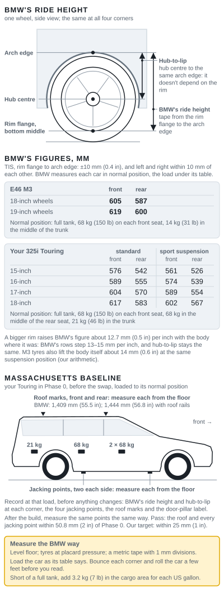 <!-- portrait -->

*Figure 11. BMW's ride height runs from the rim flange, at the bottom middle, to the arch edge, with the car loaded to BMW's normal position; hub-to-lip, from the hub centre, doesn't change with the rim. Record both at every corner in Phase 0, with the jacking points and the roof marks, at your Touring's load: they're your Massachusetts baseline.*

**BMW's figures for your Touring,** from TIS 31 00 and 33 00, at the Touring load, ±10 mm with left and right within 10 mm ([TIS 31 00, Touring](https://workshop-manuals.com/bmw/3_series_e46/325i_m54_tour/3_technical_data/31__front_axle/0__general/1_td__front_axle_ride_height_e46___rear_end/), [TIS 33 00, Touring](https://workshop-manuals.com/bmw/3_series_e46/325i_m54_tour/3_technical_data/33__rear_axle/0__general/2_td__rear_axle_ride_height_e46___rear_end/)). The label on each front strut gives your row: "6Z Serie" for standard suspension, "6Z Sport" for the lowered sports suspension ([TIS 32 00](https://workshop-manuals.com/bmw/3_series_e46/325i_m54_tour/2_repair_instructions/32__steering_and_wheel_alignment/0__electronic_chassis_alignment/11_ra__identification_on_volume_production_suspension_sports_suspension_etc/)):

| Touring wheels | Standard, front / rear | Sports suspension, front / rear |
|---|---|---|
| 15-inch | 576 / 542 mm | 561 / 526 mm |
| 16-inch | 589 / 555 mm | 574 / 539 mm |
| 17-inch | 604 / 570 mm | 589 / 554 mm |
| 18-inch | 617 / 583 mm | 602 / 567 mm |

A 2003 US 325i Touring came on 16-inch wheels as standard and on 17-inch wheels with the Sport Package's sports suspension, so expect 589/555 mm or 589/554 mm (our reading of BMW USA's fitments). BMW also publishes the 325i Touring's overall height: 1,409 mm (55.5 in), or 1,444 mm (56.8 in) with roof rails ([2004 Sports Wagon manual, p.161](https://manualsnet.com/pdf-content/0945ee845d7bf99b78315dcf/html/161.page.html)). Sport suspension sits about 15 mm lower ([BMW ST043](https://archive.org/download/BMWTechnicalTrainingDocuments/ST043%202002%20System%20Diagnosis/8%20E46%20Update.pdf)).

- **Rim size changes BMW's number, not the car.** BMW's figure starts at the rim, so a bigger rim raises it by about 12.7 mm (0.5 in) per inch of rim diameter with the body where it was. Record hub-to-lip too, from the hub center up to the same arch edge: it doesn't depend on the rim. Your Touring's Phase 0 and Phase 12 readings won't compare either way, because the wheels and the arches both change; compare body points measured from the floor instead ([Massachusetts ride-height baseline](#massachusetts-ride-height-baseline)).
- **M3 tires lift the body.** Unloaded tire radii: 205/55R16 316 mm, 225/45R17 317 mm, 225/45R18 330 mm, 255/40R18 331 mm. The M3's 18-inch tires alone raise the body about 14 mm (0.6 in) at the same suspension position (our arithmetic).
- **M3 suspension holds the body lower on the hub.** The M3 coupe and the 330Ci coupe are both 1,372 mm (54.0 in) tall on tires 12–14 mm larger in radius, so the M3's hub-to-body height is about that much less (our inference). Set to M3 heights, your car should stand within about 10 mm of a standard-suspension Touring's roof height, or about 15 mm above a Touring that left the factory with sport suspension (our estimate). Both are well inside Massachusetts' limit of 50.8 mm (2 in).

#### Targets for the mock-up and the bushed joints

**Mock-up targets** ([Phase 6](#phase-6-metalwork-2-rear-arches)) combine the donor's measured heights with BMW's figures; [Measure and mock up before you cut](#measure-and-mock-up-before-you-cut) has the steps:

1. In [Phase 1](#phase-1-buy-and-inspect-the-donor), measure the donor on its own BMW 18- or 19-inch wheels, loaded to the M3's normal position (above, with the fuel allowance if the tank isn't full): BMW's ride height at each corner, plus its hub-to-lip and hub-to-body. On other wheels BMW's figure doesn't apply, so refit M3 wheels to measure.
2. **If it reads BMW's figure ±10 mm,** with left and right within 10 mm, it stands as BMW built it: copy its hub-to-body.
3. **If not** (tired or aftermarket springs, or damage), set each hub so that BMW's ride height, read on your Touring with the M3 wheels fitted, matches BMW's figure. The two cars' arch openings sit at about the same height ([Measure and mock up before you cut](#measure-and-mock-up-before-you-cut)), so that puts your hubs about where an M3's sit.
4. **If your springs or coilovers will set the car higher or lower** than an M3, use your own target, and write it on the worksheet.

Don't load the stripped shell to ride height: it weighs far less than the finished car and rides high. Support the body on stands, take the springs out (or leave coilovers loose), jack each hub to its target, and check full bump and symmetry; at the front, also check the tires at full lock both ways. These positions decide where the [rear arches](#rear-arches-and-doors) are cut and welded. While the axle is in, also note how far each rear hub rises from its target height to full bump. That rise, taken from the hub-to-lip the new lip is marked at, gives the full-bump hub-to-lip that the loaded check in Phase 12 uses.

**Rear bushed joints (Phase 7).** Torque the trailing-arm through-bolts to 110 Nm (81 ft-lb), the control-arm bolts at the subframe to 77 Nm (57 ft-lb), the damper lower bolts to 100 Nm (74 ft-lb) and the anti-roll bar's brackets and links to 22 Nm (16 ft-lb), with each corner at its target hub-to-lip: the height the finished car will sit at in the M3's normal position. Either:

- jack each rear hub until hub-to-lip equals its target, with the body still on its stands; or
- wait until the car is complete on its wheels and loaded to the M3's normal position.

Don't jack until the body starts to lift. Without the engine and gearbox the car is lighter than when finished, so that leaves the suspension a little extended. **Pass:** hub-to-lip within 5 mm of target at each corner as you tighten ([Card 7c](JOB-CARDS.md#card-7c-rear-axle-at-ride-height)).

**Front bushed joints (Phase 12).** Only the anti-roll bar clamp nuts, 21 Nm (15 ft-lb), wait for ride height, with the car on its wheels at the M3 load. The control-arm bracket bolts, new, at 59 Nm (44 ft-lb), are torqued on stands in [Phase 8](#phase-8-fit-the-m3-front-suspension-and-steering).

#### Massachusetts ride-height baseline

Massachusetts bars a car raised or lowered "by more than two inches above or below the original manufacturer's specified height" ([c. 90 §7P](https://malegislature.gov/Laws/GeneralLaws/PartI/TitleXIV/Chapter90/Section7P)) and publishes no way of measuring one. BMW's ride heights for your Touring (above) are the manufacturer's specified height, but they're measured to the arch edge, and the arch lips can't stay the reference: the rear ones are replaced and the front fenders change. So in Phase 0, before anything changes, load the car to BMW's normal position for your Touring (above), set the tires to placard pressure, and record:

- BMW's ride height and hub-to-lip at each corner, against BMW's figure for your suspension; the arch work uses them too;
- the roof height at marked points front and rear, or at the roof-rail tops. BMW publishes 1,409 mm (55.5 in), or 1,444 mm (56.8 in) with rails, for a 325i Touring;
- the height of each of the four jacking points;
- the door-pillar label and the label on each front strut.

After the build, measure the same points the same way, at the same load. **Pass:** the roof and every jacking point within 50.8 mm (2 in) of Phase 0. **Our target:** within 25 mm (1 in), to leave room for load and measuring error. Expect the M3's 18-inch tires alone to add about 14 mm. Keep the readings and BMW's published height in the car's file.

#### After the build: settle, check and align

1. **Settle** the springs with 5–10 miles (8–16 km) of driving, then load the car to the M3's normal position and measure BMW's ride height. **Pass:** BMW's M3 figures in the table above, ±10 mm, or within 10 mm of your own target if you chose one; left and right within 10 mm; the tires clear the lips and inner arches at full lock both ways. Then load it as in Phase 0 and check the Massachusetts baseline above. **Fail:** springs wrong for the axle load, most often at the rear: adjust the perches, change springs, or trim the rear with the pad.
2. **Loaded check** (our recommendation, not a BMW figure). Load the car as you'll use it fully loaded, staying under the door-label ratings (a public scale settles any doubt), and set the fully loaded tire pressures ([Wheels, track and offsets](#wheels-track-and-offsets)). **Pass:** static rear hub-to-lip at least 30 mm above its full-bump figure from Phase 6; no tire contact when you bounce the rear; headlights still aimed in range (xenon cars level themselves). **Fail:** stiffer or longer rear springs, or more rear preload on coilovers.
3. **Align** to BMW's E46 M3 values in [Wheel alignment](#wheel-alignment), after the ride-height check, in BMW's design position: the M3 load, then extra weight near the struts until each corner is within 2 mm of BMW's ride height. BMW aligns M cars only this way and bars the alignment rig's ride-height-input (no-load) mode for them, so tell the shop ([TIS 32 00 150](https://workshop-manuals.com/bmw/3_series_e46/m3_s54_coupe/2_repair_instructions/32__steering_and_wheel_alignment/0__electronic_chassis_alignment/18_ra__kds_chassis_wheel_alignment_check_with_load_up_to_design_position/), [TIS 32 00 155](https://workshop-manuals.com/bmw/3_series_e46/325i_m54_tour/2_repair_instructions/32__steering_and_wheel_alignment/0__electronic_chassis_alignment/20_ra__kds_chassis_wheel_alignment_check_with_ride-height_measurement_without_load/)). If the car sits more than 10 mm below the M3 heights at that load, fix the springs first. A corner that already sits within 2 mm of BMW's figure, or up to 10 mm below it, can't be brought up by weights: have it aligned at the M3 load as it sits (our inference). Every geometry part is M3: knuckles, arms, offset top mounts and trailing arms. Set the toe roughly at home first: Tenza's first setup was undriveable, and the car went to the alignment shop on a trailer ([Tenza – wagon lessons (2021), 03:20](https://www.youtube.com/watch?v=O63Y52j-4PY&t=200s)). The adjustments are limited: front camber moves only about ±0.5°, and caster not at all ([BMW ST056](https://archive.org/download/BMWTechnicalTrainingDocuments/ST056%20Chassis%20Dynamics%20%28Archive%201%29/01%20Suspension%20Systems%20and%20Alignment%20Procedures%201-20-03.pdf)). So a caster reading inside the M3 window is good evidence that the right parts are fitted and the body is straight (our inference).
4. **Then calibrate the steering-angle sensor** ([Session 7](WIRING-AND-CODING.md#session-7-steering-angle-after-the-alignment)) and aim the headlights at ride height.

### Brakes and bleeding

Which DSC unit, booster and master cylinder you run is decided in [DSC, brakes and steering angle](#dsc-brakes-and-steering-angle), which recommends keeping your Touring's MK60, booster and master cylinder. This section covers the brake hardware for that route and for the M3-MK60 alternative, the booster's vacuum, the parking brake, bleeding the brakes, clutch and power steering, and a brake run before the inspection.

**What each DSC route needs:**

| Part | Keeping your Touring's MK60 | Fitting an M3 MK60 (09/2002-on) |
|---|---|---|
| Brake booster | Yours (34336779682) | Yours. The M3's (34332282622) only if the M3 master cylinder doesn't suit yours, which nobody has checked |
| Booster check valve | The M3's (34331161300), in a new grommet (34336765316) | Same |
| Master cylinder | Yours (34336785666, the same part as a 330i's) | The M3's (34317838638) |
| Front brake pipes | Yours; an MK60 M3 uses the same four pipes (34326759218, 34326755801, 34326752405, 34326752407) | Same |
| Front brake hoses | The M3's (34322229723); yours are 34326766966 | The M3's (34322229723) |
| Rear pipes and hoses | Same part numbers on both cars (rear hose 34301165174) | Same |
| Calipers, carriers, rotors, pads, parking-brake shoes | The M3's, with the corners and trailing arms | The M3's |

Sources: ETK for the Touring's [master cylinder](https://bmwfans.info/parts-catalog/E46-Touring/USA/325i-M54/L-N/browse/brakes/brake_master_cylinder_dsc/), [booster](https://bmwfans.info/parts-catalog/E46-Touring/USA/325i-M54/L-N/browse/brakes/power_brake_unit_depression_2/), [front pipes](https://bmwfans.info/parts-catalog/E46-Touring/USA/325i-M54/L-N/browse/brakes/front_brake_pipe_dsc/) and [rear pipes](https://bmwfans.info/parts-catalog/E46-Touring/USA/325i-M54/L-N/browse/brakes/rear_brake_pipe_dsc/), and for the M3's [master cylinder](https://bmwfans.info/parts-catalog/E46-Coupe/USA/M3-S54/L-N/browse/brakes/brake_master_cylinder_dsc/), [booster](https://bmwfans.info/parts-catalog/E46-Coupe/USA/M3-S54/L-N/browse/brakes/power_brake_unit_depression/), [front pipes from 09/2002](https://bmwfans.info/parts-catalog/E46-Coupe/USA/M3-S54/L-N/browse/brakes/front_brake_pipe_dsc_2/) and [rear pipes](https://bmwfans.info/parts-catalog/E46-Coupe/USA/M3-S54/L-N/browse/brakes/rear_brake_pipe_dsc_2/); [BimmerWorld](https://www.bimmerworld.com/Brakes/Master-Cylinders/OEM-Brake-Master-Cylinder-34-33-6-785-666.html) for the 330i master cylinder. An M3 built before 09/2002 has the MK20 and different front pipes, including 34322282275 and 34322282277 ([ETK](https://bmwfans.info/parts-catalog/E46-Coupe/USA/M3-S54/L-N/browse/brakes/front_brake_pipe_dsc/)); you don't need them with an MK60.

On the default route nothing between the master cylinder and the wheels changes except the two front hoses. The DSC unit sits on the left under the master cylinder, and the circuits are split front and rear ([BMW ST056](https://archive.org/download/BMWTechnicalTrainingDocuments/ST056%20Chassis%20Dynamics%20%28Archive%201%29/04%2520E46%2520DSC%25201-27-03.pdf)). BMW's photos suggest the front circuit (pressure sensor "V") leaves the master-cylinder outlet nearest the booster and the rear circuit ("H") the forward one; the left rear brake is fed by the single long pipe 34326752409, the right rear by 34326755704, a union and the crossover 34326766825 (our reading of BMW's photos and ETK's drawing) ([TIS 34 31 505](https://workshop-manuals.com/bmw/3_series_e46/325i_m54_tour/2_repair_instructions/34__brakes/31__master_brake_cylinder/3_ra__removing_and_installing_replacing_brake_master_cylinder_for_dsc_%28mk60%29/), [ETK](https://bmwfans.info/parts-catalog/E46-Touring/USA/325i-M54/L-N/browse/brakes/rear_brake_pipe_dsc/)). Option B opens those joints: label both pipes before you undo anything.

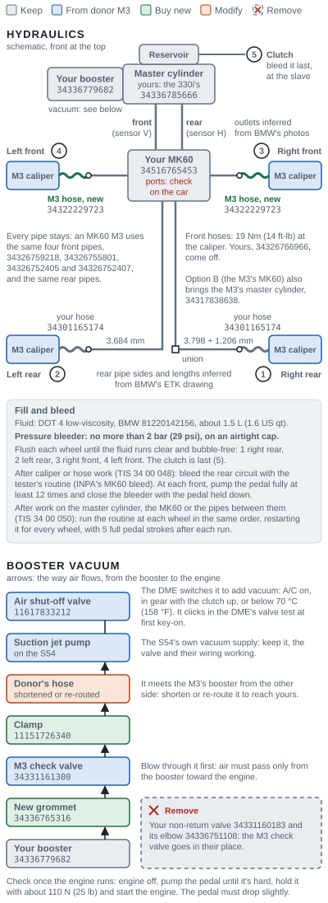 <!-- portrait -->

*Figure 12. Your booster, master cylinder, MK60 and every brake pipe stay; the M3 calipers take new M3 front hoses, and the booster takes the M3's check valve on the S54's shortened hose. Bleed in the numbered order at no more than 2 bar: even after caliper or hose work, BMW bleeds the rear circuit with the tester's routine. Which outlet and rear pipe is which is inferred from BMW's photos and parts drawing, and the MK60's ports need checking on the car.*

**Pedal feel with your master cylinder.** BMW publishes no bore sizes. One forum post gives the 330i's master cylinder as 23.8/22 mm and the M3's as 25/20 mm, with front caliper pistons of 57 mm (330i) and 60 mm (M3) ([e46zone](https://www.e46zone.com/forum/topic/41335-m3-master-cylinder-on-non/), a single post), and BimmerWorld sells your 325i's front caliper kit as 54 mm ([BimmerWorld](https://www.bimmerworld.com/Brakes/Caliper-Parts/Caliper-Rebuild-Kit-E46-323-325-328-Z4-Front.html)). Working from those sizes, the front circuit on your master cylinder needs about 10% more pedal travel than on an M3's to move the M3 pistons, and about 10% less pedal force for the same pressure (our estimate). A tandem master cylinder gives both circuits the same pressure, so the front-to-rear balance comes from the calipers, rotors and pads and from the DSC's electronic brake-force distribution, not from the master cylinder (our inference). Expect a slightly longer, lighter pedal than an M3's, not a dangerous one. M346's 2004 Touring with M3 brakes had a pedal "nice and firm" after a manual bleed and INPA's routine; which master cylinder it ran isn't stated ([M346 Projects – Pt 16 (2024), 09:20](https://www.youtube.com/watch?v=DxMs8VZiXGY&t=560s)).

**Fitting the M3 brakes.** Values are from [Flow pp.23–28](https://drive.google.com/file/d/1GS3Hirx6x0c0WG8hPeXiwfXfeUldkQnm/view?usp=sharing) and [Department 69](https://www.department69.com/articles/bmw-e46-torque-specs-complete-reference-all-engines).

1. The calipers, carriers and rotors come with the M3 corners and trailing arms, rebuilt on the bench in Phase 3. Front caliper carrier, on the M3's M12×1.5×41 bolts: 110 Nm (81 ft-lb). Rear carrier: new micro-encapsulated M10 screws (34203414763), 65 Nm (48 ft-lb). Caliper guide bolts: 30 Nm (22 ft-lb); Department 69 gives 25–30 Nm. Rotor screw: 16 Nm (142 in-lb). Dust-shield screws: 9 Nm (80 in-lb). Bleed screws: 3.5–5 Nm (7 mm) or 12–16 Nm (11 mm).
2. Fit the new M3 front hoses between your pipe ends at the strut brackets and the calipers: 19 Nm (14 ft-lb) at the caliper, and 14 Nm (10 ft-lb) at the pipe union, BMW's figure for the E46-based Z4, since TIS gives no E46 row ([TIS 34 32 1AZ](https://workshop-manuals.com/bmw/3_series_e46/325i_m54_tour/4_tightening_torques/34__brakes/32__brake_lines/1_azd__brake_lines/)). Never twist a hose. At the rear your own hoses, the same part as the M3's, go to the M3 calipers.
3. Fit the pad-wear sensors: the front one at the left front, the rear one at the right rear ([manual](WIRING-AND-CODING.md#wheel-speed-and-pad-wear-sensors)).
4. Check every hose at full lock both ways and at full droop for rubbing or tension before you fill the system.
5. Option B only: if you change the master cylinder, fit new self-locking nuts (07129906196) at 26 Nm (19 ft-lb).

**The booster's vacuum.** The S54 feeds the booster from a suction jet pump, which the DME switches through an air shut-off valve to add vacuum when the A/C is on, when you're in gear with the clutch up, and below 70 °C (158 °F) ([BMW ST055](https://archive.org/download/BMWTechnicalTrainingDocuments/ST055%20Engine%20Electronics%20%28Archive%201%29/8%20MS%20S54.pdf)). On the M3 the hose meets the booster from the other side ([Tenza Motorsports – 5 things they don't tell you, part 1 (2021), 07:40](https://www.youtube.com/watch?v=-TXzg2Z8d7w&t=460s)), so:

1. Fit a new grommet (34336765316) in your booster. It's the same part on both cars ([ETK](https://bmwfans.info/parts-catalog/34336765316/)).
2. Push the donor's check valve (34331161300) into it, in place of your non-return valve and elbow (34331160183, 34336751108). BMW fitted this check valve to your booster part on M52 cars, the 323i Touring included ([ETK](https://bmwfans.info/parts-catalog/34331161300/), [ETK](https://bmwfans.info/parts-catalog/34331160183/)). Blow through it first: air must pass only from the booster toward the engine.
3. With the engine in (Phase 10), connect the donor's hose from the jet pump. Shorten or re-route it to reach, and clamp it with 11151726340. Three builds did the same. Tenza cut the hose and moved its connector (same video). Import Modify cut an S54 hose that was "clearly too long" at its U-bend ([Import Modify – S54 swap, transmission and wiring (2018), 11:04](https://www.youtube.com/watch?v=9ErSBXkH7S0&t=664s)). An M3 converted from MK20 to MK60 had its longer line shortened and crimped onto the MK60's check valve ([NAM3](https://nam3forum.com/forums/forum/main-forum/e46-2001-2006/189096-mk20-mk60-swap)). Keep the jet pump, the air shut-off valve (11617833212) and its DME wiring working: they're the S54's own vacuum supply ([ETK](https://bmwfans.info/parts-catalog/E46-Coupe/USA/M3-S54/L-N/browse/engine/vacuum_control_engine/)).
4. **Check.** At first key-on, the DME's valve test clicks the valve ([manual](WIRING-AND-CODING.md#first-key-on-what-to-expect), step 29). Once the engine runs: engine off, pump the pedal until it's hard, hold it with about 110 N (25 lb), and start the engine. The pedal must drop slightly. That's the inspection's booster test ([540 CMR 4.04(4)(c)2](https://www.law.cornell.edu/regulations/massachusetts/540-CMR-4-04)).

**Parking brake.** The M3 trailing arms carry their own shoe kit (34416761293), springs and adjusting screw inside the rear rotor's drum. Your cables (34411165020/021), lever and switch are the same parts on both cars, so they stay ([ETK](https://bmwfans.info/parts-catalog/E46-Coupe/USA/M3-S54/L-N/browse/brakes/parking_brake_brake_shoes/)). Set it up from scratch:

1. **Free the cables.** Loosen the cable nuts at the lever inside the car, with BMW tool 34 1 030 or with the console out ([E46 workshop manual](https://www.bmwman.ru/en/3er/E46/chassis/brake/regulirovka-stoyanochnogo-tormoza)).
2. **Adjust the shoes before the cables,** on both sides. Take out a wheel bolt and turn the adjuster through its hole, blind: up on the left side, down on the right, until the rotor won't turn. Then back it off 10 notches, as BMW's E46 procedure and BimmerWorld both say ([TIS 34 10 014](https://workshop-manuals.com/bmw/3_series_e46/325i_m54_tour/2_repair_instructions/34__brakes/41__parking_brake/2_ra__adjusting_handbrake/page_1795/), [BimmerWorld](https://www.bimmerworld.com/Brakes/Miscellaneous/BMW-Parking-Brake-Shoe-Adjusting-Screw-E82-E36-E46-E9x-Z3-Z4.html)).
3. **Set the cables.** With the cable nuts hand-tight, pull the lever hard five times, about 400 N (90 lb), with the button pressed. Then pull it to the 2nd tooth and tighten the cable nuts evenly until braking just begins ([TIS 34 10 014](https://workshop-manuals.com/bmw/3_series_e46/325i_m54_tour/2_repair_instructions/34__brakes/41__parking_brake/2_ra__adjusting_handbrake/page_1795/)).
4. **Check:** released, both rear wheels turn freely and the red brake lamp is off; at the 1st tooth, no braking (the lamp may light); at the 2nd tooth, braking starts and the lamp is on. Readjust whenever the lever travels more than 10 teeth (TIS 34 10 014). The lamp checks need the battery connected; if the car is still dead, do them at power-up.
5. **Bed in the shoes.** BMW's own run-in: at about 40 km/h (25 mph), pull the lever until you feel it brake, pull it one more notch and drive about 400 m (440 yd); let it cool and repeat if needed ([TIS 34 10 014](https://workshop-manuals.com/bmw/3_series_e46/325i_m54_tour/2_repair_instructions/34__brakes/41__parking_brake/2_ra__adjusting_handbrake/page_1796/)). BMW's drum limits are 160 mm, runout under 0.1 mm and lining at least 1.5 mm ([TIS 34 41](https://workshop-manuals.com/bmw/3_series_e46/325i_m54_tour/3_technical_data/34__brakes/41__parking_brake/1_td__parking_brake_e46/)). For new shoes or rotors, ECS's procedure for its BMW rotors with built-in drums: using only the parking brake, make 10 light-to-medium stops from about 30 km/h (20 mph) to a near stop, driving about 500 m (550 yd) between stops to let the shoes cool. Then make 10 medium-to-heavy stops the same way, and park without the parking brake until everything is cold ([ECS](https://assets.ecstuning.com/edoc/9343_Parking_Brake_Bed_InR1.pdf)).
6. **Check before the inspection:** in first gear at 1,200–1,300 rpm, the applied parking brake holds the car; and from 32 km/h (20 mph) the parking brake alone stops it within 24.4 m (80 ft), about 0.17 g ([540 CMR 4.04(4)](https://www.law.cornell.edu/regulations/massachusetts/540-CMR-4-04); our arithmetic).

> [!CAUTION]
> Your brake lights don't come on when you slow down with the parking brake. Bed the shoes in, and test the parking-brake stop, on an empty road.

**Bleeding the brakes.**

1. **Fluid:** DOT 4 low-viscosity, BMW 81220142156. BMW's bleeding instructions say every DSC car without a pre-charge pump "must be filled with the new DOT4 low-viscosity brake fluid" ([BMW TIS, 2005 issue](https://5series.net/forums/attachments/diy-do-yourself-14/5580-brake-fluid-flush-ra__bleeding_brake_system_with_dsc.pdf), unverified), and the MK60 has no pre-charge pump ([BMW ST056](https://archive.org/download/BMWTechnicalTrainingDocuments/ST056%20Chassis%20Dynamics%20%28Archive%201%29/04%2520E46%2520DSC%25201-27-03.pdf)). BimmerWorld agrees: cars with DSC take the low-viscosity type ([BimmerWorld](https://www.bimmerworld.com/Brakes/Genuine-BMW-DOT4-ESL-Low-Viscosity-Brake-Fluid-81220142156.html), [brake fluid types](https://www.bimmerworld.com/BMW-Brake-Fluid-Types/)). Have about 1.5 L (1.6 US qt) on hand: one INPA bleed of an MK60 used about 1.25 L, on a Z4 M ([z4-forum](https://z4-forum.com/threads/bleed-the-abs-dsc-system-using-inpa.146558/)).
2. **Pressure bleeder: no more than 2 bar (29 psi).** BMW's E46 procedure: "Charging pressure should not exceed 2 bar" ([TIS 34 00 050](https://workshop-manuals.com/bmw/3_series_e46/325i_m54_tour/2_repair_instructions/34__brakes/0__brake_testing_and_bleeding/10_ra__bleeding_brake_system_with_dsc3/)). The bleeder needs an airtight reservoir cap ([50sKid – pressure bleeding (2015), description](https://www.youtube.com/watch?v=_LLJXUbQkdA)).
3. **Flush each wheel** in turn, right rear, left rear, right front, left front, until the fluid runs clear and bubble-free (TIS 34 00 050; [NAM3](https://nam3forum.com/forums/forum/main-forum/e46-2001-2006/189096-mk20-mk60-swap)).
4. **Then bleed BMW's way for the work you did.**
   - **Calipers and hoses only,** with the master cylinder and DSC unit kept full (the default route): BMW bleeds the rear circuit with its tester's routine, and the front by pumping the pedal fully at least 12 times per side, then holding it down while you close the bleed screw, right front then left front ([TIS 34 00 048](https://workshop-manuals.com/bmw/3_series_e46/325i_m54_tour/2_repair_instructions/34__brakes/0__brake_testing_and_bleeding/9_ra__bleeding_brake_system_with_abs_asc-t/page_1741/)). INPA's MK60 routine is the tester at home, so the rear-circuit routine waits until INPA can talk to the DSC (Phase 11; [manual](WIRING-AND-CODING.md#session-5-dsc-coding-and-vin)).
   - **The master cylinder, the DSC unit or the pipes between them opened, or the unit ran dry:** run the routine at every wheel in turn, right rear, left rear, right front, left front, each with its bleed screw open. Restart the routine for every wheel, and after each run press the pedal to the floor five times: the fluid must come out clear and bubble-free ([TIS 34 00 050](https://workshop-manuals.com/bmw/3_series_e46/325i_m54_tour/2_repair_instructions/34__brakes/0__brake_testing_and_bleeding/10_ra__bleeding_brake_system_with_dsc3/page_1743/)). This too waits for Phase 11.
   - Then bleed the clutch (below).
5. Set the level to MAX, and check the rubber seal in the cap (TIS 34 00 050).
6. **Prove it without air.** Don't blow air through the filled system: air that reaches the DSC unit makes the routine at every wheel necessary. Instead:
   - Press the pedal with about 560 N (125 lb) for 10 s. It must hold its height, with at least 20% of its travel left: the inspection's test ([540 CMR 4.04(4)(c)1](https://www.law.cornell.edu/regulations/massachusetts/540-CMR-4-04)).
   - Wedge the pedal down hard overnight with a length of wood against the seat, and check every union for weeps in the morning ([NAM3](https://nam3forum.com/forums/forum/main-forum/e46-2001-2006/189096-mk20-mk60-swap)).
   - Once INPA talks to the DSC (Phase 11): both brake-pressure readings in its DSC status are under 5 bar (73 psi) with the pedal released ([BMW ST056](https://archive.org/download/BMWTechnicalTrainingDocuments/ST056%20Chassis%20Dynamics%20%28Archive%201%29/04%2520E46%2520DSC%25201-27-03.pdf)) and rise together when you press it (our suggested check). Then BMW's leak test, engine off: pump the pedal about 10 times to empty the booster, then press until INPA reads about 36 bar, roughly 500 N (110 lb) on the pedal, and hold it there. In 2 minutes the reading may fall no more than 8%, to about 33 bar. With the engine running, about 200 N (45 lb) on the pedal should give 75–90 bar ([TIS 34 00](https://workshop-manuals.com/bmw/3_series_e46/325i_m54_tour/3_technical_data/34__brakes/0__brake_testing_and_bleeding/1_td__testing_and_bleeding_brakes_e46/)).
   - The red brake lamp is off with the parking brake released.

   Air-test only new, dry hard lines, before they're filled: on one MK20-to-MK60 conversion the new lines held 1.4 bar (20 psi), losing about 0.03 bar (0.4 psi) in 22 hours (same NAM3 thread).
7. Drive only with a firm pedal. ABS works above 12 km/h (7 mph) (BMW ST056): check it with a careful hard stop on a quiet road, and bleed again after the first few drives ([NAM3](https://nam3forum.com/forums/forum/main-forum/e46-2001-2006/189096-mk20-mk60-swap)).

**Bleeding the clutch.** E46 clutches are notoriously hard to bleed after a dry install.

1. Bleed it after the brakes, at the slave cylinder's bleed screw, ideally with the pressure bleeder still connected. Keep the reservoir topped up.
2. If the pedal stays soft, take the slave off the gearbox with its line attached. Hold it with the bleed screw at its highest point, open the screw, push the piston in by hand, close the screw, release the piston, and repeat about ten times ([M3Post](https://www.m3post.com/forums/showthread.php?p=9017245), car not stated, unverified). Refit the slave at 22 Nm ([Flow p.70](https://drive.google.com/file/d/1GS3Hirx6x0c0WG8hPeXiwfXfeUldkQnm/view?usp=sharing)).
3. Turner sells an E46 slave-cylinder bleeder tool that holds the piston compressed while you bleed ([listing via ECS](https://www.ecstuning.com/b-turner-motorsport-parts/clutch-slave-cylinder-bleeder-tool/056958la01~a/), unverified). BMW's procedure is in TIS group 21 52.

**Power steering.** Use ATF (Dexron III type), not Pentosin CHF 11S, and don't mix the two. BMW's catalog fits the same reservoir (32416851217) to both cars and pairs it with a label, 71246798132, whose own catalog page gives the fluid as "ATF" ([ETK: reservoir](https://bmwfans.info/parts-catalog/E46-Coupe/USA/M3-S54/L-N/browse/steering/oil_carrier_single_parts/), [ETK: label](https://bmwfans.info/parts-catalog/71246798132/)). FCP Euro says BMW filled its cars without active steering or hydraulic suspension with ATF Dexron III until the N-engine generation, that mixing in CHF 11S shortens an older system's life, and that a replacement cap now says CHF 11S whatever the car ([FCP Euro](https://www.fcpeuro.com/blog/heres-how-to-pick-the-right-power-steering-fluid-for-your-car-)). BimmerWorld lists CHF 11S for no E46 model ([BimmerWorld](https://www.bimmerworld.com/Suspension-Steering/Pentosin-CHF11S-Hydraulic-Fluid-BMW-82111468041.html)). M346's 2004 Touring with an M3 pump took ATF ([M346 Projects – Pt 13 first start (2024), 08:00](https://www.youtube.com/watch?v=4Q3PxGuJyxI&t=480s)). If the donor's reservoir holds green fluid, someone has converted it: flush the whole system to one fluid. No capacity was found; fill to the mark.

Fill the reservoir before the first start: M346's pump rattled dry until the ATF went in (same video). Then bleed it as BMW describes ([TIS 32 13 006](https://www.princeton.edu/~sdepasqu/bmw/steering/Bleeding.power.steering.unit.pdf); the printout doesn't name a model, so check the E46 version in TIS):

1. With the engine off, fill the reservoir to about 25 mm (1 in) below its edge.
2. Start the engine and top up the rest, pouring evenly.
3. Turn the steering wheel to full lock each way, twice. Don't hold it at full lock: the M3 rack has no hydraulic end stops, so the pump runs at its 120 bar limit there ([BMW ST041](https://archive.org/download/BMWTechnicalTrainingDocuments/ST041%20M3%20Complete%20Vehicle/4%20RunningGear_djvu.txt); our inference).
4. Switch off, check the level against the mark on the lid, and top up.
5. **Check:** no foaming or groaning after a short run; no weeps at the hollow bolts or the rack banjo; the level steady after a drive.

If the lines have been in storage, check them for kinks; Tracks and Trails found one and replaced it ([Tracks and Trails – first drive (2026), 1:05:20](https://www.youtube.com/watch?v=pvR3ovRfQHg&t=3920s)).

**Before the inspection: a brake run.** Massachusetts tests more than the 9.1 m (30 ft) stop ([540 CMR 4.04(4)](https://www.law.cornell.edu/regulations/massachusetts/540-CMR-4-04)). Run the same tests yourself, on an empty road, with a helper and a tape measure:

| Test | Pass |
|---|---|
| Light stops at 6–13 km/h (4–8 mph) | No pull to either side |
| Service brake from 32 km/h (20 mph) by GPS, about 22 mph on the M3 cluster | Stops within 9.1 m (30 ft) of where the brake goes on. That needs about 0.45 g; with M3 brakes expect roughly 4.5–5 m (15–17 ft) (our arithmetic) |
| Parking brake applied, first gear, 1,200–1,300 rpm | The car doesn't move |
| Parking brake alone from 32 km/h (20 mph) | Stops within 24.4 m (80 ft), about 0.17 g |
| Stopped, about 560 N (125 lb) on the pedal for 10 s | The pedal holds, with at least 20% of its travel left |
| Engine off, pedal pumped hard and held at about 110 N (25 lb), engine started | The pedal drops slightly |
| Lines and hoses | No leaks, chafing, cracking or swelling; all fastened |
| Lamps | Red brake, yellow brake, ABS and DSC lamps all out |

BMW's red brake lamp means low fluid or the parking brake on; ABS and DSC faults light the yellow brake lamp and the ABS and DSC lamps ([BMW ST056](https://archive.org/download/BMWTechnicalTrainingDocuments/ST056%20Chassis%20Dynamics%20%28Archive%201%29/04%2520E46%2520DSC%25201-27-03.pdf)). Massachusetts rejects a lit "brake failure warning light", so get them all dark ([Massachusetts](#massachusetts)).

### Fuel system

The S54 uses a 5-bar regulator built into the fuel-filter assembly under the left front floor. It is referenced to engine vacuum "via a hose connected to the external air distribution pipe", the idle-air rail that feeds the throttle bodies ([BMW S54 module](https://www.billswebspace.com/MS54B32TrainingModule.pdf)). Your M54 runs at 3.5 bar from a one-piece filter-regulator whose hose is an atmospheric vent, not a vacuum reference ([e46fanatics](https://www.e46fanatics.com/threads/ms45-1-m54b30-330i-fuel-pressure.1048644/)). This plan assumes an M54 Touring with a plastic tank and a return line. A US 325i with the M56 SULEV engine has a metal tank, no return line and a pump control unit, so the plan doesn't apply as written ([ETK: control unit](https://bmwfans.info/parts-catalog/16146912019/), [tank](https://bmwfans.info/parts-catalog/E46-Touring/USA/325i-M56/L-N/browse/fuel_supply/fuel_tank_mounting_parts/), [lines](https://bmwfans.info/parts-catalog/E46-Touring/USA/325i-M56/L-N/browse/fuel_supply/fuel_pipe_and_scavenging_line/)); confirm your engine code in [Phase 0](#phase-0-paperwork-and-baseline).

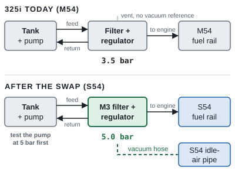 <!-- portrait -->

*Figure 13. The donor's in-tank set moves into your tank; the M3 pipe set, lines and filter-regulator take it to 5 bar, with a vacuum hose to the idle-air pipe. Test at the regulator's threaded fitting (TP1): the S54's rail has no port. Keeping your own pump is only the fallback.*

**In short:** move the donor's whole in-tank set into your tank, then fit the M3 pipe set, the three M3 lines, the M3 filter-regulator and the M3 front purge line. Keep your tank mounts, filler parts, canister and leak-test pump, and prove the system at 5 bar before the rear axle goes in.

**Build date doesn't matter here.** ETK lists the same fuel, line and EVAP parts for Tourings built in February and March 2003, so the MS43-to-MS45.1 change at 03/2003 doesn't touch this work. May 2005 Tourings list the same pump, tank, line and filter parts. The one 03/2003 change near the fuel system is the filler-flap actuator, and that stays with your body. US M3 lists match from 2003 to 2006, coupe and convertible alike ([ETK: Touring, Feb 2003](https://bmwfans.info/parts-catalog/E46-Touring/USA/325i-M54/L-N/feb2003/browse/fuel_supply/fuel_pump_and_fuel_level_sensor/), [Mar 2003](https://bmwfans.info/parts-catalog/E46-Touring/USA/325i-M54/L-N/mar2003/browse/fuel_supply/fuel_pump_and_fuel_level_sensor/), [M3](https://bmwfans.info/parts-catalog/E46-Coupe/USA/M3-S54/L-N/browse/fuel_supply/fuel_pump_and_fuel_level_sensor/)).

#### Choose the pump route

Either car's delivery unit fits either tank, as the builds below show; ETK explains why, since both use the same flange seal (16111184084), lock ring (16116762417) and plug housing (61138352390) ([ETK: Touring](https://bmwfans.info/parts-catalog/E46-Touring/USA/325i-M54/L-N/feb2003/browse/fuel_supply/fuel_pump_and_fuel_level_sensor/), [M3](https://bmwfans.info/parts-catalog/E46-Coupe/USA/M3-S54/L-N/browse/fuel_supply/fuel_pump_and_fuel_level_sensor/)). BMW pairs the M3 unit with a baffle and its own jet pump: "The baffling has been modified for the E46 M3 fuel pump pickup in the right hand side of the fuel tank to maintain fuel supply during aggressive cornering", and "A Syphon jet is required… linked to the fuel return line" ([BMW ST041 Part 2, p.24](https://archive.org/download/BMWTechnicalTrainingDocuments/ST041%20M3%20Complete%20Vehicle/3%20EngineElectronics%20%28Part%202%29.pdf)).

| Route | In your tank | Pipe set and lines | Use it when |
|---|---|---|---|
| **A. The donor's in-tank set (recommended)** | M3 delivery unit 16142229684 (pump and right sender), baffle 16112229656, jet pump 16142282208 and left sender 16142229683 | M3 pipe set 16112283288 and the three M3 lines | By default. It's BMW's own pump, baffle, jet pump and sender combination, it arrives with the donor, and it mates with the M3 pipe set with no adapter |
| **B. The donor's whole tank** | Donor tank 16112229736 with its set | The same | The donor's tank is clean inside and its vent nipples are intact. Every mounting and filler part is the same number as yours ([ETK](https://bmwfans.info/parts-catalog/E46-Coupe/USA/M3-S54/L-N/browse/fuel_supply/fuel_tank_attaching_parts/)) |
| **C. Your own pump (fallback)** | Your delivery unit, jet pump and left sender; no baffle | Your pipe set 16117175998 with an adapter to the M3 rear feed line, or your rear feed line with an adapter at the M3 filter's inlet. Neither joint is documented | Only if your pump delivers 1.3 L or more in 30 s at 5 bar (our margin, test T3 below) and you accept one undocumented joint |

Keeping your own pump saves no parts and adds a joint nobody has documented (our inference). Every documented Touring build fitted either the M3 tank or the M3 pump in its own tank, most of them with M3 lines; none kept a 325i pump:

- Kalim moved the M3 pump, baffle, transfer pipe and left sender into a 2003 325i sedan's tank, the same part as yours: "remove the old transfer pipe and install the M3 one into the baffle" ([e46fanatics](https://www.e46fanatics.com/threads/kalims-s54-sedan-swap-warning-pic-heavy.889867/), [ETK](https://bmwfans.info/parts-catalog/16116766940/)). Of two other owners, one says the M3 unit needs a sleeve in a non-M tank, and another found the M3 pump body smaller in diameter ([e46fanatics](https://www.e46fanatics.com/threads/will-an-m3-fuel-pump-fit-a-non-m-is-there-any-point-in-doing-this.903381/), [page 2](https://www.e46fanatics.com/threads/will-an-m3-fuel-pump-fit-a-non-m-is-there-any-point-in-doing-this.903381/page-2)). Both tanks take the same pump-flange seal (16111184084), O-ring and screw cap (16116762417), so the opening is the same; the "sleeve" is most likely the M3's own baffle, which sits under the pump ([ETK](https://bmwfans.info/parts-catalog/E46-Coupe/USA/M3-S54/L-N/browse/fuel_supply/fuel_pump_and_fuel_level_sensor/), [BimmerWorld](https://www.bimmerworld.com/Intake-Fuel/Fuel-Filters/Genuine-BMW-Fuel-Baffle-Fixture-16112229656-E46-E46-M3.html)). Fit the pump and baffle together. When you move the M3 jet pump and left sender, check that the transfer hose is latched: one M3 stalled with 9 L still in the left half when that hose came off at the left sender ([NAM3 (2024)](https://nam3forum.com/forums/forum/main-forum/e46-2001-2006/260666-fuel-system)).
- Project BMW swapped both in-tank units of a 325i Touring through the two access openings, with the tank lowered ([Project BMW – Day 5 (2021), 03:20](https://www.youtube.com/watch?v=t9S0iXJj2GI&t=200s)). Tracks and Trails put a new M3 pump in his Touring's tank: "Plug at the back. Easy peasy" ([Tracks and Trails – Touring rear end (2025), 27:20](https://www.youtube.com/watch?v=eMJLXbvzckE&t=1640s)).
- ThaChileanDude, yavz on a UK 318i Touring and M3Projekts on a US 2003 325iT fitted the M3 tank ([ThaChileanDude – Building an e46 m3 Wagon in 10 days (2024), 17:00](https://www.youtube.com/watch?v=iSgClonTiQg&t=1020s), [PistonHeads](https://www.pistonheads.com/gassing/topic.asp?h=0&f=47&t=1655205&i=20), [NAM3](https://nam3forum.com/forums/forum/main-forum/member-build-journals/155763-e46-m3-touring-conversion-to-europe-and-back/page10)). Tenza fitted one in place of an M56 SULEV car's sealed tank, which is a fit check rather than a method to copy ([Tenza – No more SULEV (2021), 00:20](https://www.youtube.com/watch?v=PgW1oWs7cfk&t=20s), [Registration and legal](#registration-and-legal-us)).

**Why the margin is thin.** The delivery floor for every E46 engine is at least 1.12 L (1.2 US qt) in 30 s at 12 V, about 134 L/h (35 US gal/h) ([Bentley, quoted on e46fanatics](https://www.e46fanatics.com/threads/fuel-pressure-info.1116777/)); a trade magazine gives the same E46 figure as 2.25 L a minute ([the bimmer pub, March 2013](https://automotivetechinfo.com/wp-content/uploads/2013/03/the-bimmer-pub-2013-march.pdf)). Whatever the engine doesn't burn returns to the tank and drives the jet pump that moves fuel from the left half to the pump's side ([BMW ST055](https://ia801005.us.archive.org/11/items/BMWTechnicalTrainingDocuments/ST055%20Engine%20Electronics%20%28Archive%201%29/8%20MS%20S54.pdf)). Our estimate for a pump that only just meets the floor:

| Engine | Power | Fuel used at full power | Return flow left |
|---|---|---|---|
| S54 (US M3) | 333 hp (248 kW) | 90–100 L/h (24–26 US gal/h) | 34–44 L/h (9–12 US gal/h) |
| M54B25 (your 325i) | 184 hp (137 kW) | 50–55 L/h (13–15 US gal/h) | 79–84 L/h (21–22 US gal/h) |

These are our estimates, not BMW figures: they assume 0.27–0.30 kg of fuel per kWh at full load and 0.745 kg/L, with power from BMW ([BMW ST041](https://archive.org/download/BMWTechnicalTrainingDocuments/ST041%20M3%20Complete%20Vehicle/1%20M3%20Complete%20Vehicle.pdf)) and BMW USA's 2003 sheet ([BMW USA](https://www.press.bmwgroup.com/usa/article/attachment/T0022146EN_US/41437)). We found no factory flow rating for either pump. On those numbers the S54 at full power leaves the jet pump roughly half the flow an M54 leaves it with the same pump. A turbine pump also flows less at 5 bar than at 3.5 bar, so a Touring pump that met the floor on your M54 may not at 5 bar (our inference). That fits BMW's "high output fuel pump… to match the fuel supply demands of the S54 engine (5 Bar)" (ST041 Part 2, p.33), and one 330i that starved near a quarter tank under hard driving until its owner fitted the M3 pump ([e46fanatics](https://www.e46fanatics.com/threads/will-an-m3-fuel-pump-fit-a-non-m-is-there-any-point-in-doing-this.903381/)).

**Handling the tank.**

- In Phase 7 the tank is out, so do the in-tank work on the bench. In the car, BMW's access plates are under the rear seat: the passenger side reaches the pump and its sender, the driver side the left sender and the jet pump ([BMW ST041 Part 2, p.40](https://archive.org/download/BMWTechnicalTrainingDocuments/ST041%20M3%20Complete%20Vehicle/3%20EngineElectronics%20%28Part%202%29.pdf)).
- Don't drop or carry a tank by its vent hoses: Tenza snapped both plastic vent nipples on an M3 tank, and they aren't sold separately ([Tenza – M3 rear end (2021), 06:40](https://www.youtube.com/watch?v=GdCUQY-Xn-s&t=400s)).
- The straps don't change. ETK gives both tanks the same straps (16116756583), bolts (07119905532) and nut (07146760121) ([ETK: Touring](https://bmwfans.info/parts-catalog/E46-Touring/USA/325i-M54/L-N/feb2003/browse/fuel_supply/fuel_tank_attaching_parts/), [M3](https://bmwfans.info/parts-catalog/E46-Coupe/USA/M3-S54/L-N/browse/fuel_supply/fuel_tank_attaching_parts/)). The double-width strap bracket Redish describes belongs to the non-M convertible's V-brace pick-up, not to the tank ([Redish – Touring build part 1 (2022), 08:00](https://www.youtube.com/watch?v=lf-52XqXSTk&t=480s)), and a 2003 car has the later brackets anyway.
- Your tank is 16116766940 in today's catalog. A 2003 car most likely left the factory with 16111184899 or 16116762962, both superseded by it (our inference from ETK's date ranges), so read the label rather than trusting a number ([ETK](https://bmwfans.info/parts-catalog/16116766940/)).

#### Fuel parts by car

"Same" means the same part number on the US 325i Touring (M54) and the US M3 (S54). The Touring column is today's catalog, from the February 2003 lists.

| Item | Your 325i Touring | Donor US M3 | What to do |
|---|---|---|---|
| Tank, plastic | 16116766940 | 16112229736 | Keep yours (routes A and C), or fit the donor's (B) |
| Delivery unit (pump and right sender) | 16146766942 | 16142229684 | M3 (A, B) |
| Left sender | 16116768788 | 16142229683 | M3, so the cluster reads BMW's M3 pair |
| Jet pump (transfer pipe) | 16146755880 | 16142282208 | M3, into the baffle |
| Baffle | None | 16112229656 | M3, under the pump in the right half |
| Flange seals, O-ring, lock rings, plug housing | 16111184084 ×2, 16141183543, 16116762417 ×2, 61138352390 | Same | New seals and O-ring |
| Straps, bolts, nut, filler pipe, filler hose, vent pipe | 16116756583, 07119905532, 07146760121, 16117177490, 16117176011, 16117176511 | Same | Keep; new hose clamps |
| Fuel pipes set (pump to floor lines) | 16117175998, clamped at both ends | 16112283288, push-on at the pump, quick-connector to the rear feed | M3 (A, B); yours with an adapter (C) |
| Rear feed, return, front feed | 16126752180, 16126752186, 16126752183 | 16122229409, 16122229411, 16122229410 | M3 |
| Line clips and brackets | 16126761229 ×2, 16127195327 ×2, 34301164005, 16121179396 ×2, 16131184380 | Same; the M3 adds tubing supports 16122282049 and 16131177494 | Keep yours; add the two supports |
| Filter-regulator | One piece, 13327512019 (3.5 bar) | Filter 13327831089; housing 13537830368 with copper ring 07119963129; regulator 13531404089 (5.0 bar) with O-rings 13531720251, 13531720252 and lock ring 13531736234 | M3: a new filter on the donor's housing and regulator, with a new copper ring, O-rings and lock ring |
| Filter bracket and cover | 13321435583; 13328230397 | Same; the M3 adds sealing element 13327830949 | Keep; add the M3 sealing element |
| Regulator line | Vent pipe 13327561060, hose 11727545323 | Vacuum hoses 11747797082 (blue), 64111368684 (white) and 11727837591; metal sleeve 12517508831; cable tie 61131367599; clamps 61131365412 ×4 | M3 set |
| Engine end | M54 inlet hose 13537548987; purge valve 13901433603 | Feed pipe 13317831683 with O-ring 13641730767 at the rail; purge valve 13907831770 with hoses 13907837661 and 13907837663 | Come with the S54; new O-ring |
| Front purge line (floor) | 16111184135 | 16132229652 | M3 |
| Rear purge line (to the canister) | 16136751175 | 16132229417 | Yours with the Touring floor; the M3's with the M3 floor, or if the M3 front line won't mate with yours |
| Canister | 16136751759 or 16136765440 (later 16136765271 with dust filter 16136765272) | 16136751759 or 16131183906 | Keep yours |
| Leak-test pump (DM-TL), heated, 4 pins | 16137193479 | Same | Keep |
| Liquid-vapour separator and its bracket | 16136752641; 41148196386 | Same | Keep; out before the arch work, refitted after |
| Canister vent pipes | 16137176508, 16131183895 | 16132283286, 16132229415 | Yours with the Touring floor; the M3's with the M3 floor |
| Canister holder | None (plastic nuts 51711958025) | 16132229735 with nuts 07147153450 ×4 | M3 floor only |
| Canister underbody covers | 51718233265 (front), 51718233266 (bottom) | 51717893604 (front) | Match the floor |
| Filler pot, pipe seal, cap pin | 51718208646, 16116755071, 16111184156 | Same | Keep yours |
| Filler flap and hinge | 51178208246, 51178151955 | 51172695524; hinge 51172695527 (coupe) or 51178151955 (convertible) | The donor's flap; a coupe donor's hinge with its surround |
| Filler-flap actuator | 67116988090 to 03/2003, 67116987637 from 03/2003 | The same split | Keep yours |

Sources: ETK for the Touring, February 2003 build ([pump](https://bmwfans.info/parts-catalog/E46-Touring/USA/325i-M54/L-N/feb2003/browse/fuel_supply/fuel_pump_and_fuel_level_sensor/), [tank](https://bmwfans.info/parts-catalog/E46-Touring/USA/325i-M54/L-N/feb2003/browse/fuel_supply/fuel_tank_attaching_parts/), [lines](https://bmwfans.info/parts-catalog/E46-Touring/USA/325i-M54/L-N/feb2003/browse/fuel_supply/fuel_pipe_and_mounting_parts/), [filter-regulator](https://bmwfans.info/parts-catalog/E46-Touring/USA/325i-M54/L-N/feb2003/browse/fuel_preparation_system/fuel_filter_pressure_regulator/), [EVAP](https://bmwfans.info/parts-catalog/E46-Touring/USA/325i-M54/L-N/feb2003/browse/fuel_supply/exp_tank_activated_carbon_container/), [covers](https://bmwfans.info/parts-catalog/E46-Touring/USA/325i-M54/L-N/feb2003/browse/vehicle_trim/underfloor_coating/), [filler](https://bmwfans.info/parts-catalog/E46-Touring/USA/325i-M54/L-N/feb2003/browse/bodywork/side_panel_tail_trim/)), and for the US M3 ([pump](https://bmwfans.info/parts-catalog/E46-Coupe/USA/M3-S54/L-N/browse/fuel_supply/fuel_pump_and_fuel_level_sensor/), [tank](https://bmwfans.info/parts-catalog/E46-Coupe/USA/M3-S54/L-N/browse/fuel_supply/fuel_tank_attaching_parts/), [lines](https://bmwfans.info/parts-catalog/E46-Coupe/USA/M3-S54/L-N/browse/fuel_supply/fuel_pipe_and_mounting_parts/), [filter-regulator](https://bmwfans.info/parts-catalog/E46-Coupe/USA/M3-S54/L-N/browse/fuel_preparation_system/fuel_filter_pressure_regulator/), [EVAP](https://bmwfans.info/parts-catalog/E46-Coupe/USA/M3-S54/L-N/browse/fuel_supply/exp_tank_activated_carbon_container/), [cover](https://bmwfans.info/parts-catalog/E46-Coupe/USA/M3-S54/L-N/browse/vehicle_trim/underfloor_coating/), [filler: coupe](https://bmwfans.info/parts-catalog/E46-Coupe/USA/M3-S54/L-N/browse/bodywork/side_panel_tail_trim/), [convertible](https://bmwfans.info/parts-catalog/E46-Cabrio/USA/M3-S54/L-N/browse/bodywork/side_panel_tail_trim/), [engine feed pipe](https://bmwfans.info/parts-catalog/E46-Coupe/USA/M3-S54/L-N/browse/fuel_preparation_system/valves_pipes_of_fuel_injection_system/), [purge valve](https://bmwfans.info/parts-catalog/E46-Coupe/USA/M3-S54/L-N/browse/fuel_preparation_system/fuel_tank_breather_valve/)).

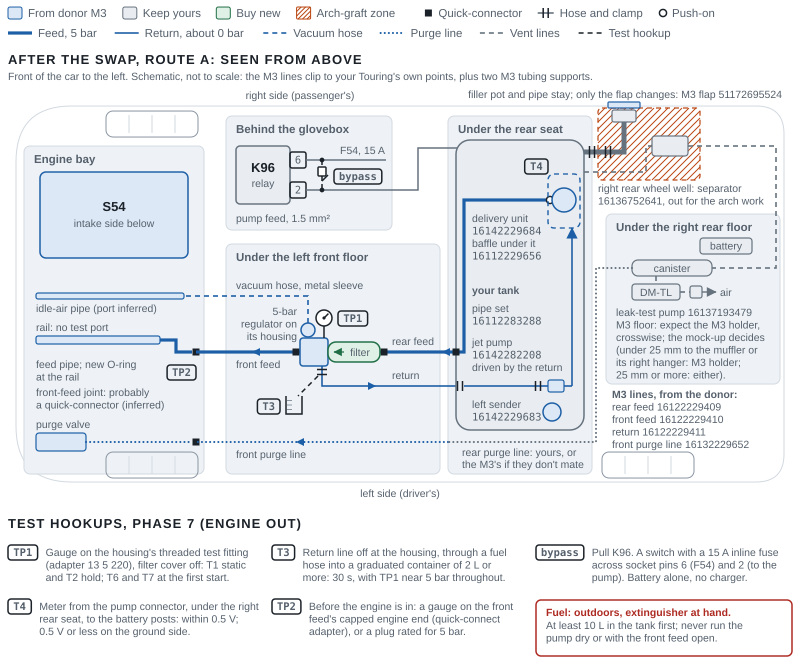

*Figure 14. Where the fuel parts sit after the swap (route A), seen from above with the front of the car to the left. Your tank stays under the rear seat with the donor's in-tank set inside it, and the M3 pipe set and lines run along the left floor to the M3 filter-regulator, a new filter on the donor's housing and regulator: along the floor every feed joint is a quick-connector and the return is hose and clamps. Test at TP1 on the regulator housing, since the rail has no port, and take the vapour separator out of the right rear wheel well before the arch work.*

#### Filter-regulator and vacuum reference

**Filter-regulator.** Fit a new M3 filter (13327831089) with the donor's regulator housing (13537830368) and regulator (13531404089) in place of the 325i's one-piece unit (13327512019). Both use the same bracket (13321435583) and filter cover (13328230397); the M3 adds a sealing element (13327830949) at the cover ([ETK: M3](https://bmwfans.info/parts-catalog/E46-Coupe/USA/M3-S54/L-N/browse/fuel_preparation_system/fuel_filter_pressure_regulator/), [Touring](https://bmwfans.info/parts-catalog/E46-Touring/USA/325i-M54/L-N/browse/fuel_preparation_system/fuel_filter_pressure_regulator/)). The donor's test in [Phase 1](#phase-1-buy-and-inspect-the-donor) proves its regulator: 5.0 ± 0.2 bar, then 20 minutes later no more than 0.5 bar lost and still 4.5 bar or more, as in test T2 below. Buy a new regulator only if the donor couldn't be tested, or if test T2 below traces a bleed-down to the regulator.

1. Fit a new filter with its flow arrow toward the engine. The rear feed line clicks onto its rear inlet.
2. Fit the donor's housing on the filter's front end with a new copper ring (07119963129). BMW's fuel module says sealing rings in the fuel system are always replaced "with new COPPER rings only" ([BMW ST055](https://archive.org/download/BMWTechnicalTrainingDocuments/ST055%20Engine%20Electronics/04_Fuel%20Management.pdf)). The housing carries the regulator, the front-feed outlet, the return outlet and the threaded test fitting, TP1 ([BMW ST041 Part 2, pp.25, 46](https://archive.org/download/BMWTechnicalTrainingDocuments/ST041%20M3%20Complete%20Vehicle/3%20EngineElectronics%20%28Part%202%29.pdf)).
3. Fit the donor's regulator with new O-rings (13531720251, 13531720252) and a new lock ring (13531736234). M346's regulator leaked at the first start on bad O-rings and was replaced ([M346 Projects – pt 13 (2024), 05:40](https://www.youtube.com/watch?v=4Q3PxGuJyxI&t=340s)).
4. Refit the cover with the M3 sealing element once the tests are done.

Fit all of this before the first start; Tracks and Trails fitted it only after the car cranked and wouldn't start ([Tracks and Trails – first drive (2026), 1:14:00](https://www.youtube.com/watch?v=pvR3ovRfQHg&t=4440s)).

**Vacuum reference.** Your M54's regulator line is a vent. BMW's E46 training says the non-M line "no longer connects to intake manifold vacuum, but is routed to the crankcase cyclone separator (in case of regulator diaphragm leakage)" ([BMW ST034, p.32](https://archive.org/download/BMWTechnicalTrainingDocuments/ST034%20E46%20Complete%20Vehicle/10%20p1%20Engine%20Management%20Sys%20Internet-1.pdf)); that's written for the M52TU, whose regulator design the M54 carries over (our inference). The S54's regulator is "influenced by engine vacuum via a hose connected to the idle air distribution pipe" ([BMW ST041 Part 2, p.25](https://archive.org/download/BMWTechnicalTrainingDocuments/ST041%20M3%20Complete%20Vehicle/3%20EngineElectronics%20%28Part%202%29.pdf)). Fit the donor's set: blue hose 11747797082, white hose 64111368684 and hose 11727837591, the corrugated metal sleeve 12517508831, cable tie 61131367599 and four clamps 61131365412 ([ETK](https://bmwfans.info/parts-catalog/E46-Coupe/USA/M3-S54/L-N/browse/fuel_preparation_system/fuel_filter_pressure_regulator/)). Route it forward from the regulator's nipple along the feed line, away from the exhaust. Keep the metal sleeve: it's BMW's answer to the heat along that run, so don't swap it for plain hose (our inference). At the engine it goes to a small nipple on the S54's idle-air pipe, which is most likely the regulator's port (our inference from the [ETK drawing](https://ills.bmwfans.info/1p85.png); [ETK](https://bmwfans.info/parts-catalog/E46-Coupe/USA/M3-S54/L-N/browse/fuel_preparation_system/idle_regul_valve_additional_air_line/)).

#### Lines and the pipe set

**The pump never meets the rear feed line.** On both cars a short "fuel pipes set" of two hoses joins the pump flange to the floor lines: a feed hose from the pump to the rear feed line, and a return hose from the return line to a nipple on the tank. Your Touring's set (16117175998) is clamped at both ends. In BMW's drawing, the M3's set (16112283288) has a moulded push-on end at the pump and a quick-connector that takes the M3 rear feed line's angled male end ([ETK: Touring](https://bmwfans.info/parts-catalog/E46-Touring/USA/325i-M54/L-N/feb2003/browse/fuel_supply/fuel_pipe_and_mounting_parts/), [M3](https://bmwfans.info/parts-catalog/E46-Coupe/USA/M3-S54/L-N/browse/fuel_supply/fuel_pipe_and_mounting_parts/); drawings: [Touring](https://ills.bmwfans.info/8de.png), [M3](https://ills.bmwfans.info/1scw.png)). Nobody has documented the M3 pipe set on a Touring pump, which is why route A moves the M3 pump with it.

**The joints.** Along the floor, the M3's feed path is all quick-connectors: pipe set to rear feed, rear feed to the filter inlet, and the regulator housing to the front feed. Its return is hose and clamps. Your Touring's plain tubes are joined by short 8×13 mm hoses (13537563456) and clamps throughout (same drawings). The quick-connector size isn't documented, so measure before you buy any adapter.

**The M3 lines fit as they are.** Four Touring builds fitted M3 fuel lines and reported no routing problem. Project BMW found "a lot of room right here for all these fuel lines… it is the same" ([Project BMW – Day 5 (2021), 03:00](https://www.youtube.com/watch?v=t9S0iXJj2GI&t=180s)); the others are yavz ([PistonHeads](https://www.pistonheads.com/gassing/topic.asp?h=0&f=47&t=1655205)), ThaChileanDude ([ThaChileanDude – Building an e46 m3 Wagon in 10 days (2024), 02:20](https://www.youtube.com/watch?v=iSgClonTiQg&t=140s)) and Renner's car ([Larry Chen – Renner's E46 M3 Touring (2025), 21:00](https://www.youtube.com/watch?v=YM2gyQOaJCk&t=1260s)). M3Projekts' US 2003 325iT shows "new fresh fuel lines" ([NAM3](https://nam3forum.com/forums/forum/main-forum/member-build-journals/155763-e46-m3-touring-conversion-to-europe-and-back/page10)). ETK gives both cars the same pipe clips, brackets, brake-pipe bracket and sealing; the M3 adds two tubing supports (16122282049, 16131177494). Clip the M3 lines to your existing points and add the supports.

- **Where they run.** The lines run along the left floor past the filter and end at the tank ahead of the rear subframe, so the subframe-mount plates don't touch them (our inference). The parts that do pass the right rear subframe, the axle carrier panel and the wheelhouse are the EVAP vent lines, the canister lines and the filler pipe. After welding, check that every EVAP clip stud and route is still clear.
- **Feed and return.** Label both ends of each before anything comes apart. Swapped at the filter, they gave one swap a no-start ([NAM3](https://nam3forum.com/forums/forum/main-forum/e46-2001-2006/82513-s54-swap-to-ms42-car-no-start)). With M3 lines they're harder to mix up, since the feed joints are quick-connectors and the return is hose and clamp; label them anyway.
- **Engine end.** The M3 front feed meets the S54's feed pipe (13317831683), which takes a new O-ring (13641730767) at the rail ([BimmerWorld](https://www.bimmerworld.com/Intake-Fuel/Fuel-Feed-Pipe-BMW-E46-M3-MZ3-S54-MZ4-13317831683.html)). The joint between them is probably a quick-connector, as on the M3 (our inference). Until the engine is in, cap the front feed's engine end with a quick-connect plug rated for at least 5 bar.
- **Purge line.** ETK gives the M3 its own front purge line (16132229652), to the S54's purge valve (13907831770) and its hose (13907837663), which ends in a quick-connector ([ETK](https://bmwfans.info/parts-catalog/E46-Coupe/USA/M3-S54/L-N/browse/fuel_preparation_system/fuel_tank_breather_valve/), [drawing](https://ills.bmwfans.info/1pnj.png)). Project BMW found that the 325's line was "not going to work with this motor" and fitted the M3's ([Project BMW – Day 5 (2021), 00:40](https://www.youtube.com/watch?v=t9S0iXJj2GI&t=40s)). Fit the donor's front line. Whether it mates with your rear line (16136751175) isn't documented; if it doesn't, fit the M3 rear line (16132229417), which you need anyway with the M3 floor's canister mount.
- **If you keep your own pump (route C).** Your pipe set doesn't take the M3 rear feed line. Adapt between your pipe set and the M3 rear feed's male end, or keep your rear feed line and adapt at the M3 filter's quick-connect inlet. Neither joint is documented, and any adapter has to hold 5 bar.

#### Filler and EVAP

**At the filler, only the flap changes.** The filler pot (51718208646), filler pipe (16117177490), pipe seal (16116755071), cap pin (16111184156), flap spring, rubber boot and sleeve are the same parts on the US 325i Touring and the US M3, and so is the 03/2003 actuator split ([ETK: Touring](https://bmwfans.info/parts-catalog/E46-Touring/USA/325i-M54/L-N/feb2003/browse/bodywork/side_panel_tail_trim/), [M3](https://bmwfans.info/parts-catalog/E46-Coupe/USA/M3-S54/L-N/browse/bodywork/side_panel_tail_trim/), [filler pot](https://bmwfans.info/parts-catalog/51718208646/)). Only the flap differs (yours 51178208246, the M3's 51172695524), and the hinge on a coupe donor (51172695527); a convertible donor's hinge (51178151955) is your Touring's part. BMW fits the same pot and the same rigid filler pipe to both bodies, so the pot stays where it is and the M3 skin's filler surround is grafted around it (our inference; M346's method, [M346 Projects – Pt 14 (2024), 36:40](https://www.youtube.com/watch?v=4_LqrbAlNmw&t=2200s)). After the arch graft ([Arch graft step by step](#arch-graft-step-by-step)), check that:

- the pot seats in the M3 skin's opening;
- the flap closes flush and the actuator locks it;
- the filler pipe and its 40×47×170 mm hose (16117176011) sit unstrained, with both L42-48 clamps (07129952119) on.

Then prove it with the leak test (test T10 below).

**EVAP: the same canister and leak-test pump, mounted two ways.** The canister family and the heated, 4-pin leak-test pump (DM-TL, 16137193479) are the same on both cars, and both sit under the cargo floor ([BMW ST041 Part 3, pp.63–64](https://archive.org/download/BMWTechnicalTrainingDocuments/ST041%20M3%20Complete%20Vehicle/3%20EngineElectronics%20%28Part%203%29.pdf), [ETK: Touring](https://bmwfans.info/parts-catalog/E46-Touring/USA/325i-M54/L-N/feb2003/browse/fuel_supply/exp_tank_activated_carbon_container/), [M3](https://bmwfans.info/parts-catalog/E46-Coupe/USA/M3-S54/L-N/browse/fuel_supply/exp_tank_activated_carbon_container/)). Your Touring mounts the canister fore and aft between the battery tray and the spare well, under covers 51718233265 and 51718233266. The M3, which has no spare well, mounts it crosswise in holder 16132229735, under its own cover 51717893604, with its own vent pipes and rear purge line ([Tenza – No more SULEV (2021), 01:20](https://www.youtube.com/watch?v=PgW1oWs7cfk&t=80s), [ETK: M3 cover](https://bmwfans.info/parts-catalog/E46-Coupe/USA/M3-S54/L-N/browse/vehicle_trim/underfloor_coating/)). Choose by the floor ([Exhaust and the spare-wheel well](#exhaust-and-the-spare-wheel-well)):

| Floor | Canister mounting |
|---|---|
| Option 4, keep the well | Your Touring's mounting, covers, vent pipes and rear purge line |
| Options 1 and 2, the M3 trunk floor | Expect the M3 holder with its four nuts (07147153450), cover, vent pipes (16132283286, 16132229415) and rear purge line (16132229417), as Renner's Touring did: "the EVAP system is from the M3" ([Larry Chen – Renner's E46 M3 Touring (2025), 22:40](https://www.youtube.com/watch?v=YM2gyQOaJCk&t=1360s)). The Phase 5 mock-up decides: under 25 mm (1 in) from the muffler or its right hanger, fit them; at 25 mm or more, either position works |
| Option 3, a flat panel | A fixed mount and cover equal to one of these; no tested design exists |

With the M3 floor in, check the Touring canister's clearance to the muffler at the mock-up, at full bump and rebound ([Exhaust and the spare-wheel well](#exhaust-and-the-spare-wheel-well)). The M3 holder's four M6 studs may sit on the M3 floor or on the rear axle carrier panel, so find them on the donor before the floor is welded in. Route the vent hoses without kinks: there's little room by the subframe, and Tenza had to remake one ([Tenza – No more SULEV (2021), 04:40](https://www.youtube.com/watch?v=PgW1oWs7cfk&t=280s)). Either way the canister and leak-test pump must keep working, so the move relocates an emissions part and removes nothing: every hose connected, the leak-test pump wired as the manual describes ([DM-TL leak-test pump](WIRING-AND-CODING.md#dm-tl-leak-test-pump-test-before-you-swap)), and the leak test passed.

**The vapour separator is inside the arch graft.** The liquid-vapour separator (ETK's "expansion tank", 16136752641, the same on both cars) sits "in the right rear wheel well behind the trim" ([BMW ST041 Part 3, p.63](https://archive.org/download/BMWTechnicalTrainingDocuments/ST041%20M3%20Complete%20Vehicle/3%20EngineElectronics%20%28Part%203%29.pdf)), on a bracket (41148196386) that every E46 shares ([ETK](https://bmwfans.info/parts-catalog/E46-Touring/USA/325i-M54/L-N/feb2003/browse/bodywork/rear_wheelhouse_floor_parts/)). Take it out with its vent hoses before you cut or weld the right arch. Protect the bracket if you keep your inner wheelhouse, or transfer it if you graft the donor's. Refit the separator and its hoses before the tank goes in, and let the leak test prove them.

#### Test the fuel system

**Where the gauge goes.** BMW's S54 test point is "a threaded fitting… at the fuel pressure regulator", taking adapter 13 5 220 ([BMW ST041 Part 2, p.46](https://archive.org/download/BMWTechnicalTrainingDocuments/ST041%20M3%20Complete%20Vehicle/3%20EngineElectronics%20%28Part%202%29.pdf)). That's TP1, on the regulator housing under the left front floor. Remove the filter cover to reach it, with an 8 mm socket and a Phillips screwdriver ([the bimmer pub, March 2013](https://automotivetechinfo.com/wp-content/uploads/2013/03/the-bimmer-pub-2013-march.pdf)). An owner confirms that on the E46 M3 "the valve is next to the fuel filter under the car" ([z4-forum](https://z4-forum.com/threads/fuel-pressure-measurement.112453/)), and the M3's rail has no test port ([m3post](https://www.m3post.com/forums/showthread.php?p=23275443), unverified). BMW names the same adapter for the threaded fitting on later non-M rails ([BMW ST055](https://archive.org/download/BMWTechnicalTrainingDocuments/ST055%20Engine%20Electronics/04_Fuel%20Management.pdf)), so one adapter should suit both cars (our inference). Before the engine is in, a gauge on the capped front feed line (TP2) works too, with a quick-connect adapter.

**How to run the pump.** Pull relay K96 behind the glovebox and fit a switch with a 15 A inline fuse across its socket's pins 6 and 2. WDS names pin 6 "Terminal 30", the load supply from fuse F54, and pin 2 the output to the pump ([WDS: drawing](https://wds.psjr.org/en/e46/svg/SP0000014336.svg), [pin table](https://wds.psjr.org/en/e46/zinfo/E46_PK96A.htm)); check them on WDS for your VIN. Leave pin 8 alone: WDS calls it "Terminal 87", but it's the relay coil's supply from fuse F3. BMW's own test bridges "pin 87b and 30 of the relay socket" ([BMW ST041 Part 2, p.41](https://archive.org/download/BMWTechnicalTrainingDocuments/ST041%20M3%20Complete%20Vehicle/3%20EngineElectronics%20%28Part%202%29.pdf)). The US M3's pump-module socket has the same pin 6 and pin 2 ([WDS](https://wds.psjr.org/en/e46/zinfo/E46_PK96B.htm)), so BMW's 87b is pin 2 (our reading). Run the tests on the battery alone, without the charger, so the pump sees the 12 V that Bentley's figures assume.

> [!WARNING]
> **Fuel spray, vapour and fire.** Work outdoors or with the doors open, away from flames, sparks, heaters, grinding and trouble lights, with an extinguisher at hand, eye protection and fuel-resistant gloves. Relieve the pressure and put a rag and a container under a joint before you open it: BMW warns that "residual fuel pressure may be present". Never run the pump dry: BMW says not to run it unless it's installed and "submersed in the fuel" ([BMW ST041 Part 2, pp.39, 46](https://archive.org/download/BMWTechnicalTrainingDocuments/ST041%20M3%20Complete%20Vehicle/3%20EngineElectronics%20%28Part%202%29.pdf)). Put at least 10 L (2.6 US gal) in the tank first (our figure). Never run it with the front feed line open: cap it or put the gauge on it. Collect fuel only in an approved container.

**Phase 7, engine out.** Record each result on the [worksheet](WORKSHEETS.md#fuel-system-tests).

| Test | How | Pass | If it fails |
|---|---|---|---|
| T1 Static pressure | Gauge on TP1; run the pump 30 s | 5.0 ± 0.2 bar (72.5 ± 2.9 psi) ([BMW ST041 Part 2, p.26](https://archive.org/download/BMWTechnicalTrainingDocuments/ST041%20M3%20Complete%20Vehicle/3%20EngineElectronics%20%28Part%202%29.pdf); [Bentley, quoted on e46fanatics](https://www.e46fanatics.com/threads/fuel-pressure-info.1116777/)) | Low: regulator O-rings, filter, pump voltage (T4), then the pump. High: a kinked return or pipe-set hose, or the regulator |
| T2 Hold | Switch off and wait 20 minutes | No more than 0.5 bar (7 psi) lost; 4.5 bar (65 psi) or more (BMW; Bentley) | Pinch the pipe set's feed hose at the tank with a hose clamp tool, then its return hose, to find whether the pump's check valve or the regulator leaks, as BMW's test does |
| T3 Delivery at 5 bar (our method) | Disconnect the return line at the regulator housing and lead the outlet through a fuel hose into a graduated container of 2 L or more. Run 30 s, watching TP1 | At least 1.12 L (1.2 US qt), with TP1 near 5 bar throughout. Keep a non-M pump only at 1.3 L (1.4 US qt) or more (our margin) | Fit the M3 delivery unit (route A or B). With the M3 unit already in: the filter, a kinked hose, then the voltage |
| T4 Pump voltage | Pump running: meter from the pump connector, under the right rear seat, to the battery posts | Within 0.5 V of the battery on the feed; 0.5 V or less on the ground side ([Luke Murray](https://automotivetechinfo.com/wp-content/uploads/2019/10/Diagnosing-Fuel-Delivery-Issues.pdf)). Optional: 9 A or less, BMW's limit for passenger cars ([the bimmer pub](https://automotivetechinfo.com/wp-content/uploads/2013/03/the-bimmer-pub-2013-march.pdf)) | Clean and tighten the pump plug and its ground; check F54 and the K96 socket. It matters more with an M3 pump on your 1.5 mm² feed ([Fuel-pump control](#fuel-pump-control)) |
| T5 Leaks | After T2, look at the pump flange, the pipe-set joints, every quick-connector, the filter, the housing, the regulator's lock ring and the return clamps | Dry | Fix before the axle goes in |

TIS 13 31's own collection point for the delivery test wasn't found; BMW's training says only that the volume must be tested, to check the pump's output and that the pump, lines and filter aren't restricted (ST041 Part 2, p.42). Collecting from the return line at the regulator measures the pump against 5 bar, the stricter case. Reconnect the return with a new clamp afterwards, refit K96 and the filter cover, and put the collected fuel back through a clean funnel.

**Phase 12, first start.** Leave the gauge on TP1, tied where you can read it.

| Test | Pass |
|---|---|
| T6 Key-on | One prime; K96 clicks; 5.0 ± 0.2 bar |
| T7 Hot idle | Vacuum hose on: below 5 bar (BMW's diagram shows 3.8 bar at part-throttle vacuum). Hose pulled: back to 5.0 ± 0.2 bar, and the hose dry inside; fuel in it means a leaking regulator diaphragm (our check) |
| T8 Fuel trims | `STATUS_LAMBDA_ADD_1` and `_2` near zero ([Session 6](WIRING-AND-CODING.md#session-6-first-start-adaptations-and-throttle-check)) |
| T9 Fuel gauge | Against your Phase 7 litre log: Tool32 `KOMBI46R.PRG` → `STATUS_AIF_TANKDATEN_LESEN` shows the two senders' litres adding up to what's in the tank, the cluster's test 06 shows phase 1 (both sensors OK), and the reserve lamp comes on with about 8 L left ([manual](WIRING-AND-CODING.md#fuel-gauge-and-tank-senders)) |
| T10 Leak test | After the arch, filler and canister work, with the tank 15–85% full: `START_SYSTEMCHECK_DMTL`, then `LESEN_SYSTEMCHECK_DMTL`, reports a "…DICHT" (sealed) result, not `GROBLECK`, `FEINLECK` or `DECKEL_FEHLT`; no "Check Filler Cap" lamp after refueling ([manual](WIRING-AND-CODING.md#the-dm-tl-leak-test)) |
| T11 Under load (optional, on a dyno) | At wide-open throttle the manifold vacuum is near zero, so the pressure should hold 5.0 ± 0.2 bar; a droop means the supply is short (our inference) |

No build has published a 5-bar delivery figure or a pressure under load, with either pump. The only number is one S54 swap into an MS42 323i sedan, which also switches its pump relay from X60004 pin 10: a static 71 psi (4.9 bar) "at the valve on the FPR" with the non-M pump ([NAM3](https://nam3forum.com/forums/forum/main-forum/e46-2001-2006/82513-s54-swap-to-ms42-car-no-start)).

**Before the swap (optional).** Your M54's pressure, taken now, tells you whether its pump is worth testing at 5 bar later: 3.5 ± 0.2 bar (51 ± 3 psi), and more than 3 bar after 20 minutes ([Bentley, quoted on e46fanatics](https://www.e46fanatics.com/threads/fuel-pressure-info.1116777/)). Use the rail's threaded test fitting if yours has one. A pump that's weak at 3.5 bar won't pass at 5. On the donor, test at TP1 while it still runs ([Phase 1](#phase-1-buy-and-inspect-the-donor)): 5.0 ± 0.2 bar with the pump module bypassed (its socket's terminals 30 and 87b: pins 6 and 2 of plug X10157, through the same fused switch), then 20 minutes later no more than 0.5 bar lost and still 4.5 bar or more. That proves its pump, regulator and check valve before you move them.

**Pump trigger.** Which DME output switches your pump relay is a wiring question, covered in [Fuel-pump control](#fuel-pump-control). Never connect the US DME's PWM pump output to a relay.

### Cooling and oil cooler

The M3's radiator, fans, oil cooler and expansion tank go in, and your Touring keeps its heater box: heater core, evaporator and expansion valve. The front panel, the radiator supports and every radiator mounting part are the same part numbers on both cars, so the M3 radiator, shroud and oil cooler bolt in ([ETK: M3](https://bmwfans.info/parts-catalog/E46-Coupe/USA/M3-S54/L-N/browse/bodywork/front_body_parts/), [ETK: Touring](https://bmwfans.info/parts-catalog/E46-Touring/USA/325i-M54/L-N/browse/bodywork/front_body_parts/)). Only the expansion tank needs new brackets on the body.

**What comes from where.**

| Part | US E46 M3 | US 325i Touring, manual | Do this |
|---|---|---|---|
| Radiator | 17102228941, with no drain plug | 17119071518 | Fit the donor's |
| Radiator mounting: supports 17117530252 and 17117530254, gaskets 17111436247 and 17111436249, brackets 17117514402 (2) and 17111436264 (2), rubber buffers 17111178412 (2), screws 17117536971 | Same | Same | Keep; new buffers if they've gone hard |
| Radiator extras | Fan-housing bracket 17112282209, expanding rivets 17111712963 (3), screw 17117536972 | Adjusting screw 17111437359, drain plug 17111437361, lower seal 17111436245 | Fit the donor's; leave the Touring's off |
| Fan shroud | 17112228943, with air ducts 17112228945 (left) and 17112228946 (right) | "Fan housing with fan" 17117561757: a 390 W electric fan in the shroud | Fit the donor's |
| Viscous fan | Fan 11521712058 (420 mm), coupling 11527831619, pulley 11517840403 | None: ETK lists it for automatics only | Fit the donor's |
| Electric fan | Pusher fan 64546988914 in front of the condenser, with compression shroud 64546905077, grid 64548377800 and nuts 07129900546 (4) | The shroud fan above | Fit the donor's; extend plug X82's lead if it's short |
| Expansion tank | 17112283344 (was 17112228944) on holder 17112229108, with hose 17222246036, connecting line 17112229053, grommets 17112229059 (2) and tubing supports 17112228439 (2) | 17117573781 on mounting plate 17111436250 | A new M3 tank on brackets added to the body |
| Cap and level switch | Cap 17117639022 (2.0 bar), switch 17137553919 | Same | Keep or renew; extend the switch's lead |
| Thermostat | 11531318274 (80 °C) with O-ring 11531318402, in housing 11537831103 | Map-controlled thermostat housing 11537509227 | New, in the Phase 3 refresh |
| Water pump | 11517838118, gasket 11517831099 | M54 part | The donor's, or new in the refresh |
| Engine coolant hoses | 11537830716 with vent screw 17111712788; 11537830715; 11537830713; pipes 11537830711 and 11537830714; return pipe 11537838756 | M54 parts | The donor's, or new; a new vent screw |
| Radiator-outlet sensor | 13621433077 | Same | Check that your lead reaches it |
| Oil cooler | 17212228942, holder 17212229744, brackets 17212229771 (2), pipe 17222283209, O-rings 17222245358 (4) | None | Fit the donor's, with new O-rings |

Sources: ETK for the M3's [radiator](https://bmwfans.info/parts-catalog/E46-Coupe/USA/M3-S54/L-N/browse/radiator/radiator_frame/), [fan](https://bmwfans.info/parts-catalog/E46-Coupe/USA/M3-S54/L-N/browse/engine/cooling_system_fan_fan_coupling/), [pusher fan](https://bmwfans.info/parts-catalog/E46-Coupe/USA/M3-S54/L-N/browse/heater_and_air_conditioning/pusher_fan/), [expansion tank](https://bmwfans.info/parts-catalog/E46-Coupe/USA/M3-S54/L-N/browse/radiator/expansion_tank_tubing/), [thermostat](https://bmwfans.info/parts-catalog/E46-Coupe/USA/M3-S54/L-N/browse/engine/waterpump_thermostat/), [hoses](https://bmwfans.info/parts-catalog/E46-Coupe/USA/M3-S54/L-N/browse/engine/cooling_system_water_hoses/) and [oil cooler](https://bmwfans.info/parts-catalog/E46-Coupe/USA/M3-S54/L-N/browse/radiator/engine_oil_cooler/), and the Touring's [radiator mounting](https://bmwfans.info/parts-catalog/E46-Touring/USA/325i-M54/L-N/browse/radiator/mounting_parts_f_radiator/), [fan](https://bmwfans.info/parts-catalog/E46-Touring/USA/325i-M54/L-N/browse/engine/cooling_system_fan_fan_coupling/), [fan shroud](https://bmwfans.info/parts-catalog/E46-Touring/USA/325i-M54/L-N/browse/radiator/fan_shroud/), [expansion tank](https://bmwfans.info/parts-catalog/E46-Touring/USA/325i-M54/L-N/browse/radiator/expansion_tank_manual_transmission/) and [thermostat](https://bmwfans.info/parts-catalog/E46-Touring/USA/325i-M54/L-N/browse/engine/waterpump_thermostat/). The M3 radiator's missing drain plug: [Blankowski](https://blankowski.com/Cars/m3_coolant_change/).

**Fans: what changes on a manual Touring.** Your manual 325i Touring has no viscous fan. ETK lists the mechanical fan and its coupling for the US 325i Touring only "for vehicles with Automatic transmission" ([ETK](https://bmwfans.info/parts-catalog/E46-Touring/USA/325i-M54/L-N/browse/engine/cooling_system_fan_fan_coupling/)). A manual car's fan is a 390 W electric fan inside the radiator shroud (17117561757), and WDS shows its power stage and its plug, X82, on that shroud ([WDS](https://wds.psjr.org/en/e46/zinfo/E46_EM9A.htm), [ETK drawing](https://ills.bmwfans.info/a2tf.png)). The M3 has two fans: a viscous fan behind the radiator, rated to switch on at 92 °C (198 °F) and off at 60 °C (140 °F) ([Flow p.61](https://drive.google.com/file/d/1GS3Hirx6x0c0WG8hPeXiwfXfeUldkQnm/view?usp=sharing)), and an electric pusher fan in front of the condenser. The DME drives the electric fan from X60004 pin 4 on both cars, so nothing is re-pinned. But X82 now has to reach the pusher fan at the front: compare the plugs, check that the lead reaches, and extend or re-route it if it doesn't ([manual](WIRING-AND-CODING.md#fans-and-can)).

BMW's catalog doesn't settle whether manual Tourings also carry a pusher fan. ETK lists one for the US 325i Touring (64546988913) with no gearbox note ([ETK](https://bmwfans.info/parts-catalog/E46-Touring/USA/325i-M54/L-N/browse/heater_and_air_conditioning/pusher_fan/)), but the DME has only one fan output, so we infer that it belongs to automatic Tourings, which have the mechanical fan; owners treat the non-M pusher as automatic-only too, so a manual Touring almost certainly has none. In one manual-Touring swap the M3 pusher "bolted right into the touring's rad support and plugged right in" ([NAM3 – Non-M electric fan fitment (2023)](https://nam3forum.com/forums/forum/main-forum/e46-2001-2006/246516-non-m-electric-fan-fitment)), and WDS calls X82 the "auxiliary-blower motor" connector, so the plug probably matches; the lead may still need lengthening ([WDS](https://wds.psjr.org/en/e46/find/X82)). The Touring's own shroud fan fits behind the M3 radiator only after trimming, and an S54-Touring builder who tried it went back to the M3 layout ([same thread, page 2](https://nam3forum.com/forums/forum/main-forum/e46-2001-2006/246516-non-m-electric-fan-fitment/page2)). The pusher needs the M3 bumper's ducting: one Touring could fit it only once it had an M-Tech II bumper ([NAM3 – Kaiv's first S54 Touring #20](https://nam3forum.com/forums/forum/main-forum/member-build-journals/4337-obioban-s-2004-jr-black-m3-wagon/page2)). If you keep the non-M belly pan, support the bottom of the radiator duct as the M3 pan does; it sits about ¾ in lower ([NAM3 – Black & Tan 332iT #289](https://nam3forum.com/forums/forum/main-forum/member-build-journals/195928-black-tan-332it/page20)). Check your car in Phase 0:

1. Behind the front bumper, in front of the condenser: is there a fan?
2. In the radiator shroud: is there a fan motor, with X82 at the shroud's upper edge?
3. Which plug does the 0.5 SW/GN wire from X60004 pin 4 reach? Photograph it, and measure from X82 to the front of the condenser.

**Recommendation:** fit both M3 fans, as BMW did. One S54 Touring build replaced both with a single electric fan ([Tracks and Trails – Attempting to Drive my BMW E46 M3 Touring (2026), 1:02:40](https://www.youtube.com/watch?v=pvR3ovRfQHg&t=3760s)); this guide's checks assume BMW's pair. The DME drives the electric fan by PWM from the radiator-outlet temperature, its calculated catalyst temperature, road speed, battery voltage and the A/C pressure the climate control reports ([BMW ST055, MS S54, p.86](https://archive.org/download/BMWTechnicalTrainingDocuments/ST055%20Engine%20Electronics%20%28Archive%201%29/8%20MS%20S54.pdf)). Owners' reverse-engineering, not BMW, adds that it runs the fan at 60% when the climate control's data is missing, so a fan stuck at a steady 60% with the A/C on suggests the cluster isn't passing that data ([MSS54-XDFs wiki](https://github.com/saildot4k/MSS54-XDFs/wiki/Aux-Fan-Speeds)).

The viscous fan's coupling has a **left-hand thread**: undo it clockwise with a 32 mm fan wrench while you hold the pulley ([FCP Euro – S54 rod bearings (2022), 07:13](https://www.youtube.com/watch?v=Emjw22o_V8c&t=433s), [ECS Tuning – S54 valves and VANOS (2025), 02:31](https://www.youtube.com/watch?v=vhsxb5IRa8s&t=151s)). Refit it at 40 Nm (30 ft-lb), and the fan to the coupling at 10 Nm (89 in-lb) ([Flow p.61](https://drive.google.com/file/d/1GS3Hirx6x0c0WG8hPeXiwfXfeUldkQnm/view?usp=sharing)).

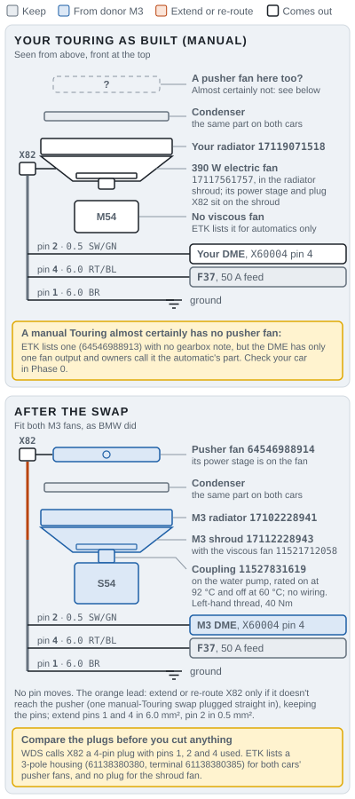 <!-- portrait -->

*Figure 15. The fans on a manual Touring before and after the swap. Your car's DME-driven fan sits in the radiator shroud; after the swap it is the M3's pusher fan in front of the condenser, with the M3's unwired viscous fan behind the radiator. The DME drives it from the same pin, so nothing is re-pinned, but plug X82 may need extending or re-routing to reach the pusher.*

**Expansion tank.** Fit a new M3 tank (17112283344, which superseded 17112228944); the plastic gets brittle with age ([BimmerWorld](https://www.bimmerworld.com/Cooling/Expansion-Tanks/Coolant-Expansion-Tank-E46-M3-BMW-17112283344.html)). It sits on the right of the engine bay, the other side from the Touring's ([Blankowski](https://blankowski.com/Cars/m3_coolant_change/)), on holder 17112229108, which also carries the M3's secondary-air pump ([ETK: tank](https://bmwfans.info/parts-catalog/E46-Coupe/USA/M3-S54/L-N/browse/radiator/expansion_tank_tubing/), [ETK: air pump](https://bmwfans.info/parts-catalog/E46-Coupe/USA/M3-S54/L-N/browse/engine/emission_control_air_pump/)). The only M3-only body brackets there are the "secondary air pump bracket, front" 41147894115 and "rear" 41147894116 on the front of the right strut tower, which your Touring's body lacks ([ETK: M3](https://bmwfans.info/parts-catalog/E46-Coupe/USA/M3-S54/L-N/browse/bodywork/front_body_bracket_right/), [ETK: Touring](https://bmwfans.info/parts-catalog/E46-Touring/USA/325i-M54/L-N/browse/bodywork/front_body_bracket_right/)); they're about \$15–17 each new ([BMWPartsDeal](https://www.bmwpartsdeal.com/parts/bmw-secondary_air_pump_bracket_front-41147894115.html)). Measure and photograph their positions on the donor, then weld copies or the new parts in. Builders cut them off the donor and welded them in ([Tracks and Trails – first drive (2026), 22:40](https://www.youtube.com/watch?v=pvR3ovRfQHg&t=1360s)), or bought copies made for welding and fitted them with rivnuts so they can come off ([M346 Projects – pt 13 (2024), 00:05](https://www.youtube.com/watch?v=4Q3PxGuJyxI&t=5s)). The 2.0 bar cap (17117639022) and the level switch (17137553919) are the same parts on both cars; extend or re-route the switch's lead to cluster pin 26 ([Harness and re-pinning](#harness-and-re-pinning)).

**Heater valve and its pump.** Every E46 M3 except the CSL, European cars included, has the "Water valve with additional water pump" 64118369807, whose pump your Touring's harness doesn't wire. The CSL and your Touring have the plain valve 64118369805 ([ETK](https://bmwfans.info/parts-catalog/64118369807/), [ETK](https://bmwfans.info/parts-catalog/64118369805/)). Either way, the S54's engine-side heater hoses replace your Touring's: those are M54 parts, and the Touring's return hose runs to the M54's expansion tank, which goes. The heater core, its pipes and the valve's bracket (41148209658) are the same on both cars ([ETK: M3](https://bmwfans.info/parts-catalog/E46-Coupe/USA/M3-S54/L-N/browse/heater_and_air_conditioning/water_hoses_water_valve/), [ETK: Touring](https://bmwfans.info/parts-catalog/E46-Touring/USA/325i-M54/L-N/browse/heater_and_air_conditioning/water_hoses_water_valve/), [ETK: heater core](https://bmwfans.info/parts-catalog/E46-Touring/USA/325i-M54/L-N/browse/heater_and_air_conditioning/heater_radiator_air_conditioning/)).

| | Option 1: your plain valve, as on the CSL | Option 2: the M3 valve and its pump |
|---|---|---|
| Valve | 64118369805, your Touring's | 64118369807, the donor's |
| Hose, engine to valve | 64216902678, the donor's | 64216902678, the donor's |
| Hose, valve to heater core | The CSL's 64212282548, bought new ([ETK](https://bmwfans.info/parts-catalog/E46-Coupe/Europe/M3_CSL-S54/L-N/browse/heater_and_air_conditioning/water_hoses_water_valve/)). Your Touring's 64218363198 joins the same two parts and may fit, but nobody has tried it | 64216902679, the donor's |
| Hose, heater core to engine | 64216902680, the donor's | 64216902680, the donor's |
| Wiring and coding | None: your climate control is already coded for this valve | Two wires, and `ZUSATZWASSERPUMPE` = `aktiv` in the climate control ([manual](WIRING-AND-CODING.md#heater-valve-and-auxiliary-water-pump)) |
| Bleeding | The engine's own pump does the venting (our inference); allow two heat cycles | BMW's fill procedure runs the pump to vent the heater circuit |

**Recommendation: option 1.** BMW built the CSL this way with the same engine-side hoses, it needs no wiring or coding, and owners running the plain valve on M3s report "No notable difference" ([NAM3](https://nam3forum.com/forums/forum/main-forum/e46-2001-2006/14592-deleting-auxiliary-water-pump)). If you keep the M3 valve, wire its pump before you fill: one swapper who left it unwired found his cooling system hard to bleed ([UNRIVALED – before you S54 swap (2021), 02:32](https://www.youtube.com/watch?v=eddLff8yba0&t=152s)).

**Oil cooler.** The S54's oil cooler sits "directly under the water radiator", "very low at the front" ([MotoIQ](https://motoiq.com/putting-csfs-e46-m3-oil-cooler-kit-to-the-test-with-data/)), clipped under a long air guide ([Flow p.57](https://drive.google.com/file/d/1GS3Hirx6x0c0WG8hPeXiwfXfeUldkQnm/view?usp=sharing)) and held up by two side screws ([Blankowski](https://blankowski.com/Cars/m3_coolant_change/)). A thermostat in the oil-filter housing sends oil through it from 95 °C (203 °F) ([BMW ST041](https://archive.org/download/BMWTechnicalTrainingDocuments/ST041%20M3%20Complete%20Vehicle/2%20M3%20DriveLine.pdf)). Every part of it is M3-only ([ETK](https://bmwfans.info/parts-catalog/E46-Coupe/USA/M3-S54/L-N/browse/radiator/engine_oil_cooler/)). Fit new O-rings 17222245358 (4). The pipe unions take 25 Nm (18 ft-lb), the M8 flange screws 20 Nm (15 ft-lb) and the M6 bracket bolt 6 Nm (53 in-lb) ([Flow p.57](https://drive.google.com/file/d/1GS3Hirx6x0c0WG8hPeXiwfXfeUldkQnm/view?usp=sharing)). The cooler breathes through the M3 bumper's lower opening, which is why the front end goes on before the first drive; with a ZHP bumper, one builder had to cut away a scoop behind it ([Front end on a 4-door body](#front-end-on-a-4-door-body)).

**Sensor leads.** The washer-level leads may need extending to reach the M3 parts, and the radiator-outlet sensor lead has to reach the M3 radiator's sensor; only a Euro 318d diesel conversion has reported extending it. Add X82, which has to reach the pusher fan ([Harness and re-pinning](#harness-and-re-pinning)).

#### Fill and bleed the cooling system

**Coolant.** About 9.3 L (9.8 US qt) including the heater: BMW's US owner's manuals for the 2002 and 2003 M3 give 9.3 L, printed as 9.9 and 9.8 US qt ([2002 manual](https://archive.org/details/manualzilla-id-7335091), [2003 manual](https://archive.org/details/manualzilla-id-7342203)). The M54 in your Touring takes about 8.4 L (8.9 US qt) ([2003 US sedan manual](https://archive.org/details/manualzilla-id-7292334)), so buy for the S54. Earlier manuals print other figures, so fill to the level mark, not by volume. Mix BMW antifreeze 82141467704, sold in 1 US gal jugs ([ETK](https://bmwfans.info/parts-catalog/82141467704/)), 50/50 with distilled water. BMW sets the concentration at 50% all year ([BMW ST054, engine cooling](https://archive.org/download/BMWTechnicalTrainingDocuments/ST054%20Climate%20Control/03_Engine%20Cooling-Heating%20System.pdf)); distilled water is DIY practice ([Blankowski](https://blankowski.com/Cars/m3_coolant_change/)). Two jugs cover a fill and the top-ups. The cap is rated 2.0 bar (29 psi) on both cars, and the M3 thermostat opens at 80 °C (176 °F) ([ETK](https://bmwfans.info/parts-catalog/E46-Coupe/USA/M3-S54/L-N/browse/radiator/expansion_tank_tubing/), [BMW ST041](https://archive.org/download/BMWTechnicalTrainingDocuments/ST041%20M3%20Complete%20Vehicle/2%20M3%20DriveLine.pdf)).

**Where these steps come from.** BMW's S54 fill-and-bleed instructions (TIS 17 00) haven't been read. The steps below combine BMW's general fill rules from its training ([BMW ST054, engine cooling](https://archive.org/download/BMWTechnicalTrainingDocuments/ST054%20Climate%20Control/03_Engine%20Cooling-Heating%20System.pdf)), the level check in the M3 owner's manual ([2003 manual](https://archive.org/details/manualzilla-id-7342203)) and one M3 owner's write-up ([Blankowski](https://blankowski.com/Cars/m3_coolant_change/)); the order is ours. BMW's rules:

- Before filling, switch the ignition on, set the blower low and the heat to maximum. The heater valve then opens fully, and the M3 valve's pump runs.
- Fill slowly.
- Don't fill past the mark: the coolant overflows, and the pump has to be able to move coolant to vent the circuit.
- Check the level only with the coolant at 30 °C (86 °F) or below.

Some owners call the S54's cooling system "self-bleeding" ([NAM3](https://nam3forum.com/forums/forum/main-forum/e46-2001-2006/14592-deleting-auxiliary-water-pump)). BMW nonetheless fits a bleed screw (17111712788, 2.5 Nm) in the radiator-feed hose 11537830716, so bleed it after any drain ([Flow p.60](https://drive.google.com/file/d/1GS3Hirx6x0c0WG8hPeXiwfXfeUldkQnm/view?usp=sharing)).

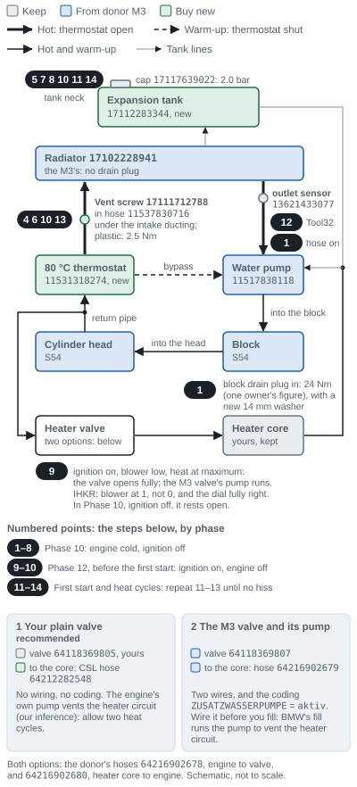 <!-- portrait -->

*Figure 16. The S54's coolant circuit with your Touring's heater, numbered with the fill-and-bleed steps below. You fill at the expansion tank's neck and let the air out at the vent screw under the intake ducting, with the heater valve open. Until the thermostat opens at 80 °C the coolant bypasses the radiator, so the radiator-outlet temperature only starts to climb after that.*

**In Phase 10: engine cold, ignition off.** The ignition stays off until the Phase 11 power-up. The heater valve rests open without power ([BMW ST054, outputs](https://archive.org/download/BMWTechnicalTrainingDocuments/ST054%20Climate%20Control%20%28Archive%201%29/16%20Output.pdf)), so the first fill works without it.

1. Check that the S54 block drain plug (13 mm) is in, with a new 14 mm washer, at 24 Nm (18 ft-lb), one owner's figure, and that the lower radiator hose is on ([Blankowski](https://blankowski.com/Cars/m3_coolant_change/)).
2. Mix about 10 L (2.6 US gal) of 50/50 coolant.
3. Park the car level or nose up, as owners of other BMW sixes do ([z4-forum, on the Z4's M54](https://z4-forum.com/threads/how-to-bleed-coolant-system-m54.69502), unverified).
4. Take off the intake ducting over the front of the engine to reach the vent screw in hose 11537830716, and open the screw ([Blankowski](https://blankowski.com/Cars/m3_coolant_change/)).
5. Fill the expansion tank slowly. Expect about 7.5 L (2 US gal) to go in before coolant runs from the vent screw ([Blankowski](https://blankowski.com/Cars/m3_coolant_change/)).
6. When it runs without bubbles, fit the vent screw at 2.5 Nm (22 in-lb). It's plastic: don't overtighten ([Flow p.60](https://drive.google.com/file/d/1GS3Hirx6x0c0WG8hPeXiwfXfeUldkQnm/view?usp=sharing)).
7. Top up to the cold mark: the top of the red float level with the filler-neck rim, and no more than 2 cm (3/4 in) above it ([2003 manual](https://archive.org/details/manualzilla-id-7342203)).
8. **Pressure-test it, still cold.** Fit the tester to the tank neck and pump to 2.0 bar (29 psi), the cap's rating. Never go higher. Hold 15 minutes: no drop, and no seepage at the hoses, the heater hoses or the valve. Then test the cap on the tester's adapter: it should hold, and relieve at 2.0 bar. The 15-minute hold is BMW's practice on a later model ([BMW SI B17 03 16](https://static.nhtsa.gov/odi/tsbs/2016/MC-10146885-9999.pdf)); no E46 test pressure from TIS has been read.

**In Phase 12, before the first start,** with the car powered up in Phase 11:

9. Battery on a charger. Ignition on, engine off. With automatic climate control (IHKA): temperature at maximum, blower low but on, A/C off. With manual climate control (IHKR): blower at position 1, since at 0 the valve is energized shut, and the temperature dial fully right ([BMW ST054, IHKR](https://archive.org/download/BMWTechnicalTrainingDocuments/ST054%20Climate%20Control%20%28Archive%201%29/13%20IHKR%20E46.pdf)). With the M3 valve, you should hear its pump.
10. After a few minutes, top up, and crack the vent screw until coolant runs without bubbles. Refit it at 2.5 Nm.

**First start and heat cycles:**

11. Start the engine and let it idle for about one minute with the cap off. Top up to the mark and fit the cap ([BMW ST054, engine cooling](https://archive.org/download/BMWTechnicalTrainingDocuments/ST054%20Climate%20Control/03_Engine%20Cooling-Heating%20System.pdf)).
12. Let it warm up until the thermostat opens. Watch the coolant temperatures in Tool32, not the gauge: the M3 cluster's gauge shows oil temperature ([manual](WIRING-AND-CODING.md#cluster-wiring)). In `MSS54DS0.PRG`, `STATUS_MOTORTEMPERATUR` reads the engine and `STATUS_KUEHLW_AUSL_TEMPERATUR` the radiator outlet ([SGBD documentation](https://github.com/emdzej/ediabasx-docs-sgbd/blob/main/docs/sgbd/MSS54DS0.md)). The outlet should climb steadily once the engine passes about 80 °C (176 °F). Look for leaks.
13. Switch off and let the coolant cool to 30 °C (86 °F) or below. Crack the vent screw: a hiss of air means another heat cycle, steps 11 to 13. Expect two ([Blankowski](https://blankowski.com/Cars/m3_coolant_change/)).
14. After the first drives, check the level again, cold.

#### Cooling checks and pass values

| Check | How | Pass |
|---|---|---|
| Leaks | Pressure tester on the tank neck, engine cold | Holds 2.0 bar (29 psi) for 15 minutes with no drop and no seepage |
| Cap | The tester's cap adapter | Holds, and relieves at 2.0 bar |
| Level | Cold, at 30 °C (86 °F) or below | The top of the red float at the filler-neck rim, up to 2 cm (3/4 in) above |
| Air | Vent screw cracked with the coolant cold | No hiss, usually after two heat cycles |
| Thermostat | Tool32: radiator outlet against engine temperature, warming up | The outlet rises once the engine passes about 80 °C (176 °F); no fault 96 (0x60) |
| Viscous fan | By hand, engine off | Bearing tilt play within ±0.65 mm, measured at 120 mm diameter. BMW rates the coupling on at 92 °C (198 °F) and off at 60 °C (140 °F) ([Flow p.61](https://drive.google.com/file/d/1GS3Hirx6x0c0WG8hPeXiwfXfeUldkQnm/view?usp=sharing)) |
| Electric fan | Tool32 `STEUERN_E_LUEFTER`; then the A/C on at idle | Runs on command; runs with the A/C on at a standstill, faster as the refrigerant pressure rises ([manual](WIRING-AND-CODING.md#fans-and-can)) |
| Overheating | Never test it on purpose | The overheat lamp lights at 120 °C (248 °F), and the electric fan then runs on ([BMW ST054, IHKA](https://archive.org/download/BMWTechnicalTrainingDocuments/ST054%20Climate%20Control%20%28Archive%201%29/12%20IHKA%20E46.pdf)) |
| Oil cooler | Feel its pipes after a hard drive | Warm once the oil passes 95 °C (203 °F) |

**Fault 96 (0x60), "Plausibilisierung Kühleraustrittstemp."** (radiator-outlet temperature plausibility) is the MSS54's check of the radiator-outlet reading against the engine's. BMW's job file lists "temperature rise too small, or radiator warmer than engine" among this fault's types ([SGBD documentation](https://github.com/emdzej/ediabasx-docs-sgbd/blob/main/docs/sgbd/MSS54DS0.md)), so we infer that a thermostat stuck open, or a radiator-outlet sensor that's unplugged or reading the wrong hose, would set it. Related faults: 43 (0x2B), the radiator-outlet sensor's circuit; 78 (0x4E), the engine's coolant sensor; and 53 (0x35), the electric fan.

### Air conditioning

Your Touring keeps its A/C system. The condenser, receiver-drier, refrigerant lines, pressure sensor, expansion valve and evaporator are the same part numbers on the US M3 and the US 325i Touring. The S54 brings its own compressor and bracket, and only one line changes: the pressure hose from the compressor to the condenser ([ETK: M3](https://bmwfans.info/parts-catalog/E46-Coupe/USA/M3-S54/L-N/browse/heater_and_air_conditioning/coolant_lines/), [ETK: Touring](https://bmwfans.info/parts-catalog/E46-Touring/USA/325i-M54/L-N/browse/heater_and_air_conditioning/coolant_lines/)).

> [!CAUTION]
> Never open an A/C line until a shop with Section 609-certified staff has recovered the refrigerant. Nobody may vent it ([EPA](https://www.epa.gov/mvac/regulatory-requirements-mvac-system-servicing)). The rules are under [A/C, odometer, title and insurance](#ac-odometer-title-and-insurance).

**What changes.**

| Part | US E46 M3 | US 325i Touring | Do this |
|---|---|---|---|
| Compressor | 64526910458 to 09/2002, 64526916232 from 09/2002 | 64526910458; check yours | The donor's, on the S54 |
| Compressor bracket | 64551432237 | 64551432237, or 64557512556 from 09/2002 | The donor's |
| Compressor belt | 11287830946 (5 ribs, 829 mm), tensioner pulley 11281433571 | 11281437450 (5 ribs, 863 mm), or 11287512762 (4 ribs, 863 mm) from 09/2002 | The donor's pulley and a new belt. Count the donor's pulley grooves first: Denso lists 4 for 64526916232, while ETK gives the M3 only the 5-rib belt ([spareto](https://spareto.com/products/denso-compressor-air-conditioning/dcp05039)) |
| Pressure hose, compressor to condenser | **64536902681**, M3 only | 64536984883 | **The donor's** |
| Condenser | 64538377614 | Same | Keep |
| Hose, condenser to receiver-drier | 64536904013 | Same | Keep |
| Receiver-drier | 64538377330, in bracket 64536917658 | Same | A new drier on the day of the charge; keep the bracket |
| Hose, drier to evaporator; double pipe at the evaporator | 64536909448; 64536908907 | Same | Keep |
| Suction pipe | 64536923956, with cover 64538385711 | Same | Keep |
| Pressure sensor | 64539181464 (was 64539141957) | Same | Keep |
| Expansion valve; evaporator | 64503452759; 64119135744 | Same | Keep, in the heater box |
| Service-valve cores and cap | 64509177579 (low side); 64509177577 or 64538391215 (high side); cap 64538387437 | Same | Inspect; caps on |
| O-rings in the lines | 64508374959 (4), 64508375741 (3), 64508363041 (1), 64538375742 (2) | Same | New at every joint you open |
| Flange screws | 07119905720 (M8 × 30): 20 Nm (15 ft-lb) | Same | — |
| Compressor relay K19 | 61368373700 | Same | Keep |

Sources: ETK for both cars' condensers ([M3](https://bmwfans.info/parts-catalog/E46-Coupe/USA/M3-S54/L-N/browse/heater_and_air_conditioning/condenser_air_conditioning/), [Touring](https://bmwfans.info/parts-catalog/E46-Touring/USA/325i-M54/L-N/browse/heater_and_air_conditioning/condenser_air_conditioning/)), receiver-driers ([M3](https://bmwfans.info/parts-catalog/E46-Coupe/USA/M3-S54/L-N/browse/heater_and_air_conditioning/drying_container/), [Touring](https://bmwfans.info/parts-catalog/E46-Touring/USA/325i-M54/L-N/browse/heater_and_air_conditioning/drying_container/)) and evaporators ([M3](https://bmwfans.info/parts-catalog/E46-Coupe/USA/M3-S54/L-N/browse/heater_and_air_conditioning/evaporator_expansion_valve/), [Touring](https://bmwfans.info/parts-catalog/E46-Touring/USA/325i-M54/L-N/browse/heater_and_air_conditioning/evaporator_expansion_valve/)); the M3's [compressor](https://bmwfans.info/parts-catalog/E46-Coupe/USA/M3-S54/L-N/browse/heater_and_air_conditioning/air_conditioner_compressor_2/), [bracket](https://bmwfans.info/parts-catalog/E46-Coupe/USA/M3-S54/L-N/browse/heater_and_air_conditioning/climate_compressor_supporting_bracket/) and [belt](https://bmwfans.info/parts-catalog/E46-Coupe/USA/M3-S54/L-N/browse/engine/belt_drive_climate_compressor/); the Touring's [belt](https://bmwfans.info/parts-catalog/E46-Touring/USA/325i-M54/L-N/browse/engine/belt_drive_climate_compressor/) and [later bracket](https://bmwfans.info/parts-catalog/64557512556/). Flange-screw torque: [Flow p.63](https://drive.google.com/file/d/1GS3Hirx6x0c0WG8hPeXiwfXfeUldkQnm/view?usp=sharing).

**Why not keep your Touring's compressor?** One S54 sedan swap kept the 325i's compressor with its lines connected, so its refrigerant circuit was never opened; it needed a different belt ([e46fanatics](https://www.e46fanatics.com/threads/kalims-s54-sedan-swap-warning-pic-heavy.889867/page-38)). In this build the donor's compressor is simpler. Your Touring's system stands open for months anyway. From 09/2002 the Touring's compressor runs a 4-rib belt where the S54's drive takes 5 ribs, so its pulley may not suit the S54. And the M3's pressure hose is the one made for the S54.

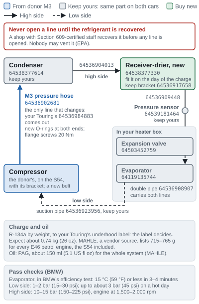 <!-- portrait -->

*Figure 17. The refrigerant circuit after the swap. Your Touring keeps everything except the compressor, which comes on the S54, and the compressor-to-condenser pressure hose, the only line that changes; the receiver-drier is renewed on the day of the charge. No line is opened until a shop with Section 609-certified staff has recovered the refrigerant, and the system is charged by weight to your underhood label.*

**The job, phase by phase.**

1. **Phases 0 and 1: before teardown.** Photograph both cars' underhood A/C labels, which give the refrigerant charge and the oil. Run BMW's quick check on each car: windows and doors shut, engine at 1,500–2,000 rpm, blower on medium, maximum cold, A/C on for more than 3 minutes. The centre vent should blow at least 11 °C (20 °F) colder than the outside air; BMW's reference conditions are 32 °C (90 °F) and 50% humidity ([BMW ST054, A/C service](https://archive.org/download/BMWTechnicalTrainingDocuments/ST054%20Climate%20Control/07_AC%20Service%20and%20Diagnosis.pdf)).
2. **Phases 2 and 4: recovery.** A shop recovers each car's refrigerant before any line is opened. Ask it to write down how much refrigerant and how much oil came out of each car: BMW puts the recovered oil back in at the charge ([BMW ST054, A/C service](https://archive.org/download/BMWTechnicalTrainingDocuments/ST054%20Climate%20Control/07_AC%20Service%20and%20Diagnosis.pdf)).
3. **Phase 4: keep your Touring's old compressor.** When the M54 comes out, unbolt the compressor, cap its ports and keep it until the A/C is charged. BMW sets the oil in a replacement compressor by what the old one held (same source).
4. **Phase 10: fit the lines.** The donor's pressure hose 64536902681 goes between the compressor and the condenser; your Touring's other lines stay. Fit new O-rings at every joint you open, wetted with the system's oil, and tighten the flange screws to 20 Nm (15 ft-lb). Leave the old drier in place and keep the system capped: the new one goes in on the day of the charge. The M3's header-to-A/C-line heat shield bolts to three studs on the M3's frame rail that a non-M rail lacks; a non-M car with an MK60 has only the center one, for the brake line. One S54-Touring owner stud-welded the missing studs, though most swaps skip the shield ([NAM3 – Black & Tan 332iT #158](https://nam3forum.com/forums/forum/main-forum/member-build-journals/195928-black-tan-332it/page11), [NAM3 – Trent's swap](https://nam3forum.com/forums/forum/main-forum/member-build-journals/173296-trent-s-s54-rebuild-and-sedan-swap/page3)). Weld the studs while the engine bay is empty (Phases 4 to 8), or fit rivnut studs later, and fit the shield before the A/C is charged.
5. **Phase 12, after the first start: the charge.** Give the shop the brief in [Shop briefs](#shop-briefs). On the day, BMW's steps ([BMW ST054, A/C service](https://archive.org/download/BMWTechnicalTrainingDocuments/ST054%20Climate%20Control/07_AC%20Service%20and%20Diagnosis.pdf)):
   - Fit the new receiver-drier 64538377330. BMW replaces it whenever a system has stood open for more than 24 hours.
   - Set the oil (below).
   - Evacuate for at least 30 minutes, then close off and hold for 5 minutes. A change of more than 7 kPa (2 inHg) means a leak.
   - Charge by weight to your Touring's underhood label.
   - Run the new compressor in: A/C off, every vent shut, engine idling, blower at 75% or more; then A/C on for at least 2 minutes at idle.

**Charge and oil.**

- **Refrigerant:** R-134a, by weight, to the underhood label. Expect about 0.74 kg (26 oz). MAHLE's fill-quantity handbook, a vendor source, lists 715–765 g for every E46 petrol engine, the S54 included ([MAHLE](https://www.mahle-aftermarket.com/media/homepage/facelift/media-center/klima/thermokampagne/2021/2-2-handbuch-fuellmengen-pkw-&-nkw-210112-en-screen.pdf)), and one E46 M3 owner reports 710–765 g (25–27 oz) ([NAM3](https://nam3forum.com/forums/forum/main-forum/e46-2001-2006/30199-diy-a-c-system-service-charging)). The label decides.
- **Oil:** PAG, about 150 ml (5.1 US fl oz) for the whole system (MAHLE). Use the type on the label; the NAM3 owner names PAG 46. Both OE compressors, 64526910458 and 64526916232, are Denso 7SBU16C units, filled with 160 ml of Denso ND-8 PAG when new ([spareto: DCP05014](https://spareto.com/products/denso-compressor-air-conditioning/dcp05014), [DCP05039](https://spareto.com/products/denso-compressor-air-conditioning/dcp05039)).
- **Where the oil goes, by BMW's rules:** a replacement compressor gets the amount of oil that came out of the old one, plus 10 g. We apply that rule to the donor's compressor: drain it, then refill it with the amount drained from your Touring's old compressor, plus 10 g. Add back the oil recovered from your Touring's system, plus about 30 ml (1 oz) for the new drier, and about 60 ml (2 oz) more if you fit a new condenser or evaporator. Hoses hold little oil. The total should come to about 150 ml (MAHLE).

**Can you do it yourself?** Small cans of R-134a, 0.9 kg (2 lb) or less with a self-sealing valve, can still be sold for DIY use; larger containers are sold only to technicians certified under Section 608 or 609 ([EPA](https://www.epa.gov/section608/refrigerant-sales-restriction)). The refrigerant has to come out through certified recovery equipment before the system is opened ([EPA](https://www.epa.gov/mvac/regulatory-requirements-mvac-system-servicing)), and an empty system needs a vacuum pump and a charge by weight. Give the recovery and the charge to a shop.

**Climate-control coding.** Keep your Touring's. Its coding carries engine and compressor settings, and both cars are six-cylinder petrol, so never code it from the M3's vehicle order. The checks are in the manual's [A/C section](WIRING-AND-CODING.md#ac-with-manual-or-automatic-climate-control).

#### A/C checks and pass values

| Check | How | Pass |
|---|---|---|
| Compressor engages | Snowflake button on, blower at 1 or more | In `MSS54DS0.PRG`, `STATUS_DIGITAL`, both `STAT_AC_EIN` and `STAT_KO_EIN` read 1; the clutch pulls in; the idle holds |
| Electric fan | A/C on, car standing | The fan runs, faster as the refrigerant pressure rises ([manual](WIRING-AND-CODING.md#fans-and-can)) |
| Efficiency, BMW's test | Outside air at 20–30 °C (68–86 °F). Heat the cabin first: recirculation, air to the footwells and windscreen, maximum heat and blower, 2,000 rpm to operating temperature, then idle. Switch the A/C on when the cabin reaches 50 °C (122 °F) | The evaporator reads 15 °C (59 °F) or less within 3–4 minutes: Tool32, `IHKR46` or `IHKA46`, `STATUS_ANALOGEINGAENGE`, `STAT_TVERDAMPFER_WERT` |
| Pressures | Gauges on both ports, engine at 1,500–2,000 rpm | Low side 1–2 bar (15–30 psi), up to about 3 bar (45 psi) on a hot day. High side 10–15 bar (150–225 psi), roughly 2–2.5 times the outside temperature in °F, read as psi |
| Vent temperature | Thermometer in the centre vent | 4–20 °C (40–68 °F), and at least 11 °C (20 °F) below the outside air |

The values are BMW's ([BMW ST054, A/C service](https://archive.org/download/BMWTechnicalTrainingDocuments/ST054%20Climate%20Control/07_AC%20Service%20and%20Diagnosis.pdf)). If the evaporator test fails, BMW's next step is to recover and weigh the charge. If the compressor never engages, work through the manual's [A/C section](WIRING-AND-CODING.md#ac-with-manual-or-automatic-climate-control), which starts with the climate control's coded compressor lock.

## Deep dive: electronics and coding

The S54 brings its own engine computer (the DME) and engine harness. Your body wiring, keys, light module and body modules stay. Five things change: the engine harness and a few body-side pins, the fuel-pump trigger, the immobilizer handshake, the instrument cluster and, if you choose, the stability-control unit. Figure 18 maps the modules involved. This chapter explains each choice and the order of work. Pin tables, continuity checks and button-by-button coding sessions are in the [Wiring and coding manual](WIRING-AND-CODING.md).

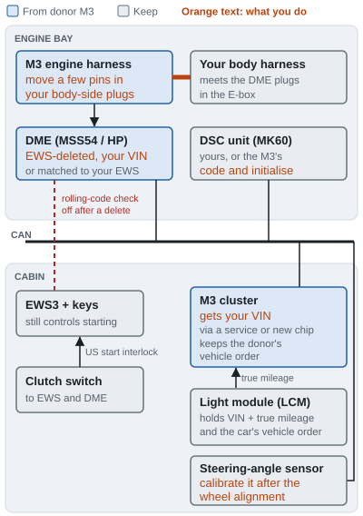 <!-- portrait -->

*Figure 18. What changes in the electronics. The M3 engine harness and DME go in, with a few body-side pins moved. The DME is EWS-deleted (or matched to your EWS, by a vendor or by your own sync), and your EWS still controls the starter. The M3 cluster gets your VIN and takes your true mileage from the light module but keeps the donor's vehicle order; the light module holds your car's own order, the one every other module is coded from. The DSC unit (your Touring's own MK60 or the M3's) is coded and initialised, and the steering-angle sensor is calibrated after the wheel alignment.*

**Decide these before you strip the donor.** They set which donor parts you harvest and which of your own you keep.

| Decision | Recommended | Alternatives | Details |
|---|---|---|---|
| Engine wiring | The complete M3 engine harness and DME, with your body-side plugs re-pinned in the E-box | A plug-in swap harness | [Harness and re-pinning](#harness-and-re-pinning) |
| Fuel-pump trigger | Leave your pump relay wiring as it is and accept one stored fault code | Fit the US M3's pump module, or have the fault suppressed | [Fuel-pump control](#fuel-pump-control) |
| Immobilizer | An EWS-delete flash of the donor DME, with your VIN written in | A used DME matched to your EWS, by a vendor or virginized for you to sync; the donor's EWS and keys | [Immobilizer (EWS)](#immobilizer-ews) |
| DME software | A manual donor's US software, unchanged apart from the delete and your VIN | An SMG donor's DME needs US manual ("HS") software: from the delete vendor, ECUWorx's tool or a WinKFP flash | [Manual, Session 2](WIRING-AND-CODING.md#session-2-dme-vin-ews-delete-and-gearbox-software) |
| Cluster | The M3 cluster, set to your VIN and true mileage by a vendor or by fitting a new memory chip | Keep your Touring's cluster | [Instrument cluster and mileage](#instrument-cluster-and-mileage) |
| Stability control and brake hydraulics | Keep your Touring's MK60, booster and master cylinder, coded as they are | The M3's MK60 (donors built from 09/2002), coded from a session vehicle order with M3 values set by hand | [DSC, brakes and steering angle](#dsc-brakes-and-steering-angle) |

**Order of work.** The coding jobs depend on each other, so do them in this order:

1. **Back up first** (the manual's Session 1). Set up the laptop and cable and prove them on your unmodified Touring. Then save the vehicle order, every module's coding, and the memories of the cluster and light module. These files are your way back ([manual](WIRING-AND-CODING.md#before-you-start)).
2. **DME during bench work** (Session 2). Have it EWS-deleted with your VIN written in ([Phase 3](#phase-3-bench-work)).
3. **Wire, then check.** Re-pin, prove every moved wire with a meter, then power up and let the DME's status jobs prove the electronic parts at the ends of those wires ([manual](WIRING-AND-CODING.md#checks-before-first-power-up)).
4. **EWS check** (Session 3). After a delete there's nothing to sync; confirm that your EWS reads the key and the clutch input.
5. **Cluster before DSC** (Session 4). The DSC checks its VIN against the cluster's. In one 330Ci the DSC and yellow BRAKE lamps went out only once the M3 cluster carried the car's VIN ([e46fanatics](https://www.e46fanatics.com/threads/e46-m3-cluster-coding.1278842/)), and an M3 owner's MK60 "complained that the vin was not a match" with the cluster ([NAM3](https://nam3forum.com/forums/forum/special-interests/coding-tuning/173720-mk60-vin-issue-m3-track-mode-rabbit-hole)). Session 4 also checks which vehicle order the cluster holds. A chip-route cluster brings the donor M3's, and that's the one to keep: BMW's coding data accepts an M3 cluster only with an M3 order, so your car's order stays in the light module (ALSZ), the source for every other module ([manual](WIRING-AND-CODING.md#session-4-cluster-and-light-module)).
6. **DSC, then the first start** (Sessions 5 and 6). Initialise the DSC and run its compensation routines (an M3 unit is coded first), then start the engine with its adaptations cleared and let the throttles relearn ([manual](WIRING-AND-CODING.md#session-6-first-start-adaptations-and-throttle-check)).
7. **Alignment, then the final steering-angle calibration** (Session 7).
8. **Options last** (Sessions 8 and 9): M Track, units and lighting, each tested on a running car. Code only the modules each change touches, one at a time. Never use Code Car on this car: it re-codes every module from the vehicle order and wipes the hand-set cluster and DSC values ([NAM3](https://nam3forum.com/forums/forum/special-interests/coding-tuning/1281-getting-started-with-ncs-expert)).

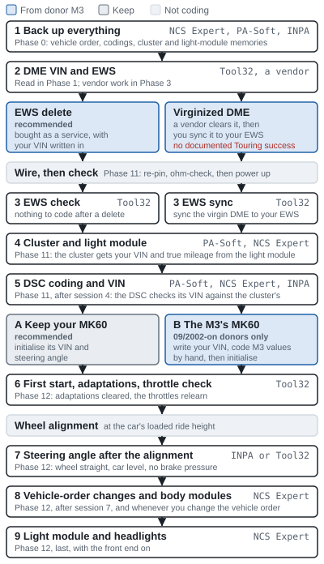 <!-- portrait -->

*Figure 19. The coding sessions in the manual's order, with the tools for each. Your immobilizer route decides what session 3 involves, and your choice of DSC unit decides session 5. The M3 cluster keeps the donor's vehicle order and is coded only from its own read-out, so later order changes start from the light module (ALSZ) and touch only the modules they affect, never through Code Car. The final steering-angle calibration waits for the wheel alignment, done in BMW's design position at the M3 load.*

### Harness and re-pinning

**Use the complete M3 engine harness and its DME.** Your MS43 or MS45.1 and the M3's MSS54 or MSS54HP use the same five-plug Siemens connector, X60001 to X60005, but the pin assignments differ throughout ([BMW ST055](https://ia801005.us.archive.org/11/items/BMWTechnicalTrainingDocuments/ST055%20Engine%20Electronics%20%28Archive%201%29/8%20MS%20S54.pdf), [WDS](https://wds.psjr.org/en/e46/zinfo/E46_PA6000L.htm)). X60004, the 40-pin "vehicle interface", belongs to your body harness and stays. The other four plugs come with the M3 harness, along with its E-box branch, fuse carrier and gearbox-module harness. Keep the donor's DME and harness together. The coil pin order differs between DME families, and one 330Ci owner damaged a DME by mixing MS43 and MS45 coil harnesses during an M54 swap ([e46fanatics](https://www.e46fanatics.com/threads/330ci-engine-swap-no-start-looking-for-help.1298699/)). The M3 harness's part numbers change at 09/2003, about when the MSS54HP arrived ([ETK](https://bmwfans.info/parts-catalog/E46-Coupe/USA/M3-S54/browse/engine_electrical_system/wiring_harness_engine_trans_module/)), but BMW's diagrams wire an HP donor like an MSS54 of the same build date ([manual](WIRING-AND-CODING.md#the-five-dme-plugs)).

**Find out which DME you have first.** US 325i Tourings built to 02/2003 have an MS43, and those built from 03/2003 an MS45.1 ([ETK](https://bmwfans.info/parts-catalog/E46-Touring/USA/325i-M54/L-N/browse/engine_electrical_system/programmed_dme_control_unit_2/)). Read the label in the E-box. Kassel's chart and most forum posts call the MS45.1 "MS45". BMW's wiring-diagram tables headed "MS45" are drawn for the M56 SULEV car, and the pinout workbook's "MS45.1" tab is a 3.0-litre table, so don't wire your car from either. The manual lists the other ways to tell ([manual](WIRING-AND-CODING.md#which-dme-your-touring-has)).

**What moves.** Most X60004 circuits sit on the same pins on all three DMEs and don't move: the pedal, CAN, EWS, terminal 15, diagnosis, the A/C and secondary-air relays, the electric fan, road speed, the cruise buttons, the radiator-outlet sensor and the fuel-pump relay on pin 10. These change, from BMW's Wiring Diagram System (WDS); each wire's color, size and drawing are in the manual ([manual: MS43](WIRING-AND-CODING.md#ms43-touring-what-to-move), [manual: MS45.1](WIRING-AND-CODING.md#ms451-touring-what-to-move)):

| Circuit | MS43 Touring (to 02/2003) | MS45.1 Touring (from 03/2003) |
|---|---|---|
| Leak-test pump heater | Body X6011 pin 7 → X60004 pin 18 | X60004 pin 2 → pin 18 |
| Secondary-air sensor | — | Take the wires out of X60004 pins 5 and 15 |
| E-box fan | — | Take the wire out of X60004 pin 19, if there is one |
| Brake-light switch, test contact | X60004 pin 28 → pin 34 | Same |
| Clutch signal | X60004 pin 23 → body X6011 pin 7, once the heater wire is out | X60004 pin 23 → body X6011 pin 7, with a new terminal |
| Oil-pressure lamp | Body X6011 pin 3 → X60004 pin 11 | Add a wire: X60004 pin 11 → cluster pin 13 |
| Charge lamp | Body X6011 pin 4 → X60004 pin 1 | Add a wire: X60004 pin 1 → cluster pin 2 |
| Oil level | Body X6011 pin 5 → X60004 pin 21 | Add a wire: X60004 pin 21 → cluster pin 17 |
| Start feedback to the cluster | Body X6011 pin 6 → X60004 pin 2 | The same move, only if your X6011 pin 6 holds a wire |
| DME ground | Add a wire: X60004 pin 5 → ground point X1108 (recommended) | Same, once pin 5 is clear |
| Sport button (optional) | Add X60004 pins 15 and 16 from the switch center | Same, once pin 15 is clear |
| Clutch-switch module | Fit the M3's, 61319122700 | Same |
| Cluster coding | Code its three lamp switches to the wires, not CAN | Same |

In X6011 the clutch wire meets the M3 harness's gray wire, which runs through the gearbox's gear switch to X60002 pin 20. The leak-test pump's own wires, on pins 20 and 30, don't move on BMW's drawings; [test them](WIRING-AND-CODING.md#dm-tl-leak-test-pump-test-before-you-swap) before you change anything. Work in the order of the manual's tables, wires out before wires in. On an MS45.1, tag pins 2 and 15 before you pull them: both are black with red (SW/RT).

**Where other sources differ.** The tables follow BMW's drawings. You'll meet these other versions:

- **Kassel's swap chart** puts the oil-pressure lamp on cluster pin 14, which is the K-bus. WDS, BMW's ISTA as a swap shop quoted it, and owners' working cars use pin 13 ([Kassel](https://www.kasselperformance.com/wp-content/uploads/2016/01/E46S54Wiring.png), [NAM3](https://nam3forum.com/forums/forum/main-forum/e46-2001-2006/61405-why-does-my-oil-light-turn-off-with-ignition-ii-engine-off)). The chart also prints the brake wire BR/GN where WDS has BR/GR (brown with gray), and its MS43 and MS45 columns leave out the clutch, the heater and some of the lamps.
- **A forum mapping** sends X6011 pin 6 to X60004 pin 6. WDS puts that wire, the start feedback, on pin 2 ([e46fanatics](https://www.e46fanatics.com/threads/s54-swap-wiring-information.1003871/)).
- **Forum advice to swap pins 20 and 30 on MS45.1 cars** follows BMW's table labels, which call the two pins pump and valve the other way round from the MSS54's. Every drawing wires them to the module the same way, and one builder who swapped still had a leak-test fault ([e46fanatics](https://www.e46fanatics.com/threads/e46-m3-sport-button-retrofit-on-non-m.1286041/)). Test before you swap.
- **X60004 pin 5** is a ground on every M3: a 0.35 mm² BR/SW wire to ground point X1108, under the driver's-seat carpet. On an MS45.1 the cavity holds the secondary-air sensor's wire, which must come out. No source shows what the DME uses this ground for, and the one builder who added one saw no change ([WDS](https://wds.psjr.org/en/e46/svg/SP0000017646.svg), [NAM3](https://nam3forum.com/forums/forum/main-forum/e46-2001-2006/201716-switched-12v-question/page2)). Fit it anyway: it's one wire, and it matches BMW's wiring.

> [!NOTE]
> A widely quoted e46fanatics list moves four wires (oil pressure, oil level, charge lamp and start signal) from X60004 into X6011. Its author posted it from memory, about an earlier MS42-to-MS43 M54 swap in a 1998 323i ([e46fanatics](https://www.e46fanatics.com/threads/s54-swap-wiring-information.1003871/)). For an S54 in an MS43 Touring, the same wires move the other way, into X60004; an MS45.1 Touring adds them.

**Why the lamps matter.** On an MS43 Touring the oil-pressure switch reaches the cluster through X6011 without touching the DME, and on an MS45.1 the lamps arrive over CAN. The M3 routes all three through the DME: the oil-pressure switch comes in at X60003 pin 26, and the lamp goes out at X60004 pin 11. A 2001 325iT with an S54 showed neither its oil nor its battery lamp until this was fixed ([e46fanatics](https://www.e46fanatics.com/threads/battery-and-oil-pressure-lights-inop.1207433/)), and an S54-swapped 2003 330i ZHP (MS45.1) needed the pin-11 wire added and the cluster recoded ([NAM3](https://nam3forum.com/forums/forum/main-forum/e46-2001-2006/61405-why-does-my-oil-light-turn-off-with-ignition-ii-engine-off)). Prove the lamp at key-on before the first start, and prime the oil with a gauge anyway (see [Phase 12](#phase-12-front-end-first-start-and-shakedown)).

**The E-box plugs.** Besides X60004, the M3 harness meets your body harness at two E-box plugs, X6011 (black, 8 pins) and X6021 (black, 4 pins), and the battery feed to the DME relay comes in at X64101/X64102. After the moves, X6011 carries only the starter wire, terminal 15 and the clutch wire, on pins 1, 2 and 7. X6021 pin 1 carries the US M3's pump-module signal and has no mate in a manual 325i, so it stays unconnected ([Fuel-pump control](#fuel-pump-control)). X6053 and X6054 (X60531 and X60541 on an MS45.1) join the engine harness to the gearbox-module harness within each car's own set, so use the M3's sections together. Mixed halves put the M3's throttle-actuator lines on the Touring's injector feed: a 330i swap got injector "circuit low" faults on all six that way ([e46fanatics](https://www.e46fanatics.com/threads/s54-swap-fuel-injectors-low-circuit.1277127/)). Older forum posts describe a 3-pin E-box plug with the reverse-light wires and the DME-relay feed; BMW's drawings for these cars put those on X6021 and X64101/X64102 ([manual](WIRING-AND-CODING.md#e-box-plugs)). Compare every cavity on both halves before you join a plug. While the donor is still whole, trace its circuits: Tenza's builder understood Kassel's re-pin instructions only after tracing them on his donor ([Tenza Motorsports – M3 Touring build finally runs (2021), 08:36](https://www.youtube.com/watch?v=8uwpzS_-uDs&t=516s)).

**Power, grounds and fans.** The DME relay (K6300), the injector and secondary-air relays, the E-box and the engine ground cable are the same parts on both cars, so the M3 harness meets your car's power layout unchanged ([manual](WIRING-AND-CODING.md#power-relays-and-fuses)). Add the X60004 pin-5 ground above. The electric fan's DME wire doesn't move (X60004 pin 4). But on a manual Touring the fan the DME drives sits in the radiator shroud, with its plug X82 on the shroud, while the M3's electric fan is a pusher in front of the condenser: compare the plugs, then extend or re-route X82's lead if it doesn't reach (one manual-Touring swap plugged it straight in) ([Cooling and oil cooler](#cooling-and-oil-cooler), [manual](WIRING-AND-CODING.md#fans-and-can)). If your E-box has no blower (BMW fits one only to automatic, SMG and hot-climate cars), leave the M3 harness's E-box fan plug unconnected, as Tenza did ([ETK](https://bmwfans.info/parts-catalog/E46-Touring/USA/325i-M54/browse/engine_electrical_system/control_unit_box/), [Tenza Motorsports – 5 things they don't tell you, part 2 (2021), 02:05](https://www.youtube.com/watch?v=mDBiRn30fEs&t=125s)).

**Re-pin, don't splice.** One swapper's advice: "Learning to de-pin is faster, neater, and less prone to error" ([e46fanatics](https://www.e46fanatics.com/threads/330ci-engine-swap-no-start-looking-for-help.1298699/)). Use depinning keys and BMW pre-crimped repair leads. X6011 and X60004 take different terminals, so a wire that moves between them needs a new terminal of the target's type. Nobody publishes which terminal fits which cavity, so pull one from the cavity you'll use and match it in the manual's terminal table before you order ([manual](WIRING-AND-CODING.md#terminals-tools-and-repair-leads)). Switch the ignition off whenever you plug or unplug the DME; BMW warns that arcing can damage it ([BMW ST055](https://ia801005.us.archive.org/11/items/BMWTechnicalTrainingDocuments/ST055%20Engine%20Electronics%20%28Archive%201%29/8%20MS%20S54.pdf)).

**A swap harness instead?** Redline's adapter (\$265) and Race German's (\$304.88, made to order, no refunds) are sold per DME family, with new connectors and pedal, pump-relay and Sport-button wiring, and both need an EWS-deleted DME ([Redline](https://www.redline-motorsport.com/product/e46-m52tu-m54-s54/), [Race German](https://racegerman.com/products/e46-m52tu-m54-s54-swap-harness-adapter), October 2026). Neither publishes its circuit list, so ask whether it covers the cluster lamps, the brake-switch move, the leak-test heater, the clutch move and keeping X6021 pin 1 off the pump relay. Don't fit the M3's whole body harness: the one build that did had to move the Touring-only circuits into it ([PistonHeads](https://www.pistonheads.com/gassing/topic.asp?h=0&f=47&t=1655205)).

**Body-side jobs** (wiring in the [manual](WIRING-AND-CODING.md#body-side-wiring)):

- **Sport button (optional).** It switches the DME's throttle map. Fit the M3's console switch unit (61316925520 on coupes, 61316925521 on convertibles) and wire its plug X1869: pin 17 to X60004 pin 15 for the button, pin 18 to X60004 pin 16 for its LED. One non-M swap did exactly that, and it worked ([e46fanatics](https://www.e46fanatics.com/threads/e46-m3-sport-button-retrofit-on-non-m.1286041/)). A base Touring with only a DSC button also lacks the switch center's terminal-30 and terminal-R feeds and its K-bus wire, on X1869 pins 7, 22 and 23 ([manual](WIRING-AND-CODING.md#sport-button-and-switch-center), [M346 Projects – E46 M3 SMG Touring build, part 2 (2023), 20:45](https://www.youtube.com/watch?v=VHCrVhVuFzY&t=1245s)). **Watch:** [Tenza Motorsports – 5 things they don't tell you, part 2 (2021), 08:45](https://www.youtube.com/watch?v=mDBiRn30fEs&t=525s).
- **Cruise control** needs the brake-switch move, the clutch chain through X6011 pin 7 and the gear switch to X60002 pin 20, and the M3's clutch-switch module, 61319122700. The module is required, not optional: the M3's sends +12 V with the pedal up, and your Touring's (61319231129) doesn't ([NAM3](https://nam3forum.com/forums/forum/main-forum/e46-2001-2006/225235-clutch-switch-help-code-50)). Two S54 builds cured no cruise with it ([e46fanatics](https://www.e46fanatics.com/threads/m3-cluster-swap-dsc-light.1260275/), [NAM3](https://nam3forum.com/forums/forum/main-forum/member-build-journals/3768-what-s-going-on-in-my-shop-currently/page3)). The 420G's gear switch is 23142229113 ([ETK](https://bmwfans.info/parts-catalog/23142229113/)).
- **Keep the start interlock.** The clutch module's fourth wire to EWS pin 8, fitted to US and Japanese cars, stays as it is ([e46fanatics](https://www.e46fanatics.com/threads/diy-manual-swap-clutch-pedal-sensor-wiring.1316805/)).
- **Sensor leads that may not reach** the M3's parts: the coolant-level sensor (the M3 expansion tank sits on the other side), the washer pump and level sensor (the M3 tank sits low), and the radiator-outlet sensor ([e46fanatics](https://www.e46fanatics.com/threads/s54-swap-wiring-information.1003871/), [Tracks and Trails – Attempting to drive my E46 M3 Touring (2026), 22:40](https://www.youtube.com/watch?v=pvR3ovRfQHg&t=1360s)). Add the electric fan's plug X82, which has to reach the M3's pusher fan ([manual](WIRING-AND-CODING.md#fans-and-can)).
- **Heater valve.** Every E46 M3 except the CSL has a valve with a small electric pump (64118369807) that your Touring's plain valve lacks. Either fit your plain valve (64118369805) on the S54 with the CSL's valve-to-heater-core hose 64212282548, with no wiring or coding (recommended), or keep the M3 valve and wire and code its pump. One builder who left the pump unwired found his cooling system hard to bleed ([manual](WIRING-AND-CODING.md#heater-valve-and-auxiliary-water-pump), [UNRIVALED – Watch this before you S54 swap (2021), 02:32](https://www.youtube.com/watch?v=eddLff8yba0&t=152s)). See [Cooling and oil cooler](#cooling-and-oil-cooler).
- **A/C.** Both climate controls send the A/C request over the K-bus to the cluster, which passes it to the DME over CAN. A/C with the S54 is confirmed on cars with automatic climate control (IHKA). Nobody has reported first-hand on manual climate control (IHKR), but BMW describes the same messages, so it should work; test it early ([manual](WIRING-AND-CODING.md#ac-with-manual-or-automatic-climate-control), [e46fanatics](https://www.e46fanatics.com/threads/kalims-s54-sedan-swap-warning-pic-heavy.889867/page-38)). Keep your Touring's climate-control coding, which carries engine and compressor settings. If the compressor never engages, check the climate control's coded compressor lock first (same manual section).

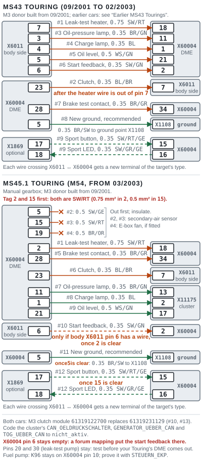 <!-- portrait -->

*Figure 20. The body-side re-pins on an MS43 Touring built 09/2001 to 02/2003 and an MS45.1 Touring built from 03/2003, each with an M3 donor built from 09/2001, drawn from where each wire is now (left) to where it goes (right) and numbered as in the manual's tables. Green marks a new wire, a dashed line an optional wire or one that may not be there, and an X a wire that comes out and is insulated. On an MS43 the heater wire leaves X6011 pin 7 before the clutch wire goes in; on an MS45.1 you tag pins 2 and 15, and the wires in pins 5 and 15 (and 19, if fitted) come out first. On both, every wire that crosses between X6011 and X60004 gets a new terminal of the target's type, and a recommended ground goes into X60004 pin 5.*

### Fuel-pump control

Your Touring and a US M3 switch their fuel pumps differently ([WDS](https://wds.psjr.org/en/e46/svg/SP0000014336.svg), [WDS](https://wds.psjr.org/en/e46/svg/SP0000014408.svg), [BMW ST041](https://archive.org/download/BMWTechnicalTrainingDocuments/ST041%20M3%20Complete%20Vehicle/3%20EngineElectronics%20%28Part%202%29.pdf), [ETK](https://bmwfans.info/parts-catalog/E46-Touring/USA/325i-M54/L-N/browse/vehicle_electrical_system/relay_for_fuel_pump_1_k96/)):

| Car | What switches the pump | DME output |
|---|---|---|
| Your 325i Touring (M54, MS43 or MS45.1) | Relay K96 (white-green, 61368373700) behind the glovebox. The DME grounds its coil through a black/violet (SW/VI) wire | X60004 pin 10 |
| Euro M3 | Relay K96 | X60004 pin 10 |
| US M3 | A pump module (EKP, 61357892976) that slows the pump at idle and part load, in a coupe's trunk above the right rear wheel or behind a convertible's right rear side trim ([e46fanatics](https://www.e46fanatics.com/threads/fuel-pump-relay-location-left-me-stranded.1316926/)) | X60002 pin 11, a 0–120 Hz PWM signal, out through the E-box plug X6021 pin 1 |

On the US M3's drawings X60004 pin 10 is "not used", a Euro-only output. Builders report that US software drives it anyway: swap shops run K96 from it ([e46fanatics](https://www.e46fanatics.com/threads/s54-swap-california-bar-certification.1307461/page-2), [e46fanatics](https://www.e46fanatics.com/threads/kalims-s54-sedan-swap-warning-pic-heavy.889867/page-38)). BMW's drawings put K96 on pin 10 on both of your DMEs, the MS45.1 too; the workbook tab that lists pin 10 as unused is the M56 layout ([manual](WIRING-AND-CODING.md#how-each-car-switches-the-pump)).

**Recommended: leave your pump wiring as it is.** The MSS54's pin-10 output then switches your K96 relay. A swap shop that does this on non-M E46s: "I don't modify anything in the fuel pump wiring system, this DOES leave a shadow code for the Fuel Pump Relay (shows in ISTA/INPA but not on a generic scan tool) but does not set the CEL", and the car "will pass an OBD2 plug in emissions test" ([e46fanatics](https://www.e46fanatics.com/threads/s54-swap-california-bar-certification.1307461/page-2)). Kassel's swap chart lists no pump changes for any E46 ([Kassel](https://www.kasselperformance.com/wp-content/uploads/2016/01/E46S54Wiring.png)). Three checks, all part of the manual's [checks before first power-up](WIRING-AND-CODING.md#checks-on-the-pump-circuit):

1. **Pin 10 reaches K96's coil.** Continuity from the X60004 pin-10 cavity to pin 4 of the relay's socket. Then, at key-on, the pump primes once, and Tool32's `STEUERN_EKP` makes K96 click; the click proves your software drives pin 10.
2. **The PWM wire stays off the relay.** On a manual 325i the body side of X6021 pin 1 is empty, so the M3's pump-module wire connects to nothing ([WDS](https://wds.psjr.org/en/e46/svg/SP0000007729.svg)). Keep it that way. A relay coil can't follow a 0–120 Hz signal and would likely chatter; nobody has reported trying it ([NAM3](https://nam3forum.com/forums/forum/main-forum/e46-2001-2006/132772-help-fuel-pump-relay-ekp-engine-wiring-schematic/page2)).
3. **Expect the stored fault:** location 1 (0x01), "Relais Kraftstoffpumpe", because US software misses its pump module. It shows in INPA, ISTA and PA-Soft, not on a generic scanner, and doesn't light the check-engine lamp; INPA prints it as 1. Don't confuse it with 130 (0x82), the immobilizer fault. A real pump fault carries the same number, so tell them apart by the car: with one prime at key-on, 5.0 bar and a running engine it's the expected fault; with no prime and no pressure it's real. BMW's files don't say exactly what sets the fault. One untested lead: the MSS54 learns which pump control is fitted, and Tool32 can read that value, `STAT_EKP_CFG_VERBAUT_WERT`; that it has anything to do with the fault is our inference. Read it if you're curious, and write nothing to the DME ([manual](WIRING-AND-CODING.md#faults-that-look-like-pump-faults)).

**If your state reads manufacturer fault codes,** or you want a clean fault memory, you have two alternatives:

- **Fit the M3's EKP module.** It takes five wires where the relay takes four, and its signal needs a terminal and a new wire in your side of X6021 pin 1 ([manual](WIRING-AND-CODING.md#optional-the-m3-pump-module-ekp)). Kalim suggests rewiring the socket behind the glovebox for it ([e46fanatics](https://www.e46fanatics.com/threads/kalims-s54-sedan-swap-warning-pic-heavy.889867/page-38)). It brings back the slow-running pump and BMW's documented crash cut-off. Nobody has documented it in a Touring.
- **Have the DME vendor suppress the fault.** One swapper planned to have it "coded out" ([e46fanatics](https://www.e46fanatics.com/threads/kalims-s54-sedan-swap-warning-pic-heavy.889867/page-38)), and Kassel's "Engine Swap Coding" (\$349) includes "any and all options" for a swap ([Kassel](https://www.kasselperformance.com/product/bmw-e46-m3-s54-mss54-hp-tuning/)); ask before you order.

Don't flash Euro DME software to get rid of the fault. It drops the functions the pin tables mark "USA only", including the DM-TL leak test you need for inspection (our reading of the [pinout sheet](https://docs.google.com/spreadsheets/d/1I_2XAvziPCiRlZXnkfk4x1tUIKy4TKPbmdJcGCBdGIg/edit?usp=sharing)).

With the relay, your pump runs at full speed whenever the engine runs. That sends more fuel back to the tank's jet pump and makes more pump heat and noise; no failures have been reported from it. Your K96 feeds the pump through a 1.5 mm² wire, where the US M3's module uses 2.5 mm² ([WDS](https://wds.psjr.org/en/e46/svg/SP0000014336.svg), [WDS](https://wds.psjr.org/en/e46/svg/SP0000014408.svg)), so with an M3 pump check the voltage at the pump connector: within 0.5 V of the battery (test T4 in [Test the fuel system](#test-the-fuel-system)). An E46 has no wire from the airbag unit to the pump: the airbag unit sends a crash message on the K-bus, the cluster passes it on over CAN, and the DME switches the pump off ([BMW ST034](https://archive.org/download/BMWTechnicalTrainingDocuments/ST034%20E46%20Complete%20Vehicle/7%20Passive%20Safety%20Systems.pdf)). The MSS54 has the function, but whether US software also drops its pin-10 relay output after a crash isn't documented ([manual](WIRING-AND-CODING.md#crash-fuel-cut-off)). All of this assumes an M54 Touring with this relay. The M56 SULEV engine has its own pump controller and a returnless metal tank, and a manual gearbox doesn't rule it out, so check your engine code ([BMW B11 75 02](https://archive.org/download/BMWTechnicalTrainingDocuments/ST055%20Engine%20Electronics%20%28Archive%202%29/08_SULEV.pdf), [Check your own Touring first](#check-your-own-touring-first)). The pressure and delivery tests, the M3 filter-regulator and the fuel lines are in [Fuel system](#fuel-system); the pins and checks are in the [manual](WIRING-AND-CODING.md#fuel-pump-control).

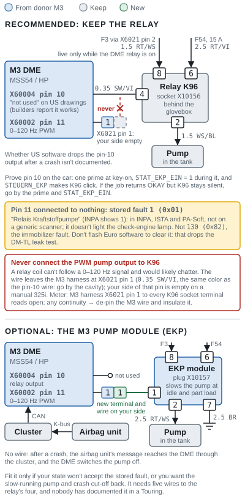 <!-- portrait -->

*Figure 21. The US MSS54 has two pump outputs. US wiring diagrams mark X60004 pin 10 "not used", but builders report that it still switches your K96 relay, so prove it on your car: one prime at key-on, and `STEUERN_EKP` makes K96 click. The X60002 pin-11 output, meant for the US M3's pump module, leaves the E-box at X6021 pin 1 and connects to nothing on a manual 325i; never connect that PWM output to the relay. Expect a stored fault, location 1 (0x01), that doesn't light the check-engine lamp. For the fuel tests, a switch with a 15 A inline fuse across K96's socket pins 6 and 2 runs the pump.*

### Immobilizer (EWS)

**How it works.** Your EWS reads the key's transponder through the ring antenna and checks the clutch input. It then releases the starter and sends a rolling code to the DME. If the code matches, the DME enables injection and ignition; if not, the engine cranks but won't start ([BMW ST051](https://archive.org/download/BMWTechnicalTrainingDocuments/ST051%20Body%20Electronics%20I%20%28Archive%201%29/05%20EWS.pdf)). The DME burns the code table into its memory the first time it pairs with an EWS: "once a DME is 'Married' to the vehicle it will not work in any other vehicle", and BMW's alignment job only resets the table to its first code (same source). So:

- **Cranks but won't start**, with fault 130 (0x82, "EWS manipulation") stored: the DME isn't accepting your EWS.
- **Won't crank:** the cause is upstream of the DME. Check the key, ring antenna, EWS, and the clutch input at EWS pin 8.
- **Cranks, fires once or twice, never runs:** treat it as the immobilizer too. A builder of S54 Tourings: "Key to EWS blocks/enables cranking. EWS to DME blocks/enables starting. EWS to DME issues generally manifest as a brief fire or no fire at all." On one M3 the cause was a delete that hadn't taken; once the DME carried a working delete it started ([NAM3 (2025)](https://nam3forum.com/forums/forum/main-forum/e46-2001-2006/319929-ews-delete-and-i-have-a-crank-with-no-start/page2)). Have the vendor re-check the delete.
- **Runs for a few seconds, then dies:** not the immobilizer. Look elsewhere, starting with the throttle system and the pump hold ([manual](WIRING-AND-CODING.md#wont-start)).

| Route | What it involves | Cost (October 2026) | In Tourings |
|---|---|---|---|
| **1. EWS delete (recommended)** | A vendor or a licensed tool sets the donor DME to skip the rolling-code check; your VIN goes in at the same time | \$100–\$300, plus \$20 for the VIN at Kassel | The usual route; your keys, locks and start interlock stay |
| 2. Used DME matched to your EWS | A vendor programs the used DME to your car's EWS and key, or clears it for you to sync yourself | About \$300 at RPM, plus shipping both ways | None in a Touring. A vendor-hosted review reports a running S54 in a 2001 330i after RPM matched its used DME "to the EWS and key" ([RPM](https://rpmmotorsport.net/products/bmw-e39-e46-m3-m5-s54-s62-used-ecu-dme-ews-programming)). A DIY sync is still undocumented: two failures in Tourings, and two more DIY-virginized MSS54s failed (route 2 below) |
| 3. Donor EWS and keys | Fit the M3's EWS with its DME and use its key | Parts from the donor | Cleared the EWS fault in one 325iT, which still didn't start; you carry two keys |

**Route 1: the delete.** It's one setting in the DME's data, changed by the vendor or by a licensed tool ([ECUWorx](https://www.ecuworx.co.uk/how-to/a-run-down-of-features-of-the-mss5x-binary-modification-tool-and-what-they-do/), [Kassel](https://www.kasselperformance.com/product/bmw-e46-m3-s54-mss54-hp-tuning/)). Afterwards, "the EWS module is now simply looking for a proper matchup with the key transponder" ([NAM3](https://nam3forum.com/forums/forum/main-forum/e46-2001-2006/38046-mss54-ews-delete-anyone-successful)): your EWS still checks the key and the clutch and still controls the starter, and that's the only immobilizer layer left. Fault 130 (0x82) may stay stored unless the tampering fault is deleted too; one owner "confirmed that the engine can start" with it (same source).

| Vendor | Service and price (October 2026) |
|---|---|
| [Kassel Performance](https://www.kasselperformance.com/product/bmw-e46-m3-s54-mss54-hp-tuning/) | EWS delete \$109; VIN recode \$20; "Engine Swap Coding" with all swap options and a consult \$349; optional \$429 core charge |
| [DUDMD](https://www.dudmd.com/products/e46-m3-mss54-ews-delete-service) | Bench flash \$215; remote flash with a cable you keep \$225 (needs a Windows 8 or newer laptop) |
| [Severn Tuning](https://www.severntuning.com/products/bmw-mss54-hp-ews-delete-2001-2006-e46-m3) | MSS54 and MSS54HP delete, \$100, or \$200 with its "Shipping" option; listed "for off-road use only" |
| [RPM Motorsport](https://www.rpmmotorsport.net/collections/bmw-unlocked-ecu-service-ews-cas-delete/products/bmw-e46-m3-s54-m5-e39-s62-ews-delete-ready-to-start) | "Ready to start" delete, \$300, 1–2 business days after arrival |
| [Poverty Built](https://povertybuilt.com/products/e46-m3-s54-custom-tune-mss54) | Tunes from \$220, with immobilizer and swap configuration on request |

You can also read the DME yourself, have the file done remotely and flash it back, as Tracks and Trails did ([Tracks and Trails – Attempting to drive my E46 M3 Touring (2026), 1:12:40](https://www.youtube.com/watch?v=pvR3ovRfQHg&t=4360s)), or run ECUWorx's licensed tool yourself ([manual](WIRING-AND-CODING.md#session-2-dme-vin-ews-delete-and-gearbox-software)). When you order:

1. Read and save the DME's identification, VIN slots and fault memory before you ship it, and check that the vendor supports its hardware number ([manual](WIRING-AND-CODING.md#session-2-dme-vin-ews-delete-and-gearbox-software)).
2. Order the delete with your Touring's full 17-character VIN. If the donor was an SMG car, ask for manual-gearbox software too. SMG software left in place kept one swapped sedan in limp mode ([UNRIVALED – Watch this before you S54 swap (2021), 02:02](https://www.youtube.com/watch?v=eddLff8yba0&t=122s)).
3. Decline the secondary-air, rear-O2, catalyst-efficiency and EVAP deletes on these vendors' menus. They're illegal on a road car.
4. When the DME comes back, read your VIN out of it.

> [!IMPORTANT]
> Keep the clutch-start interlock. Leave the clutch switch's wire to EWS pin 8 in place and the EWS parameter `PARK/NEUTRAL_EINGANG` at `aktiv` ([e46fanatics](https://www.e46fanatics.com/threads/diy-how-to-code-ews-to-ignore-clutch-park-neutral-switch.1313143/)). A popular swap video recodes it to `nicht_aktiv` to get a car to start ([ShopLifeTV – Starting the S54 swap car for the first time (2015), 01:08](https://www.youtube.com/watch?v=BV1yvGP7sCM&t=68s)), which lets the engine crank in gear. If the car won't crank, find the fault instead.

**Route 2: a used DME matched to your EWS.** If a vendor does the matching, as RPM's used-DME EWS programming does, you get the DME back ready for your key; that has worked once, in a 2001 330i (above). If you sync it yourself, only a DME whose immobilizer memory has been cleared can learn your EWS ([BMW ST051](https://archive.org/download/BMWTechnicalTrainingDocuments/ST051%20Body%20Electronics%20I%20%28Archive%201%29/05%20EWS.pdf)). That's a vendor job, done through the DME's programming port: RPM Motorsport offers used-DME EWS programming for \$300, and in October 2026 Kassel listed virginizing only for the M54's MS43 ([RPM](https://rpmmotorsport.net/products/bmw-e39-e46-m3-m5-s54-s62-used-ecu-dme-ews-programming), [Kassel](https://www.kasselperformance.com/product/ms43-virginize/)). The Tool32 sync sequence that circulates worked once, on one owner's CSL-clone MSS54: a DME converted in hardware to run CSL software, whose immobilizer code (ISN) he had written in through its BDM programming port. He wasn't sure it works on a virgin DME ([NAM3](https://nam3forum.com/forums/forum/special-interests/coding-tuning/145696-ews-sync-issue-with-csl-clone-dme-solved)). INPA's keys for an MSS54 sync aren't documented: Kassel's widely shared "Shift + F6, F1" clip syncs an M54's MS43 ([KasselPerformance – MS43 EWS sync in INPA (2015)](https://www.youtube.com/watch?v=HPoaKPqLpgE)). Two other MSS54s virginized with a DIY flasher failed too: one wouldn't sync ("Error_SG_Rejected" in INPA) and one was bricked ([NAM3](https://nam3forum.com/forums/forum/special-interests/coding-tuning/258903-dme-ews-sync-is-not-working), [NAM3](https://nam3forum.com/forums/forum/main-forum/e46-2001-2006/233343-exploring-potential-solutions-for-dme-after-virginizing-with-mssflasher)). Two Touring attempts failed:

- A 2002 325iT with its donor's DME, not virginized: INPA refused the job, Tool32 reported success but the sync status stayed invalid, and fault 130 (0x82) remained ([e46fanatics](https://www.e46fanatics.com/threads/ews-synch-for-s54-swap-into-e46-touring.1318881/)).
- A 325xi wagon built in 03/2001, with a Kassel-virginized 2003.5 MSS54: "start value not understood" ([e46fanatics](https://www.e46fanatics.com/threads/cant-sync-ews-dme-on-s54-swapped-e46-wagon.1300465/)). A member blamed the older car's ZCS coding. That's unlikely: BMW keeps the rolling code separate from ZCS coding, and the MSS54 isn't coded from the vehicle order at all ([BMW ST051](https://archive.org/download/BMWTechnicalTrainingDocuments/ST051%20Body%20Electronics%20I%20%28Archive%201%29/05%20EWS.pdf), [SGBD documentation](https://github.com/emdzej/ediabasx-docs-sgbd/blob/main/docs/sgbd/MSS54DS0.md)). A partly cleared DME, the wrong INPA script or low voltage fit better.

**Route 3: the donor's EWS and keys.** In the 2002 325iT above, fitting the donor's EWS and key and re-running the Tool32 sync cleared the EWS fault, but the car still cranked without starting, with a fuel-pump relay fault and all six injectors disabled, and the thread ends there ([e46fanatics](https://www.e46fanatics.com/threads/ews-synch-for-s54-swap-into-e46-touring.1318881/)). The route also leaves the car needing the donor key's transponder at the ring antenna as well as your own key in the lock, unless a locksmith re-keys the cylinders; your tailgate and rear-glass locks have no M3 equivalent. The donor EWS and its key transponders carry the donor's VIN, which forum members say takes a dedicated key programmer to change ([e46fanatics](https://www.e46fanatics.com/threads/chassis-vin-dme-ews-vin-lcm-ike-vin-all-mismatched-help.1253491/)); the EWS's job file reads it with `FGNR_LESEN` ([SGBD documentation](https://github.com/emdzej/ediabasx-docs-sgbd/blob/main/docs/sgbd/EWS3.md)). On a car built from 09/2001 the EWS holds a VIN but no vehicle order, so it's no backup of your options ([Instrument cluster and mileage](#instrument-cluster-and-mileage)). An SMG donor's EWS may expect a neutral signal rather than your clutch switch, so match its coding to your saved EWS file. Use this route as a test or a fallback.

**If your state checks DME software.** Since July 2021 California's Smog Check fails software that doesn't match an OEM or CARB-approved configuration ([BAR](https://www.bar.ca.gov/pdf/bag/202107/bar-ois-modified-software.pdf)), and a swap shop reports California failing cars for detected tunes ([e46fanatics](https://www.e46fanatics.com/threads/s54-swap-california-bar-certification.1307461/page-2)). If your state checks software, ask whether a VIN-matched EWS delete passes before you choose a route. See [Registration and legal](#registration-and-legal-us).

### Instrument cluster and mileage

The M3 cluster brings a tachometer with an 8,000 rpm redline and warm-up lights, and an oil-temperature gauge; with the MSS54 they all work ([e46fanatics](https://www.e46fanatics.com/threads/diy-m3-cluster-into-non-m-retrofit.1277945/)).

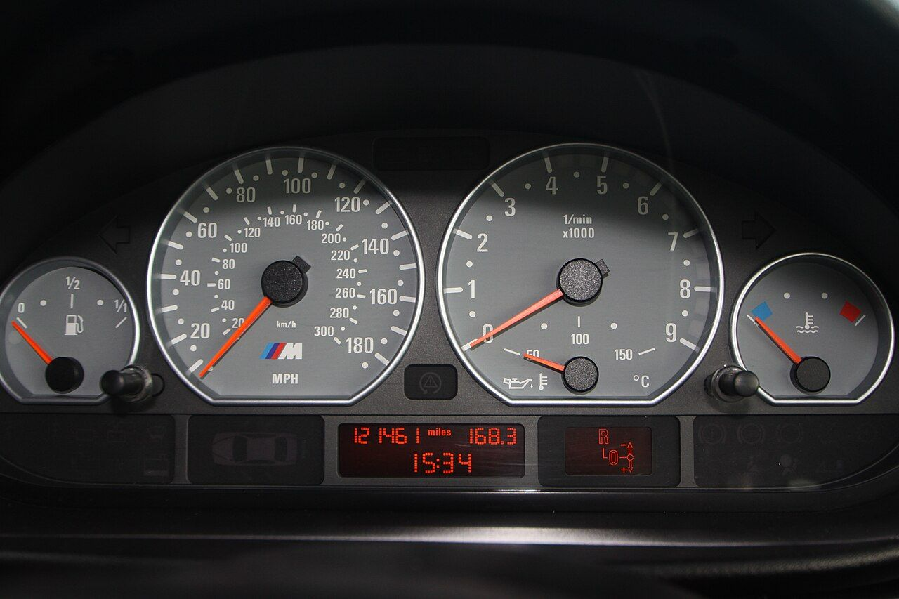

*Photo: The M3 cluster, US mph version. Adam Woodford, [CC BY 2.0](https://creativecommons.org/licenses/by/2.0/), via [Wikimedia Commons](https://commons.wikimedia.org/wiki/File:BMW_M3_-_IMG_5105_-_Flickr_-_Adam_Woodford.jpg).*

**Why it needs work.** The cluster and the light module (LCM) both store the VIN and mileage and compare them at every key-on. A mismatch lights the "tamper dot" ([e46fanatics](https://www.e46fanatics.com/threads/diy-m3-cluster-into-non-m-retrofit.1277945/)), and until the VINs match the DSC and yellow BRAKE lamps can stay on too ([e46fanatics](https://www.e46fanatics.com/threads/e46-m3-cluster-coding.1278842/)). A used M3 cluster carries the donor's VIN and mileage, and neither can be rewritten over the OBD port: PA-Soft can read the cluster, but its VIN and mileage areas are write-protected, and NCS Expert can't write a used cluster's VIN ([NAM3](https://nam3forum.com/forums/forum/special-interests/coding-tuning/154645-cluster-with-coding-index-0x24-virginization), [e46fanatics](https://www.e46fanatics.com/threads/e46-m3-cluster-coding.1278842/)). BMW's own rule explains why: "The VIN is entered in the cluster through coding and will only be accepted when the cluster mileage is zero", and the light module passes its mileage to the cluster only when the VINs match and the cluster reads zero ([BMW ST052](https://archive.org/download/BMWTechnicalTrainingDocuments/ST052%20Body%20Electronics%20II/03b_E46%20Driver%20Information%20Systems.pdf)). That's why the routes that work start from a zero-mileage chip, and why a dealer "can program a 'brand new' cluster, but not a used one" ([NAM3](https://nam3forum.com/forums/forum/main-forum/e46-2001-2006/228697-cluster-replacement)).

**The light module is the master record.** It holds your car's VIN and true mileage, and its mileage can only go up (BMW ST052). On cars built from 09/2001 it also holds a copy of the vehicle order (FA), the option list that NCS Expert codes every module from ([e46fanatics](https://www.e46fanatics.com/threads/diy-how-to-code-fa-for-at-mt-swap.1290835/)). Make the cluster match the LCM, never the reverse. One swap video advises "realigning" the LCM to a donor cluster ([ShopLifeTV – What parts are needed for an S54 swap (2016), 03:14](https://www.youtube.com/watch?v=hnaZqKbvwT4&t=194s)); with a donor cluster, that rewrites your car's mileage record.

**The cluster brings the donor's vehicle order with it.** The cluster holds the other copy of the order, in its own memory; BMW's E46 coding data names no third, so the EWS is no backup on your car ([SGBD: KOMBI46R](https://github.com/emdzej/ediabasx-docs-sgbd/blob/main/docs/sgbd/KOMBI46R.md), [BMW's E46 coding data, via ncsx](https://github.com/emdzej/ncsx/blob/main/docs/daten-format.md)). A new chip written from the donor's file therefore carries the donor's order: "the VO is brought back onto the new Chip" ([NAM3](https://nam3forum.com/forums/forum/special-interests/coding-tuning/154645-cluster-with-coding-index-0x24-virginization)). After the chip route your cluster holds the donor M3's order, coupe or convertible, and your LCM still holds your Touring's; anything coded from the cluster's copy would be coded as the donor. Leave it there all the same: BMW's coding data accepts an M3 cluster (index 22, 23 or 24) only with a vehicle order that has an M3 type key (engine `S54B32`) and a build date from 09/2001 (BMW's rule: `PU01 AND S54B32`), so your Touring's order (`EN33`, `M54B25`) makes NCS refuse the cluster, and writing it in would very likely be refused too ([BMW E46SGVT.000, SP-Daten V32](https://archive.org/details/sp-daten-v-32)). Note on your coding sheet that the cluster holds the donor's order, and use the light module (ALSZ) as the source of your car's order for every other module ([manual](WIRING-AND-CODING.md#session-4-cluster-and-light-module)).

Two ways to set the cluster to your VIN and true mileage:

1. **A cluster service.** Send the cluster with your VIN and the mileage your LCM shows. Kassel set Tenza's M3 cluster "to reflect the mileage of the actual wagon" and added the rear-door warning lights that M3 clusters lack. Tenza budgeted about \$1,000 in 2021 for Kassel's DME and cluster work, including shipping ([Tenza Motorsports – M3 Touring build finally runs (2021), 02:17](https://www.youtube.com/watch?v=8uwpzS_-uDs&t=137s), [Tenza Motorsports – 5 things they don't tell you, part 2 (2021), 06:07](https://www.youtube.com/watch?v=mDBiRn30fEs&t=367s)). Huggins Racing lists a used-cluster correction to "your car's VIN, Mileage, and build specification" at \$125 (October 2026) ([Huggins](https://racehuggins.com/product/e46-cluster-mileage-vin-correction/)). Owners also name Fixels and RPM Motorsport ([e46fanatics](https://www.e46fanatics.com/threads/diy-m3-cluster-into-non-m-retrofit.1277945/), [NAM3](https://nam3forum.com/forums/forum/main-forum/e46-2001-2006/228697-cluster-replacement)). Ask the service to keep the M3 coding and to leave the donor's vehicle order in the cluster: NCS codes an index-23 or 24 cluster only with an M3 order. Turn down coding "from the factory vehicle order", which one service lists as standard ([ECUswap](https://ecuswap.de/shop/e46-m3-kombiinstrument-programmierung-vin-km-codierung/)): from your order, that default-codes an M3 cluster.
2. **A new memory chip, fitted yourself.** Save the cluster's EEPROM with PA-Soft. Prepare a copy with the odometer cleared and your VIN set, and write it to a new M35080 chip, either in a programmer such as the R270 or by soldering in a blank chip and writing it with PA-Soft. With the VIN matching, the refitted cluster reads your true mileage from the LCM within seconds. One S54 wagon owner did exactly this ([e46fanatics](https://www.e46fanatics.com/threads/diy-m3-cluster-into-non-m-retrofit.1277945/)). It needs hot-air desoldering, and the gauge needles come off and must be reset. The chip also brings back the donor's vehicle order, which is the one the cluster needs, as above. The steps are in the [manual](WIRING-AND-CODING.md#session-4-cluster-and-light-module).

**Cars built before 09/2001** store their options in the older ZCS format, and the light module may not pass the mileage to a new cluster. One 2001 Touring owner had the true reading written straight into the chip ([e46fanatics](https://www.e46fanatics.com/threads/diy-m3-cluster-into-non-m-retrofit.1277945/)); a cluster service can do the same.

**Coding.** Keep the M3 cluster's own coding index. The redesigned clusters from about 2003 (index 23 or 24) are the only ones that properly support the M Track light and the brake-force display ([e46fanatics](https://www.e46fanatics.com/threads/diy-m3-cluster-into-non-m-retrofit.1277945/)). If your Touring was built in 09/2002 or later, its cluster must be from 09/2002 or later too: ECUswap calls that "zwangsweise", compulsory ([ECUswap](https://ecuswap.de/technikinfo-kombiinstrument-austausch-e46/)). A 2003–06 donor's cluster qualifies.

Code the cluster only from a complete coding file made from its own read-out, with just the lines you mean to change edited. Never default-code it in this car: no empty coding file, no plain coding from the vehicle order, no "Code Car". With your 325i Touring's order loaded, NCS Expert should refuse the cluster outright, by BMW's coding data (a harmless read with your ALSZ order shows it), and one owner who default-coded a cluster whose index had been altered got a tach stuck at 9,000 rpm until he wrote back his EEPROM backup (e46fanatics, as above). The options that matter:

- **The three lamp switches:** with the lamp wires in place, code `CAN_OELDRUCKSCHALTER`, `GENERATOR_UEBER_CAN` and `TOG_UEBER_CAN` to `nicht_aktiv`, on an MS43 or an MS45.1 Touring. The oil-pressure, charge and oil-level lamps then come from the wires, whatever software the DME runs. BMW's coding data has the three switches on cluster indexes 07 and 08 (non-M) and 23 and 24 (M3) only. A US M3 leaves the factory with oil level over CAN `aktiv` and oil pressure over CAN `nicht_aktiv`, and the charge lamp over CAN `aktiv` only if built from 03/2004 ([BMW E46CVT.000, SP-Daten V32](https://archive.org/details/sp-daten-v-32)). On one index-24 cluster an MSS54HP didn't light the oil-pressure lamp over CAN even with the cluster coded for it ([NAM3](https://nam3forum.com/forums/forum/main-forum/e46-2001-2006/61405-why-does-my-oil-light-turn-off-with-ignition-ii-engine-off), [manual](WIRING-AND-CODING.md#cluster-wiring)).
- **Fuel-gauge curve:** `TANK_KENNLINIE` = `60_l_literskala`, BMW's coding rule for both the M54 and the S54, so a donor cluster coded from its own M3 order already reads it. On index 23 and 24 clusters `metalltank`, for the M56's metal tank, is a different curve, while `dad_tank_diesel` is the same as `60_l_literskala` ([BMW E46CVT.000, KMBE46M3.C24](https://archive.org/details/sp-daten-v-32), [manual](WIRING-AND-CODING.md#fuel-gauge-and-tank-senders)).
- **Oil-level readout:** leave it off. The trip computer's oil-level display (`OELNIVEAU_M3`) works only on an MSS54HP running the Euro-only CSL software, and this build keeps stock US software. The low-oil warning lamp is set by the DME and works without it ([NAM3](https://nam3forum.com/forums/forum/special-interests/coding-tuning/17863-how-do-you-code-csl-oil-level-indicator)).
- **M Track light:** optional; the mode works without it ([ECUWorx](https://www.ecuworx.co.uk/uploads/M-Track.pdf)). It's one cluster value, `ANZEIGE_HOCHLADEN`, set in the cluster's coding file alongside an M3 DSC unit coded for M Track ([liam821](https://liam821.com/MK60-Comparison.pdf)). Keep the M Track option code, `$7MA` (the Competition package's), out of your stored vehicle order ([manual](WIRING-AND-CODING.md#session-8-vehicle-order-changes-and-body-modules)).

**Touring details.**

- M3 clusters have no rear-door lights. Solder them in, or have the service add them ([e46fanatics](https://www.e46fanatics.com/threads/diy-m3-cluster-into-non-m-retrofit.1277945/)); Huggins Racing's mod for M3 clusters in non-M cars adds them for \$100 (October 2026) ([Huggins](https://racehuggins.com/product/e46-m3-cluster-mod-for-non-m/)).
- The backlight feed changed at 09/2002: a cluster from an earlier car fitted to a car built from 09/2002 needs a backlight wire to cluster pin 7 (same source). A cluster from a 2003-on donor avoids this.
- The speedometer over-reads by about 8.9% by design. The M3 cluster's correction table is set to 49/45, against about 5.7% on non-M clusters ([e46fanatics](https://www.e46fanatics.com/threads/diy-e46-cluster-gauges-definitions.1324535/)), so it isn't caused by the differential. Check it against GPS; an edit to the cluster's memory can correct it.
- Move the M3 left sender with the M3 delivery unit, as the fuel plan recommends ([Choose the pump route](#choose-the-pump-route)), and the cluster reads BMW's own M3 sender pair in a tank of the same 63 L (16.6 US gal); with your Touring's senders, nobody has reported the reading. Either way, check the gauge, the range and Tool32's `KOMBI46R.PRG` → `STATUS_AIF_TANKDATEN_LESEN` against a measured fill before you rely on them; `STATUS_TANKINHALT_LESEN` belongs to the older clusters' job file. It matters beyond the gauge: the DME takes the fuel level from the cluster for its leak test ([manual](WIRING-AND-CODING.md#fuel-gauge-and-tank-senders)).
- Nobody has documented what an M3 cluster shows when a Touring's tailgate or rear glass is open. The cluster takes its check-control warnings over the K-bus ([BMW ST052](https://archive.org/download/BMWTechnicalTrainingDocuments/ST052%20Body%20Electronics%20II/03b_E46%20Driver%20Information%20Systems.pdf)); it has one rear-lid symbol and nothing to code for doors or lids, while the body module (GM5) reads the tailgate and rear-glass contacts separately ([KOMBI46R](https://github.com/emdzej/ediabasx-docs-sgbd/blob/main/docs/sgbd/KOMBI46R.md), [ZKE5](https://github.com/emdzej/ediabasx-docs-sgbd/blob/main/docs/sgbd/ZKE5.md)). Open each in turn after fitting it and note what it shows; if a symbol stays dark, check the input in Tool32 `ZKE5.PRG` → `STATUS_DIGITAL` ([manual](WIRING-AND-CODING.md#session-4-cluster-and-light-module)).
- Keeping your Touring's cluster also works with the S54; one 323i swapper's stock cluster did ([e46fanatics](https://www.e46fanatics.com/threads/s54-swap-wiring-information.1003871/)). You lose the M3's tach and warm-up lights.

> [!CAUTION]
> Federal law lets you replace an odometer if the replacement shows the same mileage ([49 U.S.C. §32704](https://www.law.cornell.edu/uscode/text/49/32704)), so the M3 cluster keeps your Touring's true mileage and nothing else. Program it to that mileage, photograph the cluster and LCM readings first, and keep screenshots before and after. Never write a donor cluster's reading into the light module. The federal written mileage disclosure on sale no longer applies to model-year 2010 and older vehicles ([49 CFR 580.17](https://www.law.cornell.edu/cfr/text/49/580.17)), but altering mileage is still illegal and your state may require disclosure.

### DSC, brakes and steering angle

**Which units you have.**

- **Your Touring:** a Teves MK60 on most US 325is, though BMW's catalog also lists ASC-only units for the US 325i Touring, with no steering-angle sensor, so check the hydraulic unit's label ([ETK](https://bmwfans.info/parts-catalog/E46-Touring/USA/325i-M54/L-N/browse/brakes/asc_hydro_unit_control_unit_support/), [e46fanatics](https://www.e46fanatics.com/threads/how-to-calibrate-steering-angle-using-tool32.1282261/)). From 09/2001 the Touring's MK60 (hydraulic unit 34516765453, which superseded 34516759046 in June 2003, and control unit 34526765455; read your own unit's label) uses a 47-pin plug and a yaw-sensor cluster that talks over CAN; earlier MK60s use older analogue sensors ([ETK](https://bmwfans.info/parts-catalog/E46-Touring/USA/325i-M54/L-N/browse/brakes/hydro_unit_dsc_fastening_sensors_2/), [e46fanatics](https://www.e46fanatics.com/threads/mk60-coding-index-the-following-control-unit-is-not-allowed-for-this-coding-job.1264623/)).
- **The M3:** a Teves MK20 (34512229827, 43-pin plug, separate pre-charge pump) on cars built before 09/2002, then an MK60 (34512282558, or 34512282421 on Competition cars from 12/2004) with the same 47-pin plug and yaw sensor as your car ([ETK](https://bmwfans.info/parts-catalog/E46-Coupe/USA/M3-S54/L-N/browse/brakes/hydro_unit_dsc_control_unit_fastening/), [ETK](https://bmwfans.info/parts-catalog/E46-Coupe/USA/M3-S54/L-N/browse/brakes/hydro_unit_dsc_fastening_sensors/)). The MK20 won't plug into your harness.
- **The parts around the unit are shared.** From 09/2002 BMW lists the same wheel-speed sensors (front 34526792896/897, rear 34526752683), yaw and lateral sensor cluster (34526764018) and steering-angle sensor (32306793632) for the M3 as for your Touring, and the same brake pipes ([ETK](https://bmwfans.info/parts-catalog/34526792896/), [Brakes and bleeding](#brakes-and-bleeding)).

**Option A (recommended): keep your Touring's MK60, booster and master cylinder.** Its VIN already matches your car, so after the build it needs only the VIN and steering-angle initialisation and the compensation routines ([manual, Session 5](WIRING-AND-CODING.md#session-5-dsc-coding-and-vin)). It's also the documented fix: one S54 wagon never cleared "VIN not initialized" with an M3 MK60, and refitting its own 325i unit cured it ([e46fanatics](https://www.e46fanatics.com/threads/m3-cluster-swap-dsc-light.1260275/)). Non-M MK60s work with the MSS54 once the cluster, steering-angle sensor and DSC share the car's VIN ([e46fanatics](https://www.e46fanatics.com/threads/kalims-s54-sedan-swap-warning-pic-heavy.889867/page-38)). One sedan swapper's sequence was NCS Expert reading the vehicle order from the light module (ALSZ), then `SG_CODIEREN` on the MK60, then a Tool32 steering-angle calibration; mixing MK20 and MK60 wheel-speed sensors upset his DSC ([NAM3 – Trent's swap #57 (2023)](https://nam3forum.com/forums/forum/main-forum/member-build-journals/173296-trent-s-s54-rebuild-and-sedan-swap/page4)).

- **Brakes:** the M3 calipers, with the M3's front hoses (34322229723, an M3-only part) on your own pipes. No pipe changes: from 09/2002 the M3 uses the same front pipes as your Touring, and the rear pipes and hoses are the same parts on both cars. The M3 pipes 34322282275/277 belong to M3s built before 09/2002, with the MK20 ([ETK](https://bmwfans.info/parts-catalog/34322229723/), [Brakes and bleeding](#brakes-and-bleeding)).
- **Pedal:** your master cylinder is the 330i's. Forum-reported bore sizes point to a front-circuit pedal about 10% longer and lighter than an M3's (our estimate). M346's 2004 Touring with M3 brakes had a "nice and firm" pedal after a manual and an INPA bleed, though which master cylinder it ran isn't stated ([Brakes and bleeding](#brakes-and-bleeding)).
- **What you give up.** The unit stays coded for a 325i: M54 engine, 325i brakes and rack, open differential. You lose M Track, and coding can't turn the unit into an M3 one. A non-M MK60's coding options (from a dump of one at coding index C05) include no M3 body type (`coupe_m`) and no M3 rack curve (`wert_05`). Its body types are coupe, touring, sedan, convertible and roadster, plus "_s" versions such as `touring_s`. It does offer the M3's brake-pressure models. So "M3 values" on your unit means editing its brake and intervention parameters by hand, not changing its body type ([manual, Session 5](WIRING-AND-CODING.md#session-5-dsc-coding-and-vin)). There's no tire-size setting either: after fitting the M3 wheels, set the pressures and reset the flat-tire warning, if it's on (Tool32 `RPA_RESET`). The two mismatches, as we read them (our inference; nobody has tested either):
  - **Rack.** Your unit's steering-angle curve suits your own 13.7:1 rack. With the M3's 15.4:1 rack and knuckles ([Front axle and steering](#front-axle-and-steering-1)), it assumes about 12% more road-wheel angle than the car gets. The `touring_s` setting and the ZHP curve (`wert_02`) that forum posts suggest are for quicker racks, not the M3's slower one ([e46fanatics](https://www.e46fanatics.com/threads/mk60-coding-index-the-following-control-unit-is-not-allowed-for-this-coding-job.1264623/), [liam821](https://liam821.com/MK60-Comparison.pdf)), so leave the rack setting as it's coded.
  - **Brakes.** Its brake-pressure models assume 325i brakes. Against your 325i's front brakes, the M3's bigger front pistons and rotors give roughly a third more braking torque per bar (our arithmetic from forum-reported piston sizes), so its interventions may bite harder than it expects. These are the values that could be set to the M3's by hand.

  Our recommendation: leave your unit as it's coded and run the three routines. It's a safety system, and nobody has documented hand-set values in a Touring with M3 brakes and rack ([manual, Session 5](WIRING-AND-CODING.md#session-5-dsc-coding-and-vin)).

**Option B: the M3's MK60 (donors built from 09/2002).** Another S54 wagon ran on both units and was "much better with m-track mode and M3 settings" ([NAM3](https://nam3forum.com/forums/forum/special-interests/coding-tuning/172815-flashing-the-mk60-with-zcp-software/page2)). It brings:

- **The M3 master cylinder** (34317838638 from 09/2002) and perhaps **the M3 booster** (34332282622 from 09/2002), in place of your own ([ETK](https://bmwfans.info/parts-catalog/34332282622/)); both cars' numbers are in [Brakes and bleeding](#brakes-and-bleeding). Nobody has documented whether the M3 master cylinder suits your booster. In a 330Ci swap the M3 booster's bolt holes didn't line up with the firewall and had to be slotted ([DBO – Full M3 swap into a 330Ci, part 1 (2019), 08:44](https://www.youtube.com/watch?v=td8MgQ_3KGs&t=524s)). Whichever booster you use, the S54's vacuum hose reaches it through the M3's check valve, as in [Brakes and bleeding](#brakes-and-bleeding).
- **Coding from a session order.** NCS Expert codes every MK60 from one rule file that picks M3 values when the vehicle order says `S54B32` ([liam821](https://liam821.com/MK60-Comparison.pdf)). BMW's coding data admits the M3 unit (coding index C06) only with an M3 type key and a production date from 09/2002, so NCS won't code it from your Touring's own order (`M54B25`, `TOUR`) at all ([SP-Daten V32](https://archive.org/details/sp-daten-v-32), [manual, Session 5](WIRING-AND-CODING.md#session-5-dsc-coding-and-vin)). Coded from a session order with the donor's type key, it takes the M3's values: check them, and set the rack curve and brake models for the parts you fitted. Its coding has no Touring body type, only coupe and convertible, so leave it at `coupe_m` ([ECUWorx](https://www.ecuworx.co.uk/uploads/M-Track.pdf)).
- **A late enough vehicle order.** An M3 MK60 codes only from a vehicle order whose production date suits its coding index: use 09/2002 or later for the coding session, then run INPA's VIN and steering-angle initialisation. Read that order from your light module (ALSZ), not the cluster, which keeps the donor's order, give it the donor's M3 type key and that date for the session only, and don't write the changed order back (no `FA_WRITE`). Once the unit is coded, keep its final coding file and never run Code Car or write a blank coding file to it: either wipes the hand-set M3 values ([manual, Session 5](WIRING-AND-CODING.md#session-5-dsc-coding-and-vin)). The S54 wagon whose M3 unit never cleared 5EF1 (5E1F in BMW's job file), "VIN not initialized", had only written a blank coding file and reset the steering-angle sensor in PA-Soft. In a parallel M3 case, the unit coded and initialised once the session's date was late enough ([e46fanatics](https://www.e46fanatics.com/threads/m3-cluster-swap-dsc-light.1260275/), [NAM3](https://nam3forum.com/forums/forum/special-interests/coding-tuning/173720-mk60-vin-issue-m3-track-mode-rabbit-hole), [NAM3](https://nam3forum.com/forums/forum/main-forum/e46-2001-2006/189096-mk20-mk60-swap)). If it still won't initialise, refit your own unit. Nobody has documented an M3 MK60 coded into a Touring step by step; the steps are in the manual's [Session 5](WIRING-AND-CODING.md#session-5-dsc-coding-and-vin). One S54 Touring has run an M3 MK60 with M Track since 2022, with `$7MA` ("brake bias, m-track, steering rack") in its vehicle order, but its owner hasn't posted the steps ([NAM3 – Black & Tan 332iT #185](https://nam3forum.com/forums/forum/main-forum/member-build-journals/195928-black-tan-332it/page13)).
- **On a Touring built before 09/2001,** the later yaw-sensor cluster and its wiring as well ([e46fanatics](https://www.e46fanatics.com/threads/mk60-coding-index-the-following-control-unit-is-not-allowed-for-this-coding-job.1264623/)).
- **M Track,** switched on by coding and worked by the existing DSC button. A cluster with the M Track symbol is optional ([ECUWorx](https://www.ecuworx.co.uk/uploads/M-Track.pdf)). Set it in the MK60's and the cluster's coding files and keep `$7MA`, the Competition package's code, out of your stored vehicle order ([manual, Session 5](WIRING-AND-CODING.md#session-5-dsc-coding-and-vin)).

> [!TIP]
> Whichever you choose, keep your Touring's MK60, booster, master cylinder and cluster until the car has passed inspection, with the rest of the hold list in [Space, storage and logistics](#space-storage-and-logistics). They're your fallback.

**Wheel-speed sensors.** An M3 built before 09/2002 has the MK20, with inductive sensors and gray plugs: they don't plug into your harness, and an MK60 isn't made to read them. From 09/2002 BMW lists the same active sensors with blue plugs for the M3 as for your Touring, and says the MK60 uses the MK20's pulse wheels ([ETK: front](https://bmwfans.info/parts-catalog/34526792896/), [ETK: rear](https://bmwfans.info/parts-catalog/34526752683/), [BMW ST056](https://archive.org/download/BMWTechnicalTrainingDocuments/ST056%20Chassis%20Dynamics%20%28Archive%201%29/04%2520E46%2520DSC%25201-27-03.pdf)). So your own sensors plug in and read the M3 hubs and half-shafts. Tenza's ABS lamp isn't evidence against that:

- That 2004 Touring had a 2002 donor, an MK20 car, so the donor's sensors wouldn't plug in, and the Touring's own went into the M3 hubs ([Tenza Motorsports – 5 things they don't tell you, part 2 (2021), 03:20](https://www.youtube.com/watch?v=mDBiRn30fEs&t=200s)).
- The lamp came on at the first start, with the car standing and the brakes not yet bled ([Tenza Motorsports – M3 Touring build finally runs (2021), 07:18](https://www.youtube.com/watch?v=8uwpzS_-uDs&t=438s), [09:27](https://www.youtube.com/watch?v=8uwpzS_-uDs&t=567s)).
- Three months later the builder had "not had any issues with this yet", after 0.5–0.6 km (0.3–0.4 mile) of driving ([5 things, part 2, 04:00](https://www.youtube.com/watch?v=mDBiRn30fEs&t=240s)), and his October 2021 update mentions only body damage ([Tenza Motorsports – Building an E46 M3 wagon is far more complicated (2021), 01:00](https://www.youtube.com/watch?v=O63Y52j-4PY&t=60s)).

On a 2003 xi Touring the M3 sensors' plugs mated with the xi's harness ([e46fanatics](https://www.e46fanatics.com/threads/m3-touring-project.1240087/)). The xi's Bosch sensors use the same blue housings, so that proves the plugs fit, not how the sensors read ([BMW ST056](https://archive.org/download/BMWTechnicalTrainingDocuments/ST056%20Chassis%20Dynamics%20%28Archive%201%29/04%2520E46%2520DSC%25201-27-03.pdf)). Never splice an MK20 donor's sensor leads onto your harness. If an ABS lamp stays on after the build, the likeliest causes are faults stored while parts were unplugged, a sensor not fully seated, or a damaged pulse wheel (our inference). The DSC fault number tells them apart: see the manual's [Wheel-speed and pad-wear sensors](WIRING-AND-CODING.md#wheel-speed-and-pad-wear-sensors).

**Lamps.** BMW's red brake lamp means low fluid or the parking brake on. DSC and ABS faults light the yellow brake lamp, the ABS lamp and the DSC lamp, and the DSC unit drives the ABS lamp directly. If the fluid-level switch in the reservoir cap opens, the DSC switches off its traction and stability functions, while ABS and normal braking carry on ([BMW ST056](https://archive.org/download/BMWTechnicalTrainingDocuments/ST056%20Chassis%20Dynamics%20%28Archive%201%29/04%2520E46%2520DSC%25201-27-03.pdf)). Massachusetts rejects a lit brake warning lamp, so get them all dark before the inspection ([Brakes and bleeding](#brakes-and-bleeding)).

**Coding and VIN.** Once the cluster carries your VIN: with Option B only, write your VIN into the M3 unit with PA-Soft and code it. Then, with either unit, initialise the VIN and steering angle in INPA, and run the other two compensation routines, for the pressure sensors and the lateral-acceleration sensor, with the wheel straight, no brake pressure and the car level ([e46fanatics](https://www.e46fanatics.com/threads/how-to-change-abs-asc-control-module-trifecta-5df5-error-e46.1275927/), written on a non-US 2002 318i whose INPA pages are the same; [NAM3](https://nam3forum.com/forums/forum/main-forum/e46-2001-2006/189096-mk20-mk60-swap)). The steps and the fallbacks (Tool32, a scan tool) are in the manual's [Session 5](WIRING-AND-CODING.md#session-5-dsc-coding-and-vin). **Watch:** [LM Auto Repairs – E46 MK60 coding and VIN (2016), 04:47](https://www.youtube.com/watch?v=1dn4c3g6dsA&t=287s) for the PA-Soft VIN write (filmed on a 2003 E46 diesel), and [50sKid – E46 DSC unit replacement and coding (2016), 33:47](https://www.youtube.com/watch?v=CvyVCwCAx1Q&t=2027s) for the initialisation.

**Steering angle after the alignment.** Calibrate the steering-angle sensor again after the wheel alignment, with the wheel dead straight. The calibration takes the wheel's position as zero, and a calibrated sensor should read 0 with the wheel straight ([Evan Goyuk – Calibrate the steering-angle sensor (2020), 03:19](https://www.youtube.com/watch?v=lseY6SRXWks&t=199s)), so a sensor zeroed before the toe was set reads off-center afterwards. Use INPA's MK60 page, or Tool32 if your INPA lacks it, as some 5.0.x builds do ([e46fanatics](https://www.e46fanatics.com/threads/dsc-mk60-replacement-coding-with-ncs-expert.1286178/)). In Tool32 the job is `lenkwinkel_dsc_abgleichen` in `DSC_MK60.PRG` ([SGBD DSC_MK60](https://github.com/emdzej/ediabasx-docs-sgbd/blob/main/docs/sgbd/DSC_MK60.md)); the `test_lenkwinkel` that some guides give belongs to the xi's Bosch unit ([manual, Session 7](WIRING-AND-CODING.md#session-7-steering-angle-after-the-alignment)). Then turn to full lock each way: with 3.0 turns lock to lock, expect about 540° either side of zero (our arithmetic). See [Wheel alignment](#wheel-alignment).

**Bleeding and testing.** After caliper and hose work, BMW flushes each wheel, bleeds the rear circuit with its tester's routine and the front by pumping the pedal ([TIS 34 00 048](https://workshop-manuals.com/bmw/3_series_e46/325i_m54_tour/2_repair_instructions/34__brakes/0__brake_testing_and_bleeding/9_ra__bleeding_brake_system_with_abs_asc-t/page_1741/)); INPA's pump routine is the home equivalent. If the master cylinder, the DSC unit or the pipes between them were opened or ran dry, the routine runs at every wheel ([TIS 34 00 050](https://workshop-manuals.com/bmw/3_series_e46/325i_m54_tour/2_repair_instructions/34__brakes/0__brake_testing_and_bleeding/10_ra__bleeding_brake_system_with_dsc3/page_1743/), [Brakes and bleeding](#brakes-and-bleeding)). Drive only once the pedal is firm, and bleed again after the first few drives ([NAM3](https://nam3forum.com/forums/forum/main-forum/e46-2001-2006/189096-mk20-mk60-swap)). Then check the DSC hardware ([BMW ST056](https://archive.org/download/BMWTechnicalTrainingDocuments/ST056%20Chassis%20Dynamics%20%28Archive%201%29/04%2520E46%2520DSC%25201-27-03.pdf) for the lamps and the button, [SGBD DSC_MK60](https://github.com/emdzej/ediabasx-docs-sgbd/blob/main/docs/sgbd/DSC_MK60.md) for INPA's status readings):

1. Key on: the ABS, DSC and yellow brake lamps light, then go out after the start or within the first few metres. Expect them to stay on until the faults stored during the build are cleared.
2. Read the DSC fault memory and note every fault; clear it, drive above 20 km/h (12 mph), and read it again ([manual](WIRING-AND-CODING.md#wheel-speed-and-pad-wear-sensors)).
3. In INPA's DSC status, the brake-light switch, the parking-brake switch, the DSC button and the brake-fluid level switch each change state as you work them, and all four wheel speeds agree when rolling.
4. DSC button: a short press, under 2.5 s, lights the DSC lamp; a long press, over 2.5 s, lights the DSC lamp and the yellow brake lamp. Another press puts them out.
5. ABS works above 12 km/h (7 mph): make a careful hard stop from above 30 km/h (20 mph) on a quiet road. The pedal pulses and the car stays straight.

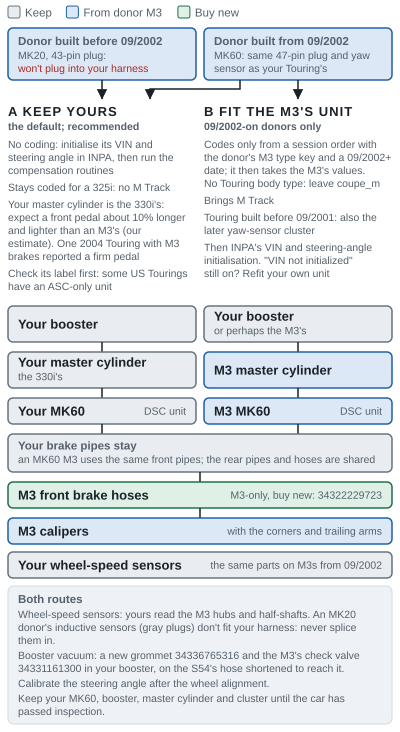 <!-- portrait -->

*Figure 22. The DSC and brake choice. Only a donor built from 09/2002 has an MK60 that plugs into your harness, so with an earlier donor you keep your own unit (route A, the default). Either way your brake pipes and wheel-speed sensors stay, the M3 calipers take new M3 front hoses, and the booster takes the M3's check valve in a new grommet.*

If your car turns out to be a 325xi, it has a Bosch DSC 5.7 instead ([e46fanatics](https://www.e46fanatics.com/threads/how-to-calibrate-steering-angle-using-tool32.1282261/)). Converted to rear drive, it needs more than Option B's unit: the whole MK60 system, with its sensors, sensor cluster, master cylinder, reservoir, pipes and an adapter loom, because the xi's front sensors don't fit a rear-drive hub and MK60 sensors don't work with the Bosch unit ([BMW ST056](https://archive.org/download/BMWTechnicalTrainingDocuments/ST056%20Chassis%20Dynamics%20%28Archive%201%29/04%2520E46%2520DSC%25201-27-03.pdf)). Kept all-wheel drive, it keeps its own DSC 5.7: there, Option A is the only option. Both are in [325xi: rear drive or all-wheel drive](#325xi-rear-drive-or-all-wheel-drive).

### Inspection readiness

- **Keep every emissions function.** Order the DME flash as an EWS delete only. Keep the secondary-air pump, all four O2 sensors and the DM-TL leak-test pump, wired to the MSS54's pins 18, 20 and 30 ([Kassel](https://www.kasselperformance.com/product/bmw-e46-m3-s54-mss54-hp-tuning/), [manual](WIRING-AND-CODING.md#dm-tl-leak-test-pump-test-before-you-swap)).
- **Write your full VIN into the DME.** State testers read the VIN stored in the DME, and BMW issued a bulletin for E46s whose DME held only the last seven digits ([BMW SI B12 09 13](https://static.nhtsa.gov/odi/tsbs/2013/MC-10150160-9999.pdf)). California's test reads it from the OBD port ([e46fanatics](https://www.e46fanatics.com/threads/chassis-vin-dme-ews-vin-lcm-ike-vin-all-mismatched-help.1253491/)). So a DME with your full VIN written should report it to the tester. Nobody has confirmed that every US MSS54 answers a generic scanner's VIN request (mode 09), and no rule required it before the 2005 model year: California's OBD rule asks for the VIN only from MY2005, while the rule for 1994–2003 cars asks only for the calibration ID and a software check ([13 CCR 1968.2](https://www.law.cornell.edu/regulations/california/13-CCR-1968.2), [13 CCR 1968.1](https://www.law.cornell.edu/regulations/california/13-CCR-1968.1)). So a 2001–03 MSS54 may not report a VIN at all: check the donor with a generic scanner in Phase 1, and yours with INPA as well as a scanner.
- **What the federal OBD check passes.** A car with stored codes passes if the check-engine lamp isn't commanded on, and a model-year 2001-or-later car may pass with one monitor not ready. It fails if the lamp is commanded on but not lit, or doesn't light with the key on and the engine off ([40 CFR 85.2222](https://www.ecfr.gov/current/title-40/chapter-I/subchapter-C/part-85/subpart-W/section-85.2222)), so check the bulb with the M3 cluster fitted. States add their own limits: New York fails a 2001-or-later car with more than one monitor not ready ([NYVIP3](https://www.nyvip3.com/OBDII/ReadyVSNotReady)). Massachusetts doesn't emissions-test a 2001–05 car in 2026 ([Massachusetts](#massachusetts)).
- **Expect stored faults:** location 1 (0x01), the pump fault, which doesn't light the check-engine lamp ([Fuel-pump control](#fuel-pump-control) explains it), and possibly 130 (0x82) after the EWS delete. Nobody has documented whether a leftover 130 (0x82) commands the lamp, so check `STAT_MIL_EIN` and a generic scanner rather than guess, and ask for the tampering-fault delete with the EWS delete.
- **The EVAP leak test is the hard monitor.** The MSS54 runs its DM-TL test only with the engine off, after at least 20 minutes of driving that followed at least 5 hours parked, with the tank 15–85% full, the air between −7 and 35 °C (20–95 °F) and the battery between 11.5 and 14.5 V, and only every second time those conditions are met ([BMW ST041](https://archive.org/download/BMWTechnicalTrainingDocuments/ST041%20M3%20Complete%20Vehicle/3%20EngineElectronics%20%28Part%203%29.pdf)). EVAP is the monitor reported "not ready" on an MSS54 swap ([e46fanatics](https://www.e46fanatics.com/threads/s54-swaps-and-smog-in-california-update.1303447/)).
- **The cluster feeds the leak test.** The DME takes the fuel level, the outside temperature and the parked time from the cluster over CAN ([SGBD documentation](https://github.com/emdzej/ediabasx-docs-sgbd/blob/main/docs/sgbd/MSS54DS0.md)). An M3 cluster that misreads your Touring's tank senders can keep the test from ever running, so check the fuel gauge against a measured fill first ([manual](WIRING-AND-CODING.md#the-dm-tl-leak-test)).
- **One bank, and purge under EVAP.** The S54 has one bank of six cylinders, so a scanner shows one set of catalyst and O2 results, not two. A generic scanner doesn't list the purge check on its own; it reports it as part of the EVAP monitor ([manual](WIRING-AND-CODING.md#what-the-mss54-monitors)).
- **Readiness resets** when codes are cleared or the battery is disconnected ([NYVIP3](https://www.nyvip3.com/OBDII/ReadyVSNotReady)). Lazy pre-cat O2 sensors can stop the secondary-air monitor completing ([e46fanatics](https://www.e46fanatics.com/threads/e46-emission-readiness-monitor-issues.1244521/), unverified); BMW does judge the secondary-air system by those sensors' response ([BMW ST041](https://archive.org/download/BMWTechnicalTrainingDocuments/ST041%20M3%20Complete%20Vehicle/3%20EngineElectronics%20%28Part%203%29.pdf)). The drive plan is in the [manual](WIRING-AND-CODING.md#a-drive-plan-for-readiness).
- **The DME's system checks test parts, not readiness.** Tool32's secondary-air, leak-test and purge checks report pass or fail. The readiness mask is a separate value that the monitors set while you drive, so we infer the checks never set a monitor to ready; BMW doesn't say ([manual](WIRING-AND-CODING.md#checks-with-tool32-and-a-scanner)). Use them to prove the hardware, then drive.
- **Software checks:** see [Immobilizer (EWS)](#immobilizer-ews) and [Registration and legal](#registration-and-legal-us).

### Troubleshooting

The full trees and tables, with tool jobs, pins and expected readings, are in the [manual](WIRING-AND-CODING.md#troubleshooting). INPA prints fault numbers in decimal and BMW's job documentation in hex, so this guide gives both: 130 (0x82) is the immobilizer fault, and 1 (0x01) the pump fault.

| Symptom | Likely cause | Where to look |
|---|---|---|
| Won't crank | A flat battery, which stopped Tenza's first attempt ([Tenza Motorsports – M3 Touring build finally runs (2021), 03:55](https://www.youtube.com/watch?v=8uwpzS_-uDs&t=235s)); the key not recognized; no clutch signal at EWS pin 8 | [Won't start](WIRING-AND-CODING.md#wont-start), [Immobilizer (EWS)](#immobilizer-ews) |
| Cranks, won't start, or fires once or twice and never runs; 130 (0x82) stored | The DME isn't released: the delete wasn't done or hasn't taken, or a virgin DME's sync failed. "EWS to DME issues generally manifest as a brief fire or no fire at all," as a builder of S54 Tourings puts it ([NAM3 (2025)](https://nam3forum.com/forums/forum/main-forum/e46-2001-2006/319929-ews-delete-and-i-have-a-crank-with-no-start/page2)) | [Immobilizer (EWS)](#immobilizer-ews) |
| Cranks, won't start; no prime at key-on | X60004 pin 10 not reaching K96, fuse F54 or F3, or the E-box plugs | [Fuel-pump control](#fuel-pump-control) |
| Cranks, won't start; primes, but pressure low | Feed and return swapped at the filter-regulator ([NAM3](https://nam3forum.com/forums/forum/main-forum/e46-2001-2006/82513-s54-swap-to-ms42-car-no-start)) | [Fuel system](#fuel-system) |
| Runs for a few seconds, then dies | Not the immobilizer. A throttle-system (EML) fault that shuts the engine off within about 3 seconds is one documented cause ([MotoIQ](https://motoiq.com/project-e46-m3-part-8-the-dreaded-eml-light/)) | [Won't start](WIRING-AND-CODING.md#wont-start) |
| Fault 1 (0x01) stored, but the pump primes and the engine runs | Expected with US software on the relay | [Fuel-pump control](#fuel-pump-control) |
| Injector "circuit low" on all six | Mixed X6053/X60531 halves | [Harness and re-pinning](#harness-and-re-pinning) |
| No oil or charge lamp at key-on | Lamp wires not moved or added, or the cluster coded for CAN | [Warning lights](WIRING-AND-CODING.md#warning-lights) |
| Yellow brake lamp, or fault 106 (0x6A) and no cruise | The brake switch's test-contact wire still on X60004 pin 28 | [Harness and re-pinning](#harness-and-re-pinning) |
| Cruise won't engage | The non-M clutch module, the gear switch, the X6011 pin-7 crossing or the brake contacts | [Harness and re-pinning](#harness-and-re-pinning) |
| Revs hang between shifts, or idle hunts on clutch-in | Clutch-chain wiring first ("the most common rev hang"), then SMG software in the DME. In a non-M automatic-to-manual swap (2000 323Ci, MS42) it was a tune written for the automatic ([e46fanatics](https://www.e46fanatics.com/threads/manual-swap-rev-hang.1315205/)) | [Manual](WIRING-AND-CODING.md#driving-emissions-and-comfort) |
| Limp mode or an SMG lamp | An SMG donor's DME still running SMG software | [Immobilizer (EWS)](#immobilizer-ews) |
| Tamper dot | Cluster VIN differs from the LCM's, or the LCM's mileage is higher ([NAM3](https://nam3forum.com/forums/forum/main-forum/e46-2001-2006/228697-cluster-replacement)) | [Instrument cluster and mileage](#instrument-cluster-and-mileage) |
| DSC lamp with "VIN not initialized" | VIN and steering angle not initialised; or an M3 MK60 not yet coded from a late enough session vehicle order, or reset in PA-Soft instead of initialised in INPA | [DSC, brakes and steering angle](#dsc-brakes-and-steering-angle), [manual, Session 5](WIRING-AND-CODING.md#session-5-dsc-coding-and-vin) |
| ABS lamp after the first drive | Faults stored while parts were unplugged (clear them and drive), a sensor not seated, a damaged pulse wheel, mixed tire sizes, or an MK20 donor's sensors. The DSC's wheel-speed faults are 5D90–5DC5, one block per wheel; the last digit: 0 wiring, 1 or 3 seating, 2 pulse wheel, 4 or 5 tooth count or tire size | [Wheel-speed and pad-wear sensors](WIRING-AND-CODING.md#wheel-speed-and-pad-wear-sensors), [DSC, brakes and steering angle](#dsc-brakes-and-steering-angle) |
| Sport LED dark; fault 110 (0x6E) | The wire from the switch center to X60004 pin 16 | [Manual](WIRING-AND-CODING.md#sport-button-and-switch-center) |
| EVAP monitor never ready | The heater not on pin 18, the pump and valve wiring not proven, a hose, the vapour separator in the right rear wheel well or the filler cap after the arch work, the fuel gauge, or the test conditions | [Inspection readiness](#inspection-readiness) |
| A/C won't engage | The cluster not passing the request; the climate control's coded compressor lock (`KOMPRESSOR_SPERRE`); the refrigerant pressure; then the chain from the DME's pin 29 to relay K19 and the compressor clutch | [Manual](WIRING-AND-CODING.md#ac-with-manual-or-automatic-climate-control) |
| Fault 96 (0x60), radiator-outlet temperature plausibility, or a slow warm-up | The radiator-outlet sensor unplugged or in the wrong hose; we infer that a thermostat stuck open sets it too | [Cooling checks and pass values](#cooling-checks-and-pass-values) |
| Speedometer about 9% high | The M3 cluster's built-in over-read | [Instrument cluster and mileage](#instrument-cluster-and-mileage) |

## Deep dive: bodywork and fitment

Everything in the M3 front end bolts to the Touring except the front fenders. The rear arches are the big job: you graft M3 arch steel into the Touring's rear quarters around a mock-up of the final axle, wheels and tires. The graft moves the skin outward, not the opening: the arch opening is the same shape and height on both cars, and the M3 skin stands out from the Touring's by a profile that peaks over and behind the axle and fades out above and behind it ([Flare profile](#flare-profile)). Set up the welder, and protect yourself and the car, as described in [Welding settings and safety](#welding-settings-and-safety).

### Front end on a 4-door body

Genuine M3 front fenders don't bolt onto a sedan or Touring: the coupe's front fenders are "an inch longer than those on the sedan and wagon" ([Jalopnik](https://www.jalopnik.com/an-e46-m3-wagon-would-have-been-the-best-bmw-1807152574/)). Builders describe the M3 fender as longer between the arch and the door and sitting further out; forced into place, its swage line drops, and its side gill sits further back than a 4-door fender's ([Tracks and Trails – What it really takes (2026), 02:20](https://www.youtube.com/watch?v=nADBRfX9DqY&t=140s), [Calvin's Car Diary – PT9 (2020), 06:00](https://www.youtube.com/watch?v=-BMrhOr8fdg&t=360s)).

The rest bolts on. "Basically the complete M3 frontend will fit on the Touring… the only thing that won't fit are the two front fenders" ([M3projekts – Ep3 (2023), 08:00](https://www.youtube.com/watch?v=TT0sd2JB5dY&t=480s)), and Redish found the M3 hood "fits straight on" ([Autoalex Cars – Part 3 (2023), 05:00](https://www.youtube.com/watch?v=cwbRDG7XHa8&t=300s)). The hood still needs M3-shaped fenders beside it, which is why one budget Touring kept a non-M front end ([Tenza Motorsports – Wagon tour and plans (2020), 01:40](https://www.youtube.com/watch?v=roTBxPmyhEY&t=100s)). BMW's catalog lists the same front panel (51717111691) and front body brackets for the Touring, coupe and M3 ([ETK](https://bmwfans.info/parts-catalog/51717111691/)), and the same M3 fender (41357894337) and hood (41617894223) for the M3 coupe, convertible and CSL, so a convertible donor's front panels are the same parts ([ETK](https://bmwfans.info/parts-catalog/41357894337/)).

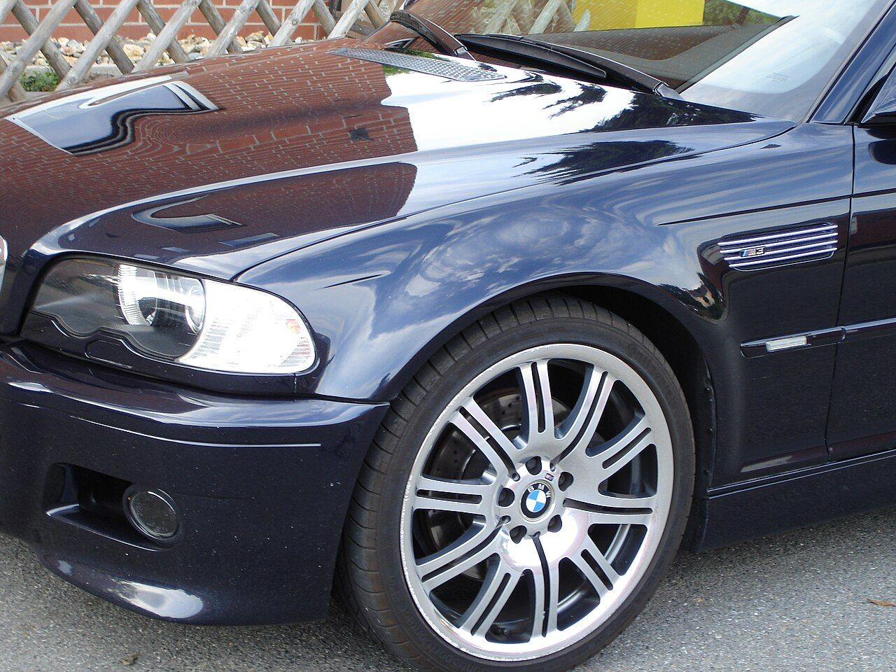

*Photo: The M3 front fender, with its flared arch and side gill (here on a convertible). JanST, [CC BY-SA 2.5](https://creativecommons.org/licenses/by-sa/2.5/), via [Wikimedia Commons](https://commons.wikimedia.org/wiki/File:BMW_M3_E46_Cabrio_detail.JPG).*

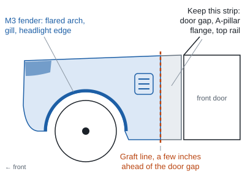 <!-- portrait -->

*Figure 23. The fender graft. Keep the rear strip of your 4-door fender, which carries the door gap, A-pillar flange and top mounting rail, and join it to the front of the M3 fender with its flared arch and gill.*

**Option A: graft genuine M3 fenders.** Keep a strip of your 4-door fender at the door gap and A-pillar, and weld the front of the M3 fender to it ([NAM3](https://nam3forum.com/forums/forum/main-forum/e46-2001-2006/75083-e46-touring-m3-front-end-conversion)); one builder describes "a slit off the sedan fender cut and welded on to the M3 fender" ([e46fanatics](https://www.e46fanatics.com/threads/can-m3-hood-fenders-front-bumper-be-fitted-to-an-e46-sedan.191582/)). SOS Customz kept the factory fender's mounting points, door-gap section and front corner, tacked the M3 flare to it and spliced the M3 gill molding in so its line meets the headlight ([SOS Customz – Building an E46 M3 Touring wagon (2023), 05:00](https://www.youtube.com/watch?v=L8m9gEOklVY&t=300s), [12:00](https://www.youtube.com/watch?v=L8m9gEOklVY&t=720s)). Calvin's body man used the rear section of a standard Touring fender and moved the gill forward ([Calvin's Car Diary – PT9 (2020), 07:00](https://www.youtube.com/watch?v=-BMrhOr8fdg&t=420s)). A graft that joins the front half of an M3 fender to the rear half of the original, so the arch line stops short, looks wrong ([Calvin's Car Diary – PT5 (2020), 07:20](https://www.youtube.com/watch?v=KzgXjYYyaL0&t=440s)). On a bench:

1. Bolt your 4-door fender to the car and mark a graft line a few inches ahead of the door gap, clear of the arch flare.
2. Trial-fit the M3 fender with the hood, headlight and bumper mounted, so the front edges sit where they must. Mark the same line on it.
3. Cut both fenders, leaving the M3 piece slightly long, then trim to a 1 mm butt gap.
4. Clamp both pieces back on the car, check the door gap and the line along the hood, and tack-weld. If pushing the fender flush lifts its top edge, relieve it; one builder slit the top of the fender ([Eurofed Automotive – Miki's M3 Touring (2025), 04:00](https://www.youtube.com/watch?v=iolOysUs20M&t=240s)).
5. Remove the fender, finish with short stitch welds, alternating ends to keep heat down, and planish the seam.
6. Seal the back of the seam and prime.

**Option B: buy Touring fenders.**

- **2M Autowerks (steel).** One owner's verdict: "The fit is ok. Not what I would call factory appearance." Thin mounting tabs broke, the line at the A-pillar "doesn't look right", it needed filler for "dimples and fixing some lines", and the M3 liners needed "a LOT of trimming" ([e46fanatics](https://www.e46fanatics.com/threads/2m-m3-touring-conversion-fenders.1209713/)).
- **M3Projekts (carbon).** €1,400 before VAT; the maker says you can "simply bolt on" them ([M3Projekts](https://m3projekts.com/product/e46-m3-touring-front-fenders/)). They're moulded from a metal hybrid of sedan and M3 coupe fenders ([M346 Projects – Pt 18 (2024), 02:20](https://www.youtube.com/watch?v=IBAqCYQuEzs&t=140s)). Fit reports: "a few hours of fiddling" per side, with lines and door gaps close but one side tight at the front and open at the rear ([Tracks and Trails – What it really takes (2026), 04:00](https://www.youtube.com/watch?v=nADBRfX9DqY&t=240s)); two days of alignment, a carbon tab ground shorter and the hood-hinge holes opened 2–3 mm ([M3projekts – Ep4 (2023), 04:30](https://www.youtube.com/watch?v=_sZHTK-Xae4&t=270s)); about five hours to fit the side-gill trim and modify its clips ([M346 Projects – Pt 18 (2024), 07:00](https://www.youtube.com/watch?v=IBAqCYQuEzs&t=420s)).

**Before you commit:**

- **Bumper supports.** The M3 bumper mounts on fender supports 51118195295/96. Tourings built before 09/2001 have them; facelift cars use different supports and need these added ([ETK](https://bmwfans.info/parts-catalog/51118195295/), [Garagistic](https://www.garagistic.com/products/e46-m3-style-front-bumper-aftermarket-replacement)). Early M3s (to 11/2001) share the Touring's bumper carrier; later ones use a lighter carrier (51117893527). Facelift Tourings with genuine M3 bumpers and headlights exist; the Sloan car is a 2004 ([BMWBlog](https://www.bmwblog.com/2024/11/11/custom-e46-m3-touring-wagon-s54-build/)).
- **Brackets and liners.** A Touring without the M Tech front bumper needs two more brackets for the bumper corners, and you need the M3's front and rear fender liners ([M3projekts – Ep3 (2023), 09:30](https://www.youtube.com/watch?v=TT0sd2JB5dY&t=570s)). The 2M fender owner also needed the M3 bumper carrier, lower headlight trim and M3 horn bracket ([e46fanatics](https://www.e46fanatics.com/threads/2m-m3-touring-conversion-fenders.1209713/)).
- **Airflow.** Keep the M3 bumper's lower opening and ducting; the oil cooler depends on it. With a ZHP bumper, Tenza had to cut away a scoop behind the bumper so the M3 oil cooler got air ([Tenza Motorsports – Front end with M3 parts (2021), 03:20](https://www.youtube.com/watch?v=k2YMcy9TdJk&t=200s)).
- **Washer tank.** The M3's washer tank sits low behind the bumper. Original M3 and ZHP bumpers leave room for it; aftermarket bumpers may not ([Tenza Motorsports – 5 things (part 2) (2021), 01:00](https://www.youtube.com/watch?v=mDBiRn30fEs&t=60s)). Its pump and level-sensor leads need extending ([M3projekts – Ep5 (2023), 04:30](https://www.youtube.com/watch?v=Ipbjt8S2c2g&t=270s)); see the [Wiring and coding manual](WIRING-AND-CODING.md).

### Rear arches and doors

**How much wider.** The rear hub faces sit in about the same place on both cars. The M3's rear track is 1,525 mm on Motorsport Australia's homologation form and 60.0 in (1,524 mm) on BMW USA's spec sheet, and the US 325i Touring's is 1,483 mm ([Motorsport Australia](https://motorsport.org.au/wpblob0fe832abcb/wp-content/uploads/docs/default-source/sporting-technical/group-3e/3-18-007-bmw-e46-m3.pdf), [BMW USA: M3](https://www.press.bmwgroup.com/usa/article/attachment/T0022127EN_US/41385), [BMW USA: Touring](https://www.press.bmwgroup.com/usa/article/attachment/T0022146EN_US/41437)). Half the track plus the wheel offset puts each rear hub face about 788–790 mm from the centerline on both cars: 788.5 mm with the M3's ET26 wheel and an ET47 wheel on the Touring. So the extra rear width comes from the M3 wheel itself. Its ET26 offset moves the wheel about 21 mm further out per side, and the 9-inch rim and 255 tire add width on top. Treat the hub-face figure as good to a millimetre or two: neither source says which wheels its track was measured on (the form lists the M3's 19-inch ET27 rear wheels, which would give 789.5 mm), and BMW's MY2003 wheel and tire list puts the Touring's 8J × 17 wheel at ET47 and its 7J × 16 wheels at ET46 or ET47, depending on the style ([BMW wheel and tire list: Touring](https://myair-bdr.bmwgroup.com/static/manual/RadReif/RadReif/00/mj2003/e46touring3_2003.htm)).

**The body follows, by a profile, not one number.** BMW USA gives the M3 a width of 70.1 in (1,780 mm) and the 325i Sport Wagon 68.5 in (about 1,740 mm): 20.3 mm (0.8 in) more per side at the widest point ([BMW USA: M3](https://www.press.bmwgroup.com/usa/article/attachment/T0022127EN_US/41385), [BMW USA: 325 models](https://www.press.bmwgroup.com/usa/article/attachment/T0022131EN_US/41405)). We scaled BMW's dimension drawing of the M3 coupe and a drawing of the Touring to BMW's published dimensions ([M3 coupe drawing](https://getoutlines.com/blueprints/6769/2007-bmw-m3-e46-coupe-blueprints), [Touring drawing](https://getoutlines.com/blueprints/372/2004-bmw-3-series-e46-touing-wagon-blueprints)). By our measurement the M3 skin stands:

- about 21–23 mm (0.8–0.9 in) proud of the Touring's from 300 mm ahead of the axle to 100 mm behind it;
- 25–32 mm (1.0–1.3 in) proud from 150 to 350 mm behind the axle;
- about 10 mm (0.4 in) proud 500 mm behind the axle, fading out beyond;
- blended in again 470–530 mm (18.5–20.9 in) above the hub, just under the shoulder crease at about 540 mm (21.3 in).

These figures come from drawings and are good to about ±5–10 mm, so the plan has you confirm them with templates on both cars. The station table and the seam lines are in [Flare profile](#flare-profile).

HARD Motorsport's M3-style rear flares are "Aprox 30mm wider" ([HARD Motorsport](https://www.hardmotorsport.com/hard-motorsport-bmw-e46-sedan-touring-m3-style-motorsport-fender-flares-rear-set/)), and an owner who fitted them measured "a solid 25-30mm" ([e46fanatics](https://www.e46fanatics.com/threads/new-hard-motorsport-sedan-m-style-flares-installed.1049334/)). That matches only the rear half of the flare. We infer from BMW's drawings that from about 150–220 mm behind the axle rearward, below the bumper's top line, the arch edge you see is the bumper cover, not steel, on both cars. So much of the extra width behind the axle is probably the M3 bumper corner, and the steel and lip hidden behind it may move out less ([Rear bumper, skirts and trim](#rear-bumper-skirts-and-trim)).

**The opening stays put.** BMW-style drawings of the M3 coupe, M3 convertible, non-M coupe and Touring all put the arch edge about 340–350 mm (13.4–13.8 in) above the hub at the top and 355–365 mm (14.0–14.4 in) ahead of it at hub height (our measurement, ±10 mm) ([M3 convertible drawing](https://getoutlines.com/blueprints/453/2004-bmw-m3-e46-c-cabriolet-blueprints), [non-M coupe drawing](https://getoutlines.com/blueprints/356/2004-bmw-3-series-e46-coupe-blueprints)). The M3's difference is sideways, not a bigger opening. The graft moves the skin and its lip outward and leaves the opening where it is.

**Tires against the body.** On the M3 wheel, the rear tire's widest sidewall sits about 892 mm from the centerline. That is about flush with the M3 flare's crown, at about 890 mm, and about 22 mm (0.9 in) outside an unflared Touring's widest point. These are our estimates, assuming a 255/40R18 measures about 260 mm across on a 9J rim. Motorsport Australia's recognition form gives the E46 M3's bodywork width as 1,787 mm at the rear axle ([3-18-007](https://motorsport.org.au/wpblob0fe832abcb/wp-content/uploads/docs/default-source/sporting-technical/group-3e/3-18-007-bmw-e46-m3.pdf)), about 24 mm per side more than BMW's 1,739 mm for the Touring. On an unflared Touring with M3 axles, one owner found a 9J ET40 rear wheel with a 245/40-17 tire sat flush with the arch lip ([NAM3 – Black & Tan 332iT (2023)](https://nam3forum.com/forums/forum/main-forum/member-build-journals/195928-black-tan-332it/page10)); the M3's own ET26 wheel and 255 tire sit about 19 mm further out. Without the M3 flares the tires stand proud of the body, which matters at a Massachusetts inspection ([Massachusetts](#massachusetts)).

**Where the rear door meets the arch.** The Touring's rear door has its own part numbers (41527034155/156; the sedan's are 41527034153/154), and its lower rear corner is cut around the wheel, so its trailing edge forms the front of the arch opening ([ETK](https://bmwfans.info/parts-catalog/E46-Touring/USA/325i-M54/L-N/browse/bodywork/rear_door_hinge_door_brake/)). It meets the arch on its forward upper curve, at about 10 o'clock on the left side and 2 o'clock on the right: roughly 300–350 mm (11.8–13.8 in) ahead of the axle and 150–250 mm above the hub. That is our estimate from a drawing without dimension lines, ±50 mm, so measure yours.

- The M3 flare starts about 380–420 mm ahead of the axle, so the first 50–100 mm of its ramp falls on the door.
- At the shut line the M3 surface would stand about 11–20 mm (0.4–0.8 in) proud of the stock door (our estimate).
- That is the forward "nose" that builders have had to beat in and blend where it meets the door ([M346 Projects – Pt 14 M3 body work (2024), 28:20](https://www.youtube.com/watch?v=4_LqrbAlNmw&t=1700s)), or carry onto the door. The choices are in [Rear doors](#rear-doors).

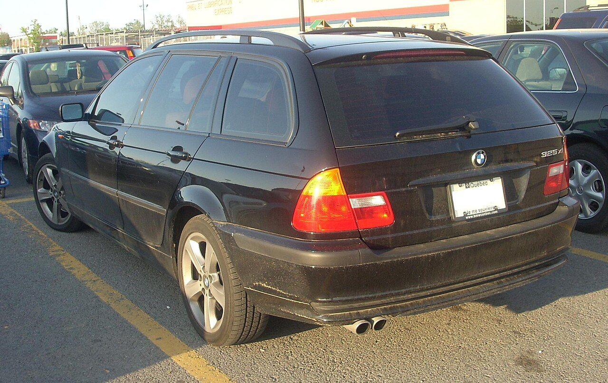

*Photo: The standard Touring rear arch, on a facelift 325xi (BMW lists the same rear side panel, 41218242347, for the 325i Touring: [ETK](https://bmwfans.info/parts-catalog/41218242347/)). Bull-Doser, public domain, via [Wikimedia Commons](https://commons.wikimedia.org/wiki/File:%2702-%2705_BMW_325xi_Wagon.JPG).*

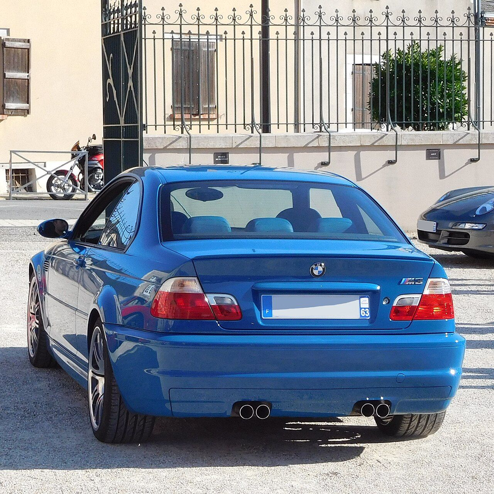

*Photo: The M3's flared rear arch, which this conversion grafts onto the Touring. Cjp24, [CC BY-SA 4.0](https://creativecommons.org/licenses/by-sa/4.0/), via [Wikimedia Commons](https://commons.wikimedia.org/wiki/File:BMW_M3_%28E46%29%2C_blue.jpg).*

**Where the steel comes from.** Most conversions we found used welded steel. BMW's prototype arches "appear to be fully metal constructed" ([Redish](https://www.redish-motorsport.com/BMWE46M3TouringS54WideArchBuilds.html)), and the Sloan car's "OEM metal fender flares were grafted on" ([BMWBlog](https://www.bmwblog.com/2024/11/11/custom-e46-m3-touring-wagon-s54-build/)).

- **Petroyle's quarters are steel.** BMWBlog lists Petroyle's carbon panels as the rear bumper, side sills, boot floor and front wings, and says "The quarter panels stay in steel" ([BMWBlog – Petroyle E46 M3 Touring (2026)](https://www.bmwblog.com/2026/04/09/e46-bmw-m3-touring-petroyle/)). Its rear quarters are "shaped and welded to match the BMW concept's arches, while the rear doors stay standard" ([Perfects Auto](https://perfectsauto.xyz/driving-e46-m3-touring.html)).
- **Petroyle's "carbon wings"** in Hagerty's video are those front wings ([Hagerty – Petroyle's E46 M3 Touring (2026), 09:00](https://www.youtube.com/watch?v=--YbwCS4F_g&t=540s)). One video review calls the car's arches carbon ([candyshowroom – The M3 BMW never built (2026), 15:40](https://www.youtube.com/watch?v=uMAVcXRFZU4&t=940s)), which conflicts with both.
- **The inside of the arch changes too.** BMW's changes for the M3 coupe included extra C-pillar reinforcement, modified inner side sections around the wheel arches, and a fuel-filler flap reshaped to the M3 quarter ([BMW ST041](https://archive.org/download/BMWTechnicalTrainingDocuments/ST041%20M3%20Complete%20Vehicle/1%20M3%20Complete%20Vehicle.pdf)). Expect to rebuild the inside of the arch, not just the skin.
- **Massachusetts.** Welding steel from another car into your unibody may count as reassembling "the frames or unit bodies of two or more motor vehicles", which brings an RMV inspection and a "reconstructed" title. Ask the RMV first ([Massachusetts](#massachusetts)), or use new BMW panels: see **A new-steel route** below.

What BMW's catalog shows:

- **Two M3 quarters.** The coupe and CSL use 41217890689/690 (14.5 kg); the M3 convertible has its own, 41357894541/542 (11.5 kg) ([ETK](https://bmwfans.info/parts-catalog/41357894541/)). The difference comes from the upper body, C-pillar and roof against the soft-top, as on non-M cars: a 325Ci coupe quarter weighs 15.2 kg and a 325Ci convertible's 10.3 kg ([ETK](https://bmwfans.info/parts-catalog/41357029221/)).
- **The same arch, as far as BMW's drawings show.** BMW gives both M3s the same rear track, the same 18 × 9 rear wheels and the same 70.1 in body width ([BMW USA](https://www.press.bmwgroup.com/usa/article/attachment/T0022127EN_US/41385)). The parts around the flare are also the same on both: filler flap 51172695524, the rear bumper and its side brackets, the side skirts and their intermediate pieces, and the M3-only "coverings" 51712695667/51717895936 ([ETK](https://bmwfans.info/parts-catalog/51172695524/)). BMW's dimension drawings of the two show the same arch opening within 2–9 mm and the same flare within 3–7 mm, except perhaps 350–400 mm behind the axle, where the convertible's turns in about 10 mm sooner ([M3 coupe drawing](https://getoutlines.com/blueprints/6769/2007-bmw-m3-e46-coupe-blueprints), [M3 convertible drawing](https://getoutlines.com/blueprints/453/2004-bmw-m3-e46-c-cabriolet-blueprints)). That is our measurement from the drawings, so confirm it with templates.
- **The inner half of the rear wheelhouse (41148231757/758) is one part on the M3 coupe, the M3 convertible and the US 325i Touring** ([ETK](https://bmwfans.info/parts-catalog/41148231757/)). The extra width sits in the outer skin and the outer side of the wheelhouse. BMW draws one wheelhouse diagram for all three bodies. In it, the panel that meets the skin's lip is different on each:
  - the Touring's own outer half, 41218242355/356, a narrow flanged strip;
  - the coupe's interior side frame, 41217890677/678, an inner quarter panel with the wheel cut-out;
  - the convertible's inner lateral trim panel, 41217894553/554, together with its heavy interior side frame, 41217894557/558.

  That is our reading of BMW's diagrams ([ETK: Touring](https://bmwfans.info/parts-catalog/E46-Touring/USA/325i-M54/L-N/browse/bodywork/rear_wheelhouse_floor_parts/), [ETK: M3 coupe](https://bmwfans.info/parts-catalog/E46-Coupe/USA/M3-S54/L-N/browse/bodywork/rear_wheelhouse_floor_parts/), [ETK: M3 convertible](https://bmwfans.info/parts-catalog/E46-Cabrio/USA/M3-S54/L-N/browse/bodywork/rear_wheelhouse_floor_parts/)), not a BMW statement. BMW gives the M3 its own part wherever this panel forms the outer wheelhouse: the non-M 325Ci convertible's 41217022593/594 becomes the M3's 41217894553/554 (both 4.8 kg), and the 325Ci coupe's interior side frame 41218242067/068 becomes the M3's 41217890677/678 ([ETK, 325Ci convertible](https://bmwfans.info/parts-catalog/E46-Cabrio/USA/325Ci-M54/L-N/browse/bodywork/rear_wheelhouse_floor_parts/), [ETK, M3 convertible](https://bmwfans.info/parts-catalog/E46-Cabrio/USA/M3-S54/L-N/browse/bodywork/rear_wheelhouse_floor_parts/)). BMW's drawing shows 41217894553 as an inner quarter panel with the arched outer wheelhouse built in ([drawing](https://ills.bmwfans.info/2s5a.png)). An M3-only number on an otherwise identical panel suggests the M3 arch flange, but nobody has confirmed it: at about \$128, buy one and check it against an M3 skin before you plan around it.

**How the factory built the lip.** The arch edge is a double skin. The quarter skin and the outer wheelhouse flange overlap in a nested U-channel, spot-welded and seam-sealed ([NAM3](https://nam3forum.com/forums/forum/main-forum/e46-2001-2006/189875-how-is-the-rear-quarter-panel-supposed-to-be-attached-to-the-wheel-well), [Redish – BMW E46 rear arches (2020), 01:00](https://www.youtube.com/watch?v=OWSjvh_28v0&t=60s)), and E46 arch rust starts in that channel. Redish puts the lip at about 15 mm (0.6 in) on most E46s and about 4 mm on the CSL, whose lip is bonded; its own bonded "CSL-style" lip is about 8 mm and gains about 7 mm of tire clearance ([Redish](https://www.redish-motorsport.com/BMWE46M3RearWheelArchesRust.html)). The skin itself is thin. Expect about 0.7–0.8 mm (0.028–0.031 in), the range I-CAR gives for typical outer panels ([I-CAR](https://rts.i-car.com/oem-restraints-system-part-replacement-search/51df0590-ca17-4e8f-a0c4-939263a9c236.html)), and measure yours at a cut edge. How to rebuild the lip is in [Arch graft step by step](#arch-graft-step-by-step).

**A convertible donor** yields the whole M3 outer skin from the door shut line back to the tail-light, with the full flare and the right-side filler opening and flap. It lacks only the C-pillar and roof section, which a Touring doesn't use. It also brings the same M3 trunk floor (41127895619), front fenders, hood, rear bumper, side skirts and filler flap as a coupe. The catch is cutting: the arch flange sits on the convertible's inner lateral trim panel and its heavy interior side frame (33.5 kg each, against 5.7 kg for the coupe's interior side frame), so you drill out more spot welds to free it ([ETK](https://bmwfans.info/parts-catalog/41217894557/)). Builds with convertible donors:

- M346 Projects cut both rear quarter sections and the trunk floor from a 2003 M3 convertible and welded them to a Touring, with no convertible-specific problem mentioned on camera ([M346 Projects – Pt 1 (2023), 06:40](https://www.youtube.com/watch?v=YqM2rQw1HQI&t=400s), [Pt 14 (2024), 58:00](https://www.youtube.com/watch?v=4_LqrbAlNmw&t=3480s)). M3Projekts, which built its own Touring from a convertible donor, says "Coupe or Cabrio/Vert doesn't really matter" ([M3projekts – Ep7 (2023), description](https://www.youtube.com/watch?v=ihD3-3ZlBjI)).
- Two written build logs used convertible donors without saying where the arch steel ended up: the US 325iT built in Hungary by M3Projekts, which came back with welded steel arches carried onto the doors ([NAM3](https://nam3forum.com/forums/forum/main-forum/member-build-journals/155763-e46-m3-touring-conversion-to-europe-and-back)), and a 2016 PistonHeads build that bought the rear half of a Cat C 2005 M3 convertible for its quarters and boot floor, then stopped before any bodywork ([PistonHeads](https://www.pistonheads.com/gassing/topic.asp?h=0&f=47&t=1623927&i=60)).

**Steel sources.** Prices were checked in October 2026 unless dated. BMW lists no section or arch repair part for the M3 rear quarter; its only E46 "section of rear fender" (41217057389/390) is for sedans ([ETK](https://bmwfans.info/parts-catalog/41217057389/)).

| Source | What you get | Price seen | Notes |
|---|---|---|---|
| Your donor's arches, coupe or convertible | Outer skin, inner lip, filler flap and surround | Comes with the donor | First choice. E46 arch rust starts at the inner lip, hidden under seam sealer ([Redish](https://www.redish-motorsport.com/BMWE46M3RearWheelArchesRust.html)); Autoalex's coupe donor lost its inner arch to rust as soon as it was stripped ([Autoalex Cars – Part 1 (2023), 07:40](https://www.youtube.com/watch?v=RyoFFLppseE&t=460s)) |
| Used pre-cut M3 quarter sections | Varies | Varies | Earlier research found them on eBay; no current listing checked |
| New M3 coupe quarter, left 41217890689, right 41217890690 | Whole side panel, up to the roof rail | \$6,932.63 each, list \$8,432.01, at BMWPartsDeal ([BMWPartsDeal](https://www.bmwpartsdeal.com/parts/bmw-right_rear_side_panel-41217890690.html)); £4,420 each at R44, a UK shop that prices in pounds and showed both as available ([R44: left](https://r44performance.com/products/genuine-bmw-e46-m3-rear-quarter-panel-left-41217890689), [right](https://r44performance.com/products/genuine-bmw-e46-m3-rear-quarter-panel-right-41217890690)); €6,518.67 each at eStore-Central, an EU retailer ([eStore-Central](https://www.estore-central.com/bmw-parts-catalog/E46-M3_CSL-S54/Coupe/Bodywork/Body-Side-Frame/)); "2,300 and something pounds each side" in the UK in 2023 ([Autoalex Cars – Part 3 (2023), 06:00](https://www.youtube.com/watch?v=cwbRDG7XHa8&t=360s)) | BMW lists them for the coupe and CSL. R44 ships backordered items together, so ask about lead time |
| New M3 convertible quarter 41357894541/542 | Side panel to the belt line, with the whole arch and filler opening | \$2,105.60 each, list \$2,561.00, at BMWPartsDeal ([BMWPartsDeal](https://www.bmwpartsdeal.com/parts/bmw-right_rear_side_panel-41357894542.html)); €1,979.88 each at eStore-Central ([eStore-Central](https://www.estore-central.com/bmw-parts-catalog/E46-M3-S54/Cabrio/Bodywork/Body-Side-Frame/)) | The cheapest new outer skin: about 30% of the coupe panel's price at the same retailer |
| New M3 convertible inner lateral trim panel, left 41217894553, right 41217894554 | Arch-shaped inner panel with flanges, 4.8 kg | \$127.54 / \$118.80 at BMWPartsDeal ([BMWPartsDeal](https://www.bmwpartsdeal.com/parts/bmw-left_inner_lateral_trim_panel-41217894553.html)); €141.50 / €131.82 at eStore-Central ([eStore-Central](https://www.estore-central.com/bmw-parts-catalog/E46-M3-S54/Cabrio/Bodywork/Rear-Wheelhouse-Floor-Parts/)) | It sits where the Touring's outer wheelhouse half does, so it probably carries the M3-width inner arch flange. That is our reading of BMW's diagram: inspect one before you rely on it |
| New M3 coupe interior side frame 41217890677/678 | Inner quarter panel with the wheel cut-out, 5.7 kg | \$1,311.70 each at BMWPartsDeal ([BMWPartsDeal](https://www.bmwpartsdeal.com/parts/bmw-left_interior_side_frame-41217890677.html)); €1,205.48 each at eStore-Central ([eStore-Central](https://www.estore-central.com/bmw-parts-catalog/E46-M3-S54/Coupe/Bodywork/Rear-Wheelhouse-Floor-Parts/)) | M3 coupe and CSL only |
| BMW inner wheel-arch panels | Inner arch | £990 each (2025) | No longer available in 2024, back in 2025; Redish doesn't give the part number ([Redish](https://www.redish-motorsport.com/BMWE46M3RearWheelArchesRust.html)). The price matches the coupe's interior side frame above, so we infer that's the part |
| LBL Panels (UK) M3 arch sections | 1.2 mm mild-steel arch, standard or full | £225 / £375 ([m3cutters](https://forums.m3cutters.co.uk/threads/e46-m3-rear-arch-repair-panel.252420/), unverified) | Coupe or convertible fitment not stated; no website or current listing found in October 2026, so ask on the m3cutters thread before planning on them. Thicker than the 0.7–0.8 mm skin it would join |
| Generic E46 coupe/convertible arch repair panels | Non-M arch | From €57 | Listed for "All models except M3" ([Mecatechnic](https://www.mecatechnic.com/en-GB/p/left-rear-wing-arch-for-bmw-e46-coupe-convertible_BT10193)); they don't fit |
| Arch sections cut from E46 front fenders | Front-fender arch welded to the rear quarter | Cheap | One 330d Touring owner's budget route ([Driftworks](https://www.driftworks.com/forum/threads/bmw-e46-330d-touring-wide-rear-arches-m3-19-wheels.249761/), unverified) |

**A new-steel route.** The convertible quarter plus its inner lateral trim panel makes a full set of new BMW arch steel.

- **Cost:** about €2,120 per side, or about €4,280 for both sides plus an M3 filler flap (51172695524, €45.06), at eStore-Central's October 2026 prices before shipping ([eStore-Central](https://www.estore-central.com/bmw-parts-catalog/E46-M3-S54/Cabrio/Bodywork/Side-Panel-Tail-Trim/)). It shows no stock levels, so ask before you order. In the US, BMWPartsDeal listed the same panels at \$2,105.60 a side panel and \$127.54 (left) or \$118.80 (right) an inner trim panel on 22 October 2026: about \$2,230 a side before freight and tax, or about \$5,309 for both arches plus the new M3 trunk floor and its reinforcement (our arithmetic). Each page said "Ships in 1-3 Business Days", but stock isn't confirmed until you order. The coupe route, quarter plus interior side frame, comes to about €7,724 or \$8,240 per side.
- **Title:** no donor steel goes into your body, which by our reading of the statute removes the Massachusetts "reconstructed" question for the arches ([Massachusetts](#massachusetts)).
- **Rust:** a new skin has no hidden rust in its lip.

**Check the steel before you cut.**

- **Shape.** Take the donor's rear bumper off, then make the section templates and record the station offsets as [Datum, stations and templates](#datum-stations-and-templates) describes. Left and right should agree within 3 mm (our suggestion). A test fit of an M3 rear bumper end and the filler flap is a quick first look.
- **Damage.** M346's donor quarters had been in an accident and curled in at the bottom; they needed a fender roller, and the rear bumper had to move in and forward to meet the new flares ([M346 Projects – Pt 14 (2024), 58:40](https://www.youtube.com/watch?v=4_LqrbAlNmw&t=3520s)).
- **Margin.** Cut 40–50 mm (1.6–2.0 in) outside the seam lines you'll use on the Touring ([Flare profile](#flare-profile)): from the donor's door shut line back past 600 mm behind the axle, and from the sill to just above the shoulder crease, keeping the factory spot-welded lip intact. If you'll graft the donor's inner tub, "make sure to cut as much of the wheel tub as possible… if you don't have that you're going to have a gap" ([M346 Projects – Pt 14 (2024), 33:00](https://www.youtube.com/watch?v=4_LqrbAlNmw&t=1980s)). On the right side, take the filler surround and flap.

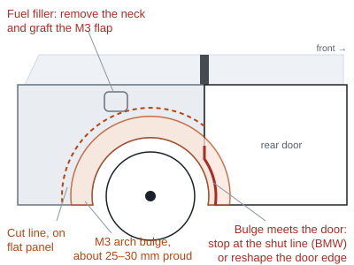 <!-- portrait -->

*Figure 24. Rear quarter, right side. The M3 section comes in between three seams: under the shoulder crease, ahead of the tail lamp, and just behind the rear door's shut line, with the filler surround and flap; your filler pot stays where it is. At the shut line a stock door sits about 11–20 mm inside the M3 surface: blend the M3 nose in before it, as BMW did, or reshape the door edge.*

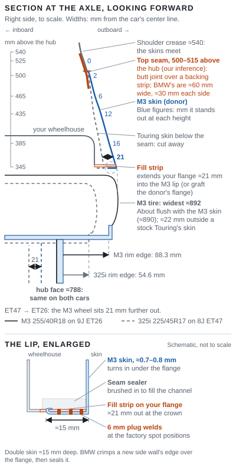 <!-- portrait -->

*Figure 25. Rear view of a section through the arch at the axle, drawn to scale, with the lip enlarged below. Both cars' hub faces sit in the same place, so the M3's ET26 wheel and wider tire end up about flush with the M3 skin, which stands about 21 mm out at the lip and blends back in under the shoulder crease. Extend your inner flange by the same amount, so the lip stays a sealed double skin.*

### Measure and mock up before you cut

The arches are welded around this mock-up for good, so have the final springs, dampers, wheels and tires in hand first; the choices are in [Suspension for Touring weight](#suspension-for-touring-weight). It matters: on the M3's springs and dampers, Tenza's Touring, which kept its standard arches, sat so low that its wider rear tires rubbed ([Tenza Motorsports – Coilover install (2022), 00:40](https://www.youtube.com/watch?v=Sit-SmfU-9k&t=40s)).

**BMW's ride height for the M3.** TIS measures it from the bottom middle of the rim flange straight up to the lower edge of the wheel arch, in BMW's normal position ([TIS 33 00](https://workshop-manuals.com/bmw/3_series_e46/m3_s54_coupe/3_technical_data/33__rear_axle/0__general/2_td__rear_axle_ride_height_e46___m3/), [TIS 31 00](https://workshop-manuals.com/bmw/3_series_e46/m3_s54_coupe/3_technical_data/31__front_axle/0__general/1_td__front_axle_ride_height_e46___m3/)). For an M3, BMW's normal position is a full tank, 68 kg (150 lb) on each front seat and 14 kg (31 lb) in the middle of the trunk ([TIS 32 00](https://workshop-manuals.com/bmw/3_series_e46/m3_s54_coupe/3_technical_data/32__steering_and_wheel_alignment/0__electronic_chassis_alignment/1_td__chassis_wheel_alignment_normal_position_e46___m3_m3_csl/), [Suspension for Touring weight](#ride-height-bmws-method-and-figures)).

| Axle | 18-inch wheels | 19-inch wheels | Tolerance |
|---|---|---|---|
| Rear | 587 mm (23.1 in) | 600 mm (23.6 in) | ±10 mm; left and right within 10 mm of each other |
| Front | 605 mm (23.8 in) | 619 mm (24.4 in) | ±10 mm; left and right within 10 mm of each other |

Use it two ways: to vet the donor before you copy its stance, and to set the mock-up height if the donor fails. The arch opening is the same height on both cars ([Rear arches and doors](#rear-arches-and-doors)), so the same reading taken on your Touring, with the M3 wheels fitted, puts its rear hubs where an M3's sit. BMW's figures for the Touring itself, at its own load, are your Phase 0 baseline, not a mock-up target ([BMW's figures](#ride-height-bmws-method-and-figures)). As one forum member warns, "You will never be able to accurately place the tape in the exact center of the rim" ([NAM3](https://nam3forum.com/forums/forum/main-forum/e46-2001-2006/272922-what-is-oe-e46-m3-stock-ride-height-from-factory)), so take each reading twice.

#### Flare profile

This is how far the M3 skin stands out from the Touring's at each station, measured along the car from the rear axle line. The figures are our measurements from BMW's dimension drawing of the M3 coupe and a drawing of the Touring scaled to BMW's published dimensions ([M3 coupe drawing](https://getoutlines.com/blueprints/6769/2007-bmw-m3-e46-coupe-blueprints), [Touring drawing](https://getoutlines.com/blueprints/372/2004-bmw-3-series-e46-touing-wagon-blueprints)). They're good to about ±5–10 mm.

Your own offsets and templates, taken on both cars, set the targets you work to. The table tells you what to expect. If one of your readings is more than 10 mm away from it, measure again before you trust it (our suggestion).

| Station | M3 skin proud of the Touring's | What's there |
|---|---|---|
| 400 mm ahead of the axle | 0–9 mm | The flare starts 380–420 mm ahead. Any difference here is the coupe's slightly wider body, which you don't graft |
| 350 mm ahead | About 16 mm | The flare's ramp. The Touring's door edge meets the arch near here |
| 300 mm ahead to 100 mm behind | About 21–23 mm | The full flare. Over the axle the lip itself moves out about 21 mm |
| 150 mm behind | About 25 mm | From about 150–220 mm behind, the arch edge below the bumper line is the bumper cover |
| 200–350 mm behind | About 29–32 mm | Mostly the M3 bumper corner, not steel (our inference) |
| 400 mm behind | About 22 mm | Bumper corner |
| 450 mm behind | About 13 mm | Bumper corner |
| 500 mm behind | About 10 mm | Fading out |
| 600 mm behind | About 7 mm | The coupe's and Touring's bodies differ slightly here |

Going up, the flare fades out. At the axle station:

| Height above the hub | M3 skin proud of the Touring's |
|---|---|
| 345 mm (the arch crown and lip) | About 21 mm |
| 385 mm | About 16 mm |
| 435 mm | About 12 mm |
| 465 mm | About 6 mm |
| 500 mm (the top seam) | About 2 mm |
| 525 mm | About 0 |
| 540 mm (the shoulder crease) | 0 |

The M3 bulge ends at a styling line that peaks about 475 mm above the hub, over the axle, and curves down at both ends. At the front it ends about 315 mm ahead of the axle and 375 mm above the hub. Behind the axle it runs down into the bumper's top line, about 300 mm behind the axle and 305 mm above the hub. Between the top of that line and the shoulder crease is a flat band only about 50–65 mm tall, and that's where the top seam goes.

**Under the bumper (our inference).** From about 150–220 mm behind the axle rearward, the bumper's top line meets the arch edge, and below it the surface on both cars is the bumper cover. Above the bumper, the steel flare tapers out between about 200 and 300 mm behind the axle. So the big figures from 200 to 450 mm behind are mostly how far the Touring's bumper corner must come out ([Rear bumper, skirts and trim](#rear-bumper-skirts-and-trim)). The steel and lip hidden behind the bumper may need less. Measure the donor with its bumper off to find out.

**Seam lines.** We infer these from the same drawings; confirm them with templates.

- **Top seam:** about 500–515 mm (19.7–20.3 in) above the hub, in the flat band, at least 25 mm under the shoulder crease.
- **Rear seam:** about 550–600 mm (21.7–23.6 in) behind the axle. It runs straight down from the top seam to about 250 mm above the hub, where the bumper hides it. The Touring's tail-lamp starts about 700 mm behind the axle, so the seam stays at least 100 mm clear of the lamp pocket.
- **Front seam:** 25–40 mm (1.0–1.6 in) behind the door shut line, parallel to it, down to the sill flange. If you'll carry the flare onto the door, the front joint goes on the door instead ([Rear doors](#rear-doors)).
- **Donor cut:** the same lines, 40–50 mm further out.

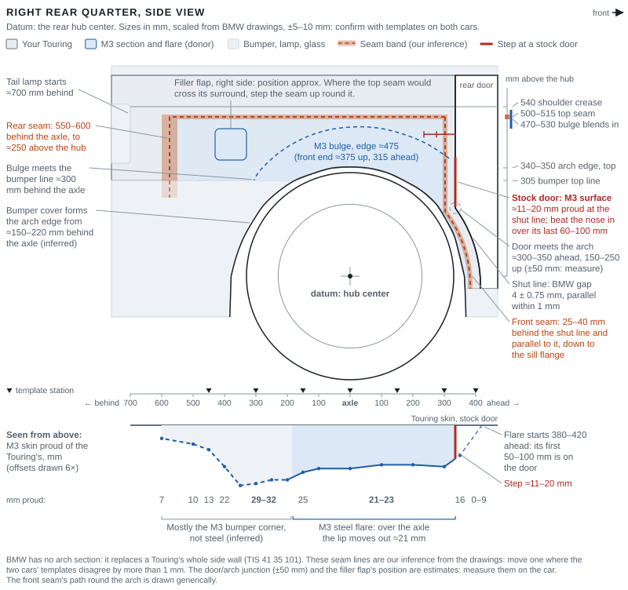

*Figure 26. The M3 flare on your Touring's right rear quarter, scaled from BMW drawings with the rear hub center as datum, and below it how far the M3 skin stands out at each station. Over the axle the lip moves out only about 21 mm; the bigger figures behind it are mostly the M3 bumper corner. Confirm every figure with templates on both cars before you mark the seams.*

#### Datum, stations and templates

Measure both cars the same way, so their numbers compare.

1. **Level the shell.** Support it on its four jacking pads. Level the sill pinch welds side to side and front to back with a digital level, and write the readings down.
2. **Snap a center line.** Drop plumb bobs from matching left and right points: the centers of the four rear subframe mounting bolts on the rear axle carrier panel (41117000246, the same part on both cars, [ETK](https://bmwfans.info/parts-catalog/41117000246/)) and the front subframe bolts. Mark the midpoint of each pair on the floor and snap a chalk line through them.
3. **Set a reference line.** Set a cross-line laser parallel to the center line at a fixed distance, such as 950 mm, beside each rear wheel. Use the same distance on both cars.
4. **Mark the stations.** Mark the rear axle line (the hub center) on the body, then every 100 mm from 400 mm ahead of it to 500 mm behind it.
5. **Take the offsets.** At each station, measure from the laser line to the skin at two heights: at the lip, and 30 mm below the shoulder crease. Record them in the worksheet ([donor](WORKSHEETS.md#arch-targets), [Touring](WORKSHEETS.md#arches-and-doors)). The Touring's reading minus the donor's, at the lip, is the move-out you need at that station.
6. **Make the templates.** At seven stations (400, 300 and 150 mm ahead of the axle; at the axle; 150, 300 and 450 mm behind it), copy the section with a profile gauge onto 3 mm hardboard or stiff card. Make one set off the donor, with its bumper off, and one off the Touring, both before you cut. Label each with car, side and station.
7. **Template the lines.** Tape on a side-view template of your cut lines and trace it. If you'll touch the door, make a tape-and-card template of its edge too. On Tracks and Trails' door template, "the tape outline's doing most of the work" ([Tracks and Trails – What it really takes (2026), 16:20](https://www.youtube.com/watch?v=nADBRfX9DqY&t=980s)).
8. **Tram the body.** Besides the body diagonals below, measure two cross-car distances with a tram gauge: lip crown to lip crown, and crease to crease at the axle station.

**Pass:** left and right agree within 3 mm at every station. That is our suggestion, not a BMW body figure: BMW's side-to-side ride-height tolerance in its design position is 2 mm, and body-measuring practice is about ±2–3 mm.

#### Measure both cars, then mock up

**1. Measure the donor before you strip it** ([Phase 1](#phase-1-buy-and-inspect-the-donor)). Put the M3 on level ground, loaded to its normal position (a full tank, 68 kg on each front seat and 14 kg in the middle of the trunk), its tires at placard pressure. At each rear corner (and the front corners too, for reference), measure:

- **BMW's ride height,** rim flange to arch edge. **Pass:** the table above. Outside it, the donor's springs are tired or not stock, or its body is damaged: use BMW's figure as your target, not the donor's stance;
- the height of the hub center above the floor;
- the height of the arch lip straight above the hub center;
- the height of a body point the Touring shares, such as the floor beside a rear subframe mount; the rear axle carrier panel there is the same part on both cars, 41117000246 ([ETK](https://bmwfans.info/parts-catalog/41117000246/));
- how far the lip sits outboard of the tire's outer face, using a plumb line from the lip;
- the gap from each rear bump stop to the damper body, and later, with the dampers out, each bump stop's free length. BMW publishes no wheel-travel or bump-stop figures for the E46 M3, so these tell you how much bump travel the mock-up has to clear.

Subtract to get hub-to-lip and hub-to-body for each side. Note the fuel level and photograph the tire placard. Later, with the bumper off and before you cut any steel ([Phase 2](#phase-2-strip-the-donor)), take the station offsets and make the templates.

**2. Record the Touring before any welding.** Note the ride height at all four corners (Phase 0), then:

- **Door gaps and flush.** Mark three points along each rear door's trailing edge. At each, record the shut gap with feeler gauges, and the flush: lay a straightedge across the gap and measure under it with feeler gauges, noting whether the door sits in or out ([worksheet](WORKSHEETS.md#arches-and-doors)). Your own readings are the target. They should fall inside BMW's E46 gaps: rear door to side wall 4 ± 0.75 mm, front door to rear door 4.5 ± 0.75 mm, doors to sill 5 ± 1 mm, each parallel within 1 mm ([TIS 41 00](https://workshop-manuals.com/bmw/3_series_e46/325i_m54_tour/2_repair_instructions/41__body_%28tour%29/0__body/13_ra__gap_dimensions_on_doors___engine_hood_and_trunk_lid/page_1919/)).
- **Door-to-arch junction.** Measure where the door's trailing edge meets the arch: how far ahead of the axle, and how high above the hub. Our estimate is 300–350 mm ahead and 150–250 mm up, ±50 mm.
- **Station offsets and templates,** as on the donor.
- **Body diagonals.** Pick fixed points you can find again, such as the four rear subframe mounts and the front subframe mounting points, and tape the two diagonals across each set. Measure again after every welding session, in Phase 5 as well as here; a change means the floor or body has pulled. BMW's control dimensions are in TIS 41 00 ([Phase 5](#phase-5-metalwork-1-subframe-mounts-and-floor)).

**3. Mock up ([Phase 6](#phase-6-metalwork-2-rear-arches)).**

1. Bolt the M3 rear axle in with the dampers you'll run, the brakes, and the final wheels and tires at road pressure. Leave the springs out.
2. Jack each rear hub to its target height. With the springs out, the shell's missing weight doesn't matter: you set the suspension position directly instead of trying to load a stripped shell to ride height. Make sure the light shell can't lift off its stands as you jack.
   - **If the donor passed BMW's check,** match its hub-to-body figure. **Check:** the Touring's own arch then reads rim flange to arch edge within 10 mm of the donor's reading, because the openings match.
   - **If it failed,** set rim flange to arch edge on the Touring to BMW's figure: 587 mm on 18-inch wheels, 600 mm on 19-inch.
   - **If your springs will set the car higher or lower,** use your own target instead.
   - **Pass:** each side within 2 mm of its target, and left and right within 2 mm of each other, BMW's side-to-side tolerance in its design position. Jacks make that easy.
3. Mark the new lip at each station: the donor's hub-to-lip height above the hub center, and the donor's move-out from your offsets, each within 3 mm.
4. Check symmetry. Measure from each side's lip mark to the same center point on the floor, such as the middle of the rear axle carrier panel, and to the center line. **Pass:** within 3 mm side to side.
5. **Full bump.** Jack the hub until the bump stop (M3 33532229777, [ETK](https://bmwfans.info/parts-catalog/E46-Coupe/USA/M3-S54/L-N/browse/rear_axle/rear_spring_strut_mounting_parts/)) is fully compressed. Turn the wheel by hand and check:
   - the tread to the planned lip;
   - the outer sidewall to the outer wheelhouse half and the lip flange;
   - the inner sidewall to the inner wheelhouse and the brake lines.

   Repeat at your planned static camber, and mark the tire's outer face and top on the body. **Pass:** at least 10 mm (0.4 in) to sheet metal everywhere. That's our suggestion; BMW publishes no rear wheel-travel figure for the M3. Also note how far each hub rose from its target height to full bump: subtracted from the new lip's hub-to-lip, it gives the full-bump figure for the loaded check in Phase 12 ([After the build](#after-the-build-settle-check-and-align)).
6. **Filler (right side).** Hold the donor's filler surround at its marks. Check that your own filler pot sits in the M3 surround's opening. The pot, 51718208646, is the same part on the Touring and both M3s, so it stays where it is (our inference): only the surround and flap change ([ETK: Touring](https://bmwfans.info/parts-catalog/E46-Touring/USA/325i-M54/L-N/browse/bodywork/side_panel_tail_trim/), [ETK: M3](https://bmwfans.info/parts-catalog/E46-Coupe/USA/M3-S54/L-N/browse/bodywork/side_panel_tail_trim/)).
7. Remove the mock-up axle before you weld.

### Arch graft step by step

Weld as described in [Welding settings and safety](#welding-settings-and-safety), with fume extraction, a fire watch, and the fuel tank, filler pipe and every fuel and EVAP part near the right-rear arch removed first. ETK lists a fuel expansion-tank bracket (41148196386) among the rear wheelhouse parts, so look inside the quarter for tanks and vent lines before you cut; keep the bracket, or move it to a new inner tub ([ETK](https://bmwfans.info/parts-catalog/E46-Touring/USA/325i-M54/L-N/browse/bodywork/rear_wheelhouse_floor_parts/), [Fuel system](#fuel-system)). The bracket carries the liquid-vapour separator (16136752641), which sits "in the right rear wheel well behind the trim" ([BMW ST041 Part 3](https://archive.org/download/BMWTechnicalTrainingDocuments/ST041%20M3%20Complete%20Vehicle/3%20EngineElectronics%20%28Part%203%29.pdf)). Take it out with its vent hoses before you cut, refit both before the tank goes back in, and let the leak test prove them ([Filler and EVAP](#filler-and-evap)).

BMW allows a panel to be sectioned only where its repair information supports it ([I-CAR – Structural sectioning: BMW/Mini (2017)](https://rts.i-car.com/crn-599.html)). BMW's own E46 procedure replaces a Touring's rear side wall whole, cut 200 mm below the roof edge on the C-pillar, at the D-pillar and at the sill, never around the arch ([TIS 41 35 101, Touring, p.1](https://workshop-manuals.com/bmw/3_series_e46/325i_m54_tour/2_repair_instructions/41__body_%28tour%29/35__side_panels/6_ra__replacing_rear_left_side_wall_%28part_replacement_c-_and_d-pillar_top%29_%28touring%29/), [p.2](https://workshop-manuals.com/bmw/3_series_e46/325i_m54_tour/2_repair_instructions/41__body_%28tour%29/35__side_panels/6_ra__replacing_rear_left_side_wall_%28part_replacement_c-_and_d-pillar_top%29_%28touring%29/page_2206/)). So an arch graft is not a BMW repair, and these sixteen steps come from the documented builds, I-CAR, BMW's own joint practice and our measurements. Each ends with the check that proves it. Figures marked as estimates come from scaled drawings ([Flare profile](#flare-profile)): your own templates and offsets overrule them.

**Before you cut.**

1. **Record both cars** before anything moves ([Measure and mock up before you cut](#measure-and-mock-up-before-you-cut)): the donor's ride height, offsets and templates, with its bumper off for the last two; the Touring's door gaps and flush, offsets, templates and body diagonals. **Check:** the donor reads 587 ± 10 mm rim flange to arch edge on 18-inch wheels (600 on 19-inch), left and right within 10 mm, or you've switched to BMW's figure; both cars have templates at all seven stations.
2. **Mock up** with the M3 axle, final dampers and wheels, springs out and hubs at the target height. **Check:** each lip mark at the target height and move-out within 3 mm at every station, and at least 10 mm from tire to sheet metal at full bump (our suggestion).
3. **Choose the door treatment now** ([Rear doors](#rear-doors)). With a standard door, BMW's way, the M3 nose has to come in about 11–20 mm over its last 60–100 mm before the shut line (our estimate). With a flared door, the door's trailing edge comes out by the same amount. **Check:** the choice is made; it sets where the front seam goes.
4. **Mark the cut lines on the Touring** from your side-view template ([Flare profile](#flare-profile)). These positions are our inference from the drawings.
   - **Top seam:** about 500–515 mm (19.7–20.3 in) above the hub, at least 25 mm under the crease.
   - **Rear seam:** about 550–600 mm (21.7–23.6 in) behind the axle, at least 100 mm ahead of the tail-lamp, down to about 250 mm above the hub, where the bumper hides it. You don't need the donor's tail-light area.
   - **Front seam:** 25–40 mm behind the shut line and parallel to it, down to the door–arch junction. Below that only a narrow band of panel is left between the opening and the shut line, so run the seam along the shut line to the sill flange. SOS Customz ran its cut to the door at the shut line and lined it up with the filler-door area ([SOS Customz (2023), 02:00](https://www.youtube.com/watch?v=L8m9gEOklVY&t=120s)).
   - **Right side:** if the top seam would cross the filler surround, step the line up and around it, so the whole M3 surround comes in with the section. M346 made "a big square cutout" around the filler on that side, and didn't need one on the other ([M346 Projects – Pt 14 (2024), 55:40](https://www.youtube.com/watch?v=4_LqrbAlNmw&t=3340s)).

   **Check:** along every line, the donor and Touring templates agree within 1 mm, so the seam sits on matching panel. Where they don't, move the line.

**Cut.**

5. **Prepare the donor section.** Cut it 40–50 mm outside your lines.
   - **Drill, don't cut.** Drill out the spot welds where you can instead of cutting, and count those along the lip: that's your plug-weld count in step 10.
   - **Separate the skin** from the inner arch panel it's welded to: the coupe's interior side frame (41217890677/678); on a convertible, the inner lateral trim panel (41217894553/554) or the interior side frame. Keep as much of the inner arch flange as you can ([M346 Projects – Pt 14 (2024), 27:20](https://www.youtube.com/watch?v=4_LqrbAlNmw&t=1640s)). M3projekts cut its donor's fenders "together with part of the inner edge… drilled down at the point welds, leaving only the outer plate" ([M3projekts – Ep8 (2023), 14:00](https://www.youtube.com/watch?v=5xBcY33CPCM&t=840s)).
   - **Clean it.** Grind the factory seam sealer off the donor's rolled lip, because it burns and spoils the weld ground ([13:40](https://www.youtube.com/watch?v=4_LqrbAlNmw&t=820s)), and grind off the zinc coating where you'll weld ([11:00](https://www.youtube.com/watch?v=4_LqrbAlNmw&t=660s)).

   **Check:** no rust in the lip's U-channel ([Redish](https://www.redish-motorsport.com/BMWE46M3RearWheelArchesRust.html)), and the section still fits its templates within 1 mm.
6. **Open the Touring.** With the fuel system out, drill the arch-lip spot welds and remove the skin inside your lines, leaving the outer wheelhouse half (41218242355/356) in place. Tracks and Trails drilled the spot welds and removed only the outer skin, keeping as much healthy Touring wheelhouse as possible ([Tracks and Trails – What it really takes (2026), 12:40](https://www.youtube.com/watch?v=nADBRfX9DqY&t=760s)). Grind the sound-deadening mat back about 25 mm (1 in) from the weld line so its glue doesn't contaminate the weld ([M346 Projects – Pt 14 (2024), 41:20](https://www.youtube.com/watch?v=4_LqrbAlNmw&t=2480s)). **Check:** the outer half's flange is whole and straight, and the door still opens and shuts cleanly.

**Inner arch and skin.**

7. **Rebuild the inner arch first,** before the skin goes on. This is the hardest joint: on a 325Ci coupe, one forum member called joining the inner fender to the wider M3 arch "the biggest issue" ([e46fanatics](https://www.e46fanatics.com/threads/m3-rear-quarter-replacements.1305471/)). Two methods have been shown on Tourings:
   - **Graft the donor's arch flange or inner tub.** M346 bent the Touring's inner-tub lip, which "was originally pointed straight down", up with a hammer, and welded the M3 tub to the shell in one piece before the skin ([M346 Projects – Pt 14 (2024), 30:20](https://www.youtube.com/watch?v=4_LqrbAlNmw&t=1820s)).
   - **Extend the Touring's outer half outward** with a fill strip, by the move-out at each station. Expect about 21 mm at the crown, 16–22 mm around 300–350 mm ahead of the axle, and up to 25–32 mm from 150 to 350 mm behind it (our estimates). From about 200 mm behind the axle rearward, under the bumper line, take the figure from the donor with its bumper off instead. The Touring's inner well "comes down a little bit lower" than the donor flare. Tracks and Trails bonded lip to lip with panel bond, hammered one section out into a new lip, bonded that to the flare and welded the rest, with weld-through primer on the back first ([Tracks and Trails (2026), 17:40](https://www.youtube.com/watch?v=nADBRfX9DqY&t=1060s)).

   Tack it, dry-fit the skin to check, then plug-weld or stitch in short runs and let each cool. Put weld-through primer on the faces that touch. **Check:** with the skin dry-fitted, the templates at the axle and 300 mm behind it still fit within 1 mm, and the quarter's corner by the bumper hasn't pulled in. A year on, M346 found that corner bent in, which he put down to the heat of welding the inner tub, and pulled it back out with a ratchet strap and heat ([M346 Projects – Pt 23 (2025), 14:00](https://www.youtube.com/watch?v=oaycAZRakfc&t=840s), [14:40](https://www.youtube.com/watch?v=oaycAZRakfc&t=880s)).
8. **Fit the skin.** Trim the section to a butt gap of 0.8–1.0 mm, about one skin thickness; Tracks and Trails used a 1 mm gap ([Tracks and Trails (2026), 15:40](https://www.youtube.com/watch?v=nADBRfX9DqY&t=940s)). Hold it with clecos or butt-weld clamps every 75–100 mm (3–4 in).
   - **Joint: we recommend a butt joint over a backing strip** of skin-thickness steel, which makes alignment and penetration easier. It's BMW's own practice on these bodies: its sectioned joints are butt joints over a backing strip about 60 mm wide on the Touring (40 mm at the coupe's pillars), pushed about 30 mm into each side and plug-welded through holes drilled in the body's side of the joint ([TIS 41 35 101, Touring, p.8](https://workshop-manuals.com/bmw/3_series_e46/325i_m54_tour/2_repair_instructions/41__body_%28tour%29/35__side_panels/6_ra__replacing_rear_left_side_wall_%28part_replacement_c-_and_d-pillar_top%29_%28touring%29/page_2212/)). I-CAR describes the same idea, with adhesive, on a 2017 X5 ([I-CAR](https://rts.i-car.com/crn-834.html)).
   - **The alternative is a joggle:** a step pressed into the old panel, plug-welded through punched holes, as SOS Customz did ([SOS Customz (2023), 14:00](https://www.youtube.com/watch?v=L8m9gEOklVY&t=840s)). It's easier to align and forgives gaps. But it leaves a double layer that traps moisture unless it's sealed from inside, and a stepped seam takes more filler.
   - **Right side: the filler.** Graft the M3 filler surround with the section, and check that your own pot (51718208646) seats in the M3 opening. The pot and filler pipe are the same parts on both cars, so the pot stays where it is (our inference; [Filler and EVAP](#filler-and-evap)). The M3 flap's bracket holes sit in different places because its door is a different shape. Some builders slot the holes, but M346 grafted the M3 surround in, matching its radius ([M346 Projects – Pt 14 (2024), 37:00](https://www.youtube.com/watch?v=4_LqrbAlNmw&t=2220s)). The flap hinge differs: 51172695527 on the coupe, while the convertible's 51178151955 is also your Touring's ([ETK](https://bmwfans.info/parts-catalog/E46-Cabrio/USA/M3-S54/L-N/browse/bodywork/side_panel_tail_trim/)).

   **Checks:** flush across every seam within 0.5 mm (0.02 in) before welding (our suggestion); the lip at its target within 3 mm; the door opens and closes; the bumper corner trial-fitted ([Rear bumper, skirts and trim](#rear-bumper-skirts-and-trim)).

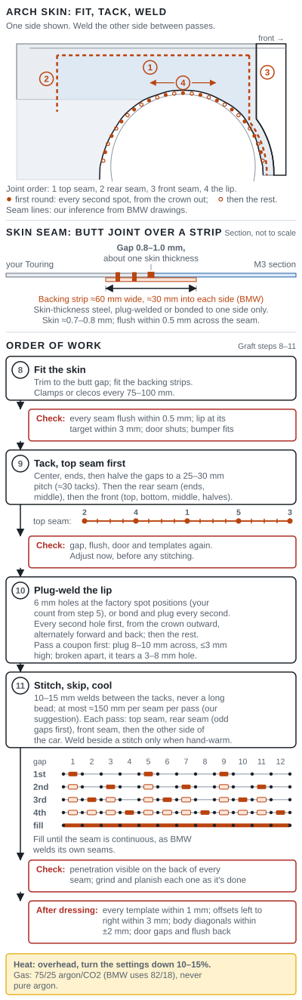 <!-- portrait -->

*Figure 27. The order for fitting, tacking and welding one arch, with the check that ends each step. Tack every seam before you weld any of it, and keep the heat down: short stitches in a skip order, coming back to an area only when it's hand-warm, until each seam is continuous.*

**Weld.**

9. **Tack.** Tack the top seam first: the center, then the ends, then halve the gaps down to a 25–30 mm (1.0–1.2 in) pitch, about 30 tacks. Then tack the rear seam (the ends, then the middle) and the front seam (top, bottom, middle, then halves). **Check:** gap, flush, door and templates again. Adjust now, before any stitching.
10. **Weld the lip joint.** Join the skin's lip flange to the inner flange with plug welds through 6 mm (1/4 in) holes at the factory spot positions, the count from step 5. Or bond it with panel adhesive and plug every second position.
    - **Hole size.** BMW's general rule is 8 mm holes at least 25 mm apart ([I-CAR: BMW](https://rts.i-car.com/crn-1484.html)). On this narrow lip use I-CAR's 6 mm thin-to-thin size, which it gives for "plug welds on a pinchweld flange joining two exterior panels, such as along a wheelhouse opening" ([I-CAR](https://rts.i-car.com/oem-restraints-system-part-replacement-search/51df0590-ca17-4e8f-a0c4-939263a9c236.html)).
    - **Order.** Weld every second position first, from the crown outward, alternately forward and back. Then fill in the rest.
    - **Crimp the edge, as BMW does.** On a new side wall BMW crimps the outer skin's arch edge over the inner flange along most of the arch, then seals it ([TIS 41 35 101, p.15](https://workshop-manuals.com/bmw/3_series_e46/325i_m54_tour/2_repair_instructions/41__body_%28tour%29/35__side_panels/6_ra__replacing_rear_left_side_wall_%28part_replacement_c-_and_d-pillar_top%29_%28touring%29/page_2219/)). After the plug welds, close any part of the lip that opened up the same way, before it's sealed in step 14. On the coupe, the donor's body, BMW also bonds the outer arch section to the side reinforcement with adhesive 51 0 032, after a contact-pattern check with no gap over 1 mm ([TIS, coupe, p.9](https://workshop-manuals.com/bmw/3_series_e46/m3_s54_coupe/2_repair_instructions/41__body_%28coupe%29/35__side_panels/6_ra__replacing_rear_left_side_panel_%28partial_replacement_c-pillar%29_%28e46_coup%29/page_1889/), [p.12](https://workshop-manuals.com/bmw/3_series_e46/m3_s54_coupe/2_repair_instructions/41__body_%28coupe%29/35__side_panels/6_ra__replacing_rear_left_side_panel_%28partial_replacement_c-pillar%29_%28e46_coup%29/page_1892/)).

    **Pass,** on a coupon of donor offcuts before you touch the car: each plug's face 8–10 mm across and no more than 3 mm high; broken apart, it tears a 3–8 mm hole in the bottom piece ([I-CAR practice welding guide](https://info.i-car.com/getmedia/5bf41ea3-7245-46a2-9d3f-9e6723bcb69f/i-car_practice-welding-guide.pdf), [test coupons](WORKSHEETS.md#test-coupons)).
11. **Stitch** 10–15 mm (0.4–0.6 in) welds between the tacks, in a skip pattern, until the seam is continuous, letting each area cool between passes.
    - **First pass:** top seam gaps 1, 5, 9…, then the rear seam's odd gaps, then the front seam's gaps 1, 5, 9…, then the other side of the car.
    - **Later passes:** come back for gaps 3, 7, 11… only when the first area is hand-warm, then 2, 6, 10…, then 4, 8, 12….
    - **Limit:** lay no more than about 150 mm of weld per seam per pass (our suggestion). GM's published rhythm for overlap seams is the same idea: 25 mm welds with 25 mm gaps, then fill ([I-CAR](https://rts.i-car.com/crn-25.html)).
    - **Why:** "you can't continuously weld this thickness gauge metal because you'll get heat distortion… so you have to stitch it" ([Calvin's Car Diary – PT9 (2020), 12:40](https://www.youtube.com/watch?v=-BMrhOr8fdg&t=760s)). BMW does the same on its butt seams: spots stitched "so close together … that a continuous seam is created", each area left to cool ([TIS 41 35 101, p.11](https://workshop-manuals.com/bmw/3_series_e46/325i_m54_tour/2_repair_instructions/41__body_%28tour%29/35__side_panels/6_ra__replacing_rear_left_side_wall_%28part_replacement_c-_and_d-pillar_top%29_%28touring%29/page_2215/)).
    - **Settings:** overhead, turn them down 10–15% ([Miller](https://www.millerwelds.com/en-US/resources/knowledge-hub/mig-welding/how-to/mig-basics-for-automotive-welding-repair)). Use an argon/CO2 mix, BMW's 82/18 or the common 75/25 ([Welding settings and safety](#welding-settings-and-safety)): M346 started on 100% argon and "could not get a good solid bead" ([M346 Projects – Pt 14 (2024), 14:40](https://www.youtube.com/watch?v=4_LqrbAlNmw&t=880s)).

    **Check:** penetration visible on the back along every seam, the test Calvin's body man uses. Grind and planish each seam as you finish it, not at the end.
12. **Close the gaps at the sill and door.** Where the new quarter met the sill by the door shut, M346 found "a moon-shaped hole" and filled it with a fabricated plate and many small welds ([M346 Projects – Pt 14 (2024), 46:00](https://www.youtube.com/watch?v=4_LqrbAlNmw&t=2760s)). Tracks and Trails templated the gaps with tape, cut gussets from scrap and tacked them in ([Tracks and Trails (2026), 23:20](https://www.youtube.com/watch?v=nADBRfX9DqY&t=1400s)). **Check:** no open hole into the sill or the cabin.
13. **Dress the welds.** Grind with 80-grit flap discs without thinning the panel, then planish (hammer the seam on a dolly) to relieve the shrinkage. **Check:**
    - every template fits within 1 mm;
    - the station offsets match left to right within 3 mm;
    - the body diagonals are within ±2 mm of your figures from before welding (our suggestion);
    - the door gaps and flush are back to your before readings.

**Finish.**

14. **Seal and protect.** Brush seam sealer into the lip's U-channel until it's full. Redish sprays a thin coat into the welded lines first, then a thicker one, curing 24 hours between ([Redish – M3 rear arches replaced (2016), 09:20](https://www.youtube.com/watch?v=7bZRLQqmEkg&t=560s)). Seam-seal the inside of every joint, epoxy-prime, and cavity-wax the quarter. Tracks and Trails scuffed with 100 grit, then used 2K epoxy primer, filler, more epoxy and high-build primer, with seam sealer and Wool Wax inside ([Tracks and Trails (2026), 24:20](https://www.youtube.com/watch?v=nADBRfX9DqY&t=1460s), [27:40](https://www.youtube.com/watch?v=nADBRfX9DqY&t=1660s)). M346 put weldable zinc primer on all exposed metal before the skin went on ([M346 Projects – Pt 14 (2024), 41:40](https://www.youtube.com/watch?v=4_LqrbAlNmw&t=2500s)). **Check:** the lip is a sealed double skin all round.
15. **Rebuild the door edge, if you flared it.** Build the gap back with panel bond against a 4 mm card wall, cure it 24 hours, and sand it to feeler gauges ([Rear doors](#rear-doors)). **Check:** the gaps and flush are back to your before readings.
16. **Use filler as a skim only.** Heavy filler loses the arch's crisp edge. M346's painter: "a lot of times when people do conversions, they get so much bondo and glaze that… the arch just kind of gets lost". He skim-coated the weld ripple, which "you can't really see, but you can feel" ([M346 Projects – Pt 24 (2025), 00:20](https://www.youtube.com/watch?v=yQF7MbuPDVI&t=20s), [01:20](https://www.youtube.com/watch?v=yQF7MbuPDVI&t=80s)). BMW allows filler only where the surface is out by less than 2 mm (0.08 in), and tins anything deeper ([TIS 41 00, p.2](https://workshop-manuals.com/bmw/3_series_e46/325i_m54_tour/2_repair_instructions/41__body_%28tour%29/0__body/48_ra__welding_and_soldering_steel_parts/page_1975/)). Final filler and paint come in [Phase 13](#phase-13-paint-trim-and-paperwork). **Check:** before any filler goes on, no low spot is 2 mm deep or more under a straightedge or a section template; planish until none is.

**Wheel-arch liners.** The widened arches need liners that fit them, so take the donor's. M3projekts lists rear liners among the parts the conversion needs ([M3projekts – Ep3 (2023), 09:30](https://www.youtube.com/watch?v=TT0sd2JB5dY&t=570s)). BMW lists M3-only "coverings", 51712695667 left and 51717895936 right, on both M3s; they may be the rear liners, but we couldn't confirm it ([ETK](https://bmwfans.info/parts-catalog/51712695667/)).

**Check before you seal and prime.** Pass values not credited to a source are our suggestions.

| Check | Pass |
|---|---|
| Templates | Every station within 1 mm of its template |
| Symmetry | Station offsets and lip heights above the hub center within 3 mm side to side |
| Body diagonals | Within ±2 mm of your figures from before welding |
| Full bump | At least 10 mm from tire to sheet metal |
| Doors | Open and close freely; gaps and flush back to your before readings |
| Lip | A sealed double skin all round |
| Filler, right side | Your pot seats in the M3 opening, the flap closes flush and latches, and the filler pipe sits unstrained ([Filler and EVAP](#filler-and-evap)). A poor seal fails the EVAP leak test, which finds leaks as small as 1.0 mm ([BMW ST041 Part 3](https://archive.org/download/BMWTechnicalTrainingDocuments/ST041%20M3%20Complete%20Vehicle/3%20EngineElectronics%20%28Part%203%29.pdf), [Inspection readiness](#inspection-readiness)) |

### Rear doors

Decide with the door shut and aligned, before you mark the cut lines (step 3 of the [graft](#arch-graft-step-by-step)). The Touring's rear door forms the front of the arch opening, and its trailing edge meets the arch roughly 300–350 mm ahead of the axle. At the shut line the M3 surface would stand about 11–20 mm (0.4–0.8 in) proud of the stock door. Both figures are our estimates from drawings; measure your car ([Rear arches and doors](#rear-arches-and-doors)). Three ways of dealing with that step have been shown:

1. **Leave the door standard and blend the flare in before the shut line.** Beat the M3 nose in over its last 60–100 mm (2.4–3.9 in) so it lands flush with the door.
   - **BMW and Petroyle.** This is how BMW built the prototype: BMW "decided against melding the rear wheel-arch sculpting into the door" ([Autocar](https://www.autocar.co.uk/car-news/features/best-car-bmw-never-built-driving-sublime-e46-m3-touring)). Petroyle says the arches "don't go into the doors… we would finish the arch before the door exactly the same as the concept car" ([Hagerty – Petroyle's E46 M3 Touring (2026), 07:40](https://www.youtube.com/watch?v=--YbwCS4F_g&t=460s), [08:40](https://www.youtube.com/watch?v=--YbwCS4F_g&t=520s)).
   - **Other builds.** One e46fanatics builder kept flat doors "to follow the BMW prototype" ([e46fanatics](https://www.e46fanatics.com/threads/m3-touring-project.1240087/)). The builder of the Renner car warns that "some people… continue the quarter panel to here and that's not correct so you got to be very careful how do you contour the door… this is the stock touring door" ([Larry Chen (2025), 05:20](https://www.youtube.com/watch?v=YM2gyQOaJCk&t=320s)).
   - **The nose.** M346 describes it: on a sedan or Touring "this part is actually pushed in more and then starts to flare out" ([M346 Projects – Pt 14 (2024), 28:40](https://www.youtube.com/watch?v=4_LqrbAlNmw&t=1720s)). Expect to dress the door's trailing edge so it meets the new arch line cleanly.
2. **Flare the door's trailing edge out by the same amount.**
   - **Without welding.** SOS Customz pounded the edge out ([SOS Customz (2023), 02:00](https://www.youtube.com/watch?v=L8m9gEOklVY&t=120s)). M346 marked start and stop points on the quarter, opened the door and massaged the edge out with a 2x4 ([M346 Projects – Pt 22 (2025), 00:40](https://www.youtube.com/watch?v=c6PDOLC94K0&t=40s)). His friend Lauren "flares the door first and then he puts on the quarter panel" ([01:00](https://www.youtube.com/watch?v=c6PDOLC94K0&t=60s)).
   - **With a welded section.** Calvin's body man welded a section into the door so it "flicks out" to meet the flare ([Calvin's Car Diary – PT9 (2020), 02:20](https://www.youtube.com/watch?v=-BMrhOr8fdg&t=140s)).
   - **Rivet-on kits** take the same approach: HARD's flare kit has separate rear-door pieces.
3. **Carry the flare across the shut line, then re-cut the gap.**
   - **Tracks and Trails** made a cardboard-and-tape template of the door edge, overlaid the front of the flare onto the door, then re-cut the gap from the template ([Tracks and Trails (2026), 15:40](https://www.youtube.com/watch?v=nADBRfX9DqY&t=940s), [21:40](https://www.youtube.com/watch?v=nADBRfX9DqY&t=1300s)).
   - **A German forum poster** planned the same in 2006: weld the M3 side panel "bis über die hinteren Türen" (right across the rear doors), then "den Türspalt wieder aufsägen" (saw the door gap open again) ([bmw-syndikat](https://www.bmw-syndikat.de/bmwsyndikatforum/topic57244_M3_hintere_Seitenwaende_in_eine_Limo__3er_BMW_-_E46.html)).
   - **Other builders** have "added a bit of metal" to the door's trailing edge ([e46fanatics](https://www.e46fanatics.com/threads/m3-touring-project.1240087/)).

**Our recommendation: option 1, the standard door, for a first build.** It's BMW's own answer. The door skin, its gaps and its trim stay untouched, and the extra shaping is confined to the last 60–100 mm of the new quarter. Choose option 2 if you want the flare to carry onto the door, and budget for rebuilding the gap.

**Restoring the gap.** The target is your own car's baseline: the gaps and flush you recorded at three marked points on each door before any welding. They should sit inside BMW's E46 gaps: rear door to side wall 4 ± 0.75 mm, front door to rear door 4.5 ± 0.75 mm, doors to sill 5 ± 1 mm, each parallel within 1 mm ([TIS 41 00](https://workshop-manuals.com/bmw/3_series_e46/325i_m54_tour/2_repair_instructions/41__body_%28tour%29/0__body/13_ra__gap_dimensions_on_doors___engine_hood_and_trunk_lid/page_1919/)).

- **Flaring opens the gap.** Flaring the door after the quarter is on opens the shut gap by about 3–4 mm ([M346 Projects – Pt 22 (2025), 01:00](https://www.youtube.com/watch?v=c6PDOLC94K0&t=60s)).
- **Panel bond builds it back.** M346 built it back with 3M panel bond (38315) against a taped card wall about 4 mm thick, let it cure for 24 hours, sanded it with a hard block and checked it against the stock gap with feeler gauges ([04:00](https://www.youtube.com/watch?v=c6PDOLC94K0&t=240s), [22:20](https://www.youtube.com/watch?v=c6PDOLC94K0&t=1340s)). His reasoning: it's a small area that doesn't flex, where panel bond is stronger than filler ([07:20](https://www.youtube.com/watch?v=c6PDOLC94K0&t=440s)).

**Pass:** at each marked point, the gap and the flush are back within 0.5 mm of your before readings (our suggestion), and the gap inside BMW's band.

**Trim that follows.** On a flared door, the straight side rubbing strip has to be reshaped to follow the flare, and one plastic side skirt was heated and bent out to meet it ([Calvin's Car Diary – PT9 (2020), 04:20](https://www.youtube.com/watch?v=-BMrhOr8fdg&t=260s), [11:20](https://www.youtube.com/watch?v=-BMrhOr8fdg&t=680s)).

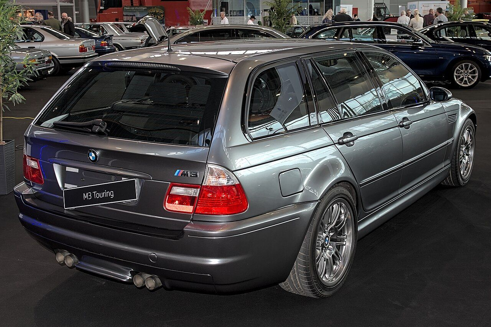

*Photo: BMW's prototype from behind. BMW kept the arch flare off the rear door skins ([Autocar](https://www.autocar.co.uk/car-news/features/best-car-bmw-never-built-driving-sublime-e46-m3-touring)). Alexander Migl, [CC BY-SA 4.0](https://creativecommons.org/licenses/by-sa/4.0/), via [Wikimedia Commons](https://commons.wikimedia.org/wiki/File:BMW_M3_%28E46%29_Touring_Retro_Classics_2025_DSC_7634.jpg).*

> [!TIP]
> A faster route is rivet-on flares. HARD Motorsport's M3-style rear set for the E46 sedan and Touring is ABS plastic, molded from M3 fenders, with separate rear-door pieces, \$294 list (\$264.60 on sale in October 2026) ([HARD Motorsport](https://www.hardmotorsport.com/hard-motorsport-bmw-e46-sedan-touring-m3-style-motorsport-fender-flares-rear-set/)). The rivets show, as on one 2018 car ([BMWBlog](https://www.bmwblog.com/2018/11/09/want-this-s54-swapped-e46-3-series-touring/)), and you still have to cut and seal the old lip behind them.

### Wheels, track and offsets

| Wheel | Front | Rear |
|---|---|---|
| Style 67, 18-inch (standard) | 8J ET47, 225/45R18 | 9J ET26, 255/40R18 |
| Style 67, 19-inch option | 8J ET47, 225/40R19 | 9.5J ET27, 255/35R19 |
| Style 163M (Competition) | 19 × 8 ET47, 225/40R19 | 19 × 9.5 ET27, 255/35R19 |
| CSL | 19 × 8.5 ET44, 235/35R19 | 19 × 9.5 ET27, 265/30R19 |

Sources: [BMW wheel and tire list](https://myair-bdr.bmwgroup.com/static/manual/RadReif/RadReif/00/M-GmbH/MJ2005/e46m3_2005.htm), [BimmerTips](https://bimmertips.com/oem-bmw-e46-m3-wheel-options-specs/).

**Offset math.** The outer rim edge sits (rim width in mm ÷ 2) − ET outboard of the hub face. One inch is 25.4 mm.

- 325i Sport Package wheel, 8J × 17 ET47, the wheel BMW's MY2003 wheel and tire list gives the 325i Touring's 225/45R17 tires ([BMW wheel and tire list: Touring](https://myair-bdr.bmwgroup.com/static/manual/RadReif/RadReif/00/mj2003/e46touring3_2003.htm), [BMW USA](https://www.press.bmwgroup.com/usa/article/attachment/T0022146EN_US/41437)): 8 × 25.4 ÷ 2 − 47 = **54.6 mm**. The same list puts the 7J × 16 standard wheels at ET46 or ET47, depending on the style
- Style 67 rear, 9J ET26: 9 × 25.4 ÷ 2 − 26 = **88.3 mm**
- ZCP rear, 9.5J ET27: 9.5 × 25.4 ÷ 2 − 27 = **93.7 mm**, so 5.4 mm further out than Style 67

At the rear, the hub faces match to within a millimetre or two, so the M3 wheel alone puts the outer rim edge about 33.7 mm further out than that 8J ET47 wheel. At the front, the M3's axle parts move each hub face about 18.5 mm out (1,508 mm against 1,471 mm of track; the M3's front wheels are ET47, like the Touring's 17-inch wheels), which the M3 front fenders cover. Tire sidewalls bulge past the rim, so leave margin. The [wheel fitment calculator](CALCULATORS.md#wheel-fitment) works these positions out for any wheel and tire.

**What builders ran.** Autoalex runs the M3's 18-inch rear wheels on all four corners and reports no rubbing ([Autoalex Cars – Finale (2025), 08:20](https://www.youtube.com/watch?v=N8pdzFoVu9k&t=500s)); M346 also kept the M3 rears for a square set ([M346 Projects – Pt 1 (2023), 07:40](https://www.youtube.com/watch?v=YqM2rQw1HQI&t=460s)). Tenza's donor came on aftermarket wheels too wide and too aggressive in offset for the wagon, so Tenza bought a fourth M3 wheel ([Tenza Motorsports – Total build cost (2022), 03:40](https://www.youtube.com/watch?v=oSZrM5wW0sQ&t=220s)).

**BMW's staggered sizes for the Touring.** The same BMW list gives the 325i Touring two staggered sets: 17-inch, 225/45ZR17 on 7½J × 17 ET41 front and 245/40ZR17 on 8½J × 17 ET50 rear; and 18-inch, 225/40ZR18 on 8J × 18 ET47 front and 255/35ZR18 on 8½J × 18 ET50 rear ([BMW wheel and tire list: Touring](https://myair-bdr.bmwgroup.com/static/manual/RadReif/RadReif/00/mj2003/e46touring3_2003.htm)). BMW's 2004 US Sports Wagon manual also gives pressures for the staggered 17-inch set ([p.27](https://manualsnet.com/pdf-content/0945ee845d7bf99b78315dcf/html/27.page.html)). The M3's own sizes, 225/45R18 and 255/40R18, aren't on the Touring's list: that's the question for a Massachusetts inspection station ([Massachusetts](#massachusetts)).

**Tires for Touring weight.** Compared like for like in US curb weights, your finished car carries about what an M3 coupe does on its front axle, but about 824–842 kg on its rear axle against the coupe's 770 kg (our estimate; see [Weights and axle loads](#weights-and-axle-loads)). Two checks before you buy tires:

- **Load index.** Read the axle ratings on your Touring's door-pillar label (BMW's 2004 US manual gives 900 kg front and 1,210 kg rear for a manual 325i Touring), and check that the load index of the M3-size tires you'll fit covers them, axle by axle ([BMW manual, p.162](https://manualsnet.com/pdf-content/0945ee845d7bf99b78315dcf/html/162.page.html)). A tire shop can check it against the maker's load table, or use the [tire load check](CALCULATORS.md#tire-load-check).
- **Pressures.** BMW's 2003 US M3 manuals give the same cold pressures for the 18- and 19-inch sizes: 230 kPa (33 psi) front and 240 kPa (35 psi) rear with up to four people, and 280 kPa (41 psi) front and 330 kPa (48 psi) rear with four people and luggage ([M3 coupe manual, p.27](https://manualsnet.com/bmw/m3-coupe-3-series-2003), [M3 convertible manual, p.27](https://manualsnet.com/bmw/m3-convertible-3-series-2003)). BMW gives the 325i Touring itself 220/260 kPa (32/38 psi), and 260/310 kPa (38/45 psi) loaded, on its 16- and 17-inch tires: its heavier rear wants more pressure ([2004 Sports Wagon manual, p.27](https://manualsnet.com/pdf-content/0945ee845d7bf99b78315dcf/html/27.page.html)). Start from BMW's M3 figures, use the loaded ones whenever the car carries luggage, and have the tire shop check the rear pressure against the tire maker's load table for your rear axle load.

### Rear bumper, skirts and trim

- **The bumper corner is part of the arch.** We infer from BMW's drawings that from about 150–220 mm behind the axle rearward, below the bumper's top line, the arch edge is the bumper cover. There the M3's outline stands about 29–32 mm (1.1–1.3 in) proud of the Touring's from 200 to 350 mm behind the axle, falling to about 13 mm at 450 mm behind (our estimate, ±5–10 mm; [Flare profile](#flare-profile)). That is roughly how far the Touring bumper's corner has to come out to follow the M3 arch, so trial-fit the bumper before the final welding (step 8 of the [graft](#arch-graft-step-by-step)). M346 made relief cuts in the Touring bumper's corners "so that it'll follow the contour of the M3 flare because originally… the stock touring bumper doesn't come out this wide" ([M346 Projects – How to make an E46 M3 Touring rear bumper (2024), 62:40](https://www.youtube.com/watch?v=R2a68pcDo38&t=3760s)). Ultimate Klasse's Touring bumper "was given the proper widening treatment with plastic weld to line up with the newly fattened arches" ([Ultimate Klasse](https://www.ultimateklasse.com/blog/2013/5/27/stuart-moultons-e46-zhp-touring)), and M3projekts pairs the wide M3 rear fenders with "the M3 bumper corner" ([M3projekts – Ep3 (2023), 03:00](https://www.youtube.com/watch?v=TT0sd2JB5dY&t=180s)).
- **Rear bumper.** Either keep and modify your Touring bumper, as on the Sloan car's customized OEM bumper ([BMWBlog](https://www.bmwblog.com/2024/11/11/custom-e46-m3-touring-wagon-s54-build/)), or fit the M3 bumper, whose corners meet the M3 quarters ([M3projekts – Ep3 (2023), 02:00](https://www.youtube.com/watch?v=TT0sd2JB5dY&t=120s)). The Touring's tailgate opening drops lower than the M3 bumper allows, so builders cut the center section from the Touring bumper and plastic-weld it into the M3 bumper ([Tracks and Trails (2026), 28:00](https://www.youtube.com/watch?v=nADBRfX9DqY&t=1680s), [Calvin's Car Diary – PT9 (2020), 09:20](https://www.youtube.com/watch?v=-BMrhOr8fdg&t=560s), [SOS Customz (2023), 21:00](https://www.youtube.com/watch?v=L8m9gEOklVY&t=1260s)). M346's 82-minute video shows one method: move the two center parking sensors down to the lower middle section, keep the Touring bumper's inner pieces to stiffen the M3 bumper, and graft in the Touring's wider corners with relief cuts, hot staples, ABS rod and two-part epoxy ([M346 Projects – How to make an E46 M3 Touring rear bumper (2024), 06:00](https://www.youtube.com/watch?v=R2a68pcDo38&t=360s)). His painter then spent about two weeks finishing it ([M346 Projects – Pt 24 (2025), 04:20](https://www.youtube.com/watch?v=yQF7MbuPDVI&t=260s)). The M3 bumper carrier's Kevlar tabs often break ([M346 rear bumper, 44:20](https://www.youtube.com/watch?v=R2a68pcDo38&t=2660s)), and it can't take a tow hitch ([Autoalex v2 – Massive update (2024), 11:20](https://www.youtube.com/watch?v=vAHWkcGu8ek&t=680s)). Mark the tip cut-outs with the exhaust hanging in its final position; see [Exhaust and the spare-wheel well](#exhaust-and-the-spare-wheel-well).
- **Side skirts.** M3 skirts fit with OEM M3 rocker clips, which are black and a little taller than the white non-M clips ([e46fanatics](https://www.e46fanatics.com/threads/m3-touring-project.1240087/), [M3projekts – Ep3 (2023), 05:30](https://www.youtube.com/watch?v=TT0sd2JB5dY&t=330s)). The coupe skirts are a few mm shorter than the Touring's; M346 split the difference front and rear ([M346 Projects – Pt 18 (2024), 08:40](https://www.youtube.com/watch?v=IBAqCYQuEzs&t=520s)), and M3projekts found the mounting points pull the rear corner down slightly ([M3projekts – Ep3 (2023), 06:00](https://www.youtube.com/watch?v=TT0sd2JB5dY&t=360s)).
- **Mirrors.** M3 mirrors don't bolt to 4-door doors: sedan and Touring doors have three mounting points, the coupe's two ([M3projekts – M3 mirrors on a Touring (2024), 00:30](https://www.youtube.com/watch?v=VMNOEfeNCdE&t=30s)). M3Projekts sells an "E46 M3 Touring/Sedan mirror base" for €239–459 before VAT ([M3Projekts](https://m3projekts.com/product/e46-m3-touring-sedan-mirror-base/)); it's the same part for left- and right-hand drive and needs the M3 mirror modules and switch ([06:30](https://www.youtube.com/watch?v=VMNOEfeNCdE&t=390s)). On M346's left-hand-drive car the driver's glass sat too far out, so he ground off the housing's locating tabs and elongated the holes ([M346 Projects – Pt 21 (2024), 26:20](https://www.youtube.com/watch?v=a7HeYZ8Ctow&t=1580s)). Facelift Touring doors have "ribbon cable" mirror harnesses; the M3 mirrors use the older connection, so M346 fitted non-ribbon door harnesses from a sedan ([02:00](https://www.youtube.com/watch?v=a7HeYZ8Ctow&t=120s)).
- **Paint.** The BMW prototype wears Chrome Shadow metallic. Most builders repaint the whole car once the metalwork is done, with only a skim of filler over the arch seams (step 16 of the [graft](#arch-graft-step-by-step)); M346's car spent about four months at the paint shop ([M346 Projects – Pt 25 (2025)](https://www.youtube.com/watch?v=1AjKKQisrGE)). What to tell the painter is in [Shop briefs](#shop-briefs).

## Registration and legal (US)

> [!NOTE]
> Practical notes, not legal advice. Rules vary by state and county. The car this guide follows is registered in Massachusetts: read the federal picture, then [Massachusetts](#massachusetts). For another state, read California's rules as an example and put the questions at the end of this chapter to your own state program before you buy the donor.

**Federal.** EPA's 2020 tampering enforcement policy replaced its 1991 Engine Switching Fact Sheet ([EPA](https://www.epa.gov/sites/default/files/2020-12/documents/epatamperingpolicy-enforcementpolicyonvehicleandenginetampering.pdf)). It treats an engine switch as acceptable when the result matches a certified configuration of the same or a newer model year. For anything else it expects a documented "reasonable basis", such as emissions testing showing the vehicle complies for its full useful life, prepared before the work. BMW never certified an S54 Touring, so read the policy and talk to your state program early. In practice, keep everything that made the donor M3 compliant:

1. An S54 the same model year as your Touring or newer.
2. The complete M3 emissions system: catalysts, all four O2 sensors, secondary air injection, evaporative system connections (including the DM-TL leak-test pump) and crankcase ventilation.
3. The M3 DME with its emissions calibration, and working OBD-II: check-engine lamp, diagnostic port and readiness monitors. Getting the monitors to set is covered in [Inspection readiness](#inspection-readiness).

**Engine-computer software.** Every immobilizer route touches the DME (see [Immobilizer (EWS)](#immobilizer-ews)), and some inspections now check the software itself.

- **VIN.** Have your Touring's full 17-character VIN written into the DME. Plug-in tests read the VIN from the OBD port ([e46fanatics](https://www.e46fanatics.com/threads/chassis-vin-dme-ews-vin-lcm-ike-vin-all-mismatched-help.1253491/)), and BMW issued a bulletin about E46s failing state tests because the DME reported an incomplete VIN ([BMW SI B12 09 13](https://static.nhtsa.gov/odi/tsbs/2013/MC-10150160-9999.pdf)).
- **EWS delete.** Order the delete only, with every emissions function kept. Vendors carry their own warnings: Severn's delete page says "Recommended for off-road use only!" ([Severn](https://www.severntuning.com/products/bmw-mss54-hp-ews-delete-2001-2006-e46-m3)).
- **No Euro or CSL software.** Euro-market M3s have no DM-TL leak-test pump ([M3projekts – Ep6 (2023), 02:48](https://www.youtube.com/watch?v=YfJyE9DU5OE&t=168s)), so a Euro or CSL flash may drop US emissions functions such as the EVAP leak test, and a plug-in test may then show monitors that never set.

**State inspections.** Nevada's Engine Swap Fact Sheet (form EC-054, revised 02/2026) is a good model of what inspectors ask for ([Nevada DMV](https://dmv.nv.gov/pdfforms/ec054.pdf)):

- an engine the same model year or newer;
- all emission devices fitted and working;
- a federally certified highway engine, with verifiable proof of its year and configuration;
- OBD-II compliance, including monitors that can be "commanded to incomplete" and then set to completion;
- contact with the emissions lab before the swap.

New York's OBD test fails model-year 2001-and-later vehicles with more than one monitor not ready ([NYVIP3](https://www.nyvip3.com/OBDII/ReadyVSNotReady)). Some programs only test cars of certain ages: Ohio's E-Check now covers vehicles 6 through 26 years old ([Ohio EPA](https://epa.ohio.gov/divisions-and-offices/air-pollution-control/e-check)), so check how your state treats a 2001–05 car.

**If your car is an M56 SULEV.** From the 2003 model year BMW sold some US 325is with the low-emission M56 engine in California, New York and Massachusetts (Vermont from 2004), with a stainless-steel tank, filler neck and canister ([BMW B11 75 02](https://archive.org/download/BMWTechnicalTrainingDocuments/ST055%20Engine%20Electronics%20%28Archive%202%29/08_SULEV.pdf)) and a fuel-pump controller ([ETK](https://bmwfans.info/parts-catalog/16146912019/)). BMW's bulletin introduced it with automatics, and the only gearbox-module harness BMW's catalog lists for the M56 is for automatics ([ETK](https://bmwfans.info/parts-catalog/E46-Touring/USA/325i-M56/browse/engine_electrical_system/wiring_harness_engine_trans_module/)). Yet the catalog's pages for the US 325i M56 Touring also list a five-speed gearbox and clutch, in groups shared with other engines ([ETK: gearbox](https://bmwfans.info/parts-catalog/E46-Touring/USA/325i-M56/L-N/browse/manual_transmission/manual_transmission_s5d_g/), [ETK: clutch](https://bmwfans.info/parts-catalog/E46-Touring/USA/325i-M56/L-N/browse/clutch/clutch/)). A manual M56 is probably a conversion, but check the engine code in Phase 0 even on a manual car. Tenza Motorsports replaced a 2004 SULEV Touring's tank and evaporative parts with an M54/S54-type tank and the M3 charcoal canister ([Tenza Motorsports – No more SULEV (2021), 00:20](https://www.youtube.com/watch?v=PgW1oWs7cfk&t=20s)). That changes a certified evaporative system, so ask your state program how it treats it before you change anything, especially in California.

### Massachusetts

> [!IMPORTANT]
> This build's Touring, a 2003, is registered in Massachusetts. A 2001–05 car gets no emissions test there in 2026, but the state's anti-tampering rules still apply, its engine-switch rule can't be met to the letter by any S54 Touring, and grafting steel from the donor may bring a "reconstructed" title. Get written answers from MassDEP and the RMV before you buy the donor. The rules below were checked in October 2026; several mass.gov pages blocked automated reading, so confirm anything marked "(unverified)".

**Inspection: safety only.** Massachusetts exempts gasoline cars "15 or more model years old" from the emissions test, so in 2026 only model year 2012 and newer get the OBD plug-in test. The station's computer decides from your Touring's VIN, not from the engine ([310 CMR 60.02(3)(b)4](https://www.law.cornell.edu/regulations/massachusetts/310-CMR-60-02), [c. 111 §142M](https://malegislature.gov/Laws/GeneralLaws/PartI/TitleXVI/Chapter111/Section142M), [Vehicles Tested](https://www.mavehiclecheck.com/motorists-vehicles), [Vehicle Check Module 1 (2026)](https://www.mavehiclecheck.com/s/Module-1-Vehicle-Inspection-Requirements-v12026.pdf)). The program's site is now [mavehiclecheck.com](https://www.mavehiclecheck.com/). The car still needs the annual safety inspection: \$35, 14 items, filmed by bay cameras ([Basic Inspection Information](https://www.mavehiclecheck.com/motorists-basicinfo), [540 CMR 4.04](https://www.law.cornell.edu/regulations/massachusetts/540-CMR-4-04), amended 3 January 2025). No public inspector's manual exists: the program posts [540 CMR 4.00](https://www.mavehiclecheck.com/s/540cmr4.pdf) as the procedure, and its inspector training modules cover emissions only. The items this build can fail:

| Item | The rule | What to do |
|---|---|---|
| Ride height | No more than 2 inches above or below "the original manufacturer's specified height", which means your Touring's, not the M3's ([c. 90 §7P](https://malegislature.gov/Laws/GeneralLaws/PartI/TitleXIV/Chapter90/Section7P), 540 CMR 4.04(13)). The state publishes no way to measure it; BMW's TIS ride height for your Touring is the clearest published figure (our inference) | In Phase 0, load the Touring to BMW's normal position (full tank; 68 kg in each front seat, 68 kg in the middle of the rear seat, 21 kg in the trunk), tires at placard pressure, and measure it BMW's way, rim flange to arch edge. Compare with BMW's figure for the suspension named on the front-strut label: "6Z Serie" on 16-inch wheels, front 589 mm (23.2 in) and rear 555 mm (21.9 in); "6Z Sport" on 17-inch wheels, 589 and 554 mm; ±10 mm ([TIS front](https://workshop-manuals.com/bmw/3_series_e46/325i_m54_tour/3_technical_data/31__front_axle/0__general/1_td__front_axle_ride_height_e46___rear_end/), [TIS rear](https://workshop-manuals.com/bmw/3_series_e46/325i_m54_tour/3_technical_data/33__rear_axle/0__general/2_td__rear_axle_ride_height_e46___rear_end/), [strut label](https://workshop-manuals.com/bmw/3_series_e46/325i_m54_tour/2_repair_instructions/32__steering_and_wheel_alignment/0__electronic_chassis_alignment/11_ra__identification_on_volume_production_suspension_sports_suspension_etc/); other sizes in [Key numbers](#key-numbers)). The arches will change, so at the same load also record the sill height at each jacking point and the roof height at marked points (BMW publishes 1,409 mm (55.5 in), or 1,444 mm (56.8 in) with roof rails; a 325xi stands 20 mm higher: [325xi](#emissions-and-massachusetts-for-an-xi)). Finish within 50.8 mm (2 in) of those, ideally within 25 mm (1 in, our target); the M3's 18-inch tires alone add about 14 mm (0.6 in) ([Massachusetts ride-height baseline](#massachusetts-ride-height-baseline)) |
| Tires | The same size on each side of an axle; front and rear may differ only "as determined by vehicle manufacturer"; tires that stick out past the body need flaps (540 CMR 4.04(11), (12)(c)). On M3 wheels, an unflared Touring's rear tires would stand about 22 mm (0.9 in) proud of the body; the M3 flares bring the body out to them (our estimate; [Rear arches and doors](#rear-arches-and-doors)) | BMW's MY2003 wheel and tire list gives the 325i Touring staggered 17-inch (225/45ZR17 front, 245/40ZR17 rear) and 18-inch (225/40ZR18 front, 255/35ZR18 rear) sizes, but not the M3's 225/45R18 and 255/40R18, so ask your station about the M3's sizes before the appointment ([BMW wheel and tire list: Touring](https://myair-bdr.bmwgroup.com/static/manual/RadReif/RadReif/00/mj2003/e46touring3_2003.htm), [Wheels, track and offsets](#wheels-track-and-offsets)) |
| Exhaust | Tight, leak-free, "securely fastened with fasteners in place and undamaged", discharging "beyond operator, passenger, and/or trunk compartment", and no louder than "the vehicle when equipped with the original manufacturer's equipment"; the inspector revs the engine to check (540 CMR 4.04(5)). No muffler "cut-out or by-pass", no muffler whose "baffle plates, screens or other original internal parts have been removed and not replaced", and no exhaust "modified in a manner which will amplify or increase the noise" ([c. 90 §16](https://malegislature.gov/Laws/GeneralLaws/PartI/TitleXIV/Chapter90/Section16)) | Fit the stock M3 system with the muffler intact, no valved, gutted or "delete" section, and every hanger nut and bolt in place. Keep the receipts and part numbers that show an unaltered BMW M3 system, and ask the station how it judges an M3 system on a 325i ([Exhaust and the spare-wheel well](#exhaust-and-the-spare-wheel-well)). Three S54 swaps on the non-M floor, two of them Tourings, ran a US E36 M3 muffler ([NAM3](https://nam3forum.com/forums/forum/main-forum/member-build-journals/4337-obioban-s-2004-jr-black-m3-wagon), [NAM3](https://nam3forum.com/forums/forum/main-forum/member-build-journals/173296-trent-s-s54-rebuild-and-sedan-swap/page4), [NAM3](https://nam3forum.com/forums/forum/main-forum/member-build-journals/195928-black-tan-332it/page2)); whatever you fit must be no louder than the car's original equipment |
| Lights | US-spec (FMVSS 108) lamps only, all working and aimed (540 CMR 4.04(10); [540 CMR 22.07](https://www.law.cornell.edu/regulations/massachusetts/540-CMR-22-07)) | Keep BMW US-spec lamps and every reflector and side marker |
| Brakes | The inspector tests the service brake at 4–8 mph for pull, the parking brake against the engine in the lowest gear at 1,200–1,300 rpm, and a stop from 20 mph within 30 ft on the foot brake or 80 ft on the parking brake. With the car stopped, about 125 lb on the pedal for 10 s must hold, with at least 20% of the travel left and the brake failure warning lamp off; the booster must assist when the engine starts; and the lines and hoses must be secure and free of leaks and chafing (540 CMR 4.04(4)) | Run the same tests first ([Brakes and bleeding](#brakes-and-bleeding)). BMW's red BRAKE lamp means low fluid or the parking brake on; DSC and ABS faults light the yellow BRAKE lamp, the ABS lamp and the DSC lamp ([BMW ST056](https://archive.org/download/BMWTechnicalTrainingDocuments/ST056%20Chassis%20Dynamics%20%28Archive%201%29/04%2520E46%2520DSC%25201-27-03.pdf)). Get all four dark before the appointment |
| Suspension and steering | The front end is jacked and inspected; ball joints are checked "in accordance with the applicable manufacturer's specifications"; the steering must reach full lock both ways without "binding or interference"; excessive play, or broken, bent or missing shocks or springs, fail; and the suspension must not upset headlamp aim (540 CMR 4.04(1), (6)) | Check the ball joints, dampers and full lock before the appointment, and aim the headlights at the final ride height |
| Structure | No "modified" structure that causes "a hazard or structural weakness" (540 CMR 4.04(12)(f)) | Sound, sealed and corrosion-protected welds, with photos of the work |
| Floor pans | No "holes or cracks, due to rust or otherwise, in the floor pans or other body panels which would permit the passage of exhaust gases into the passenger or trunk compartments" (540 CMR 4.04(12)(d)) | Seal every seam of the trunk floor on both faces, fit a plug in every hole, and check the floor with a light or smoke before the carpet goes back ([Phase 5](#phase-5-metalwork-1-subframe-mounts-and-floor)) |
| Fuel cap and bumpers | The cap must fit and the fuel system be tight; bumpers fitted (540 CMR 4.04) | Check after the filler-flap work in Phase 6 |

The airbag-lamp check applies only to cars ten or fewer model years old (540 CMR 4.04).

**Untested still means regulated.** None of the state's anti-tampering rules has an age limit ([c. 90 §7O](https://malegislature.gov/Laws/GeneralLaws/PartI/TitleXIV/Chapter90/Section7O); [c. 111 §142M(f)](https://malegislature.gov/Laws/GeneralLaws/PartI/TitleXVI/Chapter111/Section142M), with fines up to \$25,000 a day; [310 CMR 60.02(23)](https://www.law.cornell.edu/regulations/massachusetts/310-CMR-60-02); [310 CMR 7.40(2)(h)](https://www.law.cornell.edu/regulations/massachusetts/310-CMR-7-40)), and the federal ban applies for a car's whole life ([EPA tampering policy](https://www.epa.gov/sites/default/files/2020-12/documents/epatamperingpolicy-enforcementpolicyonvehicleandenginetampering.pdf)). Keep every M3 emissions part fitted and working, keep the US emissions calibration and every OBD monitor, and order the DME work as an immobilizer-only change.

**The engine-switch rule.** [310 CMR 60.02(12)(d)](https://www.law.cornell.edu/regulations/massachusetts/310-CMR-60-02) expects a car with a switched engine to be a "certified configuration" in "the same emissions certification category", with no switching between California- and federally-certified cars or between vehicle classes; the program's 2026 inspector training repeats the rule ([Module 1](https://www.mavehiclecheck.com/s/Module-1-Vehicle-Inspection-Requirements-v12026.pdf)). BMW never certified an S54 Touring, so no build matches it to the letter. How far off yours is depends on the category on your Touring's underhood emissions (VECI) label ([EPA certification data](https://www.epa.gov/compliance-and-fuel-economy-data/annual-certification-data-vehicles-engines-and-equipment)):

| Your Touring | Category | Against the S54 (LEV; federal Bin 9 from 2004) |
|---|---|---|
| 2001–02, and 2003 cars in test group "LER" | LEV | Same category |
| A 325xi, any year 2001–05 (test group "LER", or "M54" for some 2001 cars) | LEV; for 2004–05, California LEV and federal Bin 9 | Same category in every year ([325xi](#emissions-and-massachusetts-for-an-xi)) |
| Other 2003–05 325i cars (test groups "UL2" and "SMG") | ULEV | The S54 is less stringent |
| M56 cars (sold in Massachusetts) | SULEV | The S54 is much less stringent |

Every S54 test group was certified for both California and federal sale, so choose a donor whose VECI label shows a US 50-state certification. Massachusetts adopted California's new-vehicle standards but not California's engine-change referee, so there's no approval route like California's. The nearest formal step is a MassDEP "finding" that the altered car meets the standards for its model year ([310 CMR 7.40(9)(b)2](https://www.law.cornell.edu/regulations/massachusetts/310-CMR-7-40)). Nobody has documented whether MassDEP gives one to a private owner, so ask. EPA expects any "reasonable basis" for an engine switch to be documented before the work. Note that the "same model year or newer" rule comes from EPA's policy; the Massachusetts rule has no model-year test for cars.

**This build's 2003.** Both 2003 test groups for an M54 325i Sport Wagon, LER (LEV) and UL2 (LEV-II ULEV), were certified for California and for all 50 states, so where the car was first sold doesn't tell you which one yours is; its VECI label does ([EPA certification data](https://www.epa.gov/compliance-and-fuel-economy-data/annual-certification-data-vehicles-engines-and-equipment)). Read two labels before anything else: the build month on the driver's door pillar and the test group under the hood. UL2 is the M54 Touring's first LEV-II certification, and the MS45.1 with its secondary-air air-mass sensor arrived in 03/2003, so a car built before 03/2003 is probably an MS43 in LER and a later one an MS45.1 in UL2. That pairing is our inference, so go by the labels. A 2003 in LER matches the S54's LEV category, the best case this rule allows; one in UL2 would drop from ULEV to LEV, so put that question to MassDEP before you buy a donor. To meet EPA's "same or newer model year" test, choose a 2003–06 M3 as the donor.

**Title: the "reconstructed" question.** Massachusetts titles record cylinders, transmission type, fuel, colour and odometer, not the engine number, and no rule was found that requires reporting an engine change. But anyone who "reassembles a motor vehicle by means of welding together ... the frames or unit bodies of two or more motor vehicles" needs a new title application, an RMV-appointed inspection and a "reconstructed" title ([c. 90D §20F](https://malegislature.gov/Laws/GeneralLaws/PartI/TitleXIV/Chapter90D/Section20F)). Ask the RMV Title Division whether grafting the donor's arch steel or trunk floor counts: the statute's affidavit asks for "the location of the point of connection or weld joint of the two or more vehicle frames" ([c. 90D §20F](https://malegislature.gov/Laws/GeneralLaws/PartI/TitleXIV/Chapter90D/Section20F)). New BMW panels avoid the question. For the arches, the M3 convertible quarter 41357894541/542 plus its inner lateral trim panel 41217894553/554 make a complete new set, about \$2,230 per side at BMWPartsDeal (about €2,120 at eStore-Central) in October 2026 ([Rear arches and doors](#rear-arches-and-doors)). For the floor, the new M3 trunk floor 41127895619 and its front reinforcement 51717894229 are listed in the US at \$763.61 and \$88.22 (BMWPartsDeal, October 2026; [Exhaust and the spare-wheel well](#exhaust-and-the-spare-wheel-well)). A "reconstructed" brand would cut the finished car's value.

**The donor's title.** Whoever takes a car to be junked or scrapped must surrender its title within 10 days, and the record is branded JUNK for good ([c. 90D §20E](https://malegislature.gov/Laws/GeneralLaws/PartI/TitleXIV/Chapter90D/Section20E)); a salvage-titled donor has its own 10-day rule ([§20C](https://malegislature.gov/Laws/GeneralLaws/PartI/TitleXIV/Chapter90D/Section20C)). Run the donor's VIN through an [NMVTIS](https://vehiclehistory.bja.ojp.gov/nmvtis_vehiclehistory) provider before you buy, buy only with the title (or salvage title) and a bill of sale listing the VIN, and leave every VIN plate and stamping with the donor's shell ([c. 266 §139](https://malegislature.gov/Laws/GeneralLaws/PartIV/TitleI/Chapter266/Section139)). Scrap the shell through a licensed recycler and keep the junking paperwork.

**While the car is off the road.** Either keep the Touring registered and insured and file the Off-the-Road Verification form before its sticker expires (renewed after 12 months), or cancel the plates ([540 CMR 4.03](https://www.law.cornell.edu/regulations/massachusetts/540-CMR-4-03), [form VSC123](https://www.mavehiclecheck.com/s/Off-the-Road-Verification-Inspection-Form_VSC123_1119.pdf)). When it returns to the road, get it inspected straight away; after a new registration you have 7 days. A failed car gets a free re-test at the same station within 60 days ([Test Results](https://www.mavehiclecheck.com/motorists-testresults)).

**Insurance and plates.** Tell your insurer about the swap in writing: a misrepresentation that "increased the risk of loss" can void a policy ([c. 175 §186](https://malegislature.gov/Laws/GeneralLaws/PartI/TitleXXII/Chapter175/Section186)). Agreed-value collector cover exists in Massachusetts but rules out daily use. From 1 July 2025 the compulsory minimums are \$25,000/\$50,000 bodily injury, \$30,000 property damage and \$8,000 PIP ([Insurance Journal](https://www.insurancejournal.com/news/east/2025/01/10/807563.htm)). Antique plates need a car "over twenty-five years old" and limit use to shows and club events, and Year of Manufacture plates must not look like current plates, so neither suits this car ([c. 90 §1](https://malegislature.gov/Laws/GeneralLaws/PartI/TitleXIV/Chapter90/Section1), [540 CMR 2.07](https://www.law.cornell.edu/regulations/massachusetts/540-CMR-2-07)).

**A/C and odometer.** Massachusetts adds nothing to the federal A/C rules in the next section. Its odometer law matches the federal one ([c. 266 §141](https://malegislature.gov/Laws/GeneralLaws/PartIV/TitleI/Chapter266/Section141)): program the M3 cluster to your Touring's true mileage.

**Ask in writing before you buy the donor** (enclose photos of both cars' VECI labels):

| Ask | Questions | Contact |
|---|---|---|
| MassDEP, Bureau of Air and Waste | Does 310 CMR 60.02(12)(d), c. 90 §7O or c. 111 §142M(f) treat this swap as a violation in an emissions-exempt car, if every M3 emissions part, the US calibration and OBD are kept? Do you make findings under 310 CMR 7.40(9)(b)2 for one vehicle, and on what evidence? Does the answer change for a ULEV or SULEV Touring, or for a 325xi converted from all-wheel to rear-wheel drive? Is an immobilizer-only DME change treated as tampering? | 100 Cambridge Street, Suite 900, Boston MA 02114; 617-292-5500 ([MassDEP letter, October 2026](https://www.mavehiclecheck.com/s/2025-EPA-Annual-Report-Cover-Letter-a11y.pdf)) |
| RMV Title Division | Does welding M3 arch or trunk-floor sections cut from a donor into my Touring count under c. 90D §20F? Would new BMW panels avoid it? Must I surrender the donor's title under §20E, or apply for a salvage title under §20C? Must I amend the registration after the engine change? | 857-368-8050 (unverified) |
| Vehicle Check or your inspection station | Is my VIN decoded as emissions-exempt whatever engine is fitted? How do you judge staggered M3 tire sizes on a Touring, ride height against the original (I'll bring roof and jacking-point heights measured before the build), and a stock M3 exhaust on a 325i? | 1-844-358-0135 ([Test Results](https://www.mavehiclecheck.com/motorists-testresults)); [station locator](https://www.mavehiclecheck.com/motorists-testinglocations) |
| Your insurer | Agreed-value cover for the modified car, with what use limits? Cover while it's off the road? What records do you need? | Your agent |

Keep the replies in the car's file with the donor's title or junking receipt, the bills of sale, the VECI label photos and the odometer records.

### California

California's Bureau of Automotive Repair (BAR) runs the strictest program, and its rules show what a careful state will ask ([BAR](https://www.bar.ca.gov/engine-changes)):

- **Referee first.** Every vehicle with an engine change must pass an initial inspection at a BAR Referee center and carry a BAR Referee label inside the engine compartment. After that, regular Smog Check stations do the inspections, based on the label. Appointments: (800) 622-7733.
- **Donor rules apply.** The initial Referee inspection follows the Smog Check requirements of the engine's donor vehicle, and bringing the donor's VIN to the appointment simplifies the process.
- **Tampering law.** State and federal anti-tampering laws prohibit changes to the emission control system as the manufacturer certified it (California Vehicle Code section 27156; 16 CCR 3362.1). BAR's Engine Change Guidelines are in its Smog Check Reference Guide.
- **Modified software.** Since 19 July 2021, Smog Check has failed vehicles whose OBD data doesn't match an OEM or CARB-approved software configuration, reported as "Modified Software". BAR counts a vehicle's software as part of its emissions control system, and a failed car's software must be restored to an OEM or CARB-approved version ([BAR](https://www.bar.ca.gov/pdf/bag/202107/bar-ois-modified-software.pdf)).

So before you choose between an EWS-delete flash, syncing a virgin DME and fitting the donor's EWS and keys (see [Immobilizer (EWS)](#immobilizer-ews)), ask the Referee whether a VIN-matched EWS-delete flash will pass. California has reportedly failed cars for detected DME tunes ([e46fanatics](https://www.e46fanatics.com/threads/s54-swap-california-bar-certification.1307461/page-2)). One San Diego E46 M3 wagon passed as "a totally legal California swap" after "like five trips to the BAR referee" ([Driving Cody – The E46 M3 wagon BMW should have made (2020), 02:20](https://www.youtube.com/watch?v=7pAmQ4KDDYM&t=140s)).

### A/C, odometer, title and insurance

**A/C refrigerant.** Under the Clean Air Act, nobody may vent refrigerant. Anyone who services a car's A/C for pay must be certified under Section 609 and use approved equipment; certified equipment must remove the refrigerant before the system is opened; and recovered refrigerant must be recycled or reclaimed before it goes back into a car ([EPA](https://www.epa.gov/mvac/regulatory-requirements-mvac-system-servicing)). Refrigerant in containers over 0.9 kg (2 lb) is sold only to technicians certified under Section 608 or 609. Small cans of R-134a, 0.9 kg (2 lb) or less with a self-sealing valve, can still be sold for DIY use ([EPA](https://www.epa.gov/section608/refrigerant-sales-restriction), [EPA](https://www.epa.gov/section608/section-608-and-section-609-overlap)), but they don't change the order of work: recovery by a certified shop comes first. EPA's approved Section 609 programs include ASE, ESCO Institute and MACS ([EPA](https://www.epa.gov/mvac/section-609-technician-training-and-certification-programs)). In practice, have a certified shop recover the refrigerant from both cars before you open any A/C line, cap every open fitting, and after the first start have a shop evacuate the system and charge it by weight to the underhood label. The shop brief is in [Shop briefs](#shop-briefs), and the job in [Air conditioning](#air-conditioning).

**Odometer.** Program the M3 cluster to your car's true mileage. The light module (LCM) holds the car's mileage record, and a cluster with the matching VIN takes its mileage from it ([e46fanatics](https://www.e46fanatics.com/threads/e46-m3-cluster-coding.1278842/)), so make the cluster match the LCM, never the reverse (see [Instrument cluster and mileage](#instrument-cluster-and-mileage)). Federal law lets you fit a replacement odometer if it shows the same mileage ([49 U.S.C. §32704](https://www.law.cornell.edu/uscode/text/49/32704)), so the cluster keeps your Touring's true mileage. The federal written mileage disclosure on sale no longer applies to model-year 2010 and older vehicles ([49 CFR 580.17](https://www.law.cornell.edu/cfr/text/49/580.17)), but your state may still require it. Keep screenshots and photos of the cluster and LCM mileage before and after.

**Title and paperwork.** Keep the donor's title or salvage bill of sale, its VIN, photos of the engine number, receipts, and your state's written guidance. Nevada, for example, wants "verifiable proof" of the engine's year and configuration ([Nevada DMV](https://dmv.nv.gov/pdfforms/ec054.pdf)). Some states record engine changes on the title or registration; ask your DMV. Plan how you'll dispose of the donor shell and its title; see [Space, storage and logistics](#space-storage-and-logistics).

**Insurance.** Use an agreed-value policy, backed by receipts, photos and an appraisal, which costs about \$250–\$500 (June 2026). Insurers have paid out modified cars as stock when the owner couldn't document the work ([Automotive Addicts](https://www.automotiveaddicts.com/117260/dont-let-crash-ruin-your-build-essential-documentation-tips-las-vegas-drivers)). Recent prices make useful comparables: one finished conversion was bid to \$59,250 on Bring a Trailer in August 2024 without meeting its reserve ([BaT](https://bringatrailer.com/listing/2001-bmw-e46-m3-wagon/)), and an all-wheel-drive S54 Touring was listed at \$65,000 ([Built for Backroads](https://www.builtforbackroads.com/listing/2004-bmw-325xit-touring-awd-s54-swap)).

### Questions for your state program

Ask before you buy the donor, and get the answers in writing if you can:

1. Does an engine change need a referee or special inspection, and what must I bring (donor VIN and title, engine-number photos, receipts)?
2. Must the engine be the same model year as the car or newer? Must it come from a vehicle certified for this state?
3. Which emissions parts must be fitted and working: catalysts, all O2 sensors, secondary air, the evaporative system with its DM-TL leak-test pump, crankcase ventilation?
4. Does the test check DME software (calibration ID and CVN)? Will a VIN-matched EWS-delete flash pass, or must the software be OEM or state-approved?
5. How many readiness monitors may be "not ready" for my model year?
6. If my car is an M56 SULEV, which fuel tank and evaporative system must it keep?
7. Is the engine change recorded on the title or registration, and is there a form to file?
8. Does the state require any mileage disclosure when the instrument cluster is replaced with one set to the car's true mileage?

## Sources

### Start here

1. [BMW M: the E46 M3 Touring concept](https://www.bmw-m.com/en/topics/magazine-article-pool/bmw-m3-touring-concept-e46.html). The target, in BMW's words.
2. [Autocar drives Petroyle's car](https://www.autocar.co.uk/car-news/features/best-car-bmw-never-built-driving-sublime-e46-m3-touring). The professional recipe, including the spare-well clash and standard doors.
3. [PistonHeads: "BMW E46 M3 – Touring Build"](https://www.pistonheads.com/gassing/topic.asp?h=0&f=47&t=1655205). A 318i Touring with a single SMG donor converted to manual: genuine M3 quarters, reshaped doors, re-made wings.
4. [e46fanatics: "E46 M3 Touring conversion, to Europe and back"](https://www.e46fanatics.com/threads/project-e46-m3-touring-conversion-to-europe-and-back.1300891/). A US 325iT with a convertible donor, converted by M3Projekts in Hungary.
5. [e46fanatics: "M3 Touring Project"](https://www.e46fanatics.com/threads/m3-touring-project.1240087/). JMCCRNA's 2003 325xi Touring, made rear-drive (2018); builders compare door treatments, mirrors and skirts.
6. [Tracks and Trails: "What it really takes to build an E46 M3 Touring" (2026)](https://www.youtube.com/watch?v=nADBRfX9DqY). The closest match to your car, a 2004 325i Touring built at home; front end, quarters, doors and rear bumper on camera.
7. [M346 Projects: Pt 14 "M3 Body Work" (2024)](https://www.youtube.com/watch?v=4_LqrbAlNmw). An hour of trunk floor, inner tubs, quarters and filler surround on a Touring, with convertible donor steel. Both of these builds fitted catless headers; see the cautions under [Videos](#videos).
8. [Autoalex Cars on YouTube](https://www.youtube.com/@AutoalexCars/videos) and [the finale](https://www.youtube.com/watch?v=N8pdzFoVu9k). More than two years, £70k, a rusty donor.
9. [BMW SI B11 04 04](https://nam3forum.com/forums/filedata/fetch?id=5213). BMW's rod-bearing bulletin: both rod-bolt procedures, oil, break-in.
10. [FCP Euro: E46 M3 rear subframe overhaul](https://www.fcpeuro.com/blog/how-to-overhaul-the-bmw-e46-m3-rear-subframe-part-1). The rear axle, step by step.
11. [Beisan Systems: S54 VANOS procedure](https://beisansystems.com/s54-vanos-procedure-e46-m3/). The reference VANOS job.
12. [BimmerWorld: rear subframe floor reinforcement](https://www.bimmerworld.com/About-Us/E46-Rear-Subframe-Floor-Reinforcement-Install/). Why the floor cracks and how to weld it.

### Factory documentation

How to set up the documentation and coding kit is in [Factory documentation and coding kit](#factory-documentation-and-coding-kit).

- **TIS (newTIS):** BMW's repair instructions, torque tables, body dimensions and wiring diagrams, by VIN ([newTIS](https://www.newtis.info/)). Load the Touring's VIN for the body side and the donor's for the engine side: one swapper found the diagrams changed once his wagon's VIN was loaded ([e46fanatics](https://www.e46fanatics.com/threads/battery-and-oil-pressure-lights-inop.1207433/)). Our automated checks couldn't open newTIS itself. The TIS values in this guide come from BMW's E46 TIS, issue 12/2007, which workshop-manuals.com publishes page by page for each E46 variant ([325i Touring](https://workshop-manuals.com/bmw/3_Series_E46/325i_M54_TOUR/), [M3 coupe](https://workshop-manuals.com/bmw/3_Series_E46/M3_S54_COUPE/)), and from printouts and screenshots posted elsewhere.
- **WDS:** BMW's Wiring Diagram System. A public mirror at [wds.psjr.org](https://wds.psjr.org/en/e46/) has the E46 drawings, DME pin tables, connector views and component locations behind the manual's pin tables. It has no VIN filter, so pick each drawing by the models and build dates in its title. ISTA shows the diagrams for your exact VIN; BMW's official portal sold a one-day subscription for \$32 in October 2026 ([BMW AOS](https://bmwtechinfo.bmwgroup.com/)).
- **SGBD job documentation:** a community transcription of BMW's job files, with every Tool32 job, status bit and fault number the manual uses: [MSS54DS0](https://github.com/emdzej/ediabasx-docs-sgbd/blob/main/docs/sgbd/MSS54DS0.md) for the S54's DME, [DSC_MK60](https://github.com/emdzej/ediabasx-docs-sgbd/blob/main/docs/sgbd/DSC_MK60.md), [EWS3](https://github.com/emdzej/ediabasx-docs-sgbd/blob/main/docs/sgbd/EWS3.md), [KOMBI46R](https://github.com/emdzej/ediabasx-docs-sgbd/blob/main/docs/sgbd/KOMBI46R.md) for the M3 cluster, [LSZ_2](https://github.com/emdzej/ediabasx-docs-sgbd/blob/main/docs/sgbd/LSZ_2.md) for the light module and [IHKR46](https://github.com/emdzej/ediabasx-docs-sgbd/blob/main/docs/sgbd/IHKR46.md) for manual climate control.
- **Coding data and NCS Expert:** BMW's E46 coding data (SP-Daten V32) on [archive.org](https://archive.org/details/sp-daten-v-32), the ncsx project's [notes on its format](https://github.com/emdzej/ncsx/blob/main/docs/daten-format.md), [Revtor's NCS Dummy manual](https://revtor.be/ncsdummy/ncsdummy.pdf), the [FSW/PSW parameter list](https://ncs-expert.com/wp-content/uploads/2013/06/FSW_PSW.pdf), owners' [E46 coding traces](https://github.com/kd7iwp/BMW-Coding/tree/master/E46) and a [comparison of MK60 coding values](https://liam821.com/MK60-Comparison.pdf) read from real cars. BMW's retrofit instructions for [xenon headlights with levelling](https://bmw.etk.club/eba_docs/596en.pdf) and [headlight washers](https://bmw.etk.club/eba_docs/594en.pdf) show the wiring and coding.
- **ETK:** BMW's parts catalog, mirrored by [bmwfans.info](https://bmwfans.info/parts-catalog/E46-Touring/USA/325i-M54/L-N/browse/) and [RealOEM](https://www.realoem.com/). Check every number against your VIN.
- **Bentley:** the E46 3 Series service manual from [Bentley Publishers](https://www.bentleypublishers.com/) (site blocked our check; coverage of the M3 per a seller listing, unverified). One swapper found its wiring page didn't match his car ([e46fanatics](https://www.e46fanatics.com/threads/battery-and-oil-pressure-lights-inop.1207433/)).
- **BMW training:** ST041 E46 M3 [complete vehicle](https://archive.org/download/BMWTechnicalTrainingDocuments/ST041%20M3%20Complete%20Vehicle/1%20M3%20Complete%20Vehicle.pdf), [driveline (text)](https://archive.org/download/BMWTechnicalTrainingDocuments/ST041%20M3%20Complete%20Vehicle/2%20M3%20DriveLine_djvu.txt), engine electronics [part 2](https://archive.org/download/BMWTechnicalTrainingDocuments/ST041%20M3%20Complete%20Vehicle/3%20EngineElectronics%20%28Part%202%29.pdf) and [part 3](https://archive.org/download/BMWTechnicalTrainingDocuments/ST041%20M3%20Complete%20Vehicle/3%20EngineElectronics%20%28Part%203%29.pdf), and [running gear](https://archive.org/download/BMWTechnicalTrainingDocuments/ST041%20M3%20Complete%20Vehicle/4%20RunningGear.pdf); the [S54 engine module](https://www.billswebspace.com/MS54B32TrainingModule.pdf); ST055 [MS S54](https://ia801005.us.archive.org/11/items/BMWTechnicalTrainingDocuments/ST055%20Engine%20Electronics%20%28Archive%201%29/8%20MS%20S54.pdf), [fuel management](https://archive.org/download/BMWTechnicalTrainingDocuments/ST055%20Engine%20Electronics/04_Fuel%20Management.pdf) and [emissions overview](https://archive.org/download/BMWTechnicalTrainingDocuments/ST055%20Engine%20Electronics%20%28Archive%202%29/07_Emissions%20Overview.pdf); ST034 E46 [driver information](https://archive.org/download/BMWTechnicalTrainingDocuments/ST034%20E46%20Complete%20Vehicle/2%20Driver%20Information%20Internet-1.pdf) and [engine management](https://archive.org/download/BMWTechnicalTrainingDocuments/ST034%20E46%20Complete%20Vehicle/10%20p1%20Engine%20Management%20Sys%20Internet-1.pdf); ST052 [E46 driver information systems](https://archive.org/download/BMWTechnicalTrainingDocuments/ST052%20Body%20Electronics%20II/03b_E46%20Driver%20Information%20Systems.pdf); ST054 climate control: [engine cooling](https://archive.org/download/BMWTechnicalTrainingDocuments/ST054%20Climate%20Control/03_Engine%20Cooling-Heating%20System.pdf), [A/C service](https://archive.org/download/BMWTechnicalTrainingDocuments/ST054%20Climate%20Control/07_AC%20Service%20and%20Diagnosis.pdf), [IHKA](https://archive.org/download/BMWTechnicalTrainingDocuments/ST054%20Climate%20Control%20%28Archive%201%29/12%20IHKA%20E46.pdf), [IHKR](https://archive.org/download/BMWTechnicalTrainingDocuments/ST054%20Climate%20Control%20%28Archive%201%29/13%20IHKR%20E46.pdf) and [outputs](https://archive.org/download/BMWTechnicalTrainingDocuments/ST054%20Climate%20Control%20%28Archive%201%29/16%20Output.pdf); ST056 chassis dynamics: [suspension and alignment](https://archive.org/download/BMWTechnicalTrainingDocuments/ST056%20Chassis%20Dynamics%20%28Archive%201%29/01%20Suspension%20Systems%20and%20Alignment%20Procedures%201-20-03.pdf), [E46 DSC](https://archive.org/download/BMWTechnicalTrainingDocuments/ST056%20Chassis%20Dynamics%20%28Archive%201%29/04%2520E46%2520DSC%25201-27-03.pdf) and [level control](https://archive.org/download/BMWTechnicalTrainingDocuments/ST056%20Chassis%20Dynamics/05a_Level%20Control%20Systems%201-13-03.pdf); ST503 [wheel alignment](https://archive.org/download/BMWTechnicalTrainingDocuments/ST503%20Undercar%20Technology/03_Wheel%20Alignment%20Procedures.pdf); ST040 [bus troubleshooting](https://archive.org/download/BMWTechnicalTrainingDocuments/ST040%202001%20System%20Diagnosis/9%20Bus%20System%20Troubleshooting.pdf), [E46 IHKR](https://archive.org/download/BMWTechnicalTrainingDocuments/ST040%202001%20System%20Diagnosis/2%20e46%20ihkr.pdf) and [DSC](https://archive.org/download/BMWTechnicalTrainingDocuments/ST040%202001%20System%20Diagnosis/6%20DSC%202010-30-00.pdf), plus the [E46 all-wheel-drive system](https://archive.org/download/BMWTechnicalTrainingDocuments/ST040%202001%20System%20Diagnosis/7%20E46%204wd%202010-24-00.pdf) and [Bosch DSC III 5.7 (text)](https://archive.org/download/BMWTechnicalTrainingDocuments/ST040%202001%20System%20Diagnosis/8%20dsc%20205_djvu.txt); ST043 [E46 update](https://archive.org/download/BMWTechnicalTrainingDocuments/ST043%202002%20System%20Diagnosis/8%20E46%20Update.pdf); ST051 [EWS](https://archive.org/download/BMWTechnicalTrainingDocuments/ST051%20Body%20Electronics%20I%20%28Archive%201%29/05%20EWS.pdf); ST034 [E46 models (text)](https://archive.org/download/BMWTechnicalTrainingDocuments/ST034%20E46%20Complete%20Vehicle/1%20models_djvu.txt); ST045 [E85 driveline](https://archive.org/download/BMWTechnicalTrainingDocuments/ST045%20Z4%20Complete%20Vehicle/05%20E85%20Driveline.pdf); ST601 [E85 M Roadster (text)](https://archive.org/download/BMWTechnicalTrainingDocuments/ST601%20E85%20LCI%20and%20M%20Roadster/E85%20M%20Roadster_djvu.txt); ST406 [vehicle coding information](https://archive.org/download/BMWTechnicalTrainingDocuments/ST406%20Coding%20%26%20Programming/06%20Vehicle%20Coding%20Information.pdf).
- **BMW service bulletins:** [SI B11 04 04](https://nam3forum.com/forums/filedata/fetch?id=5213) (S54 rod bearings), [SI B12 09 13](https://static.nhtsa.gov/odi/tsbs/2013/MC-10150160-9999.pdf) (DME VIN and state tests), [SI B17 03 16](https://static.nhtsa.gov/odi/tsbs/2016/MC-10146885-9999.pdf) (cooling-system pressure test, written for a later model).
- **BMW owner's manuals and wheel lists:** the 2004 US 325i Sports Wagon manual ([manualsnet](https://manualsnet.com/bmw/325i-sports-wagon-3-series-2004), [archive.org](https://archive.org/details/manualsonline-id-5dc7d6b6-3cf5-4fe5-9e58-773e80bb0f50)), the 2003 US sedan manual, for the M54's capacities ([archive.org](https://archive.org/details/manualzilla-id-7292334)), the US M3 manuals for 2002 ([archive.org](https://archive.org/details/manualzilla-id-7335091)) and 2003 ([coupe](https://manualsnet.com/bmw/m3-coupe-3-series-2003); convertible on [manualsnet](https://manualsnet.com/bmw/m3-convertible-3-series-2003) and [archive.org](https://archive.org/details/manualzilla-id-7342203)), and BMW's wheel and tire lists for the MY2003 Touring ([BMW](https://myair-bdr.bmwgroup.com/static/manual/RadReif/RadReif/00/mj2003/e46touring3_2003.htm)) and the MY2005 M3 ([BMW](https://myair-bdr.bmwgroup.com/static/manual/RadReif/RadReif/00/M-GmbH/MJ2005/e46m3_2005.htm)).
- **BMW USA spec sheets:** weights, tracks, steering and final-drive ratios for the [2002 M3](https://www.press.bmwgroup.com/usa/article/attachment/T0022127EN_US/41385), [2003 M3](https://www.press.bmwgroup.com/usa/article/attachment/T0022150EN_US/41463), [2006 M3](https://www.press.bmwgroup.com/usa/article/attachment/T0019121EN_US/37451), [2002 325 models](https://www.press.bmwgroup.com/usa/article/attachment/T0022131EN_US/41405) and [2003 325 models](https://www.press.bmwgroup.com/usa/article/attachment/T0022146EN_US/41437).

### Factory prototype and professional builds

- [BMWBlog: 2016 reveal](https://www.bmwblog.com/2016/09/28/one-off-bmw-e46-m3-touring/), [BimmerFile](https://www.bimmerfile.com/2016/09/28/m3-week-the-mythical-e46-m3-touring-is-real/), [Rush Magazine](https://www.rushmagazine.co.uk/post/e46-bmw-m3-touring-concept), [evo](https://www.evo.co.uk/bmw/m3/208970/bmw-m3-touring-e46-review-driving-the-perfect-super-estate-that-never-was), [BMWBlog at Villa d'Este 2026](https://www.bmwblog.com/2026/05/17/bmw-m3-e46-touring-2026-photos/)
- Petroyle: [PistonHeads](https://www.pistonheads.com/news/ph-germancars/finally-an-e46-m3-touring-you-can-actually-buy/51036), [Rush](https://www.rushmagazine.co.uk/post/petroyle-e46-m3-touring-revealed), [Petroyle](https://www.petroyle.uk/tourings), [Hagerty's drive (2026)](https://www.youtube.com/watch?v=--YbwCS4F_g), whose "carbon wings" are the front fenders; [BMWBlog (2026)](https://www.bmwblog.com/2026/04/09/e46-bmw-m3-touring-petroyle/) and [Perfects Auto](https://perfectsauto.xyz/driving-e46-m3-touring.html) on its steel quarters and standard doors
- M Classics: [conversion service](https://mclassics.nl/en/diensten/bmw-e46-m3-touring-conversion/) (site down when checked), [Autoblog.nl on its Chrome Shadow Touring](https://www.autoblog.nl/nieuws/de-m3-touring-die-bmw-niet-durfde-te-bouwen-kan-van-jou-zijn-7175081)
- Redish Motorsport: [S54 wide-arch Touring builds](https://www.redish-motorsport.com/BMWE46M3TouringS54WideArchBuilds.html), [its own Touring build, part 1 (2022)](https://www.youtube.com/watch?v=lf-52XqXSTk), [M3 rear arches replaced (2016)](https://www.youtube.com/watch?v=7bZRLQqmEkg)
- [SOS Customz: building an E46 M3 Touring wagon (2023)](https://www.youtube.com/watch?v=L8m9gEOklVY). A US body shop's metalwork, first cut to paint in about 30 days.

### Enthusiast builds and sales

- Bring a Trailer car (325xi converted to rear-wheel drive): [BaT listing and seller comments](https://bringatrailer.com/listing/2001-bmw-e46-m3-wagon/), bid to \$59,250 on 20 August 2024 without meeting its reserve; [BMWBlog](https://www.bmwblog.com/2024/08/14/e46-bmw-m3-touring-on-bring-a-trailer/), [Motor1](https://www.motor1.com/news/730222/bmw-e46-m3-wagon-for-sale/), [Top Gear](https://www.topgear.com/car-news/used-cars/modified-bmw-e46-m3-touring-just-sold-nearly-60000) (its "just sold" headline isn't supported by BaT's page)
- S54 Tourings on NAM3: [Black & Tan 332iT](https://nam3forum.com/forums/forum/main-forum/member-build-journals/195928-black-tan-332it) (Bry5on's journal, 2022–26: a BAR-certified car on M3 axles, weighed on corner scales), [Kaiv's first S54 Touring, later Obioban's](https://nam3forum.com/forums/forum/main-forum/member-build-journals/4337-obioban-s-2004-jr-black-m3-wagon), [Redshift's S54T](https://nam3forum.com/forums/forum/main-forum/member-build-journals/255146-s54t-build-alpine-white-on-cinnamon-wagon-with-zhp-body-and-m3-drivetrain-retrofit); a 2001 S54 Touring listed at \$28,000 ([Built for Backroads](https://www.builtforbackroads.com/listing/2001-bmw-m3-touring-s54-swap))
- All-wheel-drive S54 325xi Tourings: Baca's ([Built for Backroads listing, \$65k](https://www.builtforbackroads.com/listing/2004-bmw-325xit-touring-awd-s54-swap), [BimmerLife](https://bimmerlife.com/2022/07/04/a-perfect-one-car-solution-the-e46-m3-touring/)); and the Colorado car, later FCP Euro's "M3xi", which is also the "rivet-flare" Touring BMWBlog showed in 2018 ([Jalopnik (2018)](https://jalopnik.com/does-this-custom-s54-rocking-2001-bmw-325ix-touring-hav-1830305864), [BMWBlog (2018)](https://www.bmwblog.com/2018/11/09/want-this-s54-swapped-e46-3-series-touring/), [German Cars For Sale (2019)](https://germancarsforsaleblog.com/superb-swap-2001-bmw-325xi-touring-s54-6-speed), [FCP Euro, part 1](https://www.fcpeuro.com/blog/bmw-e46-m3xi-an-m3-powered-bmw-rally-wagon-ready-for-almost-anything), [part 2](https://www.fcpeuro.com/blog/back-on-the-road-off-the-road-bmw-e46-m3xi-part-2))
- A 2004 325xi Touring made rear-drive, from Buffalo: [Built for Backroads](https://www.builtforbackroads.com/listing/2004-bmw-325xi-touring-s54-swap), [Engine Swap Depot](https://engineswapdepot.com/?p=101132)
- [Speedhunters: "Boomerang"](https://www.speedhunters.com/2023/04/an-e46-m3-touring-and-more/), [Fast Car feature](https://www.fastcar.co.uk/cars/modified-bmw-e46-m3-touring/) (both blocked our check)
- [Ultimate Klasse: Stuart Moulton's Touring](https://www.ultimateklasse.com/blog/2013/5/27/stuart-moultons-e46-zhp-touring) (a supercharged M54B30 with the M3 rear axle and quarters; not an S54)
- [PistonHeads: "E46 M3 Touring Project"](https://www.pistonheads.com/gassing/topic.asp?h=0&f=47&t=1623927) (abandoned in 2017 after buying a convertible rear half for panels), [M3Cutters build](https://forums.m3cutters.co.uk/threads/e46-m3-touring-build.165544/), [NAM3 "Unicorn" slicktop Touring](https://nam3forum.com/forums/forum/main-forum/member-build-journals/95557-unicorn-e46-slicktop-euro-touring-s54-6mt-swap-orient-individual-m-tech-ii) (Euro-market car), [Garagistic's S54 Touring](https://www.e46fanatics.com/threads/reintroduction-garagistics-e46-s54-swapped-touring.1304132/)

### Videos

**Build and swap series.** Video findings come from captions, chapters and descriptions. Builds that run catless headers or removed O2 sensors wouldn't pass a US inspection; treat those parts as warnings, not models.

| Series | Car | What it shows | Watch out |
|---|---|---|---|
| Tracks and Trails (Canada, 2025–26) | 2004 325i Touring (automatic) + 2002 M3 manual; DIY, first welding project | Rear axle carrier plates ([09:00](https://www.youtube.com/watch?v=t4CtY_W3vpU&t=540s)); trunk floor, exhaust hangers and V-brace mounts ([06:00](https://www.youtube.com/watch?v=eMJLXbvzckE&t=360s)); wiring and first start ([1:14:00](https://www.youtube.com/watch?v=pvR3ovRfQHg&t=4440s)); front end, quarters and doors ([12:40](https://www.youtube.com/watch?v=nADBRfX9DqY&t=760s)) | Catless Euro headers ([47:00](https://www.youtube.com/watch?v=pvR3ovRfQHg&t=2820s)); automatic-to-manual wiring |
| M346 Projects (Georgia, 2023–25) | 2004 base Touring (automatic) + 2003 M3 convertible SMG | Convertible quarters, inner tubs and filler surround ([Pt 14, 27:20](https://www.youtube.com/watch?v=4_LqrbAlNmw&t=1640s)); door flare and gap ([Pt 22, 04:00](https://www.youtube.com/watch?v=c6PDOLC94K0&t=240s)); rear bumper graft ([video](https://www.youtube.com/watch?v=R2a68pcDo38)); mirrors ([Pt 21](https://www.youtube.com/watch?v=a7HeYZ8Ctow)) | Bonded, not welded, subframe plates; catless Euro headers with rear O2 sensors removed; keeps SMG |
| M3projekts (Hungary, 2023–24) | Euro 318d Touring + UK M3 convertible; the maker of the carbon fenders and mirror bases | What bolts on ([Ep3, 08:00](https://www.youtube.com/watch?v=TT0sd2JB5dY&t=480s)); front-end alignment ([Ep4](https://www.youtube.com/watch?v=_sZHTK-Xae4)); S54 and body wiring ([Ep6, 08:30](https://www.youtube.com/watch?v=YfJyE9DU5OE&t=510s)); trunk floor ([Ep8](https://www.youtube.com/watch?v=5xBcY33CPCM)); mirrors ([video](https://www.youtube.com/watch?v=VMNOEfeNCdE)) | A Euro car: no DM-TL or US emissions to keep |
| Tenza Motorsports (US, 2020–22) | 2004 325i Touring (M56 SULEV) + 2002 M3; S54 swap with the non-M body | Kassel DME and cluster, first start ([02:00](https://www.youtube.com/watch?v=8uwpzS_-uDs&t=120s)); wheel-speed sensors, E-box fan plug, Sport button ([02:05](https://www.youtube.com/watch?v=mDBiRn30fEs&t=125s)); M3 springs too low in a Touring ([00:40](https://www.youtube.com/watch?v=Sit-SmfU-9k&t=40s)); total cost \$21,665 ([01:20](https://www.youtube.com/watch?v=oSZrM5wW0sQ&t=80s)) | Replaced the SULEV evaporative system (see [Registration and legal](#registration-and-legal-us)); cruise and a mirror never worked |
| ShopLifeTV (US, 2015–16) | 2001 330i sedan, automatic to S54 six-speed | [Parts needed](https://www.youtube.com/watch?v=hnaZqKbvwT4); first start blocked by the EWS clutch input ([01:08](https://www.youtube.com/watch?v=BV1yvGP7sCM&t=68s)); coolant-level lead extended ([07:34](https://www.youtube.com/watch?v=BV1yvGP7sCM&t=454s)); INPA and NCS setup ([09:06](https://www.youtube.com/watch?v=9GS21wpt7l4&t=546s)) | Used a matched donor DME, EWS and key set; Windows XP-era tools; the promised wiring video never appeared |
| Import Modify (US, 2018) | 328Ci race car (MS42) with an MSS54 | Kassel's X60004 moves applied ([13:57](https://www.youtube.com/watch?v=9ErSBXkH7S0&t=837s)); an E-box plug mismatch ([01:05](https://www.youtube.com/watch?v=9ErSBXkH7S0&t=65s)) | A race car: its eBay DME flash also removed emissions functions ([01:49](https://www.youtube.com/watch?v=gSeB5NYZ8qc&t=109s)) |
| Project BMW (US, 2021) | 325i Touring + M3 convertible; S54 swap on jack stands | Engine in ([02:40](https://www.youtube.com/watch?v=iVGU_Yg0ZLw&t=160s)); fuel lines that differ ([00:20](https://www.youtube.com/watch?v=t9S0iXJj2GI&t=20s)) | Wiring mentioned, not shown |
| Autoalex Cars with Redish (UK, 2023–25) | 330i Touring + M3 coupe; specialist-built | Rear axle carrier, boot floor, brackets ([Part 3](https://www.youtube.com/watch?v=cwbRDG7XHa8)); finale and cost ([video](https://www.youtube.com/watch?v=N8pdzFoVu9k)) | Little metalwork on camera |
| Calvin's Car Diary (UK, 2019–26) | 330d Touring, turbo S54 on a standalone ECU | Fender graft and door flare ([PT9](https://www.youtube.com/watch?v=-BMrhOr8fdg)); [the plan (PT4)](https://www.youtube.com/watch?v=qKuvKS2fR2c) | Unfinished; not a road-legal US recipe |

Other swaps: [DBO: full M3 swap into a 330Ci, part 1](https://www.youtube.com/watch?v=td8MgQ_3KGs) (complete M3 body harness fitted off camera), [ShopLifeTV: S54 and gearbox into an E46 sedan](https://www.youtube.com/watch?v=YaS7E09A-Rg), [BackyardWrenchin: SMG-to-manual harness](https://www.youtube.com/watch?v=3i3oCJJbh88) (the series ends before any wiring).

**How-to videos by job.** Use these for the method; take the values from the [appendix](#torque-values).

| Job | Video | Notes |
|---|---|---|
| Engine removal | [DBO – How to pull an E46 M3 engine (2019)](https://www.youtube.com/watch?v=SH-J8ngKerk) | M3-specific |
| Rod bearings | [FCP Euro – S54 rod bearing replacement (2022), 20:51](https://www.youtube.com/watch?v=Emjw22o_V8c&t=1251s) | The most complete; three-cycle M10 procedure on camera; in-car |
| | [Paul Vo – Rod bearing torque procedure (2017), 11:35](https://www.youtube.com/watch?v=O345BKC8EkM&t=695s) | Shows the M10 back-off-and-repeat cycles |
| | [The Bimmer Barn – Rod bearings and Plastigauge (2022), 10:50](https://www.youtube.com/watch?v=kb7PO3CtERE&t=650s) | Early M11 car. At [03:39](https://www.youtube.com/watch?v=kb7PO3CtERE&t=219s) it says "105 newton meters" for M10 bolts: it's 105°, three times |
| Valve adjustment | [FCP Euro – E46 M3 valve adjustment (2022)](https://www.youtube.com/watch?v=6xtAIiKbKmM) | Filmed on an S54-swapped E46 sedan; measuring, shim math, reassembly |
| VANOS | [ECS Tuning – S54 valve adjustment and VANOS rebuild (2025)](https://www.youtube.com/watch?v=vhsxb5IRa8s) | Seals, solenoids, rattle preload, sprocket bolts, guide and tensioner; valves at [12:50](https://www.youtube.com/watch?v=vhsxb5IRa8s&t=770s). It fits E39 M5 (S62) diaphragm springs and plates in place of the S54's |
| | [ShopLifeTV – VANOS oil pump disc (2019), 12:54](https://www.youtube.com/watch?v=QjB-pDLadXk&t=774s) | The Beisan disc swap (chapters only checked) |
| Clutch, flywheel, rear main seal | [FCP Euro – E46 M3 clutch replacement (2022), 11:14](https://www.youtube.com/watch?v=NmEOFBqreX8&t=674s) | M3-specific (chapters only; no captions) |
| Clutch delay valve | [Throttle House – CDV delete (2016)](https://www.youtube.com/watch?v=LDEty2tnZLQ) | Only if you keep the Touring's clutch line |
| Front control arms | [FCP Euro – E46 M3 control arms, tie rods and end links (2020)](https://www.youtube.com/watch?v=usfbSLE_1aI) | M3-specific (chapters only) |
| Steering rack | [50sKid – E46 steering rack replacement (2018), 22:31](https://www.youtube.com/watch?v=iwCoomDpICI&t=1351s) | A non-M car with the same rack mounting; no torques |
| Rear trailing-arm bushings | [SeanS54 – BimmerWorld RTAB install (2017)](https://www.youtube.com/watch?v=_A6SqbMowgE) | E46 M3 (description only checked) |
| Diff bushings | [Condor Speed Shop – E46 M3 diff bushing install (2019)](https://www.youtube.com/watch?v=fcOohpFKZZE) | Order of work only: its torques ([01:32](https://www.youtube.com/watch?v=fcOohpFKZZE&t=92s)) don't match the M3's and look like non-M values (our inference) |
| Subframe inspection and reinforcement | [Tedward – E46 M3 subframe cracks and reinforcement (2020), 04:50](https://www.youtube.com/watch?v=Ww5WNopJshk&t=290s) | Chapters only checked |

**Coding.** [Nick Goonan – Standard Tools on Windows 10/11 (2025), 00:32](https://www.youtube.com/watch?v=62pyWB4x03w&t=32s); [BMW Doctor – K+DCAN cable settings (2024), 01:35](https://www.youtube.com/watch?v=2Oebra7Kbn0&t=95s); [50sKid – Coding the vehicle order (2017), 08:52](https://www.youtube.com/watch?v=FiBr1h9j0bU&t=532s) (the hex example at [04:45](https://www.youtube.com/watch?v=FiBr1h9j0bU&t=285s) is wrong; he corrects it at [30:12](https://www.youtube.com/watch?v=FiBr1h9j0bU&t=1812s)). Pin-level and job-level links are in the [Wiring and coding manual](WIRING-AND-CODING.md).

### Vendor guides and references

- **Torques:** the "Flow" E46 M3 torque compilation, a forum PDF built on RealOEM printouts ([Google Drive](https://drive.google.com/file/d/1GS3Hirx6x0c0WG8hPeXiwfXfeUldkQnm/view?usp=sharing), via the [NAM3 torque thread](https://nam3forum.com/forums/forum/main-forum/e46-2001-2006/414-e46-m3-torque-spec-thread-every-bolt-on-the-car-on-diagrams)); [Department 69 E46 torque table](https://www.department69.com/articles/bmw-e46-torque-specs-complete-reference-all-engines) (TIS-cited; its "replace bolts" for the S54's M11 rod bolts is wrong per BMW); ARP rod-bolt sheets [201-6103](https://cdn.arp-bolts.com/instructions/201-6103.pdf) and [201-6102](https://cdn.arp-bolts.com/instructions/201-6102.pdf); [PS Designs/Redish plate kit instructions](https://psdesignsglobal.com/wp-content/uploads/psdesigns-bmw-e46-rear-subframe-v2-plate-install-guide.pdf)
- **Engine:** [Beisan S54 VANOS procedure](https://beisansystems.com/s54-vanos-procedure-e46-m3/), [ECS S54 valve adjustment guide](https://assets.ecstuning.com/edoc/PDF_23713_BMW_S54_ECS_Valve_Adjustment_Guide.pdf), [BimmerWorld S54 VANOS kit](https://www.bimmerworld.com/Engine/Camshafts/S54-VANOS-Refresh-Kit-with-VAC-Exhaust-Hub-E46-Z3-Z4.html)
- **Chassis:** [Pelican Parts E46 tech articles](https://www.pelicanparts.com/BMW/techarticles/tech_main_e46.htm) (blocked our check); FCP Euro E46 M3 rear subframe overhaul [part 1](https://www.fcpeuro.com/blog/how-to-overhaul-the-bmw-e46-m3-rear-subframe-part-1), [part 2](https://www.fcpeuro.com/blog/how-to-overhaul-the-bmw-e46-m3-rear-subframe-part-2), [part 3](https://www.fcpeuro.com/blog/how-to-overhaul-the-bmw-e46-m3-rear-subframe-part-3)
- **Subframe reinforcement:** [Garagistic K0536 instructions](https://www.garagistic.com/pages/instructions-e46-chassis-reinforcement-kit-k0536), [CMP part 1](https://cmpautoengineering.com/pages/part-1-will-my-e46-subframe-crack-how-will-i-know) and [part 2](https://cmpautoengineering.com/pages/part-2-it-s-not-just-the-subframe-mounts), [CMP chassis rail plates](https://cmpautoengineering.com/collections/bmw-e46/products/e46-subframe-racp-to-chassis-rail-plates), [Turner PDF](https://www.turnermotorsport.com/image/suspension/susp_e46_subframe_reinforcement.pdf)
- **Wiring and coding:** [Kassel Performance S54 swap wiring chart](https://www.kasselperformance.com/wp-content/uploads/2016/01/E46S54Wiring.png) (X60004 moves for MS42, MS43 and MS45 cars; see [Sources to treat with care](#sources-to-treat-with-care)), swap harnesses from [Redline Motorsport](https://www.redline-motorsport.com/product/e46-m52tu-m54-s54/) and [Race German](https://racegerman.com/products/e46-m52tu-m54-s54-swap-harness-adapter) (both need an EWS-deleted DME), [Tulay's Wire Werks connector kits](https://tulayswirewerks.com/product/siemens-ms42-ms43-ms45-mss54-dme-ecu-connector-kit/), [Bali: installing BMW Standard Tools](https://www.e46fanatics.com/threads/installing-bmw-standard-tools.1322014/), [ECUWorx: VIN and AIF with Tool32](https://www.ecuworx.co.uk/2016/02/26/adding-updating-your-vin-uif-with-tool32/), [ECUWorx M Track guide](https://www.ecuworx.co.uk/uploads/M-Track.pdf), [NAM3 MSS54/MSS54HP DME information](https://nam3forum.com/forums/forum/special-interests/coding-tuning/2052-comprehensive-mss54-mss54hp-dme-information)
- **DME services:** [Kassel Performance](https://www.kasselperformance.com/product/bmw-e46-m3-s54-mss54-hp-tuning/) (EWS delete, VIN recode and swap-coding options), [RPM Motorsport](https://www.rpmmotorsport.net/collections/bmw-unlocked-ecu-service-ews-cas-delete/products/bmw-e46-m3-s54-m5-e39-s62-ews-delete-ready-to-start) (EWS delete)
- **Body:** [Redish: E46 M3 rear arches and rust](https://www.redish-motorsport.com/BMWE46M3RearWheelArchesRust.html), [M3Projekts shop](https://m3projekts.com/?s=touring&post_type=product), [HARD Motorsport rear flares](https://www.hardmotorsport.com/hard-motorsport-bmw-e46-sedan-touring-m3-style-motorsport-fender-flares-rear-set/), EU prices for new M3 arch steel at [eStore-Central](https://www.estore-central.com/bmw-parts-catalog/E46-M3-S54/Cabrio/Bodywork/Body-Side-Frame/), BMW's M3 dimension drawings via getoutlines ([coupe](https://getoutlines.com/blueprints/6769/2007-bmw-m3-e46-coupe-blueprints), [convertible](https://getoutlines.com/blueprints/453/2004-bmw-m3-e46-c-cabriolet-blueprints)), the E46 M3's bodywork widths in [Motorsport Australia's recognition document](https://motorsport.org.au/wpblob0fe832abcb/wp-content/uploads/docs/default-source/sporting-technical/group-3e/3-18-007-bmw-e46-m3.pdf), and I-CAR on [BMW sectioning](https://rts.i-car.com/crn-599.html) and [steel GMA welding](https://rts.i-car.com/oem-restraints-system-part-replacement-search/51df0590-ca17-4e8f-a0c4-939263a9c236.html)
- **Fluids:** BimmerWorld pages for [MTF-LT-2](https://www.bimmerworld.com/Genuine-BMW-MTF-LT-2-GL-4-Transmission-Fluid-1-liter.html), [SAF-XJ+FM](https://www.bimmerworld.com/Fluids/Driveline-Fluids/Genuine-BMW-Differential-Gear-Oil-SAF-XJFM-500ml-bottle-E46-M3-E9X-M3-F8X-M3-M4.html) and [CHF 11S](https://www.bimmerworld.com/Suspension-Steering/Pentosin-CHF11S-Hydraulic-Fluid-BMW-82111468041.html), [DOT 4 low-viscosity brake fluid](https://www.bimmerworld.com/Brakes/Genuine-BMW-DOT4-ESL-Low-Viscosity-Brake-Fluid-81220142156.html); [MAHLE's refrigerant and oil fill quantities](https://www.mahle-aftermarket.com/media/homepage/facelift/media-center/klima/thermokampagne/2021/2-2-handbuch-fuellmengen-pkw-&-nkw-210112-en-screen.pdf) (a vendor handbook)
- **Welding and safety:** [Miller: MIG basics for automotive repair](https://www.millerwelds.com/en-US/resources/knowledge-hub/mig-welding/how-to/mig-basics-for-automotive-welding-repair), [OSHA fact sheet on welding fume](https://www.osha.gov/sites/default/files/publications/OSHA_FS-3647_WELDING.pdf), I-CAR on BMW's [plug-weld rules](https://rts.i-car.com/crn-1484.html) and [weld-through primer](https://rts.i-car.com/crn-503.html), [I-CAR plug-weld sizes (2022)](https://rts.i-car.com/collision-repair-news/spot-and-plug-weld-nugget-size.html), [I-CAR practice welding guide (2023)](https://info.i-car.com/getmedia/5bf41ea3-7245-46a2-9d3f-9e6723bcb69f/i-car_practice-welding-guide.pdf)
- **Parts catalog:** [bmwfans.info ETK, 325i Touring](https://bmwfans.info/parts-catalog/E46-Touring/USA/325i-M54/L-N/browse/), [M3 coupe](https://bmwfans.info/parts-catalog/E46-Coupe/USA/M3-S54/L-N/browse/), [M3 convertible](https://bmwfans.info/parts-catalog/E46-Cabrio/USA/M3-S54/L-N/browse/)
- **Prices and fitment:** BMWPartsDeal, a US BMW dealer's parts site, for the October 2026 US prices in this guide ([trunk floor](https://www.bmwpartsdeal.com/parts/bmw-trunk_floor-41127895619.html), [convertible quarter](https://www.bmwpartsdeal.com/parts/bmw-left_rear_side_panel-41357894541.html)); FCP Euro's fitment notes for BMW's springs by car ([Touring front spring](https://www.fcpeuro.com/products/bmw-front-coil-spring-31331093068))
- **Law:** [EPA 2020 tampering policy](https://www.epa.gov/sites/default/files/2020-12/documents/epatamperingpolicy-enforcementpolicyonvehicleandenginetampering.pdf), [EPA A/C servicing rules](https://www.epa.gov/mvac/regulatory-requirements-mvac-system-servicing), [Nevada Engine Swap Fact Sheet](https://dmv.nv.gov/pdfforms/ec054.pdf), [California BAR engine changes](https://www.bar.ca.gov/engine-changes), [BAR modified-software rule](https://www.bar.ca.gov/pdf/bag/202107/bar-ois-modified-software.pdf), [49 U.S.C. §32704](https://www.law.cornell.edu/uscode/text/49/32704), [49 CFR 580.17](https://www.law.cornell.edu/cfr/text/49/580.17), [EPA refrigerant sales restriction](https://www.epa.gov/section608/refrigerant-sales-restriction), [13 CCR 1968.2](https://www.law.cornell.edu/regulations/california/13-CCR-1968.2) (California's OBD rule, VIN from MY2005); Massachusetts: [540 CMR 4.04](https://www.law.cornell.edu/regulations/massachusetts/540-CMR-4-04), the inspection program's site [mavehiclecheck.com](https://www.mavehiclecheck.com/) with its [540 CMR 4.00 copy](https://www.mavehiclecheck.com/s/540cmr4.pdf) and [inspector Module 1 (2026)](https://www.mavehiclecheck.com/s/Module-1-Vehicle-Inspection-Requirements-v12026.pdf)

### Forum threads by topic

- Wiring: [S54 swap wiring information](https://www.e46fanatics.com/threads/s54-swap-wiring-information.1003871/) (its four-wire X60004-to-X6011 move describes an earlier M54 swap), [battery and oil lamps](https://www.e46fanatics.com/threads/battery-and-oil-pressure-lights-inop.1207433/), [Kalim's S54 sedan swap](https://www.e46fanatics.com/threads/kalims-s54-sedan-swap-warning-pic-heavy.889867/page-38), [oil lamp with an MS45.1 ZHP](https://nam3forum.com/forums/forum/main-forum/e46-2001-2006/61405-why-does-my-oil-light-turn-off-with-ignition-ii-engine-off), [clutch-switch path](https://nam3forum.com/forums/forum/main-forum/e46-2001-2006/225235-clutch-switch-help-code-50), [leak-test pinout on an MS43 wagon](https://nam3forum.com/forums/forum/main-forum/e46-2001-2006/102198-requesting-help-with-dmtl-pinout), [switch-center plugs](https://nam3forum.com/forums/forum/main-forum/e46-2001-2006/243243-depinning-center-control-switch)
- Fuel: [S54 swap California BAR certification](https://www.e46fanatics.com/threads/s54-swap-california-bar-certification.1307461/page-2) (fuel-pump wiring and smog), [fuel pressure info](https://www.e46fanatics.com/threads/fuel-pressure-info.1116777/) (Bentley's figures)
- EWS: [EWS sync for S54 swap into E46 Touring](https://www.e46fanatics.com/threads/ews-synch-for-s54-swap-into-e46-touring.1318881/), [can't sync EWS on an S54 wagon](https://www.e46fanatics.com/threads/cant-sync-ews-dme-on-s54-swapped-e46-wagon.1300465/), [MSS54 EWS delete](https://nam3forum.com/forums/forum/main-forum/e46-2001-2006/38046-mss54-ews-delete-anyone-successful), [EWS sync solved](https://nam3forum.com/forums/forum/special-interests/coding-tuning/145696-ews-sync-issue-with-csl-clone-dme-solved) (one hardware-converted CSL-clone MSS54 whose ISN had been written in by BDM; not a virgin or used US DME)
- Engine tests: [VANOS test with Tool32](https://nam3forum.com/forums/forum/special-interests/coding-tuning/34304-need-help-doing-vanos-test-with-inpa), [DIS VANOS results](https://nam3forum.com/forums/forum/main-forum/e46-2001-2006/253994-dis-vanos-test-results-leak-help), [failed VANOS test](https://nam3forum.com/forums/forum/main-forum/e46-2001-2006/88778-failed-vanos-test-post-beisan)
- Cluster and DSC: [DIY: M3 cluster into non-M](https://www.e46fanatics.com/threads/diy-m3-cluster-into-non-m-retrofit.1277945/), [E46 M3 cluster coding](https://www.e46fanatics.com/threads/e46-m3-cluster-coding.1278842/), [MK20 to MK60 swap](https://nam3forum.com/forums/forum/main-forum/e46-2001-2006/189096-mk20-mk60-swap), [MK60 VIN issue on an M3](https://nam3forum.com/forums/forum/special-interests/coding-tuning/173720-mk60-vin-issue-m3-track-mode-rabbit-hole) (the session production date), [a non-M MK60's coding options](https://web.archive.org/web/20241209032101/http://www.bmwclubmalaysia.com/forums/threads/ncs-expert-brief-walkthrough-and-available-parameters-2002-e46-318i-ckd.30039/) (a 2002 318i, coding index C05, archived)
- Body: [M3 rear quarter replacements](https://www.e46fanatics.com/threads/m3-rear-quarter-replacements.1305471/) (on a 325Ci coupe), [how the rear quarter attaches to the wheel well](https://nam3forum.com/forums/forum/main-forum/e46-2001-2006/189875-how-is-the-rear-quarter-panel-supposed-to-be-attached-to-the-wheel-well), [coupe and convertible quarter differences](https://nam3forum.com/forums/forum/main-forum/e46-2001-2006/182476-differences-between-coupe-and-convertible-quarter-panels), [are coupe and convertible panels interchangeable?](https://nam3forum.com/forums/forum/main-forum/e46-2001-2006/70033-are-e46-m3-coupe-and-convertible-body-panels-interchangeable), [2M Touring fenders](https://www.e46fanatics.com/threads/2m-m3-touring-conversion-fenders.1209713/), [Touring front-end conversion](https://nam3forum.com/forums/forum/main-forum/e46-2001-2006/75083-e46-touring-m3-front-end-conversion)
- Chassis: [E46 M3 stock ride height, with TIS screenshots](https://nam3forum.com/forums/forum/main-forum/e46-2001-2006/272922-what-is-oe-e46-m3-stock-ride-height-from-factory), [NAM3 comprehensive steering thread](https://nam3forum.com/forums/forum/main-forum/e46-2001-2006/189-comprehensive-steering-information-thread), [M3 rear swap completed](https://www.e46fanatics.com/threads/m3-rear-swap-completed.800207/), [Touring subframe failure](https://www.e46fanatics.com/threads/touring-subframe-failure.529699/)
- Legal: [S54 swaps and smog in California](https://www.e46fanatics.com/threads/s54-swaps-and-smog-in-california-update.1303447/), [chassis, DME and EWS VINs mismatched](https://www.e46fanatics.com/threads/chassis-vin-dme-ews-vin-lcm-ike-vin-all-mismatched-help.1253491/)

### Sources to treat with care

You'll meet these in forum threads. They come from another car or engine, or contain errors, so the guide doesn't rely on them:

- **Dr. VANOS Stage I sheet** ([PDF](https://cdn.shopify.com/s/files/1/0002/9048/8385/files/stage1.pdf)): the procedure for single-VANOS M50/M52/S52 engines, not the S54's double VANOS. Its tools and chain advice don't apply.
- **BMW "DSC III" training PDF** ([ge39.com](https://www.ge39.com/files/DSC.pdf)): an E38/E39 Bosch DSC module. The E46 appears only in an overview table, which lists the M3 as MK20 only.
- **Z4 M (E85) material:** the S54 valve train is the same, but disassembly differs ([z4-forum valve DIY](https://www.z4-forum.com/forum/viewtopic.php?p=1052440)), and [Pelican's S54 throttle-actuator article](https://www.pelicanparts.com/techarticles/BMW_Z4M/28-FUEL-S54_6_Cylinder_Engine_Throttle_Body_Actuator_Replacement/28-FUEL-S54_6_Cylinder_Engine_Throttle_Body_Actuator_Replacement.htm) is written on a Z4 M (the actuator is the same S54 part).
- **Treats On The Streets subframe playlist** ([YouTube](https://www.youtube.com/playlist?list=PLd8QLEWWC1G1i5y7Eu4WLRFpttcEk4JxO)): all four videos are E36 M3.
- **Condor Speed Shop's plate kit** ([video description](https://www.youtube.com/watch?v=TVBHLFNL6k4)): fitment is "E46 coupe & sedan", with modification for the convertible; the Touring isn't listed.
- **FCP Euro's non-M clutch video** ([5S7-gNEgJoM](https://www.youtube.com/watch?v=5S7-gNEgJoM)): a Spec E46 race car with an aluminium flywheel and an E36 M3 clutch. Use FCP's M3 video, [NmEOFBqreX8](https://www.youtube.com/watch?v=NmEOFBqreX8).
- **M5x Mechanix valve video** ([mTcIK8Ryc04](https://www.youtube.com/watch?v=mTcIK8Ryc04)): shows only a few valves and misstates the intake range once ([11:08](https://www.youtube.com/watch?v=mTcIK8Ryc04&t=668s)). Use FCP Euro's.
- **e46fanatics "330i to 325i rear subframe swap"** ([thread](https://www.e46fanatics.com/threads/330i-to-325i-rear-subframe-swap.1155801/)): non-M to non-M.
- **BimmerForums oil-pan clearance thread** ([thread](https://bimmerforums.com/forum/archive/index.php/t-2043156.html)): an E36 engine in an E46, unverified.
- **Kassel's S54 swap wiring chart** ([image](https://www.kasselperformance.com/wp-content/uploads/2016/01/E46S54Wiring.png)): its MS45 removals match BMW's drawings, but it puts the oil-pressure lamp on cluster pin 14 (the K-bus; use 13), prints the brake wire BR/GN (it's BR/GR), and leaves out the clutch, the leak-test heater and some lamp moves. Use the [manual](WIRING-AND-CODING.md#engine-harness-and-dme).
- **The DME pinout workbook** ([pinout sheet](https://docs.google.com/spreadsheets/d/1I_2XAvziPCiRlZXnkfk4x1tUIKy4TKPbmdJcGCBdGIg/edit?usp=sharing)): a forum member's transcription of BMW's tables. Its "MS45.1 X3ZHP" tab is a 3.0-litre table and its "MS45 903" tab the M56 layout, so neither describes a US 325i Touring's MS45.1.
- **bimmer-service "DME MSS54 (S54) pinout"** ([page](https://www.bimmer-service.com/2025/11/14/dme-mss54-s54-pinout-schematic-diagram/)): the Z3 M's table, not the E46's. It has a leak pump on pins 28 and 30, among other differences.
- **vTuned garage – M3 wagon quarter swap (2025)** ([YouTube](https://www.youtube.com/watch?v=5HE5jgFW-oo)): an F80 M3's quarters on an F31 328i wagon, not an E46. Its tail-light advice doesn't apply; on the E46 the rear seam stays well ahead of the tail-lamp.
- **candyshowroom – The M3 BMW never built (2026)** ([YouTube](https://www.youtube.com/watch?v=uMAVcXRFZU4)): calls Petroyle's arches carbon. [BMWBlog](https://www.bmwblog.com/2026/04/09/e46-bmw-m3-touring-petroyle/) says "The quarter panels stay in steel"; Petroyle's carbon panels are the front wings, sills, rear bumper and boot floor.

## Appendix

### Torque values

Use these with BMW's repair instructions (TIS). Where we could read a BMW document, the source says so: SI B11 04 04, BMW's E46 TIS (issue 12/2007, as workshop-manuals.com publishes it), a TIS screenshot and printouts. Most other values come from compilations of BMW data: the "Flow" E46 M3 torque PDF, a forum compilation built on RealOEM printouts and updated in February 2024 ([Google Drive](https://drive.google.com/file/d/1GS3Hirx6x0c0WG8hPeXiwfXfeUldkQnm/view?usp=sharing), via the [NAM3 torque thread](https://nam3forum.com/forums/forum/main-forum/e46-2001-2006/414-e46-m3-torque-spec-thread-every-bolt-on-the-car-on-diagrams); page numbers are the PDF's), and [Department 69](https://www.department69.com/articles/bmw-e46-torque-specs-complete-reference-all-engines), which cites TIS. Confirm compilation and video values in TIS for your parts. US units are in brackets. Each fastener has its own row, and these marks show what to watch:

- **New** (Notes column): fit a new fastener, or the new seal it names, with BMW's part number where we have it. **Reuse** marks the one fastener BMW wants refitted in its own hole.
- **Conflict** (Value column): the sources disagree. Both values are given, and the question is in [Open questions to verify](#open-questions-to-verify).
- **At ride height** (Notes column): tighten that rubber-bushed joint with the suspension where it sits in BMW's "normal position", so the bushings aren't pre-twisted ([Flow p.16](https://drive.google.com/file/d/1GS3Hirx6x0c0WG8hPeXiwfXfeUldkQnm/view?usp=sharing)). That's the height of the finished car on its wheels with the M3's normal-position load (a full tank, 68 kg in each front seat and 14 kg in the trunk; see [Wheel alignment](#wheel-alignment)), or each hub jacked to that height ([Targets for the mock-up and the bushed joints](#targets-for-the-mock-up-and-the-bushed-joints)). At the front that's only the anti-roll-bar clamp nuts; the control-arm bushing brackets carry no ride-height condition in Flow or Department 69. Ball joints and plain brackets can be torqued in any position.

**Engine**

| Fastener | Value | Notes | Source |
|---|---|---|---|
| Rod bolts, M11×1.25 with a 12-point head (12 mm socket); engines built before the change-over in mid-December 2002 | 5 Nm (44 in-lb), then 30 Nm (22 ft-lb), then 70° in one single stroke | **Reuse** each bolt in the hole it came from: mark the bolts and refit them in the same order. BMW doesn't sell them separately; a damaged bolt means a new rod | [BMW SI B11 04 04](https://nam3forum.com/forums/filedata/fetch?id=5213), step 36; [TIS 11 24 571](https://adkusters.dsmynas.com/Website%20mynas/TIS%20documents%20PDF%20aanvulling/11_24_571.pdf) |
| Rod bolts, M10×1.25 with an E-Torx head (E12); engines built from the change-over | Three cycles. Each cycle: 5 Nm (44 in-lb), 30 Nm (22 ft-lb), then 105° in one single stroke. After cycles 1 and 2, back each bolt off about one turn. Cycle 3 is final | **New** bolts every time: 11247834310, 12 per engine. BMW: not following this "will result in serious engine damage". Identify the bolts by their heads: the SI dates the change to 12/12–13/2002 production, while vendors and ETK say 02/2003. Do Plastigauge checks with the old bolts | BMW SI B11 04 04, steps 28 and 37 |
| ARP rod bolts 201-6103 (M11 engines) | Stretch 0.19–0.20 mm (0.0075–0.0080 in), or 95 Nm (70 ft-lb) with ARP Ultra-Torque | Never use BMW's angle procedure on ARP bolts. ARP says the rods "should always be re-sized" after new bolts go in | [ARP 201-6103](https://cdn.arp-bolts.com/instructions/201-6103.pdf) |
| ARP rod bolts 201-6102 (sold for M10 engines; the sheet names the S50 Euro) | Stretch 0.165–0.178 mm (0.0065–0.0070 in), or 68 Nm (50 ft-lb) with ARP Ultra-Torque | As for 201-6103 | [ARP 201-6102](https://cdn.arp-bolts.com/instructions/201-6102.pdf) |
| Oil-pump sprocket nut | 25 Nm (18 ft-lb) | Left-hand thread | BMW SI B11 04 04 |
| Oil-pan screws, M6 | 10 Nm (89 in-lb) | BMW's figure; Flow gives 12 Nm (106 in-lb) for 10.9 screws. Sealant at the timing-cover, block and bellhousing joints: the SI says Hylomar, Flow says Drei Bond 1209, FCP's video uses RTV | BMW SI B11 04 04; Flow p.53; [FCP Euro – S54 rod bearings (2022), 33:19](https://www.youtube.com/watch?v=Emjw22o_V8c&t=1999s) |
| Oil drain plug | 25 Nm (18 ft-lb) | **New** sealing ring 07119963151 | Flow p.53; [FCP Euro – S54 rod bearings (2022), 30:05](https://www.youtube.com/watch?v=Emjw22o_V8c&t=1805s) |
| Oil filter cover | 33 Nm (24 ft-lb) | | Flow p.58 |
| Oil filter housing bolts | 22 Nm (16 ft-lb) | | Flow p.58 |
| Oil-pressure switch, M12×1.5 | 27 Nm (20 ft-lb) | | Flow p.58 |
| Oil-cooler pipe unions | 25 Nm (18 ft-lb) | | Flow p.57 |
| Oil-cooler flange screws, M8 (17227833189) | 20 Nm (15 ft-lb) | **New** O-rings 17222245358 | Flow p.57 |
| Oil-cooler bracket bolt, M6 | 6 Nm (53 in-lb) | | Flow p.57 |
| Thermostat housing bolts | 10 Nm (89 in-lb) | **New** 80 °C thermostat 11531318274 and O-ring 11531318402 | Flow p.59 |
| Water-pump bolts | 10 Nm (89 in-lb) | **New** pump gasket 11517831099 | Flow p.59 |
| Engine mount nuts, M10 | 45 Nm (33 ft-lb) | | Flow p.54; [FCP Euro – S54 rod bearings (2022), 41:26](https://www.youtube.com/watch?v=Emjw22o_V8c&t=2486s) |
| Engine support arm to block, M8 | 21 Nm (15 ft-lb) | | Flow p.54 |
| Crank pulley bolts | 23 Nm (17 ft-lb) | One video only | [FCP Euro – S54 rod bearings (2022), 38:07](https://www.youtube.com/watch?v=Emjw22o_V8c&t=2287s) |
| Power-steering pump mounting bolts, M8×80 | 21 Nm (15 ft-lb) | The M3 compilation's figure; FCP's video gives 23 Nm (17 ft-lb) for the pump bolts ([39:18](https://www.youtube.com/watch?v=Emjw22o_V8c&t=2358s)) | [Flow p.11](https://drive.google.com/file/d/1GS3Hirx6x0c0WG8hPeXiwfXfeUldkQnm/view?usp=sharing) |
| Power-steering pump pulley bolts, M8×14 | 27 Nm (20 ft-lb) | The M3 compilation's figure | Flow p.11 |
| Spark plugs, M12×1.25 | **Conflict, no BMW figure found:** 23 Nm (17 ft-lb), dry, or 25 Nm (18 ft-lb) | The videos disagree; check TIS | [FCP Euro – E46 M3 valve adjustment (2022), 31:23](https://www.youtube.com/watch?v=6xtAIiKbKmM&t=1883s); [ECS Tuning – S54 valves and VANOS (2025), 1:11:04](https://www.youtube.com/watch?v=vhsxb5IRa8s&t=4264s) |
| Valve-cover cap nuts | **Conflict, no BMW figure found:** 10 Nm (89 in-lb) or 8 Nm (71 in-lb), in a cross pattern | The videos disagree; check TIS | [FCP Euro (2022), 34:58](https://www.youtube.com/watch?v=6xtAIiKbKmM&t=2098s); [ECS Tuning (2025), 1:13:45](https://www.youtube.com/watch?v=vhsxb5IRa8s&t=4425s) |
| Crankcase-vent return banjo (17 mm) | 19 Nm (14 ft-lb) | **New** washers. One video only | [FCP Euro (2022), 36:06](https://www.youtube.com/watch?v=6xtAIiKbKmM&t=2166s) |
| VANOS solenoid coil screws | 4 Nm (35 in-lb) | One video only; no BMW figure found | [ECS Tuning (2025), 27:02](https://www.youtube.com/watch?v=vhsxb5IRa8s&t=1622s) |
| VANOS piston cover screws | 10 Nm (89 in-lb) | One video only | [ECS Tuning (2025), 39:52](https://www.youtube.com/watch?v=vhsxb5IRa8s&t=2392s) |
| Lower VANOS bolts | 10 Nm (89 in-lb) | One video only | [ECS Tuning (2025), 1:04:52](https://www.youtube.com/watch?v=vhsxb5IRa8s&t=3892s) |
| VANOS solenoid-block screws | 10 Nm (89 in-lb) | **New** plate gasket under the block. One video only | [ECS Tuning (2025), 1:09:53](https://www.youtube.com/watch?v=vhsxb5IRa8s&t=4193s) |
| VANOS transfer-gear cover | 55 Nm (41 ft-lb) | One video only | [ECS Tuning (2025), 45:01](https://www.youtube.com/watch?v=vhsxb5IRa8s&t=2701s) |
| VANOS exhaust sprocket Torx bolts | 12 Nm (106 in-lb) with blue thread-locker | One video only | [ECS Tuning (2025), 49:52](https://www.youtube.com/watch?v=vhsxb5IRa8s&t=2992s) |
| Upper chain guide bolt | 24 Nm (18 ft-lb) | One video only | [ECS Tuning (2025), 52:40](https://www.youtube.com/watch?v=vhsxb5IRa8s&t=3160s) |
| Chain tensioner | Snug, then ½ turn | **New** tensioner washer. One video only; no BMW figure found | [ECS Tuning (2025), 53:10](https://www.youtube.com/watch?v=vhsxb5IRa8s&t=3190s) |
| VANOS hub bolts, M6×25 | About 14 Nm (124 in-lb), by feel, because no torque wrench fits | **New** bolts. One video only | [ECS Tuning (2025), 1:06:17](https://www.youtube.com/watch?v=vhsxb5IRa8s&t=3977s) |

**Clutch and gearbox**

| Fastener | Value | Notes | Source |
|---|---|---|---|
| Dual-mass flywheel to crank | 105 Nm (77 ft-lb), no angle | **New** bolts 11222243051, eight M12×1.5×50, threads lightly oiled, no thread locker. Ignore the 100 Nm in FCP's non-M DIY and the 120 Nm seen in snippets | BMW TIS screenshot via [NAM3](https://nam3forum.com/forums/forum/main-forum/e46-2001-2006/122587-loctite-on-flywheel-bolts); [ETK](https://bmwfans.info/parts-catalog/E46-Coupe/USA/M3-S54/L-N/browse/engine/flywheel_twin_mass_flywheel/); Flow p.68 |
| Pressure plate to flywheel, M8 10.9 | 34 Nm (25 ft-lb) | **New** micro-encapsulated screws 21207548052, six. The 25 Nm figure is for 8.8 screws, which the M3 doesn't use | Department 69; Flow p.69; [ETK](https://bmwfans.info/parts-catalog/E46-Coupe/USA/M3-S54/L-N/browse/clutch/clutch/) |
| Bellhousing Torx bolts, M8 | 28 Nm (21 ft-lb) | | [Flow p.72](https://drive.google.com/file/d/1GS3Hirx6x0c0WG8hPeXiwfXfeUldkQnm/view?usp=sharing) |
| Bellhousing Torx bolts, M10 | 52 Nm (38 ft-lb) | | Flow p.72 |
| Bellhousing Torx bolts, M12 | **Conflict:** 98 Nm (72 ft-lb) on Flow's page; 82 Nm (60 ft-lb) in Flow's own general table for M12 8.8 | Confirm the M12 value in TIS | Flow p.72 |
| Gearbox crossmember to body, M8 | 21 Nm (15 ft-lb) | | Flow p.78 |
| Gearbox mounts, M8 | 21 Nm (15 ft-lb) | | Flow p.78 |
| Starter, M10 Torx | 45 Nm (33 ft-lb) | | Flow p.77 |
| Starter lead nut, M5 | 5 Nm (44 in-lb) | | Flow p.77 |
| Starter lead nut, M6 | 7 Nm (62 in-lb) | | Flow p.77 |
| Starter lead nut, M8 | 13 Nm (115 in-lb) | | Flow p.77 |
| Clutch slave cylinder nuts | 22 Nm (16 ft-lb) | | Flow p.70 |
| Clutch line unions | 14–20 Nm (10–15 ft-lb) | | Flow p.70 |
| 420G drain and fill plugs, M24×1.5 | 52 Nm (38 ft-lb) | | Flow p.74 |
| NV 124 transfer-case drain and fill plugs (a 325xi kept all-wheel drive only) | 33 Nm (24 ft-lb) | Lifetime fill; see Fluids | [BMW ST040](https://archive.org/download/BMWTechnicalTrainingDocuments/ST040%202001%20System%20Diagnosis/7%20E46%204wd%202010-24-00.pdf) |
| 420G reverse-light switch | 20 Nm (15 ft-lb) | | Flow p.74 |

**Driveline**

| Fastener | Value | Notes | Source |
|---|---|---|---|
| Flex disc (guibo), M3, M12 10.9 | 115 Nm (85 ft-lb) | **New** self-locking nuts 26127536563 on M12×1.5×62 bolts 26117635643. Shaft side on the bench (Phase 3), gearbox side in the car (Phase 9). BMW's all-model TIS table gives 115 Nm on its "M3 / M5, M12 10.9" row; its 100 Nm row is for other models' M12 10.9 bolts, the non-M E46 among them | BMW TIS 26 11 [printout](https://www.princeton.edu/~sdepasqu/bmw/Gas.Tank/AZD.Propeller.Shaft,complete.pdf); Department 69; [ETK](https://bmwfans.info/parts-catalog/E46-Coupe/USA/M3-S54/L-N/browse/drive_shaft/drive_shaft_cen_bearing_const_vel_joint/); [Flow p.79](https://drive.google.com/file/d/1GS3Hirx6x0c0WG8hPeXiwfXfeUldkQnm/view?usp=sharing) |
| Driveshaft center mount | 21 Nm (15 ft-lb) | Preload the bearing 4–6 mm forward (compilation only) | Department 69; Flow p.79 |
| Driveshaft to diff, M3 (ribbed M10×46 Torx, E14) | 70 Nm (52 ft-lb) | Mark the shaft's position before removal; it's balanced | Department 69; [FCP Euro, part 3](https://www.fcpeuro.com/blog/how-to-overhaul-the-bmw-e46-m3-rear-subframe-part-3); Flow p.79 |
| Half-shaft to diff output flange (ribbed M10×46 Torx, ×12, E12) | 100 Nm (74 ft-lb) for the M3's black bolts | **New** bolts 33211227664 (Flow). The 80 Nm (59 ft-lb) Flow also prints is for silver bolts, not the M3's | FCP Euro, part 3; Flow p.83 |
| Diff drain and fill plugs | 60 Nm (44 ft-lb) with an O-ring; 65 Nm (48 ft-lb) with a sealing washer | If the output flanges come out, mark the flange bolt first and reassemble to the mark (bearing preload) | Flow pp.80–81 |

**Rear axle**

| Fastener | Value | Notes | Source |
|---|---|---|---|
| Subframe to body: M12×1.5 studs 33326760360 | 90 Nm (66 ft-lb) | One at each front mount; torque before the axle goes up | Department 69; [Flow p.15](https://drive.google.com/file/d/1GS3Hirx6x0c0WG8hPeXiwfXfeUldkQnm/view?usp=sharing) |
| Subframe to body: collar nuts 33326760374 on the front studs | 77 Nm (57 ft-lb) | **New** self-locking nuts (TIS 33 32 160). A nut on each front stud; line the studs up first | Department 69; [FCP Euro, part 3](https://www.fcpeuro.com/blog/how-to-overhaul-the-bmw-e46-m3-rear-subframe-part-3); Flow p.15 |
| Subframe to body: rear M12×1.5×116 bolts 33326760361 | 77 Nm (57 ft-lb) | One bolt at each rear mount | Department 69; FCP Euro, part 3; Flow p.15 |
| Subframe front support cradle (push rod) bolts, ×4 | 21 Nm (15 ft-lb) | BMW's figure for its M8 8.8 screws ([TIS 33 32 17AZ](https://workshop-manuals.com/bmw/3_series_e46/m3_s54_coupe/4_tightening_torques/33__rear_axle/32__control_arms_and_struts/1_azd__control_arms_and_struts/page_3588/), via TIS 33 32 160). Keep your reinforcement kit's spacer plates under it; PS Designs' instructions give 25 Nm | [PS Designs/Redish instructions](https://psdesignsglobal.com/wp-content/uploads/psdesigns-bmw-e46-rear-subframe-v2-plate-install-guide.pdf) |
| M3 V-brace bolts, ×3 (M10×35 10.9) | 59 Nm (44 ft-lb) + 90° | **New** screws. Only if your body has the mounting points; see [Rear subframe mount reinforcement](#rear-subframe-mount-reinforcement) | [TIS 33 32 23AZ](https://workshop-manuals.com/bmw/3_series_e46/m3_s54_coupe/4_tightening_torques/33__rear_axle/32__control_arms_and_struts/1_azd__control_arms_and_struts/page_3589/); PS Designs/Redish instructions |
| M3 diff front mount bolt, M14×1.5×65 10.9 (33177840535) | 200 Nm (148 ft-lb) | On the bench, Phase 3. Condor's video and an ECS/Rogue listing say 128 ft-lb (174 Nm), which matches the non-M rear figure (our inference); use 200 Nm | Department 69; Flow pp.15, 81; [NAM3](https://nam3forum.com/forums/forum/main-forum/e46-2001-2006/19815-diff-bolt-question) |
| M3 diff rear bolts, M12×50 Torx, ×2 | 20 Nm (15 ft-lb) + 90° | On the bench, Phase 3. Condor's video says 70 ft-lb (95 Nm), which matches the non-M front figure (our inference); don't use it | Department 69; Flow p.15; NAM3 |
| Trailing arm to bracket (through-bolt) | 110 Nm (81 ft-lb) | **At ride height** | Department 69; [FCP Euro, part 2](https://www.fcpeuro.com/blog/how-to-overhaul-the-bmw-e46-m3-rear-subframe-part-2); Flow p.16 |
| Trailing-arm bracket to body | 77 Nm (57 ft-lb) | Any position | Department 69; Flow p.16 |
| Rear control-arm bolts at the subframe, M12 | 77 Nm (57 ft-lb) | **At ride height** | Flow p.16 |
| M12 10.9 bolts at the trailing arm (the two ball joints; one is the eccentric bolt) | 110 Nm (81 ft-lb) | **New** nuts. Any position: on the M3 both joints are ball joints ("S54: A ball joint is fitted instead of the rubber mount", TIS 33 32 044); TIS's E46 row says "tighten in normal position" for the non-M rubber mount | [TIS 33 32 11AZ](https://workshop-manuals.com/bmw/3_series_e46/m3_s54_coupe/4_tightening_torques/33__rear_axle/32__control_arms_and_struts/1_azd__control_arms_and_struts/page_3587/); Flow p.16 |
| Rear damper lower bolt, M12 | 100 Nm (74 ft-lb) | **At ride height** (TIS: "tighten in normal position") | [TIS 33 52](https://workshop-manuals.com/bmw/3_series_e46/m3_s54_coupe/4_tightening_torques/33__rear_axle/52__shock_absorber/1_azd__shock_absorbers/page_3597/); Flow p.17 |
| Rear damper top-mount nuts, M8, on the M3 mounts 33526779670 | 28 Nm (21 ft-lb) | **New** nuts 07119905374. TIS gives 28 Nm for every E46 rear top mount, so it applies to your Touring's own mount (33521092362, the same nut) too | [TIS 33 52](https://workshop-manuals.com/bmw/3_series_e46/m3_s54_coupe/4_tightening_torques/33__rear_axle/52__shock_absorber/1_azd__shock_absorbers/); Flow p.17; [ETK](https://bmwfans.info/parts-catalog/33521092362/) |
| Rear damper rod nut, M10×1 | 14 Nm (124 in-lb) | **New** nut 33526773882 | TIS 33 52; Flow p.17 |
| Rear anti-roll bar link nuts | 22 Nm (16 ft-lb) | **New** nuts on the links and on the link brackets at the upper control arms. **At ride height** (rubber mounts; BMW doesn't mark it, our recommendation) | [TIS 33 55 4AZ, 5AZ](https://workshop-manuals.com/bmw/3_series_e46/m3_s54_coupe/4_tightening_torques/33__rear_axle/55__stabiliser_bar/1_azd__stabilizer_bar/); Flow p.18 |
| Rear anti-roll bar bracket nuts | 22 Nm (16 ft-lb) | **At ride height** (rubber mounts; the diagram doesn't mark it, our recommendation) | Flow p.18 |
| Rear drive-flange collar nut, M27×1.5 | 300 Nm (221 ft-lb) | **New** nut 33411133785; lightly oil the contact face | Flow p.19 |

**Front axle and steering**

| Fastener | Value | Notes | Source |
|---|---|---|---|
| Front axle support (subframe) to body, M12 10.9 | 110 Nm (81 ft-lb) | **New** bolts 31116781023 (TIS: replace). Tighten the rear bolts first; their dowels center the subframe | [Flow p.2](https://drive.google.com/file/d/1GS3Hirx6x0c0WG8hPeXiwfXfeUldkQnm/view?usp=sharing); Department 69; [FCP Euro – S54 rod bearings (2022), 40:58](https://www.youtube.com/watch?v=Emjw22o_V8c&t=2458s) |
| Control arm to subframe, M14 self-locking nut | 90 Nm (66 ft-lb) | **New** nut 31106774714 | Flow p.2 |
| Control-arm bushing bracket to body, M10 | 59 Nm (44 ft-lb) | **New** bolts 33306760652. Any position, so on stands in Phase 8 | Flow p.2; Department 69; [FCP Euro (2022), 42:06](https://www.youtube.com/watch?v=Emjw22o_V8c&t=2526s) |
| Ball joint to knuckle, M12 self-locking collar nut | 65 Nm (48 ft-lb) | **New** nut 31106777806; no impact wrench | Flow p.2 |
| Front reinforcement plate, M10×35 10.9 | 59 Nm (44 ft-lb) + 90°; TIS allows up to 30° more | **New** screws 31106772199, twelve on the M3 plate. Tighten the rear row first, then the six small edge screws | [TIS 31 10 8AZ](https://workshop-manuals.com/bmw/3_series_e46/m3_s54_coupe/4_tightening_torques/31__front_axle/10__front_axle_suspension/1_azd__front_axle_suspension/page_3534/), [TIS 51 71 3AZ](https://workshop-manuals.com/bmw/3_series_e46/m3_s54_coupe/4_tightening_torques/51__body_equipment_%28coupe%29/71__gaskets-seals_loose_body_components/1_azd__seals_and_loose_body_parts/); BMW SI B11 04 04; Flow p.2 |
| Strut top mount to body, M8 collar nuts (21 mm flange) | 34 Nm (25 ft-lb) | **New** nuts 31316769731, six. TIS's E46 row has no M3 exception and sits in the M3's own manual; the compilation's 24 Nm is most likely TIS's row for older models' 18 mm-flange nuts (our inference) | [TIS 31 31 1AZ](https://workshop-manuals.com/bmw/3_series_e46/m3_s54_coupe/4_tightening_torques/31__front_axle/31__spring_strut/1_azd__spring_struts/); Department 69 |
| Damper rod top nut, M14 | 64 Nm (47 ft-lb) | **New** nut 31106774714 | TIS 31 31; Flow p.3 |
| Strut to knuckle clamp bolt, M12×1.5×55 10.9 | 81 Nm (60 ft-lb) | **New** bolt 31306779487 | Flow p.4 |
| Front wheel-speed sensor bolt | 8 Nm (71 in-lb) | | [TIS 34 51](https://workshop-manuals.com/bmw/3_series_e46/325i_m54_tour/4_tightening_torques/34__brakes/50__slip_control_systems_%28abs_asc%29/1_azd__slip_control_system_%28abs_asc-t_dsc%29/); Flow p.4 |
| Front anti-roll bar link nuts, M10 | 65 Nm (48 ft-lb) | **New** nuts 33306760587 | Flow p.6 |
| Front anti-roll bar bracket (clamp) nuts, M8 | 21 Nm (15 ft-lb) | **New** nuts 07119905374. **At ride height,** with the car's weight on its wheels (Phase 12): "tighten in normal position to avoid preload". The only front joint so marked | Flow p.6 |
| Steering rack to subframe, M10 | 42 Nm (31 ft-lb) | | Flow p.7; Department 69 |
| Inner tie rod to rack | 110 Nm (81 ft-lb) | TIS prints "100 + 10 Nm" for every E46, the M3 included, as the M3 compilation does; 110 Nm meets it whether the "+ 10" is a tolerance or a final step (our reading). TIS's separate 110 Nm row is for the Z4 M (E85/E86 with the S54), the figure Department 69 gives for the M3 | [TIS 32 21 2AZ](https://workshop-manuals.com/bmw/3_series_e46/m3_s54_coupe/4_tightening_torques/32__steering_and_wheel_alignment/21__steering_arms_tie_rods_steer._damper/1_azd__steering_arms/); Flow p.9; Department 69 |
| Outer tie-rod lock nut, M14 | 45 Nm (33 ft-lb) | | Flow p.9 |
| Tie-rod end to knuckle, M12 self-locking | 65 Nm (48 ft-lb) | **New** nut 32216769539; no impact wrench | Flow p.9; Department 69 |
| Steering shaft lower joint Torx bolt, M8×33 | 22 Nm (16 ft-lb) | **New** bolt 32306778609 | BMW SI B11 04 04; Flow p.12 |
| Power-steering hollow bolts, M16 (pump outlet and rack) | 40 Nm (30 ft-lb) | **New** A16×22 sealing rings 32411093597 | Flow p.8 |
| Rack banjo bolt with check valve, M14 | 35 Nm (26 ft-lb) | **New** A14×20 sealing rings 32411093596 | Flow p.8 |
| Front hub collar nut (only if hubs are replaced) | 290 Nm (214 ft-lb) | **New** nut 31211128336; Phase 8 | Flow p.14 |

**Brakes and wheels**

| Fastener | Value | Notes | Source |
|---|---|---|---|
| Wheel bolts, M12×1.5 | 120 ± 10 Nm (89 ± 7 ft-lb) | | [Flow p.28](https://drive.google.com/file/d/1GS3Hirx6x0c0WG8hPeXiwfXfeUldkQnm/view?usp=sharing) |
| Front caliper carrier, M12×1.5 | 110 Nm (81 ft-lb) | The M3's M12×1.5×41 bolts (34111156989 or 34116767217) | [TIS 34 11](https://workshop-manuals.com/bmw/3_series_e46/m3_s54_coupe/4_tightening_torques/34__brakes/11__front_brakes/1_azd__front_brake/); Flow p.25; Department 69 |
| Caliper guide bolts, front and rear | 30 Nm (22 ft-lb) | TIS prints "30 − 5 Nm" and Department 69 25–30 Nm, so 25–30 Nm passes | TIS 34 11; Flow pp.24–25; Department 69 |
| Rear caliper carrier, M10 | 65 Nm (48 ft-lb) | **New** micro-encapsulated screws 34203414763 | [TIS 34 21](https://workshop-manuals.com/bmw/3_series_e46/m3_s54_coupe/4_tightening_torques/34__brakes/21__rear_brakes/1_azd__rear_brake/); Flow p.24; Department 69 |
| Brake line to caliper | 19 Nm (14 ft-lb) | | Flow pp.24–25 |
| Brake hose-to-pipe unions, M10×1 and M12×1 | **No E46 figure in TIS:** 14 Nm (10 ft-lb) for the E46-based Z4 (E85/E86), 18 Nm (13 ft-lb) for the E36 | BMW's nearest values. The front hoses meet your pipes at the strut brackets, the rear hoses at their brackets | [TIS 34 32 1AZ](https://workshop-manuals.com/bmw/3_series_e46/325i_m54_tour/4_tightening_torques/34__brakes/32__brake_lines/1_azd__brake_lines/) |
| Bleed screws, 7 mm | 3.5–5 Nm (31–44 in-lb) | | Flow pp.24–25 |
| Bleed screws, 11 mm | 12–16 Nm (106–142 in-lb) | | Flow pp.24–25 |
| Rotor retaining screw | 16 Nm (142 in-lb) | | TIS 34 11; Flow p.23 |
| Brake dust-shield screws, M6 | 9 Nm (80 in-lb) | | Flow p.23 |
| Master cylinder to booster, M8 | 26 Nm (19 ft-lb) | **New** self-locking nuts 07129906196 | [TIS 34 31](https://workshop-manuals.com/bmw/3_series_e46/325i_m54_tour/4_tightening_torques/34__brakes/31__master_brake_cylinder/1_azd__brake_master_cylinder/); Flow pp.26–27 |
| Booster to pedal bracket | 25 Nm (18 ft-lb) | | Flow p.26 |
| DSC pressure sensors "V" and "H" in the master cylinder | 25 + 5 Nm (18 + 4 ft-lb), as BMW prints it | Only if the master cylinder is opened (option B). Calibrate each sensor with INPA after replacing it. What the "+ 5" means is an open question | TIS 34 51; Flow p.27 |

**Cooling, A/C and exhaust**

| Fastener | Value | Notes | Source |
|---|---|---|---|
| Fan clutch to water pump | 40 Nm (30 ft-lb) | **Left-hand thread:** loosen it clockwise, with a 32 mm fan wrench and a pulley holder | [Flow p.61](https://drive.google.com/file/d/1GS3Hirx6x0c0WG8hPeXiwfXfeUldkQnm/view?usp=sharing); [FCP Euro – S54 rod bearings (2022), 07:13](https://www.youtube.com/watch?v=Emjw22o_V8c&t=433s) |
| Fan to coupling | 10 Nm (89 in-lb) | | Flow p.61 |
| Coolant vent screw 17111712788, in hose 11537830716 | 2.5 Nm (22 in-lb) | Plastic: don't overtighten. Tightened in Phase 10 and again at the first start | Flow p.60 |
| S54 block drain plug (13 mm) | 24 Nm (18 ft-lb) | **New** 14 mm sealing washer. One owner's figure | [Blankowski](https://blankowski.com/Cars/m3_coolant_change/) |
| A/C line flanges, M8 (07119905720) | 20 Nm (15 ft-lb) | **New** O-rings at every joint you open | Flow p.63 |
| Exhaust manifold to front pipe (US S54) | 24 Nm (18 ft-lb) | **New** nuts and gaskets | Flow p.86 |
| O2 sensors | 50 Nm (37 ft-lb) | Anti-seize on the threads only | Flow p.86 |
| Exhaust flange, M8 | 22 ± 2 Nm (16 ± 1.5 ft-lb) | | Flow p.86 |
| Rear muffler clamp flange, M8×50 bolts 07119904533 with square nuts (×4) | 15 Nm (11 ft-lb) | **New** gasket rings 18111723379 and 18101405737 | [Flow p.87](https://drive.google.com/file/d/1GS3Hirx6x0c0WG8hPeXiwfXfeUldkQnm/view?usp=sharing) |
| Muffler hanger brackets to body studs, M8 flanged nuts 18307620549 (×6) | 22 Nm (16 ft-lb) | Every nut fitted: Massachusetts wants exhaust fasteners "in place and undamaged" | Flow p.87 |
| Muffler hanger bolts, M8×45 07119902955 with collar nuts 07119927022 (×3) | 20 Nm (15 ft-lb) | Through the rubber mounts 18201401797 | Flow p.87 |

### Fluids and capacities

| System | Specification | Quantity | Source |
|---|---|---|---|
| S54 engine oil | Castrol TWS Motorsport SAE 10W-60 or Castrol Formula RS 10W-60, BMW 07510009420 | 5.5 L (5.8 US qt) for an oil change with filter; 6.5 L (6.9 US qt) after a rod-bearing job. Fill, then check the dipstick | BMW ST041 [driveline text](https://archive.org/download/BMWTechnicalTrainingDocuments/ST041%20M3%20Complete%20Vehicle/2%20M3%20DriveLine_djvu.txt) and [technical data](https://archive.org/download/BMWTechnicalTrainingDocuments/ST041%20M3%20Complete%20Vehicle/1%20M3%20Complete%20Vehicle_djvu.txt); [BMW SI B11 04 04](https://nam3forum.com/forums/filedata/fetch?id=5213) |
| Getrag 420G gearbox | Genuine BMW MTF-LT-2, 75W-80 GL-4 (83220309031) | About 1.8 L (1.9 US qt), as four editions of BMW's US M3 owner's manual print it; ST041's "1.9 L" matches the quart figure (our inference). Fill to the fill plug with the car level, and buy 2 L | Fluid: [BimmerWorld](https://www.bimmerworld.com/Genuine-BMW-MTF-LT-2-GL-4-Transmission-Fluid-1-liter.html); capacity: BMW's US M3 owner's manuals ([2003 coupe, p.147](https://manualsnet.com/bmw/m3-coupe-3-series-2003), [2003 convertible, p.153](https://archive.org/details/manualzilla-id-7342203)); BMW ST041 technical data |
| NV 124 transfer case (a 325xi kept all-wheel drive only) | BMW MTF-LT-1 (83229408942) | 0.24 L (0.25 US qt), a lifetime fill; plugs 33 Nm (24 ft-lb) | [BMW ST040](https://archive.org/download/BMWTechnicalTrainingDocuments/ST040%202001%20System%20Diagnosis/7%20E46%204wd%202010-24-00.pdf) |
| M variable differential | Genuine BMW SAF-XJ+FM 75W-140 GL-5, with the friction modifier the M differential needs (83222282583, 500 ml bottles) | 1.1 L (1.2 US qt); Turner says 1.2 L (unverified), so buy three bottles | Fluid: [BimmerWorld](https://www.bimmerworld.com/Fluids/Driveline-Fluids/Genuine-BMW-Differential-Gear-Oil-SAF-XJFM-500ml-bottle-E46-M3-E9X-M3-F8X-M3-M4.html); capacity: BMW ST041 technical data and BMW's US M3 owner's manuals |
| Power steering | ATF (Dexron III type), not CHF 11S; don't mix the two. ETK gives both cars the same reservoir, 32416851217, paired with the "ATF" label 71246798132. BMW's original fill for cars without active steering was ATF Dexron III. A new reservoir cap may say CHF 11S whatever the car | **Capacity not found.** With the engine off, fill to about 25 mm (1 in) below the reservoir's edge, bleed it after the start, then check against the mark on the lid ([Brakes and bleeding](#brakes-and-bleeding)) | [ETK: label](https://bmwfans.info/parts-catalog/71246798132/), [FCP Euro](https://www.fcpeuro.com/blog/heres-how-to-pick-the-right-power-steering-fluid-for-your-car-), [M346 Projects – Pt 13 first start (2024), 08:00](https://www.youtube.com/watch?v=4Q3PxGuJyxI&t=480s) |
| Coolant | BMW antifreeze 82141467704, 50/50 with distilled water; the cap and system are rated 2.0 bar (29 psi), and the M3 thermostat opens at 80 °C (176 °F) | About 9.3 L (9.8 US qt) including the heater; the 325i's M54 takes 8.4 L (8.9 US qt) ([2003 sedan manual](https://archive.org/details/manualzilla-id-7292334)). Fill to the level mark, checked with the coolant at 30 °C (86 °F) or below | Capacity: BMW's US M3 owner's manuals, [2002](https://archive.org/details/manualzilla-id-7335091), [2003 coupe, p.147](https://manualsnet.com/bmw/m3-coupe-3-series-2003) and [2003 convertible](https://archive.org/details/manualzilla-id-7342203); mix: [BMW ST054, engine cooling](https://archive.org/download/BMWTechnicalTrainingDocuments/ST054%20Climate%20Control/03_Engine%20Cooling-Heating%20System.pdf); cap: [ETK](https://bmwfans.info/parts-catalog/E46-Coupe/USA/M3-S54/L-N/browse/radiator/expansion_tank_tubing/); distilled water is DIY practice ([Blankowski](https://blankowski.com/Cars/m3_coolant_change/)) |
| Brake and clutch fluid | DOT 4 low-viscosity, BMW 81220142156. BMW's 2005 bleeding instructions require it in DSC cars without a pre-charge pump (seen only in a summary, unverified), and the MK60 has none ([BMW ST056](https://archive.org/download/BMWTechnicalTrainingDocuments/ST056%20Chassis%20Dynamics%20%28Archive%201%29/04%2520E46%2520DSC%25201-27-03.pdf)). BMW's owner's manuals call for DOT 4, changed every two years ([2004 Sports Wagon manual](https://archive.org/details/manualsonline-id-5dc7d6b6-3cf5-4fe5-9e58-773e80bb0f50)). Pressure bleeder at no more than 2 bar (29 psi) | Allow about 1.5 L (1.6 US qt) for filling and bleeding; one INPA DSC bleed on a Z4 M's MK60 used about 1.25 L | [BMW TIS (2005)](https://5series.net/forums/attachments/diy-do-yourself-14/5580-brake-fluid-flush-ra__bleeding_brake_system_with_dsc.pdf), [BimmerWorld](https://www.bimmerworld.com/Brakes/Genuine-BMW-DOT4-ESL-Low-Viscosity-Brake-Fluid-81220142156.html), [BMW TIS 34 00 050, E46](https://workshop-manuals.com/bmw/3_series_e46/325i_m54_tour/2_repair_instructions/34__brakes/0__brake_testing_and_bleeding/10_ra__bleeding_brake_system_with_dsc3/); Z4 M bleed: [z4-forum](https://z4-forum.com/threads/bleed-the-abs-dsc-system-using-inpa.146558/) |
| A/C refrigerant | R-134a, by weight, to the underhood label; PAG oil, about 150 ml (5.1 US fl oz) for the whole system. Both OE compressors are Denso 7SBU16C units, and a new one comes with 160 ml of Denso ND-8 PAG ([spareto](https://spareto.com/products/denso-compressor-air-conditioning/dcp05014), vendor data), so set the oil by BMW's rules in [Air conditioning](#air-conditioning) | Expect about 0.74 kg (26 oz): MAHLE lists 715–765 g for every E46 petrol engine, the S54 included, and one M3 owner reports 710–765 g (25–27 oz). The label decides | [MAHLE](https://www.mahle-aftermarket.com/media/homepage/facelift/media-center/klima/thermokampagne/2021/2-2-handbuch-fuellmengen-pkw-&-nkw-210112-en-screen.pdf) (a vendor source), [NAM3](https://nam3forum.com/forums/forum/main-forum/e46-2001-2006/30199-diy-a-c-system-service-charging); oil rules: [Air conditioning](#air-conditioning) |
| Fuel | Premium unleaded | 63 L (16.6 US gal), the same in your Touring's tank and the M3's. About 8 L (2.1 US gal) of it is reserve: the low-fuel lamp comes on with about 8 L left ([2004 Sports Wagon manual](https://archive.org/details/manualsonline-id-5dc7d6b6-3cf5-4fe5-9e58-773e80bb0f50)) | BMW ST041 [technical data](https://archive.org/download/BMWTechnicalTrainingDocuments/ST041%20M3%20Complete%20Vehicle/1%20M3%20Complete%20Vehicle_djvu.txt); BMW USA spec sheets, [2003 325](https://www.press.bmwgroup.com/usa/article/attachment/T0022146EN_US/41437) and [2002 M3](https://www.press.bmwgroup.com/usa/article/attachment/T0022127EN_US/41385) |

### Wheel alignment

These are BMW's TIS "32 00 Wheel alignment E46 / M3" values ([TIS, issue 12/2007](https://workshop-manuals.com/bmw/3_series_e46/m3_s54_coupe/3_technical_data/32__steering_and_wheel_alignment/0__electronic_chassis_alignment/7_td__wheel_alignment_e46___m3/)), the same as the 01/2005 printout on p.96 of the [Flow PDF](https://drive.google.com/file/d/1GS3Hirx6x0c0WG8hPeXiwfXfeUldkQnm/view?usp=sharing). Every geometry part on your car is M3, so align it to these. The stock Touring's values are given for reference ([TIS, standard suspension](https://workshop-manuals.com/bmw/3_series_e46/325i_m54_tour/3_technical_data/32__steering_and_wheel_alignment/0__electronic_chassis_alignment/6_td__wheel_alignment_e46___rear_end___standard_suspension/), [sport suspension](https://workshop-manuals.com/bmw/3_series_e46/325i_m54_tour/3_technical_data/32__steering_and_wheel_alignment/0__electronic_chassis_alignment/2_td__wheel_alignment_e46___rear_end___low-slung_sports_suspension/)).

**Test conditions.** TIS says "observe test conditions": the same rim and tire sizes on each axle, tread depths within 3–4 mm side to side, placard tire pressures, and sound wheel bearings, steering and dampers ([TIS](https://workshop-manuals.com/bmw/3_series_e46/m3_s54_coupe/2_repair_instructions/32__steering_and_wheel_alignment/0__electronic_chassis_alignment/15_ra__test_conditions_for_chassis_wheel_alignment_check/)). The car must also be loaded to BMW's normal position. For an E46 M3 that's a full tank, 68 kg (150 lb) in each front seat, seats in their middle position, and 14 kg (31 lb) in the middle of the trunk ([TIS](https://workshop-manuals.com/bmw/3_series_e46/m3_s54_coupe/3_technical_data/32__steering_and_wheel_alignment/0__electronic_chassis_alignment/1_td__chassis_wheel_alignment_normal_position_e46___m3_m3_csl/)); the non-M E46's load adds 68 kg in the middle of the rear seat and uses 21 kg in the trunk. BMW's training manuals say M3s are "usually … measured without any weight" ([BMW ST056](https://archive.org/download/BMWTechnicalTrainingDocuments/ST056%20Chassis%20Dynamics%20%28Archive%201%29/01%20Suspension%20Systems%20and%20Alignment%20Procedures%201-20-03.pdf), [BMW ST503](https://archive.org/download/BMWTechnicalTrainingDocuments/ST503%20Undercar%20Technology/03_Wheel%20Alignment%20Procedures.pdf)), but TIS is the repair manual itself and the later document, so follow TIS.

**Design position for this car.** BMW aligns M models, and any car with accident repairs, only in "design position": the normal-position load, then extra weight near the struts until each corner's ride height is within 2 mm of the TIS figure ([TIS 32 00 150](https://workshop-manuals.com/bmw/3_series_e46/m3_s54_coupe/2_repair_instructions/32__steering_and_wheel_alignment/0__electronic_chassis_alignment/18_ra__kds_chassis_wheel_alignment_check_with_load_up_to_design_position/), [design position](https://workshop-manuals.com/bmw/3_series_e46/m3_s54_coupe/2_repair_instructions/32__steering_and_wheel_alignment/0__electronic_chassis_alignment/12_ra__moving_vehicle_into_design_position/)). Your car qualifies twice over, with M3 geometry and a rebuilt body, so use the M3's load and the M3's ride heights in [Key numbers](#key-numbers). Tell the shop not to use the alignment rig's ride-height-input mode, which BMW bars for these cars ([TIS 32 00 155](https://workshop-manuals.com/bmw/3_series_e46/325i_m54_tour/2_repair_instructions/32__steering_and_wheel_alignment/0__electronic_chassis_alignment/20_ra__kds_chassis_wheel_alignment_check_with_ride-height_measurement_without_load/)). If the car sits more than 10 mm below the M3 heights at that load, weights can't fix it: sort the springs first ([Suspension for Touring weight](#suspension-for-touring-weight)). Up to 10 mm low is inside BMW's tolerance: align it at the M3 load as it sits (our inference). After the alignment, calibrate the steering-angle sensor (see [DSC, brakes and steering angle](#dsc-brakes-and-steering-angle)).

| Axle | Item | E46 M3 value | Stock 325i Touring, for reference | How it's set ([BMW ST056](https://archive.org/download/BMWTechnicalTrainingDocuments/ST056%20Chassis%20Dynamics%20%28Archive%201%29/01%20Suspension%20Systems%20and%20Alignment%20Procedures%201-20-03.pdf)) |
|---|---|---|---|---|
| Front | Total toe | 0°16' ± 7' | 0°14' ± 8' | Tie rods |
| Front | Camber | −1°00' ± 20' (left/right difference max 30') | −20' ± 20'; sport suspension −43' | Only about ±0.5°: drive the locating pin out of the top mount and slide the mount in the slotted strut-tower holes (BMW tool 32 3 140) |
| Front | Caster at ±10° lock / ±20° lock | 7°25' ± 30' / 7°40' ± 30' (left/right difference max 30') | 5°26' / 5°37' ± 30'; sport suspension 5°36' / 5°47' | Not adjustable |
| Front | Toe-out on turns (20° inner lock) | −1°32' ± 30' | −1°34' ± 30' | — |
| Front | Set-back | 0° ± 10' | 0° ± 15' | — |
| Front | Maximum lock (approx.) | 40.90° inner, 33.81° outer | 43.6° inner, 35.6° outer | — |
| Rear | Total toe | 0°22' ± 6' | 0°16' ± 6' | At the trailing arm's front mount (BMW tool 32 3 030) |
| Rear | Camber | −1°45' ± 15' (left/right difference max 15') | −1°30' ± 15'; sport suspension −2°04' | Eccentric bolt at the outer end of the lower lateral link |
| Rear | Thrust angle (geometric axis) | 0° ± 4' | 0° ± 6' | Follows the rear toe |

**Our street pick,** inside BMW's tolerances so the pass and fail stay BMW's: front camber −1°10' to −1°20' (as far as the slots allow), rear camber −1°45' to −2°00', toe at nominal. More front camber than the slots give needs camber plates and falls outside the M3 tolerance. For reference only, BMW's CSL, on its own springs, dampers and tires, gets 0°4' ± 7' total toe and −1°45' ± 20' camber in front, and 0°4' ± 6' toe and −1°50' ± 15' camber at the rear (TIS "32 00 Wheel Alignment E46 / M3 CSL", 02/2004, in the same [Flow PDF](https://drive.google.com/file/d/1GS3Hirx6x0c0WG8hPeXiwfXfeUldkQnm/view?usp=sharing)).

**If a value won't come in.** Caster out of range means a bent part, a top mount on the wrong side (they're left and right parts) or the wrong ride height; a caster near the Touring's 5°26' means a non-M part is still fitted. Camber you can't reach within the slots: BMW says to check for suspension damage and the ride height before anything else.

### Key numbers

| Item | Value | Source |
|---|---|---|
| S54 fuel pressure | 5.0 ± 0.2 bar (72.5 ± 2.9 psi), referenced to engine vacuum, so about 3.8 bar (55 psi) under part-throttle vacuum. A bleed-off of more than 0.5 bar (7 psi) is a fail | [BMW ST041 Part 2](https://archive.org/download/BMWTechnicalTrainingDocuments/ST041%20M3%20Complete%20Vehicle/3%20EngineElectronics%20%28Part%202%29.pdf), [BMW S54 module](https://www.billswebspace.com/MS54B32TrainingModule.pdf) |
| S54 fuel-pressure test point | The threaded fitting on the regulator housing under the left front floor, BMW adapter 13 5 220; the rail has no port | [BMW ST041 Part 2](https://archive.org/download/BMWTechnicalTrainingDocuments/ST041%20M3%20Complete%20Vehicle/3%20EngineElectronics%20%28Part%202%29.pdf) |
| Fuel residual pressure and pump delivery | Above 4.5 bar (65 psi) after 20 minutes; at least 1.12 L (1.2 US qt) in 30 s at 12 V, the floor for every E46 engine. This guide collects the delivery from the return line at the regulator, so the pump works against 5 bar, and keeps a non-M pump only at 1.3 L (1.4 US qt) or more (both our method) | Bentley, quoted on [e46fanatics](https://www.e46fanatics.com/threads/fuel-pressure-info.1116777/); [Test the fuel system](#test-the-fuel-system) |
| M54 fuel pressure | 3.5 ± 0.2 bar (51 ± 3 psi) | Bentley, quoted on [e46fanatics](https://www.e46fanatics.com/threads/fuel-pressure-info.1116777/) |
| S54 valve clearance, cold (coolant below 35 °C / 95 °F) | Intake 0.18–0.23 mm (0.007–0.009 in), exhaust 0.28–0.33 mm (0.011–0.013 in) | [BMW S54 module](https://www.billswebspace.com/MS54B32TrainingModule.pdf) |
| S54 compression | About 11–12 bar (160–174 psi) minimum, about the same on every cylinder. A compilation figure: confirm it in TIS | [Flow p.47](https://drive.google.com/file/d/1GS3Hirx6x0c0WG8hPeXiwfXfeUldkQnm/view?usp=sharing) |
| S54 oil pressure | At least 0.7 bar (10 psi) at hot idle; regulated pressure 4.0 bar (58 psi). From a RealOEM page annotated with BMW values: confirm in TIS | [Flow p.49](https://drive.google.com/file/d/1GS3Hirx6x0c0WG8hPeXiwfXfeUldkQnm/view?usp=sharing) |
| S54 rod-bearing oil clearance | 0.040–0.070 mm (0.0016–0.0028 in) | [BMW TIS 11 24 571](https://adkusters.dsmynas.com/Website%20mynas/TIS%20documents%20PDF%20aanvulling/11_24_571.pdf) (issue 10/2001); FCP and The Bimmer Barn quote 0.03–0.07 mm on camera |
| VANOS tests (Tool32, warm: coolant 85 °C / 185 °F or more) | Adjustment time about 180–300 ms, ISTA's limit 500 ms; leak test within about ±5 °KW of target, with no "weggedriftet" status. Owner and ISTA figures, not BMW's. BMW's adjustment ranges: 60° intake, 45° exhaust | [NAM3](https://nam3forum.com/forums/forum/special-interests/coding-tuning/34304-need-help-doing-vanos-test-with-inpa), [NAM3](https://nam3forum.com/forums/forum/main-forum/e46-2001-2006/253994-dis-vanos-test-results-leak-help), [NAM3](https://nam3forum.com/forums/forum/main-forum/e46-2001-2006/88778-failed-vanos-test-post-beisan); ranges: [BMW S54 module](https://www.billswebspace.com/MS54B32TrainingModule.pdf) |
| Crankshaft end play | 0.141–0.253 mm (0.0056–0.0100 in) | [Flow p.43](https://drive.google.com/file/d/1GS3Hirx6x0c0WG8hPeXiwfXfeUldkQnm/view?usp=sharing) |
| Oil-pressure switch closes at | 0.5 bar (7 psi) | [NAM3](https://nam3forum.com/forums/forum/main-forum/e46-2001-2006/61405-why-does-my-oil-light-turn-off-with-ignition-ii-engine-off) |
| Cooling system | Cap and system 2.0 bar (29 psi): pressure-test at 2.0 bar, never above, and hold 15 minutes. Thermostat opens at 80 °C (176 °F); overheat lamp at 120 °C (248 °F). Capacity about 9.3 L (9.8 US qt) with the heater | [ETK](https://bmwfans.info/parts-catalog/E46-Coupe/USA/M3-S54/L-N/browse/radiator/expansion_tank_tubing/), Flow p.60, [BMW SI B17 03 16](https://static.nhtsa.gov/odi/tsbs/2016/MC-10146885-9999.pdf) (hold time, on a later model), [BMW ST041](https://archive.org/download/BMWTechnicalTrainingDocuments/ST041%20M3%20Complete%20Vehicle/2%20M3%20DriveLine.pdf), [BMW ST054, IHKA](https://archive.org/download/BMWTechnicalTrainingDocuments/ST054%20Climate%20Control%20%28Archive%201%29/12%20IHKA%20E46.pdf), [2003 owner's manual](https://archive.org/details/manualzilla-id-7342203) |
| Fan clutch switch-on and switch-off | About 92 °C (198 °F) on, 60 °C (140 °F) off | Flow p.61 |
| A/C pass values | Evaporator 15 °C (59 °F) or less within 3–4 minutes in BMW's efficiency test; low side 1–2 bar (15–30 psi), high side 10–15 bar (150–225 psi); vents 4–20 °C (40–68 °F), at least 11 °C (20 °F) below outside; vacuum: at least 30 minutes, then no more than 7 kPa (2 inHg) of change in 5 minutes | [BMW ST054, A/C service](https://archive.org/download/BMWTechnicalTrainingDocuments/ST054%20Climate%20Control/07_AC%20Service%20and%20Diagnosis.pdf) |
| Break-in after new rod bearings | 1,200 miles (1,930 km) below 5,500 rpm and 105 mph (169 km/h); BMW lists no checks along the way and no oil service at the end | [BMW SI B11 04 04](https://nam3forum.com/forums/filedata/fetch?id=5213) |
| DM-TL leak test | Runs with the engine off, after at least 20 minutes of driving that followed at least 5 hours parked; fuel 15–85%; −7 to 35 °C (20 to 95 °F); below 2,500 m; 11.5–14.5 V; every second time those are met (about once a day). Finds leaks down to 1.0 mm | [BMW ST041 Part 3](https://archive.org/download/BMWTechnicalTrainingDocuments/ST041%20M3%20Complete%20Vehicle/3%20EngineElectronics%20%28Part%203%29.pdf), pp.64–72 |
| DME supplies and sensors | Terminal 15 above 9 V, with the DME-relay supply within 3 V of it; sensor supplies about 5 V. Pedal sensor 1 about 0.5 V released to 4.5 V, sensor 2 0.5 to 2.0 V; throttle sensor 0.5 V closed to 4.5 V open; each coil about 0.8 Ω with its harness | [BMW ST055](https://ia801005.us.archive.org/11/items/BMWTechnicalTrainingDocuments/ST055%20Engine%20Electronics%20%28Archive%201%29/8%20MS%20S54.pdf) |
| CAN bus | About 60 Ω between high and low with every module connected (two 120 Ω terminators); about 2.5 V on each line with the key on; 10–50 kΩ across an unplugged module without a terminator | [BMW ST040](https://archive.org/download/BMWTechnicalTrainingDocuments/ST040%202001%20System%20Diagnosis/9%20Bus%20System%20Troubleshooting.pdf) |
| Generic part values (a guide, not a limit) | Bosch NTC temperature sensor about 2,500 Ω at 20 °C; relay coil about 90 Ω; one new Bosch leak-test module about 14 Ω pump, 30 Ω valve, 38 Ω heater | [Checks before first power-up](WIRING-AND-CODING.md#checks-before-first-power-up) |
| M3 track | 1,508 mm front, 1,525 mm rear (+37 and +47 mm on a regular E46 coupe) | [Motorsport Australia](https://motorsport.org.au/wpblob0fe832abcb/wp-content/uploads/docs/default-source/sporting-technical/group-3e/3-18-007-bmw-e46-m3.pdf), [BMW ST041](https://archive.org/download/BMWTechnicalTrainingDocuments/ST041%20M3%20Complete%20Vehicle/1%20M3%20Complete%20Vehicle.pdf) |
| US 325i Touring track | 1,471 mm front, 1,483 mm rear | [BMW USA](https://www.press.bmwgroup.com/usa/article/attachment/T0022146EN_US/41437) |
| Rear hub face to centerline | About 788–790 mm on both cars: 788.5 mm from half the track plus the offset, with ET26 wheels on the M3 and ET47 on the Touring (BMW lists ET47 for its 8J × 17 wheel and ET46 or ET47 for its 7J × 16 wheels). Good to a millimetre or two; see [Rear arches and doors](#rear-arches-and-doors) | Worked out from the above, [BMW USA](https://www.press.bmwgroup.com/usa/article/attachment/T0022127EN_US/41385) (M3 rear track 60.0 in, 1,524 mm) and [BMW's wheel and tire list: Touring](https://myair-bdr.bmwgroup.com/static/manual/RadReif/RadReif/00/mj2003/e46touring3_2003.htm) |
| Body width and rear-arch flare | M3 1,780 mm (70.1 in); 325i Touring 68.5 in (about 1,740 mm): 20.3 mm (0.8 in) more per side at the widest point. Motorsport Australia gives the M3 1,787 mm across the bodywork at the rear axle (±1%), about 24 mm per side more than the Touring (our arithmetic). The M3 skin stands out from the Touring's by about 21–23 mm from 300 mm ahead of the rear axle to 100 mm behind it, 25–32 mm from 150 to 350 mm behind (mostly the bumper corner, our inference) and about 10 mm at 500 mm behind, fading out 470–530 mm above the hub, under the shoulder crease at about 540 mm (our estimate from scaled drawings, ±5–10 mm). See [Flare profile](#flare-profile) | [BMW USA: M3](https://www.press.bmwgroup.com/usa/article/attachment/T0022127EN_US/41385), [BMW USA: 325 models](https://www.press.bmwgroup.com/usa/article/attachment/T0022131EN_US/41405), [M3 coupe drawing](https://getoutlines.com/blueprints/6769/2007-bmw-m3-e46-coupe-blueprints), [Motorsport Australia](https://motorsport.org.au/wpblob0fe832abcb/wp-content/uploads/docs/default-source/sporting-technical/group-3e/3-18-007-bmw-e46-m3.pdf) |
| Rear arch seams | Top about 500–515 mm above the hub; rear about 550–600 mm behind the axle; front 25–40 mm behind the door shut line (our inference; confirm with templates) | [Flare profile](#flare-profile) |
| Rear axle carrier mounts on the body (BMW control dimensions) | Front pair (E–E) 440 mm (17.3 in) apart, rear pair (F–F) 660 mm (26.0 in), ±1 mm. Which pair is which is our reading of BMW's drawing: it shows E ahead of the spring seats and F behind them, and the top view puts H–E at 2,609 mm and H–F at 3,011 mm. BMW calls these a rough check; a correct repair needs a straightening bench | [BMW TIS 41 00, top view](https://workshop-manuals.com/bmw/3_series_e46/325i_m54_tour/2_repair_instructions/41__body_%28tour%29/0__body/10_ra__frame_alignment_control_dimensions_body_top_view_bmw_e_46_4-door___2-door___t/), [rear](https://workshop-manuals.com/bmw/3_series_e46/325i_m54_tour/2_repair_instructions/41__body_%28tour%29/0__body/12_ra__frame_alignment_control_dimensions_body_top_view_rear_end_bmw_e_46_4-door___/) |
| BMW door gaps, E46 | Rear door to rear side wall 4 ± 0.75 mm; front door to rear door 4.5 ± 0.75 mm; front side wall to front door 4.25 ± 0.75 mm; doors to sill 5 ± 1 mm; each gap parallel within 1 mm. Your own readings from before welding are the target, and they should fall inside these | [BMW TIS 41 00](https://workshop-manuals.com/bmw/3_series_e46/325i_m54_tour/2_repair_instructions/41__body_%28tour%29/0__body/13_ra__gap_dimensions_on_doors___engine_hood_and_trunk_lid/page_1919/), [Rear arches and doors](#rear-arches-and-doors) |
| Front rotors | 325 × 28 mm; 345 × 28 mm on ZCP (from 12/2004) and CSL | [ETK](https://bmwfans.info/parts-catalog/34112282445/) |
| Rear rotors | 328 × 20 mm | [ETK](https://bmwfans.info/parts-catalog/E46-Coupe/USA/M3-S54/L-N/browse/) |
| Steering | M3: 15.4:1 overall, 3.0 turns lock to lock, turning circle 11.0 m (36.1 ft); 2003 US 325i Touring: 13.7:1, 3.0 turns, 10.5 m (34.4 ft). So the M3 rack makes your steering about 12% slower. M3 rack 47 mm per turn; ZCP and CSL 50 mm per turn (about 14.5:1) | BMW USA [M3](https://www.press.bmwgroup.com/usa/article/attachment/T0022150EN_US/41463) and [325i Sport Wagon](https://www.press.bmwgroup.com/usa/article/attachment/T0022146EN_US/41437) (2003); [NAM3 steering thread](https://nam3forum.com/forums/forum/main-forum/e46-2001-2006/189-comprehensive-steering-information-thread) |
| Brakes and DSC | Pressure bleeder no more than 2 bar (29 psi). BMW's leak test, engine off: about 500 N (110 lb) on the pedal gives about 36 bar (520 psi), and the pressure may fall no more than 8% in 2 minutes. Booster test, engine running: about 200 N (45 lb) gives 75–90 bar (1,090–1,300 psi). DSC brake-pressure sensors under 5 bar (73 psi) with the pedal released; ABS works above 12 km/h (7 mph); wheel-speed sensors switch 7 mA and 14 mA on a 12 V supply | [BMW TIS 34 00 050](https://workshop-manuals.com/bmw/3_series_e46/325i_m54_tour/2_repair_instructions/34__brakes/0__brake_testing_and_bleeding/10_ra__bleeding_brake_system_with_dsc3/), [TIS 34 00](https://workshop-manuals.com/bmw/3_series_e46/325i_m54_tour/3_technical_data/34__brakes/0__brake_testing_and_bleeding/1_td__testing_and_bleeding_brakes_e46/), [BMW ST056](https://archive.org/download/BMWTechnicalTrainingDocuments/ST056%20Chassis%20Dynamics%20%28Archive%201%29/04%2520E46%2520DSC%25201-27-03.pdf) |
| Differential and final drive | M3: one large-case diff (Redish: "Type 210/215") for every E46 M3, 3.62:1 per BMW USA's 2002 and 2003 spec sheets; BMW's 2006 sheet and ST041 print 3.64:1. US 325i Touring with the manual gearbox: 3.46:1 (BMW USA, 2002 and 2003) | [ETK](https://bmwfans.info/parts-catalog/33102282480/), [Redish](https://www.redish-motorsport.com/BMWE46M3LSD210LargeCase410CWPDiffGearSet33108321899.html), BMW USA M3 [2002](https://www.press.bmwgroup.com/usa/article/attachment/T0022127EN_US/41385), [2003](https://www.press.bmwgroup.com/usa/article/attachment/T0022150EN_US/41463) and [2006](https://www.press.bmwgroup.com/usa/article/attachment/T0019121EN_US/37451), [BMW ST041](https://archive.org/download/BMWTechnicalTrainingDocuments/ST041%20M3%20Complete%20Vehicle/1%20M3%20Complete%20Vehicle.pdf), BMW USA 325i [2002](https://www.press.bmwgroup.com/usa/article/attachment/T0022131EN_US/41405) and [2003](https://www.press.bmwgroup.com/usa/article/attachment/T0022146EN_US/41437) |
| Weight, US curb (full tank), manual gearbox | 325i Touring 1,525 kg (3,362 lb): 727 kg front, 798 kg rear. M3 coupe 1,549 kg (3,415 lb): 779 kg front, 770 kg rear. M3 convertible 1,715 kg (3,781 lb): 856 kg front, 859 kg rear. Your S54 Touring, our estimate: 1,584–1,614 kg (3,490–3,560 lb), 760–772 kg front, 824–842 kg rear. Don't compare these with the M3's 1,495 kg DIN weight in ST041, which leaves out the driver and assumes 90% fuel | [BMW USA: Touring](https://www.press.bmwgroup.com/usa/article/attachment/T0022146EN_US/41437), [BMW USA: M3](https://www.press.bmwgroup.com/usa/article/attachment/T0022150EN_US/41463), [Weights and axle loads](#weights-and-axle-loads) |
| Weight, one finished S54 Touring (measured) | 1,636 kg (3,606 lb), 48/52 front/rear, with a full tank, roof rack, spare tire and an E36 M3 muffler; cross-weight 49.66% with the driver; center of gravity 540 mm (21.25 in) high on stock M3 springs and 245/40-17 tires. Later, with a lighter battery, 1,610 kg (3,550 lb) at 48.5/51.5: about 781 kg front and 829 kg rear | [NAM3 – Black & Tan 332iT #25 (2023)](https://nam3forum.com/forums/forum/main-forum/member-build-journals/195928-black-tan-332it/page2), [#52](https://nam3forum.com/forums/forum/main-forum/member-build-journals/195928-black-tan-332it/page4) |
| Axle ratings, 325i Touring, manual (door-pillar label) | Front 900 kg (1,984 lb), rear 1,210 kg (2,668 lb), GVWR 2,045 kg (4,509 lb). The swap uses about 60–90 kg of the 520 kg payload, and loaded to BMW's normal position for a Touring the front has only about 45–55 kg to spare (our estimates) | [BMW 2004 Sports Wagon owner's manual, p.162](https://manualsnet.com/pdf-content/0945ee845d7bf99b78315dcf/html/162.page.html) |
| BMW ride height, E46 M3: rim flange to arch edge, in normal position (full tank, 68 kg in each front seat, 14 kg in the trunk) | 18-inch wheels: 605 mm (23.8 in) front, 587 mm (23.1 in) rear. 19-inch: 619 mm (24.4 in) front, 600 mm (23.6 in) rear. ±10 mm; left and right within 10 mm. That's about 359 mm front and 341 mm rear from hub center to arch edge (our arithmetic) | [TIS 31 00](https://workshop-manuals.com/bmw/3_series_e46/m3_s54_coupe/3_technical_data/31__front_axle/0__general/1_td__front_axle_ride_height_e46___m3/), [TIS 33 00](https://workshop-manuals.com/bmw/3_series_e46/m3_s54_coupe/3_technical_data/33__rear_axle/0__general/2_td__rear_axle_ride_height_e46___m3/), [normal position](https://workshop-manuals.com/bmw/3_series_e46/m3_s54_coupe/3_technical_data/32__steering_and_wheel_alignment/0__electronic_chassis_alignment/1_td__chassis_wheel_alignment_normal_position_e46___m3_m3_csl/) |
| BMW ride height, 325i Touring: rim flange to arch edge, in normal position (full tank, 68 kg in each front seat, 68 kg in the middle of the rear seat, 21 kg in the trunk) | Front/rear, standard suspension ("6Z Serie" on the front-strut label): 576/542 mm on 15-inch wheels, 589/555 mm (23.2/21.9 in) on 16-inch, 604/570 mm on 17-inch, 617/583 mm on 18-inch. Sport suspension ("6Z Sport"): 561/526, 574/539, 589/554 mm (23.2/21.8 in) and 602/567 mm. ±10 mm; left and right within 10 mm. Overall height 1,409 mm (55.5 in), or 1,444 mm (56.8 in) with roof rails | [TIS 31 00](https://workshop-manuals.com/bmw/3_series_e46/325i_m54_tour/3_technical_data/31__front_axle/0__general/1_td__front_axle_ride_height_e46___rear_end/), [TIS 33 00](https://workshop-manuals.com/bmw/3_series_e46/325i_m54_tour/3_technical_data/33__rear_axle/0__general/2_td__rear_axle_ride_height_e46___rear_end/), [normal position](https://workshop-manuals.com/bmw/3_series_e46/325i_m54_tour/3_technical_data/32__steering_and_wheel_alignment/0__electronic_chassis_alignment/1_td__chassis_wheel_alignment_normal_position_e46___m43tu_m47_m47tu_m52tu_m54_m/), [strut label](https://workshop-manuals.com/bmw/3_series_e46/325i_m54_tour/2_repair_instructions/32__steering_and_wheel_alignment/0__electronic_chassis_alignment/11_ra__identification_on_volume_production_suspension_sports_suspension_etc/), [BMW manual, p.161](https://manualsnet.com/pdf-content/0945ee845d7bf99b78315dcf/html/161.page.html) |
| M3 tire pressures, 18- and 19-inch, cold | 230 kPa (33 psi) front, 240 kPa (35 psi) rear with up to four people; 280 kPa (41 psi) front, 330 kPa (48 psi) rear with luggage too | [BMW 2003 M3 coupe owner's manual, p.27](https://manualsnet.com/bmw/m3-coupe-3-series-2003) |
| M3 springs, early and late | Late-model (ZCP) M3 springs set one S54 Touring about 8 mm higher in front and 9 mm higher at the rear than early M3 springs (the owner's measurement). Early springs carry yellow paint stripes, late ones blue (front) and green (rear) | [NAM3 – Black & Tan 332iT #598 (2026)](https://nam3forum.com/forums/forum/main-forum/member-build-journals/195928-black-tan-332it/page40) |
| Rear damper lengths, Bilstein equivalents | Non-M E46 rear (B4 19-103150): 370–618 mm (14.6–24.3 in); M3 rear (B4 19-199511): 377–597 mm (14.8–23.5 in); B6 non-M 368.5–599 mm, B6 M3 367.5–593.5 mm; all with a 12 mm lower eye and a stem top. A non-M damper bolts on but extends 21 mm further, so use M3 dampers | [ShockWarehouse: M3](https://www.shockwarehouse.com/products/bilstein-19-199511-rear-b4-oe-replacement-bilstein-touring-class-shock-absorber-bmw-m3), [non-M](https://www.shockwarehouse.com/products/bilstein-19-103150-rear-b4-oe-replacement-bilstein-touring-class-shock-absorber-bmw-318i-318is-323ci-323i-323is-325ci-325i-325is-328ci-328i-328is-330ci-330i) (Bilstein data) |
| MIG wire and gas | 0.023–0.024 in wire for body panels up to 1/16 in; 0.030 in for 20 gauge to 1/8 in; 75/25 argon/CO2; voltage and wire speed from your welder's door chart. BMW's own body-repair rules: G3Si1 or G4Si1 wire (sold in the US as ER70S-6) with 82% argon / 18% CO2; paint stripped about 30 mm around each weld; weld-through primer on every overlap; no MIG brazing. More in [Welding settings and safety](#welding-settings-and-safety) | [Miller](https://www.millerwelds.com/en-US/resources/knowledge-hub/mig-welding/how-to/mig-basics-for-automotive-welding-repair), [BMW TIS 41 00](https://workshop-manuals.com/bmw/3_series_e46/325i_m54_tour/2_repair_instructions/41__body_%28tour%29/0__body/48_ra__welding_and_soldering_steel_parts/) |
| Sheet and plate thickness | Properparts plates 1.5 mm; CMP rail plates 2.5 mm, zinc-coated; LBL arch sections 1.2 mm (unverified). Body panels aren't published: about 1.0–1.4 mm for the trunk floor and 0.7–0.8 mm for the arch skins (our estimates); measure your own at a cut edge | [Properparts](https://properparts.co/products/99-06-bmw-e46-rear-subframe-reinforcement-plates-kit), [CMP](https://cmpautoengineering.com/collections/bmw-e46/products/e46-subframe-racp-to-chassis-rail-plates), [m3cutters](https://forums.m3cutters.co.uk/threads/e46-m3-rear-arch-repair-panel.252420/), [Welding settings and safety](#welding-settings-and-safety) |
| Plug welds | BMW: 8 mm (5/16 in) holes, at least 25 mm (1 in) apart, at the factory spot-weld positions. I-CAR: an 8 mm plug 10–13 mm across and no more than 3 mm high. On the arch lip this guide uses I-CAR's 6 mm thin-to-thin hole: face 8–10 mm, and a 3–8 mm hole torn from the bottom coupon | [BMW TIS 41 00](https://workshop-manuals.com/bmw/3_series_e46/325i_m54_tour/2_repair_instructions/41__body_%28tour%29/0__body/48_ra__welding_and_soldering_steel_parts/); [I-CAR CRN 1484](https://rts.i-car.com/crn-1484.html), [I-CAR (2022)](https://rts.i-car.com/collision-repair-news/spot-and-plug-weld-nugget-size.html), [I-CAR practice welding guide](https://info.i-car.com/getmedia/5bf41ea3-7245-46a2-9d3f-9e6723bcb69f/i-car_practice-welding-guide.pdf) |
| Prototype | S54 (343 hp, 365 Nm, Euro rating), six-speed manual, rear-wheel drive, Chrome Shadow | [BMW M](https://www.bmw-m.com/en/topics/magazine-article-pool/bmw-m3-touring-concept-e46.html), [BMWBlog](https://www.bmwblog.com/2016/09/28/one-off-bmw-e46-m3-touring/) |

### Glossary

| Term | Meaning |
|---|---|
| AIF | The DME's identification record, which holds the VIN; written with Tool32 |
| BAR | California's Bureau of Automotive Repair, which runs Smog Check and the Referee centers that inspect engine changes |
| Cleco | A spring-loaded temporary fastener that holds two panels together through a drilled hole while you fit and weld them |
| Code Car | NCS Expert's function that codes every module from the vehicle order in one pass. This build never uses it: it would overwrite the hand-set cluster and DSC values |
| CPV | Constant pressure valve, the S54's crankcase-vent valve; its O-ring is a common oil leak |
| CSB | Driveshaft center support bearing (center mount) |
| CSL, ZCP | The lightweight special M3, and the Competition package; both have the quicker rack and bigger front brakes |
| DM-TL | The fuel-tank leak-diagnosis pump of the US evaporative system; the DME runs its test with the engine off. Euro cars don't have it |
| DMF | Dual-mass flywheel |
| DME | Digital Motor Electronics, the engine computer (MSS54 or MSS54HP on the S54; MS43 or MS45.1 on your M54) |
| DSC | Dynamic Stability Control; the ABS and traction control unit |
| DSC 5.7 | The Bosch DSC unit on all-wheel-drive E46s (325xi, 330xi), with a 42-pin plug, in place of the Teves MK60 |
| E-box | The sealed box in the engine bay that holds the DME |
| EKP | The fuel-pump control module that US M3s use, driven by a PWM signal from the DME |
| ET | Wheel offset in mm |
| ETK | BMW's electronic parts catalog; RealOEM and bmwfans.info mirror it |
| EWS | BMW's immobilizer module, which pairs with the DME and keys |
| FA, VO, ZCS | The two ways E46 modules store a car's options: the older key code (ZCS) on cars built before 09/2001, the vehicle order (FA, which NCS Expert calls VO) after |
| GAWR, GVWR | Gross axle weight rating and gross vehicle weight rating: the most each axle, and the whole car, may carry. Both are on the door-pillar label |
| GM5 | The general module: locks, tailgate, rear wiper and other body functions |
| HS | Handschaltung, manual gearbox: the mark of US manual software in BMW's DME data-set names, such as "E46-M3-USA-HS" |
| Hub-to-lip | The height from the hub center to the wheel arch's lower edge straight above it. Unlike BMW's ride height, it doesn't change with rim size |
| IHKA, IHKR | Automatic and manual climate control |
| INPA, Tool32, NCS Expert, WinKFP | BMW's diagnostic, job-running, coding and flashing programs |
| ISN | The secret code shared by the EWS and DME |
| ISTA | BMW's dealer diagnostic software |
| Joggle | A step pressed into a panel's edge so another panel can overlap it flush; the alternative to a butt joint |
| K96 | Your Touring's fuel-pump relay, behind the glovebox |
| K+DCAN | The USB-to-OBD cable used with BMW's tools; on an E46 its pins 7 and 8 must be bridged |
| KOMBI (KMB, AKMB) | The instrument cluster; NCS Expert calls it KMB on ZCS cars and AKMB on FA cars, where it holds one of the two copies of the vehicle order |
| LCM (LSZ, ALSZ) | Light Control Module (ALSZ on FA cars); also stores a backup of the VIN, mileage and vehicle order |
| M Track | A mode of the MK60 DSC on M3s built from 09/2002, switched on by NCS coding; a cluster with the M Track symbol is optional. The separate Sport button changes the throttle map |
| M35080 | The cluster's EEPROM chip, which stores its VIN, mileage and coding, and its copy of the vehicle order |
| M56, SULEV | A low-emission version of the 325i engine sold in some US cars, with its own sealed fuel tank and evaporative system |
| MK20, MK60 | Teves DSC units: MK20 (43-pin plug) on M3s built before 09/2002, MK60 (47-pin) on later M3s and on 325i Tourings with DSC |
| MS43, MS45.1 | Your Touring's DME: the MS43 on US 325i Tourings built to 02/2003, the MS45.1 from 03/2003. Kassel's chart and most forum posts call the MS45.1 "MS45" |
| MSS54, MSS54HP | The S54's DME; the HP version from about 09/2003 |
| MTF-LT-2 | BMW's manual gearbox oil for the 420G |
| MVAC | Motor vehicle air conditioning, EPA's term |
| Normal position, design position | BMW's load conditions for ride height and alignment. Normal position is the car with its standard (DIN) load: a full tank and 68 kg in each front seat, plus 14 kg in the trunk on an M3, or 68 kg on the rear seat and 21 kg in the trunk on other E46s. Design position adds weight near the struts until each ride height is within 2 mm of BMW's figure; BMW aligns M models and accident-repaired cars only in design position |
| NV 124 | The transfer case on all-wheel-drive E46s: a single-speed gear unit that sends 38% of the torque to the front axle and 62% to the rear |
| Option code | One item of a car's equipment in its vehicle order, written with a dollar sign: `$203` is all-wheel drive, `$7MA` the Competition package |
| PA-Soft | The tool that reads and writes the cluster and LCM memory (BMW Scanner 1.4) |
| PAG | Polyalkylene glycol, the compressor oil in R-134a A/C systems |
| Planish | Hammer a weld seam against a dolly to stretch it back and undo the shrinkage welding causes |
| Pusher fan | An electric fan in front of the A/C condenser that pushes air through it and the radiator; on the M3 it's the fan the DME controls |
| RACP | Rear axle carrier panel, the floor area the rear subframe bolts to |
| Receiver-drier | The A/C part that holds a little refrigerant and absorbs moisture; BMW replaces it whenever a system has stood open for more than 24 hours |
| Ride height (BMW) | The height from the rim flange's lower edge, straight below the hub center, to the wheel arch's lower edge straight above it, measured in normal position |
| RSFC | Rear subframe cracking, the E46's floor-crack problem |
| RTAB | Rear trailing-arm bushing |
| SAS | Steering-angle sensor |
| SGBD | BMW's job files for Tool32 and INPA, such as `MSS54DS0.PRG` for the S54's DME |
| SI | BMW Service Information, a technical bulletin |
| SMG | BMW's automated manual gearbox, an option on the M3 |
| SP-Daten | BMW's coding and programming data for NCS Expert and WinKFP, issued in numbered versions (V32 is from 2007). Its rules decide which vehicle orders each module accepts |
| Station | A measuring point along the arch, named by its distance ahead of or behind the rear axle line |
| TIS, newTIS | BMW's repair information system, and the online copy of it |
| Trace, coding file (TRC, MAN) | NCS Expert's read-out of a module's coding (`FSW_PSW.TRC`), and the edited copy it writes back (`FSW_PSW.MAN`) |
| Type key | The four-character model code in the vehicle order, such as EN33 for a US 325i Touring built from 09/2001. NCS Expert codes each module by it; on cars built from 09/2001 it's also the VIN's characters 4–7 |
| VANOS | BMW's variable cam timing |
| VECI label | The underhood Vehicle Emission Control Information label: the engine's emissions test group and category (LEV, ULEV or SULEV) |
| Viscous fan (fan clutch) | An engine-driven fan with a temperature-controlled coupling. The M3 has one; a manual 325i Touring doesn't |
| WDS | BMW's Wiring Diagram System: drawings, pin tables and connector views |
| X60001–X60005 | The DME's five connectors in the E-box. X60004 belongs to your body harness, the other four to the M3 engine harness |
| X6011, X6021 | E-box plugs where the M3 engine harness meets your body harness |
| X6053, X6054 (X60531, X60541) | E-box plugs between the engine harness and the gearbox-module harness; use the M3's halves together |
| ZB number | The assembly (Zusammenbau) number of a DME software data set, which WinKFP flashes and the DME's VIN slots record |

### Open questions to verify

Research didn't settle these. Check them in TIS, on RealOEM, or on the parts before you depend on them; each item says what would settle it. Questions the October 2026 research answered are listed at the end, with where the guide now uses each answer.

**Wiring and coding:**

- Whether a US MS45.1 325i Touring's X60004 carries the secondary-air sensor wires in pins 5 and 15, and uses pin 19, as BMW's catalog and drawings say. A photo of one settles it.
- What the DME uses the M3's ground at X60004 pin 5 for. BMW's pin description for the MSS54 would settle it.
- Which X60004 pin, 20 or 30, drives the leak-test pump: BMW's labels disagree between DME families, and one MS45.1 swap that swapped the two still had a fault. The manual's test settles it for your car.
- Why one MS43 S54 swap still logged leak-test heater and module faults after the heater move. Its builder's report after fitting the new pump he'd ordered would settle it.
- Whether the E46's second CAN terminating resistor sits in the cluster or the DME: BMW says one or the other. A resistance reading across each unplugged module settles it ([Key numbers](#key-numbers)).
- Which terminal family fits each X60004 and X6011 cavity. A terminal pulled from each cavity and matched to BMW's repair kits settles it.
- Whether the M3 console switch unit fits a Touring's console; it needs no coding. A trial fit settles it. (A DSC-equipped US Touring has a separate DSC button, 61316901592: [ETK](https://bmwfans.info/parts-catalog/E46-Touring/USA/325i-M54/2003/browse/vehicle_electrical_system/various_switches/).)
- The gear-recognition switch's state in reverse. A meter across the switch with reverse selected settles it.
- Whether the rear glass alone lights the M3 cluster's single rear-lid symbol: the cluster has one rear-lid LED and no door coding, and the GM5 reads the tailgate and rear-glass contacts separately ([KOMBI46R](https://github.com/emdzej/ediabasx-docs-sgbd/blob/main/docs/sgbd/KOMBI46R.md), [ZKE5](https://github.com/emdzej/ediabasx-docs-sgbd/blob/main/docs/sgbd/ZKE5.md)). A ten-minute Tool32 test on the car settles it.
- How an M3 cluster's fuel gauge reads Touring tank senders, if you keep them; it's moot with the M3 senders. A measured fill settles it.
- Whether a pre-09/2001 (ZCS) Touring's light module passes its mileage to a new M3 cluster; one owner's didn't. That car's own Session 4 read-out settles it.
- Whether a US halogen light module can run headlight levelling after coding alone (BMW's retrofit replaces the module), and whether `OFFSET_LWR` should follow the M3 front axle or the Touring rear. BMW's load test settles the second ([Session 9](WIRING-AND-CODING.md#session-9-light-module-and-headlights)).
- A documented DIY sync of a virginized MSS54 to another car's EWS3, and INPA's key path for it (Kassel's "Shift + F6, F1" clip is an M54 MS43 sync). A vendor-matched used DME has worked once ([RPM](https://rpmmotorsport.net/products/bmw-e39-e46-m3-m5-s54-s62-used-ecu-dme-ews-programming)); an owner's screenshots of INPA's MS S54 menus would settle the key path.
- The coding steps for an M3 MK60 in a Touring. One S54 Touring has run one with M Track since 2022, but its owner hasn't published them ([NAM3](https://nam3forum.com/forums/forum/main-forum/member-build-journals/195928-black-tan-332it/page13)); the manual's route is in [Session 5](WIRING-AND-CODING.md#session-5-dsc-coding-and-vin).
- Which US manual ("HS") assembly number WinKFP should flash to a given M3 DME. A table parsed from BMW's ISTA discs ends at about 7842973 for the MSS54 and 7842979 or 7842977 for the MSS54HP; `MSS54.HIS` in your SP-Daten settles it ([Session 2](WIRING-AND-CODING.md#session-2-dme-vin-ews-delete-and-gearbox-software)).
- Whether a 2001–03 US MSS54 reports its VIN in mode 09. No rule required it before the 2005 model year ([13 CCR 1968.2](https://www.law.cornell.edu/regulations/california/13-CCR-1968.2)); a generic scanner on the donor settles it.
- Whether the MSS54's system-check jobs can ever set a readiness monitor. BMW calls them function checks and says readiness comes from the drive cycle, so we infer they don't ([manual](WIRING-AND-CODING.md#checks-with-tool32-and-a-scanner)). Running one with a monitor not ready, then reading readiness, settles it.
- Which US model years have the OC3 passenger-seat occupancy system rather than SBE, and whether an OC3 seat works with an earlier airbag module. It matters only if the seats change; Tool32's `AUSSTATTUNG_LESEN` on each car's airbag module shows which it has.
- A first-hand report of NCS Expert refusing an M3 cluster with a Touring's vehicle order: BMW's coding data says it will, but nobody has posted the refusal. The no-risk read in [Session 4](WIRING-AND-CODING.md#session-4-cluster-and-light-module), step 4, settles it.
- The first SP-Daten version that carries the M3 cluster's coding indexes 23 and 24: V32 (2007) has them, a January 2001 set only 20 and 21 ([archive.org](https://archive.org/details/sp-daten-v-32)). If your NCS Expert lists `KMBE46M3.C23` and `.C24`, yours is new enough.

**Fuel:**

- Whether every US MSS54 software version drives the X60004 pin-10 relay output, which BMW's US drawings mark "not used". Builders report it does; `STEUERN_EKP` proves it on your car.
- Whether the M3 fuel pipes set (16112283288) fits the Touring pump's outlet, which matters only if you keep your pump, and the size of the M3 quick-connectors. The M3 lines themselves route unmodified ([Lines and the pipe set](#lines-and-the-pipe-set)); a trial fit settles the rest.
- Whether the M3 front purge line 16132229652 mates with the Touring's rear purge line 16136751175; the drawings show the same coupling style. A trial fit settles it.
- Whether the MSS54 cuts its relay pump output after an airbag deployment, as BMW describes for the EKP module. BMW's description of the MSS54's crash cut-off would settle it.
- Where TIS 13 31 collects the delivery sample on an S54, at what pressure, and how much: BMW's training gives only the purpose ([BMW ST055, p.42](https://ia801005.us.archive.org/11/items/BMWTechnicalTrainingDocuments/ST055%20Engine%20Electronics%20%28Archive%201%29/8%20MS%20S54.pdf)). A TIS 13 31 printout settles it; until then the guide collects from the return line at about 5 bar (our method).
- A flow rating (L/h at 5 bar) for either car's delivery unit, and a 5-bar delivery figure or a pressure under load from any S54 swap. Vendors cross the Touring pump to VDO 228-222-009-002Z without a flow figure ([spareto](https://spareto.com/products/vdo-fuel-feed-unit/228-222-009-002z)); your T3 and T4 readings are the practical answer ([Test the fuel system](#test-the-fuel-system)).
- Sender resistance curves for either car, and why BMW gave the M3 its own left sender and jet pump. A resistance sweep of each sender settles the curves.
- Whether the MSS54's learned `STAT_EKP_CFG_VERBAUT_WERT` follows the pump control fitted, and whether it has anything to do with the stored fault 1 (0x01). Reading it on the donor and again after an adaptation reset on your car settles the first part.

**Engine and driveline:**

- BMW's leak-down limit for the S54. TIS would settle it; until then, compare the cylinders with each other.
- The spark-plug (23 or 25 Nm) and valve-cover cap-nut (10 or 8 Nm) torques: the videos disagree ([Torque values](#torque-values)). TIS settles both.
- The VANOS fasteners and crank pulley bolts (one video each) and the S54 block drain plug (one owner's 24 Nm). TIS settles them.
- Whether M10 rod bolts may be tightened more than the SI's three cycles (FCP says "up to five times"; an e46fanatics post says "no more than five", unverified), and whether to oil them: the SI is silent on both. A BMW text written for the M10 bolt would settle it.
- The bell-housing M12 torque: 98 Nm on Flow's page or 82 Nm in its own general table. TIS settles it.
- BMW's own limits for the MSS54 VANOS test jobs (`STEUERN_EVANOS1_VERSTELLZEIT`, `STEUERN_AVANOS1_VERSTELLZEIT`, `STEUERN_EVANOS1_DICHTHEIT`, `STEUERN_AVANOS1_DICHTHEIT`). Owners and ISTA give about 180–300 ms and ±5 °KW ([Session 6](WIRING-AND-CODING.md#session-6-first-start-adaptations-and-throttle-check)); BMW's ISTA or DIS test module holds the real figures.
- A BMW procedure for stopping fuel and spark while you prime the S54's oil (this guide pulls K96 and K6327 and unplugs the coils). BMW's own priming text would settle it.
- The M3's final drive: 3.62:1 on BMW USA's 2002 and 2003 spec sheets, 3.64:1 on its 2006 sheet and in ST041. The tag on the donor's differential settles it for your car.
- The US 325i Touring's manual final drive for 2001, 2004 and 2005 cars (3.46:1 on the 2002 and 2003 sheets). The tag on the differential settles it.

**Cooling and A/C:**

- BMW's own S54 fill-and-bleed text (TIS 17 00) and an E46 cooling-system test pressure. The guide's bleed follows BMW's general rules and tests at the cap's 2.0 bar rating; a TIS 17 00 printout settles both.
- BMW's own refrigerant charge in grams for the US M3 and 325i Touring (TIS 64). MAHLE gives 715–765 g for E46 petrol engines; your underhood label settles it for your car.
- The MSS54's electric-fan switch points against coolant temperature. The fan runs at the larger of a coolant-temperature map and the A/C request, but the stock map's figures weren't found ([MSS54-XDFs wiki](https://github.com/saildot4k/MSS54-XDFs/wiki/Aux-Fan-Speeds)); logging fan duty and coolant temperature in Tool32 settles it.
- Whether a US manual 325i Touring has a pusher fan as well as its shroud fan (owners say it doesn't: [NAM3](https://nam3forum.com/forums/forum/main-forum/e46-2001-2006/246516-non-m-electric-fan-fitment)), and whether its plug X82 reaches the M3's pusher fan. Your Phase 0 look behind the grille settles the first, a trial fit the second.
- Whether the Touring's own valve-to-heater-core hose 64218363198 fits the plain valve with the S54's heater hoses. A trial fit settles it.
- How many grooves the compressor pulleys have: the post-09/2002 Touring's (it matters only if you keep that compressor), and the M3's 64526916232, which Denso lists with 4 against ETK's 5-rib belt. Counting them on each car settles it.
- Whether A/C with manual climate control (IHKR) works with the MSS54 in practice. BMW's description says it should, and nobody has reported on it; your first A/C check settles it.
- What the IHKR's `STAT_KLIMABEREITSCHAFT_EIN` ("A/C ready after the compressor run-in") needs beyond BMW's conditions: snowflake on, blower at 1 or more, refrigerant pressure in range, evaporator above its cycling point ([BMW ST040](https://archive.org/download/BMWTechnicalTrainingDocuments/ST040%202001%20System%20Diagnosis/2%20e46%20ihkr.pdf)). Reading it in Tool32 before and after the shop's compressor run-in settles it.

**Chassis and brakes:**

- OEM spring rates for the M3 coupe and convertible, which BMW doesn't publish; the part numbers are now known ([Springs, dampers and anti-roll bars](#springs-dampers-and-anti-roll-bars)). A spring tester settles the rates.
- Measured ride heights of any finished S54 Touring: one has been weighed, but nobody has published heights ([Key numbers](#key-numbers)). Your own Phase 12 readings will be the first.
- The E46 M3's rear wheel travel and bump-stop length: BMW publishes neither. Measure the donor's bump-stop free length and its gap to the damper body before teardown; this guide's full-bump check asks for at least 10 mm from tire to sheet metal (our suggestion).
- The OE lengths of the M3 and Touring rear dampers: the guide compares Bilstein's equivalents ([Key numbers](#key-numbers)). Measuring the donor's and your own, eye center to stem shoulder, extended and compressed, settles it.
- What BMW's "25 + 5 Nm" for the DSC pressure sensors means; TIS 34 51 prints it the same way as the compilation. A TIS footnote would settle it.
- Where the M3 reinforcement plate's extra screws thread in: it has six across the front and six across the rear to the Touring plate's four and four, and the Touring's rear row threads into the body. Running every screw in by hand at the mock-up settles it; if one won't go, fit your own plate.
- BMW's power-steering capacity; the fluid is ATF. Measuring what a drained system takes settles it.
- BMW's bore sizes for both master cylinders and the M3 calipers, and whether the M3 master cylinder suits the Touring's booster. Forum sizes suggest a pedal about 10% longer and lighter than an M3's (our estimate), and BMW's photos suggest the front circuit uses the outlet next to the booster (our reading).
- How a 325i-coded MK60 behaves with the M3's brakes, rack and limited-slip differential. Nobody has reported it; your shakedown is the test.
- Your Touring MK60's coding index and the values it offers (`touring_s` is likely but unproven). Tool32 `DSC_MK60.PRG` → `IDENT` reads the index, and NCS Dummy then shows the values; the manual's list comes from one non-M unit at index C05, a 2002 318i's.
- How many teeth the M3 front hub's pulse wheel has (the rear gives 48 pulses per turn on every rear-drive E46). A steady-speed comparison of the four wheel speeds proves it on the car.
- An E46 torque for brake-pipe unions: TIS 12/2007 has none (14 Nm for the E85/E86 Z4, 18 Nm for the E36). An older TIS issue or Bentley's table settles it.

**Body:**

- A measured comparison of real M3 coupe and convertible rear panels; BMW's drawings agree within 2–9 mm (our measurement). Templates from one of each settle it.
- Whether the convertible's inner lateral trim panel 41217894553/554 carries a usable M3-width arch flange, which would make an all-new BMW arch possible. BMW gives the M3 its own number for it, which suggests so; at about \$128, one bought and checked against an M3 skin settles it.
- Where the US 325iT built by M3Projekts got its rear-arch steel: its convertible donor's quarters, new BMW panels or fabricated metal. The builder's answer settles it.
- Whether an M3 convertible donor carries the V-brace and its mounting boxes, and who sells the aftermarket boxes one builder bought. A look under a convertible settles the first.
- Whether 51712695667/51717895936 are the M3 rear wheel-arch liners. ETK's page for the M3's wheel-arch trim settles it.
- Whether Redish's £990 inner arch panel is the M3 coupe's interior side frame 41217890677/678, as its price suggests, and whether LBL Panels still sells its sections: no website or listing was found in October 2026. Asking each settles it.
- A second US dealer's price and stock for the M3 floor 41127895619 (one lists it at \$763.61), and a successor to the RACP repair insert 41117000246, which BMWPartsDeal marks discontinued ([BMWPartsDeal](https://www.bmwpartsdeal.com/parts/bmw-repair_part_insert_rear_axle_support-41117000246.html)). A dealer's order desk settles both.
- Rear axle carrier panel and floor sheet thickness: still unpublished. BMW's part weights suggest about 1.0–1.4 mm for the trunk floor (our estimate); measure yours at a cut edge.
- A dimensioned flat-panel floor tested under an exhaust: one was fitted (Calvin's Car Diary, 2021) but replaced before that car's exhaust was built. A finished, driven car with one would settle it.
- Which of BMW's three muffler brackets (41112497585, 41122494844, 41112493931) is which plate the builders describe. Place them by the donor's measured positions meanwhile.
- Where the M3 canister holder's four M6 studs sit: both cars list the same two floor brackets 41128204385, so check on the donor whether the studs are on them. The rear heat shield fixes with flanged nuts on body studs.
- Whether the Touring's canister position clears the M3 muffler's right end; BMW moved the canister on the M3. The Phase 5 mock-up settles it.
- The M3 floor's and muffler's dimensions: the well's depth, the muffler's size, the hanger positions and the factory gaps. No source publishes them; record them on your donor ([Floor and exhaust positions](WORKSHEETS.md#floor-and-exhaust-positions)).
- The part numbers of the two extra bumper-corner brackets a Touring without the M Tech bumper needs. ETK's rear-bumper page for an M Tech Touring settles it.
- How far the M3's steel and arch lip move out under the rear bumper, from about 150–220 mm behind the axle rearward: BMW's drawings show only the bumper there. Measure a donor with its bumper off.
- Where the Touring's rear door meets the arch: about 300–350 mm ahead of the axle by our estimate from a drawing (±50 mm). Measure yours.
- The exact rear hub-face position, about 788–790 mm: neither track figure names its wheels, and BMW lists the Touring's wheels at ET46 or ET47 depending on the style (ET47 for the 8J × 17). Measuring hub face to centerline on both cars settles it.
- OSHA's 30-minute fire watch after hot work (its page blocked our check). Reading OSHA's page settles it.

**If your car is a 325xi:**

- Whether a rear-drive front subframe bolts to an xi's own front frame rails, with all four M12 collar-screw threads and the arm-bracket M10 threads present. Three cars imply it; nobody measured it. A trial fit, or gauging the threads on the rails, settles it.
- Whether the M3 anti-roll bar's bushing brackets seat on the xi's body brackets (41117161089/032), and whether the xi's strut-tower tops sit at a 325i's height. Measuring your car settles both.
- Where the M3 gearbox crossmember's four M8 threads would fall on the xi tunnel, and where JMCCRNA's exhaust clashed with its bracket. Measure the donor's crossmember positions before you strip it.
- The Bosch DSC 5.7's full 42-pin pin table, and the MK60's pins for the brake-light switch, ABS lamp, diagnosis line and wheel-speed outputs. ISTA's wiring for your VIN, or the plugs themselves, settle them.
- Whether NCS codes an MK60 from a session order built from an xi's (with `$203` deleted and a rear-drive type key), and the US 325xi Touring's type keys by build date, including whether a pre-09/2001 xi shares AW33 with the 325i Touring. Your car's own order and coding session settle them for your car.
- Whether the xi's fuel-filter cover (13327500083) clears the M3 filter-regulator. A trial fit settles it.
- Keeping all-wheel drive: the xi pan's inside dimensions and how the two builders reworked theirs; the S54's oil pressure on an M50-family pump; the clearance between the S54's headers and the right front shaft; whether the xi's left engine bracket fits the S54; whether the MSS54 and the DSC 5.7 talk cleanly on CAN; how to wire the MSS54's clutch chain with the 330xi gearbox, which has no gear switch; torque ratings for the NV 124, the GS6X37BZ and the diffs behind an S54; and BMW's tolerance, if any, for mismatched front and rear diff ratios. Trial fits, an oil-pressure gauge and your own CAN read-outs settle most of these; the torque ratings may never be published.
- MassDEP's view of a change from all-wheel to rear-wheel drive under 310 CMR 60.02(12)(d), and what a 2001–05 xi's VECI label prints. MassDEP's written answer and a photo of your label settle them.

**Legal and paperwork:**

- Whether California's software check (calibration ID and CVN) flags M3 software in a 325i Touring, and whether a VIN-matched EWS-delete flash passes there. The BAR Referee's answer settles it.
- Whether an MSS54 on stock US software with only an EWS delete sets every readiness monitor in a Touring: one swap builder says yes, while M346's "converted" DMEs never did. Your own drive cycles, read with a generic scanner, settle it.
- Whether a stored fault 130 (0x82) after an EWS delete commands the check-engine lamp, which decides whether it matters at an inspection. A generic scanner's lamp status after a delete settles it.
- Whether an M3 DME built from 03/2004 still drives X60004 pins 1 and 2 (charge lamp and start feedback): WDS stops drawing them on those cars and shows the charge lamp over CAN. A meter on a late donor's pins settles it.
- How your state treats an M56 SULEV car whose certified tank and evaporative system have been changed. Your state program's written answer settles it.
- Whether Bentley's E46 service manual covers the M3 (a seller listing says so, unverified). Bentley's contents page settles it.
- Whether a stock M3 exhaust on a 325i counts as "modified in a manner which will amplify or increase the noise" under c. 90 §16. The inspection station decides.
- Whether Massachusetts inspectors work to any procedure beyond 540 CMR 4.04: no public safety-inspection manual exists, and the program's training modules cover emissions only. Your station, or the RMV's Vehicle Safety and Compliance Services, settles it.

**Answered in October 2026:**

- The cluster's three lamp-switch values for a US M3: [Cluster wiring](WIRING-AND-CODING.md#cluster-wiring).
- The light-module levelling wiring, parameter names and the M3's level-sensor curves: [Session 9](WIRING-AND-CODING.md#session-9-light-module-and-headlights).
- The other two MK60 compensation routines, and what `$7MA` stands for (the Competition package): [Session 5](WIRING-AND-CODING.md#session-5-dsc-coding-and-vin).
- The session vehicle order an M3 MK60 needs (an M3 type key, dated 09/2002 or later), and why the M3 cluster keeps the donor's order: [Session 5](WIRING-AND-CODING.md#session-5-dsc-coding-and-vin), [Session 4](WIRING-AND-CODING.md#session-4-cluster-and-light-module).
- How to add multifunction steering-wheel buttons: [Steering-wheel buttons (MFL)](WIRING-AND-CODING.md#steering-wheel-buttons-mfl).
- Whether the M3 tank parts and pump fit every model year of Touring (they do): [Fuel parts by car](#fuel-parts-by-car).
- Where the fuel-pressure gauge connects (the regulator's threaded fitting): [Test the fuel system](#test-the-fuel-system).
- The S54's coolant capacity: 9.3 L (9.8 US qt), from BMW's US M3 owner's manuals ([Fluids and capacities](#fluids-and-capacities)).
- The 420G's oil capacity (about 1.8 L) and the power-steering and brake fluids: [Fluids and capacities](#fluids-and-capacities).
- The power-steering pump bolts, the inner tie-rod torque (110 Nm, which meets TIS's "100 + 10 Nm" for every E46), the front strut-top nuts (34 Nm with new nuts) and the Touring's rear damper top mounts (28 Nm, the same nut): [Torque values](#torque-values).
- BMW's ride-height figures and loading for both cars, and how BMW aligns an M3 (loaded, in design position): [Ride height: BMW's method and figures](#ride-height-bmws-method-and-figures), [Wheel alignment](#wheel-alignment).
- BMW tire pressures for the 18- and 19-inch M3 sizes: [Wheels, track and offsets](#wheels-track-and-offsets).
- How the S54's booster vacuum hose reaches the Touring's booster, BMW's 2 bar bleeder limit, and BMW's parking-brake adjustment and bedding: [Brakes and bleeding](#brakes-and-bleeding).
- Why one Touring's own wheel-speed sensors gave an ABS light in M3 hubs: [DSC, brakes and steering angle](#dsc-brakes-and-steering-angle).
- The M3 floor's heat-shield part numbers and US prices for the new trunk floor: [Exhaust and the spare-wheel well](#exhaust-and-the-spare-wheel-well).
- US prices for new M3 arch steel: [Rear arches and doors](#rear-arches-and-doors). BMW's E46 panel gaps: [Rear doors](#rear-doors). BMW's E46 body control dimensions, in TIS 41 00 rather than 51 00: [Phase 5](#phase-5-metalwork-1-subframe-mounts-and-floor) and [Key numbers](#key-numbers).

### Photo credits

All photos come from Wikimedia Commons under open licenses, checked on each file page in October 2026. Each was resized to 1280 px wide and re-saved as a JPEG; nothing else was changed. The photos keep their own licenses, which don't extend to the guide's text.

| Photo | Author | License | Source |
|---|---|---|---|
| E46 M3 Touring prototype, front and rear | Alexander Migl | [CC BY-SA 4.0](https://creativecommons.org/licenses/by-sa/4.0/) | Commons: [front](https://commons.wikimedia.org/wiki/File:BMW_M3_%28E46%29_Touring_Retro_Classics_2025_DSC_7636.jpg), [rear](https://commons.wikimedia.org/wiki/File:BMW_M3_%28E46%29_Touring_Retro_Classics_2025_DSC_7634.jpg) |
| 325i Touring | OWS Photography | [CC BY 4.0](https://creativecommons.org/licenses/by/4.0/) | [Commons](https://commons.wikimedia.org/wiki/File:BMW_325i_Touring_%28E46%29_Washington_DC_Metro_Area%2C_USA.jpg) |
| 325xi Touring, rear arch | Bull-Doser | Public domain | [Commons](https://commons.wikimedia.org/wiki/File:%2702-%2705_BMW_325xi_Wagon.JPG) |
| M3 coupe | Alexander Migl | [CC BY-SA 4.0](https://creativecommons.org/licenses/by-sa/4.0/) | [Commons](https://commons.wikimedia.org/wiki/File:BMW_M3_%28E46-2S%29_Retro_Classics_2025_DSC_7558.jpg) |
| M3 convertible | Alexander Migl | [CC BY-SA 4.0](https://creativecommons.org/licenses/by-sa/4.0/) | [Commons](https://commons.wikimedia.org/wiki/File:BMW_M3_%28E46-2CS%29_Retro_Classics_2026_IMG_4807.jpg) |
| M3 rear arches | Cjp24 | [CC BY-SA 4.0](https://creativecommons.org/licenses/by-sa/4.0/) | [Commons](https://commons.wikimedia.org/wiki/File:BMW_M3_%28E46%29%2C_blue.jpg) |
| S54 engine bay | melvil | [CC BY-SA 4.0](https://creativecommons.org/licenses/by-sa/4.0/) | [Commons](https://commons.wikimedia.org/wiki/File:S54B32-BMW-E46-M3.jpg) |
| M3 cluster | Adam Woodford | [CC BY 2.0](https://creativecommons.org/licenses/by/2.0/) | [Commons](https://commons.wikimedia.org/wiki/File:BMW_M3_-_IMG_5105_-_Flickr_-_Adam_Woodford.jpg) |
| M3 front fender | JanST | [CC BY-SA 2.5](https://creativecommons.org/licenses/by-sa/2.5/) | [Commons](https://commons.wikimedia.org/wiki/File:BMW_M3_E46_Cabrio_detail.JPG) |

The prototype is identified from BMWBlog's report of the one-off E46 M3 Touring at Retro Classics 2025 ([BMWBlog, 9 Mar 2025](https://www.bmwblog.com/2025/03/09/one-off-bmw-m3-e46-touring-concept-video/)). The Commons descriptions say 2024, but their date fields, EXIF data and categories all say February 2025.

### About this research

The first draft came from seven research passes over search-engine extracts. In October 2026 a verification pass re-read the linked pages directly, rendering them in a browser where needed, and checked part numbers against BMW's parts catalog (ETK) through bmwfans.info.

Later in October 2026, two skeptic reviews tested the guide. A completeness review asked whether a hands-on amateur could finish the car with it plus BMW's documentation; it found four blocking errors and dozens of gaps. A platform review checked that every fact belongs to the E46 325i Touring or the E46 M3, and flagged material from other engines and models. A second round of twelve targeted research notes then answered most of their points: the engine-side and body-side wiring, fuel-pump control, BMW torque specifications, rear subframe reinforcement on the Touring, convertible versus coupe arch steel, DME and immobilizer coding, body and chassis coding, openly licensed photos, and three surveys of YouTube build series and DIY videos.

A third round read BMW's factory wiring diagrams (WDS), the documented swap re-pins for each engine-computer family, the body and network circuits, BMW's test values and diagnostics, and Massachusetts' rules. It rebuilt the [wiring and coding manual](WIRING-AND-CODING.md) and wrote the [Massachusetts](#massachusetts) section.

A fourth round, also in October 2026, covered coding, body and chassis in eight research notes: DME, immobilizer and DSC coding; body-module coding; the rear arches; the rear floor and exhaust; suspension for the Touring's weight; fitting the fuel system; the front axle, brakes and ABS; and cooling and A/C. Five gap-filling passes followed. They read BMW's own E46 repair manual (TIS, issue 12/2007, as workshop-manuals.com publishes it), BMW's US owner's manuals and coding data, US dealer prices, and builders' first-hand reports from finished S54 Tourings. Among other things they settled the ride-height and alignment loads, the strut-top torque and the 420G's oil capacity; what they couldn't settle is in [Open questions to verify](#open-questions-to-verify). Two more notes covered a 325xi Touring, one converting it to rear drive and one keeping all-wheel drive ([325xi: rear drive or all-wheel drive](#325xi-rear-drive-or-all-wheel-drive)). This version folds all four rounds in.

Video findings come from captions, chapters and descriptions; YouTube's rate limits and bot checks stopped some caption reads, and the guide says where only chapters were checked. Pages that blocked automated reading or were down (newTIS, Pelican Parts, Bentley Publishers, M Classics, Speedhunters, Fast Car, Driftworks, m3cutters, Bimmerforums, Reddit, the Wayback Machine in the fourth round, and many e46fanatics threads) are still linked, and claims that rest only on them or on search snippets are marked "(unverified)". Treat single-forum-post and single-video claims as leads, and confirm part numbers, pinouts and torque values for your VIN before you rely on them.
