# Wiring and coding manual

This is the bench companion to the [E46 M3 Touring conversion guide](README.md). It covers a US 2001–05 BMW E46 325i Touring (rear-wheel drive, 5-speed manual, M54 engine, Siemens MS43 or MS45.1 DME, Teves MK60 DSC) taking the S54 engine, its MSS54 or MSS54HP DME and its engine harness from a US 2001–06 E46 M3 with a manual gearbox. The guide's [Deep dive: electronics and coding](README.md#deep-dive-electronics-and-coding) explains the choices and the order of work. This page has the pins, the checks and the coding sessions. If your Touring is a 325xi, choose a route in [325xi: rear drive or all-wheel drive](README.md#325xi-rear-drive-or-all-wheel-drive) first; this manual notes where an xi differs.

> [!WARNING]
> The pins, colors and sizes here come from BMW's own wiring diagrams (WDS, read on a public mirror), its parts catalog and its training documents, checked against documented builds. WDS has no VIN filter and never says which face of a connector it shows. Before you move a wire, check it on your car: the cavity number moulded into the housing, the wire's color and size, and what the wire does ([checks before first power-up](#checks-before-first-power-up)). ISTA shows the diagrams for your exact VIN ([Factory documentation and coding kit](README.md#factory-documentation-and-coding-kit)). Where sources disagree, the tables give the better-sourced value and flag the other.

> [!CAUTION]
> Three limits apply throughout. The EWS delete appears only as a service you buy or a tool function you run. Nothing here removes or disables an emissions function. Cluster work only ever sets a replacement cluster to your car's true mileage ([49 U.S.C. §32704](https://www.law.cornell.edu/uscode/text/49/32704)).

**Conventions.**

- Wire colors use the German codes WDS prints: BL blue, BR brown, GE yellow, GN green, GR gray, OR orange, RS pink, RT red, SW black, VI violet, WS white. BR/GN is brown with a green stripe. GR is gray, not green: one swapper misread it ([e46fanatics](https://www.e46fanatics.com/threads/manual-swap-wiring-with-mss54-dme.1316134/)). Vendors and forums often write BK for black. Wire sizes are in mm².
- "Pin 28 → 34" means move the wire from pin 28 to pin 34 of the same plug.
- "SP" numbers are WDS drawings and "PA" pages its pin tables, linked to the mirror at [wds.psjr.org](https://wds.psjr.org/en/e46/). WDS dates such as 2001_09 mean "built from 09/2001".
- "MS45.1" is the US 325i Touring's DME from 03/2003; Kassel's chart and most forum posts call it "MS45" ([Which DME your Touring has](#which-dme-your-touring-has)).
- The "pinout sheet" is nextelbuddy's DME pin workbook, a community transcription of WDS pin tables. Its "MS45.1 X3ZHP" tab is a 3.0-litre table for the 330i ZHP and X3, and its "MS45 903" tab is the M56 SULEV layout ([pinout sheet](https://docs.google.com/spreadsheets/d/1I_2XAvziPCiRlZXnkfk4x1tUIKy4TKPbmdJcGCBdGIg/edit?usp=sharing)).
- Tool32 jobs are written as Tool32 shows them. Their files live in `C:\EDIABAS\ECU\`, and a community repository documents the jobs ([SGBD documentation](https://github.com/emdzej/ediabasx-docs-sgbd/blob/main/docs/sgbd/MSS54DS0.md)). Fault numbers are given as INPA prints them, in decimal, with the job file's hex location in brackets: 130 (0x82).

<!-- toc -->
**Contents:** [Before you start](#before-you-start) · [Engine harness and DME](#engine-harness-and-dme) · [Body-side wiring](#body-side-wiring) · [Fuel-pump control](#fuel-pump-control) · [Checks before first power-up](#checks-before-first-power-up) · [Coding step by step](#coding-step-by-step) · [Readiness and inspection](#readiness-and-inspection) · [Troubleshooting](#troubleshooting)
<!-- /toc -->

## Before you start

### Hardware

| Item | What to get | Why |
|---|---|---|
| Laptop | A Windows 10 or 11 laptop (64-bit is fine) running Windows directly, not in a virtual machine or Boot Camp, and plugged into its charger | Bali's install guide covers Windows 7–11; virtual machines lag and break flashes ([e46fanatics](https://www.e46fanatics.com/threads/installing-bmw-standard-tools.1322014/)). Advice in 2015–16 videos that the tools need 32-bit Windows XP is out of date; a 2025 video installs them on Windows 10/11 ([Nick Goonan – Install INPA, NCS Expert, WinKFP and Tool32 on Windows 10/11 (2025), 00:32](https://www.youtube.com/watch?v=62pyWB4x03w&t=32s)) |
| Diagnostic cable | A K+DCAN USB cable with a genuine FTDI chip and a switch that bridges OBD pins 7 and 8 | The E46's DME is on pin 7 and every other module on pin 8. Without the bridge you reach the DME but not the cluster, light module or DSC ([e46fanatics](https://www.e46fanatics.com/threads/installing-bmw-standard-tools.1322014/), [NAM3](https://nam3forum.com/forums/forum/main-forum/e46-2001-2006/293965-verify-ncsexpert-function-before-doing-manual-swap)). If the cable has no switch, solder the pads for pins 7 and 8 together ([MS4X wiki](https://www.ms4x.net/index.php?title=How_to_connect)) |
| PA-Soft interface | The separate interface that BMW Scanner 1.4 (PA-Soft) uses | Needed for the cluster and light-module memories and the DSC's VIN. Its driver is the install step most likely to fail on Windows 10/11 ([NAM3](https://nam3forum.com/forums/forum/special-interests/coding-tuning/204464-help-with-coding-issues-re-ncs-and-pasoft), [e46fanatics](https://www.e46fanatics.com/threads/installing-bmw-standard-tools.1322014/)) |
| Power supply | A battery charger or power supply that delivers at least 10 A in supply mode | A sagging battery breaks flashes and long coding sessions; ECUWorx uses a CTEK MXS 10 ([ECUWorx](https://www.ecuworx.co.uk/how-to/using-the-mss5x-binary-modification-tool/)) |
| Cluster chip tools (DIY route only) | An EEPROM programmer such as the R270, a hot-air rework station and blank M35080 chips | See [Session 4](#session-4-cluster-and-light-module) ([e46fanatics](https://www.e46fanatics.com/threads/diy-m3-cluster-into-non-m-retrofit.1277945/)) |
| Wiring tools | Depinning keys, a multimeter with back-probe pins, BMW pre-crimped repair leads, labels | See [Terminals, tools and repair leads](#terminals-tools-and-repair-leads) |

If your car has a round 20-pin socket under the hood, you need an adapter and must plug in there: on those cars the under-dash socket reaches only the engine and gearbox modules ([e46fanatics](https://www.e46fanatics.com/threads/installing-bmw-standard-tools.1322014/)).

### Software that works and software that doesn't

BMW's programs and data files are BMW-internal or community-modified files that circulate through forums and vendors; there's no official download ([e46fanatics](https://www.e46fanatics.com/threads/installing-bmw-standard-tools.1322014/)).

| Program | Used for | What works | Avoid or watch |
|---|---|---|---|
| BMW Standard Tools 2.12 (EDIABAS, INPA, Tool32, NCS Expert, WinKFP) | Everything below | Run the installer in compatibility mode, untick the two backup-wizard boxes, then replace `C:\EC-APPS`, `C:\EDIABAS` and `C:\NCSEXPER` with a pre-filled package that already holds the INPA scripts and E46 data files ([e46fanatics](https://www.e46fanatics.com/threads/installing-bmw-standard-tools.1322014/), [Nick Goonan (2025), 02:41](https://www.youtube.com/watch?v=62pyWB4x03w&t=161s)) | The installer alone has no INPA scripts or data files |
| INPA | Fault memory, live data, DSC routines, adaptations. The S54 is under E46 → Engine → "MS S54 for S54 M3" ([bmwfaq](https://bmwfaq.org/threads/duda-con-el-inpa.796332/)) | Builds 3.0.1 and 4.4.7 are reported to have the MK60 steering-angle page ([e46fanatics](https://www.e46fanatics.com/threads/dsc-mk60-replacement-coding-with-ncs-expert.1286178/)) | Two owners' builds lacked it: one labelled "EA-90X 5.00" ([e46fanatics](https://www.e46fanatics.com/threads/dsc-mk60-replacement-coding-with-ncs-expert.1286178/)) and another "5.0.2" ([e46fanatics](https://www.e46fanatics.com/threads/steering-angle-calibration-not-showing-up-in-inpa.1285802/)). A 2016 setup video installs 5.0.1 ([ShopLifeTV – How to set up INPA and NCS Expert (2016), 06:27](https://www.youtube.com/watch?v=9GS21wpt7l4&t=387s)). Keep Tool32 as the fallback |
| Tool32 | Single jobs: EWS, DME VIN, adaptations, steering angle | Any working install | If its result grid misbehaves, register its grid control (below) |
| NCS Expert | Vehicle order and module coding | Version 4.0.1, from Standard Tools 2.12, with a manipulation profile that codes from an edited file: Revtor's `NCSDUMMY4.PFL` or terra's "Expert Mode w/ Manipulation" (FISTER's also works) ([Revtor](https://revtor.be/ncsdummy/ncsdummy.pdf), [NAM3](https://nam3forum.com/forums/forum/special-interests/coding-tuning/1281-getting-started-with-ncs-expert), [ECUWorx](https://www.ecuworx.co.uk/uploads/M-Track.pdf)). The stock "Expertenmodus" profile can't (Revtor). Setup and screens: [NCS Expert basics](#ncs-expert-basics) | Version 3.x "doesn't work at Win x 64bit, because of NTVDMs is not present"; keep it for a 32-bit Windows 7 laptop, if 4.0.1 won't talk to the car ([NAM3](https://nam3forum.com/forums/forum/special-interests/coding-tuning/1281-getting-started-with-ncs-expert/page3)). IFH-0009, "no response from control unit", means the module didn't answer, not that the version is wrong ([Tools and coding](#tools-and-coding)). Never use Process Car or Code Car on this car: it re-codes every module from the vehicle order and wipes the hand-set cluster and DSC values |
| NCS Dummy | Editing coding parameters by name | Optional ([NAM3](https://nam3forum.com/forums/forum/main-forum/e46-2001-2006/189096-mk20-mk60-swap)) | |
| PA-Soft (BMW Scanner 1.4) | Cluster and light-module memories, DSC VIN | With its own interface | Driver trouble on Windows 10/11 |
| E46 data files (SP-Daten) | The coding rules NCS Expert applies | Bali's package; one M3 owner updated to v69 ([e46fanatics](https://www.e46fanatics.com/threads/ncs-expert-dsc-mk60-car-brain-farts.1305967/)) | Cars built from 2005 may need newer files than older packages carry ([ECUWorx](https://www.ecuworx.co.uk/uploads/M-Track.pdf)); any set from V32 (2007) on has the M3 cluster files `KMBE46M3.C23` and `C24` and the light-module files up to `LSZ.C37` ([SP-Daten V32 file list](https://archive.org/download/sp-daten-v-32/SP-DATEN_V32.torrent); how to check: [NCS Expert basics](#ncs-expert-basics)) |
| BMWFlash (licensed) or MSS Flasher | Reading and reflashing the DME for a DIY delete | The free BMWFlash only reads ([NAM3](https://nam3forum.com/forums/forum/special-interests/coding-tuning/2052-comprehensive-mss54-mss54hp-dme-information)) | Only needed if you do the delete yourself |
| ISTA | Guided service functions | Optional | Its EWS sync was greyed out in one Touring swap ([e46fanatics](https://www.e46fanatics.com/threads/ews-synch-for-s54-swap-into-e46-touring.1318881/)) |

Generic tools can't do this work. BimmerGeeks' ProTool reads E46 faults but can't code an E46 ([BimmerGeeks](https://www.bimmergeeks.net/protool)), and the Foxwell NT530 has a steering-angle reset and a brake-bleed mode but no module coding ([BimmerWorld](https://www.bimmerworld.com/Tools/Foxwell-NT530-OBD-System-Scanner-for-BMWs.html)).

### Cable and EDIABAS settings

| Setting | Value | Where |
|---|---|---|
| COM port | COM1 | Device Manager → Ports → USB Serial Port → Port Settings → Advanced ([e46fanatics](https://www.e46fanatics.com/threads/installing-bmw-standard-tools.1322014/), [Nick Goonan (2025), 05:53](https://www.youtube.com/watch?v=62pyWB4x03w&t=353s)) |
| `obd.ini` | `Port=Com1` under `[OBD]`, matching Device Manager; the two "must always match" | `C:\EDIABAS\BIN\obd.ini` ([e46fanatics](https://www.e46fanatics.com/threads/installing-bmw-standard-tools.1322014/)); a 2026 guide also copies it to `C:\Windows` ([tippsling](https://tippsling.de/windows-11-bmw-standard-tools-installieren-so-gehts/)) |
| Latency timer | 1 ms (Windows' default is 16) | Same Advanced page. At 16, INPA's battery and ignition indicators "go crazy" ([BMW Doctor – K+DCAN settings for INPA and ISTA (2024), 03:36](https://www.youtube.com/watch?v=2Oebra7Kbn0&t=216s)). The 16 ms in the MS4X wiki is for MS42/MS43 flashing, not this work ([MS4X wiki](https://www.ms4x.net/index.php?title=How_to_connect)) |
| EDIABAS interface | `Interface = STD:OBD`, not remote or ENET | `C:\EDIABAS\BIN\EDIABAS.INI` ([BMW Doctor (2024), 01:35](https://www.youtube.com/watch?v=2Oebra7Kbn0&t=95s)) |
| Paths | Keep the default `C:\` folders and add `C:\EDIABAS\BIN` to the system Path | ([tippsling](https://tippsling.de/windows-11-bmw-standard-tools-installieren-so-gehts/)) |
| Tool32 grid control | From an administrator prompt run `regsvr32 "c:\ediabas\bin\msflxgrd.ocx"`; on 64-bit Windows copy the OCX files to `C:\Windows\SysWOW64` first | ([e46fanatics](https://www.e46fanatics.com/threads/installing-bmw-standard-tools.1322014/), [tippsling](https://tippsling.de/windows-11-bmw-standard-tools-installieren-so-gehts/)) |

Run one program at a time: INPA, NCS Expert and Tool32 can't share the cable ([e46fanatics](https://www.e46fanatics.com/threads/installing-bmw-standard-tools.1322014/)). Connect the cable to the laptop and the car before you start INPA ([tippsling](https://tippsling.de/windows-11-bmw-standard-tools-installieren-so-gehts/)).

### Prove the setup on your Touring

Do this on the unmodified car, before you take anything apart.

1. Connect the charger. Turn the ignition to position 2 with the accessories off.
2. Start INPA. Two solid black dots at the top of the main screen mean it's connected; empty circles mean it isn't ([e46fanatics](https://www.e46fanatics.com/threads/installing-bmw-standard-tools.1322014/)).
3. Read the fault memory of the DME and, on cars built before 09/2001, the KMB and EWS, or from 09/2001 the AKMB and ALSZ (same source). Read the DSC's too.
4. Read the vehicle order in NCS Expert ([Session 1](#session-1-vehicle-order-and-codings)).

If the DME answers but the cluster and light module don't, check the pin 7/8 bridge and the COM port first ([NAM3](https://nam3forum.com/forums/forum/main-forum/e46-2001-2006/293965-verify-ncsexpert-function-before-doing-manual-swap)).

### Back up everything first

| What | Tool | How |
|---|---|---|
| Vehicle order (FA) or ZCS | NCS Expert | [Session 1](#session-1-vehicle-order-and-codings), steps 1–2: screenshots from the light module (ALSZ) and from the cluster (AKMB), which should match |
| The coding of every module NCS lists: KMB or AKMB, LSZ or ALSZ, GM5, DSC, EWS, IHKA or IHKR, and the airbag unit (MRS), steering-angle sensor (LWS) and park distance control (PDC) if fitted | NCS Expert | Session 1, steps 3–4: copy `FSW_PSW.TRC` and `NETTODAT.TRC` straight after each read, named after the module and its coding file ([Revtor](https://revtor.be/ncsdummy/ncsdummy.pdf)) |
| Cluster memory (EEPROM) | PA-Soft | Read the cluster's EEPROM and save the file |
| Light-module memory | PA-Soft | Read the light module's EEPROM and save the file |
| VIN and mileage in the cluster and the light module | Camera, Tool32 | Photograph the odometer, then read both modules' VIN and mileage with the date (Session 1, step 5) |
| Fault memories | INPA | Read every module; save or photograph the lists |
| DSC identity | INPA or PA-Soft; Tool32 `DSC_MK60.PRG` → `IDENT` shows both, as `ID_BMW_NR` and `ID_COD_INDEX` ([SGBD documentation](https://github.com/emdzej/ediabasx-docs-sgbd/blob/main/docs/sgbd/DSC_MK60.md)) | Note the unit's part number and coding index ([e46fanatics](https://www.e46fanatics.com/threads/mk60-coding-index-the-following-control-unit-is-not-allowed-for-this-coding-job.1264623/)). ETK lists hydro unit 34516765453 (which superseded 34516759046 in June 2003) and control-unit kit 34526765455 for a 2003 Touring ([ETK](https://bmwfans.info/parts-catalog/E46-Touring/USA/325i-M54/L-N/feb2003/browse/brakes/hydro_unit_dsc_fastening_sensors/)), so read your own unit's label |
| Your DME's wires | Tool32, a test lamp | Before your Touring's DME comes out, run its leak-test jobs (and `STEUERN_EKP`, `STEUERN_E_LUEFTER`) and tag each X60004 wire with what it does ([DM-TL leak-test pump](#dm-tl-leak-test-pump-test-before-you-swap)) |

Keep two copies, one off the laptop, for as long as you own the car. The coding files you write later belong with them: a workshop that re-codes the car from its vehicle order wipes every value set by hand, and Revtor's advice is to keep the original traces and every coding file you write ([Revtor](https://revtor.be/ncsdummy/ncsdummy.pdf)).

**While the donor still runs** (Phase 1):

- Read every module's identity and faults in INPA.
- Screenshot the donor's vehicle order from its cluster and light module, as in [Session 1](#session-1-vehicle-order-and-codings). The M3 cluster may carry that order into your car, and you may need to type it in for a session-only order ([Session 4](#session-4-cluster-and-light-module)).
- Save the M3 cluster's EEPROM with PA-Soft and keep that file untouched.
- Run the DME read steps in [Session 2](#session-2-dme-vin-ews-delete-and-gearbox-software).
- Save the donor's coding traces, to compare settings later: the cluster (expect `KMBE46M3.C23` or `C24`), light module, DSC, climate control and steering-angle sensor. Never write the donor's light-module coding into your car: its rear-lamp settings follow the body type ([Session 1](#session-1-vehicle-order-and-codings)).
- Note whether it's an SMG car, which buttons its switch center has, and its build date: it sets the DSC unit (an MK20 before 09/2002), the wheel-speed sensors and the leak-test layout (a heater output from 09/2001).
- Before you strip it, confirm on the donor what WDS shows: a 0.35 BR/SW ground wire in its body-side X60004 pin 5, and the gray clutch wire in X6011 pin 7. Take its clutch-switch module (61319122700).

## Engine harness and DME

The pins, colors and sizes in this chapter come from BMW's Wiring Diagram System (WDS), read on a public mirror ([WDS](https://wds.psjr.org/en/e46/)), with BMW's parts catalog (ETK) and training documents. Each move names the WDS drawing it rests on; the "SP" numbers link to the drawings. WDS has no VIN filter: every drawing is titled with the models, markets and build dates it covers, and you pick the one that fits your car. ISTA, BMW's dealer software, shows the diagrams for your exact VIN; a one-day subscription to BMW's official portal cost \$32 in October 2026 ([BMW AOS](https://bmwtechinfo.bmwgroup.com/)). Where vendor charts or builders say something else, the tables say so.

### Re-pin or swap harness

| Approach | What you do | For | Against |
|---|---|---|---|
| **Re-pin (recommended)** | Fit the complete M3 engine harness and DME, then move a few wires in your X60004 and in the body side of the E-box plug X6011 | Factory connectors and terminals; on an MS42 323i, "I only had to re-pin the X60004 connector on few places, everything else is just plug and play" ([e46fanatics](https://www.e46fanatics.com/threads/s54-swap-wiring-information.1003871/)) | You must get every pin right |
| Swap harness | Redline's adapter (\$265) or Race German's (\$304.88, made to order, no refunds), both sold per DME family, including "M54 (MS43) / S54" and "M54 (MS45) / S54". New connectors, pedal, pump-relay and Sport wiring; needs an EWS-deleted DME ([Redline](https://www.redline-motorsport.com/product/e46-m52tu-m54-s54/), [Race German](https://racegerman.com/products/e46-m52tu-m54-s54-swap-harness-adapter), October 2026) | Leaves your factory plugs alone | Neither publishes its circuit list or instructions. Ask whether it covers the cluster lamps, the brake-switch move, the leak-test heater, the clutch move to X6011 pin 7, and keeping X6021 pin 1 off the pump relay |
| Splicing | Cutting and soldering into the harness | None | "cutting/soldering a BMW harness is the last resort...and not a very good one at that" ([e46fanatics](https://www.e46fanatics.com/threads/330ci-engine-swap-no-start-looking-for-help.1298699/)) |

The guide explains the choice in [Harness and re-pinning](README.md#harness-and-re-pinning).

### Which DME your Touring has

The US 325i Touring changed DME with March 2003 production: MS43 before, MS45.1 from then on ([ETK](https://bmwfans.info/parts-catalog/E46-Touring/USA/325i-M54/L-N/browse/engine_electrical_system/programmed_dme_control_unit_2/), [ETK](https://bmwfans.info/parts-catalog/E46-Touring/USA/325i-M54/L-N/browse/engine_electrical_system/basic_cotrol_unit_dme/)). BimmerWorld and RPM Motorsport say 02/2003; that's the same change, since the last MS43 cars were built in February and the first MS45.1 cars in March ([BimmerWorld](https://www.bimmerworld.com/About-Us/MS45-to-MS43-Conversion/)). Three names cause confusion:

- **ETK** calls the US 2.5-litre unit "MS45.1". Kassel's chart and most forum posts write "MS45" for it.
- **WDS** calls the whole family "MS45", but its MS45 pin tables are drawn for the M56 SULEV car: a pump controller on a local CAN at pins 31 and 35, an EAC sensor on pin 25, and nothing on pins 10 and 23 ([WDS PA6000P](https://wds.psjr.org/en/e46/zinfo/E46_PA6000P.htm), [SP0000018268](https://wds.psjr.org/en/e46/svg/SP0000018268.svg)). WDS's own M54 drawings put the pump relay on pin 10 and the clutch on pin 23, as on the MS43 ([SP0000014336](https://wds.psjr.org/en/e46/svg/SP0000014336.svg), [SP0000016193](https://wds.psjr.org/en/e46/svg/SP0000016193.svg)).
- **The pinout workbook's "MS45.1 X3ZHP" tab** is a 3.0-litre table for the 330i ZHP and X3, and its "MS45 903" tab is the M56 layout ([pinout sheet](https://docs.google.com/spreadsheets/d/1I_2XAvziPCiRlZXnkfk4x1tUIKy4TKPbmdJcGCBdGIg/edit?usp=sharing)).

**How to tell which you have**, most reliable first:

1. **The DME label** in the E-box: MS43 or MS45.1.
2. **INPA or NCS Expert** identifies the DME.
3. **ETK by VIN**, under "Programmed DME control unit": the manual-gearbox MS45.1 units are 12147561526 (03/2003–07/2004), 12147561528 (07/2004–09/2005) and 12147562340 (from 09/2005) ([ETK](https://bmwfans.info/parts-catalog/E46-Touring/USA/325i-M54/L-N/browse/engine_electrical_system/programmed_dme_control_unit_2/)).
4. **Where the leak-test heater wire sits** (0.75 mm² SW/RT): in X60004 pin 2 on an MS45.1; in the body side of X6011, pin 7, on an MS43 built from 09/2001 ([SP0000018609](https://wds.psjr.org/en/e46/svg/SP0000018609.svg), [SP0000017260](https://wds.psjr.org/en/e46/svg/SP0000017260.svg)).
5. **X60004 pins 5 and 15** carry wires (0.5 mm² SW/GE and SW/RT) on an MS45.1. They serve a small air-mass sensor at the secondary-air pump, which ETK lists for the 325i Touring from 03/2003 (11721438814) ([ETK](https://bmwfans.info/parts-catalog/E46-Touring/USA/325i-M54/L-N/browse/engine/emission_control_air_pump_2/), [SP0000019608](https://wds.psjr.org/en/e46/svg/SP0000019608.svg)).
6. **The main air-mass meter's plug** is said to have five wires on an MS45.1 and three on an MS43 ([e46fanatics](https://www.e46fanatics.com/threads/ms43-or-ms45.1114142/), unverified).

Don't go by the coils or the valve cover: BMW changed those at 09/2002, before the DME ([BimmerWorld](https://www.bimmerworld.com/About-Us/MS45-to-MS43-Conversion/)). A car built in 02 or 03/2003 needs the label and a look at the plugs.

**A 325xi:** expect an MS43 in every year. ETK lists only MS43 units for the 325xi Touring, the latest "from Jul '02", and only the MS43-era air-mass meter (13621432356), where the 325i also lists a later one from 03/2003 ([ETK: DME](https://bmwfans.info/parts-catalog/E46-Touring/USA/325xi-M54/L-N/browse/engine_electrical_system/programmed_dme_control_unit/), [ETK: air-mass meter](https://bmwfans.info/parts-catalog/E46-Touring/USA/325xi-M54/L-N/browse/fuel_preparation_system/hot_film_air_mass_meter/)). EPA certified every 2001–05 325xi Sport Wagon in LEV test groups (LER, and for some 2001 cars M54), never in the LEV II ULEV group (UL2) the 325i Touring joined from 2003 ([EPA certification data](https://www.epa.gov/compliance-and-fuel-economy-data/annual-certification-data-vehicles-engines-and-equipment)). The 325xi does list the "from Mar '03" engine harness ([ETK](https://bmwfans.info/parts-catalog/E46-Touring/USA/325xi-M54/browse/engine_electrical_system/engine_wiring_harness_engine_module/)), so read the label to confirm.

**An M54 or an M56?** The M56 SULEV engine also runs an MS45.1, with a CAN-controlled pump module and a returnless metal tank, and this manual doesn't cover it. Two readings of ETK disagree about its gearbox. The US 325i M56 Touring's pages list a five-speed gearbox and a manual clutch-switch module ([ETK](https://bmwfans.info/parts-catalog/E46-Touring/USA/325i-M56/L-N/browse/manual_transmission/manual_transmission_s5d_g/)). But those sit in groups shared with other engines, and the only gearbox-module harness ETK lists for the M56 is "For vehicles with Automatic transmission" ([ETK](https://bmwfans.info/parts-catalog/E46-Touring/USA/325i-M56/browse/engine_electrical_system/wiring_harness_engine_trans_module/)), matching BMW's bulletin that introduced the M56 with automatics ([BMW B11 75 02](https://archive.org/download/BMWTechnicalTrainingDocuments/ST055%20Engine%20Electronics%20%28Archive%202%29/08_SULEV.pdf)). So a manual M56 is probably a conversion. Either way, check the engine code; a manual gearbox doesn't prove an M54.

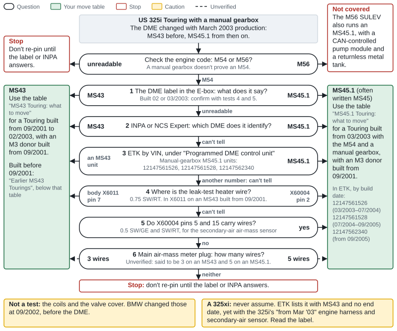

*Figure 1. How to tell an MS43 Touring from an MS45.1, and which move table to use. Check the engine code first, then work down the tests from the most reliable until one gives an answer: its arrows lead left to the MS43 table or right to the MS45.1 table. A car built in 02 or 03/2003 needs the label and a look at the plugs, so confirm a label reading with tests 4 and 5.*

### The five DME plugs

All three DMEs use the same five-plug Siemens connector, but the pin assignments differ throughout ([BMW ST055](https://ia801005.us.archive.org/11/items/BMWTechnicalTrainingDocuments/ST055%20Engine%20Electronics%20%28Archive%201%29/8%20MS%20S54.pdf), [WDS](https://wds.psjr.org/en/e46/zinfo/E46_PA6000L.htm)). Four plugs come with the M3 harness; X60004 is your body harness's.

| Plug | Pins | Belongs to | MSS54 functions that matter here | Source |
|---|---|---|---|---|
| X60001 | 9 | M3 engine harness | 1 terminal 15 to the injector relay K6327; 2 and 9 throttle actuator; 4, 5 and 6 grounds; 7 battery positive; 8 supply from the E-box fuse carrier | [SP0000014290](https://wds.psjr.org/en/e46/svg/SP0000014290.svg) |
| X60002 | 24 | M3 engine harness | O2 sensors and heaters; 5 ground; 11 US pump-module signal (out through X6021 pin 1); 12 E-box fan; 20 clutch and gear-switch chain; 23 DME-relay coil | [SP0000014292](https://wds.psjr.org/en/e46/svg/SP0000014292.svg) |
| X60003 | 52 | M3 engine harness | 8 and 21 crankshaft sensor; 12 starter feedback in; 13 alternator (terminal 61) in; 26 oil-pressure switch; 39 oil level; 33–38 injectors; 19 tire-pressure reset from X6011 pin 8 (M3s with the MK20 only); 51 jet-pump valve; 52 crankcase-breather valve (from 09/2004) | [SP0000014294](https://wds.psjr.org/en/e46/svg/SP0000014294.svg), [SP0000022868](https://wds.psjr.org/en/e46/svg/SP0000022868.svg) |
| X60004 | 40 | Your body harness | The vehicle interface: next table | [SP0000017646](https://wds.psjr.org/en/e46/svg/SP0000017646.svg) |
| X60005 | 9 | M3 engine harness | Coils: pins 1, 2, 3, 6, 7 and 9 drive cylinders 1, 2, 3, 5, 6 and 4; pin 5 ground | [SP0000014296](https://wds.psjr.org/en/e46/svg/SP0000014296.svg) |

The MS45 drives its coils from different pins (1, 4, 6, 7, 8, 9 for cylinders 5, 3, 1, 2, 4, 6), and so does the MS43. Never mix a coil harness and a DME from different families: one 330Ci owner damaged a DME by mixing MS43 and MS45 coil harnesses during an M54 swap ([e46fanatics](https://www.e46fanatics.com/threads/330ci-engine-swap-no-start-looking-for-help.1298699/)).

**Keep the donor's DME and harness together.** WDS splits the M3's drawings at three build dates: 09/2001 (the leak-test heater on X60004 pin 18), 03/2004 (the charge lamp over CAN, and X60004 pins 1 and 2 no longer drawn) and 09/2004 (a crankcase-breather valve on X60003 pin 52). It has no separate "MSS54HP" condition, so an HP donor wires like an MSS54 of the same build date ([SP0000020984](https://wds.psjr.org/en/e46/svg/SP0000020984.svg), [SP0000022868](https://wds.psjr.org/en/e46/svg/SP0000022868.svg)). If the donor was an SMG car, its harness has no gear-switch wire at X60002 pin 20; add one ([e46fanatics](https://www.e46fanatics.com/threads/s54-swap-wiring-information.1003871/), [NAM3](https://nam3forum.com/forums/forum/main-forum/e46-2001-2006/2844-smg-to-6mt-conversion)).

### X60004 pin by pin

From WDS: the MS43 column is its manual-gearbox table from 09/2001 ([PA6000J](https://wds.psjr.org/en/e46/zinfo/E46_PA6000J.htm), [SP0000017224](https://wds.psjr.org/en/e46/svg/SP0000017224.svg)); the MSS54 column is the US M3 from 09/2001 to 03/2004 ([PA6000L](https://wds.psjr.org/en/e46/zinfo/E46_PA6000L.htm), [SP0000017646](https://wds.psjr.org/en/e46/svg/SP0000017646.svg)). WDS has no single drawing for the MS45.1 M54 manual car, so its column combines the MS45 drawing ([SP0000018609](https://wds.psjr.org/en/e46/svg/SP0000018609.svg)) with WDS's M54 drawings for the pump relay, clutch and secondary-air sensor ([SP0000014336](https://wds.psjr.org/en/e46/svg/SP0000014336.svg), [SP0000016193](https://wds.psjr.org/en/e46/svg/SP0000016193.svg), [SP0000019608](https://wds.psjr.org/en/e46/svg/SP0000019608.svg)). Wire sizes are in mm².

**The same on all three DMEs; nothing moves:**

| Pin | Circuit (wire) |
|---|---|
| 3 | Secondary-air pump relay K6304 (0.35 BR/BL) |
| 4 | Electric fan (0.5 SW/GN) |
| 7, 8, 9, 12, 13, 14 | Accelerator pedal sensors (0.35: 7 BR/GN, 8 WS, 9 GE, 12 BR, 13 WS/GN, 14 GE/GN) |
| 17 | Engine-speed signal to OBD pin 9 (0.35 SW) |
| 22 | Road speed from the DSC unit (0.35 WS/GN) |
| 24 | Brake-light switch, first contact, through splice X181 (0.35 BL/RT) |
| 26 | Terminal 15 from F29, 5 A (0.5 GN/VI) |
| 27 | Cruise buttons: serial data from the steering wheel (0.35 BL/SW). A Touring without steering-wheel buttons gets this wire from BMW's retrofit ([Steering-wheel buttons (MFL)](#steering-wheel-buttons-mfl)) |
| 29 | A/C compressor relay K19 (0.5 SW/BL) |
| 32 | Diagnosis line TXD II to OBD pin 7 (0.5 WS/VI) |
| 33 | EWS data line (0.35 SW/VI) |
| 36, 37 | CAN high, CAN low (0.5 GE/RT, GE/BR) |
| 38, 39 | Radiator-outlet temperature sensor (0.35 SW/GN, SW/GR) |
| 40 | Empty on all three |

**Pins that differ:**

| Pin | MS43 (325i, to 02/2003) | MS45.1 (325i, from 03/2003) | MSS54 (US M3) | In your Touring |
|---|---|---|---|---|
| 1 | Empty (charge lamp at body X6011 pin 4) | Empty (lamp over CAN) | Charge lamp out to cluster pin 2 (0.35 BL) | MS43: move from X6011 pin 4. MS45.1: add |
| 2 | Empty (start feedback at body X6011 pin 6) | Leak-test heater (0.75 SW/RT) | Start feedback (terminal 30h) out to splice X276: cluster pin 3 (0.35 SW/GN) | MS43: move from X6011 pin 6. MS45.1: heater to 18 |
| 5 | Empty | Secondary-air sensor ground (0.5 SW/GE) | Ground to point X1108 (0.35 BR/SW) | MS45.1: remove. Both: add the ground (recommended) |
| 6 | Empty | Empty | Terminal 50 in, from connector X18820 (0.35 SW/BL) | Leave empty |
| 10 | Pump relay K96 (0.35 SW/VI) | Same | Pump relay, Euro cars only; "not used" on US drawings | Keep ([Fuel-pump control](#fuel-pump-control)) |
| 11 | Empty (lamp at body X6011 pin 3) | Empty (lamp over CAN) | Oil-pressure lamp out to cluster pin 13 (0.35 BR/GN) | MS43: move from X6011 pin 3. MS45.1: add |
| 15 | Empty | Secondary-air sensor signal (0.5 SW/RT) | Sport button in (0.35 SW/RT/GE) | MS45.1: remove. Sport optional |
| 16 | Empty | Empty | Sport LED out (0.35 SW/GR/GE) | Sport optional |
| 18 | Exhaust flap (3.0-litre only; empty on a 325i) | Empty (flap on 3.0-litre cars) | Leak-test heater (0.75 SW/RT) | Heater goes here |
| 19 | Empty | E-box fan, if fitted (0.5 BR/OR) | Empty (M3 fan on X60002 pin 12) | MS45.1: remove if populated |
| 20 | Leak-test module pin 1; BMW's table says "valve" | Module pin 1; table says "pump" | Module pin 1; table says "valve" | No change on the drawings; [test](#dm-tl-leak-test-pump-test-before-you-swap) |
| 21 | Empty (oil level at body X6011 pin 5) | Empty (over CAN) | Oil level out to cluster pin 17 (0.5 WS/GN) | MS43: move from X6011 pin 5. MS45.1: add |
| 23 | Clutch module (0.35 BL/BR) | Same | Empty: the clutch reaches X60002 pin 20 through the gear switch | Move to body X6011 pin 7 |
| 25 | Empty | Empty (EAC sensor, M56 only) | Empty | — |
| 28 | Brake-light switch, test contact (0.35 BR/GR) | Same | Empty (leak-test pump on M3s built before 09/2001) | Move to 34 |
| 30 | Module pin 3; table says "pump" | Module pin 3; table says "valve" | Module pin 3; table says "pump" | No change on the drawings; test |
| 31, 35 | Empty | Empty (local CAN, M56 only) | Empty | — |
| 34 | Empty | Empty | Brake-light switch, test contact (0.35 BR/GR) | Takes the wire from 28 |

On most drawings pin 20 is 0.75 BR/BL and pin 30 is 0.5 SW/GN. The US MS43 drawing shows them the other way round ([SP0000017224](https://wds.psjr.org/en/e46/svg/SP0000017224.svg); BMW's MS43 function drawing [SP0000017277](https://wds.psjr.org/en/e46/svg/SP0000017277.svg) agrees with the others), and the one documented MS43 wagon had SW/GN on 20, so on an MS43 Touring expect either. Go by the cavity, not the color. WDS prints pin 26 GN/VI on the module drawings and GN/SW on the MS43 supply drawings.

### Connector views and cavity numbers

- **WDS never says which face it shows.** Its connector views draw the housing with cavity numbers, often only at the corners, but don't say whether you're looking at the wire side or the mating side ([WDS](https://wds.psjr.org/en/e46/zinfo/E46_SX60004A.htm)). Go by the numbers moulded into the housing. BMW's training says to "observe cavity numbers on reverse side of socket housing" ([BMW ST051](https://archive.org/download/BMWTechnicalTrainingDocuments/ST051%20Body%20Electronics%20I%20%28Archive%201%29/03%20Breakout%20Boxes%20%26%20Connectors.pdf)), and one swapper found X60004's numbers on its underside ([Import Modify – S54 swap, transmission and wiring (2018), 13:57](https://www.youtube.com/watch?v=9ErSBXkH7S0&t=837s)).
- **X60004 runs the opposite way to the other four.** WDS draws X60004 as two blocks of two rows of ten. Its rows run left to right, with pin 1 at the bottom left: 1–10 and 11–20 in the lower block, 21–30 and 31–40 in the upper. X60001, X60002, X60003 and X60005 number right to left, with pin 1 at the bottom right ([WDS X60004](https://wds.psjr.org/en/e46/zinfo/E46_SX60004A.htm), [X60001](https://wds.psjr.org/en/e46/zinfo/E46_SX60001A.htm), [X60002](https://wds.psjr.org/en/e46/zinfo/E46_SX60002A.htm), [X60003](https://wds.psjr.org/en/e46/zinfo/E46_SX60003A.htm)). Don't carry a habit from one plug to the other. The 40-pin housing is a "/B" part where the others are "/A", which may be why (unconfirmed).
- **X6011** (black, 8 cavities, "Engine plug I"): two rows of four, 1–4 in one row and 5–8 in the other, with 5 next to 1. WDS draws pin terminals on this plug where the DME plugs, X6053 and X6021 show sockets ([WDS](https://wds.psjr.org/en/e46/zinfo/E46_SX6011A.htm)). The body half is black and the engine-harness half teal ([Tulay](https://tulayswirewerks.com/product/bmw-8-pin-teal-unsealed-plug-e46-engine-plug-i-x6011-engine-harness-connector-kit/)).
- **X6053** (natural, 8 round cavities): 4-3-2-1 over 8-7-6-5 ([WDS](https://wds.psjr.org/en/e46/zinfo/E46_SX6053A.htm)). The MS45.1's X60531 is a different style: one owner found flat spade pins on a 07/2004 325i where a 10/2003 car had round pins ([e46fanatics](https://www.e46fanatics.com/threads/funky-x6053-connector-on-ebox.1268369/)).
- **X6021** (black, 4): 1-2-3-4 in one row ([WDS](https://wds.psjr.org/en/e46/zinfo/E46_SX6021A.htm)).
- **Body-side plugs:** the cluster's X11175 (black, 26) has 1–13 in one row and 14–26 in the other; the switch center's X1869 (23) has 13 to 1 on top and 23 to 14 below, in uneven groups; the clutch module's X13635 and the brake switch's X78 (4 each) read 4-3-2-1; the leak-test module's plug (X17140 on the M3, X1714 on the MS43, X17141 on the MS45) has four staggered cavities, 3 and 1 over 4 and 2; the pump relay socket X10156 (9) reads 3-6-9 over 1-4-7, with an unnumbered middle row; the OBD socket X19527 (16) reads 8–1 over 16–9 ([WDS](https://wds.psjr.org/en/e46/zinfo/E46_SX11175A.htm), [WDS](https://wds.psjr.org/en/e46/zinfo/E46_SX1869A.htm), [WDS](https://wds.psjr.org/en/e46/zinfo/E46_SX13635A.htm), [WDS](https://wds.psjr.org/en/e46/zinfo/E46_SX17140A.htm), [WDS](https://wds.psjr.org/en/e46/zinfo/E46_SX10156A.htm), [WDS](https://wds.psjr.org/en/e46/zinfo/E46_SX19527A.htm)).

### MS43 Touring: what to move

For a Touring built from 09/2001 to 02/2003, with an M3 donor built from 09/2001. Earlier cars are below the table. Work on the body side in the E-box, and in this order: the heater wire must leave X6011 pin 7 before the clutch wire goes in. Sizes are mm².

| # | Connector and cavity | Wire | From → to | Function | Source |
|---|---|---|---|---|---|
| 1 | Body X6011 pin 7 → X60004 pin 18 | 0.75 SW/RT | Leak-test module plug pin 2 → DME | Leak-test pump heater (US only) | [SP0000017260](https://wds.psjr.org/en/e46/svg/SP0000017260.svg), [SP0000017646](https://wds.psjr.org/en/e46/svg/SP0000017646.svg) |
| 2 | X60004 pin 23 → body X6011 pin 7 | 0.35 BL/BR | Clutch module X13635 pin 2 → M3 engine harness (0.5 GR) → X6053 pin 5 → gear switch → 0.5 GR/BL → X60002 pin 20 | Clutch and gear-switch chain: cruise and idle control | [SP0000016193](https://wds.psjr.org/en/e46/svg/SP0000016193.svg), [SP0000016194](https://wds.psjr.org/en/e46/svg/SP0000016194.svg), [SP0000014314](https://wds.psjr.org/en/e46/svg/SP0000014314.svg) |
| 3 | Body X6011 pin 3 → X60004 pin 11 | 0.35 BR/GN | DME → cluster X11175 pin 13 (switch on X60003 pin 26) | Oil-pressure lamp | [SP0000017260](https://wds.psjr.org/en/e46/svg/SP0000017260.svg), [SP0000014396](https://wds.psjr.org/en/e46/svg/SP0000014396.svg), [SP0000007269](https://wds.psjr.org/en/e46/svg/SP0000007269.svg) |
| 4 | Body X6011 pin 4 → X60004 pin 1 | 0.35 BL | DME → cluster pin 2 (alternator on X60003 pin 13) | Charge lamp | [SP0000014363](https://wds.psjr.org/en/e46/svg/SP0000014363.svg), [SP0000014362](https://wds.psjr.org/en/e46/svg/SP0000014362.svg) |
| 5 | Body X6011 pin 5 → X60004 pin 21 | 0.5 WS/GN | DME → cluster pin 17 (sensor on X60003 pin 39) | Oil level | [SP0000014397](https://wds.psjr.org/en/e46/svg/SP0000014397.svg), [SP0000014426](https://wds.psjr.org/en/e46/svg/SP0000014426.svg) |
| 6 | Body X6011 pin 6 → X60004 pin 2 | 0.35 SW/GN | DME → splice X276: cluster pin 3 and the E-box fan plug (starter on X60003 pin 12) | Start feedback (terminal 30h) | [SP0000014365](https://wds.psjr.org/en/e46/svg/SP0000014365.svg), [SP0000014364](https://wds.psjr.org/en/e46/svg/SP0000014364.svg) |
| 7 | X60004 pin 28 → pin 34 | 0.35 BR/GR | Brake-light switch X78 pin 3, through splice X1179 → DME | Brake-light switch, test contact | [SP0000017224](https://wds.psjr.org/en/e46/svg/SP0000017224.svg), [SP0000014399](https://wds.psjr.org/en/e46/svg/SP0000014399.svg) |
| 8 | Add: X60004 pin 5 | New 0.35 BR/SW | X60004 pin 5 → ground point X1108, under the driver's-seat carpet | DME ground, as on every M3 (recommended) | [SP0000017646](https://wds.psjr.org/en/e46/svg/SP0000017646.svg), [EX1108A](https://wds.psjr.org/en/e46/zinfo/E46_EX1108A.htm) |
| 9 | Add (optional): X60004 pins 15 and 16 | New 0.35 SW/RT/GE and SW/GR/GE | Switch center X1869 pin 17 → X60004 pin 15; X60004 pin 16 → X1869 pin 18 | Sport button and its LED | [SP0000014425](https://wds.psjr.org/en/e46/svg/SP0000014425.svg) |
| 10 | Clutch module | — | Replace 61319231129 with the M3's 61319122700 | The chain needs the M3 module's output | [Clutch switch, gear switch and cruise](#clutch-switch-gear-switch-and-cruise) |
| — | No change | — | X60004 pin 10 (pump relay); pins 20 and 30 (leak-test pump; [test](#dm-tl-leak-test-pump-test-before-you-swap)); X6011 pins 1 and 2; X6021 pins 2, 3 and 4 | — | [SP0000014336](https://wds.psjr.org/en/e46/svg/SP0000014336.svg), [SP0000007729](https://wds.psjr.org/en/e46/svg/SP0000007729.svg) |
| — | Leave empty | — | X60004 pin 6 (an M3 terminal-50 input whose use isn't shown); X6011 pin 8 (tire-pressure reset on MK20-era M3s); X6021 pin 1 (the US pump-module signal) | — | [SP0000017646](https://wds.psjr.org/en/e46/svg/SP0000017646.svg), [NAM3](https://nam3forum.com/forums/forum/main-forum/e46-2001-2006/243029-e46-m3-tpms-x60003-to-x6011-question) |

X6011 and X60004 take different terminals, so every wire that moves between them gets a new terminal of the target's type: re-terminate it, or use a BMW repair lead ([Tulay](https://tulayswirewerks.com/product/bmw-e46-ms42-to-ms43-cluster-indicator-plug-and-play-adapter/), [Terminals, tools and repair leads](#terminals-tools-and-repair-leads)).

**Where other sources differ:**

- **Start feedback goes to pin 2, not 6.** A forum mapping sends X6011 pin 6 to X60004 pin 6. WDS shows X6011 pin 6 as the 30h start feedback, whose M3 home is pin 2, and the M3's pin 6 as a separate terminal-50 input ([SP0000017260](https://wds.psjr.org/en/e46/svg/SP0000017260.svg), [SP0000017646](https://wds.psjr.org/en/e46/svg/SP0000017646.svg), [e46fanatics](https://www.e46fanatics.com/threads/s54-swap-wiring-information.1003871/)). One builder started his car without it; move it anyway, since the wire is already there.
- **The brake test-contact wire is BR/GR** (brown with gray) in WDS. Kassel's chart and the workbook print BR/GN, probably reading GR as green ([Kassel](https://www.kasselperformance.com/wp-content/uploads/2016/01/E46S54Wiring.png)).
- **The oil-pressure lamp is cluster pin 13.** Kassel's chart says pin 14, which is the K-bus; WDS, BMW's ISTA as a swap shop quoted it, and Trent's working 330i all use 13 ([SP0000018656](https://wds.psjr.org/en/e46/svg/SP0000018656.svg), [NAM3](https://nam3forum.com/forums/forum/main-forum/e46-2001-2006/61405-why-does-my-oil-light-turn-off-with-ignition-ii-engine-off), [NAM3](https://nam3forum.com/forums/forum/main-forum/member-build-journals/173296-trent-s-s54-rebuild-and-sedan-swap/page4)).
- **Kassel's MS43 column** lists only the brake move and the oil-pressure, oil-level and Sport additions; it leaves out the charge lamp, the start feedback, the heater and the clutch. Trent: "Some of the Kassel directions work and some do not" (same thread).
- **The heater wire left in X6011 pin 7** meets the M3's clutch wire. An MS43 S54 wagon had leak-test faults for about two years for that reason; with the heater on 18 (SW/GN on 20 and BR/BL on 30 in his harness) it passed California's referee in 10/2023 ([NAM3](https://nam3forum.com/forums/forum/main-forum/e46-2001-2006/102198-requesting-help-with-dmtl-pinout)).
- **One 2001 325iT owner joined the M3's oil-pressure wire to the cluster wire** at X6011 instead of moving it ([e46fanatics](https://www.e46fanatics.com/threads/battery-and-oil-pressure-lights-inop.1207433/)). The lamp works that way, but it's a splice; the move keeps BMW's route.

**Earlier MS43 Tourings:**

- **Built before 09/2001:** the leak-test module has three wires and no heater, so X6011 pin 7 is empty; the clutch wire goes in with a new terminal ([SP0000014355](https://wds.psjr.org/en/e46/svg/SP0000014355.svg)). An MSS54 from 09/2001 expects the heated four-wire module, so fit 16137193479 with a four-wire lead (a 2001 325iT owner took one from a junkyard car) and add a 0.75 mm² heater wire from X60004 pin 18 to module pin 2. The four-wire module takes X60004 pin 20 on its pin 1, pin 30 on its pin 3 and the F3 supply on pin 4 ([SP0000017277](https://wds.psjr.org/en/e46/svg/SP0000017277.svg), [ETK](https://bmwfans.info/parts-catalog/E46-Touring/USA/325i-M54/L-N/browse/fuel_supply/exp_tank_activated_carbon_container/), [e46fanatics](https://www.e46fanatics.com/threads/2001-325i-wagon-in-steel-grey-now-with-s54-swap.1127936/page-9), unverified). Then prove pump and valve with the [test](#dm-tl-leak-test-pump-test-before-you-swap).
- **A donor built before 09/2001** has an older DME layout: a three-wire leak-test module on X60004 pins 28 and 30, no heater output, and WDS names that conflict ([PA6000G](https://wds.psjr.org/en/e46/zinfo/E46_PA6000G.htm), [SP0000014423](https://wds.psjr.org/en/e46/svg/SP0000014423.svg)). Prefer a donor built from 09/2001.
- **Built before 03/2001:** a clutch switch (S32) instead of the clutch module ([SP0000014357](https://wds.psjr.org/en/e46/svg/SP0000014357.svg)). Check its plug and wiring against the M3 module's in WDS before you buy.

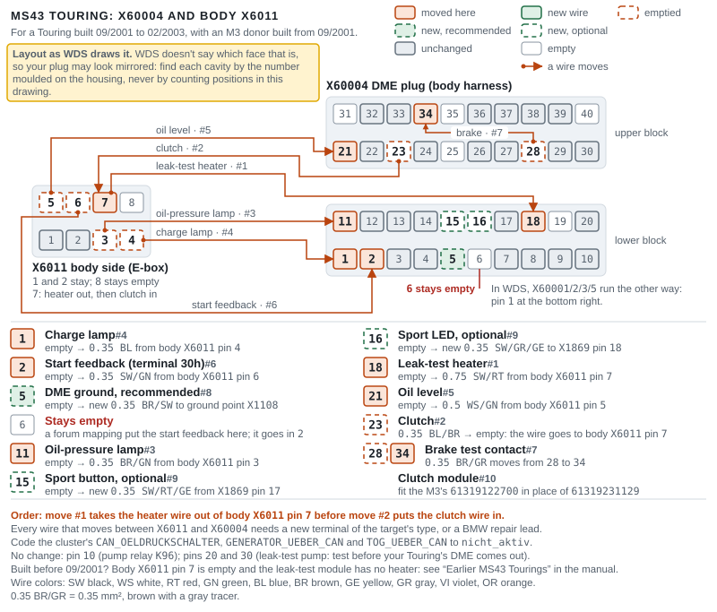

*Figure 2. X60004 and the body side of X6011 on an MS43 Touring, with every cavity that changes and its move number from the table above; five wires cross into X60004, and the clutch wire goes into X6011 pin 7 once the heater wire is out. Layout as WDS draws it. WDS doesn't say which face that is, so your plug may look mirrored: find each cavity by the number moulded on the housing, never by counting positions in this drawing.*

### MS45.1 Touring: what to move

For a Touring built from 03/2003 with the M54 and a manual gearbox, with an M3 donor built from 09/2001. Pins 5, 15 and 19 (if fitted) come out first; the heater leaves pin 2 before anything else goes in. Sizes are mm².

| # | Connector and cavity | Wire | From → to | Function | Source |
|---|---|---|---|---|---|
| 1 | X60004 pin 2 → pin 18 | 0.75 SW/RT | Leak-test module plug X17141 pin 2 → DME | Leak-test pump heater (US only) | [SP0000018609](https://wds.psjr.org/en/e46/svg/SP0000018609.svg), [SP0000017646](https://wds.psjr.org/en/e46/svg/SP0000017646.svg) |
| 2 | X60004 pin 5: out; insulate and tie back | 0.5 SW/GE | Secondary-air air-mass sensor, plug X6206 pin 1 | Sensor ground. On the MSS54, pin 5 is a ground | [SP0000018609](https://wds.psjr.org/en/e46/svg/SP0000018609.svg), [SP0000019608](https://wds.psjr.org/en/e46/svg/SP0000019608.svg) |
| 3 | X60004 pin 15: out; insulate | 0.5 SW/RT | Same sensor, X6206 pin 3 | Sensor signal. On the MSS54, pin 15 is the Sport input | Same |
| 4 | X60004 pin 19: out if populated; insulate | 0.5 BR/OR | E-box fan plug X6506 pin 1 | E-box fan. The M3 harness drives its own fan | [SP0000017918](https://wds.psjr.org/en/e46/svg/SP0000017918.svg) |
| 5 | X60004 pin 28 → pin 34 | 0.35 BR/GR | Brake-light switch X78 pin 3, through splice X1179 → DME | Brake-light switch, test contact | [SP0000018609](https://wds.psjr.org/en/e46/svg/SP0000018609.svg), [SP0000014399](https://wds.psjr.org/en/e46/svg/SP0000014399.svg) |
| 6 | X60004 pin 23 → body X6011 pin 7, with a new X6011-type terminal (body X6011 pin 7 is empty on this car) | 0.35 BL/BR | Clutch module X13635 pin 2 → M3 engine harness → gear switch → X60002 pin 20 | Clutch and gear-switch chain | [SP0000016193](https://wds.psjr.org/en/e46/svg/SP0000016193.svg), [SP0000018632](https://wds.psjr.org/en/e46/svg/SP0000018632.svg), [SP0000016194](https://wds.psjr.org/en/e46/svg/SP0000016194.svg) |
| 7 | Add: X60004 pin 11 → cluster X11175 pin 13 | New 0.35 BR/GN | DME → cluster | Oil-pressure lamp; code `CAN_OELDRUCKSCHALTER` = `nicht_aktiv` | [SP0000007269](https://wds.psjr.org/en/e46/svg/SP0000007269.svg), [NAM3](https://nam3forum.com/forums/forum/main-forum/e46-2001-2006/61405-why-does-my-oil-light-turn-off-with-ignition-ii-engine-off) |
| 8 | Add: X60004 pin 1 → cluster pin 2 | New 0.35 BL | DME → cluster | Charge lamp; code `GENERATOR_UEBER_CAN` = `nicht_aktiv` | [SP0000014362](https://wds.psjr.org/en/e46/svg/SP0000014362.svg) |
| 9 | Add: X60004 pin 21 → cluster pin 17 | New 0.5 WS/GN | DME → cluster | Oil level; code `TOG_UEBER_CAN` = `nicht_aktiv` | [SP0000014426](https://wds.psjr.org/en/e46/svg/SP0000014426.svg) |
| 10 | Only if your body X6011 pin 6 holds a wire: X6011 pin 6 → X60004 pin 2 (after move 1) | 0.35 SW/GN | DME → splice X276: cluster pin 3 | Start feedback (terminal 30h) | [SP0000014365](https://wds.psjr.org/en/e46/svg/SP0000014365.svg) against [SP0000018632](https://wds.psjr.org/en/e46/svg/SP0000018632.svg) |
| 11 | Add: X60004 pin 5 (after move 2) | New 0.35 BR/SW | X60004 pin 5 → ground point X1108, under the driver's-seat carpet | DME ground, as on every M3 (recommended) | [SP0000017646](https://wds.psjr.org/en/e46/svg/SP0000017646.svg), [EX1108A](https://wds.psjr.org/en/e46/zinfo/E46_EX1108A.htm) |
| 12 | Add (optional): X60004 pins 15 and 16 (after move 3) | New 0.35 SW/RT/GE and SW/GR/GE | Switch center X1869 pin 17 → X60004 pin 15; X60004 pin 16 → X1869 pin 18 | Sport button and its LED | [SP0000014425](https://wds.psjr.org/en/e46/svg/SP0000014425.svg) |
| 13 | Clutch module | — | Replace 61319231129 with the M3's 61319122700 | The chain needs the M3 module's output | [Clutch switch, gear switch and cruise](#clutch-switch-gear-switch-and-cruise) |
| — | No change | — | X60004 pin 10 (pump relay); pins 20 and 30 (leak-test pump; [test](#dm-tl-leak-test-pump-test-before-you-swap) before you swap anything); X6011 pins 1 and 2; X6021 pins 2, 3 and 4 | — | [SP0000014336](https://wds.psjr.org/en/e46/svg/SP0000014336.svg) |
| — | Check empty before you use it | — | X60004 pin 18 (an exhaust-flap wire exists on 3.0-litre cars only) | — | [PA6000P](https://wds.psjr.org/en/e46/zinfo/E46_PA6000P.htm) |
| — | Leave empty | — | X60004 pin 6; X6011 pin 8; X6021 pin 1 | — | As the MS43 table |

> [!IMPORTANT]
> Pins 2 and 15 are both SW/RT (black with red). Tag them before you pull them: the 0.75 mm² wire in pin 2 moves to pin 18, and the 0.5 mm² wire in pin 15 comes out.

**Notes:**

- **Pins 5 and 15.** Nobody has photographed a 325i Touring's X60004, but ETK lists the secondary-air air-mass sensor for it from 03/2003, and the one documented MS45.1 swap with a pin list (smee123's 2004 ZHP) removed 5, 15 and 19 and moved 28 → 34 and 2 → 18, exactly Kassel's MS45 column ([ETK](https://bmwfans.info/parts-catalog/E46-Touring/USA/325i-M54/L-N/browse/engine/emission_control_air_pump_2/), [NAM3](https://nam3forum.com/forums/forum/main-forum/e46-2001-2006/201716-switched-12v-question)). Left in place, the sensor's ground side would sit on the MSS54's ground pin and its signal on the Sport input.
- **Pin 19.** ETK fits the E-box blower only to automatic, SMG and hot-climate cars, so a manual US Touring probably has nothing there ([ETK](https://bmwfans.info/parts-catalog/E46-Touring/USA/325i-M56/browse/engine_electrical_system/control_unit_box/)). Feed the fan from one harness only ([E-box plugs](#e-box-plugs)).
- **The lamps.** The MS45.1 reads the oil-pressure switch, alternator and oil-level sensor itself and sends the lamps to the cluster over CAN, so the Touring's cluster plug may have nothing in pins 2, 13 and 17 ([SP0000018655](https://wds.psjr.org/en/e46/svg/SP0000018655.svg)). An MSS54HP doesn't light the oil-pressure lamp over CAN even with the cluster coded for it: nextelbuddy's MS45.1 ZHP needed the pin-11 wire, and his cluster's pin 13 was empty ([NAM3](https://nam3forum.com/forums/forum/main-forum/e46-2001-2006/61405-why-does-my-oil-light-turn-off-with-ignition-ii-engine-off)). Wire all three and code all three switches to `nicht_aktiv` ([Cluster wiring](#cluster-wiring)): then the lamps don't depend on which MSS54 software you run. With stock MSS54HP software you can leave the charge lamp and oil level on CAN instead.
- **Pin 6 of X6011.** WDS disagrees with itself: one drawing routes an MS45 car's start feedback through X6011 pin 6, another shows that X6011 with pins 1 and 2 only. Look at your plug; move 10 covers both cases.
- **Kassel's MS45 column** adds nothing ("ADD N/A"), so it misses the clutch, the lamps and the leak-test question. That may hold only with Kassel's own DME and cluster programming ([Kassel](https://www.kasselperformance.com/wp-content/uploads/2016/01/E46S54Wiring.png)). An ex-automatic MS45.1 330i wired to the chart alone had no cruise ([e46fanatics](https://www.e46fanatics.com/threads/s54-swap-cruise-control-not-working.1316868/), unverified).

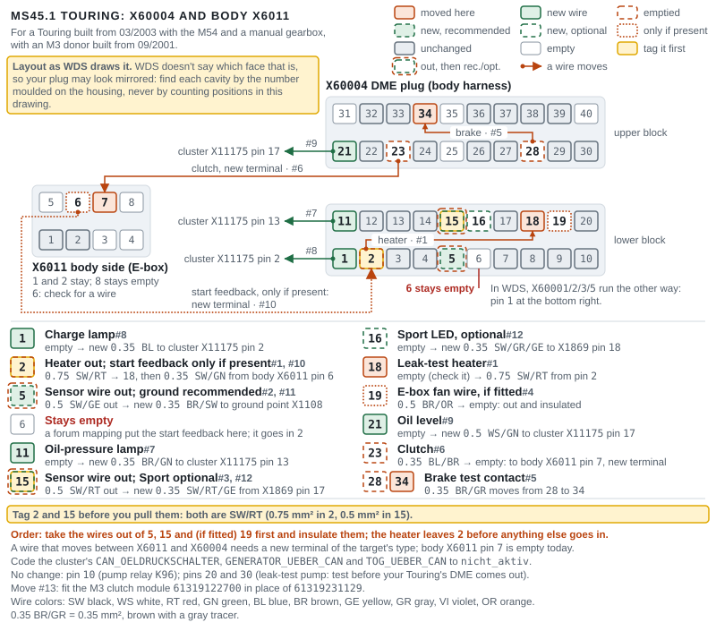

*Figure 3. X60004 and body X6011 on an MS45.1 Touring, laid out like the MS43 map: tag pins 2 and 15 (both SW/RT), take the wires out of 5 and 15 (and 19, if fitted) first, and move the heater from 2 to 18 before anything else goes in; the clutch wire needs a new terminal in X6011 pin 7, and the lamp wires to the cluster are new. Layout as WDS draws it. WDS doesn't say which face that is, so your plug may look mirrored: find each cavity by the number moulded on the housing, never by counting positions in this drawing.*

### DM-TL leak-test pump: test before you swap

The US leak-test pump (DM-TL) is the same part on both cars: 16136756440 to 09/2001, then the heated 16137193479 ([ETK: Touring](https://bmwfans.info/parts-catalog/E46-Touring/USA/325i-M54/L-N/browse/fuel_supply/exp_tank_activated_carbon_container/), [ETK: M3](https://bmwfans.info/parts-catalog/E46-Coupe/USA/M3-S54/L-N/browse/fuel_supply/exp_tank_activated_carbon_container/)). The heated module has four pins: 1 and 3 are the pump and the valve, 2 is the heater, and 4 is the +12 V supply (0.75 RT/WS, F3 20 A, through X6021 pin 2) ([SP0000017659](https://wds.psjr.org/en/e46/svg/SP0000017659.svg)).

**Every heated-module drawing, MS43, MS45 and MSS54, wires X60004 pin 20 to module pin 1 and pin 30 to module pin 3** ([SP0000017646](https://wds.psjr.org/en/e46/svg/SP0000017646.svg), [SP0000017277](https://wds.psjr.org/en/e46/svg/SP0000017277.svg), [SP0000017914](https://wds.psjr.org/en/e46/svg/SP0000017914.svg)). Only the labels disagree: the MSS54 and MS43 tables call pin 20 the valve and pin 30 the pump, while the MS45 tables say the reverse. On the drawings, neither Touring needs a 20/30 swap. Forum advice to swap 20 and 30 on MS45.1 cars follows the labels, and one builder who swapped still had P2418, "switching valve control circuit open" ([e46fanatics](https://www.e46fanatics.com/threads/e46-m3-sport-button-retrofit-on-non-m.1286041/)). Treat the swap as unproven, and settle it on your car:

1. **Before your Touring's DME comes out,** run its leak-test jobs in Tool32 and note which X60004 wire switches (a test lamp or meter at the back of the plug) and which job makes the pump run. MS45.1 (`MS450DS0.PRG`): `STEUERN_DMTL_P`, `STEUERN_DMTL_V` and `STEUERN_DMTL_H`, each with its `_ENDE` job, and `STATUS_DMTL_P`, `_V`, `_H`. MS43 (`MS430DS0.PRG`): `STEUERN_DMTL_MOTOR`, `STEUERN_DMTL_VENTIL`, `STEUERN_DMTL_HEIZUNG`. Tag each wire with its function ([MS450DS0](https://raw.githubusercontent.com/emdzej/ediabasx-docs-sgbd/main/docs/sgbd/MS450DS0.md), [MS430DS0](https://raw.githubusercontent.com/emdzej/ediabasx-docs-sgbd/main/docs/sgbd/MS430DS0.md)).
2. **Measure the triangle** from X60004 with the DME unplugged ([step 9 of the checks](#checks-before-first-power-up)): the lowest element is the pump.
3. **If still unsure, bench-check the module:** unplug it, feed +12 V through a fused lead to pin 4 (pin 3 on a three-wire unit) and briefly ground pin 1, then pin 3. The pump runs on one and the valve clicks on the other (our inference from the drawings).
4. **The MSS54 wants the pump on pin 30 and the valve on pin 20** (its table, and WDS's signal names DMTLP and DMTL). Pump on 30: change nothing. Pump on 20: swap 20 and 30.
5. **After the swap,** the MSS54 has no separate pump or valve job. `STEUERN_DMTL_HEIZUNG` switches the heater; run `START_SYSTEMCHECK_DMTL`, then `LESEN_SYSTEMCHECK_DMTL`, and read the faults: 14 (0x0E) heater, 27 (0x1B) valve, 127 (0x7F) module ([SGBD documentation](https://github.com/emdzej/ediabasx-docs-sgbd/blob/main/docs/sgbd/MSS54DS0.md)).

The one unresolved case: Trent's MS43 330i still logged "Heating DMTL module", 14 (0x0E), and "Module, tank-leak diagnosis", 127 (0x7F), after the heater move, with pump current over 50 mA against about 24 mA, and a new pump on order in June 2026 ([NAM3](https://nam3forum.com/forums/forum/main-forum/member-build-journals/173296-trent-s-s54-rebuild-and-sedan-swap/page4)).

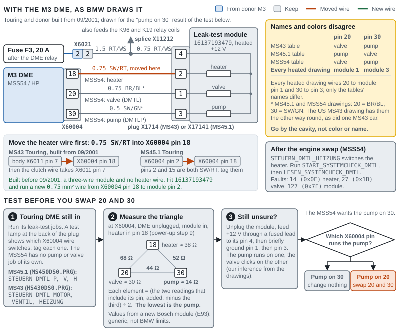

*Figure 4. The leak-test module with the M3 DME as BMW draws it, for a Touring and donor built from 09/2001: F3 feeds module pin 4, the heater wire moves into X60004 pin 18, and pins 20 and 30 run to module pins 1 and 3. The tables disagree about which of 20 and 30 is the pump, so run your Touring DME's own leak-test jobs before it comes out, then measure the triangle once the heater is in pin 18: pump on 30, change nothing; pump on 20, swap 20 and 30.*

### E-box plugs

The M3 harness's E-box branch meets your body harness at X6011 and X6021, and the B+ feed enters at X64101/X64102. X6053 and X6054 (X60531 and X60541 on an MS45.1) join the engine harness to the gearbox-module harness inside the M3 set, so use the M3's sections together and never mate an M3 half with a Touring half there. Compare every cavity on both halves before you join a plug, and log it ([worksheet](WORKSHEETS.md#e-box-plug-log)).

**X6011** (black, 8 pins, "Engine plug I") ([SP0000014314](https://wds.psjr.org/en/e46/svg/SP0000014314.svg), [SP0000017260](https://wds.psjr.org/en/e46/svg/SP0000017260.svg), [SP0000014318](https://wds.psjr.org/en/e46/svg/SP0000014318.svg), [SP0000018632](https://wds.psjr.org/en/e46/svg/SP0000018632.svg)):

| Pin | M3, body side | M3, engine side | MS43 Touring, body side | MS45.1 Touring, body side |
|---|---|---|---|---|
| 1 | Terminal 50 from EWS X1659 pin 1 (2.5 SW) | To the starter (2.5 SW) | Same | Same |
| 2 | Terminal 15 from F30, 7.5 A (0.75 GN/BR) | To the oil-level sensor and alternator regulator (1.0 GN/BR) | Same | Same |
| 3 | — | — | Oil-pressure lamp from cluster pin 13 (0.35 BR/GN) | — |
| 4 | — | — | Charge lamp from cluster pin 2 (0.35 BL) | — |
| 5 | — | — | Oil level from cluster pin 17 (0.5 WS/GN) | — |
| 6 | — | — | Start feedback from splice X276 (0.35 SW/GN) | — (one drawing shows it; check) |
| 7 | Clutch from module X13635 pin 2 (0.35 GR) | To X6053 pin 5 and the gear switch (0.5 GR) | Leak-test heater (0.75 SW/RT), from 09/2001; empty before | — |
| 8 | Tire-pressure reset from switch center X1869 pin 2 (0.5 GE/SW), MK20-era M3s only | To X60003 pin 19 | — | — |

After the moves, X6011 on either Touring carries only pins 1, 2 and 7 (the clutch wire). On an MK60 M3 (from 09/2002) the tire-pressure reset goes to the DSC unit and pin 8 is empty ([NAM3](https://nam3forum.com/forums/forum/main-forum/e46-2001-2006/243029-e46-m3-tpms-x60003-to-x6011-question)).

**X6021** (black, 4 pins) ([SP0000014315](https://wds.psjr.org/en/e46/svg/SP0000014315.svg), [SP0000007729](https://wds.psjr.org/en/e46/svg/SP0000007729.svg)):

| Pin | US M3 | Your Touring (manual) | Function |
|---|---|---|---|
| 1 | Pump-module signal from X60002 pin 11 (0.35 SW/VI) | Empty | The US M3's pump module; no mate in a 325i, so it stays unconnected |
| 2 | DME-relay power out, F3 (1.5 RT/WS) | Same, to splice X11212 | Feeds the pump relay's coil, the leak-test module and the A/C relay coil |
| 3 | Reverse-light switch output (1.0 BL/GE) | Same | Reverse lights |
| 4 | Reverse-light switch feed from F27, 10 A (1.0 GN/WS) | Same | Reverse lights |

Older forum posts describe a "3-pin plug" with the reverse-light wires and a heavy DME-relay feed that "nothing will work without" ([e46fanatics](https://www.e46fanatics.com/threads/s54-swap-wiring-information.1003871/)). WDS shows no 3-pin E-box plug on these cars: the reverse-light wires and the DME-relay supply to the body share X6021, and the heavy battery feed to the DME relay comes in at X64101/X64102.

**X6053 / X60531** (natural, 8 pins; engine harness to gearbox-module harness) ([SP0000014316](https://wds.psjr.org/en/e46/svg/SP0000014316.svg), [SP0000014319](https://wds.psjr.org/en/e46/svg/SP0000014319.svg), [SP0000018630](https://wds.psjr.org/en/e46/svg/SP0000018630.svg)):

| Pin | M3 (X6053) | MS43 (X6053) | MS45.1 (X60531) |
|---|---|---|---|
| 1 | Injector supply from relay K6327 (2.5 RT/GE) | Terminal 15 to the automatic-gearbox unit | Same as MS43 |
| 2 | F2 supply (2.5 RT/WS/GE) | Same | Same |
| 3 | F3 supply (2.5 RT/WS) | Same | Same |
| 4 | Ground (1.5 BR) | Oil-level sensor ground (0.5 BR) | Same as MS43 |
| 5 | Clutch chain: X6011 pin 7 to the gear switch (0.5 GR) | — | — |
| 6 | Throttle actuator + from X60001 pin 2 (2.5 RT) | — | — |
| 7 | Throttle actuator − from X60001 pin 9 (2.5 WS) | Injector supply from K6327 (2.5 RT/GE) | Same as MS43 |
| 8 | — | — | — |

Mixed halves would put the M3's throttle-actuator lines on the Touring's injector feed. A 330i swap with mixed sections got injector "circuit low" faults on all six ([e46fanatics](https://www.e46fanatics.com/threads/s54-swap-fuel-injectors-low-circuit.1277127/)), and Tracks and Trails' ex-automatic Touring had spark but no fuel until the M3's gearbox section went in ([Tracks and Trails – Attempting to drive my E46 M3 Touring (2026), 1:14:00](https://www.youtube.com/watch?v=pvR3ovRfQHg&t=4440s)).

**X6054 / X60541** (natural, 2 pins): 1 coil supply from F1 (30 A, 2.5 mm²); 2 ground from X60005 pin 5 (2.5 BR) ([SP0000014317](https://wds.psjr.org/en/e46/svg/SP0000014317.svg), [SP0000018631](https://wds.psjr.org/en/e46/svg/SP0000018631.svg)).

**X64101 / X64102** (the B+ feed): battery positive from the distributor (F102, 80 A) to DME X60001 pin 7 (1.5 RT) and to the DME relay K6300's terminal 30 (4.0 RT) ([SP0000014406](https://wds.psjr.org/en/e46/svg/SP0000014406.svg), [EX64101C](https://wds.psjr.org/en/e46/zinfo/E46_EX64101C.htm)).

**The E-box fan plug X6506.** The M3 harness's plug takes its control from X60002 pin 12 (0.5 BR/GE) on pin 1, the start feedback on pin 2 and the F3 supply on pin 3. An MS45.1 Touring's, where fitted, takes its control from X60004 pin 19 (0.5 BR/OR) on pin 1 and the F3 supply on pin 2 ([SP0000014366](https://wds.psjr.org/en/e46/svg/SP0000014366.svg), [SP0000017918](https://wds.psjr.org/en/e46/svg/SP0000017918.svg)). The pins differ, so feed the fan from one harness only. If your E-box has no blower, leave the M3 plug unplugged, as Tenza did ([Tenza Motorsports – 5 things they don't tell you, part 2 (2021), 02:05](https://www.youtube.com/watch?v=mDBiRn30fEs&t=125s)).

### Power, relays and fuses

The S54's DME power layout matches the 325i's ([SP0000014406](https://wds.psjr.org/en/e46/svg/SP0000014406.svg), [SP0000014676](https://wds.psjr.org/en/e46/svg/SP0000014676.svg), [SP0000017912](https://wds.psjr.org/en/e46/svg/SP0000017912.svg)):

- Battery positive reaches X60001 pin 7 and the DME relay K6300 (terminal 30, X6300 pin 6) through X64101/X64102.
- The DME switches the relay's coil (X6300 pin 4) from X60002 pin 23. The relay's output (X6300 pins 2 and 5, 4.0 RT/WS) feeds the E-box fuse carrier A8680: F1 30 A (coils, through X6054), F2 30 A (X60001 pin 8 and X6053 pin 2), F3 20 A (X6053 pin 3, and X6021 pin 2 to the pump relay's coil, the leak-test module and the A/C relay's coil) and F4 30 A (O2-sensor heaters and others). BMW's ST055 also lists an F5, 30 A ([BMW ST055](https://ia801005.us.archive.org/11/items/BMWTechnicalTrainingDocuments/ST055%20Engine%20Electronics%20%28Archive%201%29/8%20MS%20S54.pdf)).
- Terminal 15 reaches X60004 pin 26 through F29 (5 A), and X60001 pin 1 feeds the injector relay K6327, whose output goes to the injectors through X6053 pin 1 on the M3 (pin 7 on the Touring).
- The DME holds its relay on for a few seconds after key-off (same source).

| Item | Part or rating | Notes | Source |
|---|---|---|---|
| DME relay K6300 | 61366915327, sky blue | Same on both cars | [ETK](https://bmwfans.info/parts-catalog/E46-Coupe/USA/M3-S54/browse/vehicle_electrical_system/relay_dme_mss54_k6300/) |
| Injector relay K6327 | 61368373700 | Same on both cars | [ETK](https://bmwfans.info/parts-catalog/E46-Coupe/USA/M3-S54/browse/vehicle_electrical_system/relay_for_injectors_k6327/) |
| Secondary-air relay K6304 | 12631742690 | Same on both cars | [ETK](https://bmwfans.info/parts-catalog/E46-Coupe/USA/M3-S54/browse/vehicle_electrical_system/secondary_air_injection_pump_relay_k6304/) |
| Fuel-pump relay K96 | 61368373700, white-green, in holder 61131389111 | Your Touring and the Euro M3; the US M3 uses module 61357892976 | [ETK](https://bmwfans.info/parts-catalog/E46-Touring/USA/325i-M54/L-N/browse/vehicle_electrical_system/relay_for_fuel_pump_1_k96/) |
| A/C compressor relay K19 | 61368373700 | Same on both cars | [ETK](https://bmwfans.info/parts-catalog/E46-Coupe/USA/M3-S54/L-N/browse/vehicle_electrical_system/relay_for_a_c_compressor_k19/) |

**Glovebox fuses in these circuits**, from the WDS drawings: F9 5 A (terminal R: brake-light switch and clutch module); F10 5 A (cluster, terminal R); F12 (switch center, terminal R; rating not in our sources); F27 10 A (reverse-light switch); F29 5 A (DME, terminal 15); F30 7.5 A (X6011 pin 2: alternator and oil-level sensor; OBD pin 1); F33 5 A (switch center X521, terminal 15); F34 5 A (cluster, terminal 15); F37 50 A (electric fan); F42 30 A (switch center, terminal 30); F43 5 A (cluster, terminal 30; OBD pin 16); F54 15 A (pump power through K96); F62 7.5 A (the M3 heater valve's auxiliary pump; older drawings show F23); F63 7.5 A (A/C relay K19) ([SP0000014399](https://wds.psjr.org/en/e46/svg/SP0000014399.svg), [SP0000014336](https://wds.psjr.org/en/e46/svg/SP0000014336.svg), [SP0000015484](https://wds.psjr.org/en/e46/svg/SP0000015484.svg), [SP0000017567](https://wds.psjr.org/en/e46/svg/SP0000017567.svg), [SP0000011762](https://wds.psjr.org/en/e46/svg/SP0000011762.svg), [SP0000014297](https://wds.psjr.org/en/e46/svg/SP0000014297.svg), [NAM3](https://nam3forum.com/forums/forum/main-forum/e46-2001-2006/243243-depinning-center-control-switch)). Check your car's fuse card. Unused positions are usually wired on the power side only, so adding a fuse means adding a terminal on the load side ([e46fanatics](https://www.e46fanatics.com/threads/kalims-s54-sedan-swap-warning-pic-heavy.889867/page-38)).

### Grounds

- The MSS54's grounds are X60001 pins 4, 5 and 6, X60002 pin 5, X60005 pin 5 and X60004 pin 5 ([BMW ST055](https://ia801005.us.archive.org/11/items/BMWTechnicalTrainingDocuments/ST055%20Engine%20Electronics%20%28Archive%201%29/8%20MS%20S54.pdf)). All but X60004 pin 5 come with the M3 harness; keep their ground points intact.
- **Add a ground at X60004 pin 5.** Every M3 drawing in WDS has a real ground wire there: 0.35 mm² BR/SW to ground point X1108, under the driver's-seat carpet ([SP0000017646](https://wds.psjr.org/en/e46/svg/SP0000017646.svg), [EX1108A](https://wds.psjr.org/en/e46/zinfo/E46_EX1108A.htm)). The same point grounds OBD pin 5, so your Touring has it ([SP0000011831](https://wds.psjr.org/en/e46/svg/SP0000011831.svg)). No source shows what the DME uses this ground for, and the one builder who added one, while chasing a relay that stayed on (a worn ignition switch, it turned out), saw no change ([NAM3](https://nam3forum.com/forums/forum/main-forum/e46-2001-2006/201716-switched-12v-question/page2)). It costs one wire and matches BMW's wiring, so fit it. On an MS45.1, take the air-mass-sensor wire out of pin 5 first.
- The engine ground cable (12421737755, 380 mm) and the E-box are the same parts on both cars ([ETK](https://bmwfans.info/parts-catalog/E46-Coupe/USA/M3-S54/browse/vehicle_electrical_system/ground_cable/), [ETK](https://bmwfans.info/parts-catalog/E46-Coupe/USA/M3-S54/browse/engine_electrical_system/control_unit_box/)).

### Fans and CAN

- **Electric fan.** All three DMEs drive it from X60004 pin 4 (0.5 SW/GN) to the fan's power stage, plug X82 pin 2. The fan takes power from F37 (50 A, 6.0 RT/BL) on pin 4 and its ground on pin 1, and the DME reads the radiator-outlet sensor on pins 38 and 39 ([SP0000011770](https://wds.psjr.org/en/e46/svg/SP0000011770.svg) to 03/2003, [SP0000019629](https://wds.psjr.org/en/e46/svg/SP0000019629.svg) from 03/2003, [SP0000019630](https://wds.psjr.org/en/e46/svg/SP0000019630.svg) for the M3). No pin moves. What changes is where X82 has to reach:
  - **Your Touring, as built:** on a manual car the DME's fan is a 390 W unit inside the radiator shroud (17117561757), with its power stage and X82, a black 4-pin plug, at the shroud's upper edge ([WDS](https://wds.psjr.org/en/e46/zinfo/E46_EM9A.htm), [ETK](https://bmwfans.info/parts-catalog/E46-Touring/USA/325i-M54/L-N/browse/radiator/fan_shroud/)). There's no viscous fan: ETK lists the mechanical fan for automatic Tourings only ([ETK](https://bmwfans.info/parts-catalog/E46-Touring/USA/325i-M54/L-N/browse/engine/cooling_system_fan_fan_coupling/)).
  - **After the swap:** the M3's electric fan is the pusher 64546988914 in front of the condenser, with its power stage on the fan ([ETK](https://bmwfans.info/parts-catalog/E46-Coupe/USA/M3-S54/L-N/browse/heater_and_air_conditioning/pusher_fan/), [BMW ST041](https://archive.org/download/BMWTechnicalTrainingDocuments/ST041%20M3%20Complete%20Vehicle/3%20EngineElectronics%20%28Part%203%29.pdf)). The viscous fan in the M3 shroud has no wiring. In the one documented manual-Touring swap the M3 pusher "bolted right into the touring's rad support and plugged right in" ([NAM3 (2023)](https://nam3forum.com/forums/forum/main-forum/e46-2001-2006/246516-non-m-electric-fan-fitment)). If your X82 lead doesn't reach, extend or re-route it, keeping the pins: 1 ground (6.0 BR), 2 the DME's signal (0.5 SW/GN), 4 the feed from F37 (6.0 RT/BL). Extend pins 1 and 4 in 6.0 mm² and pin 2 in 0.5 mm², with crimped, or soldered and heat-shrunk, joints, and add each to your list for the [power-up checks](#checks-before-first-power-up).
  - **Compare the plugs before you cut anything.** WDS calls X82 a 4-pin plug with pins 1, 2 and 4 used. ETK lists a 3-pole housing (61138380380, terminal 61138380385) for both cars' pusher fans, and no plug for the shroud fan ([ETK: M3](https://bmwfans.info/parts-catalog/E46-Coupe/USA/M3-S54/L-N/browse/heater_and_air_conditioning/pusher_fan/), [ETK: Touring](https://bmwfans.info/parts-catalog/E46-Touring/USA/325i-M54/L-N/browse/heater_and_air_conditioning/pusher_fan/)).
  - **A pusher fan on your Touring too?** ETK's US 325i Touring pusher-fan page lists 64546988913 with no gearbox note. But the same catalog gives a manual Touring the shroud fan, WDS lists one electric fan (M9) on X82 either way, and owners call the non-M pusher the automatic part, so 64546988913 is almost certainly the automatic Tourings' fan, beside their mechanical fan; no owner reports a pusher on a manual Touring ([WDS](https://wds.psjr.org/en/e46/zinfo/E46_EM9A.htm), [NAM3](https://nam3forum.com/forums/forum/main-forum/e46-2001-2006/246516-non-m-electric-fan-fitment)). Check your car in Phase 0: look in front of the condenser for a fan, look for a fan motor in the radiator shroud, and follow the 0.5 SW/GN wire from X60004 pin 4 to the plug it reaches. Photograph X82 where it sits.
- **How the DME runs the electric fan.** It sends a square-wave signal with a duty cycle between 10 and 90%; below 5% and above 95% are used to detect faults, not to run the fan. The speed follows the radiator-outlet temperature and the refrigerant pressure, and drops as road speed rises ([WDS](https://wds.psjr.org/en/e46/zinfo/HEL0498FB1214_M0ELU.htm), [BMW ST041](https://archive.org/download/BMWTechnicalTrainingDocuments/ST041%20M3%20Complete%20Vehicle/3%20EngineElectronics%20%28Part%203%29.pdf)). With the overheat lamp on, at 120 °C (248 °F), the fan runs on at 10 Hz. BMW's table for automatic climate control, below 80 km/h (50 mph), sets fan stage 0 at 8 bar (116 psi) of refrigerant pressure, 1 at 9 bar, 2 at 11, 3 at 13 and 4 at 14 bar, then one stage per bar up to 14 at 24 bar, and 15 above 24 bar (348 psi) ([BMW ST054, IHKA](https://archive.org/download/BMWTechnicalTrainingDocuments/ST054%20Climate%20Control%20%28Archive%201%29/12%20IHKA%20E46.pdf)). Test the fan with `STEUERN_E_LUEFTER` in `MSS54DS0.PRG`. Its faults are 53 (0x35), the fan, and 43 (0x2B), the radiator-outlet sensor ([SGBD documentation](https://github.com/emdzej/ediabasx-docs-sgbd/blob/main/docs/sgbd/MSS54DS0.md)).
- **Viscous fan.** No wiring. BMW rates its coupling on at 92 °C (198 °F) and off at 60 °C (140 °F). It screws onto the water pump with a left-hand thread, at 40 Nm (30 ft-lb) ([Flow p.61](https://drive.google.com/file/d/1GS3Hirx6x0c0WG8hPeXiwfXfeUldkQnm/view?usp=sharing)).
- **E-box fan.** See the X6506 note under [E-box plugs](#e-box-plugs).
- **CAN.** All three DMEs use X60004 pins 36 and 37 (0.5 GE/RT, GE/BR), which join splices X1893 and X1894 to the cluster, the DSC unit and the steering-angle sensor ([SP0000015023](https://wds.psjr.org/en/e46/svg/SP0000015023.svg)). The bus wiring doesn't change. The network and its check are under [CAN, K-bus and the diagnosis socket](#can-k-bus-and-the-diagnosis-socket).

### Terminals, tools and repair leads

- **Housings** (ETK; the same numbers on both cars): 9-pin socket housing 12521744624 (cap 12527502456); 24-pole 12521744627 and 12521744628 (cap 12521744626); 52-pole 12521744633 and 12521744634 (cap 12521744632 to 07/2003, or 12527526424); 40-pole "/B" 12521744630 and 12521744631 (cap 12521744629) ([ETK](https://bmwfans.info/parts-catalog/E46-Touring/USA/325i-M54/L-N/browse/engine_electrical_system/basic_cotrol_unit_dme/)). We found no part numbers for the X6011 and X6021 housings; Tulay's Wire Werks sells kits for X6011, X6053 and X6021 ([Tulay](https://tulayswirewerks.com/product/bmw-8-pin-black-unsealed-receptacle-e46-engine-plug-i-x6011-chassis-harness-connector-kit/), [Tulay](https://tulayswirewerks.com/product/bmw-4-pin-black-unsealed-plug-e46-engine-plug-ii-x6021-transmission-harness-connector-kit/)).
- **Terminal families** in the Touring's catalog ([ETK](https://bmwfans.info/parts-catalog/E46-Touring/USA/325i-M54/L-N/browse/engine_electrical_system/contact_system_mlk/), [ETK](https://bmwfans.info/parts-catalog/E46-Touring/USA/325i-M54/L-N/browse/engine_electrical_system/laminated_contacts_spring_contacts/)):

  | Family | Part numbers (wire size in mm²; Sn tin, Ag silver plating) |
  |---|---|
  | MLK 1.2 sockets | 12527510668 (0.25–0.5 Sn); 12527510670 (0.5–1.0 Sn, with grommet 12527503411); 12527510671 (0.25–0.5 Ag); 12527510672 (0.25–0.5 Sn); 12527510673 (0.5–1.0 Ag); 12527510674 (0.5–1.0 Sn); 12527502932 (0.25–0.5 Ag); 12527564537 (0.35 Ag); 12527532371 (0.25–0.5 Ag); 12527560453 and 12527560455 (0.5 Ag); 12527502929 discontinued |
  | Bushing contacts | 12520030685 (0.35); 12520143438 (0.25–0.5 Ag); 12520143439 (0.5–1.0 Ag) |
  | MLK 1.2 flat plug | 12527512135 (0.5 Ag) |
  | SLK 2.8 sockets with wire | 12520007168 (0.25–0.5); 12520007171 (0.5–1.0) |
  | SLK 2.8 ELA with wire | 12520007170 (0.2–0.5); 12520007172 (0.5–1.0 Sn); 12520143427 (0.2–0.5 Ag); 12520143433 (0.5–1.0 Ag); 12520143434 (2.5–4.0 Ag) |
  | Microtimer blade with wire | 12520007251 (0.5) |
  | MDK4 2.8 blades with wire | 12520007252 (1.0 Sn); 12520007253 (2.5 Sn); 12520007254 (0.5 Au); 12520007255 (1.0 Au) |

- **Which terminal goes where** isn't published: ETK doesn't say, and no source maps terminals to the X60004 or X6011 cavities. Pull one terminal from the cavity you'll use, match it to the family and wire size, and order that. Tulay's DME kit gives X60004 terminals for 0.22–0.35 mm² and 0.50–0.75 mm² wire ([Tulay](https://tulayswirewerks.com/product/siemens-ms42-ms43-ms45-mss54-dme-ecu-connector-kit/)). BMW pre-crimped repair leads save crimping.
- **Relay sockets** take double leaf-spring contacts sized by wire: 61130007437 (1.0 mm²), 61130007438 (2.5 mm²), 61130007271 (6.0 mm²) ([ETK](https://bmwfans.info/parts-catalog/E46-Coupe/USA/M3-S54/browse/vehicle_electrical_system/relay_dme_mss54_k6300/)).
- **Release tools.** BMW's are 61 1 132, 61 1 134, 61 1 135, 61 1 136 and 61 1 137 for its plug families; the training document doesn't say which fits which E46 plug ([BMW ST051](https://archive.org/download/BMWTechnicalTrainingDocuments/ST051%20Body%20Electronics%20I%20%28Archive%201%29/03%20Breakout%20Boxes%20%26%20Connectors.pdf)). Turner lists 12- and 23-piece depinning sets ([Turner](https://www.turnermotorsport.com/c-1681-bmw-repair-kit), unverified).
- **Opening X60004.** Release its two end latches ([Import Modify – S54 swap, transmission and wiring (2018), 13:57](https://www.youtube.com/watch?v=9ErSBXkH7S0&t=837s)).
- **Testing at the DME.** BMW's break-out box 90 88 6 121 300 sits between the DME and its plugs ([BMW ST055](https://ia801005.us.archive.org/11/items/BMWTechnicalTrainingDocuments/ST055%20Engine%20Electronics%20%28Archive%201%29/8%20MS%20S54.pdf)). Back-probe pins work for the rest.
- **Ignition off** whenever you plug or unplug a DME module; BMW warns that arcing can damage the DME (same source).

## Body-side wiring

Your Touring keeps its body harness and its body modules: the light module, the body module (GM5), the climate control, the EWS and the airbag unit. Only a few body-side circuits change, and most body modules need no coding:

| Part | Wiring | Coding |
|---|---|---|
| M3 switch center, for the Sport button (optional) | A new X1869 plug with five wires ([Sport button and switch center](#sport-button-and-switch-center)) | None: NCS Expert can't code it |
| Brake-light switch and clutch chain | Two wires move, and the M3's clutch module goes in ([Brake-light switch](#brake-light-switch), [Clutch switch, gear switch and cruise](#clutch-switch-gear-switch-and-cruise)) | None |
| Steering-wheel buttons, only if your Touring has none | Three wires ([Steering-wheel buttons (MFL)](#steering-wheel-buttons-mfl)) | None: BMW forbids it |
| M3 cluster | Three lamp wires from the DME ([Cluster wiring](#cluster-wiring)) | Your VIN and true mileage, then a few options from its own coding file ([Session 4](#session-4-cluster-and-light-module)) |
| Halogen M3 headlights | None; check the plugs and bulbs | None ([Session 9](#session-9-light-module-and-headlights)) |
| Xenon M3 headlights | Two level sensors with their wiring, and BMW's xenon light module ([Mirrors and headlights](#mirrors-and-headlights)) | The new light module and the vehicle order ([Session 9](#session-9-light-module-and-headlights)) |
| Climate control, GM5, EWS, airbag unit | None, unless you keep the M3's heater pump: two wires ([Heater valve and auxiliary water pump](#heater-valve-and-auxiliary-water-pump)) | Keep your Touring's ([Session 8](#session-8-vehicle-order-changes-and-body-modules)) |

### Sport button and switch center

The Sport button switches the DME's throttle map; pressed, it grounds the DME's input ([BMW ST041](https://archive.org/download/BMWTechnicalTrainingDocuments/ST041%20M3%20Complete%20Vehicle/3%20EngineElectronics%20%28Part%203%29.pdf)). M Track needs no wiring: it's the M3 DSC unit's coding plus, for its lamp, one value in the cluster's coding file ([Session 5](#session-5-dsc-coding-and-vin), [Session 4](#session-4-cluster-and-light-module)). Its option code, `$7MA`, is the Competition package's; keep it out of your stored vehicle order ([Session 8](#session-8-vehicle-order-changes-and-body-modules)).

**The switch center needs no coding.** Its job file can read its 17 coding bytes but has no job to write them, and no E46 coding list we found has a switch-center entry ([SGBD](https://github.com/emdzej/ediabasx-docs-sgbd/blob/main/docs/sgbd/SZM46.md), [ncsx](https://github.com/emdzej/ncsx/blob/main/docs/ecu-selection.md), [E46Zone](https://www.e46zone.com/forum/topic/36596-guide-to-coding-with-ncs-expert/)). Its buttons work through their wires and the K-bus, so it only has to be wired and powered.

**The two plugs on the M3's switch center (SZM),** from a newTIS page posted on NAM3 and the WDS drawings ([NAM3](https://nam3forum.com/forums/forum/main-forum/e46-2001-2006/243243-depinning-center-control-switch), [SP0000014425](https://wds.psjr.org/en/e46/svg/SP0000014425.svg), [SP0000015484](https://wds.psjr.org/en/e46/svg/SP0000015484.svg)):

| Pin | Function | Wire | Goes to | Needed in your Touring? |
|---|---|---|---|---|
| X1869 pin 7 | Terminal 30 | 4.0 RT/VI | Fuse F42, 30 A | **Yes**: without it the switch center logs "terminal 30 missing" |
| X1869 pin 22 | Terminal R | Not given | Fuse F12 | **Yes**: without it nothing on the panel works, the DSC button included |
| X1869 pin 23 | K-bus | 0.35 WS/RT/GE | Any K-bus point (the cluster's pin 14 wire is WS/RT/GE) | **Yes** |
| X1869 pin 17 | Sport signal; the button grounds it | 0.35 SW/RT/GE | DME X60004 pin 15 | **Yes, for Sport** |
| X1869 pin 18 | Sport LED, driven by the DME | 0.35 SW/GR/GE | DME X60004 pin 16 | **Yes, for the LED** |
| X1869 pin 2 | Tire-pressure reset button | 0.5 GE/SW | MK20-era M3: X6011 pin 8 to the DME. MK60 cars: DSC unit pin 40 | Optional |
| X1869 pins 1, 13, 20, 21 | Seat heating, right and left: buttons and temperature | — | Seat heaters | Only with seat heating |
| X1869 pins 14, 15, 19 | Sunshade up and down; HiFi (spatial sound) | — | Sunshade motor; amplifier | No |
| X521 pin 1 | Terminal 15 | 0.5 GN/BL/GE | Fuse F33, 5 A | Present with a DSC button |
| X521 pin 2 | DSC-off button | Blue/violet (TIS) | DSC unit, MK60 pin 39 | Present |
| X521 pin 3 | Panel lighting (58g) | 0.5 GR/RT | Light module | Present |
| X521 pin 4 | Ground | 0.75 BR, or 0.5 BR/SW (the two drawings differ) | Ground point | Present |

**A Touring with only a DSC button** has the 4-pin X521 plug and nothing for X1869 ([M346 Projects – E46 M3 SMG Touring build, part 2 (2023), 18:05](https://www.youtube.com/watch?v=VHCrVhVuFzY&t=1085s)). George Hill: "Some Non-M's did not come with SZMs as such they just had a DSC button. That button can connect straight to the 4 pin connector at the SZM" (same NAM3 thread).

1. **Fit the M3's console switch unit:** 61316925520 on M3 coupes, 61316925521 on convertibles ([ETK](https://bmwfans.info/parts-catalog/E46-Coupe/USA/M3-S54/L-N/browse/vehicle_electrical_system/switch_unit_center_console/)). A DSC-equipped US 325i Touring has no console switch unit, just the DSC button 61316901592 on the 4-pin X521 plug; 61316925498 is the catalog's console unit for cars without DSC ([ETK: 325iT switches](https://bmwfans.info/parts-catalog/E46-Touring/USA/325i-M54/2003/browse/vehicle_electrical_system/various_switches/), [ETK: console unit](https://bmwfans.info/parts-catalog/E46-Touring/USA/325i-M54/2003/browse/vehicle_electrical_system/switch_unit_center_console/)). Nobody has confirmed the M3 unit's fit in a Touring console.
2. **Plug the existing DSC-button plug into X521.**
3. **Make up an X1869 plug** with terminals in pins 7, 22, 23, 17 and 18, and run: pin 7 to F42; pin 22 to F12; pin 23 to the K-bus; pin 17 to X60004 pin 15; pin 18 to X60004 pin 16. On an MS45.1, clear X60004 pin 15 first. Check that F42 and F12 are wired on their load side; unused positions often aren't ([e46fanatics](https://www.e46fanatics.com/threads/kalims-s54-sedan-swap-warning-pic-heavy.889867/page-38)). One owner's dead panel was a blown F12 (NAM3 thread above). One non-M swapper routed his wires under the dash and through the E-box fan opening in the firewall ([e46fanatics](https://www.e46fanatics.com/threads/e46-m3-sport-button-retrofit-on-non-m.1286041/)).
4. **Leave out** seat heating, the sunshade and HiFi unless you have them: that's why the HiFi button on Tenza's wagon lit but did nothing, and his panel worked reliably only once every feed had 12 V ([Tenza Motorsports – 5 things they don't tell you, part 2 (2021), 10:22](https://www.youtube.com/watch?v=mDBiRn30fEs&t=622s)).
5. **Test.** Tool32, `SZM46.PRG` → `STATUS_IO`: terminals R, 15 and 50 on and the terminal-30 voltage present ([SGBD](https://github.com/emdzej/ediabasx-docs-sgbd/blob/main/docs/sgbd/SZM46.md)). Then `MSS54DS0.PRG` → `STATUS_DIGITAL`: `STAT_FDYN_EIN` changes when you press the button, and the LED follows. Without the LED wire, expect fault 110 (0x6E), "LED Fahrdynamikschalter" ([SGBD documentation](https://github.com/emdzej/ediabasx-docs-sgbd/blob/main/docs/sgbd/MSS54DS0.md)).

The tire-pressure reset needs your DSC unit coded for the flat-tire warning and the M3 cluster for it; on Tenza's car it didn't work. If you don't want the switch center at all, a tuner can set Sport to stay on (NAM3 thread above). **Watch:** [Tenza Motorsports – 5 things they don't tell you, part 2 (2021), 08:45](https://www.youtube.com/watch?v=mDBiRn30fEs&t=525s).

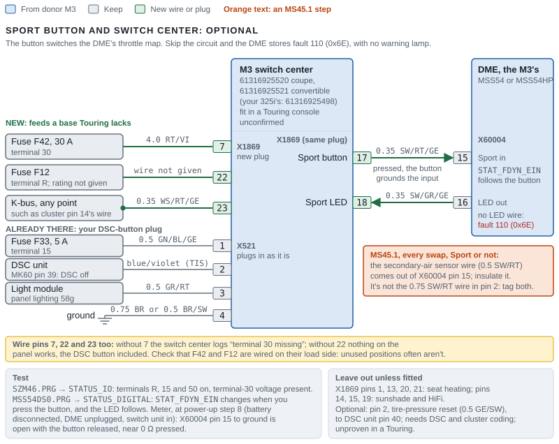

*Figure 5. The optional Sport button. The M3 switch center takes the place of your DSC button, and that button's plug, X521, plugs into it as it is. Two new wires join its new X1869 plug to X60004 pins 15 and 16, and it also needs three feeds a base Touring lacks: terminal 30 from F42, terminal R from F12 and the K-bus; without terminal R nothing on the panel works, the DSC button included. On an MS45.1, the secondary-air sensor wire comes out of X60004 pin 15 on every swap, Sport or not.*

### Brake-light switch

Both cars use the same switch, 61316967601 ([ETK](https://bmwfans.info/parts-catalog/61316967601/)): switch S29 with a 4-pin plug, X78 ([SP0000014399](https://wds.psjr.org/en/e46/svg/SP0000014399.svg), [SP0000016222](https://wds.psjr.org/en/e46/svg/SP0000016222.svg)).

| Pin | Wire | Function | Goes to |
|---|---|---|---|
| 1 | 0.5 VI/GE | Terminal R | Fuse F9, 5 A |
| 2 | 0.35 BR/SW | Ground | Ground point X217 |
| 3 | 0.35 BR/GR | Second (test) contact | Splice X1179 → X60004 pin 28 (MS43, MS45.1). **Move to pin 34** for the MSS54 |
| 4 | 0.35 BL/RT | First contact | Splice X181 → X60004 pin 24 and the light module |

The DSC unit reads the switch too (MK60 pin 41) and checks it against its pressure sensors ([BMW ST056](https://archive.org/download/BMWTechnicalTrainingDocuments/ST056%20Chassis%20Dynamics%20%28Archive%201%29/04%2520E46%2520DSC%25201-27-03.pdf)).

- **It's electronic.** BMW calls it "The Electronic brake light switch": it "provides a B+ signal when the brakes are applied", and the light module treats an interrupted idle signal as a faulty switch ([BMW ST052](https://archive.org/download/BMWTechnicalTrainingDocuments/ST052%20Body%20Electronics%20II/03c_E46%20Lighting%20Systems.pdf)). A meter proves the wire to pin 34; the DME proves the switch.
- **Test:** in `STATUS_DIGITAL`, `STAT_BLS_EIN` and `STAT_BLTS_EIN` both change with the pedal. If only one changes, the DME can't confirm braking: expect fault 106 (0x6A), "Bremslichtschalter", and no cruise ([SGBD documentation](https://github.com/emdzej/ediabasx-docs-sgbd/blob/main/docs/sgbd/MSS54DS0.md)).
- **Skip the move** and you get the yellow brake lamp: an S54 xi Touring cleared it by moving the wire from 28 to 34 ([e46fanatics](https://www.e46fanatics.com/threads/s54-xi-touring-swap.1102352/page-6), unverified).

### Clutch switch, gear switch and cruise

**The chain.** The MSS54 reads the clutch through a "power transmission switch": the clutch-switch module and the 420G's gear-recognition switch in series. It gives "a high signal for the MS S54 when the clutch is disengaged [pedal up] and the transmission is in gear", and the DME uses it to cut out cruise control and to enable its idle control ([BMW ST041](https://archive.org/download/BMWTechnicalTrainingDocuments/ST041%20M3%20Complete%20Vehicle/3%20EngineElectronics%20%28Part%203%29.pdf)). Your Touring's MS43 or MS45.1 reads the clutch module directly on X60004 pin 23.

**The clutch module's plug, X13635** ([SP0000016193](https://wds.psjr.org/en/e46/svg/SP0000016193.svg), [SP0000016194](https://wds.psjr.org/en/e46/svg/SP0000016194.svg)):

| Pin | Wire | Your Touring | In the M3 (and after the swap) |
|---|---|---|---|
| 1 | 0.35 BR/SW | Ground, point X217 | Same |
| 2 | 0.35 BL/BR (Touring); 0.35 GR (M3) | Output to X60004 pin 23 | Output to body X6011 pin 7 → engine harness 0.5 GR → X6053 pin 5 → gear switch pin 1; gear switch pin 2 → 0.5 GR/BL → X60002 pin 20 |
| 3 | 0.5 VI/GE | Terminal R from F9, 5 A | Same |
| 4 | 0.35 BL/SW | To EWS X1659 pin 8: the clutch-start interlock on US and Japanese cars | Same: keep it |

So after the move, your Touring's BL/BR wire sits in body X6011 pin 7 and meets the M3 harness's gray wire, which runs through X6053 pin 5 to the gear switch. A BMW TIS diagram posted on NAM3 shows the same path ([NAM3](https://nam3forum.com/forums/forum/main-forum/e46-2001-2006/225235-clutch-switch-help-code-50)). The same poster's text names X6011 "pin 3"; his diagram says pin 7, and so does WDS.

**Fit the M3's clutch module, 61319122700.** It's required, not optional. The M3 module outputs +12 V with the pedal up; the non-M module (61319231129, your Touring's) switches between open and ground, which the chain can't use (terra, [NAM3](https://nam3forum.com/forums/forum/main-forum/e46-2001-2006/225235-clutch-switch-help-code-50)). Two builds cured no cruise this way: George Hill's S54 ZHP, whose intermittent stalling also stopped, and ewcmr2's S54 wagon ([NAM3](https://nam3forum.com/forums/forum/main-forum/member-build-journals/3768-what-s-going-on-in-my-shop-currently/page3), [e46fanatics](https://www.e46fanatics.com/threads/m3-cluster-swap-dsc-light.1260275/)). BimmerWorld on 61319122700: "The switch must work to allow the car to start or to disengage from cruise control" ([BimmerWorld](https://www.bimmerworld.com/Driveline-Shifter/Clutch-Parts/Genuine-BMW-Module-Clutch-Switch-61319122700-E39-M5-E46-M3-E85.html)). The Euro-only 61319122701 works only with the EWS interlock coded out, which this guide doesn't do ([ETK](https://bmwfans.info/parts-catalog/61319122701/)). Take the donor's module, or buy one.

**The gear-recognition switch** (23142229113, on the 420G) is closed in gear and open in neutral ([NAM3](https://nam3forum.com/forums/forum/main-forum/e46-2001-2006/225235-clutch-switch-help-code-50), [ETK](https://bmwfans.info/parts-catalog/23142229113/)). Its state in reverse isn't documented. A 325xi that keeps all-wheel drive runs the 330xi six-speed, which has no such switch: ETK lists only its reversing-light switch, 23147524811 ([ETK](https://bmwfans.info/parts-catalog/E46-Sedan/USA/330xi-M54/L-N/browse/manual_transmission/gs6x37bz_grbx_housing_and_mount_parts/)). Without it the chain stays open and cruise won't work; bridging its plug would make the DME read "in gear" whenever the pedal is up, even in neutral. Neither has been tested (our inference; [325xi](README.md#route-2-gearbox-transfer-case-and-differentials)).

**Cruise also needs:**

- the steering-wheel buttons' data line, X60004 pin 27 (0.35 BL/SW), unchanged: the right-hand buttons reach the DME on one serial wire through the clock spring ([BMW ST041](https://archive.org/download/BMWTechnicalTrainingDocuments/ST041%20M3%20Complete%20Vehicle/3%20EngineElectronics%20%28Part%203%29.pdf)). A Touring without steering-wheel buttons gets this wire from BMW's three-wire retrofit, with no coding ([Steering-wheel buttons (MFL)](#steering-wheel-buttons-mfl));
- both brake contacts (above);
- the road speed from the DSC unit over CAN, so a DSC unit with a VIN fault can stop cruise;
- manual-gearbox software in the DME ([ECUWorx](https://www.ecuworx.co.uk/how-to/a-run-down-of-features-of-the-mss5x-binary-modification-tool-and-what-they-do/)).

**Test with a gear engaged.** The DME's `STAT_KUP_EIN` and `STAT_KRAFTSCHLUSS_EIN` read the same input bit with opposite sense, so they can only follow the pedal when the chain's gear switch is closed ([SGBD documentation](https://github.com/emdzej/ediabasx-docs-sgbd/blob/main/docs/sgbd/MSS54DS0.md)). Engine off, parking brake on, a gear engaged: pedal up gives `STAT_KRAFTSCHLUSS_EIN` = 1 and `STAT_KUP_EIN` = 0; pedal down gives 0 and 1. In neutral both stay at 0 and 1 whatever the pedal does. That's correct behavior, not a fault. A chain that never closes in gear points to the gear switch or the clutch module's output; one that is always closed points to a short at X60002 pin 20. Fault 80 (0x50), "Schalterkette Kraftschluss", is the chain.

**Meters and electronics.** The clutch module is a Hall-effect sensor, "providing a high signal when the clutch is depressed" to the EWS ([BMW ST051](https://archive.org/download/BMWTechnicalTrainingDocuments/ST051%20Body%20Electronics%20I%20%28Archive%201%29/05%20EWS.pdf)). An ohmmeter proves its wires, not the module: check its supply and ground, then the status bits above and the EWS's clutch input ([Session 3](#session-3-ews)).

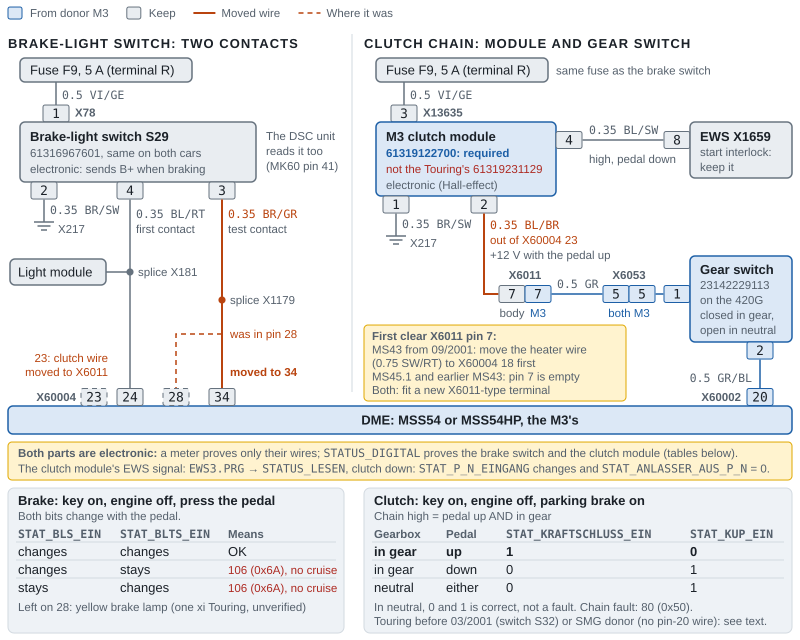

*Figure 6. The brake-light switch and the clutch chain after the swap. Two wires move: the brake switch's test contact from X60004 pin 28 to pin 34, and the clutch module's output from X60004 pin 23 to body X6011 pin 7, where the M3 harness takes it through the gear switch to X60002 pin 20. The chain works only with the M3's clutch module, and both parts are electronic: a meter proves their wires, but only the status jobs prove the parts, run with the key on, the engine off and the parking brake on.*

### Steering-wheel buttons (MFL)

If your Touring already has steering-wheel buttons, a wheel with buttons plugs in and nothing changes. If it has none and the wheel you fit has them, BMW's own retrofit adds three wires and no coding: "Coding of the vehicle must not be carried out" ([BMW EBA 01 29 0 023 076](https://etk.club/eba_docs/284en.pdf)). BMW wrote it for E46s with the SMART airbag sports wheel, Tourings from 06/99, and allows about an hour.

| From X10170 (10-pin, green, at the switch fixture) | Wire | To | Signal |
|---|---|---|---|
| Pin 8 | 0.35 BL/SW | DME X60004 pin 27 | The cruise buttons' serial line to the DME |
| Pin 9 | 0.35 WS/RT/GE | Light module X12 pin 21 | K-bus |
| Pin 10 | 0.5 VI/GE | Light module X12 pin 27 | Terminal R |

X60004 pin 27 is the cruise buttons' pin on the MSS54 too ([Clutch switch, gear switch and cruise](#clutch-switch-gear-switch-and-cruise)). BMW splices pins 9 and 10 into the two X12 leads, cut about 40 mm (1.6 in) behind the plug.

1. Disconnect the battery and follow BMW's airbag procedure before you take the wheel off ([Safety](README.md#safety)).
2. Run and splice the three wires as the table shows.
3. Clear the DME adaptations afterwards ([Session 6](#session-6-first-start-adaptations-and-throttle-check)): that's how the DME learns that cruise buttons are fitted (`STAT_FGR_MFL_VERBAUT_WERT`).
4. **Test.** Tool32, `MSS54DS0.PRG` → `STATUS_DIGITAL`: `STAT_MFL1_EIN` to `STAT_MFL4_EIN` change as you press the cruise buttons ([SGBD documentation](https://github.com/emdzej/ediabasx-docs-sgbd/blob/main/docs/sgbd/MSS54DS0.md)). Fault 81 (0x51) is the steering-wheel data line ([Warning lights](#warning-lights)).

### Cluster wiring

Both clusters use the same two plugs: X11175 (black, 26 pins) and X11176 (white, 18 pins) ([bmwgm5](https://www.bmwgm5.com/E46_IKE_Connections.htm), a hobby-site transcription; [SP0000017540](https://wds.psjr.org/en/e46/svg/SP0000017540.svg), [SP0000018656](https://wds.psjr.org/en/e46/svg/SP0000018656.svg)). The pins this swap touches, on X11175:

| Pin | Signal | Wire | From, in the swapped car |
|---|---|---|---|
| 1 | Ground | BR/SW | Ground point |
| 2 | Charge lamp | 0.35 BL | DME X60004 pin 1 |
| 3 | Start feedback (terminal 30h) | 0.35 SW/GN | DME X60004 pin 2, through splice X276 |
| 4 | Terminal 30 | RT/GE/WS | F43, 5 A |
| 5 | Terminal 15 | GN/BL | F34, 5 A |
| 6 | Terminal R | VI/GE | F10, 5 A |
| 7 | Backlight (58g), clusters built to 09/2002 only | GR/RT | Light module pin 47: needed when an older cluster goes into a car built from 09/2002 ([e46fanatics](https://www.e46fanatics.com/threads/diy-m3-cluster-into-non-m-retrofit.1277945/)) |
| 9, 10 | CAN high, CAN low | GE/RT, GE/BR | CAN splices |
| 11, 12 | Right tank sender + and − | — | Fuel pump unit |
| 13 | Oil-pressure lamp | 0.35 BR/GN | DME X60004 pin 11 |
| 14 | **K-bus**, not oil pressure | WS/RT/GE | K-bus |
| 15, 16 | Left tank sender + and − | — | Left sender |
| 17 | Oil level | 0.5 WS/GN | DME X60004 pin 21 |
| 19, 20, 21, 22, 23, 24, 26 | Road speed from the DSC; brake fluid; airbag lamp; ABS lamp; parking brake; pad-wear loop; coolant level | — | Unchanged |
| 25 | Diagnosis (D-bus) | WS/VI | OBD pin 8 |

**How the three lamps work with an MSS54.** The oil-pressure switch reads into the DME on X60003 pin 26, and the DME drives the lamp from X60004 pin 11; the switch is closed below about 0.5 bar, so the lamp is on at key-on and goes out once there's pressure ([SP0000007269](https://wds.psjr.org/en/e46/svg/SP0000007269.svg), [NAM3](https://nam3forum.com/forums/forum/main-forum/e46-2001-2006/61405-why-does-my-oil-light-turn-off-with-ignition-ii-engine-off)). "The alternator light is powered through the cluster and grounded by the DME whenever the alternator is not charging" (George Hill, same thread). The oil-level sensor sends a pulse-width signal to X60003 pin 39, and the DME repeats it on X60004 pin 21 ([BMW ST055](https://ia801005.us.archive.org/11/items/BMWTechnicalTrainingDocuments/ST055%20Engine%20Electronics%20%28Archive%201%29/8%20MS%20S54.pdf)). On an MS43 Touring these wires bypass the DME through X6011; on an MS45.1 the lamps arrive over CAN.

**Three coding switches in the cluster** choose wire or CAN for each lamp ([NAM3](https://nam3forum.com/forums/forum/main-forum/e46-2001-2006/61405-why-does-my-oil-light-turn-off-with-ignition-ii-engine-off), [NCS list](https://ncs-expert.com/wp-content/uploads/2013/06/FSW_PSW.pdf)):

| Parameter | Lamp | Set to | Why |
|---|---|---|---|
| `CAN_OELDRUCKSCHALTER` | Oil pressure | `nicht_aktiv` on every car | An MSS54HP didn't light the lamp over CAN even with this `aktiv`; wired to pin 13, it works ([NAM3](https://nam3forum.com/forums/forum/main-forum/e46-2001-2006/61405-why-does-my-oil-light-turn-off-with-ignition-ii-engine-off)) |
| `GENERATOR_UEBER_CAN` | Charge lamp | `nicht_aktiv` with pin 1 wired | `aktiv` works only with stock MSS54HP software; the CSL software didn't send it (same thread) |
| `TOG_UEBER_CAN` | Oil level | `nicht_aktiv` with pin 21 wired | `aktiv` only with an MSS54HP: the oil-level byte on CAN is HP-only ([MS4X](https://www.ms4x.net/index.php?title=Siemens_MS45_CAN_Bus_(CAN11h))) |

Wiring all three and coding all three to `nicht_aktiv` works whatever software the DME runs. BMW's coding data has these three switches on cluster indexes 07 and 08 (non-M) and 23 and 24 (M3), and on no earlier index ([BMW KMBE46M3.C23/C24, KMB_E46.C07/C08, SP-Daten V32](https://archive.org/details/sp-daten-v-32)); that fits a pre-2003 non-M cluster's trace and a 2002 M3's cluster list, which have none of them ([kd7iwp trace](https://github.com/kd7iwp/BMW-Coding/tree/master/E46), [NCS list](https://ncs-expert.com/wp-content/uploads/2013/06/FSW_PSW.pdf)). From the factory a US M3 has oil level over CAN `aktiv` and oil pressure over CAN `nicht_aktiv` at any date, and the charge lamp over CAN `aktiv` only on cars built from 03/2004 (BMW E46CVT.000). One index-24 cluster in an S54 swap read exactly that: "alternator over can bus enabled oil level over can bus enabled but oil pressure over can bus not enabled" (NAM3, above). So what you find follows the donor's build date, not your wiring: set all three to match the wiring ([Session 4](#session-4-cluster-and-light-module)).

**A donor built from 03/2004 needs one check.** WDS stops drawing X60004 pins 1 and 2 on M3s built from 03/2004 and shows their charge lamp over CAN ([The five DME plugs](#the-five-dme-plugs)). Nobody has documented whether those DMEs still drive pins 1 and 2. Wire them as the tables say, and if the charge lamp stays dark at key-on with `GENERATOR_UEBER_CAN` = `nicht_aktiv`, code it `aktiv`: a late car's stock MSS54HP software sends the lamp over CAN.

- **Engine speed, coolant temperature, consumption, the check-engine, cruise and overheat lamps, and the M3's oil-temperature gauge and warm-up lights** all arrive over CAN ([BMW ST034](https://archive.org/download/BMWTechnicalTrainingDocuments/ST034%20E46%20Complete%20Vehicle/2%20Driver%20Information%20Internet-1.pdf), [BMW ST041](https://archive.org/download/BMWTechnicalTrainingDocuments/ST041%20M3%20Complete%20Vehicle/1%20M3%20Complete%20Vehicle.pdf)). The warm-up and shift lights need DME software that supports them; stock M3 software does ([e46fanatics](https://www.e46fanatics.com/threads/diy-m3-cluster-into-non-m-retrofit.1277945/)).
- **Rear-door lights.** M3 clusters have none; solder in the LEDs or have a cluster service add them (same source). One snippet says the pads are on the M3 board and take red LEDs with a 196 Ω resistor (unverified). Huggins Racing's M3-cluster mod for non-M cars adds them for \$100 (October 2026), and can also change the redline LEDs and the speedometer's built-in over-read: "The M3 is configured to be 9% fast versus the non-M at 6% fast" ([Huggins](https://racehuggins.com/product/e46-m3-cluster-mod-for-non-m/)).
- **Check-control.** The cluster takes its check-control signals over the K-bus, and its turn-signal, fog and high-beam lights from the light module's K-bus messages ([BMW ST052](https://archive.org/download/BMWTechnicalTrainingDocuments/ST052%20Body%20Electronics%20II/03b_E46%20Driver%20Information%20Systems.pdf)), so pin 14 must be on the K-bus. What an M3 cluster shows when the Touring's tailgate or rear glass is open is undocumented: check it in [Session 4](#session-4-cluster-and-light-module).
- **Test** with Tool32, `KOMBI46R.PRG` → `STATUS_IO_LESEN`: `STAT_OELDRUCK_EIN` follows the switch (on at key-on, off running) ([SGBD](https://github.com/emdzej/ediabasx-docs-sgbd/blob/main/docs/sgbd/KOMBI46R.md)).

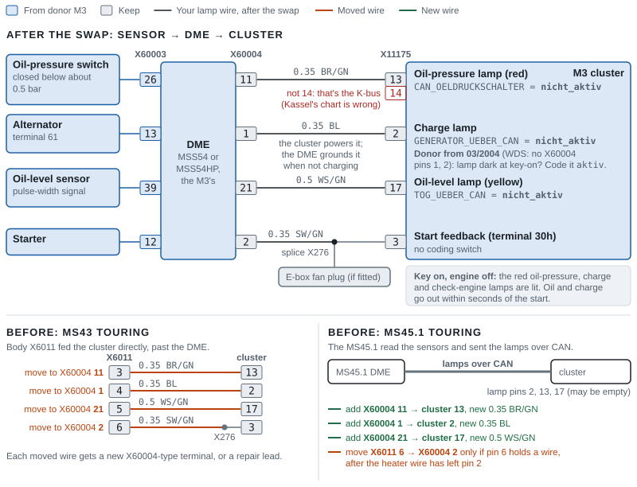

*Figure 7. The three warning lamps and the start feedback after the swap: each sensor reads into the DME, and the DME drives the cluster from X60004 pins 11, 1, 21 and 2. On an MS43 you move these four wires over from body X6011 pins 3 to 6; on an MS45.1, which sent the lamps over CAN, you add the three lamp wires new and move the start feedback only if X6011 pin 6 holds a wire. Code all three cluster switches to `nicht_aktiv` (with a donor built from 03/2004, check the charge lamp as the text says), and use cluster pin 13 for the oil-pressure lamp: pin 14 is the K-bus.*

### Fuel gauge and tank senders

The cluster reads the two lever senders separately: the right one, in the pump unit, on X11175 pins 11 and 12, and the left one on pins 15 and 16. It turns their signals into the gauge and the low-fuel warning through a coded curve, `TANK_KENNLINIE` ([BMW ST034](https://archive.org/download/BMWTechnicalTrainingDocuments/ST034%20E46%20Complete%20Vehicle/2%20Driver%20Information%20Internet-1.pdf), [BMW ST052](https://archive.org/download/BMWTechnicalTrainingDocuments/ST052%20Body%20Electronics%20II/03b_E46%20Driver%20Information%20Systems.pdf), [NCS list](https://ncs-expert.com/wp-content/uploads/2013/06/FSW_PSW.pdf)).

- **Capacity.** Both tanks hold 16.6 US gal (62.8 L). BMW USA's 2003 sheet gives that for every 325 sedan and Sport Wagon, and its 2002 M3 sheet gives the same ([BMW USA: 325](https://www.press.bmwgroup.com/usa/article/attachment/T0022146EN_US/41437), [BMW USA: M3](https://www.press.bmwgroup.com/usa/article/attachment/T0022127EN_US/41385)). BMW's M3 training gives 63 L ([BMW ST041](https://archive.org/download/BMWTechnicalTrainingDocuments/ST041%20M3%20Complete%20Vehicle/1%20M3%20Complete%20Vehicle.pdf)).
- **The curve: `60_l_literskala`.** BMW's coding rule gives `TANK_KENNLINIE` = `60_l_literskala` for every engine but the M56 SULEV (`metalltank`) and one diesel, so your Touring's M54 and the M3's S54 both get it. On index 23 and 24 clusters `metalltank` is a different curve, while `dad_tank_diesel` is the same as `60_l_literskala` ([BMW E46CVT.000, KMBE46M3.C24](https://archive.org/details/sp-daten-v-32)). A Touring that started as an M56 SULEV car with its metal tank would need `metalltank`. Nobody has reported an M3 cluster on Touring senders, so check with a measured fill.
- **Move the senders with the pump.** The recommended fuel route puts the M3 delivery unit (16142229684, which carries the right sender) and the M3 left sender (16142229683) in your tank, as Kalim did ([e46fanatics](https://www.e46fanatics.com/threads/kalims-s54-sedan-swap-warning-pic-heavy.889867/), [Fuel system](README.md#choose-the-pump-route)). The M3 cluster then reads BMW's own M3 sender pair in a tank of the same capacity. If you keep your Touring's senders (16146766942 and 16116768788) or mix the two cars' senders, nobody has reported the reading, so check each side. All four share the plug housing 61138352390 ([ETK: Touring](https://bmwfans.info/parts-catalog/E46-Touring/USA/325i-M54/L-N/browse/fuel_supply/fuel_pump_and_fuel_level_sensor/), [ETK: M3](https://bmwfans.info/parts-catalog/E46-Coupe/USA/M3-S54/L-N/browse/fuel_supply/fuel_pump_and_fuel_level_sensor/)).
- **Reserve.** The published M3 cluster coding and a non-M cluster's trace both set the reserve threshold, `TANK_SCHWELLE_RESERVE`, at 8 L ([NCS list](https://ncs-expert.com/wp-content/uploads/2013/06/FSW_PSW.pdf), [kd7iwp trace](https://github.com/kd7iwp/BMW-Coding/tree/master/E46)). Expect the reserve lamp with about 8 L (2.1 US gal) left; it's only as accurate as the senders.
- **Resistance.** We found no resistance curve for either car's senders. The hobby page this manual once cited for resistance values lists only the pins and wire colours: pin 11 right signal (SW/RT/WS), pin 12 right ground (BR/SW/WS), pin 15 left signal (SW/RT/GE) and pin 16 left ground (BR/SW/GE) ([bmwgm5](https://www.bmwgm5.com/E46_Fuel_Level.htm)). At the tank there's a large pump feed and ground plus two small pairs for the senders; Tenza matched the pairs by their tracer colours ([Tenza – No more SULEV (2021), 07:20](https://www.youtube.com/watch?v=PgW1oWs7cfk&t=440s)). Go by the tracer pairs on your own plugs.
- **Check** from near empty, adding measured amounts and logging them. The M3 cluster is a redesign cluster, so use Tool32 `KOMBI46R.PRG` → `STATUS_AIF_TANKDATEN_LESEN`. It gives litres for each sender (`STAT_TANKINHALT_HEBEL1_WERT` and `…HEBEL2_WERT`), the total, unfiltered and filtered (`STAT_TANKINHALT_UNGEF_WERT` and `…GEF_WERT`), and `STAT_RESERVE`; `STATUS_ANALOG_LESEN` in the same file gives each sender's raw input ([SGBD: KOMBI46R](https://github.com/emdzej/ediabasx-docs-sgbd/blob/main/docs/sgbd/KOMBI46R.md)). `STATUS_TANKINHALT_LESEN` belongs to `KOMBI46.PRG`, the older cluster's file, and returns "JOB NOT FOUND" on the M3's ([SGBD: KOMBI46](https://github.com/emdzej/ediabasx-docs-sgbd/blob/main/docs/sgbd/KOMBI46.md)). The cluster's own test 06 shows each sender in litres and a tank phase: 1 both sensors OK, 2 one sensor fault, 3 implausible ([BMW ST052](https://archive.org/download/BMWTechnicalTrainingDocuments/ST052%20Body%20Electronics%20II/03b_E46%20Driver%20Information%20Systems.pdf)). One side stuck: a sender or its plug pins. Record it on the [worksheet](WORKSHEETS.md#speedometer-and-fuel-gauge).
- **Why it matters beyond the gauge.** The DME takes the tank level from the cluster over CAN, for the leak test's 15–85% window and its refueling check ([Readiness and inspection](#readiness-and-inspection)). BMW's "Check Filler Cap" lamp "will be activated if change in fuel volume as read by the fuel level sensors precedes a failed Evap System test" ([BMW ST043](https://archive.org/download/BMWTechnicalTrainingDocuments/ST043%202002%20System%20Diagnosis/8%20E46%20Update.pdf)). The cluster also sends its low-fuel signal to the DME, which stores it alongside a misfire fault ([BMW ST052](https://archive.org/download/BMWTechnicalTrainingDocuments/ST052%20Body%20Electronics%20II/03b_E46%20Driver%20Information%20Systems.pdf)).

### CAN, K-bus and the diagnosis socket

**Powertrain CAN** (twisted pair: high GE/RT, low GE/BR) ([SP0000015023](https://wds.psjr.org/en/e46/svg/SP0000015023.svg), [BMW ST052](https://archive.org/download/BMWTechnicalTrainingDocuments/ST052%20Body%20Electronics%20II/03a_E46%20Power%20Supply%20and%20Bus%20Systems.pdf)):

| Node | CAN high / low | Notes |
|---|---|---|
| DME (MSS54) | X60004 pins 36 / 37 | |
| Cluster | X11175 pins 9 / 10 | The gateway between CAN, the K-bus and the diagnosis line (D-bus) |
| DSC unit (MK60) | Pins 11 / 15 | MK20: pins 17 / 16. Its yaw sensor has a separate CAN of its own |
| Steering-angle sensor | Pins 3 / 4 | |
| Automatic-gearbox unit | — | None on a manual. An ex-automatic Touring keeps the harness stub: leave it unplugged with nothing attached |

The DME's splices X1893 and X1894 join the nodes; WDS draws no terminating resistors. BMW: "A 120 Ohm resistor is installed in two control units… the effective resistance of the complete circuit is 60 Ohms… The terminal resistors are located in the ASC/DSC control unit and either the instrument cluster or in the DME", and modules without one read 10–50 kΩ across their CAN pins when unplugged ([BMW ST040](https://archive.org/download/BMWTechnicalTrainingDocuments/ST040%202001%20System%20Diagnosis/9%20Bus%20System%20Troubleshooting.pdf)). Which of the cluster and DME carries the second resistor on an E46 isn't documented; a forum snippet says the cluster ([Beyond](https://forums.beyond.ca/threads/418337-E46-gauge-cluster), unverified). With the key on, each line sits at about 2.5 V to ground (2.35–2.65 V on a meter) (BMW ST040). The check is step 19 of the [checks before first power-up](#checks-before-first-power-up).

**K-bus** (one WS/RT/GE wire, about 12 V): the cluster (pin 14), light module, body module, climate control, airbag unit, EWS, switch center (X1869 pin 23), the steering wheel's audio buttons, park distance control and others ([BMW ST401b](https://archive.org/download/BMWTechnicalTrainingDocuments/ST401b%20Bus%20System%20Overview%20-%20All%20Models/02_3%20Series%20Bus%20Charts.pdf)). The light module's X12 pin 21 is a K-bus point: BMW's steering-wheel button retrofit splices in there ([Steering-wheel buttons (MFL)](#steering-wheel-buttons-mfl)).

**The diagnosis socket** (16 pins, driver's footwell, on E46s built from 06/2000) ([SP0000014297](https://wds.psjr.org/en/e46/svg/SP0000014297.svg), [BMW ST040](https://archive.org/download/BMWTechnicalTrainingDocuments/ST040%202001%20System%20Diagnosis/1%202001%20Changes.pdf)):

| Pin | Signal |
|---|---|
| 7 | TXD II: the DME (X60004 pin 32) |
| 8 | TXD (D-bus): the cluster (X11175 pin 25), which gateways to the K-bus modules, the DSC unit and the steering-angle sensor |
| 16 | Battery positive (F43) |
| 1 | Terminal 15 (F30) |
| 4, 5 | Grounds (pin 5 to point X1108) |
| 9 | Engine speed (from X60004 pin 17) |
| 6, 14 | **No CAN**: an E46 socket has no terminals there |

That's why E46 cables bridge pins 7 and 8: BMW's own socket cap bridges both to battery positive when no tester is fitted ([BMW ST040](https://archive.org/download/BMWTechnicalTrainingDocuments/ST040%202001%20System%20Diagnosis/1%202001%20Changes.pdf)). Without the bridge you reach the DME but not the cluster or the modules behind it, and NCS Expert reports IFH-0009, "NO RESPONSE FROM CONTROLUNIT" ([EdiabasLib](https://github.com/uholeschak/ediabaslib), [NCS Expert basics](#ncs-expert-basics)).

**What travels over the network in this swap:** the A/C request, the crash signal and the tank level all cross the cluster's gateway, so an M3 cluster that isn't talking on both CAN and the K-bus costs you the A/C, the crash cut-off and the leak test (our reading of BMW's descriptions). The cluster's own check-control warnings arrive over the K-bus as well ([BMW ST052](https://archive.org/download/BMWTechnicalTrainingDocuments/ST052%20Body%20Electronics%20II/03b_E46%20Driver%20Information%20Systems.pdf)). The DME logs missing partners: 132 (0x84) DSC, 133 (0x85) steering-angle sensor, 134 (0x86) cluster, and 86 (0x56) for its own CAN ([SGBD documentation](https://github.com/emdzej/ediabasx-docs-sgbd/blob/main/docs/sgbd/MSS54DS0.md)).

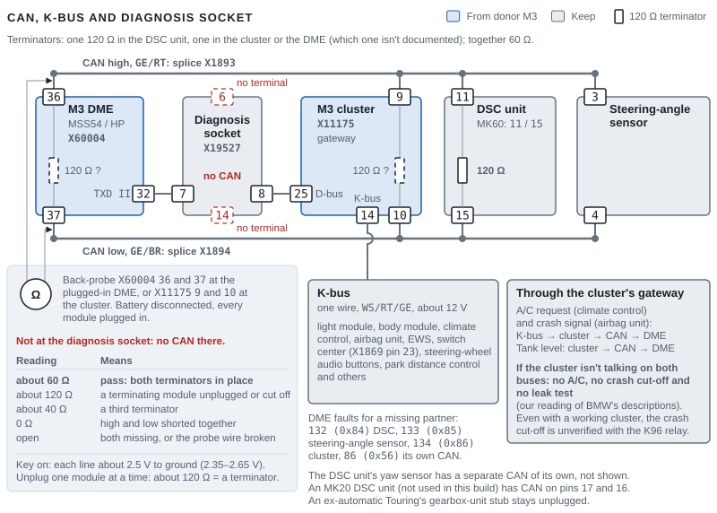

*Figure 8. The CAN network after the swap: four modules on splices X1893 and X1894, with one 120 Ω terminator in the DSC unit and one in the cluster or the DME. Back-probe the DME or the cluster with the battery disconnected and expect about 60 Ω; the diagnosis socket has no CAN. The cluster is the gateway between CAN, the K-bus and the diagnosis line, so the A/C request, the crash signal and the tank level all pass through it.*

### Sensor leads that may not reach

| Sensor | Why it may not reach | What builders did |
|---|---|---|
| Coolant level (cluster pin 26) | The M3 expansion tank sits on the other side of the engine bay | Extended the lead over the radiator ([UNRIVALED – Watch this before you S54 swap (2021), 01:02](https://www.youtube.com/watch?v=eddLff8yba0&t=62s)), or re-routed the plug through the cabin rather than splicing ([Tracks and Trails – Attempting to drive my E46 M3 Touring (2026), 22:40](https://www.youtube.com/watch?v=pvR3ovRfQHg&t=1360s)) |
| Washer pump and level sensor | The M3 washer tank sits low behind the bumper | Extended both plugs with soldered jumpers (same video, [23:00](https://www.youtube.com/watch?v=pvR3ovRfQHg&t=1380s)); Tenza kept the non-M tank up top instead ([Tenza Motorsports – 5 things they don't tell you, part 1 (2021), 00:40](https://www.youtube.com/watch?v=-TXzg2Z8d7w&t=40s)) |
| Radiator-outlet temperature (X60004 pins 38 and 39) | The M3 radiator and hoses move it | Your 325i already reads this sensor, so check that its lead reaches the M3 radiator's. The one build that extended it was a Euro 318d diesel Touring ([M3projekts – E46 M3 Touring build, episode 6 (2023), 07:31](https://www.youtube.com/watch?v=YfJyE9DU5OE&t=451s)) |
| Electric fan, plug X82 (pin 2 from X60004 pin 4; pin 4 the F37 feed; pin 1 ground) | On a manual Touring X82 sits on the radiator shroud; the M3's electric fan is a pusher in front of the condenser | One manual-Touring swap plugged its X82 straight into the M3 pusher ([NAM3 (2023)](https://nam3forum.com/forums/forum/main-forum/e46-2001-2006/246516-non-m-electric-fan-fitment)); measure yours anyway. If it's short, compare the plugs, then extend pins 1 and 4 in 6.0 mm² and pin 2 in 0.5 mm² ([Fans and CAN](#fans-and-can)) |
| Leak-test pump | Three wires on Tourings built before 09/2001, four from then | See [MS43 Touring: what to move](#ms43-touring-what-to-move) |
| Wheel-speed sensors | Depends on the donor's build date | See [Wheel-speed and pad-wear sensors](#wheel-speed-and-pad-wear-sensors) |

### Heater valve and auxiliary water pump

Every E46 M3 except the CSL, European cars included, has the "Water valve with additional water pump" 64118369807. Your Touring has the plain "Water valve" 64118369805, the part the CSL and the X3 use too ([ETK: M3](https://bmwfans.info/parts-catalog/E46-Coupe/USA/M3-S54/L-N/browse/heater_and_air_conditioning/water_hoses_water_valve/), [ETK: Touring](https://bmwfans.info/parts-catalog/E46-Touring/USA/325i-M54/L-N/browse/heater_and_air_conditioning/water_hoses_water_valve/), [ETK: 64118369807](https://bmwfans.info/parts-catalog/64118369807/), [NAM3](https://nam3forum.com/forums/forum/main-forum/e46-2001-2006/14592-deleting-auxiliary-water-pump)). The pump isn't a DME circuit: it's fed from F62 (7.5 A, 0.5 RT/GR) and the climate control switches its ground side through pin 6 of its 6-pin plug X608 (0.5 BR/RT) ([SP0000017567](https://wds.psjr.org/en/e46/svg/SP0000017567.svg)). Older drawings show F23 instead of F62 ([SP0000011635](https://wds.psjr.org/en/e46/svg/SP0000011635.svg)). The S54's engine-side heater hoses go in with either valve; the hoses for each option are in the guide's [Cooling and oil cooler](README.md#cooling-and-oil-cooler). Two options; the guide recommends the first:

1. **Fit the plain valve, 64118369805, on the S54,** with the CSL's valve-to-heater-core hose 64212282548, the only hose ETK pairs with this valve and the S54's engine-side hoses ([ETK: CSL](https://bmwfans.info/parts-catalog/E46-Coupe/Europe/M3_CSL-S54/L-N/browse/heater_and_air_conditioning/water_hoses_water_valve/)). No wiring and no coding change: your climate control is already coded for a valve without a pump. Owners running it on M3s report "No notable difference" (NAM3 thread above). Bleed the heater circuit carefully: without the pump, the engine's own pump does the venting (our inference), so allow two heat cycles.
2. **Keep the M3 valve and its pump.** Run two wires: the pump's supply from F62 (check your fuse card) and its switched side to pin 6 of the climate control's X608 plug. Then set `ZUSATZWASSERPUMPE` = `aktiv` in the climate control's coding ([Session 8](#session-8-vehicle-order-changes-and-body-modules)) and test with `STEUERN_ZUSATZWASSERPUMPE` (IHKR46 or IHKA46), watching `STAT_ZUSATZWASSERPUMPE_EIN` ([SGBD](https://github.com/emdzej/ediabasx-docs-sgbd/blob/main/docs/sgbd/IHKR46.md), [NCS list](https://ncs-expert.com/wp-content/uploads/2013/06/FSW_PSW.pdf)). Do it before you fill: BMW's fill procedure runs the pump to vent the heater circuit ([BMW ST054, engine cooling](https://archive.org/download/BMWTechnicalTrainingDocuments/ST054%20Climate%20Control/03_Engine%20Cooling-Heating%20System.pdf)). One builder whose pump wasn't wired found the cooling hard to bleed ([UNRIVALED – Watch this before you S54 swap (2021), 02:32](https://www.youtube.com/watch?v=eddLff8yba0&t=152s)); Tenza found two plugs on the S54's heater valve where his harness had one ([Tenza Motorsports – 5 things they don't tell you, part 1 (2021), 05:00](https://www.youtube.com/watch?v=-TXzg2Z8d7w&t=300s)).

**Check, before the first start:** ignition on, engine off, blower low and the heat at maximum (on an IHKR, blower at 1 and the dial fully right: at 0 the valve is energized shut). That holds the valve open, and with option 2 the pump should run: you hear it, and `STATUS_IO` shows `STAT_ZUSATZWASSERPUMPE_EIN` = 1 ([BMW ST054, IHKR](https://archive.org/download/BMWTechnicalTrainingDocuments/ST054%20Climate%20Control%20%28Archive%201%29/13%20IHKR%20E46.pdf), [SGBD](https://github.com/emdzej/ediabasx-docs-sgbd/blob/main/docs/sgbd/IHKA46.md)). The full fill and bleed is in the guide's [Fill and bleed the cooling system](README.md#fill-and-bleed-the-cooling-system).

### A/C with manual or automatic climate control

- **The chain.** Both climate controls send the A/C request, the compressor load and the fan request over the K-bus to the cluster, which passes them to the DME over CAN. The DME then grounds the compressor relay K19's coil from X60004 pin 29 (0.5 SW/BL) ([BMW ST040 IHKR](https://archive.org/download/BMWTechnicalTrainingDocuments/ST040%202001%20System%20Diagnosis/2%20e46%20ihkr.pdf), [BMW ST054](https://archive.org/download/BMWTechnicalTrainingDocuments/ST054%20Climate%20Control%20%28Archive%201%29/12%20IHKA%20E46.pdf)). K19 takes power from F63 (7.5 A) and feeds the compressor clutch; the refrigerant pressure sensor is read by the climate control, not the DME ([SP0000011761](https://wds.psjr.org/en/e46/svg/SP0000011761.svg), [SP0000011762](https://wds.psjr.org/en/e46/svg/SP0000011762.svg)). Nothing moves.
- **Manual climate control (IHKR).** BMW fitted IHKR as standard to the 325i Touring and the M3 from 09/2000, with the same K-bus and CAN messages as IHKA (BMW ST040 IHKR). A/C with the S54 is confirmed on IHKA cars; nobody had reported on IHKR first-hand by October 2026, but by BMW's description it should work ([e46fanatics](https://www.e46fanatics.com/threads/kalims-s54-sedan-swap-warning-pic-heavy.889867/page-38)). Test it early: in `STATUS_DIGITAL`, `STAT_AC_EIN` should follow the snowflake button and `STAT_KO_EIN` the compressor ([SGBD documentation](https://github.com/emdzej/ediabasx-docs-sgbd/blob/main/docs/sgbd/MSS54DS0.md)). BMW's conditions for the compressor are the snowflake button with the blower at 1 or above, the refrigerant pressure within limits, and the evaporator above its cycling point: 1 °C (34 °F) when it's above 20 °C (68 °F) outside, 3 °C (37 °F) below that ([BMW ST040 IHKR, p.10](https://archive.org/download/BMWTechnicalTrainingDocuments/ST040%202001%20System%20Diagnosis/2%20e46%20ihkr.pdf), [BMW ST054, IHKR](https://archive.org/download/BMWTechnicalTrainingDocuments/ST054%20Climate%20Control%20%28Archive%201%29/13%20IHKR%20E46.pdf)).
- **Automatic climate control (IHKA).** It asks for the compressor while the evaporator is above 2 °C (36 °F), and drops it for 4–10 seconds at full throttle below 16 km/h (10 mph) ([BMW ST054, IHKA](https://archive.org/download/BMWTechnicalTrainingDocuments/ST054%20Climate%20Control%20%28Archive%201%29/12%20IHKA%20E46.pdf)).
- **Keep your Touring's climate-control coding.** It carries engine and compressor settings, `ZYLINDER_ZAHL`, `MOTOR_ART`, `GEREGELTER_KOMPRESSOR` and `ZUSATZWASSERPUMPE`; a US six-cylinder sedan's reads `6_zylinder`, `benziner`, `gross` and `nicht_aktiv` ([kd7iwp](https://github.com/kd7iwp/BMW-Coding/tree/master/E46)). Both cars are six-cylinder petrol, so never code the climate control from the M3's vehicle order. From 09/2002 the M3's compressor is 64526916232, a part ETK doesn't list for the US 325i Touring ([ETK](https://bmwfans.info/parts-catalog/64526916232/)), and nobody has documented whether the two cars code `GEREGELTER_KOMPRESSOR` the same way: compare your saved coding with the donor's. Coding steps are in [Session 8](#session-8-vehicle-order-changes-and-body-modules).
- **The cluster is in the path,** so no A/C often means the cluster isn't talking on both buses.
- **If the compressor never engages,** check in this order:
  1. **The request:** `STAT_AC_EIN` in `MSS54DS0.PRG`, `STATUS_DIGITAL`, follows the snowflake button. If it doesn't, the request isn't reaching the DME: the cluster's gateway, the K-bus or CAN ([CAN, K-bus and the diagnosis socket](#can-k-bus-and-the-diagnosis-socket)).
  2. **The compressor lock.** Both climate controls carry a coded compressor transport lock, `KOMPRESSOR_SPERRE` ([IHKR46](https://github.com/emdzej/ediabasx-docs-sgbd/blob/main/docs/sgbd/IHKR46.md), [IHKA46](https://github.com/emdzej/ediabasx-docs-sgbd/blob/main/docs/sgbd/IHKA46.md)). Read it in Tool32 with `CODIERUNG_LESEN`: on an IHKR, `KOMPRESSOR_SPERRE` should read 0, since 1 means "Klimakompressor deaktiviert" (A/C compressor deactivated); on an IHKA, `ALLGEMEIN_2` should be blank, not "Kompressortransportsperre". BMW's dealer tool calls clearing it "Deactivate transport-lock function" ([BMW ST054, IHKR](https://archive.org/download/BMWTechnicalTrainingDocuments/ST054%20Climate%20Control%20%28Archive%201%29/13%20IHKR%20E46.pdf)). Clearing it is a coding job: [Session 8](#session-8-vehicle-order-changes-and-body-modules). On an IHKR, `STATUS_IO` also shows `STAT_KLIMABEREITSCHAFT_EIN`, "A/C ready after the compressor run-in"; BMW's files don't say what sets it.
  3. **The refrigerant pressure:** the climate control's `STATUS_ANALOGEINGAENGE`, `STAT_DRUCKSENSOR_WERT`, in bar. An empty or overfull system keeps the compressor off.
  4. **The output:** `STAT_KO_EIN` follows the request; `STEUERN_KO` clicks relay K19; 12 V reaches the compressor clutch. The DME's fault for the relay is 48 (0x30).
  5. **What the DME has learned:** `STAT_KKOS_ST_VERBAUT_WERT`, "Klimaanlage erkannt" (A/C detected). The DME relearns it after an adaptation reset ([Session 6](#session-6-first-start-adaptations-and-throttle-check)).
  6. **The electric fan:** command it with `STEUERN_E_LUEFTER` and read the DME's fan fault, 53 (0x35). One E46 owner's rule is that the compressor isn't engaged while the electric fan doesn't run ([bmw-syndikat (2013)](https://www.bmw-syndikat.de/bmwsyndikatforum/topic_p323488_Kein_Plus_Strom_am_Komperssor_3er_BMW_-_E46.html), unconfirmed).
- **Fan.** The DME drives the electric fan by PWM from the radiator-outlet temperature, its calculated catalyst temperature, road speed, battery voltage and the A/C pressure the climate control reports ([BMW ST055, MS S54, p.86](https://archive.org/download/BMWTechnicalTrainingDocuments/ST055%20Engine%20Electronics%20%28Archive%201%29/8%20MS%20S54.pdf)); BMW's pressure stages are under [Fans and CAN](#fans-and-can). Community reverse-engineering adds more ([MSS54-XDFs wiki](https://github.com/saildot4k/MSS54-XDFs/wiki/Aux-Fan-Speeds), not BMW): the DME takes the larger of a coolant-temperature request and the A/C request (16 stages, 0–100%); it runs the fan at 60% if the climate control's data is missing, and at 60% or more once intake air reaches 60 °C (140 °F); and it scales the result down with road speed. So a fan running at a steady 60% with the A/C on suggests the cluster isn't passing the climate-control data. Test with `STEUERN_E_LUEFTER`.
- **Compressor and lines.** Fit the donor's compressor and bracket with the S54, a new belt to suit its pulley's grooves, and only one M3 line, the pressure hose 64536902681 from the compressor to the condenser: the guide's [Air conditioning](README.md#air-conditioning) has the parts, the oil, the charge and BMW's pass values. If you keep your Touring's compressor instead, you need a different belt (Kalim, same post).

### Crash fuel cut-off

There's no wire from the airbag unit to the pump on an E46. The airbag unit (MRS III) sends a crash message on the K-bus, the cluster forwards it on CAN, and the DME switches the pump off ([BMW ST034](https://archive.org/download/BMWTechnicalTrainingDocuments/ST034%20E46%20Complete%20Vehicle/7%20Passive%20Safety%20Systems.pdf)). The MSS54 has the function: fault 126 (0x7E) is "EKP-Crash-Abschaltung", and BMW's S54 texts say the pump relay or module is switched off ([BMW ST055](https://ia801005.us.archive.org/11/items/BMWTechnicalTrainingDocuments/ST055%20Engine%20Electronics%20%28Archive%201%29/8%20MS%20S54.pdf), [BMW ST041](https://archive.org/download/BMWTechnicalTrainingDocuments/ST041%20M3%20Complete%20Vehicle/3%20EngineElectronics%20%28Part%202%29.pdf)). Nobody documents whether US software, which drives the M3's pump module from X60002 pin 11, also drops the X60004 pin-10 relay output this build uses. Treat the cut-off as unverified with the relay.

**Bench check, without firing anything:** INPA reaches the airbag unit through the cluster, and its fault memory is clear; the DME's `FS_LESEN` shows no 134 (0x86), the cluster-message timeout; and `STEUERN_EKP_AUS` switches K96 off, which shows the DME can drop the relay. Never test the cut-off by deploying anything. If you want BMW's documented US arrangement back, fit the pump module ([Optional: the M3 pump module](#optional-the-m3-pump-module-ekp)). The battery safety terminal, which fires in a severe crash, cuts the main battery cable but leaves the front distribution live, so it doesn't stop the pump by itself ([BMW ST052](https://archive.org/download/BMWTechnicalTrainingDocuments/ST052%20Body%20Electronics%20II/03a_E46%20Power%20Supply%20and%20Bus%20Systems.pdf)).

### Wheel-speed and pad-wear sensors

| Car and build date | DSC unit | Wheel-speed sensors |
|---|---|---|
| US 325i Touring, from 09/2000 | Teves MK60 | Active (magnetoresistive), 12 V from the DSC unit, blue plugs. On your 2003: front 34526792896 (right) and 34526792897 (left), rear 34526752683 |
| US M3 built before 09/2002 | Teves MK20 | Inductive, AC signal, gray plugs: they don't plug into your harness, and an MK60 isn't made to read them |
| US M3 built from 09/2002 | Teves MK60 | The same part numbers as your Touring's |

Sources: [BMW ST056](https://archive.org/download/BMWTechnicalTrainingDocuments/ST056%20Chassis%20Dynamics%20%28Archive%201%29/04%2520E46%2520DSC%25201-27-03.pdf), [ETK: Touring](https://bmwfans.info/parts-catalog/E46-Touring/USA/325i-M54/L-N/browse/brakes/hydro_unit_dsc_fastening_sensors_2/), [ETK: M3 MK60](https://bmwfans.info/parts-catalog/E46-Coupe/USA/M3-S54/L-N/browse/brakes/hydro_unit_dsc_fastening_sensors/), [ETK: M3 MK20](https://bmwfans.info/parts-catalog/E46-Coupe/USA/M3-S54/L-N/browse/brakes/hydro_unit_dsc_control_unit_fastening/), [ETK: M3 rear sensors](https://bmwfans.info/parts-catalog/E46-Coupe/USA/M3-S54/L-N/browse/rear_axle/rear_axle_support_wheel_suspension/), [ETK: Touring rear sensors](https://bmwfans.info/parts-catalog/E46-Touring/USA/325i-M54/L-N/browse/rear_axle/rear_axle_support_wheel_suspension/).

- **Your own sensors read the M3 hubs.** BMW lists the same front and rear sensors for the US 325i Touring and for the US M3 from 09/2002, with the same yaw and lateral sensor cluster (34526764018) and steering-angle sensor (32306793632) ([ETK](https://bmwfans.info/parts-catalog/34526792896/), [ETK](https://bmwfans.info/parts-catalog/34526752683/)). BMW says the MK60 "uses the same metal pulse wheels used with the MK20". On a rear-drive E46 the rear pulse wheel sits on the half-shaft's outer CV joint, so it comes with the M3 half-shafts, and it gives 48 pulses per wheel turn (BMW ST056). No source gives the M3 front hub's count; the road test below proves it. The rear sensor for a 325i is the short one (BMW ST056).
- **Tenza's ABS lamp doesn't contradict this.** That build's donor was a 2002 car with the MK20, so its sensors couldn't plug in. The lamp came on at the first start, with the car standing and the brakes not yet bled, and three months later the builder reported no problems ([Tenza Motorsports – M3 Touring build finally runs (2021), 07:18](https://www.youtube.com/watch?v=8uwpzS_-uDs&t=438s), [Tenza Motorsports – 5 things they don't tell you, part 2 (2021), 04:00](https://www.youtube.com/watch?v=mDBiRn30fEs&t=240s); the full story is in the guide's [DSC, brakes and steering angle](README.md#dsc-brakes-and-steering-angle)). On a 2003 xi Touring the M3 sensors' plugs mated with the xi's harness, whose Bosch sensors use the same blue housings ([e46fanatics](https://www.e46fanatics.com/threads/m3-touring-project.1240087/), [BMW ST056](https://archive.org/download/BMWTechnicalTrainingDocuments/ST056%20Chassis%20Dynamics%20%28Archive%201%29/04%2520E46%2520DSC%25201-27-03.pdf)): proof that the plugs fit, not of how the sensors read. Never splice an MK20 donor's sensor pigtails onto your MK60 harness: they're the wrong kind of sensor.
- **Front sensors:** BMW says MK60 front sensors are three-wire, but an owner converting an M3 from MK20 to MK60 found the MK60 plugs expect two, with pin 3 an unneeded ground; the pins are otherwise the same ([NAM3](https://nam3forum.com/forums/forum/main-forum/e46-2001-2006/189096-mk20-mk60-swap)).
- **Fitting:** seat each sensor flush in its bore, screw at 8 Nm (71 in-lb), and clip the lead so it isn't stretched at full droop or full lock. A donor knuckle or trailing arm with a corroded bore leaves an air gap; clean it out.
- **Testing one.** These are active sensors: the DSC unit feeds them 12 V and counts current pulses of 7 mA and 14 mA (BMW ST056), so an ohmmeter can't test them. With the key on, check for 12 V at the plug. With an ammeter in series, the current should switch between about 7 and 14 mA as you turn the wheel slowly.
- **Reading the speeds.** With the car on stands and the key on, spin each wheel by hand and check that its own reading moves in INPA's DSC status: front left, front right, rear left, rear right. On the road, at a steady 30–50 km/h (20–30 mph) in a straight line on matching tires, all four should agree within about 1–2 km/h (our suggested pass value). ABS works only above 12 km/h (7 mph) (BMW ST056).

**MK60 wheel-speed faults.** BMW's documentation prints the MK60's faults in hex, and this manual keeps them that way. Each wheel has six, and the last digit says what the unit saw ([SGBD DSC_MK60](https://github.com/emdzej/ediabasx-docs-sgbd/blob/main/docs/sgbd/DSC_MK60.md)):

| Wheel | Sensor | Faults |
|---|---|---|
| Front left | 34526792897 | 5D90–5D95 |
| Front right | 34526792896 | 5DA0–5DA5 |
| Rear left | 34526752683 | 5DB0–5DB5 |
| Rear right | 34526752683 | 5DC0–5DC5 |

| Last digit | BMW's description | Likely cause, and the check (our reading) |
|---|---|---|
| 0 | Electrically defective | The wiring, the plug, or a wrong (inductive) sensor. Check for 12 V at the plug and the 7/14 mA pulses |
| 1 | Extrapolation | A weak signal: the sensor not seated flush, or a corroded bore. Reseat it at 8 Nm and read its speed at walking pace |
| 2 | Pulse wheel, periodic monitoring | A damaged or rusty pulse wheel (front hub, rear CV joint) or a worn hub bearing. Inspect it, and look for one wheel's speed wavering at a steady speed |
| 3 | Drive-off detection, speed comparison | As for 1 |
| 4 | Long-term monitoring | One wheel turning at a different speed for a long time: mixed tire sizes, or a pulse wheel with a different tooth count. The M3's 18-inch tires are about 4.4% bigger round than your Touring's 205/55R16s (our arithmetic), so don't test on mixed wheels |
| 5 | Check for double pulse-wheel frequency | As for 4 |

Other MK60 faults you may meet, from the same list: 5E1F, VIN not initialised, so run the steering-angle initialisation ([Session 5](#session-5-dsc-coding-and-vin)); 5E5D, the brake-fluid level switch; 5E5E, the brake-light switch; 5E20, 5E21 and 5E24, the brake-pressure sensors; 5E40 and 5E43, the steering-angle sensor. After the build, read the faults, clear them, drive above 20 km/h (12 mph) and read them again. Faults stored while parts were unplugged should stay cleared once the unit has seen all four wheels turn (our inference); a fault that comes back needs finding. The NAM3 list gives the MK60's other faults in English ([NAM3](https://nam3forum.com/forums/forum/special-interests/coding-tuning/167185-mk-60-fault-codes-in-english)).

- **Pad-wear sensors** differ by part number (M3 front 34356751311, rear 34352229780; Touring 34351164371 and 34351164372) but feed one ground loop to cluster pin 24, and an open loop lights the lamp ([ETK](https://bmwfans.info/parts-catalog/34356751311/), [BMW ST052](https://archive.org/download/BMWTechnicalTrainingDocuments/ST052%20Body%20Electronics%20II/03b_E46%20Driver%20Information%20Systems.pdf)). The front sensor goes at the left front and the rear one at the right rear. The M3 front sensor is also fitted to the US 325xi Touring, so it should plug into your front connector; the rear one is M3-only, so check its plug and lead length against your right-rear connector ([ETK](https://bmwfans.info/parts-catalog/34352229780/); our inference).

### Mirrors and headlights

- **Mirrors.** Facelift Touring doors use "ribbon cable" mirror motors, and M3 mirrors use the older connection. One builder fitted non-ribbon door harnesses from a junkyard sedan ([M346 Projects – E46 M3 SMG Touring build, part 21 (2024), 02:00](https://www.youtube.com/watch?v=a7HeYZ8Ctow&t=120s)).
- **Shared parts.** The US M3 came with halogen lamps as standard and xenon as option S522A, bi-xenon from 09/2001. Both cars' catalogs list the same headlight socket housings, xenon ballasts, levelling motor and front and rear levelling sensors (37146784696, 37146784697) ([ETK: M3](https://bmwfans.info/parts-catalog/E46-Coupe/USA/M3-S54/L-N/browse/lighting/headlight/), [ETK: Touring](https://bmwfans.info/parts-catalog/E46-Touring/USA/325i-M54/L-N/browse/lighting/headlight/)). They list the same light modules too, which differ by equipment ([ETK: Touring](https://bmwfans.info/parts-catalog/E46-Touring/USA/325i-M54/L-N/browse/vehicle_electrical_system/switch_unit_light/), [ETK: M3](https://bmwfans.info/parts-catalog/E46-Coupe/USA/M3-S54/L-N/browse/vehicle_electrical_system/switch_unit_light/)):

| Light module | Catalog name | Rain/light sensor | Xenon |
|---|---|---|---|
| 61319133022 | "Switch unit, light" | No | No |
| 61319133023 | "Switch unit, light" (from 09/2001) | Yes | No |
| 61319133024 | "Switch unit, light / foglamps" | No | No |
| 61319133025 | "Switch unit, light / foglamps" | Yes | No |
| 61319133026 | "Switch unit, light / foglamps" | No | Yes |
| 61319133027 | "Switch unit, light / foglamps" | Yes | Yes |
| 61319133029 | "… light / ALC" (from 09/2001), for adaptive headlights | Yes | Yes |

…022 and …023 have no fog-light output; …024 to …027 have one. Front fogs need a fog-variant module, the switch panel with the fog button and relay K47, and no coding turns them on: option `$520` changes no light-module setting, only the GM5's heated washer jets on cars from 03/2004 ([BMW E46AT.000 / E46CVT.000](https://archive.org/details/sp-daten-v-32)). Test a module's fog output with Tool32 `LSZ_2.PRG` → `STEUERN_IO` `REL_NSW` ([SGBD](https://github.com/emdzej/ediabasx-docs-sgbd/blob/main/docs/sgbd/LSZ_2.md)).

- **Halogen M3 lamps into a halogen Touring** should plug in with the coding unchanged. Confirm the pin functions at the headlight plugs and the bulb wattages before the first light-up ([Session 9](#session-9-light-module-and-headlights)).
- **Xenon or bi-xenon into a halogen US Touring is a system job.** BMW fitted automatic levelling to every US xenon car, run by the light module ([BMW ST034](https://archive.org/download/BMWTechnicalTrainingDocuments/ST034%20E46%20Complete%20Vehicle/2%20Driver%20Information%20Internet-1.pdf)). A 2003 Touring's light module is already the 09/2001 type, which has the bi-xenon output ([BMW ST043](https://archive.org/download/BMWTechnicalTrainingDocuments/ST043%202002%20System%20Diagnosis/8%20E46%20Update.pdf)), but BMW's own xenon retrofit still replaces it with the xenon variant: 61319133026, or 61319133027 with a rain/light sensor. The retrofit adds a front-right and a rear-right level sensor wired to the module's X12 plug, and stores the option in the light module and in the cluster's central coding key. BMW allows about 5 hours ([BMW EBA 01 29 9 416 445](https://bmw.etk.club/eba_docs/596en.pdf)). On this car the front sensor rides on the M3 arm with the M3 link, 31122282404, and the levelling motors are fed through the headlight plugs. The steps and the pin table are in [Session 9](#session-9-light-module-and-headlights). Prefer lamps without adaptive headlights (AHL), which need their own control unit. BMW ties the xenon retrofit to headlight washers in ECE countries only. US M3s had washers only as option 502, not as standard: look for nozzle covers in the donor's bumper and a second pump on its washer bottle ([ETK](https://bmwfans.info/parts-catalog/E46-Coupe/USA/M3-S54/L-N/browse/vehicle_electrical_system/windshield_cleaning_container/), [Session 8](#session-8-vehicle-order-changes-and-body-modules)).
- **Front fogs.** If your Touring has no front fogs, the catalog points to a different light module as well as the switch panel and relay ([Session 9](#session-9-light-module-and-headlights)).
- **Mileage safety.** The light module holds your car's true mileage, and its mileage can only go up ([BMW ST052](https://archive.org/download/BMWTechnicalTrainingDocuments/ST052%20Body%20Electronics%20II/03b_E46%20Driver%20Information%20Systems.pdf)). Never replace the cluster and the light module at the same time. A new light module goes in only after the M3 cluster carries your mileage: fit it new or virginized, give it your VIN and let it take the mileage from the cluster; never write a mileage into it ([BMW ST034](https://archive.org/download/BMWTechnicalTrainingDocuments/ST034%20E46%20Complete%20Vehicle/2%20Driver%20Information%20Internet-1.pdf), [49 U.S.C. §32704](https://www.law.cornell.edu/uscode/text/49/32704)).

## Fuel-pump control

### How each car switches the pump

| Car | What switches the pump | Pins and wires | Source |
|---|---|---|---|
| Your 325i Touring, MS43 or MS45.1 (M54) | Relay K96 (61368373700, white-green, socket X10156), behind the glovebox | Pin 4: the DME grounds the coil from X60004 pin 10 (0.35 SW/VI). Pin 8: coil supply from F3 through X6021 pin 2 (1.5 RT/WS), live only while the DME relay is on. Pin 6: load supply from F54, 15 A (2.5 RT/VI). Pin 2: out to the pump (1.5 WS/BL) | [SP0000014336](https://wds.psjr.org/en/e46/svg/SP0000014336.svg), [ETK](https://bmwfans.info/parts-catalog/E46-Touring/USA/325i-M54/L-N/browse/vehicle_electrical_system/relay_for_fuel_pump_1_k96/) |
| Euro M3 | Relay K96, same socket and pins | X60004 pin 10 | [SP0000017524](https://wds.psjr.org/en/e46/svg/SP0000017524.svg) |
| US M3 | Pump module (EKP) 61357892976, which WDS still labels "K96 fuel pump relay 1", on its own plug X10157. It slows the pump at idle and part load | Pin 1: signal from X60002 pin 11 through X6021 pin 1 (0.35 SW/VI). Pin 8: F3 supply. Pin 6: F54. Pin 2: out to the pump (2.5 RT/WS). Pin 7: ground (2.5 BR) | [SP0000014408](https://wds.psjr.org/en/e46/svg/SP0000014408.svg), [BMW ST041](https://archive.org/download/BMWTechnicalTrainingDocuments/ST041%20M3%20Complete%20Vehicle/3%20EngineElectronics%20%28Part%202%29.pdf) |

WDS shows K96 on X60004 pin 10 on both Touring DMEs: the MS45.1 too, despite the workbook tab that lists pin 10 as unused, which is the M56 layout. On US M3 drawings X60004 pin 10 is "not used" (a Euro-only output); the US M3 drives its module from X60002 pin 11 instead ([PA6000L](https://wds.psjr.org/en/e46/zinfo/E46_PA6000L.htm)). Builders report that US software drives pin 10 anyway: swap shops and owners run K96 from it with a stored pump fault and no check-engine lamp ([e46fanatics](https://www.e46fanatics.com/threads/s54-swap-california-bar-certification.1307461/page-2), [e46fanatics](https://www.e46fanatics.com/threads/kalims-s54-sedan-swap-warning-pic-heavy.889867/page-38), [NAM3](https://nam3forum.com/forums/forum/main-forum/e46-2001-2006/61405-why-does-my-oil-light-turn-off-with-ignition-ii-engine-off)). WDS can't show that, so prove it on your car with the checks below. With the relay, the DME grounds K96's coil at key-on and keeps it grounded while it sees engine speed ([BMW ST055](https://ia801005.us.archive.org/11/items/BMWTechnicalTrainingDocuments/ST055%20Engine%20Electronics%20%28Archive%201%29/3%20MS42%20MS43.pdf)).

### Recommended: keep the relay

No wiring changes:

1. DME X60004 pin 10 → your body harness → K96 socket pin 4 (SW/VI).
2. K96's contact → the pump, through F54 (15 A).
3. The M3 harness's pump-module wire (X60002 pin 11 → X6021 pin 1, SW/VI) → **connected to nothing.** On a manual 325i the body side of X6021 pin 1 is empty ([SP0000007729](https://wds.psjr.org/en/e46/svg/SP0000007729.svg)); keep it that way. Never put that PWM signal on K96.

Expect one stored fault: location 1 (0x01), "Relais Kraftstoffpumpe" (fuel-pump relay), because US software misses the pump module it expects. It shows in INPA, ISTA and PA-Soft, not on a generic scanner, and doesn't light the check-engine lamp ([e46fanatics](https://www.e46fanatics.com/threads/s54-swap-california-bar-certification.1307461/page-2), [SGBD documentation](https://github.com/emdzej/ediabasx-docs-sgbd/blob/main/docs/sgbd/MSS54DS0.md)). INPA prints fault locations in decimal, so it shows as 1. Don't confuse it with 130 (0x82), the immobilizer fault. BMW's files don't say exactly what sets it; one untested lead is in [Faults that look like pump faults](#faults-that-look-like-pump-faults).

### Checks on the pump circuit

Checks 1 to 4 are steps 10, 28 and part of 22 of the [checks before first power-up](#checks-before-first-power-up). Check 5 belongs to the Phase 7 fuel tests, where it's test T4.

1. **Pin 10 to the relay** (battery off, DME unplugged, K96 pulled): continuity from the X60004 pin-10 cavity (body side) to K96's socket pin 4, the SW/VI wire. Across the relay's coil, about 90 Ω (a generic value for this relay type, [TE](https://radiolocman.com/datasheet/data.html?di=108521)). If pin 10 goes elsewhere, find K96's coil wire in WDS for your car and bring it to pin 10.
2. **The PWM wire stays off the relay:** from the M3 harness's X6021 pin 1 to every K96 socket terminal: open. If any reads continuity, de-pin the M3 wire and insulate it.
3. **The relay command, without cranking** (DME plugged in, charger on, key at position 2):
   - Listen at K96 and at the tank at key-on: one prime.
   - Tool32 `MSS54DS0.PRG` → `STATUS_DIGITAL`: `STAT_EKP_EIN` reads 1 during the prime.
   - Run `STEUERN_EKP`: K96 clicks and the pump runs. Stop it with `STEUERN_EKP_AUS` ([SGBD documentation](https://github.com/emdzej/ediabasx-docs-sgbd/blob/main/docs/sgbd/MSS54DS0.md)). A click proves that your software drives pin 10.
   - If the job returns OKAY but K96 stays silent, the job may drive only the module output on X60002 pin 11. Go by the prime and `STAT_EKP_EIN`. With K96 pulled, a test light across its socket's coil terminals should flash at key-on ([Motor Age](https://www.vehicleservicepros.com/industry-news/article/53089788/evap-monitor-on-european-cars-real-world-diagnosis-of-dmtl-systems-2017-08-04), the generic method).
   - In INPA the engine is under E46 → Engine → "MS S54 for S54 M3". INPA's "Fuel pump EKP" entry won't answer on this build, because there's no module ([bmwfaq](https://bmwfaq.org/threads/duda-con-el-inpa.796332/)).
4. **Pressure,** on the gauge at the regulator's threaded test fitting under the left front floor; the M3's rail has no port ([BMW ST041](https://archive.org/download/BMWTechnicalTrainingDocuments/ST041%20M3%20Complete%20Vehicle/3%20EngineElectronics%20%28Part%202%29.pdf)). Pass: 5.0 ± 0.2 bar (72.5 ± 2.9 psi) at the prime, and less than 0.5 bar lost after switch-off, BMW's pass/fail ([BMW ST055](https://ia801005.us.archive.org/11/items/BMWTechnicalTrainingDocuments/ST055%20Engine%20Electronics%20%28Archive%201%29/8%20MS%20S54.pdf)). BMW: "DO NOT OPERATE THE FUEL PUMP unless it is properly installed in the fuel tank and is submersed in the fuel" (same source). To run the pump longer without the DME, pull K96 and bridge its socket's pins 6 (the F54 supply) and 2 (out to the pump) through a switch with a 15 A inline fuse. BMW's test bridges "pin 87b and 30 of the relay socket" (ST041, p.41). WDS names pin 6 "Terminal 30" and pin 2 the output to the pump, on your K96 socket and on the US M3's module socket alike, so 87b is pin 2 (our reading). Pin 8 is the one WDS calls "Terminal 87": it's the coil supply from F3, so never bridge to it ([WDS: X10156](https://wds.psjr.org/en/e46/zinfo/E46_PK96A.htm), [X10157](https://wds.psjr.org/en/e46/zinfo/E46_PK96B.htm)). The full pressure and delivery tests belong to the fuel system: see [Test the fuel system](README.md#test-the-fuel-system).
5. **Voltage at the pump,** with it running on the bypass: at the pump connector under the right rear seat, within 0.5 V of the battery on the feed, and 0.5 V or less on the ground side ([Luke Murray](https://automotivetechinfo.com/wp-content/uploads/2019/10/Diagnosing-Fuel-Delivery-Issues.pdf)). It matters more with an M3 pump: K96 feeds the pump through 1.5 mm² (WS/BL), where the US M3's module uses 2.5 mm² (RT/WS). If it fails, clean and tighten the pump plug and its ground, then check F54 and the socket terminals.

K96, K6327 and K19 are the same relay (61368373700), so swapping K96 with K19 is a quick relay test.

### Optional: the M3 pump module (EKP)

Fit it only if your state reads manufacturer fault codes and won't accept the stored fault, or you want the M3's slow-running pump and BMW's documented crash cut-off back ([Crash fuel cut-off](#crash-fuel-cut-off)). Nobody has documented one in a Touring.

The module takes five wires where K96 takes four: the signal from X60002 pin 11 (through X6021 pin 1, so your body side needs a terminal there and a new wire), F3 and F54 supplies, a 2.5 mm² feed to the pump and a 2.5 mm² ground ([SP0000014408](https://wds.psjr.org/en/e46/svg/SP0000014408.svg)). One owner measured the same layout on an '06 M3 ([NAM3](https://nam3forum.com/forums/forum/main-forum/e46-2001-2006/132772-help-fuel-pump-relay-ekp-engine-wiring-schematic)). Another owner's claim that a 2006 car uses pin 10 for the module contradicts both WDS and that measurement (same thread). Kalim suggests rewiring the socket behind the glovebox for the module's black socket ([e46fanatics](https://www.e46fanatics.com/threads/kalims-s54-sedan-swap-warning-pic-heavy.889867/page-38)). Loose coil-pack grounds after valve work have killed EKP modules in stock M3s (NAM3 thread above). For BMW's pressure test on the donor, pull the module and bridge terminals 30 and 87b of its socket ([BMW ST041](https://archive.org/download/BMWTechnicalTrainingDocuments/ST041%20M3%20Complete%20Vehicle/3%20EngineElectronics%20%28Part%202%29.pdf)): pins 6 (F54) and 2 (out to the pump) of plug X10157, through a switch with a 15 A inline fuse. Leave pin 8, the F3 supply that WDS calls "Terminal 87", alone ([WDS](https://wds.psjr.org/en/e46/zinfo/E46_PK96B.htm)).

The other way to clear the fault is to have the DME vendor suppress it. Don't flash Euro software to lose it: that drops the US-only functions, including the leak test.

### Faults that look like pump faults

**The harmless stored fault and a real one carry the same number, location 1 (0x01).** Tell them apart by what the car does:

| What you see | It's | Do |
|---|---|---|
| Fault 1 stored; one prime at key-on (`STAT_EKP_EIN` = 1, K96 clicks); 5.0 bar; the engine starts and runs; `STAT_MIL_EIN` = 0 | The expected fault: US software misses its pump module | Nothing. Record it |
| Fault 1 stored; no prime, no pressure, K96 silent | A real pump-circuit fault | Checks 1–3 above; fuses F54 and F3; swap K96 with K19 |
| Cranks, won't start; fault 1 with all six injectors disabled | Usually not the pump: in the 2002 325iT case it followed an immobilizer problem | Read 130 (0x82) and 66 (0x42) and `STAT_EWS3_FREIGABE` first ([Session 3](#session-3-ews), [e46fanatics](https://www.e46fanatics.com/threads/ews-synch-for-s54-swap-into-e46-touring.1318881/)) |

- **Pump primes but the car won't start:** feed and return swapped at the filter-regulator caused one swap's no-start ([NAM3](https://nam3forum.com/forums/forum/main-forum/e46-2001-2006/82513-s54-swap-to-ms42-car-no-start)).
- **No prime at all:** in a swap into a 2000 323i wagon the M3 harness's E-box plugs had no mates in the older E-box. The owner fitted junkyard body-side plugs and used X60004 pin 10 ([e46fanatics](https://www.e46fanatics.com/threads/kalims-s54-sedan-swap-warning-pic-heavy.889867/page-39)).
- **Starts only with the pump fuse pulled, then floods:** in an E36 S54 swap a ground terminal at X60003 pin 25 wasn't seated ([NAM3](https://nam3forum.com/forums/forum/special-interests/coding-tuning/112619-s54-only-starts-when-fuel-pump-fuse-is-pulled-did-i-code-it-wrong)). Different chassis, same lesson: tug-test every terminal you touch.

**An untested lead: `STAT_EKP_CFG_VERBAUT_WERT`.** The MSS54 keeps a learned value for which pump control is fitted ("welche EKP wurde verbaut"). Tool32 `MSS54DS0.PRG` → `STATUS_ADAPTIONSBLOCK_06` returns it as a plain number, beside the learned flags for the A/C, cruise and the leak-test pump's heater ([SGBD documentation](https://github.com/emdzej/ediabasx-docs-sgbd/blob/main/docs/sgbd/MSS54DS0.md)). No job writes it: the DME relearns it after `ADAPT_LOESCHEN` clears the adaptations ([Session 6](#session-6-first-start-adaptations-and-throttle-check)). The SGBD doesn't say which number means relay and which means module, and BMW's files don't link the value to fault 1 (0x01); that link is our inference. To see what it reports, read it on the donor while its M3 wiring is intact, and again on your car after the first start and its adaptation clear, and log both on the [worksheet](WORKSHEETS.md#fuel-system-tests). Only read it. Write nothing to the DME, and don't expect the reading to change anything: the fault can store again on the next drive whatever the value.

## Checks before first power-up

One procedure, in order, from the first ohm reading to the oil-priming crank. Log it on the [worksheet](WORKSHEETS.md#power-up-checks).

**What a meter can prove.** A meter proves wires, and the parts at the end of a wire only when they're plain loads: coils, relay coils, the leak-test module, temperature sensors, the gear switch. Three re-pinned circuits end at electronic parts instead. The clutch module is a Hall-effect sensor, high with the pedal down ([BMW ST051](https://archive.org/download/BMWTechnicalTrainingDocuments/ST051%20Body%20Electronics%20I%20%28Archive%201%29/05%20EWS.pdf)); the brake-light switch is electronic and sends battery voltage when you brake ([BMW ST052](https://archive.org/download/BMWTechnicalTrainingDocuments/ST052%20Body%20Electronics%20II/03c_E46%20Lighting%20Systems.pdf)); and the S54's oil-level sensor sends a pulse-width signal ([BMW ST055](https://ia801005.us.archive.org/11/items/BMWTechnicalTrainingDocuments/ST055%20Engine%20Electronics%20%28Archive%201%29/8%20MS%20S54.pdf)). For those, the meter checks the wiring and the DME's status jobs prove the part (steps 26 and 27).

**Which values are BMW's.** Pass values marked "BMW" come from BMW's training documents. The ones marked "generic" are typical figures for that kind of part: a guide, not a limit. Tool32 jobs are in `MSS54DS0.PRG` unless the step names another file ([SGBD documentation](https://github.com/emdzej/ediabasx-docs-sgbd/blob/main/docs/sgbd/MSS54DS0.md)).

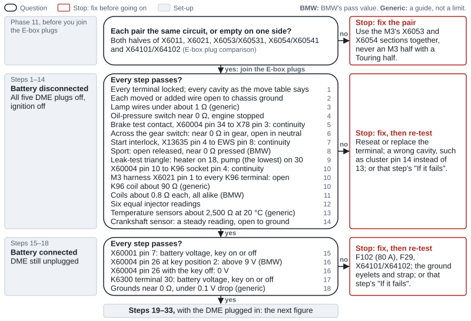

*Figure 9. The checks before first power-up with the DME unplugged: the E-box plug comparison, then steps 1–18. The gray labels give each stage's steps and how the battery and DME are set; go down only when the stage's question is answered yes, and on a no, stop and fix what the red box names or that step's "If it fails". The gray numbers on the right are step numbers, and values are marked BMW or generic, as in the tables below.*

### E-box plug comparison

Before you join the E-box plugs (Phase 11), list every cavity on both halves of X6011, X6021, X6053/X60531, X6054/X60541 and X64101/X64102: wire color and where it goes, against the tables in [E-box plugs](#e-box-plugs). Each pair should be the same circuit, or empty on one side. Anything else is a fault waiting to happen: injector "circuit low" codes ([e46fanatics](https://www.e46fanatics.com/threads/s54-swap-fuel-injectors-low-circuit.1277127/)) or a dead pump.

### Steps 1–14: battery disconnected, DME unplugged

All five DME plugs off, ignition off.

| Step | Check | Pass | If it fails |
|---|---|---|---|
| 1 | Tug-test every terminal you moved or added. Look into the emptied cavities: X60004 pins 23 and 28 on both cars; on an MS43 also X6011 pins 3–6; on an MS45.1 also X60004 pin 19, and pins 2, 5 and 15 unless they now carry the start feedback, the new ground and the Sport wire | Every terminal locked; every cavity as the move table says | Reseat or replace the terminal |
| 2 | Each moved or added wire to chassis ground (not the new pin-5 ground) | Open | A pinched or misrouted wire |
| 3 | Lamp wires: X60004 pin 11 to cluster X11175 pin 13; pin 1 to pin 2; pin 21 to pin 17; pin 2 to pin 3 (start feedback, if moved) | Continuity, under about 1 Ω (generic) | Wrong cavity; pin 14 instead of 13 |
| 4 | Oil-pressure switch: M3 harness X60003 pin 26 to engine ground, engine stopped | Near 0 Ω: the switch is closed without pressure | Switch plug, wire or switch |
| 5 | Brake test contact: X60004 pin 34 to the brake-switch plug X78 pin 3 | Continuity. The switch itself is proven in step 26 | The move, or the splice X1179 |
| 6 | Clutch chain: clutch-module plug X13635 pin 2 to body X6011 pin 7; through the engine harness to the gear switch's pin 1; gear switch pin 2 to X60002 pin 20; and across the gear switch | Continuous wires. Across the gear switch: near 0 Ω in gear, open in neutral. The module is proven in step 26 | The X6011 crossing, X6053 pin 5, the gear switch |
| 7 | Start interlock: X13635 pin 4 to EWS X1659 pin 8 | Continuity | The wire |
| 8 | Sport, if fitted: X1869 pin 17 to X60004 pin 15; pin 18 to pin 16; then pin 15 to ground with the switch unit in | Continuity; open with the button released, near 0 Ω pressed (BMW: it grounds the input) | Wiring, switch unit |
| 9 | Leak-test triangle, the module plugged in: X60004 pins 18–20, 18–30 and 20–30. Each element = (the two readings that include its pin, added, minus the third) ÷ 2 | A new Bosch module measured about 68, 52 and 44 Ω, solving to heater ≈ 38 Ω on 18, valve ≈ 30 Ω on 20 and pump ≈ 14 Ω on 30 (generic: an E93 unit). The lowest element is the pump; it belongs on 30 | Open on both pairs with 18: no heater (a three-wire module or a missing wire). Pump on 20: see the [leak-test pump](#dm-tl-leak-test-pump-test-before-you-swap). Identical readings or 0 Ω: a short |
| 10 | Pump trigger, K96 pulled: X60004 pin 10 to K96 socket pin 4 (SW/VI); the M3 harness's X6021 pin 1 to every K96 socket terminal; across K96's coil | Continuity; open to every terminal; about 90 Ω (generic) | Find K96's coil wire for your car; isolate the module wire; swap K96 with K19 |
| 11 | Coils: the coil supply (terminal 15 side) to X60005 pins 1, 2, 3, 9, 6 and 7 (cylinders 1–6) | About 0.8 Ω each, all alike (BMW: harness plus primary winding) | Coil or harness. Never a coil harness from another DME family |
| 12 | Injectors: the injector supply to X60003 pins 33–38 | Six equal readings (no BMW figure found) | Injector, plug, an X6053 mix |
| 13 | Temperature sensors: coolant X60003 pins 24 and 25; radiator outlet X60004 pins 38 and 39 | Near the NTC curve at the air temperature: about 2,500 Ω at 20 °C (generic Bosch NTC) | Open or short; compare again in step 24 |
| 14 | Crankshaft sensor: X60003 pins 8 and 21 | A steady coil reading (no BMW figure), open to ground | Sensor or wire |

### Steps 15–18: battery connected, DME still unplugged

| Step | Check | Pass | If it fails |
|---|---|---|---|
| 15 | Terminal 30 at X60001 pin 7 (harness side) | Battery voltage, key on or off | F102 (80 A), the plugs X64101/X64102 |
| 16 | Terminal 15 at X60004 pin 26, key at position 2 | Battery voltage, above 9 V (BMW's threshold); 0 V with the key off | F29, the ignition switch |
| 17 | DME relay supply: K6300 socket terminal 30 (X6300 pin 6, 4.0 RT) | Battery voltage, key on or off | X64101/X64102, the B+ feed |
| 18 | Grounds: X60001 pins 4, 5 and 6 to the battery's negative post | Near 0 Ω; under 0.1 V drop under load (generic) | Ground eyelets, the engine ground strap |

The DME relay and everything behind it (the E-box fuses, the pump relay's coil) stay dead until the DME is plugged in, because the DME switches the relay.

### CAN bus resistance

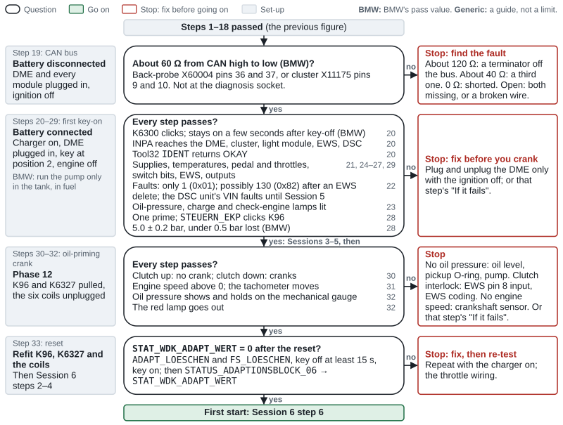

*Figure 10. The checks with the DME plugged in, from the CAN bus reading to the oil-priming crank and the reset, then the first start. Go down only when the stage's question is answered yes; on a no, stop and fix what the red box names or that step's "If it fails". Sessions 3–5 come between the first key-on and the oil-priming crank.*

**Step 19.** Disconnect the battery again. Plug the DME in (ignition off), with every other module plugged in: cluster, DSC unit, steering-angle sensor. Back-probe X60004 pin 36 (CAN high) to pin 37 (CAN low) at the plugged-in DME, or X11175 pins 9 and 10 at the cluster. The E46's diagnosis socket has no CAN pins, so don't measure there ([SP0000014297](https://wds.psjr.org/en/e46/svg/SP0000014297.svg)).

| Reading | Means |
|---|---|
| About 60 Ω | Pass: both 120 Ω terminating resistors in place (BMW) |
| About 120 Ω | One terminating module is unplugged or cut off from the bus |
| About 40 Ω | A third terminator |
| 0 Ω | High and low shorted together |
| Open | Both terminators missing, or the wire to the probe point broken |

To find which modules terminate, unplug one at a time: the reading jumps to about 120 Ω when you unplug a terminating module and stays at 60 Ω for the others. An unplugged module without a resistor reads 10–50 kΩ across its own CAN pins ([BMW ST040](https://archive.org/download/BMWTechnicalTrainingDocuments/ST040%202001%20System%20Diagnosis/9%20Bus%20System%20Troubleshooting.pdf)). BMW puts the resistors in the DSC unit and in either the cluster or the DME, so a replaced cluster or DME can change the count. No swapper has reported a CAN wiring fault; the reported problems are coding ones ([e46fanatics](https://www.e46fanatics.com/threads/m3-cluster-swap-dsc-light.1260275/)).

### First key-on: what to expect

**Steps 20–29.** DME plugged in, battery connected, charger on, key at position 2, engine off. Plug and unplug the DME only with the ignition off.

| Step | Check | Pass | If it fails |
|---|---|---|---|
| 20 | Relay and comms | K6300 clicks at key-on and stays on a few seconds after key-off (BMW). INPA shows two black dots and reaches the DME (E46 → Engine → "MS S54 for S54 M3"), cluster, light module, EWS and DSC; Tool32 `IDENT` returns OKAY | Steps 15–18; the cable's pin 7/8 bridge |
| 21 | Supplies: `STATUS_UBATT`; `STATUS_UEXT1` and `STATUS_UEXT2` | `STATUS_UBATT` within a few tenths of a volt of the battery (generic). BMW: five seconds after key-on, with terminal 15 above 9 V, the DME sets a fault if its relay supply differs from terminal 15 by more than 3 V. Sensor supplies about 5 V (BMW) | Relay, fuse carrier, grounds; a shorted sensor supply: faults 58 (0x3A) and 59 (0x3B) |
| 22 | Fault memory: `FS_LESEN` | Only fault location 1 (0x01), "Relais Kraftstoffpumpe"; possibly 130 (0x82) after an EWS delete; and the DSC unit's VIN faults until Session 5 | Fix anything else before you crank |
| 23 | Lamps at key-on | Red oil-pressure lamp, charge lamp and check-engine lamp lit, and the red BRAKE lamp with the parking brake on; the DSC, ABS and yellow BRAKE lamps stay on until Session 5. The check-engine bulb check is also an inspection item | Steps 3 and 4; the cluster's three CAN switches ([Session 4](#session-4-cluster-and-light-module)); `STAT_MIL_EIN` shows whether the DME is asking for the check-engine lamp |
| 24 | Temperatures on a cold-soaked engine: `STATUS_MOTORTEMPERATUR`, `STATUS_OEL_TEMPERATUR`, `STATUS_AN_LUFTTEMPERATUR`, `STATUS_KUEHLW_AUSL_TEMPERATUR`, `STATUS_TUMG` | All within a few °C of each other and of the air | A reading pinned near −48 °C (the scale's zero): an open or shorted sensor circuit |
| 25 | Pedal and throttles: `STATUS_PWG_POTI_SPANNUNG`; `STATUS_DKP_WINKEL` against `STATUS_DKP_WINKEL_SOLL` | Pedal sensor 1 about 0.5 V released, rising to about 4.5 V; sensor 2 0.5 to 2.0 V (BMW). Throttle sensor 0.5 V closed to 4.5 V open, the actuator's feedback the reverse (BMW). The throttles follow the pedal; actual follows target | Pedal wiring (X60004 pins 7–14), throttle actuator, synchronization |
| 26 | Switch bits: `STATUS_DIGITAL` | **Clutch, with a gear engaged:** pedal up `STAT_KRAFTSCHLUSS_EIN` = 1 and `STAT_KUP_EIN` = 0; pedal down 0 and 1. In neutral both stay at 0 and 1 whatever the pedal. **Brake:** `STAT_BLS_EIN` and `STAT_BLTS_EIN` both change with the pedal. **Sport:** `STAT_FDYN_EIN` changes; the LED follows. **Cruise buttons:** `STAT_MFL1_EIN` to `STAT_MFL4_EIN` change | [Troubleshooting](#troubleshooting). If buttons 3 and 4 behave oddly while 1 and 2 work, trust a cruise test instead: their bit masks look like table errors |
| 27 | EWS: `EWS3.PRG` → `STATUS_LESEN` | Key sending (`STAT_SCHLUESSEL_SENDET`), not barred, the three "NIO" bits 0. Clutch down: `STAT_P_N_EINGANG` changes and `STAT_ANLASSER_AUS_P_N` = 0 ([SGBD](https://github.com/emdzej/ediabasx-docs-sgbd/blob/main/docs/sgbd/EWS3.md)) | Key, ring antenna, EWS; clutch-module pin 4 to EWS pin 8; EWS coding `PARK/NEUTRAL_EINGANG` |
| 28 | Pump | One prime heard at key-on; `STAT_EKP_EIN` = 1 during it; `STEUERN_EKP` clicks K96 and runs the pump (stop it with `STEUERN_EKP_AUS`); 5.0 ± 0.2 bar, under 0.5 bar lost (BMW) | Step 10; fuses F54 and F3; swap K96 with K19; [Checks on the pump circuit](#checks-on-the-pump-circuit) |
| 29 | Outputs: `STEUERN_DMTL_HEIZUNG` ('ein', then 'aus'); `STEUERN_SLP` and `STEUERN_SLV`; `STEUERN_KO` (K19); `STEUERN_E_LUEFTER`; `STEUERN_TEV`; `STEUERN_VENTIL_SAUGSTRAHLPUMPE` | Each part runs or clicks, and `JOB_STATUS` reads OKAY | That part's wiring. "Condition not met": try again with the engine running. Leave the injector and coil jobs alone |

Sources for steps 20–29: [BMW ST055](https://ia801005.us.archive.org/11/items/BMWTechnicalTrainingDocuments/ST055%20Engine%20Electronics%20%28Archive%201%29/8%20MS%20S54.pdf) (power, pedal, throttle and pump values), [SGBD documentation](https://github.com/emdzej/ediabasx-docs-sgbd/blob/main/docs/sgbd/MSS54DS0.md) (jobs and bits), [bmwfaq](https://bmwfaq.org/threads/duda-con-el-inpa.796332/) (INPA's menu). On a stock E46 M3, the throttles visibly follow the pedal at key-on ([MotoIQ](https://motoiq.com/project-e46-m3-part-8-the-dreaded-eml-light/5)).

### Steps 30–33: the oil-priming crank

In Phase 12, with the pump relay K96 and the injector relay K6327 pulled and the six coils unplugged ([README, Phase 12](README.md#phase-12-front-end-first-start-and-shakedown)):

| Step | Check | Pass | If it fails |
|---|---|---|---|
| 30 | Start interlock | Clutch up: no crank. Clutch down: cranks | EWS pin 8 input, EWS coding |
| 31 | Engine speed while cranking: `STATUS_MOTORDREHZAHL` | Above 0, and the tachometer moves | Crankshaft sensor and its wires (X60003 pins 8 and 21); fault 16 (0x10). Without it there's no injection, no spark and no pump hold |
| 32 | Oil, on the mechanical gauge | Pressure shows and holds; the red lamp goes out | Stop. Oil level, pickup O-ring, pump |
| 33 | Reset: refit the relays and coils, then [Session 6](#session-6-first-start-adaptations-and-throttle-check) steps 2–5 | `STAT_WDK_ADAPT_WERT` = 0 after the reset; the clutch, brake and Sport bits respond | Repeat with the charger on; throttle wiring |

Then the first start, Session 6 step 6.

## Coding step by step

Do the sessions in this order. The guide explains why and shows the order as a figure ([Deep dive: electronics and coding](README.md#deep-dive-electronics-and-coding)).

| Session | When | Main tools |
|---|---|---|
| 1. Vehicle order and codings | Phase 0, before you change anything | NCS Expert |
| 2. DME VIN, EWS delete and gearbox software | Read in Phase 1; vendor work in Phase 3 | Tool32, a vendor |
| 3. EWS | Phase 11 | Tool32 |
| 4. Cluster and light module | Phase 11 | PA-Soft, NCS Expert |
| 5. DSC coding and VIN | Phase 11, after Session 4 | PA-Soft, NCS Expert, INPA |
| 6. First start, adaptations and throttle check | Phase 12 | Tool32 |
| 7. Steering angle after the alignment | Phase 12 | INPA or Tool32 |
| 8. Vehicle-order changes and body modules | Phase 12, after Session 7, and whenever you change the vehicle order | NCS Expert |
| 9. Light module and headlights | Phase 12, last, with the front end on | NCS Expert |

Keep the charger on for every session, and run one program at a time. Set NCS Expert up before Session 1: the version, a manipulation profile, the coding file, the data files and what each error message means are in [NCS Expert basics](#ncs-expert-basics), the next section.

**Three choices change what the sessions involve.** Make them before Session 2.

| Choice | Recommended | What it changes |
|---|---|---|
| The donor DME's software | A manual donor's US software, as it is. MSS54 or MSS54HP doesn't change the sessions | An SMG donor adds manual ("HS") software to Session 2 |
| Immobilizer route | An EWS delete with your VIN written in | After a delete, or a vendor's match of a used DME to your EWS, Session 3 is a check. A DME virginized for you to sync is synced in Session 3; the donor's EWS is fitted and re-aligned there |
| DSC unit | Your Touring's MK60 (Option A) | Option A needs only the initialisation. Option B adds a VIN write, coding from a late session vehicle order read from ALSZ, and M3 values set in its coding file |

Your Touring's DME family (MS43 or MS45.1) changes only the wiring, not the sessions.

**What fixes the order:**

- **Session 2 before the first key-on.** A used DME that hasn't been deleted or synced is married to the donor's EWS and gives crank, no start ([BMW ST051](https://archive.org/download/BMWTechnicalTrainingDocuments/ST051%20Body%20Electronics%20I%20%28Archive%201%29/05%20EWS.pdf)).
- **Session 4 before Session 5.** The DSC checks its VIN against the cluster's, so 5E1F "VIN not initialized" can't clear until the cluster carries your VIN ([NAM3](https://nam3forum.com/forums/forum/special-interests/coding-tuning/173720-mk60-vin-issue-m3-track-mode-rabbit-hole)).
- **Session 7 after the alignment.** Session 5's steering-angle zero is provisional; the alignment moves the wheel's straight-ahead position.
- **A vehicle-order change loops back, but only so far.** After Session 8, code only the modules the change touches, one at a time, never with Code Car. Clear the DME adaptations again (Session 6) only if the change touches the engine side, such as the cruise buttons or the A/C.

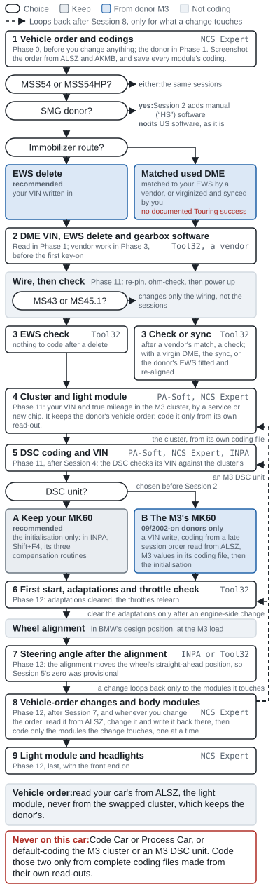 <!-- portrait -->

*Figure 11. The coding sessions in order, with the choices that change them: an SMG donor adds manual software to Session 2, the immobilizer route splits Sessions 2 and 3, and the DSC unit splits Session 5, while MSS54 or MSS54HP changes nothing and MS43 or MS45.1 changes only the wiring. Read your car's vehicle order from ALSZ, never from the M3 cluster, which keeps the donor's. A later order change loops back only to the modules it touches, and to the adaptations only after an engine-side change; never use Code Car.*

### NCS Expert basics

Sessions 1, 4, 5, 8 and 9 use NCS Expert. Set it up once, learn the screens, and keep to the file rules below: they're what keep the M3 cluster's and an M3 DSC unit's hand-set values safe.

**Set it up once** (at the desk, about 10 minutes):

| Item | What you need | Check |
|---|---|---|
| Version | NCS Expert 4.0.1, from Standard Tools 2.12. Version 3.x "doesn't work at Win x 64bit, because of NTVDMs is not present", so keep 3.x for a 32-bit Windows 7 laptop, the fallback if 4.0.1 won't talk to the car ([NAM3](https://nam3forum.com/forums/forum/special-interests/coding-tuning/1281-getting-started-with-ncs-expert/page3)) | It starts, and reads the vehicle order in Session 1 |
| Profile | A profile that allows coding from an edited file, copied into `C:\NCSEXPER\PFL\`: Revtor's `NCSDUMMY4.PFL` or terra's "Expert Mode w/ Manipulation" ([Revtor](https://revtor.be/ncsdummy/ncsdummy.pdf), [NAM3](https://nam3forum.com/forums/forum/special-interests/coding-tuning/1281-getting-started-with-ncs-expert)). The stock Expert Mode profile reads, but "does not support trace manipulation" (Revtor) | File → Load Profile lists it |
| Coding file | In Windows Explorer, View → tick "File name extensions". In `C:\NCSEXPER\WORK\` create an empty text file named `FSW_PSW.MAN` (Revtor) | The name reads exactly `FSW_PSW.MAN`, not `FSW_PSW.MAN.txt` |
| Data files | In `C:\NCSEXPER\DATEN\E46\`: `KMBE46M3.C23` and `KMBE46M3.C24` (M3 clusters), `KMB_E46.C07` and `KMB_E46.C08`, `LSZ.C35` to `LSZ.C37`, and your DSC unit's file | All there. If not, update the E46 data: cars built from 2005 need newer files ([ECUWorx](https://www.ecuworx.co.uk/uploads/M-Track.pdf)), and one vendor lists V75 (12/2025) as the latest ([ncs-expert.com](https://ncs-expert.com/sp-daten-update-matrix)). Any E46 data from V32 (2007) on has these files; a 01/2001 set had only `KMBE46M3.C20` and `C21` ([SP-Daten V32 file list](https://archive.org/download/sp-daten-v-32/SP-DATEN_V32.torrent)) |
| Job files | `KOMBI46R.PRG`, `KOMBI46.PRG` and `LSZ_2.PRG` in `C:\EDIABAS\ECU\` | Tool32 opens them; a missing one gives SYS-0002 or SYS-0005 |

Before every session: close INPA, put the charger on, check the cable's pin 7/8 bridge and turn the ignition to position 2.

**The screens.** English labels vary by version and language pack, such as "Change ECU" or "Change SG/SGET":

| You are at | Press | You get |
|---|---|---|
| Empty main screen | File → Load Profile → choose → OK | Labelled F-keys |
| Main | F1 "VIN/ZCS/FA" | The identity screen |
| Identity | F3 "ZCS/FA f. ECU" → E46 → a module → OK | The VIN (FG) and vehicle order, loaded for this session only |
| Identity | "Enter FA" → E46 → OK → OK at the VIN | The order dialog: type a code under Attribute → Add; select one → Delete; OK |
| Identity | F6 "Back" | Main, showing the modules and the job offered, often `SG_CODIEREN` |
| Main | F4 "Process ECU" → module → OK | The job name and the module's coding file |
| Module screen | F2 "Change job" → job → OK | `CODIERDATEN_LESEN` reads; `SG_CODIEREN` writes; `FA_WRITE` stores the session's order in the module |
| Module screen | F3 "Execute job" | "coding active", then "coding ended" |
| Module screen | "Change ECU" → module | The same job on another module |
| Main | "Process Car" → "Code Car" | **Never on this car** ([Session 8](#session-8-vehicle-order-changes-and-body-modules)) |

**Reading a module.** F4 → module → F2 → `CODIERDATEN_LESEN` → F3. The job offered first is usually `SG_CODIEREN`, which writes, so change it before you execute; NCS may say it's coding while it only reads. After the read, note the coding-file name shown under JOBNAME, such as `KMBE46M3.C24`: the name shown before the read is only the one NCS expects. Then copy `FSW_PSW.TRC` and `NETTODAT.TRC` out of `C:\NCSEXPER\WORK\` at once, as `E46-<MODULE>.<Cxx>-FSW_PSW.TRC` and `E46-<MODULE>.<Cxx>-NETTODAT.TRC`. NCS reuses the trace file as scratch space: "Do not perform any other actions in NCS Expert until the trace files are … saved to another location" ([Revtor](https://revtor.be/ncsdummy/ncsdummy.pdf)).

**Writing a module from a coding file:**

1. Copy the module's fresh trace whole, change only the lines you mean to, and save it as `FSW_PSW.MAN` in `C:\NCSEXPER\WORK\`. In Notepad's Save As, choose "All files", or it saves as .TXT ([E46Zone](https://www.e46zone.com/forum/topic/36596-guide-to-coding-with-ncs-expert/)). Use only your own module's trace: "you should never use someone else's FSW_PSW file" (terra, [NAM3](https://nam3forum.com/forums/forum/special-interests/coding-tuning/1281-getting-started-with-ncs-expert)).
2. Load your manipulation profile → F1 → F3 → E46 → the module the session names for the order → F6 → F4 → module → F2 → `SG_CODIEREN` → F3. Some modules need the ignition cycled before the change shows (Revtor).
3. Re-read the module (`CODIERDATEN_LESEN`), then load the new trace and your MAN in NCS Dummy's compare ("Compare Trace 2…"): only your lines may differ.
4. Empty the MAN; don't delete it (Revtor).

**Why a complete file.** With terra's profile, an empty MAN means "NCS Expert will determine how to set every option … by your VO", and "you'll lose the customizations you've made" (terra). With Revtor's, functions left out keep their old values (Revtor). A complete copy of the module's own fresh trace gives the same result either way; an empty or partial one doesn't (our inference).

**Rules for this car:**

- After the cluster swap, read your car's vehicle order only from ALSZ. The M3 cluster keeps the donor's order, which BMW's data requires for an index 22–24 cluster, so code the cluster with that order in the session and never `FA_WRITE` your Touring's order into it ([Session 4](#session-4-cluster-and-light-module)). On a car built from 09/2001 the EWS holds your VIN but no order ([BMW's E46 coding data, via ncsx](https://github.com/emdzej/ncsx/blob/main/docs/daten-format.md), [SGBD: EWS3](https://github.com/emdzej/ediabasx-docs-sgbd/blob/main/docs/sgbd/EWS3.md)).
- Never default-code the M3 cluster or a hand-coded M3 DSC unit: no empty MAN, no `SG_CODIEREN` in Expert Mode, no Code Car. Write them only from a complete coding file made from their own read-out.
- Coding from the order, with an empty MAN, is right only for a Touring module you never customised, or for a new module such as a xenon light module ([Session 9](#session-9-light-module-and-headlights)).

**Messages and what to do** ([EdiabasLib](https://github.com/uholeschak/ediabaslib), [Revtor](https://revtor.be/ncsdummy/ncsdummy.pdf), [BMW CoApi list](https://nam3forum.com/forums/filedata/fetch?id=21984)):

| Message | Meaning | Do this |
|---|---|---|
| IFH-0002, IFH-0003 | "NO RESPONSE FROM INTERFACE", "DATATRANSMISSION TO INTERFACE DISTURBED": the cable | Driver, COM1 in `obd.ini`, latency timer, USB port ([Cable and EDIABAS settings](#cable-and-ediabas-settings)) |
| IFH-0009 | "NO RESPONSE FROM CONTROLUNIT": the module isn't answering. It isn't a version fault | Pins 7 and 8 bridged; ignition at position 2; the right module chosen (ALSZ or AKMB); the module's fuse and plug |
| IFH-0010 | "DATATRANSMISSION TO CONTROLUNIT DISTURBED" | Wiring, power, the bus |
| IFH-0032, IFH-0037 | "IGNITION IS OFF", "LOW UBATT" | Key to position 2; charger on |
| SYS-0002, SYS-0005 | "ECU OBJECT FILE NOT FOUND", "OBJECT FILE NOT FOUND" | The job file is missing from `C:\EDIABAS\ECU` |
| SYS-0008 | "JOB NOT FOUND" | Wrong job file for that job: `KOMBI46R.PRG` for the M3 cluster, `KOMBI46.PRG` for an older one |
| "VIN is faulty" while reading the order | Bad communication | The pin 7/8 switch; test in INPA first |
| COAPI-1020 | "can not open file for reading" | `FSW_PSW.MAN` missing, or saved as `FSW_PSW.MAN.txt` |
| COAPI-1141, COAPI-1142 | "FSW faulty", "PSW faulty" | An old MAN left in WORK: empty it, don't delete it |
| COAPI-1143 | "error during processing of CBD-file" | A typo in the MAN, or a MAN from another module |
| COAPI-2000 | "EDIABAS or SGBD error" | With "VIN is faulty", the interface or pins 7 and 8: "Most of the time it's due to the switch on the cable connector" (sapote, [NAM3](https://nam3forum.com/forums/forum/special-interests/coding-tuning/1281-getting-started-with-ncs-expert/page3)). Otherwise, out-of-date data or job files |
| COAPI-2020 | "no answer from ECU" | The module isn't fitted, is dead or has no power: its fuses and plugs |
| COAPI-2060 to COAPI-2099 | The link broke during the job | BMW: end the session, disconnect everything including the charger, "Perform a battery reset for 15 minutes", reconnect. On a used GM5 the cause was a loose pin in its plug ([NAM3](https://nam3forum.com/forums/forum/special-interests/coding-tuning/21981-ncs-error-while-trying-to-recode-used-gm5-module)) |
| "Codierindex … nicht zulässig" | The session order's production date or type key rules out this module's version. BMW's data admits an M3 cluster (index 22–24) only with an M3 type key such as `BL93`, and an M3 MK60 only with an M3 type key and a date from 09/2002 ([SP-Daten V32](https://archive.org/details/sp-daten-v-32)) | A session-only order, with the donor's type key or a later date, without `FA_WRITE` ([e46fanatics](https://www.e46fanatics.com/threads/ncs-expert-coding-is-faulty-resolved-8-12-21.1293250/), [e46fanatics](https://www.e46fanatics.com/threads/mk60-coding-index-the-following-control-unit-is-not-allowed-for-this-coding-job.1264623/)) |
| "Ungültiger Codierindex 24" | An M3 cluster chosen as KMB | Choose AKMB ([e46fanatics](https://www.e46fanatics.com/threads/e46-m3-cluster-coding.1278842/)) |

### Session 1: Vehicle order and codings

**Background.** Cars built before 09/2001 store their options as a ZCS (three hex strings, GM, SA and VN) in the cluster (KMB), with a backup in the EWS. Cars built from 09/2001 store a vehicle order (FA) in two modules, the cluster (AKMB) and the light module (ALSZ); BMW's E46 coding data marks only those two as holding the order, and the EWS as holding a ZCS only ([e46fanatics](https://www.e46fanatics.com/threads/diy-how-to-code-fa-for-at-mt-swap.1290835/), [e46fanatics](https://www.e46fanatics.com/threads/diy-how-to-code-zcs-for-at-mt-swap.1290589/), [BMW ST406](https://archive.org/download/BMWTechnicalTrainingDocuments/ST406%20Coding%20%26%20Programming/06%20Vehicle%20Coding%20Information.pdf), [BMW's E46 coding data, via ncsx](https://github.com/emdzej/ncsx/blob/main/docs/daten-format.md)). terra, on cars built from 09/2001: "pick AKMB or ALSZ (both should have the same options stored unless your car has been messed with in the past)" ([NAM3](https://nam3forum.com/forums/forum/special-interests/coding-tuning/1281-getting-started-with-ncs-expert)). NCS Expert codes each module from that record: the type code sets body (TOUR), engine (M54B25) and market (a 2003 US 325i Touring's type code is `EN33`; a US M3 coupe's is `BL93`, a convertible's `BR93`: [BMW E46AT.000](https://archive.org/details/sp-daten-v-32), [zcs_all](https://github.com/emdzej/ediabasx-docs-sgbd/blob/main/docs/sgbd/zcs_all.md)), and the production date (#MMYY) decides which module versions NCS will accept ([e46fanatics](https://www.e46fanatics.com/threads/mk60-coding-index-the-following-control-unit-is-not-allowed-for-this-coding-job.1264623/), [NAM3](https://nam3forum.com/forums/forum/special-interests/coding-tuning/173720-mk60-vin-issue-m3-track-mode-rabbit-hole)). Set NCS Expert up first ([NCS Expert basics](#ncs-expert-basics)).

**On your Touring,** with its own cluster, light module and DSC unit fitted:

1. NCS Expert → File → Load Profile → Expert Mode → OK.
2. VIN/ZCS/FA (F1) → ZCS/FA f. ECU (F3) → E46 → OK → **ALSZ** → OK. Screenshot the VIN (FG), the option list, the production date and the type code. Then Back → F1 → F3 → E46 → **AKMB** → OK, and screenshot the same. On a car built before 09/2001, read KMB, then EWS, and screenshot the ZCS strings.
   - **Expect:** the two orders match. If they don't, trust ALSZ, the copy that never leaves the car, and note the difference.
3. Back (F6) → Process ECU (F4) → choose a module → Change job (F2) → `CODIERDATEN_LESEN` → Execute (F3). The job offered first is `SG_CODIEREN`, which writes: change it before you press Execute ([Revtor](https://revtor.be/ncsdummy/ncsdummy.pdf)).
4. After the read, note the coding-file name under JOBNAME, such as `LSZ.C36`. Before you press anything else, copy `FSW_PSW.TRC` and `NETTODAT.TRC` from `C:\NCSEXPER\WORK\` to your backup folder as `E46-<MODULE>.<Cxx>-FSW_PSW.TRC` and `E46-<MODULE>.<Cxx>-NETTODAT.TRC` (Revtor). Repeat for every module NCS lists: AKMB or KMB, ALSZ or LSZ, GM5, DSC, EWS, IHKA or IHKR, and MRS (airbag), LWS (steering angle) and PDC if fitted.
5. **VIN and mileage in Tool32** (screenshots). `KOMBI46R.PRG`, or `KOMBI46.PRG` if that answers "JOB NOT FOUND": `IDENT` (`ID_COD_INDEX`, the coding index, and `ID_BMW_NR`, the part number), `STATUS_AIF_FG_NR_LESEN` (the VIN) and `STATUS_AIF_GWSZ_LESEN` (the mileage, in km). Then `LSZ_2.PRG` → `IDENT`, and `SIA_LESEN`: `FG_NR` (the VIN's last 7 characters) and `GESAMTWEGSTRECKE_WERT` (the mileage, in units of 100 km) ([SGBD: KOMBI46R](https://github.com/emdzej/ediabasx-docs-sgbd/blob/main/docs/sgbd/KOMBI46R.md), [SGBD: LSZ_2](https://github.com/emdzej/ediabasx-docs-sgbd/blob/main/docs/sgbd/LSZ_2.md)). Photograph the odometer the same day.
6. **Memories.** Read the cluster's and light module's EEPROMs with PA-Soft ([Back up everything first](#back-up-everything-first)).
7. Store everything in two places, with the cluster's and light module's part numbers and coding indexes written down.

**Expect:** the same order from ALSZ and AKMB; one pair of trace files per module, each named with its coding file; the same VIN in the cluster and the light module, and mileages that agree (the light module's in steps of 100 km).

**On the donor, before you strip it** (Phase 1): steps 1 to 6 in the donor. Its order matters later: the M3 cluster keeps it, Session 4 codes the cluster with it, and an M3 DSC unit (Session 5) needs its type key in a session-only order. Expect its cluster's coding file to be `KMBE46M3.C23` or `C24` on a 2003–06 car. Keep its cluster EEPROM file untouched.

**Rules.**

- Keep your Touring's type code and production date in the stored order, and add option codes only for hardware you fit ([Session 8](#session-8-vehicle-order-changes-and-body-modules)). The body modules code from the type code: the GM5 for the tailgate and rear wiper, the light module for the Touring's rear lamps. Changing one light module's body variant (`VARIANTE_LSZ`, from `wert_01` to `wert_02`) changed about 25 rear-lamp settings at once ([kd7iwp traces](https://github.com/kd7iwp/BMW-Coding/tree/master/E46)). BMW's coding rules confirm it: an M3 type key in the stored order would switch off the GM5's Touring functions (`FUNKTIONEN_TOURING` and the remote rear-glass release) and change 37 light-module settings for the rear lamps ([BMW E46CVT.000](https://archive.org/details/sp-daten-v-32)).
- A chip-route cluster brings the donor's order with it, the M3's type code included, and keeps it for good: BMW's coding data admits an M3 cluster only with an M3 type key ([Session 4](#session-4-cluster-and-light-module)). After the cluster swap, ALSZ holds your car's only true order: read it from ALSZ for every other module.
- Never use Process Car or Code Car on this car ([Session 8](#session-8-vehicle-order-changes-and-body-modules) says why).

**Watch:** [50sKid – Code the vehicle order (2017), 08:52](https://www.youtube.com/watch?v=FiBr1h9j0bU&t=532s) for reading the order, and [Motorsport Inspired – Enable the CSL oil-level display (2022), 00:35](https://www.youtube.com/watch?v=SISvhcoWmYE&t=35s) for `CODIERDATEN_LESEN` on an E46 M3 (watch it for the read job only; the option it enables needs CSL software).

### Session 2: DME VIN, EWS delete and gearbox software

**Read the donor DME before it goes anywhere** (charger on, ignition at position 2, engine off):

1. Tool32 → File → Load SGBD → `MSS54DS0.PRG` (a zero, not the letter O; the same file covers the MSS54HP) ([SGBD documentation](https://github.com/emdzej/ediabasx-docs-sgbd/blob/main/docs/sgbd/d_0012.md)). Run `IDENT` and `FS_LESEN`, and save the results. From `IDENT`, record the part number (`ID_BMW_NR`), hardware number (`ID_HW_NR`), coding index (`ID_COD_INDEX`) and software number (`ID_SW_NR`) ([SGBD documentation](https://github.com/emdzej/ediabasx-docs-sgbd/blob/main/docs/sgbd/MSS54DS0.md)). Also note whether a generic OBD-II scanner reads the donor's VIN (mode 09): California requires that only from the 2005 model year, and the rule for earlier cars asks only for the calibration ID, so a 2001–03 MSS54 may not report one ([13 CCR 1968.2(g)(4.8.1)](https://www.law.cornell.edu/regulations/california/13-CCR-1968.2), [13 CCR 1968.1](https://www.law.cornell.edu/regulations/california/13-CCR-1968.1)).
2. Check the hardware number against the M3's: 7831815, 7833892, 7837941, 7842559 or 7842975 for an MSS54; 7834910, 7835564, 7837340, 7837805, 7842569 or 7842981 for an MSS54HP. That list was parsed from BMW's ISTA discs ([NAM3](https://nam3forum.com/forums/forum/special-interests/coding-tuning/2052-comprehensive-mss54-mss54hp-dme-information)). RPM Motorsport's list of DMEs it can delete runs from 7831815 to 7838802, so ask your vendor about a later number before you buy ([RPM Motorsport](https://www.rpmmotorsport.net/products/bmw-e46-m3-s54-m5-e39-s62-ews-delete-ready-to-start)).
3. Load `12MSS54.PRG`. Run `AIF_LESEN` with argument 1, then 2, 3 and so on. For each slot record the VIN, software, authority and assembly numbers, plus `AIF_ANZ_FREI` (free slots left) and the first slot with an empty `AIF_FG_NR` and its `AIF_ADRESSE_LOW` ([SGBD documentation](https://github.com/emdzej/ediabasx-docs-sgbd/blob/main/docs/sgbd/12MSS54.md), [ECUWorx](https://www.ecuworx.co.uk/2016/02/26/adding-updating-your-vin-uif-with-tool32/)). A DME with few free slots left has little room for your VIN.
4. For a DIY delete only: BMWFlash → File → Read DME → "No" for a partial read; save it and keep a copy ([ECUWorx](https://www.ecuworx.co.uk/how-to/using-the-mss5x-binary-modification-tool/)). A 32 kB file means an MSS54, 64 kB an MSS54HP ([NAM3](https://nam3forum.com/forums/forum/special-interests/coding-tuning/2052-comprehensive-mss54-mss54hp-dme-information)).

**Vendor route** (the guide's [Immobilizer (EWS)](README.md#immobilizer-ews) lists vendors and prices): order the EWS delete with your Touring's full VIN, manual-gearbox software if the donor was SMG, and the tampering-fault delete if offered. Decline every emissions delete. Ask for BMW's latest US software for the donor's hardware: BMW reprogrammed 2001–05 US M3 DMEs because the original software could misjudge catalyst efficiency (SI B12 22 08, [NHTSA bulletin index, record 10029304](https://static.nhtsa.gov/odi/ffdd/tsbs/TSBS_RECEIVED_2005-2009.zip)). Instead of a delete, a vendor can program the used DME to your car's EWS and key: one review reports a running S54 in a 2001 330i after RPM Motorsport "synced" its used DME "to the EWS and key" (\$300, 1–2 days plus shipping, October 2026; [RPM](https://rpmmotorsport.net/products/bmw-e39-e46-m3-m5-s54-s62-used-ecu-dme-ews-programming)).

**DIY delete** (a licensed tool function): load the partial read into ECUWorx's MSS5x tool, buy and activate its licence, select "EWS Delete + EWS Tampering DTC Delete" (and "Transmission Swap" to manual for an SMG donor), apply and write the changes, then reflash with BMWFlash (File → Reflash DME), key to 0 and back to 2 ([ECUWorx](https://www.ecuworx.co.uk/how-to/using-the-mss5x-binary-modification-tool/), [ECUWorx](https://www.ecuworx.co.uk/how-to/a-run-down-of-features-of-the-mss5x-binary-modification-tool-and-what-they-do/)). Don't apply any emissions option the tool offers.

**DIY VIN write** (Tool32, `12MSS54.PRG`), after ECUWorx's procedure:

1. Build the string from the free slot's `AIF_ADRESSE_LOW` and ten more fields, separated by semicolons: address; VIN (all 17 characters); today's date (DDMMYY in ECUWorx's example); change index; software number; authority number; assembly number; serial number; dealer number; kilometres; programme number. ECUWorx's example: `7596;WBSBL12345JR12345;260216;DA;7837331;7834533;7834530;NFS01;240;0;000401` ([ECUWorx](https://www.ecuworx.co.uk/2016/02/26/adding-updating-your-vin-uif-with-tool32/)). Copy the software, authority and assembly numbers from the latest filled slot. The kilometres field is the job file's `AIF_KM`, "Kilometerstand", the odometer reading ([SGBD documentation](https://github.com/emdzej/ediabasx-docs-sgbd/blob/main/docs/sgbd/12MSS54.md)): enter your car's true reading in km, not the example's 0.
2. Run `SEED_KEY`, paste the string into the Arguments box, then run `AIF_SCHREIBEN`. Check that `JOB_STATUS` reads OKAY. If it says Error or Rejected, run `SEED_KEY` again and retry without clicking anything else (same source).
3. Verify: `AIF_LESEN` with argument 0; INPA → E46 → Engine → MS S54 for S54 M3 → Coding; and a generic OBD scanner's VIN read, if the DME answers it (step 1).

Slots are finite: a forum member puts the limit at 14 VIN writes, and about 60 flashes in all ([NAM3](https://nam3forum.com/forums/forum/special-interests/coding-tuning/2052-comprehensive-mss54-mss54hp-dme-information)). Write the VIN once, correctly. A partial VIN fails state tests ([BMW SI B12 09 13](https://static.nhtsa.gov/odi/tsbs/2013/MC-10150160-9999.pdf)).

**An SMG donor's DME** has the same hardware as a manual one but different software ([NAM3](https://nam3forum.com/forums/forum/special-interests/coding-tuning/2052-comprehensive-mss54-mss54hp-dme-information)). BMW's data-set names say which: US manual software is "E46 M3 US HS" on the MSS54 and "E46-M3-USA-HS" on the MSS54HP, where HS stands for Handschaltung, manual; US SMG software carries "SMG" in the name (same source). Choose, in this order:

1. **A vendor conversion.** Kassel's "Engine Swap Coding" (\$349) includes it; or ask your delete vendor ([Kassel](https://www.kasselperformance.com/product/bmw-e46-m3-s54-mss54-hp-tuning/)).
2. **ECUWorx's "Transmission Swap: SMG→Manual"**, applied in the same read and reflash as a DIY delete; it also switches off the SMG faults ([ECUWorx](https://www.ecuworx.co.uk/how-to/a-run-down-of-features-of-the-mss5x-binary-modification-tool-and-what-they-do/)).
3. **A WinKFP flash to a US manual data set.** In a table parsed from BMW's ISTA discs, the latest US manual assembly (ZB) numbers are about 7842973 for the MSS54 and 7842979 or 7842977 for the MSS54HP ([NAM3](https://nam3forum.com/forums/forum/special-interests/coding-tuning/2052-comprehensive-mss54-mss54hp-dme-information)). They're the table's last entries, not a tested flash: find your DME in `MSS54.HIS` in your SP-Daten and confirm the number before you program. The steps, from one owner's guide: charger on, ignition at position 2, engine off, the laptop's power saving off; WinKFP → Comfort mode → Choose ZUSB → the MSS54 family and the HS number → Enter VIN (all 17 characters; this also writes it) → Done → Program. It programs in two phases and ends "programming okay". Key off, wait, key on; clear the DME adaptations and every module's faults. It may take a couple of cranks to start ([e46fanatics](https://www.e46fanatics.com/threads/diy-how-to-flash-update-dme-or-egs.1324566/)). Each flash uses one of the DME's limited flashes, which is why routes 1 and 2 come first.

Left on SMG software, the DME will probably log SMG bus faults 6 (0x06) and 123 (0x7B), and it has a fault type, "MIL-Anforderung durch SMG", in which the SMG asks for the check-engine lamp, an inspection risk ([SGBD documentation](https://github.com/emdzej/ediabasx-docs-sgbd/blob/main/docs/sgbd/MSS54DS0.md)). One shop's "coding" left a swapped sedan in limp mode ([UNRIVALED – Watch this before you S54 swap (2021), 02:02](https://www.youtube.com/watch?v=eddLff8yba0&t=122s)).

**Expect:** your VIN in the AIF; the engine starts with your EWS and key; fault 130 (0x82) may stay stored unless the tampering fault was deleted ([NAM3](https://nam3forum.com/forums/forum/main-forum/e46-2001-2006/38046-mss54-ews-delete-anyone-successful)).

**If a flash fails** (charger on):

- **A bad partial flash with BMWFlash:** write the saved, unmodified partial read back with BMWFlash. That's why you keep it. Recovering from a bad full flash "is much more involved" ([ECUWorx](https://www.ecuworx.co.uk/2016/02/22/how-safe-is-flashing-your-dme-over-obd2/)).
- **WinKFP stops partway, or the DME then cranks without starting and WinKFP reports error 209, "UIF cannot be read":** set WinKFP back to its defaults, with fast baud rate and boot-sector update off; set the cable's latency timer to 1 ms; keep at least 13.8 V at the battery; switch the ignition off and on, then flash again. That's the advice in one thread about an M54's DME, flashed with the same tool, whose owner had cancelled the second phase; he ended up with a replacement DME ([e46fanatics](https://www.e46fanatics.com/threads/failed-zb-update-crank-no-start-solved-replacement-dme.1327944/)).
- **The DME refuses more flashes or VIN writes:** it has used up its counters. MSS Flasher can reset them ([NAM3](https://nam3forum.com/forums/forum/special-interests/coding-tuning/2052-comprehensive-mss54-mss54hp-dme-information)).

### Session 3: EWS

**After a delete,** or a vendor's match of the DME to your EWS (Session 2), there's nothing to code. Check:

1. Your EWS coding file from Session 1 shows `PARK/NEUTRAL_EINGANG` = `aktiv`. Leave it there ([e46fanatics](https://www.e46fanatics.com/threads/diy-how-to-code-ews-to-ignore-clutch-park-neutral-switch.1313143/)).
2. Tool32 → `EWS3.prg` → `STATUS_LESEN`, key in, clutch pressed: the key is sending and not barred, `STAT_ANLASSER_AUS_P_N` (starter blocked by P/N) reads 0, and while cranking `STAT_ANLASSER_FREIGESCHALTET` (starter released) reads 1 ([SGBD documentation](https://github.com/emdzej/ediabasx-docs-sgbd/blob/main/docs/sgbd/EWS3.md)).
3. Tool32 → `MSS54DS0.PRG` → `FS_LESEN`: fault 130 (0x82) may be stored. The engine still starts ([NAM3](https://nam3forum.com/forums/forum/main-forum/e46-2001-2006/38046-mss54-ews-delete-anyone-successful)).

Don't jumper EWS pins. "If you find yourself having to jump the actual pins in the EWS module itself then you have another EWS related issue" with the module, key or transponder (same source).

**Syncing a virgin DME.** This sequence worked once, on one owner's CSL-clone MSS54: a DME converted in hardware to run CSL software, whose immobilizer code (ISN) he had written in through its BDM programming port. He wasn't sure it works on a virgin DME, and no Touring build has confirmed it ([NAM3](https://nam3forum.com/forums/forum/special-interests/coding-tuning/145696-ews-sync-issue-with-csl-clone-dme-solved)). A forum moderator says the sync should be done in INPA ([NAM3](https://nam3forum.com/forums/forum/main-forum/e46-2001-2006/320555-mss54-and-mss54hp-ews-syncing-or-delete)), but the INPA keys for the MSS54 aren't documented. On an MSS54HP, INPA offers a "Synchronize EWS 3 initial value" page with F1 "store" and F2 "reset"; the owner who found it didn't run it ([NAM3 (2025)](https://nam3forum.com/forums/forum/main-forum/e46-2001-2006/319929-ews-delete-and-i-have-a-crank-with-no-start)). Kassel's 40-second clip, "Select E46, Engine M54 MS43, Shift + F6, F1, Start car", syncs an M54's MS43 and doesn't carry over to the MSS54 ([KasselPerformance – MS43 EWS sync in INPA (2015)](https://www.youtube.com/watch?v=HPoaKPqLpgE)). Use Tool32. Two more MSS54s virginized with a DIY flasher failed: one wouldn't sync ("Error_SG_Rejected" in INPA; Tool32 reported OKAY, but it stayed unsynced) and one was bricked ([NAM3](https://nam3forum.com/forums/forum/special-interests/coding-tuning/258903-dme-ews-sync-is-not-working), [NAM3](https://nam3forum.com/forums/forum/main-forum/e46-2001-2006/233343-exploring-potential-solutions-for-dme-after-virginizing-with-mssflasher)). With the two Touring failures, that's four, and no documented DIY success: buy the delete or a vendor's match.

1. Charger on, ignition at position 2, engine off.
2. Tool32 → `EWS3.prg` → `WECHSELCODE_SYNC_DME`. Expect OKAY.
3. Load `MSS54DS0.PRG`. Type `0x01` in the Arguments box and run `EWS3_INITIALISIEREN`. Expect OKAY.
4. Run `EWS3_SYNC`. Expect OKAY.
5. Run `EWS3_GET_STATUS`. The failed Touring showed `EWS3_STATUS` = Invalid and `EWS3_STATUS_WERT` = 3 ([e46fanatics](https://www.e46fanatics.com/threads/ews-synch-for-s54-swap-into-e46-touring.1318881/)).
6. Run `FS_LESEN`: fault 130 (0x82) should be gone. `STATUS_DIGITAL` → `STAT_EWS3_FREIGABE` shows the release.
7. Key off for at least 10 seconds, then try to start.

**Reading the faults** ([SGBD documentation](https://github.com/emdzej/ediabasx-docs-sgbd/blob/main/docs/sgbd/MSS54DS0.md), [BMW ST051](https://archive.org/download/BMWTechnicalTrainingDocuments/ST051%20Body%20Electronics%20I%20%28Archive%201%29/05%20EWS.pdf)):

| Fault 130 (0x82) type | Meaning | Next step |
|---|---|---|
| "Startwert leer" (start value empty) | A virgin DME that hasn't received the code table | Run the sync |
| "Wechselcode verloren" (rolling code lost) | An ordinary loss of sync | Re-run the alignment; BMW allows it any number of times |
| "Manipulation" | The DME is married to another EWS | Delete, virginize, or use the donor EWS |
| Fault 66 (0x42), EWS interface | The EWS–DME line, or the key was on with a module unplugged | Check the wire at X60004 pin 33 (EWS data line); re-run the alignment |

INPA's "ERROR_SG_REJECTED" means the module refused the job, not that the cable failed. "No free starting value storage space available" fits a DME that already holds a married table; "start value not understood" and "start value not set" came from the virginized-DME case ([e46fanatics](https://www.e46fanatics.com/threads/cant-sync-ews-dme-on-s54-swapped-e46-wagon.1300465/), [SGBD documentation](https://github.com/emdzej/ediabasx-docs-sgbd/blob/main/docs/sgbd/MS450DS0.md)). The INPA messages in the 2002 325iT case match the M54 MS45.1's job file word for word, so we infer its INPA may have run an M54 engine script rather than the MSS54's, unless the MSS54 uses the same texts ([e46fanatics](https://www.e46fanatics.com/threads/ews-synch-for-s54-swap-into-e46-touring.1318881/)).

**Using the donor's EWS:**

1. Make sure your own EWS's coding file is saved (Session 1).
2. Fit the donor's EWS with its DME, and put the donor key's transponder near the ring antenna.
3. Code the donor EWS to match your file, especially `PARK/NEUTRAL_EINGANG` = `aktiv`.
4. Re-align it with the sync sequence above ([e46fanatics](https://www.e46fanatics.com/threads/ews-synch-for-s54-swap-into-e46-touring.1318881/)).
5. Check `STATUS_LESEN` as after a delete.

**If it won't start after EWS work,** work down this list. The figure below shows it as a flowchart.

1. **It doesn't crank:** the cause is on the EWS side, and a delete in the DME changes none of it. In `EWS3.prg` → `STATUS_LESEN`, the key should be sending and not barred, the key-check bits `STAT_SCHLUESSEL_NIO_ID`, `STAT_SCHLUESSEL_NIO_PW` and `STAT_SCHLUESSEL_NIO_WC` (ID, password and rolling code not OK) should read 0, and with the clutch down `STAT_ANLASSER_AUS_P_N` should read 0 ([SGBD documentation](https://github.com/emdzej/ediabasx-docs-sgbd/blob/main/docs/sgbd/EWS3.md)). Then the battery, the clutch input at EWS pin 8 and the starter feed ([Won't start](#wont-start), question 2).
2. **It cranks, and may fire once or twice, but never runs, with 130 (0x82) or 66 (0x42) stored:** that's the EWS-to-DME refusal. A builder of S54 Tourings: "EWS to DME issues generally manifest as a brief fire or no fire at all"; on one M3 the cause was a delete that hadn't taken ([NAM3 (2025)](https://nam3forum.com/forums/forum/main-forum/e46-2001-2006/319929-ews-delete-and-i-have-a-crank-with-no-start/page2)). Read the fault's type in the table above and do what it says. After a delete, re-read the DME, or ask the vendor, to confirm the delete took. With a virginized DME, run the alignment again: BMW allows it any number of times ([BMW ST051](https://archive.org/download/BMWTechnicalTrainingDocuments/ST051%20Body%20Electronics%20I%20%28Archive%201%29/05%20EWS.pdf)).
3. **Still not released:** fit the donor's EWS and key and re-align (above), or send the DME away for a delete.
4. **Only a leftover 130 (0x82), after a delete the vendor has confirmed:** that alone doesn't stop the engine. Go on with [Won't start](#wont-start), question 5.

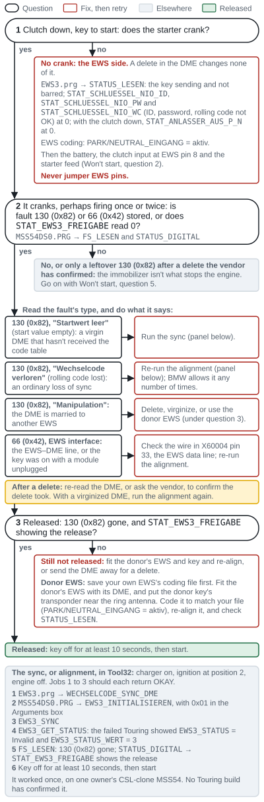 <!-- portrait -->

*Figure 12. A no-start after EWS work, worked through. No crank points to the EWS side, which a DME delete doesn't change; a crank with 130 (0x82) or 66 (0x42) stored, perhaps with a brief fire that never catches, points to the DME's release, and the fault's type says what to do. A leftover 130 on its own, after a delete the vendor has confirmed, doesn't stop the engine: go on with Won't start, question 5.*

### Session 4: Cluster and light module

**Before you start:** the light module untouched; your true mileage photographed; both cars' Session 1 backups at hand, including both vehicle-order screenshots and the M3 cluster's untouched EEPROM file; the charger on; NCS Expert set up with a manipulation profile ([NCS Expert basics](#ncs-expert-basics)).

**BMW's rules for a new cluster.** The cluster and the light module compare VIN and mileage at every key-on ([BMW ST052](https://archive.org/download/BMWTechnicalTrainingDocuments/ST052%20Body%20Electronics%20II/03b_E46%20Driver%20Information%20Systems.pdf)):

- "The VIN is entered in the cluster through coding and will only be accepted when the cluster mileage is zero."
- "Data will only be transferred from the LSZ to the cluster if the ID numbers match and the cluster mileage is zero."
- "The stored mileage in the LSZ can only be overwritten by a higher mileage."

So the used M3 cluster goes back to zero with your VIN, through a service or a new chip, and then takes your true mileage from the light module. Nothing is ever written into the light module.

**Service route.** Send the cluster with your VIN, the light module's mileage, and a note that it's going into a wagon. Kassel asked Tenza for the car's mileage, year, body (wagon or sedan), the switch-center buttons and whether the DME was tuned, and added the rear-door lights ([Tenza Motorsports – 5 things they don't tell you, part 2 (2021), 05:42](https://www.youtube.com/watch?v=mDBiRn30fEs&t=342s)). Also ask the service to keep the M3 coding as it is, and to leave the donor's vehicle order in the cluster: that's the order the cluster needs (below). Turn down coding "from the factory vehicle order", which one service lists as standard ([ECUswap](https://ecuswap.de/shop/e46-m3-kombiinstrument-programmierung-vin-km-codierung/)): from a 325i Touring's order, that default-codes an M3 cluster.

**Chip route, two documented ways:**

| Step | A: blank chip, written by PA-Soft ([e46fanatics](https://www.e46fanatics.com/threads/diy-m3-cluster-into-non-m-retrofit.1277945/)) | B: programmer ([e46fanatics](https://www.e46fanatics.com/threads/diy-m3-cluster-into-non-m-retrofit.1277945/)) |
|---|---|---|
| 1 | With the M3 cluster plugged into your car, read and save its EEPROM in PA-Soft | Photograph the needles at rest (INPA can drive them to known positions), then pull them off carefully |
| 2 | In a copy of the file, clear the mileage and set your car's VIN | Open the cluster and desolder the M35080 |
| 3 | Remove the needles, open the cluster, desolder the M35080 and solder in a blank one (this owner used an 080D0WQ) | In the R270 software, select "EEPROM M35080 3", read the chip, check the VIN, and use "erase odometer" |
| 4 | Plug the cluster in: it shows "code". Write your prepared file with PA-Soft | Solder the chip back, reassemble, and refit the needles: push them on about 2 mm, turn them anticlockwise to the stop, set them to the photographed positions, press them home |
| 5 | The cluster restarts with no tamper dot, and your mileage appears within seconds, read from the light module | Write your VIN with PA-Soft; the mileage then comes from the light module |

Later clusters use M35080 "v6" chips, which a stock R270 can read but not write; write the image to a "3" chip instead (same source). Editing and re-burning the original chip is "hit or miss", so use a new chip ([NAM3](https://nam3forum.com/forums/forum/special-interests/coding-tuning/154645-cluster-with-coding-index-0x24-virginization)). One owner who dropped in a blank chip needed no programmer at all (same source). Early M3 clusters (coding index 20 or 21) were made by Motometer, whose clusters PA-Soft can program completely: a 323Ci owner set a replacement Motometer cluster's VIN and true mileage that way ([e46fanatics](https://www.e46fanatics.com/threads/diy-m3-cluster-into-non-m-retrofit.1277945/), [e46fanatics](https://www.e46fanatics.com/threads/cluster-swap-tamper-dot-removal-success.1130431/)). Check who made yours before buying tools.

**A chip brings the donor's vehicle order back.** The cluster keeps its copy of the vehicle order in its own memory ([SGBD: KOMBI46R](https://github.com/emdzej/ediabasx-docs-sgbd/blob/main/docs/sgbd/KOMBI46R.md)), so a chip written from the donor's file carries the donor's order. An owner who virginizes index-24 clusters: "the VO is brought back onto the new Chip" ([NAM3](https://nam3forum.com/forums/forum/special-interests/coding-tuning/154645-cluster-with-coding-index-0x24-virginization)). After the chip route, expect the cluster (AKMB) to hold the donor M3's type code, options and date, while the light module (ALSZ) still holds your Touring's. Anything that codes from the cluster's copy would code your car as the donor, so code every other module from ALSZ.

**Which vehicle order the cluster needs.** BMW's coding data admits an M3 cluster (index 22, 23 or 24) only with a vehicle order that has an M3 type key (engine keyword `S54B32`) and a build date from 09/2001; a non-M order admits only indexes 06–08 ([BMW E46SGVT.000 / E46SGET.000, SP-Daten V32](https://archive.org/details/sp-daten-v-32), [format](https://github.com/emdzej/ncsx/blob/main/docs/ecu-selection.md)). Your Touring's order (type key `EN33`, `M54B25`) therefore can't be used to read or code the M3 cluster: by BMW's rule NCS refuses that coding index (our reading of the rule; nobody has posted the refusal). The donor's order, which a chip job leaves in the cluster, is exactly what it needs, so leave it there for good. ALSZ then holds your car's only true order: use ALSZ, never AKMB, as the source for every other module.

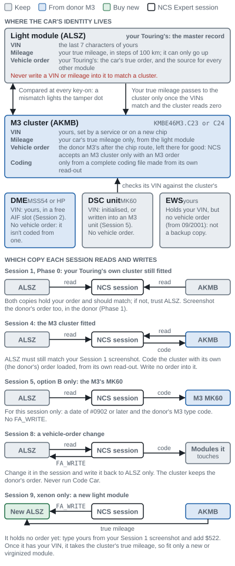 <!-- portrait -->

*Figure 13. Where your car's VIN, mileage and vehicle order live, and which copy each session reads and writes. The light module (ALSZ) is the master record and holds your Touring's order; the M3 cluster carries your VIN and true mileage but keeps the donor's order for good. Your EWS holds your VIN too, but no vehicle order. So read the order from ALSZ for every other module, write it only to ALSZ, and never write a VIN or mileage into the light module.*

**Then, with the cluster in the car:**

1. **First look,** ignition on:
   - no tamper dot;
   - the odometer reads your photo plus the miles driven since;
   - the service display shows your car's interval, which comes from the light module.
2. **VIN and mileage in Tool32.** `KOMBI46R.PRG` → `STATUS_AIF_FG_NR_LESEN` and `C_FG_LESEN` both show your VIN, and `STATUS_AIF_GWSZ_LESEN` the mileage in km. `LSZ_2.PRG` → `SIA_LESEN`: `FG_NR` is your VIN's last 7 characters, and `GESAMTWEGSTRECKE_WERT` × 100 km agrees with the cluster ([SGBD: KOMBI46R](https://github.com/emdzej/ediabasx-docs-sgbd/blob/main/docs/sgbd/KOMBI46R.md), [SGBD: LSZ_2](https://github.com/emdzej/ediabasx-docs-sgbd/blob/main/docs/sgbd/LSZ_2.md)).
   - **If the tamper dot is lit:** the cluster's VIN differs from the light module's. Fix the cluster, never the light module.
3. **Find out which vehicle order is where.** NCS Expert → F1 → F3 → E46 → **ALSZ**: screenshot. It must match your Session 1 screenshot. Back → F1 → F3 → E46 → **AKMB**: screenshot.
   - **AKMB holds the donor's order** (expected): go on with steps 4 and 5.
   - **AKMB holds your Touring's order** (a service wrote it): in Enter FA, change the type key to `BL93` (`BR93` from a convertible donor) for this session only, without `FA_WRITE`, then do steps 4 and 5. Every later cluster session needs the same.
4. **Back up the cluster's coding** with the order from step 3 still loaded: Back → F4 → AKMB → F2 → `CODIERDATEN_LESEN` → F3. **Expect** `KMBE46M3.C23` or `C24` under JOBNAME. Copy the trace pair now. To see BMW's rule for yourself, repeat the read with your ALSZ order loaded: it should be refused, and it changes nothing.
5. **Code the options from a complete coding file.** Copy the new trace whole, change only the lines in the table below, and save it as `FSW_PSW.MAN` ([NCS Expert basics](#ncs-expert-basics)). Load your manipulation profile → F1 → F3 → E46 → AKMB → F6 → F4 → AKMB → F2 → `SG_CODIEREN` → F3 ([ECUWorx](https://www.ecuworx.co.uk/uploads/M-Track.pdf), [Motorsport Inspired (2022), 02:05](https://www.youtube.com/watch?v=SISvhcoWmYE&t=125s)).
   - **Expect** "coding ended". Cycle the ignition.
   - Re-read the cluster and compare the new trace with your MAN in NCS Dummy: only your edited lines may differ.
   - **If it fails:** COAPI-1020 is a missing or misnamed MAN, COAPI-1143 a MAN from another module or a typo, COAPI-1141 or 1142 an old MAN to empty ([NCS Expert basics](#ncs-expert-basics)).
   - The donor's order stays in the session on purpose: BMW's data admits this cluster only with an M3 order.
6. **Leave the donor's order in the cluster.** Don't `FA_WRITE` your Touring's order into it: NCS won't accept the cluster with it, and every later cluster edit would need a typed session order. Write on your coding sheet: "AKMB holds the donor M3 order; the car's order is in ALSZ." From now on read your car's order **only from ALSZ**, and never run Code Car.
7. **Empty the MAN,** and save the cluster's final trace and MAN with your backups for the life of the car.
8. **Function checks.**
   - Oil lamp: `KOMBI46R.PRG` → `STATUS_IO_LESEN`: `STAT_OELDRUCK_EIN` = 1 at key-on, 0 with the engine running. Key on, engine off, the oil-pressure and charge lamps are lit ([Warning lights](#warning-lights)).
   - Fuel: `STATUS_AIF_TANKDATEN_LESEN` gives litres for each sender and the total. Check it against a measured fill ([Fuel gauge and tank senders](#fuel-gauge-and-tank-senders)).
   - Doors: open each door, the tailgate and the rear glass in turn, and record what the cluster shows. The redesign cluster has four door symbols and one rear-lid symbol, and no door or lid coding, so there's nothing to code. If a symbol doesn't light, check the input in Tool32 `ZKE5.PRG` → `STATUS_DIGITAL` (`STAT_HKK` tailgate, `STAT_HSK` rear glass), then the LED with `KOMBI46R.PRG` → `STEUERN_LEUCHTE` (BYTE3 bit 2 rear lid, bits 3 and 4 rear doors) ([SGBD: ZKE5](https://github.com/emdzej/ediabasx-docs-sgbd/blob/main/docs/sgbd/ZKE5.md), [SGBD: KOMBI46R](https://github.com/emdzej/ediabasx-docs-sgbd/blob/main/docs/sgbd/KOMBI46R.md)). Whether the rear glass alone lights the rear-lid symbol is untested. M3 clusters have no rear-door LEDs unless a service adds them.
   - Speedometer: against GPS.

**The options to set** (M3 cluster, index 23 or 24). Everything else stays as read:

| Parameter | Set to | Why |
|---|---|---|
| `CAN_OELDRUCKSCHALTER` (oil pressure over CAN) | `nicht_aktiv` | Every build: X60004 pin 11 is wired to cluster pin 13. An MSS54HP didn't light the lamp over CAN even with this `aktiv`; the wire did ([NAM3](https://nam3forum.com/forums/forum/main-forum/e46-2001-2006/61405-why-does-my-oil-light-turn-off-with-ignition-ii-engine-off)) |
| `GENERATOR_UEBER_CAN` (charge lamp over CAN) | `nicht_aktiv` | With X60004 pin 1 wired to cluster pin 2. `aktiv` only if you leave the lamp on CAN with stock MSS54HP software (same thread) |
| `TOG_UEBER_CAN` (oil level over CAN) | `nicht_aktiv` | With X60004 pin 21 wired to cluster pin 17. `aktiv` only with an MSS54HP and no wire |
| `TANK_KENNLINIE` (fuel-gauge curve) | `60_l_literskala` | BMW's rule for every plastic tank, the M54's and the S54's; `metalltank` is only for the M56 SULEV. On index 23 and 24 `metalltank` is a different curve, while `dad_tank_diesel` is the same as `60_l_literskala` ([BMW E46CVT.000, KMBE46M3.C24](https://archive.org/details/sp-daten-v-32)). Check the gauge against a measured fill ([Fuel gauge and tank senders](#fuel-gauge-and-tank-senders)) |
| `OELNIVEAU_M3` | As read | The oil-level readout works only on an MSS54HP running the Euro-only CSL software, and this build keeps stock US software ([NAM3](https://nam3forum.com/forums/forum/special-interests/coding-tuning/17863-how-do-you-code-csl-oil-level-indicator)) |
| `ANZEIGE_HOCHLADEN` (M Track lamp) | `aktiv` only with an M3 DSC unit coded for M Track | The M Track light ([liam821](https://liam821.com/MK60-Comparison.pdf)). Its option code, `$7MA`, stays out of your stored vehicle order ([Session 8](#session-8-vehicle-order-changes-and-body-modules)) |
| `SPRACHE`, `WEG_EINHEIT`, `WEG_DURCHSCHNITT`, `WEG_REICHWEITE`, `WEG_LIMIT`, `VERBRAUCH_D1`, `TEMPERATUR_EINHEIT`, `ZEIT_EINHEIT` | `us`, `mls`, `mph`, `mls`, `mls`, `mpg_us`, `grad_f`, `12_stunden` | US units. A US cluster has them already, so only check; change them on a cluster from a km/h car ([NCS list](https://ncs-expert.com/wp-content/uploads/2013/06/FSW_PSW.pdf), [NAM3](https://nam3forum.com/forums/forum/main-forum/e46-2001-2006/83919-canada-to-u-s-importation-gauge-cluster-programming)) |
| `K_ZAHL_TACHO`, `K_ZAHL_WEG` and their `_KOMPL` versions | As read | They turn wheel pulses into speed and distance for the M3's wheels and tires, which your car now runs (our inference) |
| `SIA_LITER_GRENZE`, `DREHZAHL_KENNLINIE` | As read (`s54b32…`, `kennlinie_03`) | The S54's service limit and the M3 tachometer ([NCS list](https://ncs-expert.com/wp-content/uploads/2013/06/FSW_PSW.pdf)) |
| `GETRIEBEART` | `handschaltung` | Manual gearbox; a manual donor's cluster has it already ([ncsx patches](https://github.com/emdzej/ncsx-community-patches/tree/main/patches/E46)) |
| Any function about the tamper dot or a cluster exchange | Never touch | The tamper dot is your proof of a matched VIN and true mileage |

The three CAN switches must match the wiring: read why in [Cluster wiring](#cluster-wiring). BMW's coding files confirm they exist on indexes 07, 08, 23 and 24 only ([SP-Daten V32](https://archive.org/details/sp-daten-v-32)). Their factory values depend on the build date, not the index: a US M3 has `TOG_UEBER_CAN` = `aktiv` and `CAN_OELDRUCKSCHALTER` = `nicht_aktiv` at any date, and `GENERATOR_UEBER_CAN` = `aktiv` only from 03/2004 (BMW E46CVT.000; one index-24 cluster read exactly that, [NAM3](https://nam3forum.com/forums/forum/main-forum/e46-2001-2006/61405-why-does-my-oil-light-turn-off-with-ignition-ii-engine-off)). So set all three to match your wiring; don't keep what you find.

**Service interval.** The counters come from your light module, and the M3 cluster keeps its S54 limit (`SIA_LITER_GRENZE`). Reset the display once at the S54's first oil service, with the cluster's own reset or Tool32's `KOMBI46R.PRG` → `SIA_RESET` (our inference; [BMW ST052](https://archive.org/download/BMWTechnicalTrainingDocuments/ST052%20Body%20Electronics%20II/03b_E46%20Driver%20Information%20Systems.pdf), [SGBD: KOMBI46R](https://github.com/emdzej/ediabasx-docs-sgbd/blob/main/docs/sgbd/KOMBI46R.md)).

**Never default-code the M3 cluster in this car.** That means no empty coding file, no `SG_CODIEREN` in Expert Mode, no Process Car or Code Car, and no service coding "from the factory vehicle order". From a 325i Touring's order, NCS refuses an index-23/24 cluster (BMW's rule, above); from the donor's, default coding throws away your hand-set values. The one documented default-coding of an altered cluster left its tach stuck at 9,000 rpm until the EEPROM backup went back ([e46fanatics](https://www.e46fanatics.com/threads/diy-m3-cluster-into-non-m-retrofit.1277945/)). Keep the M3 index; the non-M index 08 that some retrofit guides use gives non-M gauge definitions (same source). That's also why those guides change it: index 08 is the one BMW's data allows with a non-M vehicle order ([BMW E46SGVT.000 / E46SGET.000, SP-Daten V32](https://archive.org/details/sp-daten-v-32)). Keeping index 23 or 24 means coding the cluster with an M3 type key in the session order.

**Cars built before 09/2001.** The light module may not push the mileage to a new cluster. One 2001 Touring owner had the true reading written into the chip; another owner fitted a newer light module and switched his car to FA ([e46fanatics](https://www.e46fanatics.com/threads/diy-m3-cluster-into-non-m-retrofit.1277945/), [e46fanatics](https://www.e46fanatics.com/threads/e46-m3-cluster-coding.1278842/)).

**Expect:** no tamper dot; your true mileage, matching the Phase 0 photo; the donor's order in AKMB and yours in ALSZ, as your coding sheet notes; a re-read that matches your MAN; the DSC and yellow BRAKE lamps may go out within a short drive once the VINs match ([e46fanatics](https://www.e46fanatics.com/threads/e46-m3-cluster-coding.1278842/)).

> [!CAUTION]
> The light module is your car's mileage record. PA-Soft can write a VIN and mileage into the light module, and one retrofit guide uses that to match the module to a donor cluster ([e46fanatics](https://www.e46fanatics.com/threads/diy-m3-cluster-into-non-m-retrofit.1277945/)). Don't: it changes your car's recorded mileage. Make the cluster match the light module, keep the photos and screenshots, and see the guide's [Instrument cluster and mileage](README.md#instrument-cluster-and-mileage).

### Session 5: DSC coding and VIN

**Before you start:** the cluster carries your VIN (Session 4); the charger is on; your DSC unit's part number and coding index are saved (Session 1).

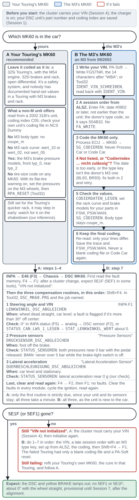 <!-- portrait -->

*Figure 14. Session 5 for either DSC unit. Keep your own MK60 as it's coded (option A), or write your VIN into the M3's unit and code it from a session-only vehicle order read from ALSZ: dated #0902 or later, with the donor's type code and no `FA_WRITE` (option B). Then run the three compensation routines in the order shown, each with its condition and check. If an M3 unit still won't initialise after steps 1–7, refit your own.*

**Option A, your Touring's own MK60** (already coded for your car):

1. INPA → E46 (F3) → Chassis → DSC MK60 → fault memory (F4) → read (F1). After a cluster change, expect 5E1F, "VIN not initialized, run the steering-angle calibration" in BMW's job file; one owner's PA-Soft showed it as 5EF1 ([SGBD documentation](https://github.com/emdzej/ediabasx-docs-sgbd/blob/main/docs/sgbd/DSC_MK60.md), [e46fanatics](https://www.e46fanatics.com/threads/how-to-change-abs-asc-control-module-trifecta-5df5-error-e46.1275927/); these steps were written on a non-US 2002 318i, whose INPA pages are the same).
2. Shift+F4 (compensation routines) → F1 (steering angle and VIN initialisation) with the wheel straight. Accept the warning; a fault is flagged if the wheel is more than 30° off center. Expect "initialization completed" (same source).
3. Run the other two routines on the same page, "Pressure Sensors" and "Lateral Acceleration Sensor", with the wheel straight, your foot off the brake and the car level and still ([e46fanatics](https://www.e46fanatics.com/threads/steering-angle-sensor-reset-shift-f4-compensation-routines-not-showing-up.1216321/), [NAM3](https://nam3forum.com/forums/forum/main-forum/e46-2001-2006/189096-mk20-mk60-swap)). The table below gives each one's conditions and check.
4. Fault memory (F4) → clear (F2) → read (F1): no faults. Clear the faults in every module, cycle the ignition and read again.

**The three compensation routines.** BMW calls for each one when its part is replaced or disturbed ([BMW ST040](https://archive.org/download/BMWTechnicalTrainingDocuments/ST040%202001%20System%20Diagnosis/6%20DSC%202010-30-00.pdf)). Run them in this order; the first also initialises the VIN (the order is ours; BMW gives none).

| Routine | In INPA (Shift+F4) | In Tool32 (`DSC_MK60.PRG`) | BMW calls for it after | Conditions | Check |
|---|---|---|---|---|---|
| 1. Steering angle and VIN | F1 | `LENKWINKEL_DSC_ABGLEICHEN` | A new DSC unit; a steering-angle sensor replaced or coded; steering or suspension work | Wheel dead straight, car level | INPA status (F5) → analog → DSC sensor (F2) reads 0° ([Evan Goyuk (2020), 03:19](https://www.youtube.com/watch?v=lseY6SRXWks&t=199s)); or `STATUS_CAN_LWS_1_LESEN` → `STAT_LENKWINKEL_WERT` about 0 |
| 2. Pressure sensors | "Pressure Sensors" | `DRUCKSENSOR_DSC_ABGLEICHEN` | A new DSC unit; a brake-pressure sensor replaced | Foot off the brake | `STATUS_SENSOREN`: both pressures near 0 bar with the pedal released. BMW: they must not read over 5 bar while the brake-light switch is off ([BMW ST056](https://archive.org/download/BMWTechnicalTrainingDocuments/ST056%20Chassis%20Dynamics%20%28Archive%201%29/04%2520E46%2520DSC%25201-27-03.pdf)) |
| 3. Lateral acceleration | "Lateral Acceleration Sensor" | `QUERBESCHLEUNIGUNG_DSC_ABGLEICHEN` | A new DSC unit; the lateral-acceleration sensor replaced | Car level and stationary | `STATUS_SENSOREN`: lateral acceleration near 0 g (our check) |

`STATUS_SENSOREN_OFFSET` shows the offset each routine stored ([SGBD documentation](https://github.com/emdzej/ediabasx-docs-sgbd/blob/main/docs/sgbd/DSC_MK60.md)). With Option A only the first is strictly due, since your unit and its sensors stay; running all three, as the builders did, takes a minute.

**What your own MK60 can be set to.** NCS Expert codes it as a 325i Touring's: M54 engine, 325i brakes and rack, open differential ([liam821](https://liam821.com/MK60-Comparison.pdf)). The full parameter list of one non-M MK60, read in NCS Dummy from a 2002 318i's unit at coding index C05, shows what such a unit offers ([bmwclubmalaysia, archived](https://web.archive.org/web/20241209032101/http://www.bmwclubmalaysia.com/forums/threads/ncs-expert-brief-walkthrough-and-available-parameters-2002-e46-318i-ckd.30039/)):

| Parameter | On that non-M unit (C05) | The M3's value |
|---|---|---|
| `BAUART_MK60` (body type) | `coupe`, `touring`, `limousine` (sedan), `cabrio`, `roadster`, and "_s" variants such as `touring_s`. No `coupe_m` or `csl` | `coupe_m` |
| `LENKWINKELKENNLINIE_2` (rack curve) | `wert_10` and `wert_02` only | `wert_05`: not offered |
| `DRUCKMODELL_VORDERACHSE` (front brake model) | `typ_0`, `typ_1` | `typ_0` |
| `DRUCKMODELL_HINTERACHSE` (rear brake model) | `typ_0`, `typ_1`, `typ_2` | `typ_2` (`typ_3` with Competition brakes) |
| `MOTOR_ART_DSC_2` (engine) | M43 to M54 engines only | `s54b32`: not offered |
| Tire size | No such parameter | None |

So "M3 values" on your own unit can only mean editing its brake models and handling parameters by hand. It can't take the M3's body type or rack curve. Your Touring's unit may have a different coding index. Read it with Tool32 `DSC_MK60.PRG` → `IDENT` (`ID_BMW_NR` is the part number, `ID_COD_INDEX` the index), and read the unit's label: ETK lists hydraulic unit 34516765453, which replaced 34516759046 in June 2003, and control-unit kit 34526765455 for a 2003 Touring, so yours may carry the older number ([SGBD documentation](https://github.com/emdzej/ediabasx-docs-sgbd/blob/main/docs/sgbd/DSC_MK60.md), [ETK](https://bmwfans.info/parts-catalog/E46-Touring/USA/325i-M54/L-N/feb2003/browse/brakes/hydro_unit_dsc_fastening_sensors/)). Then open its own coding file in NCS Dummy and check before you plan anything.

**Our recommendation: leave your unit as it's coded.** It's a safety system, and nobody has documented hand-set values in a Touring with M3 brakes and rack. Owners have run non-M units with M3-like values set by hand in NCS Dummy ([NAM3](https://nam3forum.com/forums/forum/special-interests/coding-tuning/172815-flashing-the-mk60-with-zcp-software/page2)), and changing `BAUART_MK60` from `touring` to `touring_s` is reported to suit a faster rack ([e46fanatics](https://www.e46fanatics.com/threads/mk60-coding-index-the-following-control-unit-is-not-allowed-for-this-coding-job.1264623/)); whether your unit's index offers `touring_s` at all is unpublished: check it in NCS Dummy after reading the index. The M3's rack is slower than yours, 15.4:1 against 13.7:1 ([BMW USA: M3](https://www.press.bmwgroup.com/usa/article/attachment/T0022150EN_US/41463), [BMW USA: 325i](https://www.press.bmwgroup.com/usa/article/attachment/T0022146EN_US/41437)), so `touring_s` doesn't match it. We infer that your unit, still set for the Touring's quicker rack, will expect a little more turn than the car makes. Nobody has tested how that feels, so watch for the DSC stepping in early on the shakedown.

**Wheels and tires.** The MK60 has no tire-size code. If its flat-tire warning (`REIFENDRUCKWARNSYSTEM`) is on, it learns the tires' rolling circumference: after fitting the M3 wheels, set the pressures, then reset it with Tool32 → `DSC_MK60.PRG` → `RPA_RESET` ([SGBD documentation](https://github.com/emdzej/ediabasx-docs-sgbd/blob/main/docs/sgbd/DSC_MK60.md)).

**Option B, the M3's MK60:**

1. **Write your VIN into it.** PA-Soft → the ABS/DSC module → Reprogramming → Write FGSTNR, and enter the last 14 characters of your VIN, the ones after "WBA" ([LM Auto Repairs – E46 MK60 coding and VIN (2016), 04:47](https://www.youtube.com/watch?v=1dn4c3g6dsA&t=287s), filmed on a 2003 E46 diesel). In Tool32 the job is `DSC_MK60.PRG` → `IDENT_VIN_SCHREIBEN`: type your 17-character VIN plus one more character, any, as the job file asks. Read it back with `IDENT_VIN` ([SGBD documentation](https://github.com/emdzej/ediabasx-docs-sgbd/blob/main/docs/sgbd/DSC_MK60.md)).
2. **Set up this session's vehicle order.** NCS Expert with a manipulation profile → F1 → F3 → E46 → **ALSZ**, then check the order against your Session 1 screenshot. Read it from the light module, not the cluster: after the cluster swap AKMB holds the donor's order (Session 4), and on a car built from 09/2001 the EWS holds none ([SGBD documentation](https://github.com/emdzej/ediabasx-docs-sgbd/blob/main/docs/sgbd/KOMBI46R.md), [NCS data, via ncsx](https://github.com/emdzej/ncsx/blob/main/docs/daten-format.md)). Then Enter FA, leaving the VIN as it is ([NCS Expert basics](#ncs-expert-basics) shows the screens). Delete the production date (#MMYY) and add #0902 or later, no earlier than the unit itself; the donor's own date is a safe choice. Also give the order the donor's type code (`BL93` from a coupe, `BR93` from a convertible), from its vehicle order saved in Phase 1, so that it says `S54B32`: BMW's coding data admits the M3 MK60 (index C06) only with an M3 type key and a date from 09/2002 ([SP-Daten V32](https://archive.org/details/sp-daten-v-32), [NAM3](https://nam3forum.com/forums/forum/main-forum/e46-2001-2006/189096-mk20-mk60-swap), [NAM3](https://nam3forum.com/forums/forum/special-interests/coding-tuning/173720-mk60-vin-issue-m3-track-mode-rabbit-hole)). Don't run `FA_WRITE`: the changes last for this session only, and your stored order stays a Touring's. BMW's rule requires the M3 type key; nobody has documented this order in a Touring. On a 325xi converted to rear drive, also delete `$203` (all-wheel drive) from the session order, as the guide's [325xi section](README.md#route-1-code-the-mk60-from-an-xi-order) explains.
3. **Code it.** Back (F6) → Process ECU (F4) → MK60 → check the job is `SG_CODIEREN` → Execute (F3). Expect "coding active", then "coding ended" ([50sKid – E46 DSC unit replacement and coding (2016), 31:14](https://www.youtube.com/watch?v=CvyVCwCAx1Q&t=1874s)). Code only the MK60 with this order: Process Car would code your body modules as a coupe's ([Session 1](#session-1-vehicle-order-and-codings)). Never use Process Car or Code Car on this car.
4. **If NCS doesn't list MK60, or reports "Codierindex … nicht zulässig"**, the session's production date is too early for the unit, or its type key isn't an M3's: fix both and retry. In one M3 the date, not the VIN, was at fault ([NAM3](https://nam3forum.com/forums/forum/main-forum/e46-2001-2006/189096-mk20-mk60-swap), [NAM3](https://nam3forum.com/forums/forum/special-interests/coding-tuning/173720-mk60-vin-issue-m3-track-mode-rabbit-hole), [e46fanatics](https://www.e46fanatics.com/threads/ncs-expert-coding-is-faulty-resolved-8-12-21.1293250/)).
5. **Check the values.** Read its coding (`CODIERDATEN_LESEN`) and compare it with the values below, which liam821 read from real cars. Set the rack curve and brake models for the parts you fitted, save as `FSW_PSW.MAN` and write it with `SG_CODIEREN` ([liam821](https://liam821.com/MK60-Comparison.pdf), [ECUWorx](https://www.ecuworx.co.uk/uploads/M-Track.pdf)). From your Touring's own order NCS won't code the M3 unit at all (BMW's rule, step 2). The handling parameters that follow the engine (`UEBERSTEUERN_MUE_0_2`, `UNTERSTEUERSCHWELLE_2`, `GEARMOMENTREGLER_MAX_HA_2` and others) take the M3's settings from the `S54B32` type key (liam821).

   | Parameter | 330i ZHP | M3 | M3 Competition |
   |---|---|---|---|
   | `BAUART_MK60` | `limousine_ms` | `coupe_m` | `csl` |
   | `MOTOR_ART_DSC_2` | `m54b30` | `s54b32` | `s54b32` |
   | `GETRIEBE` | `handschaltung` | `handschaltung` | `handschaltung` |
   | `LENKWINKELKENNLINIE_2` (rack) | `wert_02` | `wert_05` | `wert_04` |
   | `DRUCKMODELL_VORDERACHSE` | `typ_1` | `typ_0` | `typ_0` |
   | `DRUCKMODELL_HINTERACHSE` | `typ_2` | `typ_2` | `typ_3` |
   | `LOGIK_HA_SPERRE` (limited-slip logic) | `nicht_aktiv` | `aktiv` | `aktiv` |
   | `SPERRDIFFERENZREGELUNG` | `aktiv` | `nicht_aktiv` | `nicht_aktiv` |
   | `TRAKTIONDIFFERENZREGELUNG` | `aktiv` | `nicht_aktiv` | `aktiv` |
   | `PRE_MSR` | `nicht_aktiv` | `nicht_aktiv` | `aktiv` |
   | `DBC_MIN_AUSLOESEDRUCK` | `wert_01` | `wert_03` | `wert_03` |
   | `REIFENDRUCKWARNSYSTEM` (flat-tire warning) | `nicht_aktiv` | `aktiv` | `aktiv` |
   | `DTC_LAMPE` | `nicht_aktiv` | `nicht_aktiv` | `aktiv` |

   Neither unit has a body type for an M3 Touring: leave the M3 unit at `coupe_m`. ECUWorx gives `cabrio_m` for convertibles and nothing for a Touring ([ECUWorx](https://www.ecuworx.co.uk/uploads/M-Track.pdf)).
6. **Keep the final coding.** Read the unit again, check that only the lines you meant to change differ from the first read, and save its final trace and `FSW_PSW.MAN` with your backups. From now on, never write a blank coding file to it and never run Code Car: either recodes it from the vehicle order and wipes the hand-set values. Process Car "can be buggy and you'll lose all customizations you've ever made" ([NAM3](https://nam3forum.com/forums/forum/special-interests/coding-tuning/1281-getting-started-with-ncs-expert)).
7. **Initialise** as in Option A, steps 1–4, with all three routines: the unit is new to the car.
8. **M Track (optional).** Leave it until the car runs. `$7MA` is the Competition package's option code: ETK lists the Competition calipers under option S7MAA, from 12/2004 ([ETK](https://bmwfans.info/parts-catalog/E46-Coupe/USA/M3-S54/L-N/browse/brakes/rear_brake_brake_pad_wear_sensor/)). ECUWorx enables M Track by writing `$7MA` into the stored order and default-coding the cluster and MK60 from it ([ECUWorx](https://www.ecuworx.co.uk/uploads/M-Track.pdf)). In this car, keep `$7MA` out of the stored order and use coding files:
   1. Add `$7MA` to a session order only, set up as in step 2, with no `FA_WRITE`, and code the MK60 with it (step 3).
   2. In the MK60's coding file, set ECUWorx's corrections: `DRUCKMODELL_HINTERACHSE` = `typ_2` for non-Competition brakes, `LENKWINKELKENNLINIE_2` = `wert_05` for the standard rack, and `DTC_LAMPE` = `nicht_aktiv` if your cluster has no M Track light. Write it, then keep it as in step 6.
   3. For the cluster's M Track light, set `ANZEIGE_HOCHLADEN` = `aktiv` in the cluster's own coding file ([Session 4](#session-4-cluster-and-light-module)), never by default-coding the cluster.

   Writing a code to a session order and setting values in coding files are both our reading of the coding rules; nobody has documented M Track in a Touring.

**Bleeding with INPA.** BMW bleeds a DSC car with its tester's routine, and INPA's MK60 routine is that tester at home: INPA → E46 → Chassis → DSC MK60 → Activate (F6) → Control hydraulic (F1) → F2 for front left and rear left, F3 for front right and rear right. Follow BMW's procedure for the work you did, with a pressure bleeder at no more than 2 bar (29 psi); the whole sequence, flush first, is in the guide's [Brakes and bleeding](README.md#brakes-and-bleeding):

- **Caliper or hose work only** (the default route): the routine on the rear circuit, right rear then left rear. The front is bled by pumping the pedal fully at least 12 times per side and closing the bleed screw with the pedal held down, right front then left front ([TIS 34 00 048](https://workshop-manuals.com/bmw/3_series_e46/325i_m54_tour/2_repair_instructions/34__brakes/0__brake_testing_and_bleeding/9_ra__bleeding_brake_system_with_abs_asc-t/page_1741/)).
- **Work on the master cylinder, the DSC unit or the pipes between them, or a unit that ran dry:** the routine at every wheel in turn, right rear, left rear, right front, left front, restarting it for each wheel ([TIS 34 00 050](https://workshop-manuals.com/bmw/3_series_e46/325i_m54_tour/2_repair_instructions/34__brakes/0__brake_testing_and_bleeding/10_ra__bleeding_brake_system_with_dsc3/), [p.2](https://workshop-manuals.com/bmw/3_series_e46/325i_m54_tour/2_repair_instructions/34__brakes/0__brake_testing_and_bleeding/10_ra__bleeding_brake_system_with_dsc3/page_1743/)).

At each wheel, open the bleed screw and run the routine, working the pedal as INPA asks while the pump runs and pulses it. When the routine ends, press the pedal to the floor five times: clear, bubble-free fluid must come out. Then close the screw (TIS 34 00 050).

**Owners' tips, not BMW's procedure:** one guide runs the routine two or three times per corner and finishes with a conventional bleed ([e46fanatics](https://www.e46fanatics.com/threads/how-to-change-abs-asc-control-module-trifecta-5df5-error-e46.1275927/)). On a Z4 M's MK60, with the same menus, the pedal stayed spongy until the owner pressed it hard rather than the 80% INPA's screen suggests, and the job used about 1.25 L of fluid ([Z4-forum](https://z4-forum.com/threads/bleed-the-abs-dsc-system-using-inpa.146558/)).

**Expect:** the DSC and yellow BRAKE lamps out (the red BRAKE lamp means low fluid or the parking brake, not a DSC fault); no 5EF1 or 5E1F; about 0° with the wheel straight (provisional until Session 7).

**If an M3 unit never clears "VIN not initialized":** in the one documented Touring case, the owner had written a blank coding file to the unit and reset the steering angle in PA-Soft. He never coded it from a vehicle order whose date suited it, and never ran INPA's initialisation ([e46fanatics](https://www.e46fanatics.com/threads/m3-cluster-swap-dsc-light.1260275/)). So first do steps 1–7 in order: the VIN, a late session order with an M3 type key, set up from ALSZ, the coding, then Shift+F4 → F1. A late enough session date is what let one M3's MK60 code and initialise ([NAM3](https://nam3forum.com/forums/forum/special-interests/coding-tuning/173720-mk60-vin-issue-m3-track-mode-rabbit-hole)). If it still won't initialise, refit your Touring's own unit, the cure in that Touring ([e46fanatics](https://www.e46fanatics.com/threads/m3-cluster-swap-dsc-light.1260275/)).

**Watch:** [LM Auto Repairs – E46 MK60 coding and VIN (2016), 04:47](https://www.youtube.com/watch?v=1dn4c3g6dsA&t=287s) for Write FGSTNR (on a 2003 E46 diesel), [50sKid – E46 DSC unit replacement and coding (2016), 31:14](https://www.youtube.com/watch?v=CvyVCwCAx1Q&t=1874s) for the NCS coding, and the same video at [33:47](https://www.youtube.com/watch?v=CvyVCwCAx1Q&t=2027s) for the Shift+F4 → F1 initialisation.

### Session 6: First start, adaptations and throttle check

**Why.** BMW: if the throttle housing or pedal module is replaced, "the ADAPTATIONS MUST BE CLEARED and ADAPTATION PROCEDURE MUST BE PERFORMED… If this is not performed, the vehicle will not start, or run in 'fail-safe' mode" ([BMW ST041](https://archive.org/download/BMWTechnicalTrainingDocuments/ST041%20M3%20Complete%20Vehicle/3%20EngineElectronics%20%28Part%201%29.pdf)). Do this at the first start, as part of [Phase 12](README.md#phase-12-front-end-first-start-and-shakedown).

**When to clear again.** After any change on the engine side: the engine wiring, the cruise or steering-wheel buttons, the A/C, the fuel pump or the gearbox. A body option, such as a cluster or light setting, doesn't need it, because the DME isn't coded from the vehicle order ([BMW ST051](https://archive.org/download/BMWTechnicalTrainingDocuments/ST051%20Body%20Electronics%20I%20%28Archive%201%29/05%20EWS.pdf), [SGBD documentation](https://github.com/emdzej/ediabasx-docs-sgbd/blob/main/docs/sgbd/MSS54DS0.md)). Clearing the DME's faults also resets the readiness monitors, so don't clear without a reason ([NYVIP3](https://www.nyvip3.com/OBDII/ReadyVSNotReady)).

Tool32, `MSS54DS0.PRG` ([SGBD documentation](https://github.com/emdzej/ediabasx-docs-sgbd/blob/main/docs/sgbd/MSS54DS0.md)):

1. Charger on, key on, engine off. Run `IDENT` and `FS_LESEN`, and save the results.
2. Run `ADAPT_LOESCHEN`, then `FS_LOESCHEN`.
3. Key off and wait at least 15 seconds: on a cold engine the DME runs its post-drive throttle check 10 seconds after key-off ([BMW ST041](https://archive.org/download/BMWTechnicalTrainingDocuments/ST041%20M3%20Complete%20Vehicle/3%20EngineElectronics%20%28Part%201%29.pdf)). Key on again and listen for the throttles' click (the pre-drive check).
4. `STATUS_ADAPTIONSBLOCK_06` → `STAT_WDK_ADAPT_WERT` should read 0 (throttle adaptation OK).
5. `STATUS_DIGITAL`, with a gear engaged and the parking brake on: `STAT_KRAFTSCHLUSS_EIN` reads 1 with the clutch pedal up and `STAT_KUP_EIN` reads 1 with it down. In neutral both stay fixed whatever the pedal does: they read one input through the gear switch ([Clutch switch, gear switch and cruise](#clutch-switch-gear-switch-and-cruise)). `STAT_BLS_EIN` and `STAT_BLTS_EIN` both follow the brake, and `STAT_FDYN_EIN` follows the Sport button.
6. Start without touching the accelerator and idle to operating temperature. Watch `STATUS_LFR` (the idle control), `STATUS_N_LL_SOLL` (the target idle speed) and the fuel trims `STATUS_LAMBDA_ADD_1` and `_2`; a trim above 0.0 ms means the DME is adding fuel ([BMW ST041](https://archive.org/download/BMWTechnicalTrainingDocuments/ST041%20M3%20Complete%20Vehicle/3%20EngineElectronics%20%28Part%203%29.pdf)).
7. Warm, with the coolant at 85 °C (185 °F) or more: the VANOS jobs. Run `STEUERN_LLS_TESTDREHZAHL` (raised idle for the test), then the adjustment-time jobs `STEUERN_EVANOS1_VERSTELLZEIT` (intake camshaft) and `STEUERN_AVANOS1_VERSTELLZEIT` (exhaust camshaft), and the leak jobs `STEUERN_EVANOS1_DICHTHEIT` and `STEUERN_AVANOS1_DICHTHEIT`. Select each job and press Tool32's run button: the idle rises and the engine sounds odd while it runs ([NAM3](https://nam3forum.com/forums/forum/special-interests/coding-tuning/34304-need-help-doing-vanos-test-with-inpa)). The S54 is a straight six with one bank, so use the jobs ending in 1; the job file also lists bank-2 jobs, which this engine doesn't use. BMW publishes no limits. These come from owners and ISTA, not from BMW:

   | Job | Reads | Healthy, per owners and ISTA |
   |---|---|---|
   | `…_VERSTELLZEIT` | The time to advance and to retard the camshaft (`EVAN_VERSTELLZEIT_FRUEH` and `_SPAET`; `AVAN_…` for the exhaust), in ms | About 180–300 ms; ISTA's limit is 500 ms. One healthy car read 195–235 ms on both camshafts |
   | `…_DICHTHEIT` | Target and actual camshaft position (`_SOLLWERT`, `_ISTWERT`) in °KW, degrees of crankshaft rotation, and a status text (`_STATUS`) | Actual within about ±5 °KW of target. A status containing "weggedriftet" (drifted away) means the VANOS leaks: worn seals, valve block or sealing plate |

   A leak reads smaller as the engine warms: one car's exhaust camshaft failed at about 5 °KW and passed at about 3.9 °KW on a warmer retest ([NAM3](https://nam3forum.com/forums/forum/main-forum/e46-2001-2006/253994-dis-vanos-test-results-leak-help), [NAM3](https://nam3forum.com/forums/forum/main-forum/e46-2001-2006/88778-failed-vanos-test-post-beisan), [NAM3](https://nam3forum.com/forums/forum/main-forum/e46-2001-2006/529-e46-m3-s54-vanos-pressure-tests/page3)). BMW gives the adjustment ranges: 60° on the intake camshaft, 45° on the exhaust ([BMW S54 module](https://www.billswebspace.com/MS54B32TrainingModule.pdf)). Record the readings and compare them with the donor's from Phase 1.
8. Drive, with several closed-throttle coast-downs in gear from 3,000–5,000 rpm. `STAT_LU_ADAP_CNT_WERT` should rise: that's the crank-wheel adaptation the misfire monitor needs for full sensitivity ([BMW ST041](https://archive.org/download/BMWTechnicalTrainingDocuments/ST041%20M3%20Complete%20Vehicle/3%20EngineElectronics%20%28Part%203%29.pdf)). Then check the trims again, and `STAT_VAN_ADAP_ST_WERT` in the same block: bit 0 set means the intake VANOS has adapted, bit 1 the exhaust ([SGBD documentation](https://github.com/emdzej/ediabasx-docs-sgbd/blob/main/docs/sgbd/MSS54DS0.md)).

**In INPA**, adaptations are erased under E46 → Engine → F4 → F7, running each entry. That was filmed on an M54 car; the MSS54 script's path isn't documented ([50sKid – Code the vehicle order (2017), 23:59](https://www.youtube.com/watch?v=FiBr1h9j0bU&t=1439s)). One owner reportedly "soft-bricked" a DME clearing adaptations in INPA ([z4-forum](https://z4-forum.com/threads/e85-manual-swap-trouble-solved.152760/), unverified), so keep the charger on.

**What the DME relearns.** Clearing adaptations also makes the DME relearn which equipment is fitted: pump control, A/C, cruise and the DM-TL heater (`STAT_EKP_CFG_VERBAUT_WERT`, `STAT_KKOS_ST_VERBAUT_WERT`, `STAT_FGR_MFL_VERBAUT_WERT`, `STAT_LDPH_VERBAUT_WERT`, all in `STATUS_ADAPTIONSBLOCK_06`). Nothing codes them; they're learned ([SGBD documentation](https://github.com/emdzej/ediabasx-docs-sgbd/blob/main/docs/sgbd/MSS54DS0.md)). The job file doesn't say which `STAT_EKP_CFG_VERBAUT_WERT` value means relay and which the pump module, so write down the number on the donor and again after this session. We infer, though nobody has shown it, that a mismatch between this learned setting and your relay wiring is what stores the pump fault 1 (0x01); see [Faults that look like pump faults](#faults-that-look-like-pump-faults).

**Expect:** a steady idle with fuel trims near zero; all four VANOS jobs complete inside the figures above; no new faults.

**If it fails:** clear and relearn again, on the charger. Check `STAT_WDK_ADAPT_WERT`, then the throttle sensors, pedal and actuator, the chain behind the EML lamp's 3-second shutdown ([Won't start](#wont-start)). VANOS readings outside the figures: retest fully warm, then see the guide's [S54 refresh on the stand](README.md#s54-refresh-on-the-stand).

**Watch:** [50sKid – Code the vehicle order (2017), 23:59](https://www.youtube.com/watch?v=FiBr1h9j0bU&t=1439s) for INPA's F4 → F7 adaptation erase (on an M54 car).

### Session 7: Steering angle after the alignment

**When:** after the wheel alignment, done in BMW's design position at the M3's normal-position load ([Wheel alignment](README.md#wheel-alignment)), and after any later steering or suspension work.

**INPA (MK60):**

1. Car level, wheel dead straight, ignition on, no brake pressure.
2. INPA → E46 → Chassis → DSC MK60 → Shift+F4 → F1. Accept the warning. Expect "initialization complete" ([Evan Goyuk – Calibrate the steering-angle sensor (2020), 02:48](https://www.youtube.com/watch?v=lseY6SRXWks&t=168s)).
3. Run the other two compensation routines on the same page, "Pressure Sensors" and then "Lateral Acceleration Sensor", foot off the brake and the car still ([NAM3](https://nam3forum.com/forums/forum/main-forum/e46-2001-2006/189096-mk20-mk60-swap)). The table in [Session 5](#session-5-dsc-coding-and-vin) gives each one's conditions and check.
4. Check: status (F5) → read analog → read DSC sensor (F2). The steering angle should read 0 with the wheel straight; "if it says like two or three then you know that it's not calibrated" ([Evan Goyuk (2020), 03:19](https://www.youtube.com/watch?v=lseY6SRXWks&t=199s)).
5. Clear the faults in every module, cycle the ignition and read again.

**Tool32, if your INPA lacks the MK60 page** (File → Load SGBD, then double-click the job) ([e46fanatics](https://www.e46fanatics.com/threads/how-to-calibrate-steering-angle-using-tool32.1282261/)). The MK60's job file holds all three routines, and its job list has no `TEST_LENKWINKEL`: that job belongs to the Bosch DSC 5.7 ([SGBD documentation](https://github.com/emdzej/ediabasx-docs-sgbd/blob/main/docs/sgbd/DSC_MK60.md)).

| Unit | File | Job |
|---|---|---|
| MK60 (your Touring; M3 from 09/2002) | `DSC_MK60.PRG` | `LENKWINKEL_DSC_ABGLEICHEN` (steering angle), then `DRUCKSENSOR_DSC_ABGLEICHEN` (pressure sensors) and `QUERBESCHLEUNIGUNG_DSC_ABGLEICHEN` (lateral acceleration). Check with `STATUS_CAN_LWS_1_LESEN`: `STAT_LENKWINKEL_WERT` about 0 with the wheel straight, and `STAT_ID_LWS`, the ID the sensor sends once it's initialised ([BMW ST056](https://archive.org/download/BMWTechnicalTrainingDocuments/ST056%20Chassis%20Dynamics%20%28Archive%201%29/04%2520E46%2520DSC%25201-27-03.pdf)) |
| MK20 (M3 before 09/2002) | `DSC_E46.PRG` | `lenkwinkelsensor_id_dsc_schreiben` or `abgleich_lws_aq_sensoren`, "whichever succeeds". The thread's MK20 cars are 323i and 328i, so confirm Tool32 identifies an M3 MK20 with it. Only relevant if you run an early donor's MK20, which won't plug into your harness without rewiring |
| Bosch DSC 5.7 | `DSC57.PRG` | `TEST_LENKWINKEL`, with argument `LFD_NR`; it returns `STATUS_ABGLEICH` and `ABGL_LWS_ID`. Read the angle with `STATUS_IO_LESEN_ANALOG` → `STAT_LENKWINKEL_WERT` ([SGBD documentation](https://github.com/emdzej/ediabasx-docs-sgbd/blob/main/docs/sgbd/DSC57.md)). Only for a 325xi or 330xi that keeps all-wheel drive: an xi converted to rear drive has an MK60 and uses its job |

**Other fallbacks.** A generic scan tool calibrated the angle "straightway" when one shop's INPA couldn't connect ([LM Auto Repairs (2016), 06:23](https://www.youtube.com/watch?v=1dn4c3g6dsA&t=383s)); the Foxwell NT530 lists a steering-angle reset ([BimmerWorld](https://www.bimmerworld.com/Tools/Foxwell-NT530-OBD-System-Scanner-for-BMWs.html)).

**If it fails:**

- INPA's compensation page shows only "Pressure Sensors" and "Lateral Acceleration Sensor", with no steering-angle entry. One owner's did ([e46fanatics](https://www.e46fanatics.com/threads/steering-angle-sensor-reset-shift-f4-compensation-routines-not-showing-up.1216321/)): use Tool32's `LENKWINKEL_DSC_ABGLEICHEN`.
- Tool32 returns IFH-0009, "no response from control unit": a swapped steering-angle sensor that was never coded. Code it with NCS Expert, cycle the key, and retry ([e46fanatics](https://www.e46fanatics.com/threads/how-to-calibrate-steering-angle-using-tool32.1282261/)).
- The angle sticks at "!1440" and jumps back after a reset: the sensor has failed ([e46fanatics](https://www.e46fanatics.com/threads/calibrating-steering-angle-with-inpa.1287151/)). It sits at the base of the steering column, and a new one needs calibrating too ([Earl Moorhead – E46 code 5E43, steering-angle sensor (2023), 04:05](https://www.youtube.com/watch?v=2mqz14tWpMI&t=245s)).

**Expect:** the DSC lamp out, 0° with the wheel straight, and a straight wheel on the road test.

**Watch:** [Evan Goyuk – Calibrate the steering-angle sensor (2020), 02:48](https://www.youtube.com/watch?v=lseY6SRXWks&t=168s) for the calibration and [03:19](https://www.youtube.com/watch?v=lseY6SRXWks&t=199s) for the status check.

### Session 8: Vehicle-order changes and body modules

**When:** once the car runs (Phase 12, after Session 7), and only if you change the vehicle order. The swap itself needs no change: the cluster's options went in through its coding file in Session 4, and the DSC unit's in Session 5. Changing the order on its own changes nothing in how the car works; only coding a module from it does ([NAM3](https://nam3forum.com/forums/forum/special-interests/coding-tuning/1281-getting-started-with-ncs-expert)).

**What needs an order change, and what to code:**

| Change | Vehicle-order code | Modules to code | How |
|---|---|---|---|
| None: the swap itself | — | None from the order | The cluster through its coding file ([Session 4](#session-4-cluster-and-light-module)); the DSC unit as [Session 5](#session-5-dsc-coding-and-vin) says |
| M Track, with an M3 DSC unit | None stored: `$7MA` at most in a session-only order, without `FA_WRITE` | The DSC unit, as [Session 5](#session-5-dsc-coding-and-vin) says; the cluster's `ANZEIGE_HOCHLADEN` = `aktiv` | The cluster through its coding file ([Session 4](#session-4-cluster-and-light-module); [liam821](https://liam821.com/MK60-Comparison.pdf), [ECUWorx](https://www.ecuworx.co.uk/uploads/M-Track.pdf)) |
| Xenon or bi-xenon headlights | Add `$522` | A new xenon light module, coded from the order and then checked | [Session 9](#session-9-light-module-and-headlights) ([BMW EBA](https://bmw.etk.club/eba_docs/596en.pdf)) |
| Front fogs, on a car without them | None: `$520` changes no light-module setting, only the GM5's heated washer jets on cars from 03/2004 | None. Fit a fog-variant light module (61319133024 to 61319133027), the switch panel with the fog button and relay K47; Tool32 `LSZ_2.PRG` → `STEUERN_IO` `REL_NSW` tests the module's fog output | Hardware, not coding ([BMW E46AT.000 / E46CVT.000](https://archive.org/details/sp-daten-v-32), [SGBD: LSZ_2](https://github.com/emdzej/ediabasx-docs-sgbd/blob/main/docs/sgbd/LSZ_2.md), [Session 9](#session-9-light-module-and-headlights)) |
| Headlight washers, only if the donor had them (option 502 on US M3s, not standard) | `$502` (`SWA`) | GM5: `SCHEINWERFERREINIGUNG` = `aktiv`, its only coding effect | Add `$502` and code the GM5 from the order only if it was never customised; otherwise set that one line in a coding file ([BMW E46AT.000 / E46CVT.000](https://archive.org/details/sp-daten-v-32), [ETK](https://bmwfans.info/parts-catalog/E46-Coupe/USA/M3-S54/L-N/browse/vehicle_electrical_system/windshield_cleaning_container/), [BMW EBA](https://bmw.etk.club/eba_docs/594en.pdf)) |
| Steering-wheel buttons | None | None: BMW says "Coding of the vehicle must not be carried out" | Wiring only ([Steering-wheel buttons (MFL)](#steering-wheel-buttons-mfl)) |
| M3 rear bumper with park-distance sensors | None | PDC: the M3's echo thresholds, `ECHOSCHWELLWERTE_…_HI` = `e46_m3_3/01` | A coding file ([NCS list](https://ncs-expert.com/wp-content/uploads/2013/06/FSW_PSW.pdf)) |
| A later production date for an M3 DSC unit | `#0902` or later and an M3 type key (`BL93`), for that session only | The DSC unit | No `FA_WRITE` ([Session 5](#session-5-dsc-coding-and-vin)) |

`$7MA` is the Competition package's option code. Keep it out of the stored order. ECUWorx's procedure codes the DSC unit from it and then has you set the rear brake model and rack curve back by hand for standard M3 parts. With `$7MA` stored, anyone who later codes the car from the order would undo those hand-set values, and would code the M3 cluster from the order too ([ECUWorx](https://www.ecuworx.co.uk/uploads/M-Track.pdf), [Session 5](#session-5-dsc-coding-and-vin)).

1. **Read the order from ALSZ,** never AKMB, which keeps the donor's: F1 → F3 → E46 → ALSZ. Check it against your Session 1 screenshot.
2. **Change it.** Enter FA → E46 → OK → OK, leaving the VIN as it is. Select an option code and press Delete, or type one under Attribute and press Add. OK → Back. Keep your type code and production date.
3. **Write it to the light module only.** Process ECU → ALSZ → Change job → `FA_WRITE` → Execute ("Job active", then "Job ended"). Don't write it to AKMB: the M3 cluster keeps the donor's order, which BMW's data requires for it ([Session 4](#session-4-cluster-and-light-module); [e46fanatics](https://www.e46fanatics.com/threads/diy-how-to-code-fa-for-at-mt-swap.1290835/), [50sKid – Code the vehicle order (2017), 12:31](https://www.youtube.com/watch?v=FiBr1h9j0bU&t=751s)).
4. **Read it back.** Restart NCS Expert and read the order from ALSZ ([50sKid (2017), 15:40](https://www.youtube.com/watch?v=FiBr1h9j0bU&t=940s)).
5. **Code only the modules the change touches,** one at a time ([NCS Expert basics](#ncs-expert-basics)):
   - A Touring module you've never customised: an empty `FSW_PSW.MAN` → `SG_CODIEREN`, which sets it from the new order.
   - A module you've customised (light module, GM5, climate control), or M3 hardware coded by hand (the M3 cluster, an M3 DSC unit): `CODIERDATEN_LESEN` → copy the complete trace to the MAN → change only what the new option needs → `SG_CODIEREN`. Never an empty MAN. Code the M3 cluster with the donor's order in the session, the one AKMB holds, never with yours ([Session 4](#session-4-cluster-and-light-module)).
   - Re-read each module and compare it with your MAN in NCS Dummy.
6. **Empty the MAN.** Clear the faults in each coded module, cycle the ignition and read them again.
7. **Clear the DME adaptations ([Session 6](#session-6-first-start-adaptations-and-throttle-check)) only after an engine-side change:** steering-wheel button wiring, A/C hardware, the fuel pump or the gearbox. A lamp or cluster option doesn't need it. Each reset also clears the readiness monitors, so plan the drive cycles before an inspection ([A drive plan for readiness](#a-drive-plan-for-readiness)).
8. **Save** every module's final trace and MAN with your backups. Put a note in the car's papers for any workshop: "Don't run Code Car, and don't re-code the cluster or the DSC unit from the vehicle order."

> [!WARNING]
> Never use Process Car or Code Car on this car. It codes every module from the vehicle order, including the M3 cluster and a hand-coded M3 DSC unit, and wipes every value set by hand. terra: "you'll lose all customizations you've ever made" ([NAM3](https://nam3forum.com/forums/forum/special-interests/coding-tuning/1281-getting-started-with-ncs-expert)); Revtor: "if the vehicle is ever recoded using the ZCS or FA all your changes will be lost" ([Revtor](https://revtor.be/ncsdummy/ncsdummy.pdf)). It also stops at the first module that fails ([e46fanatics](https://www.e46fanatics.com/threads/diy-how-to-code-fa-for-at-mt-swap.1290835/)).

On a car built before 09/2001, the ZCS equivalent is Enter ZCS: remove the last digit of each string (a checksum), tick "Calculate checksum", make the change, then `ZCS_SCHREIBEN` to KMB and EWS ([e46fanatics](https://www.e46fanatics.com/threads/diy-how-to-code-zcs-for-at-mt-swap.1290589/)).

**The body modules after the swap:**

| Module | NCS name | For this swap | Check |
|---|---|---|---|
| General module | GM5 | No change: keep your Touring's coding. A used GM5 is coded from an empty coding file, and its stored VIN "doesn't actually impact anything"; a COAPI-2060 write error was a loose pin in its plug ([NAM3](https://nam3forum.com/forums/forum/special-interests/coding-tuning/21981-ncs-error-while-trying-to-recode-used-gm5-module)) | `FUNKTIONEN_TOURING` and the rear-glass functions (`HECKSCHEIBE_…`) stay as read; BMW codes them on only for a Touring ([kd7iwp traces](https://github.com/kd7iwp/BMW-Coding/tree/master/E46), [BMW E46CVT.000](https://archive.org/details/sp-daten-v-32)) |
| Climate control | IHKA or IHKR | Keep your Touring's coding. It carries engine settings, `ZYLINDER_ZAHL`, `MOTOR_ART`, `GEREGELTER_KOMPRESSOR` and `ZUSATZWASSERPUMPE`, which a US six-cylinder petrol sedan codes `6_zylinder`, `benziner`, `gross` and `nicht_aktiv` (kd7iwp). Both cars are six-cylinder petrol, so yours stands | Compare it with the donor's trace, and check `GEREGELTER_KOMPRESSOR` against the compressor fitted ([A/C](#ac-with-manual-or-automatic-climate-control)). `ZUSATZWASSERPUMPE` = `aktiv` only with the M3's heater pump wired ([Heater valve and auxiliary water pump](#heater-valve-and-auxiliary-water-pump)) |
| Immobilizer | EWS | No change | `PARK/NEUTRAL_EINGANG` stays `aktiv` |
| Airbag | MRS | Only if the seats change. Keep the passenger-seat occupancy sensing and never code it out: coded out, the passenger airbag "will go off in a crash even if you don't have a passenger seated" ([NAM3](https://nam3forum.com/forums/forum/main-forum/e46-2001-2006/161484-after-market-seats-coding-for-air-bag-light)) | `ERKENNUNG_SITZBELEGUNG_…` as read ([NCS list](https://ncs-expert.com/wp-content/uploads/2013/06/FSW_PSW.pdf)). Before a seat swap, read Tool32 `MRS3.PRG` (or `MRS4.PRG`) → `AUSSTATTUNG_LESEN` ([Warning lights](#warning-lights)) |
| Park distance control | PDC | Only with a different rear bumper | `ECHOSCHWELLWERTE_…_HI` |
| Rain/light sensor | RLS | None: it's on the K-bus, whatever the front end ([BMW ST052](https://ia800902.us.archive.org/26/items/BMWTechnicalTrainingDocuments/ST052%20Body%20Electronics%20II/03c_E46%20Lighting%20Systems.pdf)) | — |
| Switch center | None in NCS | None ([Sport button and switch center](#sport-button-and-switch-center)) | — |
| Steering-wheel buttons | MFL | None (BMW) | — |
| Steering-angle sensor | LWS | Only if it's replaced; then calibrate it ([Session 7](#session-7-steering-angle-after-the-alignment)) | — |

**If the A/C never engages,** read the climate control's coded compressor transport lock: Tool32 `CODIERUNG_LESEN` should show `KOMPRESSOR_SPERRE` = 0 in `IHKR46.PRG`, or a blank `ALLGEMEIN_2` in `IHKA46.PRG`. Both job files have a `KOMPRESSOR_SPERRE` job (argument `SPERRE`: `EIN` or `AUS`) that sets or clears it; BMW's dealer tool calls clearing it "Deactivate transport-lock function" ([IHKR46](https://github.com/emdzej/ediabasx-docs-sgbd/blob/main/docs/sgbd/IHKR46.md), [IHKA46](https://github.com/emdzej/ediabasx-docs-sgbd/blob/main/docs/sgbd/IHKA46.md), [BMW ST054, IHKR](https://archive.org/download/BMWTechnicalTrainingDocuments/ST054%20Climate%20Control%20%28Archive%201%29/13%20IHKR%20E46.pdf)).

**Restoring a module's defaults:** write an empty coding file ([NAM3](https://nam3forum.com/forums/forum/special-interests/coding-tuning/331072-need-help-starting-with-ncs-expert-manipulation-profile)), except on the M3 cluster and any M3 module coded by hand, such as an M3 DSC unit. Restore those from their saved complete MAN or trace.

**Watch:** [50sKid – Code the vehicle order (2017), 09:59](https://www.youtube.com/watch?v=FiBr1h9j0bU&t=599s) for editing the order and [12:31](https://www.youtube.com/watch?v=FiBr1h9j0bU&t=751s) for `FA_WRITE`. His car is a non-M E46 converted from automatic, so the option he deletes (205, automatic gearbox) isn't one you'll touch, and the Code Car he runs afterwards is the step this car skips.

### Session 9: Light module and headlights

**When:** last, at the end of Phase 12, with the front end on, the car at ride height and Session 4 complete. Never change the light module in the same session, or on the same day, as the cluster.

The light module keeps your car's VIN and mileage; the swap itself needs no change to it.

**Halogen M3 lamps in a halogen Touring** (no coding):

1. Before the first light-up, check the plug pins at each lamp. Low beam, plugs X130 and X135: pin 1 ground (BR), pin 2 supply (GE/GN left, GE/BL right) ([BMW EBA](https://bmw.etk.club/eba_docs/596en.pdf)).
2. Fit the bulb types and wattages your light module expects. It checks the lamps hot and cold, and BMW calls it "very important to use the specified lamps with the correct wattage rating" ([BMW ST052](https://ia800902.us.archive.org/26/items/BMWTechnicalTrainingDocuments/ST052%20Body%20Electronics%20II/03c_E46%20Lighting%20Systems.pdf)). Compare both cars' bulb lists in ETK; we haven't.
3. Tool32 → `LSZ_2.PRG` → `FS_LESEN`: no lamp faults. They're locations 50 to 71 (0x32–0x47); the low beams are 65 (0x41) and 66 (0x42) ([SGBD: LSZ_2](https://github.com/emdzej/ediabasx-docs-sgbd/blob/main/docs/sgbd/LSZ_2.md)).
4. **Front fogs.** With factory fogs (a "light / foglamps" module, 61319133024 or …025), wire the M3 lamps to your fog circuit. Relay K47 is the same part on both cars (61368373700), but the M3's fog bulbs are HB4 and a facelift Touring's H11, so check the plugs ([ETK: M3](https://bmwfans.info/parts-catalog/E46-Coupe/USA/M3-S54/L-N/browse/lighting/fog_lamp_m_technik/), [ETK: Touring](https://bmwfans.info/parts-catalog/E46-Touring/USA/325i-M54/L-N/browse/lighting/fog_lights/), [ETK: K47](https://bmwfans.info/parts-catalog/E46-Touring/USA/325i-M54/L-N/browse/vehicle_electrical_system/relay_front_fog_lamp_k47/)). `STATUS_LESEN` → `STAT_TASTER_NSW_EIN` follows the button, and the fogs work only with the parking lights or headlights on (BMW ST052).
   - **Without factory fogs,** the catalog lists a different light module, so plan on the fog version (fitted the mileage-safe way below), the switch panel with the fog button (61318378576, or 61316911648 with a rain/light sensor) and K47 with its wiring ([ETK](https://bmwfans.info/parts-catalog/E46-Touring/USA/325i-M54/L-N/browse/vehicle_electrical_system/switch_unit_light/)). Option `$520` isn't needed: it changes no light-module setting, only the GM5's heated washer jets on cars from 03/2004 ([BMW E46AT.000 / E46CVT.000](https://archive.org/details/sp-daten-v-32)). Tool32 `LSZ_2.PRG` → `STEUERN_IO` `REL_NSW` tests a module's fog-relay output; whether a module without fogs can drive K47 at all is untested ([SGBD: LSZ_2](https://github.com/emdzej/ediabasx-docs-sgbd/blob/main/docs/sgbd/LSZ_2.md)).
5. **Side markers:** `SIDEMARKER_US` stays `aktiv`.

**Your old module's factory values.** BMW's coding rules, computed for a 2003 US halogen 325i Touring, give `VARIANTE_LSZ` `wert_02`, `LAENDERVARIANTE_LSZ` `wert_02`, `SIDEMARKER_US` `aktiv`, `KALTUEBERWACHUNG_AL` `aktiv`, `BI_XENON` and the three `LEUCHTWEITENREG…` functions `nicht_aktiv`, and `GED_FL_ALS_DRL` `nicht_aktiv` (computed from [BMW E46CVT.000](https://archive.org/details/sp-daten-v-32); the same method reproduced a real factory trace exactly). Your Session 1 trace should match. A difference is a past customisation: keep it.

**Xenon or bi-xenon M3 lamps: BMW's system.** BMW's own retrofit replaces the light module with the xenon version and adds two level sensors ([BMW EBA 01 29 9 416 445](https://bmw.etk.club/eba_docs/596en.pdf)):

1. **Back up the old module:** its trace pair, its PA-Soft EEPROM, the `SIA_LESEN` values and a mileage photo.
2. **Get the right module:** the xenon version, 61319133026, or 61319133027 with a rain/light sensor, to match your car ([Mirrors and headlights](#mirrors-and-headlights)). It must be new, or virginized by a service: after RPM Motorsport's programming a used module "will take whatever mileage that is stored in the Instrument Cluster" (\$300, October 2026, [RPM](https://www.rpmmotorsport.net/products/bmw-e46-e38-e39-z4-x5-x3-lcm-vin-number-mileage-programming)). Never fit a used module that still holds a mileage: the light module's mileage can only go up, so a higher reading would put a false record into your car ([BMW ST052](https://archive.org/download/BMWTechnicalTrainingDocuments/ST052%20Body%20Electronics%20II/03b_E46%20Driver%20Information%20Systems.pdf)).
3. **Fit the sensors and their wiring.** A US halogen Touring has no level sensors, so both are new: the front-right one on the M3 arm with the M3 link, 31122282404, and the rear-right one on the rear axle you fit, the donor's M3 axle in this build. Both cars use the same sensors (37146784696 front, 37146784697 rear) and the same rear rod (37146752797); only the front link differs ([ETK: 325iT](https://bmwfans.info/parts-catalog/E46-Touring/USA/325i-M54/L-N/browse/front_axle/headlight_vertical_aim_control_sensor/), [ETK: M3](https://bmwfans.info/parts-catalog/E46-Coupe/USA/M3-S54/L-N/browse/front_axle/headlight_vertical_aim_control_sensor/)). BMW's note for the front sensor: "check the coding on the level sensor". Wire them to the light module's X12 plug:

   | X12 pin | Wire | Goes to | BMW's label |
   |---|---|---|---|
   | 22 | GR/GN | Front sensor X1451 pin 4 | HSSV |
   | 19 | GR/WS | Front sensor X1451 pin 1 | HSGV |
   | 23 | GR/BR | Front sensor X1451 pin 5 | HSPV |
   | 14 | SW/GN | Rear sensor X13251 pin 4 | HSSH |
   | 46 | SW/WS | Rear sensor X13251 pin 1 | HSGH |
   | 26 | SW/GR | Rear sensor X13251 pin 5 | HSPH |

   We read S, G and P in the labels as signal, ground and supply; BMW doesn't spell them out. For bi-xenon lamps, fit BMW's adapter cables at the high-beam plugs X131 and X134, and connect their free plugs X10106 and X10107 to the lamps.
4. **Fit the module and write the order.** The new module holds no order yet, and the cluster holds the donor's, so type yours in Enter FA from your Session 1 screenshot and add `$522` → OK → Back ([E46Zone](https://www.e46zone.com/forum/topic/33680-coding-xenon-headlights/)). Then F4 → ALSZ → F2 → `FA_WRITE` → F3. BMW's retrofit also stores the option "in the central coding key of the IKE/instrument cluster"; leave the M3 cluster's donor order alone ([Session 4](#session-4-cluster-and-light-module)).
5. **Give the new module your VIN,** or have the service do it. Data passes to a replacement module only "ONCE the VIN has been entered into the replacement unit" ([BMW ST052](https://ia800902.us.archive.org/26/items/BMWTechnicalTrainingDocuments/ST052%20Body%20Electronics%20II/03c_E46%20Lighting%20Systems.pdf)). NCS Expert's `FGNR_SCHREIBEN` job writes a module's VIN ([NAM3](https://nam3forum.com/forums/forum/special-interests/coding-tuning/21981-ncs-error-while-trying-to-recode-used-gm5-module)), and the light module's own job file has `C_FG_AUFTRAG` for it ([SGBD: LSZ_2](https://github.com/emdzej/ediabasx-docs-sgbd/blob/main/docs/sgbd/LSZ_2.md)); nobody has documented either on a light module, so a service is the safer choice (our inference).
   - **Expect:** the module takes the mileage from the cluster. Check with `LSZ_2.PRG` → `SIA_LESEN`.
6. **Code the module from the order:** an empty `FSW_PSW.MAN` → F4 → ALSZ → F2 → `SG_CODIEREN` → F3. A new module in a Touring with a Touring order is the case where coding from the order is right. Then re-read it and compare it in NCS Dummy with:
   - your old halogen trace: put your own customisations back through a coding file, line by line, never the whole old trace;
   - the xenon values in the table below. The levelling switches are `LEUCHTWEITENREGELUNG`, `LEUCHTWEITENREG_AUTOM` and `LEUCHTWEITENREG_DYNAM`, which BMW sets from `$522`. `AUTO_LWR_ENABLE`, which some coding lists show, belongs to the adaptive-headlight unit, not the light module ([BMW E46CVT.000](https://archive.org/details/sp-daten-v-32)).
   - Then set the M3's level-sensor curves through a coding file, because coding from your Touring's order gives the non-M ones: `KENNLINIE_LWR_SENSOR_VO` = `wert_03`, `KENNLINIE_LWR_SENSOR_HI` = `wert_02`, `DEF_LWR_SENSOR_HI` = `wert_03` and `OFFSET_LWR` = `wert_03`, BMW's values for an M3; every non-M rear-drive car gets `wert_01` ([BMW E46CVT.000, group LSZ_M3undAllrad](https://archive.org/details/sp-daten-v-32)). They suit both sensors on M3 suspension. If your rear axle is still the Touring's, leave `_HI` and `DEF_LWR_SENSOR_HI` at `wert_01` (our inference: BMW never pairs an M3 front with a non-M rear).
   - **On a 325xi,** the order says `ALLRAD` (all-wheel drive), so coding from it gives BMW's all-wheel-drive curves instead: `wert_02`, `wert_01`, `wert_02` and `wert_02`, in the same order (same source). Converted to rear drive with the M3's front and rear axles, set the M3 values above, as on a 325i. Kept on all-wheel drive, with both sensors on the xi's own axles, leave the values the order gives: they're BMW's for that hardware ([325xi](README.md#325xi-rear-drive-or-all-wheel-drive)).
7. **Check in Tool32, `LSZ_2.PRG`:**
   - `XENON_VORHANDEN` and `LWR_VORHANDEN` report the xenon and levelling present.
   - `STATUS_LESEN`: `STAT_SPANNUNG_BELADUNGSSENSOR_VORN_WERT` and `…HINTEN_WERT` read between 0 and 5 V and change as you load the car.
   - `FS_LESEN`: none of 31 (0x1F), the levelling motors, or 33 to 36 (0x21–0x24), the level sensors ([SGBD: LSZ_2](https://github.com/emdzej/ediabasx-docs-sgbd/blob/main/docs/sgbd/LSZ_2.md)).
8. **BMW's function test:** with the low beam on, "the headlights must adjust automatically". Load the front, then the rear, and allow about 15 seconds for each ([BMW EBA](https://bmw.etk.club/eba_docs/596en.pdf)).
9. **Aim** the lamps at ride height, after waiting at least 30 seconds for the levelling to cycle ([BMW ST034](https://archive.org/download/BMWTechnicalTrainingDocuments/ST034%20E46%20Complete%20Vehicle/2%20Driver%20Information%20Internet-1.pdf)).

**Target values after step 6.** BMW's coding rules, computed for a 2003 US 325i Touring, a method that reproduced a real factory trace function for function ([BMW E46CVT.000](https://archive.org/details/sp-daten-v-32), `LSZ.C36`). The "US bi-xenon" trace that circulates is a Canadian car's ([kd7iwp](https://github.com/kd7iwp/BMW-Coding/tree/master/E46): `SPRACHE kanada`), which is why it shows daytime lights.

| Parameter | US xenon 325i Touring | US halogen 325i Touring (your old module) | What it does |
|---|---|---|---|
| `VARIANTE_LSZ` | `wert_02` | `wert_02` | Body type; sets the rear-lamp functions. Keep your old module's value |
| `LAENDERVARIANTE_LSZ`, `SIDEMARKER_US` | `wert_02`, `aktiv` | `wert_02`, `aktiv` | US market and side markers |
| `GED_FL_ALS_DRL` | `nicht_aktiv` | `nicht_aktiv` | Daytime lights on dimmed high beams: Canadian cars only |
| `BI_XENON`, `XENON_TEST` | `aktiv` | `nicht_aktiv` | Bi-xenon high beam and the xenon lamp check; one owner's high beams worked only once `BI_XENON` was `aktiv` ([e46fanatics](https://www.e46fanatics.com/threads/pre-facelift-xenon-retrofit-ncs-expert-coding-questions.1314954/), unverified) |
| `KALTUEBERWACHUNG_AL`, `AL_KL_50` | `nicht_aktiv` | `aktiv` | No cold check on xenon low beams: BMW checks them only hot (BMW ST052) |
| `PWM_ANSTEUERUNG_AL` | `wert_02` | `wert_01` | Low-beam drive |
| `LEUCHTWEITENREGELUNG`, `LEUCHTWEITENREG_AUTOM`, `LEUCHTWEITENREG_DYNAM` | `aktiv` | `nicht_aktiv` | Levelling on, automatic, dynamic |
| `KENNLINIE_LWR_SENSOR_VO`, `KENNLINIE_LWR_SENSOR_HI`, `DEF_LWR_SENSOR_HI`, `OFFSET_LWR` | `wert_01` from your order (a 325xi's: `wert_02`, `wert_01`, `wert_02`, `wert_02`); set the M3's `wert_03`, `wert_02`, `wert_03`, `wert_03` for M3 axles (step 6) | — | The level sensors' curves |

After the curves are set, judge them by BMW's load test and the aim. If the beam rides high or low under load, suspect the curve or the link geometry (our inference).

- Upgrading the light module itself (for example from version 1.3 to 4.0) took one owner PA-Soft and NCS work ([e46fanatics](https://www.e46fanatics.com/threads/e46-m3-cluster-coding.1278842/)).
- A vehicle order written to the wrong module mis-coded one light module so its rear lights misbehaved ([bmwfaq](https://bmwfaq.org/threads/perdida-fa-vo-e46.1068598/), unverified).
- Headlight aim is an inspection item; have it set once the front end is final.

## Readiness and inspection

The DME sets each readiness monitor itself, while you drive, once that monitor's test has run; a test that fails stores a fault as well. Nothing in this chapter forces, hides or skips a monitor: the work is to give each test the hardware and the conditions it needs, then let it run. Every emissions part stays fitted and working.

### What the MSS54 monitors

From BMW's M3 training ([BMW ST041](https://archive.org/download/BMWTechnicalTrainingDocuments/ST041%20M3%20Complete%20Vehicle/3%20EngineElectronics%20%28Part%203%29.pdf)):

| Monitor | Runs when |
|---|---|
| Catalyst | Closed-loop operation, engine at operating temperature, 5–80 km/h (3–50 mph), calculated catalyst temperature 350–650 °C, steady throttle and engine speed; once per trip |
| O2 sensors and heaters | Continuously in closed loop |
| Secondary air | After a cold start between −10 and 40 °C (14–104 °F); the pump runs about 90 seconds, and the pre-cat O2 sensors must respond within a set time |
| EVAP leak test (DM-TL) | See the next section |
| Purge | O2 control active, coolant above 60 °C, engine under load; a second step runs at idle when stationary. A generic scanner doesn't list purge on its own: it reports it as part of the EVAP monitor |
| Misfire | Counted over 1,000- and 200-revolution windows; full sensitivity only after the crankshaft-wheel adaptation ([Session 6](#session-6-first-start-adaptations-and-throttle-check)) |

The S54 has one bank of six cylinders, so there's one set of catalyst and O2 results, not two.

### The DM-TL leak test

The MSS54's leak test runs in the DME's follow-up mode, with the engine off and the ignition off, and needs all of these ([BMW ST041](https://archive.org/download/BMWTechnicalTrainingDocuments/ST041%20M3%20Complete%20Vehicle/3%20EngineElectronics%20%28Part%203%29.pdf)):

- the car driven for at least 20 minutes before switch-off,
- parked for at least 5 hours before that drive,
- fuel between 15 and 85% of the tank,
- air temperature between −7 and 35 °C (20–95 °F),
- altitude below 2,500 m,
- battery between 11.5 and 14.5 V.

"When these criteria are satisfied every second time, the ECM will start the Fuel System Leak Diagnosis Test. The test will typically be carried out once a day." It takes 45–270 seconds and finds leaks down to 1.0 mm (0.040 in) (same source). EVAP is the monitor reported "not ready" on an MSS54 swap ([e46fanatics](https://www.e46fanatics.com/threads/s54-swaps-and-smog-in-california-update.1303447/)).

**The cluster feeds the test.** The DME takes the fuel level, the outside temperature and the parked time from the cluster over CAN. Its leak-test status has a "waiting for fuel level" state, it has faults for an implausible outside temperature after a long stop, 225 (0xE1), and an implausible parked time from the cluster, 226 (0xE2), and it detects refueling from the cluster's level, for its "Check Filler Cap" message ([SGBD documentation](https://github.com/emdzej/ediabasx-docs-sgbd/blob/main/docs/sgbd/MSS54DS0.md), [BMW ST055](https://ia801005.us.archive.org/11/items/BMWTechnicalTrainingDocuments/ST055%20Engine%20Electronics%20%28Archive%201%29/8%20MS%20S54.pdf)). With an M3 cluster reading your Touring's tank senders, a gauge that reads wrongly can keep the test from ever running. Check the gauge against a measured fill first ([Fuel gauge and tank senders](#fuel-gauge-and-tank-senders)).

### A drive plan for readiness

This plan combines BMW's enabling conditions with New York's universal drive cycle; it isn't a BMW-published cycle ([BMW ST041](https://archive.org/download/BMWTechnicalTrainingDocuments/ST041%20M3%20Complete%20Vehicle/3%20EngineElectronics%20%28Part%203%29.pdf), [NYVIP3](https://www.nyvip3.com/OBDII/UniversalDriveCycle), [NYVIP3](https://www.nyvip3.com/OBDII/HelpingSetMonitors)).

1. **Before you start:** fix every fault so the check-engine lamp is off, and confirm `STAT_MIL_EIN` = 0. Keep the tank between 35 and 85% full: BMW's leak test needs 15–85%, and New York's tips say some EVAP monitors want 35–85%, so 35–85% suits both. Keep the battery healthy. While parked, prove the hardware with the system checks below. They test the parts; we infer they don't set any monitor to ready, which only the drive does.
2. **Evening:** park for at least 5 hours. Don't switch the ignition on before the cold start.
3. **Morning:** cold start between −10 and 40 °C (14–104 °F), and let it idle about 2.5 minutes so the secondary-air run and its O2 check finish.
4. **Drive at least 20 minutes:** steady stretches at 50–80 km/h (30–50 mph) for the catalyst monitor, steady 90 km/h (55 mph) stretches, several coast-downs in gear without the clutch or brake, and some warm idling for the purge check.
5. **Park and switch off for at least 5 minutes** so the leak test can run; you may hear the pump. Don't unlock, lock or restart in that time.
6. **Repeat steps 2–5 the next day:** the leak test runs only every second time its conditions are met.
7. **Check readiness** with a generic OBD-II scanner, or in Tool32: `STATUS_ADAPTIONSBLOCK_26` → `STAT_FF_FF_RDY_WERT` (the readiness mask) and `STAT_FF_FF_DCY_CNT_WERT` (drive cycles since the last reset) ([SGBD documentation](https://github.com/emdzej/ediabasx-docs-sgbd/blob/main/docs/sgbd/MSS54DS0.md)).

Clearing codes or disconnecting the battery resets readiness, so don't do either in the weeks before a test ([NYVIP3](https://www.nyvip3.com/OBDII/ReadyVSNotReady)).

### Checks with Tool32 and a scanner

All in `MSS54DS0.PRG` ([SGBD documentation](https://github.com/emdzej/ediabasx-docs-sgbd/blob/main/docs/sgbd/MSS54DS0.md)):

| Job | Shows |
|---|---|
| `STATUS_ADAPTIONSBLOCK_26` | The readiness mask (`STAT_FF_FF_RDY_WERT`); the drive cycles and warm-up cycles since the last reset (`STAT_FF_FF_DCY_CNT_WERT`, `STAT_FF_FF_WUC_CNT_WERT`); and a counter per monitor (`STAT_FF_FF_RDY_CNT0_WERT` onward) |
| `START_SYSTEMCHECK_SEK_LUFT`, then `LESEN_SYSTEMCHECK_SEK_LUFT` | Secondary-air system check; "1_SLS_OK" passes |
| `START_SYSTEMCHECK_DMTL`, then `LESEN_SYSTEMCHECK_DMTL` | Leak-test check. A result ending "_DICHT" means sealed; "GROBLECK" and "FEINLECK" mean a coarse or fine leak, "DECKEL_FEHLT" a missing cap, and the "WARTEN" states that it's waiting, for example for the fuel level. A result containing "ABBRUCH" means it stopped early, for example "50_ABBRUCH_VERSTOPFT" (blocked) or "48_ABBRUCH_REFERENZSTROM_HI" (a reference-current fault) |
| `STATUS_TANK_DICHTHEIT` | The pump's measuring current against its reference current. BMW: sealed when the measuring current is above the reference |
| `STEUERN_TEV_CHECK` | Purge-valve check; "16_ERGEBNIS_TEV_OK" passes |
| `STEUERN_SLP`, `STEUERN_SLV` | Run the secondary-air pump and valve |
| `STATUS_DIGITAL` | `STAT_MIL_EIN`: whether the DME is asking for the check-engine lamp |

**The system checks test the hardware; don't expect them to set readiness.** BMW's job descriptions call them function checks whose result you read afterwards ([SGBD documentation](https://github.com/emdzej/ediabasx-docs-sgbd/blob/main/docs/sgbd/MSS54DS0.md)), and BMW's training says the readiness code is set when the drive cycle has completed each monitor ([BMW ST055, p.21](https://archive.org/download/BMWTechnicalTrainingDocuments/ST055%20Engine%20Electronics%20%28Archive%202%29/07_Emissions%20Overview.pdf)). So we infer they never set a monitor to ready; BMW doesn't say so outright. The monitors run while you drive: BMW's catalyst test runs once per trip, and the leak test every second time its conditions are met ([BMW ST041](https://archive.org/download/BMWTechnicalTrainingDocuments/ST041%20M3%20Complete%20Vehicle/3%20EngineElectronics%20%28Part%203%29.pdf)). Use the checks to prove the parts, then drive the plan.

**A generic scanner** shows the monitor status and whether the lamp is commanded on (OBD mode 01), the stored codes (mode 03) and, on many scanners, the stored VIN (mode 09). BMW's bulletin on E46 inspection failures says the state tester reads the VIN stored in the DME, and its fix writes all 17 characters ([BMW SI B12 09 13](https://static.nhtsa.gov/odi/tsbs/2013/MC-10150160-9999.pdf)). So a DME that answers mode 09 should report your full VIN once it's written. Whether a 2001–03 MSS54 answers at all is open: California requires the VIN over the OBD port only from the 2005 model year ([13 CCR 1968.2(g)(4.8.1)](https://www.law.cornell.edu/regulations/california/13-CCR-1968.2)), and its rule for 1994–2003 cars asks only for the calibration ID and a software check ([13 CCR 1968.1](https://www.law.cornell.edu/regulations/california/13-CCR-1968.1)). Check it with a generic scanner on the donor before you rely on it.

### What an inspection checks

- **The federal OBD rule:** a car with stored codes passes if the check-engine lamp isn't commanded on; a model-year 2001-or-later car may pass with one monitor not ready; and it fails if the lamp is commanded on but not lit, or if the lamp doesn't light at all with the key on and the engine off ([40 CFR 85.2222](https://www.ecfr.gov/current/title-40/chapter-I/subchapter-C/part-85/subpart-W/section-85.2222)). So check the bulb at key-on with the M3 cluster fitted. States set their own limits on top: New York fails a 2001-or-later car with more than one monitor not ready ([NYVIP3](https://www.nyvip3.com/OBDII/ReadyVSNotReady)).
- **The stored faults.** Location 1 (0x01), the pump fault, doesn't light the lamp. Whether a leftover 130 (0x82) after an EWS delete commands the lamp hasn't been documented: check `STAT_MIL_EIN` and a generic scanner's mode 01 and 03 rather than guess, and order the tampering-fault delete with the EWS delete ([Session 2](#session-2-dme-vin-ews-delete-and-gearbox-software)).
- **The VIN.** The state tester reads the VIN stored in the DME, and a partial VIN fails ([BMW SI B12 09 13](https://static.nhtsa.gov/odi/tsbs/2013/MC-10150160-9999.pdf)). Make sure all 17 characters of yours are in it ([Session 2](#session-2-dme-vin-ews-delete-and-gearbox-software)).
- **SMG software** left in the DME can ask for the check-engine lamp on the SMG's behalf; fit manual software first ([Session 2](#session-2-dme-vin-ews-delete-and-gearbox-software)).
- **Massachusetts** doesn't emissions-test a 2001–05 car in 2026, so there it's a safety inspection only; its anti-tampering rules still apply ([Massachusetts](README.md#massachusetts)).
- **California** and other states that check DME software: see the guide's [Registration and legal](README.md#registration-and-legal-us).

### When a monitor won't complete

- **EVAP:** check the heater on X60004 pin 18 and the pump on pin 30 with the triangle test (step 9 of the [checks](#checks-before-first-power-up)), and run `LESEN_SYSTEMCHECK_DMTL`. One MS45.1 car swapped pins 20 and 30 by label and still had P2418, "switching valve control circuit open" ([e46fanatics](https://www.e46fanatics.com/threads/e46-m3-sport-button-retrofit-on-non-m.1286041/)): prove the pump's pin, don't follow the label ([DM-TL leak-test pump](#dm-tl-leak-test-pump-test-before-you-swap)). Then check the fuel gauge against a measured fill, the hoses and the filler cap; check that `STAT_LDPH_VERBAUT_WERT` shows the heater after an adaptation reset; and remember the −7 to 35 °C (20–95 °F) window. A check that stays in "8_WARTEN_FUELLSTAND" is waiting for a fuel level it accepts, which it gets from the cluster ([SGBD documentation](https://github.com/emdzej/ediabasx-docs-sgbd/blob/main/docs/sgbd/MSS54DS0.md)). With a smoke tester, close the leak-test pump's vent first and stay under 0.1 bar (1.5 psi) ([BMW TechDrive](https://automotivetechinfo.com/wp-content/uploads/2008/02/What-If-It-Is-Not-The-Gas-Cap.pdf)).
- **Secondary air:** run the pump and valve with `STEUERN_SLP` and `STEUERN_SLV`, check the pre-cat O2 sensors' response, and make sure the cold start is inside −10 to 40 °C (14–104 °F). Lazy pre-cat sensors are reported to stall this monitor ([e46fanatics](https://www.e46fanatics.com/threads/e46-emission-readiness-monitor-issues.1244521/), unverified).
- **Several monitors at once:** a fault that keeps coming back stops monitors completing, and clearing it resets them all ([NYVIP3](https://www.nyvip3.com/OBDII/ReadyVSNotReady)). Fix the cause, then drive the plan again.

## Troubleshooting

**Fault numbers.** INPA prints fault locations in decimal and the job documentation in hex; this manual gives both. The two you'll see most: **130 (0x82)**, "EWS-Signalmanipulation", the immobilizer fault; and **1 (0x01)**, "Relais Kraftstoffpumpe", the pump fault that US software stores when K96 replaces the pump module ([SGBD documentation](https://github.com/emdzej/ediabasx-docs-sgbd/blob/main/docs/sgbd/MSS54DS0.md)). The DME learns which pump control is fitted and keeps it as `STAT_EKP_CFG_VERBAUT_WERT` in `STATUS_ADAPTIONSBLOCK_06`, relearned after every adaptation clear. We infer, without proof, that this learned value against your relay wiring is what stores fault 1 (0x01); see [Faults that look like pump faults](#faults-that-look-like-pump-faults).

DSC faults (5E1F, 5D90 and the like) are printed in hex, as INPA and PA-Soft show them.

### Won't start

Work down the questions in order; each one rules out a group of causes. Tool32 jobs are in `MSS54DS0.PRG` unless named otherwise.

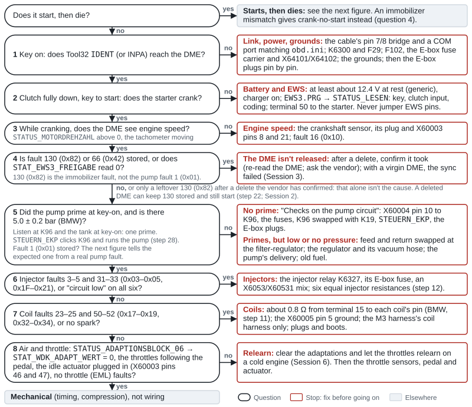

*Figure 15. The no-start questions in the order below, with the same numbers. Answer each one: the arrow to the right names what to check, and the arrow down goes to the next question. If the engine runs for a few seconds and then dies, use the next figure instead; a brief fire while cranking that never catches belongs to question 4.*

1. **Key on: does Tool32 `IDENT` (or INPA) reach the DME?**
   - **No:** check the cable's pin 7/8 bridge and that the COM port matches `obd.ini` (the DME talks on OBD pin 7). Does the DME relay K6300 click? If not: terminal 15 at X60004 pin 26 (F29), the relay, its control wire from X60002 pin 23. Battery voltage at X60001 pins 7 and 8 with the relay on? If not: F102, the E-box fuse carrier, X64101/X64102. Then the grounds: X60001 pins 4, 5 and 6, X60004 pin 5, X60005 pin 5. BMW lists "ECM (Not Found)" and no start among the signs of poor power and grounds ([BMW ST055](https://ia801005.us.archive.org/11/items/BMWTechnicalTrainingDocuments/ST055%20Engine%20Electronics%20%28Archive%201%29/8%20MS%20S54.pdf)). Still nothing: compare the E-box plugs pin by pin; a Euro 328i Touring whose X6011 didn't mate cranked without starting, and a scanner saw no modules ([e46fanatics](https://www.e46fanatics.com/threads/328i-touring-s54-swap-dme-wiring.1305546/)).
   - **Yes:** go to 2.
2. **Clutch fully down, key to start: does the starter crank?**
   - **No:** a battery at rest of at least about 12.4 V (generic) with the charger on; Tenza's first attempt failed on a flat battery ([Tenza Motorsports – M3 Touring build finally runs (2021), 03:55](https://www.youtube.com/watch?v=8uwpzS_-uDs&t=235s)). Then `EWS3.PRG` → `STATUS_LESEN`: is the key sending, barred, or failing its ID, password or rolling-code check? With the clutch down, does `STAT_P_N_EINGANG` change and `STAT_ANLASSER_AUS_P_N` read 0? If not: the clutch module's power and ground, its pin 4 to EWS pin 8, and the EWS coding `PARK/NEUTRAL_EINGANG`. `STAT_ANLASSER_AUS_ZV`, `_BC` or `_DREHZAHL` at 1 means the car is double-locked, the code function is on, or the EWS sees engine speed. `STAT_ANLASSER_FREIGESCHALTET` at 1 but no crank: the terminal-50 path from the EWS through X6011 pin 1 to the starter, the starter, its cable and the ground strap ([SGBD](https://github.com/emdzej/ediabasx-docs-sgbd/blob/main/docs/sgbd/EWS3.md)). An EWS delete in the DME doesn't change any of this: the EWS still controls the starter. Never jumper EWS pins.
   - **Yes:** go to 3.
3. **While cranking, does the DME see engine speed** (`STATUS_MOTORDREHZAHL` above 0, the tachometer moving)?
   - **No:** the crankshaft sensor, its plug and X60003 pins 8 and 21; fault 16 (0x10). Without that signal there's no injection, no spark and no pump hold ([BMW ST055](https://ia801005.us.archive.org/11/items/BMWTechnicalTrainingDocuments/ST055%20Engine%20Electronics%20%28Archive%201%29/8%20MS%20S54.pdf)).
   - **Yes:** go to 4.
4. **Is fault 130 (0x82) or 66 (0x42) stored, or does `STAT_EWS3_FREIGABE` read 0?**
   - **Yes:** the DME isn't released. After a delete, confirm the delete took (re-read the DME; ask the vendor); with a virgin DME, the sync failed ([Session 3](#session-3-ews)). BMW describes this as crank-no-start ([BMW ST051](https://archive.org/download/BMWTechnicalTrainingDocuments/ST051%20Body%20Electronics%20I%20%28Archive%201%29/05%20EWS.pdf)); the engine may also fire once or twice and never run ([NAM3 (2025)](https://nam3forum.com/forums/forum/main-forum/e46-2001-2006/319929-ews-delete-and-i-have-a-crank-with-no-start/page2)). In the 2002 325iT case a "fuel pump relay" fault 1 and all six injectors disabled followed an immobilizer problem ([e46fanatics](https://www.e46fanatics.com/threads/ews-synch-for-s54-swap-into-e46-touring.1318881/)).
   - **Only a leftover 130 (0x82), after a delete the vendor has confirmed:** that alone isn't the cause. A deleted DME can keep 130 stored and still start (step 22; [Session 2](#session-2-dme-vin-ews-delete-and-gearbox-software)). Go to 5.
   - **No:** go to 5.
5. **Did the pump prime at key-on, and is there 5.0 ± 0.2 bar?**
   - **No prime:** [Checks on the pump circuit](#checks-on-the-pump-circuit): X60004 pin 10 to K96, the fuses, K96 swapped with K19, `STEUERN_EKP`, the E-box plugs. A 323i wagon whose M3 plugs had no mates didn't prime ([e46fanatics](https://www.e46fanatics.com/threads/kalims-s54-sedan-swap-warning-pic-heavy.889867/page-39)).
   - **Primes, but low or no pressure:** feed and return swapped at the filter-regulator ([NAM3](https://nam3forum.com/forums/forum/main-forum/e46-2001-2006/82513-s54-swap-to-ms42-car-no-start)), the regulator and its vacuum hose, the pump's delivery (at least 1.12 L in 30 s at 12 V, [Fuel system](README.md#fuel-system)), old fuel.
   - **Yes:** go to 6.
6. **Injector faults 3–5 and 31–33 (0x03–0x05, 0x1F–0x21), or "circuit low" on all six?**
   - **Yes:** the injector relay K6327, its E-box fuse, an X6053/X60531 mix ([e46fanatics](https://www.e46fanatics.com/threads/s54-swap-fuel-injectors-low-circuit.1277127/)); six equal injector resistances (step 12).
   - **No:** go to 7.
7. **Coil faults 23–25 and 50–52 (0x17–0x19, 0x32–0x34), or no spark?**
   - **Yes:** about 0.8 Ω from terminal 15 to each coil's pin at the DME (BMW, step 11); the X60005 pin 5 ground; a coil harness from the M3 harness only; plugs and boots.
   - **No:** go to 8.
8. **Air and throttle: does `STATUS_ADAPTIONSBLOCK_06` → `STAT_WDK_ADAPT_WERT` read 0, do the throttles follow the pedal, is the idle actuator plugged in (X60003 pins 46 and 47), and are there no throttle (EML) faults?**
   - **No:** clear the adaptations and let the throttles relearn on a cold engine (Session 6). BMW: without it, the car "will not start, or run in 'fail-safe' mode" ([BMW ST041](https://archive.org/download/BMWTechnicalTrainingDocuments/ST041%20M3%20Complete%20Vehicle/3%20EngineElectronics%20%28Part%201%29.pdf)). Then the throttle sensors, pedal and actuator ([MotoIQ](https://motoiq.com/project-e46-m3-part-8-the-dreaded-eml-light/)).
   - **Yes:** the causes are mechanical (timing, compression), not wiring.

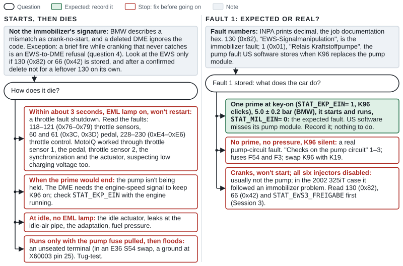

*Figure 16. Left: what to check when the engine starts and then dies, by how it dies; an immobilizer mismatch shows as crank-no-start, or a brief fire that never catches, instead (question 4). Right: how to tell the expected stored pump fault, location 1 (0x01), from a real one, by what the car does.*

**Starts, then dies.** That isn't the immobilizer's signature: BMW describes a mismatch as crank-no-start, and a deleted DME ignores the code. A brief fire while cranking that never catches is the exception: that's an EWS-to-DME refusal, fault 130 (0x82), as one delete that hadn't taken showed ([NAM3](https://nam3forum.com/forums/forum/main-forum/e46-2001-2006/319929-ews-delete-and-i-have-a-crank-with-no-start/page2)). Look at the EWS only if 130 (0x82) or 66 (0x42) is stored, and after a confirmed delete not for a leftover 130 on its own.

- **Dies within about 3 seconds with the EML lamp on, and won't restart:** a throttle fault shutdown. MotoIQ's stock-hardware M3 "would shut itself off in a matter of roughly 3 seconds and not start back up"; the causes they worked through were throttle sensor 1, the pedal, throttle sensor 2, the throttle synchronization and finally the actuator, with low charging voltage suspected along the way ([MotoIQ](https://motoiq.com/project-e46-m3-part-8-the-dreaded-eml-light/)). Read the faults: 118–121 (0x76–0x79) throttle sensors, 60 and 61 (0x3C, 0x3D) pedal, 228–230 (0xE4–0xE6) throttle control.
- **Dies when the prime would end:** the pump isn't being held. The DME needs the engine-speed signal to keep K96 on; check `STAT_EKP_EIN` with the engine running.
- **Dies at idle, no EML lamp:** the idle actuator, leaks at the idle-air pipe, the adaptation, fuel pressure.
- **Runs only with the pump fuse pulled, then floods:** an unseated terminal; in an E36 S54 swap, a ground at X60003 pin 25 ([NAM3](https://nam3forum.com/forums/forum/special-interests/coding-tuning/112619-s54-only-starts-when-fuel-pump-fuse-is-pulled-did-i-code-it-wrong)). Tug-test.

### Warning lights

Expected states: key on, engine off, the red oil-pressure lamp, the charge lamp and the check-engine lamp are lit, and the red BRAKE lamp while the parking brake is on. After the start, oil and charge go out within seconds and the check-engine lamp goes out unless a fault asks for it; Tenza's check-engine and oil lamps went out after 10–15 seconds ([Tenza Motorsports – M3 Touring build finally runs (2021), 05:38](https://www.youtube.com/watch?v=8uwpzS_-uDs&t=338s)). The DSC, ABS and yellow BRAKE lamps stay on until Session 5. To tell lamp wiring from a real fault, read `STAT_MIL_EIN`: at 0 with the lamp lit, suspect the cluster or its coding; at 1, read `FS_LESEN`.

**The two BRAKE lamps mean different things.** BMW: the red BRAKE lamp means low brake fluid or the parking brake on, while DSC and ABS faults light the yellow BRAKE lamp with the ABS and DSC lamps ([BMW ST056](https://archive.org/download/BMWTechnicalTrainingDocuments/ST056%20Chassis%20Dynamics%20%28Archive%201%29/04%2520E46%2520DSC%25201-27-03.pdf)). Have all four dark before the inspection ([Massachusetts](README.md#massachusetts)).

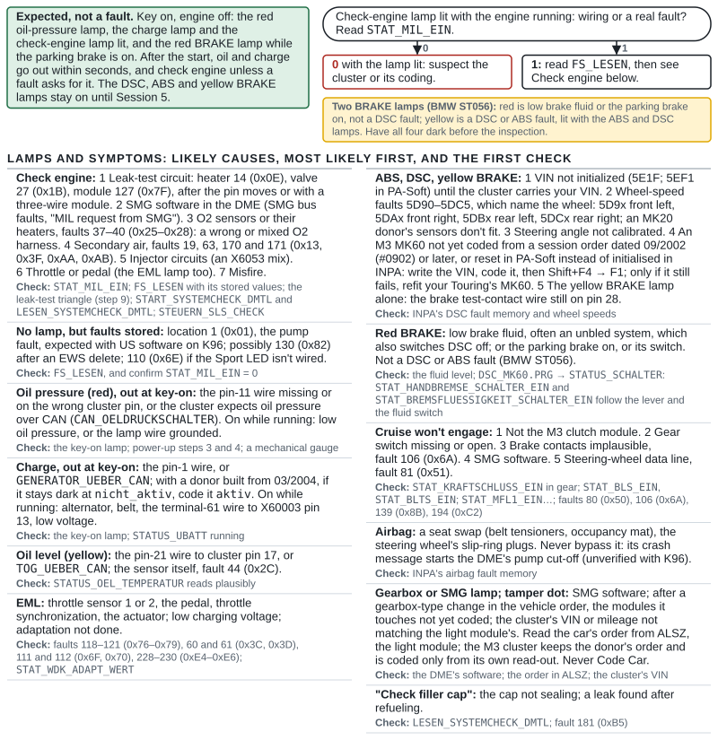

*Figure 17. Which lamps are expected at key-on and after the start, how to tell lamp wiring from a real fault with `STAT_MIL_EIN` once the engine runs, and, for each lamp or symptom, its likely causes, most likely first, with the first check. The red BRAKE lamp is low fluid or the parking brake, never a DSC fault; DSC and ABS faults light the yellow one.*

| Light | Likely causes, most likely first | Check | Documented fix |
|---|---|---|---|
| Check engine | 1. Leak-test circuit: heater 14 (0x0E), valve 27 (0x1B), module 127 (0x7F), after the pin moves or with a three-wire module. 2. SMG software in the DME (SMG bus faults, "MIL request from SMG"). 3. O2 sensors or their heaters, faults 37–40 (0x25–0x28): a wrong or mixed O2 harness. 4. Secondary air, faults 19, 63, 170 and 171 (0x13, 0x3F, 0xAA, 0xAB). 5. Injector circuits (an X6053 mix). 6. Throttle or pedal (the EML lamp too). 7. Misfire | `STAT_MIL_EIN`; `FS_LESEN` with its stored values; the leak-test triangle (step 9); `START_SYSTEMCHECK_DMTL` and `LESEN_SYSTEMCHECK_DMTL`; `STEUERN_SLS_CHECK` | Re-pin the leak test and find the pump by test, not label; manual-gearbox software; the M3 harness's own O2 section ([UNRIVALED – Watch this before you S54 swap (2021), 04:39](https://www.youtube.com/watch?v=eddLff8yba0&t=279s)); the M3's own X6053 halves |
| None, but faults stored | Location 1 (0x01), the pump fault, expected with US software on K96; possibly 130 (0x82) after an EWS delete; 110 (0x6E) if the Sport LED isn't wired | `FS_LESEN`, and confirm `STAT_MIL_EIN` = 0 | Leave the pump fault (it doesn't light the lamp, per two swappers), or fit the pump module; 130 per your vendor; wire X60004 pin 16 |
| Oil pressure (red) | Out at key-on: the pin-11 wire is missing or on the wrong cluster pin, or the cluster expects oil pressure over CAN. On while running: low oil pressure, or the lamp wire grounded | The key-on lamp; steps 3 and 4; a mechanical gauge | Wire X60004 pin 11 to cluster pin 13 and code `CAN_OELDRUCKSCHALTER` to `nicht_aktiv` (an MS45.1 ZHP, [NAM3](https://nam3forum.com/forums/forum/main-forum/e46-2001-2006/61405-why-does-my-oil-light-turn-off-with-ignition-ii-engine-off)); an MS43 325iT joined the signal to the cluster wire ([e46fanatics](https://www.e46fanatics.com/threads/battery-and-oil-pressure-lights-inop.1207433/)) |
| Charge | Out at key-on: the pin-1 wire, or `GENERATOR_UEBER_CAN`. On while running: alternator, belt, the terminal-61 wire to X60003 pin 13, low voltage | The key-on lamp; `STATUS_UBATT` running | The 325iT owner restored his lamp in 15 minutes once he understood the circuit (same thread) |
| Oil level (yellow) | The pin-21 wire to cluster pin 17, or `TOG_UEBER_CAN`; the sensor itself, fault 44 (0x2C) | `STATUS_OEL_TEMPERATUR` reads plausibly (the sensor is alive) | Wire 21 to 17 |
| EML | Throttle sensor 1 or 2, the pedal, throttle synchronization, the actuator; low charging voltage; adaptation not done | Faults 118–121 (0x76–0x79), 60 and 61 (0x3C, 0x3D), 111 and 112 (0x6F, 0x70), 228–230 (0xE4–0xE6); `STAT_WDK_ADAPT_WERT` | MotoIQ: sensors, two synchronizations, then a new actuator ([MotoIQ](https://motoiq.com/project-e46-m3-part-8-the-dreaded-eml-light/)); the adaptation reset (Session 6) |
| ABS, DSC, yellow BRAKE | 1. VIN not initialized (5EF1, 5E1F) until the cluster carries your VIN. 2. Wheel-speed faults (5D90–5DC5): see [Wheel-speed and pad-wear sensors](#wheel-speed-and-pad-wear-sensors); an MK20 donor's sensors don't fit. 3. Steering angle not calibrated. 4. An M3 MK60 not yet coded from a late enough session vehicle order, or reset in PA-Soft instead of initialised in INPA. 5. The yellow BRAKE lamp alone: the brake test-contact wire still on pin 28 | INPA's DSC fault memory and wheel speeds | Session 5; your own sensors; an M3 unit that still won't initialise: refit your Touring's MK60 ([e46fanatics](https://www.e46fanatics.com/threads/m3-cluster-swap-dsc-light.1260275/)); move 28 to 34 |
| Red BRAKE | Low brake fluid, often an unbled system, which also switches DSC off; or the parking brake on, or its switch. Not a DSC or ABS fault ([BMW ST056](https://archive.org/download/BMWTechnicalTrainingDocuments/ST056%20Chassis%20Dynamics%20%28Archive%201%29/04%2520E46%2520DSC%25201-27-03.pdf)) | The fluid level; Tool32 `DSC_MK60.PRG` → `STATUS_SCHALTER`: `STAT_HANDBREMSE_SCHALTER_EIN` and `STAT_BREMSFLUESSIGKEIT_SCHALTER_EIN` follow the lever and the fluid switch ([SGBD documentation](https://github.com/emdzej/ediabasx-docs-sgbd/blob/main/docs/sgbd/DSC_MK60.md)) | Fill and bleed ([Brakes and bleeding](README.md#brakes-and-bleeding)); adjust the parking brake or fix its switch |
| Cruise won't engage | 1. Not the M3 clutch module. 2. Gear switch missing or open. 3. Brake contacts implausible, fault 106 (0x6A). 4. SMG software. 5. Steering-wheel data line, fault 81 (0x51) | `STAT_KRAFTSCHLUSS_EIN` in gear; `STAT_BLS_EIN`, `STAT_BLTS_EIN`; `STAT_MFL1_EIN`…; faults 80 (0x50), 106 (0x6A), 139 (0x8B), 194 (0xC2) | A new M3 clutch module (an S54 wagon, [e46fanatics](https://www.e46fanatics.com/threads/m3-cluster-swap-dsc-light.1260275/); a ZHP, [NAM3](https://nam3forum.com/forums/forum/main-forum/member-build-journals/3768-what-s-going-on-in-my-shop-currently/page3)); fit the gear switch: a 5-speed 323i never got cruise without one ([e46fanatics](https://www.e46fanatics.com/threads/s54-swap-wiring-information.1003871/)) |
| Airbag | A seat swap (belt tensioners, occupancy mat), the steering wheel's slip-ring plugs | INPA's airbag fault memory; before swapping seats, Tool32 `MRS3.PRG` (or `MRS4.PRG`) → `AUSSTATTUNG_LESEN` (SBE, SBE2 or OC3 fitted): keep a passenger mat of that type. E46 coding has no OC3 setting, and seat-back-lock monitoring is coded only on convertibles, so M3 coupe seats need no seat-back coding ([BMW MRS3.C31 / E46CVT.000](https://archive.org/details/sp-daten-v-32), [MRS3 SGBD](https://github.com/emdzej/ediabasx-docs-sgbd/blob/main/docs/sgbd/MRS3.md), [MRS4 SGBD](https://github.com/emdzej/ediabasx-docs-sgbd/blob/main/docs/sgbd/MRS4.md)) | Matching tensioners and plugs; clear the codes. Never bypass it: its crash message starts the DME's fuel-pump cut-off, which is unverified with the K96 relay ([Crash fuel cut-off](#crash-fuel-cut-off)) |
| Gearbox or SMG lamp; tamper dot | SMG software; after a gearbox-type change in the vehicle order, the modules it touches not yet coded; the cluster's VIN or mileage not matching the light module's | The DME's software; the vehicle order in ALSZ (AKMB keeps the donor's M3 order); the cluster's VIN | Manual software (Session 2); code the modules the change touches, the cluster only from its own coding file ([Session 8](#session-8-vehicle-order-changes-and-body-modules); one owner's gearbox icon after an automatic-to-manual change, [50sKid – Code the vehicle order (2017), 26:05](https://www.youtube.com/watch?v=FiBr1h9j0bU&t=1565s)); Session 4 |
| "Check filler cap" | The cap not sealing; a leak found after refueling | `LESEN_SYSTEMCHECK_DMTL`; fault 181 (0xB5) | The cap and its seal; a smoke test with the vent closed, under 0.1 bar ([BMW TechDrive](https://automotivetechinfo.com/wp-content/uploads/2008/02/What-If-It-Is-Not-The-Gas-Cap.pdf)) |

**Other cluster symptoms:**

| Symptom | Likely cause | Check |
|---|---|---|
| Many lamps lit after the first start | Expected until the cluster, light module and DSC are coded | ([ShopLifeTV – Starting the S54 swap car for the first time (2015), 05:45](https://www.youtube.com/watch?v=BV1yvGP7sCM&t=345s)) |
| Tamper dot | The cluster's VIN differs from the light module's, or the light module's mileage is higher | [Session 4](#session-4-cluster-and-light-module) ([NAM3](https://nam3forum.com/forums/forum/main-forum/e46-2001-2006/228697-cluster-replacement)); one swapped Touring was left with it ([ThaChileanDude – E46 M3 wagon in 10 days (2024), 35:19](https://www.youtube.com/watch?v=iSgClonTiQg&t=2119s)) |
| DSC and yellow BRAKE lamps lit (owners often call the yellow one the parking-brake lamp) | VIN mismatch with the cluster | Session 4 ([e46fanatics](https://www.e46fanatics.com/threads/e46-m3-cluster-coding.1278842/)) |
| Red BRAKE lamp always on | The parking-brake switch or low fluid (BMW ST056). Seen once on a 1998 323i (MK20 ASC) with an M3 cluster, cause not found; it worked in a 2001 325iT | The switch on cluster pin 23 and DSC pin 27 ([e46fanatics](https://www.e46fanatics.com/threads/s54-swap-wiring-information.1003871/)); `STATUS_SCHALTER` (above) |
| Tach needle stuck at 9,000 rpm after coding | The cluster default-coded (an empty coding file) after its coding index was changed | Write back the EEPROM backup ([e46fanatics](https://www.e46fanatics.com/threads/diy-m3-cluster-into-non-m-retrofit.1277945/)); code the cluster only from its own complete coding file ([Session 4](#session-4-cluster-and-light-module)) |
| No cluster backlight | A cluster from before 09/2002 in a car built from 09/2002 | Backlight wire to cluster pin 7 ([Cluster wiring](#cluster-wiring)) |
| No rear-door warnings | M3 clusters have no rear-door LEDs | Solder them in, or use a cluster service |
| Speedometer about 9% high | The M3 cluster's built-in correction table | Check against GPS ([e46fanatics](https://www.e46fanatics.com/threads/diy-e46-cluster-gauges-definitions.1324535/)) |
| Fuel gauge or range wrong | A sender or its plug pins, or senders mixed between the two cars | `KOMBI46R.PRG` → `STATUS_AIF_TANKDATEN_LESEN` against a measured fill ([Fuel gauge and tank senders](#fuel-gauge-and-tank-senders)) |
| Lamp-out warning after fitting the M3 lamps | A bulb type or wattage the light module doesn't expect | `LSZ_2.PRG` → `FS_LESEN`; the specified bulbs ([Session 9](#session-9-light-module-and-headlights)) |
| Rear lights wrong after a vehicle-order change | The light module coded from the wrong order, such as the donor M3's | Check the type code in ALSZ; put the saved light-module trace back through a coding file ([Session 8](#session-8-vehicle-order-changes-and-body-modules)) |

### DSC, ABS and steering angle

| Symptom | Likely cause | Check |
|---|---|---|
| DSC lamp; 5E1F (5EF1 in one owner's PA-Soft) "VIN not initialized" | The cluster's VIN doesn't match yet, or the DSC's VIN and steering angle aren't initialized | [Session 5](#session-5-dsc-coding-and-vin) ([50sKid (2016), 32:47](https://www.youtube.com/watch?v=CvyVCwCAx1Q&t=1967s)) |
| 5E1F or 5EF1 never clears with an M3 MK60 | A blank coding file written to the unit, a session order dated too early for it or without an M3 type key, or a PA-Soft reset instead of INPA's initialisation | Write the VIN, code it from a session order read from ALSZ, dated #0902 or later and with the donor's type key (`BL93`), then INPA's Shift+F4 → F1 ([Session 5](#session-5-dsc-coding-and-vin), [NAM3](https://nam3forum.com/forums/forum/special-interests/coding-tuning/173720-mk60-vin-issue-m3-track-mode-rabbit-hole)). Still failing: refit your Touring's MK60, the documented cure ([e46fanatics](https://www.e46fanatics.com/threads/m3-cluster-swap-dsc-light.1260275/)) |
| NCS doesn't list MK60, or "Codierindex … nicht zulässig" | The session order doesn't suit the unit's coding index: a production date too early, or the wrong type key. BMW's data admits the M3 unit only with an M3 type key and a date from 09/2002, and a non-M unit only with an order that says neither `S54B32` nor `ALLRAD` (all-wheel drive) ([SP-Daten V32](https://archive.org/details/sp-daten-v-32)) | For the M3 unit, #0902 or later and the donor's type key, for the session only, without `FA_WRITE`; on a 325xi, also delete `$203` ([Session 5](#session-5-dsc-coding-and-vin)). Check the coding index ([NAM3](https://nam3forum.com/forums/forum/special-interests/coding-tuning/173720-mk60-vin-issue-m3-track-mode-rabbit-hole), [e46fanatics](https://www.e46fanatics.com/threads/ncs-expert-coding-is-faulty-resolved-8-12-21.1293250/)) |
| 5E59, coding error | The unit's coding doesn't suit it | Code it ([Session 5](#session-5-dsc-coding-and-vin)) |
| ABS lamp after the first drive, or wheel-speed faults 5D90 to 5DC5 | Faults stored during the build, with a sensor unplugged and the key on; a sensor not seated; a damaged pulse wheel; an MK20 donor's sensors, a different type; mixed wheel sizes while testing | Read the DSC fault memory, clear it, drive above 20 km/h (12 mph) and read it again. The fault names the wheel: 5D9x front left, 5DAx front right, 5DBx rear left, 5DCx rear right. Its last digit points to the cause, on our reading of BMW's fault names: 0 electrical (wiring or the wrong sensor type), 1 or 3 the signal (seating or air gap), 2 the pulse wheel, 4 or 5 the long-term and double-frequency checks (tooth count or tire size) ([SGBD documentation](https://github.com/emdzej/ediabasx-docs-sgbd/blob/main/docs/sgbd/DSC_MK60.md)). Then compare the four wheel speeds in INPA ([Wheel-speed and pad-wear sensors](#wheel-speed-and-pad-wear-sensors)). The faults are listed in English on [NAM3](https://nam3forum.com/forums/forum/special-interests/coding-tuning/167185-mk-60-fault-codes-in-english) |
| 5E20, 5E21 or 5E24, pressure sensors | A brake-pressure sensor or its stored offset | `STATUS_SENSOREN` with the pedal released: near 0 bar, and never over 5 bar with the brake-light switch off ([BMW ST056](https://archive.org/download/BMWTechnicalTrainingDocuments/ST056%20Chassis%20Dynamics%20%28Archive%201%29/04%2520E46%2520DSC%25201-27-03.pdf)). Re-run the pressure-sensor routine with your foot off the brake (Session 5) |
| 5E1E, steering-angle sensor CAN timeout | The sensor isn't talking to the DSC | Its plug at the base of the column: pin 1 terminal 30, pin 2 terminal 87, pins 3 and 4 CAN high and low, pin 5 ground ([BMW ST056](https://archive.org/download/BMWTechnicalTrainingDocuments/ST056%20Chassis%20Dynamics%20%28Archive%201%29/04%2520E46%2520DSC%25201-27-03.pdf)); then `STATUS_CAN_LWS_1_LESEN` |
| 5E40, steering-angle signal implausible or offset | Most likely an angle zeroed before the alignment, or never calibrated (our reading) | Calibrate again with the wheel dead straight ([Session 7](#session-7-steering-angle-after-the-alignment)) |
| No Shift+F4 page in INPA, or a page with only "Pressure Sensors" and "Lateral Acceleration Sensor" | Some INPA builds lack the steering-angle entry ([e46fanatics](https://www.e46fanatics.com/threads/steering-angle-sensor-reset-shift-f4-compensation-routines-not-showing-up.1216321/)) | Tool32's `LENKWINKEL_DSC_ABGLEICHEN`, or another INPA build ([Session 7](#session-7-steering-angle-after-the-alignment)) |
| Tool32 can't find `TEST_LENKWINKEL` | That's the Bosch DSC 5.7's job, in `DSC57.PRG` | `DSC_MK60.PRG` → `LENKWINKEL_DSC_ABGLEICHEN` ([SGBD documentation](https://github.com/emdzej/ediabasx-docs-sgbd/blob/main/docs/sgbd/DSC_MK60.md)) |
| INPA can't connect to the DSC at all | INPA build or setup | A generic scan tool for the steering angle ([LM Auto Repairs (2016), 06:23](https://www.youtube.com/watch?v=1dn4c3g6dsA&t=383s)) |
| Tool32 IFH-0009 on the steering-angle job | A swapped sensor that was never coded, so it doesn't answer | Code it with NCS Expert, then retry |
| Steering angle stuck at "!1440", or 5E43 "internal" that returns after calibration | A failed sensor | Replace it and calibrate the new one ([e46fanatics](https://www.e46fanatics.com/threads/calibrating-steering-angle-with-inpa.1287151/), [Earl Moorhead (2023), 26:24](https://www.youtube.com/watch?v=2mqz14tWpMI&t=1584s)) |
| Flat-tire warning after fitting the M3 wheels | It learned the old tires' rolling circumference; the MK60 has no tire-size code | Set the pressures, then `RPA_RESET` ([Session 5](#session-5-dsc-coding-and-vin)) |
| DSC steps in early on the shakedown, with your own MK60 | It still expects the Touring's quicker rack (our inference; untested) | Steering angle at 0° straight (Session 7); see the recommendation in [Session 5](#session-5-dsc-coding-and-vin) |
| Spongy pedal after a DSC change | Air in the hydraulic unit | Bleed BMW's way: INPA's routine at every wheel, restarted for each, with five full pedal strokes after each run (TIS 34 00 050, [Session 5](#session-5-dsc-coding-and-vin)); then BMW's leak test ([Brakes and bleeding](README.md#brakes-and-bleeding)). Owners also press the pedal hard during the routine (Session 5) |

### Driving, emissions and comfort

| Symptom | Likely cause | Check |
|---|---|---|
| Cruise won't engage | See the warning-light table | `STATUS_DIGITAL` bits in gear; fault 80 (0x50). On a non-S54 E46 race car a "plausibility signal brake light switch" fault stopped cruise ([Tenza Motorsports – E46 cruise control stalk wiring (2025), 14:15](https://www.youtube.com/watch?v=8uRGM-OzqWs&t=855s)) |
| Revs hang between shifts, idle hunts on clutch-in, or stalls | Clutch-chain wiring first ("the most common rev hang is from improper clutch switch wiring"), the wrong clutch module, then SMG software in the DME, then a third-party tune. The chain enables the idle control, and a ZHP's intermittent stalling stopped with the M3 module | `STAT_KUP_EIN` and `STAT_KRAFTSCHLUSS_EIN` in gear; fault 80 (0x50) ([e46fanatics](https://www.e46fanatics.com/threads/manual-swap-rev-hang.1315205/), [NAM3](https://nam3forum.com/forums/forum/main-forum/member-build-journals/3768-what-s-going-on-in-my-shop-currently/page3)) |
| Limp mode after an SMG donor's DME was "coded" | The software still thinks it's an SMG car | Manual software (Session 2) ([UNRIVALED (2021), 02:02](https://www.youtube.com/watch?v=eddLff8yba0&t=122s)) |
| VANOS test slow (over 500 ms) or its status reads "weggedriftet" | Worn VANOS seals, valve block or sealing plate; or a test run before the engine was fully warm | Retest at 85 °C (185 °F) or more, against the owner and ISTA figures in [Session 6](#session-6-first-start-adaptations-and-throttle-check); then the VANOS work in the guide's [S54 refresh on the stand](README.md#s54-refresh-on-the-stand) |
| Sport works but its LED doesn't | The pin-16 circuit; fault 110 (0x6E) | Continuity from X1869 pin 18 to X60004 pin 16 ([Tenza Motorsports (2021), 06:28](https://www.youtube.com/watch?v=8uwpzS_-uDs&t=388s)) |
| Switch center works only sometimes, or not at all | Missing feeds (F42, F12) or K-bus | [Sport button and switch center](#sport-button-and-switch-center) |
| EVAP monitor never ready; P2418 | Leak-test wiring, hoses, filler cap, the fuel gauge, or the test conditions | [When a monitor won't complete](#when-a-monitor-wont-complete) |
| Secondary-air monitor never ready | Pump relay or valve, pre-cat O2 response, cold-start temperature | Same section |
| A/C won't engage | The cluster not passing the request; the climate control's coded compressor lock; the refrigerant pressure; then the chain through the DME (X60004 pin 29) to relay K19 and 12 V at the compressor clutch | `STAT_AC_EIN`; `CODIERUNG_LESEN` in IHKR46 (`KOMPRESSOR_SPERRE` = 0) or IHKA46 (`ALLGEMEIN_2` blank); `STAT_DRUCKSENSOR_WERT`; `STAT_KO_EIN`, `STEUERN_KO` ([A/C with manual or automatic climate control](#ac-with-manual-or-automatic-climate-control)). A dead compressor clutch was the cause in one E46 (an N42 318i) ([e46fanatics](https://www.e46fanatics.com/threads/a-c-compressor-not-engaging.1278940/)) |
| Cooling system hard to bleed; heater odd | The M3 valve's pump isn't wired | [Heater valve and auxiliary water pump](#heater-valve-and-auxiliary-water-pump) |
| Fault 96 (0x60), radiator-outlet temperature plausibility; slow warm-up | The radiator-outlet sensor unplugged or in the wrong hose; we infer that a thermostat stuck open sets it too | `STATUS_MOTORTEMPERATUR` against `STATUS_KUEHLW_AUSL_TEMPERATUR` while warming: the outlet should rise once the engine passes about 80 °C (176 °F) ([Cooling checks and pass values](README.md#cooling-checks-and-pass-values)) |
| Coolant-level or washer warning | A sensor lead not extended or connected | [Sensor leads that may not reach](#sensor-leads-that-may-not-reach) |

### Tools and coding

| Symptom | Likely cause | Check |
|---|---|---|
| INPA shows empty circles | Cable not connected, COM port and `obd.ini` don't match, or ignition off | [Cable and EDIABAS settings](#cable-and-ediabas-settings) |
| The DME answers but the cluster, light module and DSC don't | Pins 7 and 8 not bridged | Flip the cable's switch or solder the pads ([NAM3](https://nam3forum.com/forums/forum/main-forum/e46-2001-2006/293965-verify-ncsexpert-function-before-doing-manual-swap)) |
| INPA's battery and ignition indicators flicker | Latency timer at 16 | Set it to 1 ([BMW Doctor (2024), 03:36](https://www.youtube.com/watch?v=2Oebra7Kbn0&t=216s)) |
| IFH-0009, "no response from control unit", in NCS Expert or Tool32 | The module didn't answer: ignition off, pins 7 and 8 not bridged, the wrong module chosen, or the module unpowered. It isn't a fault of the NCS Expert version | Ignition at position 2, the cable's 7/8 switch, the module choice: read the vehicle order from ALSZ on a car built from 09/2001, from KMB or EWS on an earlier one ([EdiabasLib](https://github.com/uholeschak/ediabaslib), [NAM3](https://nam3forum.com/forums/forum/special-interests/coding-tuning/1281-getting-started-with-ncs-expert)) |
| Another IFH, SYS or COAPI message | The cable, a missing job file, the coding file or the module | The message table in [NCS Expert basics](#ncs-expert-basics) |
| COAPI-2060 when coding the GM5 | A loose pin in its plug | Reseat the plug ([NAM3](https://nam3forum.com/forums/forum/special-interests/coding-tuning/21981-ncs-error-while-trying-to-recode-used-gm5-module)) |
| The cluster's or DSC's settings back to stock after a coding job | Code Car, a blank coding file, or a workshop that re-coded the car from its vehicle order | Write your saved coding files back, one module at a time with Process ECU. Never use Code Car on this car: it "can be buggy and you'll lose all customizations you've ever made" ([NAM3](https://nam3forum.com/forums/forum/special-interests/coding-tuning/1281-getting-started-with-ncs-expert)) |
